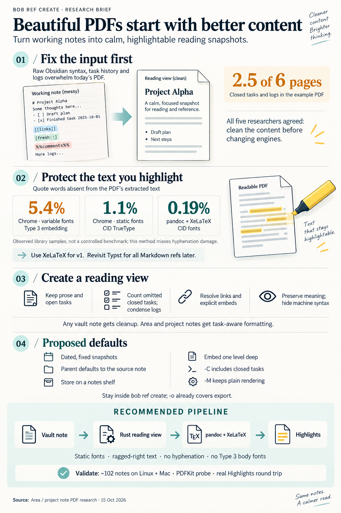

# Beautiful PDFs from area and project notes in `bob ref create` (consolidated)

> **Research query:** What is the best way to give `bob ref create` much better support for
> turning Bob area and project notes into beautiful PDFs, given how poor today's output looks
> (for example `sase_blog_v1.pdf`)? Critique the plan as a whole: is it a good idea, and would a
> different approach be better? Adjust the requirements where justified, call those changes out
> clearly, and end with a recommended solution.



## Bottom line

- **Build it. But the real problem is what goes into the PDF, not how it is typeset.**
  - `sase_blog_v1.pdf` looks bad because `bob ref create` hands an Obsidian/Bob working note to
    pandoc as if it were plain pandoc Markdown.
  - As a result, wikilinks, embeds, Dataview fields, block IDs, custom task statuses, log bullets,
    emoji, plugin chip rows, and `%%` comments all print literally (see the
    [diagnosis](#diagnosis)).
  - All five reports reached this diagnosis independently.
  - In cld's spike, the *same* pandoc+xelatex engine produced a polished page once the note was
    rewritten first ([engine choice](#engine-choice), figure).
- **Recommended shape** (detailed under [recommended solution](#recommended-solution)):
  1. A Rust **note projection** turns a vault note into a clean reading view. It is engine-neutral
     and reuses Bob's own task, field, link, and heading parsers.
  2. The existing pandoc+xelatex route renders that view with a new **note profile**:
     - bundled static fonts;
     - a masthead;
     - status glyphs plus labels;
     - unnumbered headings and no TOC page;
     - ragged-right text with no hyphenation.
  3. `bob ref create` detects area and project notes automatically, and `-P` defaults to the note
     itself.
- **Do not print annotated note PDFs through Chromium.** This was the biggest disagreement:
  cdx, mus, and gem recommended the web-clip Chromium renderer. The evidence goes the other way:
  - cld's Mac PDFKit probe found 2.4–6.4% of words split in Chrome PDFs, versus 0% for xelatex and
    Typst.
  - My check of **real Highlights quotes** already in the vault ([engine choice](#engine-choice))
    found 5.4% damaged quote words in Bob's Chrome template PDFs, versus about 0.2% for xelatex.
  - The cause is Skia embedding Bob's variable woff2 fonts as **Type 3**.
- **Typst is the credible runner-up, not the first step.** Record it as a reopen decision for
  *all* Markdown refs, not a second engine just for notes.
- **I adjust the request in eight places** ([requirement adjustments](#requirement-adjustments)).
  The biggest:
  - scope widens to any vault note, with extra Bob semantics for area and project notes;
  - closed history is omitted by default, but counted and recoverable;
  - every snapshot gets a deliberate dated identity;
  - the Highlights text layer becomes a hard requirement;
  - there is **no** separate export command in v1.

## Diagnosis

High agreement across reports, verified.

`bob ref create ~/bob/sase_blog.md -P sase_blog -N sase_blog_v1` ran pandoc on the raw note with
these arguments:

```
--toc --toc-depth=3 --number-sections --pdf-engine=xelatex
-V mainfont="DejaVu Serif" -V fontsize=10pt -V geometry:margin=0.85in
```

That is `render_temp_pdf` in `src/native/highlights_ref/create.rs`. Pandoc's default
`markdown` reader has no Obsidian handling. The result is a 6-page, Letter-size, 78 KB PDF
(`xdvipdfmx`, untagged).

### Symptoms and root causes

Each symptom in `sase_blog_v1.pdf`, followed by its root cause:

- **Title is `sase_blog`:** No frontmatter `title` and no H1, so `extract_title` falls back to
  the stem. **0 of about 102** area/project notes have `title:`; only 8 have an H1 (my count).
- **Sections `0.1`, `0.1.1`, … plus a TOC page dominated by task lanes:** `--number-sections` on
  a body that starts at H2; lane headings become chapters
- **`^create-prj-0 ## Requirements` printed inline; Requirements missing from the TOC:** Pandoc
  `markdown` needs a blank line before an ATX heading; Obsidian (CommonMark) does not (cld)
- **`[[…|alias]]`, `![[img/….png|400]]`, `![[note#^id]]` printed raw; screenshots missing:** No
  wikilink, embed, or transclusion handling; `--resource-path` is only the source directory
- **`[fresh::]`, `[created::]`, `[id::]`, `[dependsOn::]`, `^ids`, `#task #hide #prj`:** Machine
  syntax prints as text
- **`[/]`, `[?]`, `[-]` printed as text:** The `task_lists` extension knows only `[ ]` and `[x]`;
  Bob uses six statuses
- **Tofu boxes for 🧱 ⛓️ 🗓️ ❌ ⚪🔵🔴🟢:** DejaVu has no emoji; xelatex has no automatic fallback
- **`%%gkeep:…%%` runs off the margin:** Obsidian comments are not stripped, and the token cannot
  break
- **About 2.5 of 6 pages are Done & Canceled tasks, SCHEDULE LOG, and CANCEL LOG:** No content
  policy
- **Justified, hyphenated text:** Hyphen splits end up inside Highlights quotes (cld: 6 of 395
  real `lib/chat` quotes)

### Corpus scope

**The corpus is narrower than "Obsidian".** My grep of the roughly 102 area/project notes (one
extra hit is a `_conflicts/` copy) found:

- **zero** Dataview, Tasks, or Base query blocks, callouts, tables, or full-note `![[note]]` embeds;
- 11 notes with `![[note#^id]]` block embeds and 4 with image embeds;
- 6 notes with `%%` comments;
- 21 notes with `~~[[…]]~~` struck links;
- 8 notes with ` @WORD` capture routes, which pandoc `markdown` turns into citations;
- 5 notes with `$<digit>` money amounts, which pandoc may treat as math.

So the projection must master *Bob's* grammar, not emulate plugins. Size varies widely: `sase.md`
is 1,381 lines and 34 pages today, and 211 of its 214 blocked tasks are date-scheduled ticklers
(cld).

## Disagreements and how I resolved them

### Engine choice

Chromium vs xelatex vs Typst: the decisive question.

What each report recommended, and the evidence behind it:

- **cdx**
  - *Recommendation:* Pandoc HTML plus Bob's Chromium reader (opt-in `reader` style); keep
    xelatex as "classic"
  - *Evidence behind it:* Synthetic render looked good; `pdfinfo Tagged: yes`; no Highlights text
    test
- **mus**
  - *Recommendation:* Chromium via the clip adapter; pandoc as fallback
  - *Evidence behind it:* Beauty-per-effort argument; no text-layer test
- **gem**
  - *Recommendation:* Chromium, with hero cards and KPI dashboards
  - *Evidence behind it:* Reasoning only. Some claims are wrong; see below
- **grk**
  - *Recommendation:* Projection on xelatex first, then flip to a Bob Typst template
  - *Evidence behind it:* `pdffonts`: Bob's Chrome template embeds **Type 3** fonts; Typst embeds
    CID
- **cld**
  - *Recommendation:* Projection plus an xelatex note profile; Typst runner-up; never Chrome for
    annotated PDFs
  - *Evidence behind it:* **Mac PDFKit probe:** Chrome 2.4–6.4% split words, xelatex and Typst 0%;
    real damaged quotes

**My added evidence: real Highlights quotes, grouped by PDF producer and font type.**

- Method:
  1. For every `ref/**` note with highlights, I took its `> [!quote]` lines, which Highlights
     extracted on the Mac through PDFKit.
  2. I counted quote words that do not occur in poppler's own text of the same PDF.
  3. Script and output: `area_project_note_reading_pdfs__final_assets/`.
- Caveat: this method cannot see hyphenation splits, because both fragments occur in the PDF text.

Results by producer and body font embedding:

- **Chrome/Skia, Type 3 fonts (Bob web-clip template, variable fonts)**
  - *Docs:* 5
  - *Quote words:* 1,631
  - *Not in PDF text:* 88
  - *Rate:* **5.4%**
  - *Typical damage:* intra-word splits: `ublished`, `spectru`, `ueue`, `ultiple`, `decisionsfor`
- **Chrome/Skia, CID TrueType (static system fonts: Helvetica Neue, Georgia, Menlo)**
  - *Docs:* 15
  - *Quote words:* 1,643
  - *Not in PDF text:* 18
  - *Rate:* 1.1%
  - *Typical damage:* no intra-word splits; words merged at line or code-span joins
    (`intervalmust`, `callsase`)
- **pandoc + xelatex (CID)**
  - *Docs:* 49
  - *Quote words:* 1,558
  - *Not in PDF text:* 3
  - *Rate:* 0.19%
  - *Typical damage:* only selection-edge fragments (`unction`)
- **arXiv / other LaTeX**
  - *Docs:* 7
  - *Quote words:* 1,153
  - *Not in PDF text:* 0
  - *Rate:* 0%
  - *Typical damage:* —

**What this settles:**

1. **The damage tracks font embedding, not Chromium as such.**
   - Skia embeds static TrueType fonts as CID TrueType and **variable** fonts as Type 3.
   - I confirmed the split inside single PDFs: `build_with_muse_code.pdf` has Georgia/Arial as CID
     TrueType and the variable `.SFNS` as Type 3.
   - In cld's own Chrome spike, Inter and Noto Color Emoji came out Type 3 while static Tinos came
     out CID TrueType.
   - Bob's reader template ships **only** variable woff2 files (`scripts/web_clip/fonts/*-wght-*.woff2`,
     embedded via `include_bytes!`), so every Bob web clip is Type 3.
   - This confirms grk's mechanism and cld's measurement from a second, independent angle (real
     annotations, not a synthetic probe).
2. **Even the best Chrome case is worse than xelatex for annotation.** With static fonts, Chrome
   still merges words at line joins about 1% of the time, versus about 0.2% for xelatex. Notes
   exist in this workflow to be highlighted and turned into `#task` comments, so the text layer is
   the product. The cdx/mus/gem recommendation fails on this evidence.
3. **An inference I did not verify on a Mac:** Obsidian's own "Export to PDF" uses
   Electron/Chromium. Its default macOS UI font (SF, a variable font) shows up as Type 3 `.SFNS` in
   Bob's Chrome-printed PDFs. Native Obsidian export is therefore likely to inherit the split-word
   damage. That is fine as a zero-code stopgap for viewing, but not for annotation.

**Corrections to specific claims:**

- gem said xelatex takes "8–15 s". cld measured 3–9 s, and 3.1 s for an imageless note; image
  embedding dominates the time.
- gem said Chromium "perfectly mirrors Obsidian" with "zero new deps". In fact it adds a browser
  dependency to the Markdown route, and the mirroring is irrelevant to the text layer.
- gem said Typst is "not standard on macOS". This is true today: cld reports Typst is not
  installed on the Mac, though it is on athena (0.15.1).

**xelatex vs Typst (cld vs grk):**

- **Text layer in PDFKit**
  - *xelatex note profile:* 0% (cld probe); about 0.2% in real quotes
  - *Pandoc → Typst:* 0% (cld probe)
- **Looks**
  - *xelatex note profile:* Polished (figure below)
  - *Pandoc → Typst:* Equally polished
- **Speed**
  - *xelatex note profile:* 3–9 s
  - *Pandoc → Typst:* 0.3–0.5 s (about 20×)
- **Already works in Bob**
  - *xelatex note profile:* Return-link pills, listen card, code-break filter, `lopdf` stamp,
    doctor rows, Mac BasicTeX runbook
  - *Pandoc → Typst:* None of these. Return links must be ported; Mac needs the binary; poppler
    warns `Suspects object is wrong type` on Typst 0.15 output, so the stamp is unverified
- **Known traps**
  - *xelatex note profile:* Struck link aborts the build; `@`/`$`; silent tofu; BasicTeX packages
    (all fixable, see [TeX traps](#tex-traps-the-projection-must-handle))
  - *Pandoc → Typst:* Pandoc 3.1.11's Typst writer corrupted content (unescaped leading `+`);
    empty `font: ()` abort; `#Tasks#…` labels are syntax errors. Even Typst emitted one **Type 3**
    font (Source Code Pro) in cld's spike

**Decision:** stay on xelatex for v1, and keep the projection engine-neutral so a Typst backend
later costs only a serializer and template.

Reopen Typst as an engine-wide migration of every Markdown ref if any of these happens:

- the corpus gate keeps tripping on the TeX long tail;
- snapshots become bulk or automated, so render time matters;
- color emoji or richer layout becomes a requirement.

Whatever the engine, gate on `pdffonts` showing no Type 3 in body text.


See `obsidian_note_pdf_snapshots__cld_assets/proposed_xelatex_note_page1.png` for the
full-resolution xelatex note profile. It is clearly "beautiful enough", which removes the main
argument for changing engines now.

### Command placement

Inside `ref create`, or a separate export command?

mus and gem proposed an intake-free export (`bob ref export` / `bob note pdf`) because a
reference capture of your own note is awkward: required `-P`, a stamped marker, `xlib/` intake.
cdx, cld, and grk keep it inside `ref create`. **I keep it in `ref create` and reject a new
command for v1:**

- **The real workflow is the Highlights loop.** Bryan created `sase_blog_v1` with
  `-P sase_blog`, and its ref note embeds `sase_blog#^ref-sase-blog-v1`. Highlights quotes
  routinely carry `Comment #task …` follow-ups. Export-for-sharing is a hypothetical need.
- **An export path already exists.** `-o PATH` writes the finished PDF anywhere. `bob ref scan`
  only reads `xlib/`/`lib/`, so no reading task or ref note appears. The only residue is the
  page-1 `/Text` marker annotation, a sticky note.
- **The CLI rules count against a new noun.** There is no `bob note` noun, and the rules say to
  nest only under a noun with a membership rule. A new export command is justified only if
  sharing becomes a real workflow, or the sticky marker becomes a real problem.
- The awkward parts mus and gem flagged are real but fixable *inside* `create`: default `-P`, a
  better ref type, and deliberate naming ([snapshot identity](#snapshot-identity)).

### Content policy

Faithful print or reading projection?

- **cdx** wants to keep closed tasks and logs by default and reduce history only in a later opt-in
  profile.
- **cld, grk, mus, and gem** default to open work plus prose.

**Resolution: project by default, but never silently.**

- **Omit Done & Canceled tasks**, and show the omission in the masthead (`8 closed not shown`) and
  in dry-run output. `-C/--closed` adds them back as an appendix.
  - These tasks are already archived nightly (`collect_done` in `bob nightly`).
  - They took 2.5 of 6 pages in v1.
- **Condense logs:**
  - `SCHEDULE LOG` becomes a `moved N×` chip;
  - `WORK LOG` and `CANCEL LOG` keep only their newest entry plus `+N older`.
- **Keep cdx's guardrails:**
  - hide *machine syntax*, never *meaning*;
  - known Bob bookkeeping fields (`fresh`, `created`, `id`, `dependsOn`, block IDs, `#task`,
    `#prj`, `#ref`, `#hide`) are hidden or turned into structure;
  - `priority`, `scheduled`, `completion`, and `cancelled` become chips;
  - **unknown** inline fields stay as muted text rather than being deleted;
  - `#hide` never hides a task;
  - the projection never runs reconcile or status hooks.

### Transclusion and links

grk wanted plain links to child content notes inlined one level deep. The motivating case is
`## Contents → Draft: [[sase_blog_contents]]`, where the post's real prose lives in another note.
cld and cdx said never follow plain links.

**I side with cld and cdx, and add an Obsidian-native escape:**

- Honor *embeds* exactly as Obsidian does: `![[note]]`, `![[note#Heading]]`, and `![[note#^id]]`
  transclude **one level deep**. Nested embeds become links. Cap the included bytes, and detect
  cycles.
- Plain `[[links]]` are never followed.
- For `sase_blog`, either change one line to `![[sase_blog_contents]]` (Obsidian then shows it
  inline too), or snapshot `sase_blog_contents.md` directly. The Obsidian layer applies to any
  vault note ([requirement adjustments](#requirement-adjustments), item 1).
- This turns a guessing heuristic into an explicit gesture the author already knows.

**Link targets:**

- **Same-note `[[#^id]]`:** Internal PDF anchor
- **Other vault notes:** `obsidian://open?vault=…&file=…`
- **Link to an omitted task:** Plain text, no dead link
- **Unresolved link:** Plain text plus a `warning:` line, matching the existing return-link
  dead-link convention
- **`![[img/x.png|400]]`:** A real image at width 400 px, downscaled to ≤1600 px on the long edge.
  Missing images get a placeholder and a warning

A bare path such as `~/tmp/screenshots/…png` is **not** auto-embedded (cdx). It becomes a
wrapped code span, which fixes the overflow on page 5 of v1.

### Snapshot identity

Parent, ref type, naming, provenance.

**Parent.** `-P` defaults to the snapshotted note itself (cld, gem). TARGET may also be a note
route (`sase_blog`), resolved through the same `parent_notes::resolve_parent` that `-P` uses.

**Ref type.** `-t` is a free-form library subdirectory, so this is a default choice, not a code
change:

- grk: `chat`;
- cdx: existing `docs`;
- cld and gem: a new `notes`.

**I recommend `notes`.** `lib/chat` is agent research (385 PDFs), and `lib/docs` holds external
docs, so snapshots of Bryan's own notes are a distinct shelf for Bob Refs filtering. This is
Bryan's call.

**Naming.** The default stem is `<note>_<YYMMDD>` (e.g. `sase_blog_261015`), matching the
existing `sase_blog_260708` style.

- Create-time identity for Markdown is the title. Today a re-snapshot with the same title at the
  same stem refuses, which is correct.
- A dated stem makes each day's snapshot a new reference without weakening that rule.
- A same-day redo still refuses. `--force` overwrites only a still-queued intake copy (current
  documented rule); use `-N` for a deliberate second snapshot.

**Self-reference.** Each snapshot adds a `#ref` reading task to the note it snapshots, and later
snapshots would print those tasks. The projection drops `#ref` tasks that point at snapshots of
the same note.

**Provenance (phase 2).** Add a `source_note: "[[sase_blog]]"` ref-note field, so backlinks list
every snapshot and doctor can flag stale ones.

- Treat this as a *reviewed* marker/ref-schema change, not an ad-hoc key (cdx's caution).
- Also print source path and hash in create's success and dry-run output (mus).
- Never auto-close older snapshots. Print a hint when an older one is unread with 0 highlights
  (consistent with the "offered, never automatic" stance in the decisions roster).

### Visual design

Document, not dashboard.

gem's hero banners, KPI cards, box shadows, and themes optimize for a dashboard. A Highlights
reading surface wants a calm document. I adopt cld's spike design (the figure under
[engine choice](#engine-choice)):

- **Masthead:**
  - kicker `PROJECT · sase`;
  - display title from the humanized stem (`SASE Blog`), unless `-T` or frontmatter sets one;
  - the `^prj` outcome as an italic dek;
  - Blocks / Sub-projects as metadata;
  - one counts line;
  - an "In this note" line of section links;
  - "Snapshot of sase_blog.md · 2026-10-15".
- **Tasks:**
  - status glyph replaces the bullet: open ○, next ◉, wip ◐, blocked ⊘, done ✓, canceled ⊗;
  - lane headers in small caps;
  - muted chips for dates, priority, and `ref`;
  - `BLOCKS` / `WAITS ON` as labeled rows with linked targets;
  - closed sub-projects get a `done` chip, never a struck link.
- **Typography:**
  - bundled **static** OTF/TTF Source Serif 4 (body, about 10.5 pt), Inter (headings and chips),
    and JetBrains Mono (code), loaded by path from scratch. This gives one "Bob print" look with
    web clips and identical output on athena (TeX Live) and the Mac (BasicTeX). The cost is about
    3.5 MB in a 26.5 MB binary (cld).
  - monochrome Noto Emoji as fallback for uncovered characters, chosen from the bundled fonts'
    cmaps so nothing becomes silent tofu;
  - Bob's structural emoji become text labels.
- **Text-layer rule (a requirement, not a style):** ragged-right, no hyphenation, no common
  ligatures, and never a Type 3 body font.
- **Navigation:**
  - no section numbers and no TOC page; hyperref still builds PDF bookmarks;
  - a TOC only above about 8 pages;
  - footer with the short title on the left and `n / N` on the right.

## Requirement adjustments

Deliberate changes to the request. Each item names what was asked or implied, then what I adjusted
it to and why.

1. **Area and project notes**
   - *Adjusted to:* **Any vault Markdown note** gets the Obsidian layer: links, embeds, comments,
     headings, glyphs, text-layer rule. Area/project notes (frontmatter `type`) also get the Bob
     layer: masthead, tasks, lanes, logs, fields
   - *Why:* Child prose notes like `sase_blog_contents.md` and agent reports with wikilinks hit the
     same Obsidian failures
2. **"Beautiful" means better typesetting**
   - *Adjusted to:* Beautiful means, **in priority order:** the right content, resolved links and
     embeds, then house typography
   - *Why:* Restyling v1's input still prints schedule logs and raw syntax
3. **Print the note**
   - *Adjusted to:* A **reading projection**: closed tasks omitted but counted (`-C` restores
     them), logs condensed, machine syntax hidden, meaning kept
   - *Why:* 2.5 of 6 pages of v1 was history; `sase.md` would be 17+ pages of ticklers
4. **Snapshot naming left to the user (`_v1`)**
   - *Adjusted to:* Default `<note>_<YYMMDD>` stem, `-P` defaults to the note, `notes` ref type,
     `source_note` provenance (phase 2)
   - *Why:* Repeated snapshots are expected; avoid `_vN` drift and self-reference clutter
5. **(implicit) any engine that looks good**
   - *Adjusted to:* **Text-layer requirement:** 0 Type 3 body fonts, ragged-right, no hyphenation,
     no common ligatures, verified in PDFKit. Rules out Chromium with Bob's current fonts
   - *Why:* [Engine choice](#engine-choice). The PDF exists to be highlighted, and damaged quotes
     become damaged follow-up tasks
6. **Improve `bob ref create`**
   - *Adjusted to:* Stay in `create` with auto-detection. **No** separate export command in v1
     (rejecting mus/gem); `-o` covers ad-hoc export
   - *Why:* [Command placement](#command-placement)
7. **(implicit) follow what the note references**
   - *Adjusted to:* Only explicit `![[…]]` embeds, one level deep; plain links are never followed
     (rejecting grk's heuristic)
   - *Why:* [Transclusion and links](#transclusion-and-links)
8. **(implicit) the note stays live**
   - *Adjusted to:* A snapshot is a dated, immutable reading artifact. No live refresh, no
     auto-close of old snapshots, and annotations stay with the snapshot's ref note
   - *Why:* Re-rendering repaginates and orphans highlights (cdx)

## Recommended solution

### Shape

```text
TARGET (path or note route) ──► classify (vault note? area/project?) ──► read one consistent snapshot
   ──► Rust note projection ──► projected.md (CommonMark + attributes) in scratch
   ──► pandoc -f commonmark_x-tex_math_dollars --pdf-engine=xelatex  + note profile header
       + note.lua (classes → TeX macros) + existing code-break and return-links filters
   ──► existing validate → stamp page-1 marker → listen → atomic install into xlib/notes/
```

Stamping, collision walk, dedupe, audio, scan, and sync are unchanged. Dry-run still returns
before rendering.

### Command surface

```bash
bob ref create ~/bob/sase_blog.md       # note detected; -P sase_blog, -t notes, stem sase_blog_261015
bob ref create sase_blog                # same, by note route
bob ref create cash -C                  # include closed tasks as an appendix
bob ref create sase_blog -M             # escape hatch: today's plain-Markdown rendering
bob ref create sase_blog -d             # projection summary, no render
bob ref create sase_blog -o ~/Desktop/sase_blog.pdf   # ad-hoc export, no intake
```

New options. Both short letters are free today: the used letters are
`A a b d f H i L l N n o P p r s T t x`. Keep them alphabetical in a "Notes" help section, per
`cli_rules`:

- **`-C, --closed`:** Include closed tasks and full logs as a compact appendix
- **`-M, --plain`:** Render a vault note as plain Markdown (today's behavior)

`-S, --section` (snapshot only the named sections) is deferred to phase 2, once real use shows
it is needed.

**Dry-run prints:**

- kind and resolved parent;
- sections included;
- omitted closed-task count;
- images found and missing;
- unresolved links;
- embeds;
- the default stem.

`BOB_HIGHLIGHTS_KEEP_WORKDIR=1` keeps `projected.md` for debugging.

### Projection

Rust, in `highlights_ref/note_projection.rs`.

**Model:**

- `Masthead`
- `Section { heading, blocks }`
- `TaskRow { status, text, chips, anchor, children }`
- `LabeledRow`, `Image`, `Transclusion`, `Prose`

The model serializes to CommonMark with attributes, so a later Typst backend reuses it.

**Reuse the existing helpers** rather than writing a second parser in Lua:

- `note_tasks::{scan, clean_description}`
- `task_fields::inline_fields`
- `markdown::{atx_heading, fenced_lines, strictly_closed_frontmatter_end}`
- `vault_links`
- `parent_notes::resolve_parent`

These are line-oriented, so the projection must respect fences, and never regex-rewrite inside
code (cdx).

**Normalization:**

- blank lines before headings;
- heading levels shifted so the top level is 1;
- `%%…%%` dropped, inline and block;
- block IDs become PDF anchors `t-<id>`;
- the status-chip row becomes the masthead counts line, which also removes the `#Tasks#…`
  fragments that break Typst.

Rendering rules are in [content policy](#content-policy), [transclusion and
links](#transclusion-and-links), [snapshot identity](#snapshot-identity), and [visual
design](#visual-design). cld's working Python spike (`spike/project_note.py`, about 340 lines) is
the reference for the rules.

### TeX traps the projection must handle

From cld's spike, with my corpus counts. Each trap, followed by its handling:

- **`~~[link]~~` aborts xelatex (`\hyper@n@rmalise`). This hits 21 notes, once struck wikilinks
  become real links:** Never strike a link: plain link plus a `done` chip
- **Heading swallowed when there is no blank line before it:** `commonmark_x` reader **and**
  blank-line normalization
- **` @BANK` becomes a citation (8 notes); `#cite` aborts Typst:** `commonmark_x` has no
  citations
- **`$` amounts as math (5 notes):** `-tex_math_dollars`
- **Silent tofu (`→`, ✅ under Source Serif):** cmap-driven fallback wrapping; structural emoji
  become labels
- **Raw TeX inside hyperref arguments:** Masthead and chips are AST spans mapped by Lua, never
  string-built TeX
- **BasicTeX on the Mac lacks packages:** Add `titlesec`, `enumitem`, `fancyhdr`, `lastpage` to
  the existing `latex_packages` doctor row
- **Pandoc 3.1.11 (athena) vs 3.11 (Mac, per cld):** Minimal Lua using stable APIs; corpus gate
  on both hosts

### Phasing

Sizes are cld's estimates.

1. **P1**
   - *Content:* Projection (Obsidian and Bob layers); note profile; bundled static fonts plus
     glyph fallback; detection; `-P` default; route TARGET; dated stem; `notes` type; `-C`; `-M`;
     one-level embeds; image downscaling; docs (`docs/highlights-create.md` "Vault notes" section
     plus a help block); [gates 1–3](#acceptance-gates)
   - *Size (cld estimate):* about 3–4 agent-days; roughly 700–1,000 lines of Rust plus tests,
     about 150 lines of TeX, about 150 lines of Lua
2. **P2**
   - *Content:* `source_note` provenance plus an unread-snapshot hint; compact "Scheduled"
     grouping (this week / this month / later) for tickler-heavy notes like `sase.md`;
     `-S/--section`
   - *Size (cld estimate):* about 2 days
3. **P3 (optional)**
   - *Content:* bob-plugins command "Snapshot this note to Highlights"; doctor staleness report;
     Typst reopen review
   - *Size (cld estimate):* later

### Acceptance gates

1. **Corpus gate.** Project and render all of the roughly 102 area/project notes into a scratch
   `xlib`, on athena **and** the Mac. Require:
   - 100% success;
   - zero `Missing character` log lines;
   - `pdffonts` showing no Type 3 body fonts;
   - every unresolved-link warning explained.

   In cld's spike, 2 of 4 notes failed on the first try.
2. **Golden projection tests.**
   - Real notes: `sase_blog`, `cash`, `bob`, `sase`.
   - Synthetic cases: strike plus link; `@route`; `$`; heading with no blank line before it;
     `%%`; a missing image; a link to an omitted task; nested logs; an embed cycle.
3. **PDFKit probe** (`spike/pdfkit_probe.swift`) across the corpus on the Mac: 0 non-source words.
4. **Real Highlights round trip.**
   1. Run `create`, then `scan`.
   2. Highlight a task line, a prose quote, and an image.
   3. Run `sync`.
   4. Check that the quotes are byte-clean and the `#task` comments land in the project.

### What not to build

- A Chromium route for notes.
- A note-only second engine.
- Lua-side parsing of Bob's grammar.
- Plugin-query emulation (the corpus has none).
- Recursive or plain-link transclusion.
- Auto-closing old snapshots.
- Live refresh.
- A theme system.
- A new export noun.

## Open questions for Bryan

1. **What is a snapshot for:** plan review (prose) or task triage? The defaults assume plan
   review; triage already happens in the morning walk.
2. **Ref type:** a new `notes` shelf (recommended), or `docs`/`chat`?
3. **Naming:** dated stems (`sase_blog_261015`, recommended) or `_vN` counters?
4. **Sharing:** do snapshots ever go to other people? If so, plan an intake-free export without
   the page-1 sticky marker (mus/gem) as a follow-up.
5. **Engine:** accept xelatex now with Typst as a recorded reopen, or schedule a TeX-to-Typst
   migration for *all* Markdown refs?

## Adjacent findings

Outside this request.

- **Bob web-clip PDFs damage Highlights quotes. This is bead `bob-cli-85`, filed by cld.** My
  real-quote data narrows the likely fix:
  - serve **static** TTF faces instead of the variable `*-wght-*.woff2` files in `reader.css`;
  - then expect CID TrueType embedding and no intra-word splits (Chrome static-font PDFs: 0
    intra-word splits across 15 annotated docs);
  - a residual, roughly 1% line-join merge rate may remain;
  - re-run the PDFKit probe to confirm.

  These static faces are the same files the note profile bundles, so one font asset serves both
  pipelines.
- **Default Markdown profile.** Apply the text-layer rule and the `commonmark_x-tex_math_dollars`
  reader to today's research-report route too: 6 of 395 real quotes are hyphen-damaged (cld).

## Confidence and limits

**High confidence:**

- the diagnosis (all five reports plus my corpus counts);
- that projection is the main work (cld's figure);
- that Type 3 embedding drives the worst quote damage (two independent methods: cld's synthetic
  PDFKit probe and my real-quote analysis).

**Medium confidence:**

- Static-font Chrome residue (about 1%) versus xelatex (about 0.2%). The sample is modest: 15 and
  49 documents, about 1,600 quote words each. My method misses hyphenation splits, and it counts
  selection-edge fragments and `fi`-ligature mismatches as damage, so the low rates are upper
  bounds.
- The xelatex vs Typst call. It rests on contract reuse, not on measured superiority.

**Not verified by me:**

- anything on the Mac (offline during this pass);
- a PDFKit run of a static-font Chrome PDF;
- `lopdf` stamping of Typst output;
- Mac render times.

## Inputs and sources

*Lead consolidation · 2026-10-15 · Inputs: five independent reports (`__cdx`, `__cld`, `__grk`,
`__mus`, `__gem` in this directory) plus my own checks on athena: bob-cli `master` at `8a3c561`,
the live vault, and every annotated PDF in `~/bob/lib`. The MacBook was offline during my pass,
so the Mac-side evidence above comes from cld's PDFKit probe, which ran earlier the same day.*

- **Reports in this directory:** `area_project_note_reading_pdfs__{cdx,cld,grk,mus,gem}.md`;
  cld spike and figures in `obsidian_note_pdf_snapshots__cld_assets/`.
- **Lead evidence:** `area_project_note_reading_pdfs__final_assets/quote_damage.py` and
  `quote_damage_20261015.txt` (run on athena against `~/bob/ref/**` and `~/bob/lib/**`).
- **bob-cli:**
  - `src/native/highlights_ref/{create.rs,stamp.rs,return_links.lua}`
  - `src/scripts.rs` (embedded woff2 fonts)
  - `scripts/web_clip/{web_clip_render.py,template/reader.css,fonts/}`
  - `src/native/{note_tasks,task_fields,markdown,vault_links,parent_notes}.rs`
  - `src/native/nightly.rs` (`collect_done`)
  - `docs/highlights-create.md` (identity, `-o`, stamping)
  - `bob ref create --help`
- **Vault:**
  - `~/bob/sase_blog.md`, `~/bob/sase_blog_contents.md`
  - `~/bob/lib/chat/sase_blog_v1.pdf`, `~/bob/ref/chat/sase_blog_v1.md`
  - the area/project corpus
- **External** (cited in the reports):
  - [Pandoc wikilinks extension](https://pandoc.org/MANUAL.html#extension-wikilinks_title_after_pipe)
  - [Typst PDF targets](https://typst.app/docs/reference/pdf/)
  - [Typst via pandoc benchmark (slhck, 2025)](https://slhck.info/software/2025/10/25/typst-pdf-generation-xelatex-alternative.html)
  - [Chrome variable/woff2 fonts → Type 3 (tkhquang, 2026)](https://tkhquang.dev/blog/posts/every-letter-in-this-pdf-is-a-drawing)
  - [Chrome print margins](https://developer.chrome.com/blog/print-margins)
  - [Obsidian embeds](https://help.obsidian.md/embeds)
