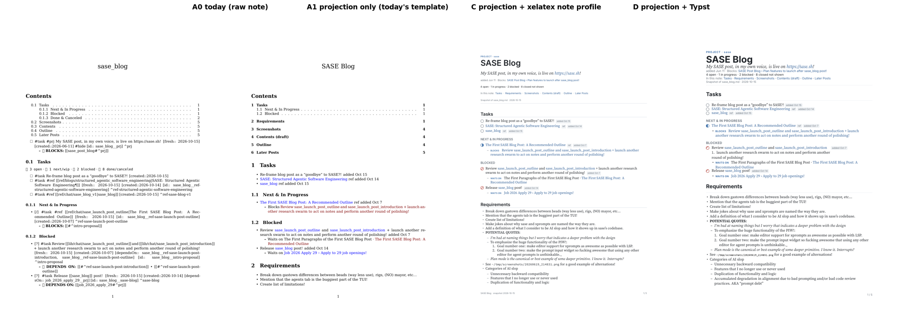

# Beautiful PDFs from Bob area and project notes via `bob ref create`

*Researcher: cld · 2026-10-15 · Evidence: bob-cli `master` at `eb0dca8`, the live vault on athena, and
an engine spike run on athena plus a PDFKit text probe run on the MacBook.*

## 0. Bottom line

- **This is worth doing, but the problem is mostly what goes into the PDF, not how it's
  typeset.** `sase_blog_v1.pdf` looks bad because `bob ref create` feeds an Obsidian/Bob note
  to pandoc as if it were plain pandoc Markdown. The wikilinks, embeds, Dataview fields, block
  ids, custom task statuses, Bob's log bullets, emoji, and plugin UI rows all print literally.
  A section heading even disappears into the line above it. In my spike, the same
  pandoc+xelatex engine produced a clean document once the note was rewritten first (figure
  in §3.1).
- **Recommended shape:**
  1. A Rust **note projection** turns an area or project note into a clean, engine-neutral
     *view*. It reuses bob's existing task, field, and link parsers.
  2. The existing Markdown route renders that view with a new **"note profile"**: bundled
     fonts, status glyphs, a masthead, no section numbers, and ragged-right text.
  3. `create` detects area and project notes automatically, so
     `bob ref create ~/bob/sase_blog.md` just works.
- **Keep xelatex. Do not move this to Chrome/HTML.** I ran a probe on the Mac using PDFKit,
  the framework Highlights uses to pull quotes:
  - Chrome-printed PDFs: **2.4–6.4 % of words came back split** (`agen ts`, `pr oject`). That
    includes Bob's own production web-clip template.
  - xelatex and Typst: **0 %**.
  - Real Highlights quotes from web clips confirm the Chrome damage (`decisionsFor example`,
    `git pushor`).
- **Typst is the credible runner-up.** It looked as good, rendered about 20× faster (0.4 s
  versus 8 s), and handled emoji and Unicode natively. But it would be a second engine with
  no return-link support. Pandoc 3.1.11's Typst writer also corrupted content in my spike. It
  belongs in a separate, deliberate engine decision (§4.3).
- **Requirement changes I'm proposing (detailed in §5):**
  - widen the scope from "area/project notes" to any vault note, with extra Bob semantics for
    area and project notes;
  - by default, show open work and prose, and omit closed history;
  - give snapshots date-stamped names, store which note they came from, and give them their
    own ref type;
  - make `-P` default to the note being snapshotted;
  - have the note profile follow a text-layer rule (no justification, hyphenation, or
    ligatures). I also recommend the same rule for today's Markdown profile.

---

## 1. What happens today (verified)

### 1.1 The pipeline

`bob ref create <file.md>` (`src/native/highlights_ref/create.rs::render_temp_pdf`) runs:

```
pandoc <note.md> --standalone --toc --toc-depth=3 --number-sections --pdf-engine=xelatex
  --lua-filter code-break.lua --lua-filter return-links.lua
  -V mainfont="DejaVu Serif" -V fontsize=10pt -V geometry:margin=0.85in ...
```

- The reader is pandoc's default `markdown`.
- The title waterfall is `-T`, then frontmatter `title`, then the first H1, then the file
  stem.
- The default ref type is `chat`, because this route was built for agent-written research
  reports (`lib/chat/` holds 385 PDFs).
- `create` never checks whether the file is a vault note.

### 1.2 What's wrong with `sase_blog_v1.pdf`, and why

I rendered the 6-page PDF and went through it page by page:

| Symptom in the PDF | Root cause |
| --- | --- |
| Title is `sase_blog` | No frontmatter `title` or H1, so it falls back to the file stem |
| Sections numbered `0.1`, `0.1.1` | `--number-sections` on a note that has no H1 |
| **"Requirements" is missing from the TOC**; `^create-prj-0 ## Requirements` is printed inline | Pandoc `markdown` requires a blank line before an ATX heading; Obsidian (CommonMark) doesn't |
| `[[ref/chat/…\|Title]]`, `![[img/…png\|400]]`, `![[note#^ref]]` printed raw | The reader has no wikilink, embed, or transclusion support |
| `[fresh:: …] [created::…] [id:: …] [dependsOn:: …]`, `^block-ids`, `#task #ref #hide` | Dataview fields, block ids, and tags print as text |
| Tofu boxes for 🧱 ⛓️ ❌ 🗓️ 🛠️ 🎲 ⚪🔵🔴🟢 | DejaVu has no emoji, and xelatex has no font fallback |
| `[/]`, `[?]`, `[-]` printed as text; `[ ]`/`[x]` as ☐/☒ | The `task_lists` extension knows only two statuses; Bob uses six |
| `%%gkeep:v1:…%%` runs off the margin | Obsidian comments aren't stripped, and the token can't break |
| `⚪ 3 open · 🔵 1 next/wip · …` printed as code | The Tasks status-chip row is plugin UI |
| Two headings called "Contents" | The note's own `## Contents` plus pandoc's TOC title |
| About 2.5 pages of Done & Canceled, `SCHEDULE LOG` and `CANCEL LOG` history | No content policy |
| Justified, hyphenated text | Hyphen splits end up in Highlights quotes (§3.2) |

These problems would hit any area or project note. In `cash.md`, the capture route `@BANK`
becomes a pandoc **citation**. Dollar amounts are also at risk from `tex_math_dollars`.

### 1.3 The corpus

- The vault has **101 area/project notes**: 13 areas and 88 projects, all but one at the
  vault root.
- They use **no** Dataview, Tasks, or Base query blocks, no callouts, no tables, and no math.
  So the projection doesn't need to emulate plugins.
- What they do use heavily:
  - Bob's task grammar: six statuses, inline fields, block ids, and the status-group headings
    that `bob task-status-hooks` maintains;
  - Bob's log bullets: `🧱 BLOCKS`, `⛓️ DEPENDS ON`, `🗓️ SCHEDULE LOG`, `🛠️ WORK LOG`,
    `❌ CANCEL LOG`, `🧩 Sub-projects`;
  - wikilinks and block refs: 11 notes have `![[note#^id]]` transclusions;
  - image embeds: 3 notes;
  - `%%` comments: 5 notes;
  - struck-through links `~~[[sub_project]]~~ ✅`: **20 notes, 61 occurrences**. This matters
    for TeX (§3.3).
- Size varies a lot:
  - `sase.md` is 1,381 lines with 235 tasks and renders to **34 pages** today;
  - **211 of its 214 Blocked tasks are blocked only by a future `scheduled` date** (ticklers),
    not by a dependency.
- `sase_blog_v1` is the only existing snapshot of an area or project note. This is a new
  usage pattern, not an established one.

---

## 2. Is this a good idea? Critique

**Yes, with a reframing.** A project note is a working document: lanes, logs, bookkeeping
fields, plugin affordances. A "beautiful PDF of the note" is really an **editorial view** of
it, like `dash.md` is a view of tasks. Treating it as a print of the file is why today's
output looks the way it does. Some specific points:

1. **The PDF earns its place through the Highlights loop, not through looks.** You can read
   the note in Obsidian already. A snapshot adds a focused reading surface on the Mac or iPad,
   annotations, and annotation-derived follow-up tasks that flow back through
   `bob ref scan`/`sync`. Every design choice should protect that loop. That's why the text
   layer is a first-class requirement (§3.2), and why Chrome is out.
2. **Snapshots of living notes go stale and pile up.** `sase_blog.md` changed while I was
   researching it. You already named the first one `sase_blog_v1`, so you expect several
   snapshots. Without a naming and provenance story you get `lib/chat/sase_blog_v1`, `_v2`,
   and so on, each with an open `#ref` reading task in the same project note. Each later
   snapshot then prints the earlier snapshots' reading tasks. That's a small but real
   self-reference loop. §5 handles it with date stems, a `source_note` field, and hints
   rather than automation.
3. **Area notes full of tasks make poor PDFs unless the content is chosen.** For `cash.md`,
   `dev.md`, and the `sase.md` task lanes, the useful review already happens in the morning
   walk. A full dump of `sase.md` is a 17–34-page tickler list. The feature pays off for
   **prose-heavy project notes**: requirements, outlines, quotes, plans, as in `sase_blog`.
   The defaults should serve that case: show open work compactly, hide history, keep prose.
4. **`bob ref create` is the right home, and a new subcommand isn't needed.** Detecting area
   and project notes from frontmatter keeps one entry point. Sniffing the target is how
   `create` already routes PDFs, arXiv links, and web articles. Note-only options live in a
   "Notes" help section.
5. **Don't let "beautiful" mean "faithful to Obsidian's screen rendering."** Obsidian's own
   PDF export (and plugins like Better Export PDF) prints the Electron/Chromium screen. That
   is exactly the producer that fragments in PDFKit (§3.2). It's also manual, GUI-only, and
   Mac-only. It's a fine zero-code stopgap, but not a foundation. *(Inference: I didn't
   export through Obsidian. The claim rests on Obsidian printing with the same Chromium/Skia
   stack as the PDFs I measured.)*

---

## 3. Evidence

### 3.1 Spike: one projection, four engines

I wrote a throwaway projection in Python (`…__cld_assets/spike/project_note.py`, about 340
lines). It covers wikilinks, embeds, block refs, fields, statuses, logs, comments, heading
normalization, a masthead, and omitting closed tasks. I rendered `sase_blog.md` through:

- **A0:** today's arguments on the raw note;
- **A1:** today's arguments on the projected note;
- **C:** the projected note through an xelatex note profile;
- **D:** the projected note through pandoc→Typst;
- **E:** the projected note through pandoc→HTML and headless Chrome.



| Variant (athena, `sase_blog.md`, 4 embedded screenshots) | Time | Pages | Size |
| --- | --- | --- | --- |
| A0 today, raw note | 4.2–4.8 s | 6 | 70 KB |
| A1 projection + today's template | ~8.0 s | 5 | 1.86 MB |
| **C projection + xelatex note profile** | 8.2–8.6 s | 5 | 1.84 MB |
| D projection + pandoc→Typst | **0.34–0.47 s** | 5 | 1.73 MB |
| E projection + HTML→Chrome | 1.3 s | 6 | 1.83 MB |

What the spike shows:

- **The projection alone (A1) fixes most of the readability.** It gives a human title,
  correct sections (Requirements is back), sensible numbering, no field noise, resolved link
  text, and embedded screenshots. The note profile (C) adds the polish: masthead, status
  glyphs, chips, labels, bundled-feel typography, `n / N` footers.
- **Page counts drop:** `sase_blog` 6 → 5, `cash` 6 → 3, `bob` 7 → 3–4, `sase` 34 → 17. The
  17 pages for `sase` are almost all ticklers, which is why §6.2 compacts schedule-blocked
  lanes.
- **Size goes up because images are now real.** xelatex embeds 2870×1626 PNGs losslessly.
  Downscale embeds to ≤1600 px on the long edge (the web-clip rule).
- **The xelatex time is dominated by images.** `cash.md`, which has none, renders through C
  in 3.1 s.
- See `proposed_xelatex_note_page1.png` and `proposed_xelatex_cash_area_page1.png` in the
  assets folder for full-resolution pages.

### 3.2 The deciding test: what PDFKit (Highlights) reads back

Highlights takes quotes from PDFKit selections. On the MacBook I ran a Swift probe
(`spike/pdfkit_probe.swift`):

- It selects every line of every page with `PDFSelection.selectionsByLine()`.
- It splits the line strings into words.
- It counts words that aren't words of the source text, which catches split and merged
  words.
- For the real library PDFs I couldn't use source text, so the vocabulary is MuPDF's
  extraction of the same file. That measures only PDFKit-specific damage.

| PDF | Producer | Words | Not a source word | Rate | Examples |
| --- | --- | --- | --- | --- | --- |
| A0 today | xelatex, justified + hyphenated | 1349 | 9 | 0.67 % | `rec`/`ommended`, `notifica`/`tion` |
| **C note profile** | xelatex, ragged-right, no hyphenation | 950 | **0** | **0.00 %** | — |
| D | Typst, no hyphenation | 945 | **0** | **0.00 %** | — |
| E | Chrome, spike CSS | 919 | 23 | 2.50 % | `bl ocked`, `pr oject`, `otenti al` |
| E2 | Chrome, kerning and letter-spacing forced off | 920 | 22 | 2.39 % | same |
| Real `lib/chat/agent_catalog_pane.pdf` | xelatex (`create` route) | 7027 | 0 | 0.00 % | — |
| Real `lib/blogs/…omnigent….pdf` | **Bob web-clip Chrome template** | 1207 | 77 | **6.38 %** | `mnigen`, `agen ts` |
| Real `lib/blogs/harness_engineering.pdf` | **Bob web-clip Chrome template** | 3326 | 213 | **6.40 %** | `agen`, `wi th` |

Real annotations agree. The omnigent sidecar, written by Highlights, contains quotes like
`AP`/`Is`, `decisionsFor example`, and `git pushor`. In the 395 quotes across `lib/chat/*.md`
(xelatex), words break only at word boundaries, except **6 quotes that break at today's
hyphenation points** (`correc-` / `tion`, `per-` / `surface`).

Conclusions:

1. Any engine that prints through Chrome/Skia is disqualified for documents you annotate.
   Turning kerning off doesn't help.
2. Ragged-right text with no hyphenation brings xelatex to 0 %. That's the note profile's
   text-layer rule, and it should be the default profile's rule too.
3. Typst is as clean as xelatex.

This is a proxy for Highlights, not Highlights itself. §6.5 keeps a real Highlights round
trip as the acceptance test.

### 3.3 TeX traps the spike surfaced (each a concrete requirement for the implementation)

| Trap | Repro | Required handling |
| --- | --- | --- |
| **A struck-through link aborts xelatex** (`! Argument of \hyper@n@rmalise has an extra }`) | `~~[bob_gtd](obsidian://…)~~` through plain pandoc 3.1.11 → exit 43 | Today `~~[[x]]~~` is literal text, so it "works". Once the projection makes real links, all 61 occurrences would abort the render. Render closed sub-projects as **plain link + "done" chip**, never strike a link |
| Headings without a blank line are swallowed | `- task ^id` then `## Requirements` → one list item | Read with `commonmark_x`, or normalize blank lines in the projection. Do both |
| `@word` becomes a citation | `@BANK` → `Cite` (`markdown`), and `#cite(<BANK>)` aborts Typst | `commonmark_x` has no citations extension |
| `$…$` math | money in `cash.md` | `-f commonmark_x-tex_math_dollars` |
| Missing glyphs print as silent tofu | `→` in the schedule-log text and ✅ under Source Serif; xelatex logs only `Missing character` | Wrap characters the body font doesn't cover in a fallback font, based on the bundled fonts' cmaps (§6.3). Replace Bob's own structural emoji with labels |
| Raw TeX inside hyperref arguments | spike masthead `\BobGoalMeta{…\href…\st…}` | Masthead and chips are AST spans mapped by Lua, never string-built TeX |
| BasicTeX on the Mac lacks packages | already documented for `needspace` | Add the note profile's packages (`titlesec`, `enumitem`, `fancyhdr`, `lastpage`) to the existing `latex_packages` doctor row |
| Pandoc version skew | athena 3.1.11.1, Mac **3.11** | Keep the Lua filter minimal and use only stable APIs. Run the corpus gate (§6.5) on both hosts |

Typst traps, for comparison: pandoc 3.1.11's Typst writer didn't escape a wrapped line that
began with `+`, so Typst rendered half a task as a numbered list item (content corruption).
Labels also need explicit attachment (`#box[…]<label>`). Typst isn't installed on the Mac.

---

## 4. Options compared

### 4.1 Input strategy (the decision that matters most)

| Option | Verdict |
| --- | --- |
| Feed the raw note to pandoc (today) | Fails (§1.2) |
| Switch the reader to `commonmark_x+wikilinks_title_after_pipe` and do Bob semantics in a Lua filter | Fixes headings, citations, and simple wikilinks for free. But Bob semantics in Lua means re-implementing task, field, and log parsing outside Rust, on two pandoc versions, without vault access to resolve embeds and block refs. **Rejected as the main layer**, though the reader switch stays |
| **Rust projection, then pandoc (`commonmark_x`)** | **Recommended.** bob already owns this grammar: `note_tasks::scan` / `clean_description`, `task_fields::inline_fields`, `vault_links::VaultLinkResolver`, `markdown::{atx_heading, fenced_lines, …}`, `parent_notes`. It can resolve vault images, block refs, and task anchors deterministically. It also gives pure-Rust golden tests |
| Obsidian's own export or a bob-plugins `printToPDF` command | Chromium text layer (§3.2), GUI- and Mac-only. **Rejected** |

### 4.2 Engine

| Engine | Looks | Highlights text | Speed | Fits bob today | Verdict |
| --- | --- | --- | --- | --- | --- |
| **pandoc + xelatex, note profile** | Good (C) | 0 % | 3–9 s | Reuses stamping, return links, listen card, code wrapping, doctor, tests | **Recommended** |
| pandoc + Typst | Good (D) | 0 % | 0.3–0.5 s | New engine; no return links; writer bugs depend on pandoc version; needs Typst on the Mac | Runner-up (§4.3) |
| HTML + Chrome (reuse web-clip template) | Good when tuned | **2.4–6.4 % damage** | 1.3 s | Template exists | **Rejected** for annotated documents |
| lualatex | Same as xelatex | Presumably same | Slower | Native font fallback | Keep in reserve if cmap wrapping proves fragile |

### 4.3 Why not Typst now, and when to revisit

Typst's advantages are real:

- it's about 20× faster;
- it has native color emoji and font fallback;
- it has no TeX special-character traps;
- it lays out the same on both hosts (one pinned binary).

Typst's `query`/`locate` would also make return pills easier than in TeX.

Moving to Typst is still an **engine migration**:

- port `return_links` and the listen card;
- add the Typst CLI to the Mac, or embed the `typst` crates (a large tree of 0.x crates, at
  odds with bob's lean dependency list);
- choose between relying on pandoc's version-sensitive Typst writer and writing a
  Markdown→Typst emitter yourself.

Doing that for notes alone would leave two engines to maintain. **Revisit if:**

1. the TeX long tail keeps producing failures in the corpus gate;
2. snapshots become automated (nightly or bulk), so render time matters; or
3. you want color emoji.

Either way the projection survives unchanged, which is why it should be engine-neutral (§6.4).

---

## 5. Requirement adjustments (deliberate changes to the request)

1. **Scope: any vault note, in two layers.**
   - The **Obsidian layer** handles wikilinks, embeds, block refs, `%%` comments, heading
     normalization, glyph fallback, and the text-layer rule. It applies to any Markdown target
     inside the vault, including agent reports that use wikilinks.
   - The **Bob layer** handles the masthead, task statuses, lanes, logs, and fields. It applies
     when frontmatter `type` is `[[area]]` or `[[project]]`.
2. **Content policy by default: open work plus prose.**
   - Closed tasks (Done & Canceled) are omitted and counted in the masthead. They're also
     archived nightly to `done/`.
   - `SCHEDULE LOG` becomes a "moved N×" chip.
   - `WORK LOG` and `CANCEL LOG` show only their newest entry.
   - Bookkeeping fields are hidden.
   - Opt-ins: `-C/--closed` and `-S/--section`.
3. **Snapshot identity.**
   - The default stem is `<note>_<YYMMDD>` (for example `sase_blog_261015`, matching the
     existing `ref/docs/sase_blog_260708` style).
   - The title carries the date ("SASE Blog · 2026-10-15"), so create-time title identity is
     per day.
   - A same-day re-snapshot follows today's rules: refuse if the earlier one is still queued
     (`--force` to replace it), otherwise suffix `_2`.
   - The ref note gains **`source_note: "[[sase_blog]]"`**, so Obsidian backlinks list every
     snapshot of a note and doctor can report stale ones.
   - Default ref type: a new **`notes`** library directory rather than `chat`, which holds
     agent research. This one is your call (§7).
4. **`-P` defaults to the snapshotted note**, and TARGET may be a note route (`sase_blog`) as
   well as a path. It resolves through the same area/project resolver as `-P`.
5. **The text-layer rule is a requirement, not a style choice:** ragged-right, no
   hyphenation, no common ligatures, and never a Chromium producer, for any PDF meant for
   Highlights. I recommend applying it to today's Markdown profile too (6 of 395 real quotes
   are damaged by hyphenation).
6. **No automation that overrides your gestures.** A new snapshot never closes or abandons an
   older one. When an earlier snapshot of the same note is still unread with 0 highlights, it
   prints a hint. This matches the "offered, never auto-linked" stance in the decisions
   roster.
7. **Non-goals for v1:**
   - live refresh;
   - writing annotations back onto the original task line;
   - following linked notes (for example appending `sase_blog_contents` as a chapter);
   - emulating Dataview or Tasks queries (none exist in these notes).

---

## 6. Recommended solution

### 6.1 Command surface

```bash
bob ref create ~/bob/sase_blog.md            # note detected, -P defaults to sase_blog
bob ref create sase_blog                     # same, by route
bob ref create sase_blog -S Outline -S Requirements
bob ref create cash -C                       # include closed tasks as an appendix
bob ref create sase_blog -M                  # escape hatch: today's plain Markdown rendering
bob ref create sase_blog -d                  # dry run: projection summary, no render
```

New options, using free short flags and kept alphabetical in help per `cli_rules`:

| Option | Meaning |
| --- | --- |
| `-C, --closed` | Include closed tasks as a compact appendix |
| `-M, --plain` | Render a vault note as plain Markdown, which is today's behavior |
| `-S, --section <HEADING>` | Repeatable; snapshot only these sections, plus the masthead |

Dry run is local and cheap. It prints:

- the detected kind and the resolved parent;
- the sections it will include;
- the count of omitted closed tasks;
- images found and missing;
- unresolved and dead links;
- the default stem.

`BOB_HIGHLIGHTS_KEEP_WORKDIR=1` keeps `projected.md` for debugging.

### 6.2 Projection rules (MVP)

| Construct | Rendering |
| --- | --- |
| Frontmatter | Dropped. `type`, `parent`, and `status` feed the masthead kicker ("PROJECT · sase") |
| Title | `-T`, then frontmatter `title`, then H1, then the humanized stem |
| `^prj` task | Masthead goal line (italic), with its children (Blocks, Sub-projects) as masthead metadata |
| Stats | "4 open · 1 in progress · 2 blocked · 8 closed not shown" replaces the plugin chip row |
| Headings | Blank lines normalized; levels shifted so the top level is 1; unnumbered. "Next & In Progress" and "Blocked" become small-caps lane headers |
| Task line | Status glyph replaces the bullet: open ○, next ◉, wip ◐, blocked ⊘, done ✓, canceled ⊗ (canceled text is struck, links excepted). Then the cleaned text, then chips: priority, `sched Oct 17`, done or canceled date, `ref` |
| Inline fields | Hidden, except priority, scheduled, completion, and cancelled, which become chips |
| Tags | `#task #ref #prj #hide` dropped; other tags kept as muted text |
| Block ids | Dropped from the text; each becomes a PDF anchor `t-<id>` |
| `[[#^id]]` | Internal link whose text is the target task's text. If the target was omitted, plain text with no dead link |
| `[[note]]`, `[[note\|alias]]`, `[[note#^id]]` | Text is the alias, the note name, or "Note › task text". The target uses the existing `obsidian://open?vault={vault}&file={path}` template. For `#ref` links, consider `highlights://<stem>` so a snapshot works as a reading hub (verify the URL scheme on the Mac) |
| `![[img.png\|400]]` | Real image; width taken from px; downscaled to ≤1600 px. A missing image becomes a muted placeholder plus a `warning:` |
| `![[note#^id]]` | One level of transclusion: a quoted block with a source label |
| `![[note]]` | Link only, with no recursion |
| `🧱 BLOCKS`, `⛓️ DEPENDS ON`, `🧩 Sub-projects` | Labeled rows ("BLOCKS", "WAITS ON") with linked targets. Closed sub-projects show a "done" chip instead of `~~strike~~` (§3.3) |
| `🗓️ SCHEDULE LOG` | Dropped, plus a "moved N×" chip |
| `🛠️ WORK LOG`, `❌ CANCEL LOG` | Newest entry, plus "+N older" |
| `%% … %%` | Dropped, inline and block |
| Closed lane | Omitted and counted (`-C` adds an appendix) |
| Schedule-blocked lanes (Phase 2) | "Scheduled" grouped by this week, this month, and later, in compact one-line rows. Turns `sase.md` from a 17-page list into a few pages |
| `~/paths`, long tokens, bare URLs | Code spans or autolinks, so the existing code-break filter can wrap them |

### 6.3 The note profile (render side)

- **Reader:** `-f commonmark_x-tex_math_dollars`. **No** `--number-sections`.
- **TOC:** no TOC page. The masthead has an "In this note" line, and hyperref still builds
  PDF bookmarks. Add a TOC only above roughly 8 pages.
- **Text:** `\raggedright`, hyphenation off, `Ligatures=NoCommon`. This is the §3.2 rule.
- **Fonts: bundle them.** Use Source Serif 4, Inter, and JetBrains Mono, the same families
  as the web-clip template, for one "Bob print" look. Monochrome Noto Emoji is the fallback.
  - Ship static OTF/TTF files (about 3.5 MB; bob is 26.5 MB today).
  - Write them to the scratch directory and load them with fontspec `Path=`.
  - That makes output identical on athena (full TeX Live) and the Mac (BasicTeX).
  - Name-based system fonts would differ between the two hosts.
- **Glyph fallback:** at build time, read the bundled fonts' cmaps (a few lines with
  `ttf-parser`, or a generated table). The projection or Lua then wraps any uncovered
  character in the fallback font, so nothing becomes silent tofu.
- **Lua:** a small filter maps the projection's classes (`.st-*`, `.chip`, `.label`,
  `.muted`, masthead metadata) to TeX macros. The existing code-break and return-links
  filters still run, so a "Waits on" link inside a note gains return pills. The projection
  can set `bob-return-links: false` if that turns out to be noise.
- **Footer:** short title on the left, `n / N` on the right, matching the web-clip look.
- **Doctor:** the note profile's packages join `latex_packages`. Missing ones produce the
  existing one-line `tlmgr` hint.

### 6.4 Implementation shape

- **`highlights_ref/note_projection.rs`** (new, with a `tests/` sibling) builds a small view
  model of the note:

  ```
  Masthead
  Section { heading, blocks }
  TaskRow { status, text, chips, anchor, children }
  LabeledRow, Image, Transclusion, Prose
  ```

  It then serializes the model to CommonMark with attributes. Keeping the model separate
  from the output format is what lets a later Typst backend reuse it.
- **`create.rs`** classifies a Markdown target that is inside the vault (an area or project
  note, or any vault note for the Obsidian layer). `CreatePlan` gains
  `profile: Plain | Note`. The note profile writes `projected.md` into scratch and renders
  with the note arguments. Stamping, dedupe, collision walk, listen, and install stay as
  they are.
- **`render_tex.rs`** gets the note header constant and the doctor package list.
- **Docs:** a "Vault notes" section in `docs/highlights-create.md`, plus a "Notes:" block in
  `create --help`.
- **Size:** roughly 700–1,000 lines of Rust plus tests, about 150 lines of TeX header, and
  about 150 lines of Lua. The spike's Python projection is a working reference for the rules.

### 6.5 Acceptance

1. **Corpus gate (the key one).** Project and render all 101 area/project notes into a
   scratch xlib, on **both** athena and the Mac. Require:
   - 100 % success;
   - zero `Missing character` lines in the xelatex logs;
   - every unresolved-link warning explained.

   In the spike, 2 of 4 notes failed to render on their first try (the strike-link bug and
   a citation). This gate is what turns the long tail into a checklist.
2. **Golden projection tests:** `sase_blog`, `cash`, `bob`, and `sase`, plus synthetic edge
   cases:
   - strike plus link;
   - `@route`;
   - `$` amounts;
   - a heading with no blank line before it;
   - `%%` blocks;
   - embeds, including a missing image;
   - a link to an omitted task;
   - nested logs.
3. **PDFKit probe** (`spike/pdfkit_probe.swift`) on the Mac across the corpus: 0 non-source
   words.
4. **Real Highlights round trip on the Mac:**
   1. `create`, then `scan`;
   2. highlight a task line, a quote, and an image;
   3. `sync`;
   4. check that the quotes are byte-clean and the follow-up tasks land in the project.

### 6.6 Phasing

| Phase | Content | Size |
| --- | --- | --- |
| P1 | Projection (Obsidian and Bob layers), note profile, bundled fonts, glyph fallback, detection, `-P` default, route TARGET, date stem, `-M`, docs, gates 1–3 | 3–4 agent-days |
| P2 | `source_note` provenance (marker key → ref-note field) plus unread-snapshot hint; compact Scheduled grouping; `-C`, `-S`; image downscaling; `highlights://` ref links | 2 days |
| P3 (optional) | Obsidian command in bob-plugins: "Snapshot this note to Highlights"; doctor staleness report; annotation write-back to the source task via block ids | later |

### 6.7 What not to build

- A Chrome/HTML route for notes.
- A second engine for notes only.
- Lua-side parsing of Bob's grammar.
- Plugin query emulation.
- Recursive transclusion.
- Automatic closing of old snapshots.

---

## 7. Risks and open questions for Bryan

1. **What is a snapshot for?** Reviewing the plan (prose) or triaging tasks? My defaults
   assume plan review: closed tasks hidden, logs condensed. Triage is better done in the
   morning walk.
2. **Ref type:** a new `notes` directory (recommended; keeps Bob Refs filtering meaningful)
   or `chat`?
3. **Naming:** date stems (`sase_blog_261015`) or `_vN` counters like your `sase_blog_v1`?
4. **Links:** should wikilinks open Obsidian (`obsidian://`)? Should `#ref` tasks open the
   referenced PDF in Highlights? The `highlights://` scheme needs checking on the Mac first.
5. **Engine:** do you accept xelatex now, with Typst as a recorded "reopen" decision, or do
   you want to schedule a TeX-to-Typst migration for all Markdown refs?
6. **Risk: hidden content.** Omitting closed tasks and condensing logs means the PDF isn't the
   whole note. The masthead count ("8 closed not shown") and `-C` keep that visible.
7. **Risk: pandoc skew** (athena 3.1.11 versus Mac 3.11). The two-host corpus gate is the
   mitigation. Consider upgrading athena's pandoc.

## 8. Discovered follow-ups (outside this request)

- **Bob web-clip PDFs fragment in PDFKit.** About 6.4 % of words came back split on two
  production captures, and real Highlights quotes are damaged (`decisionsFor`, `AP`/`Is`).
  The earlier web-URL research named exactly this as its gating Mac test. This probe shows
  the Bob template doesn't escape it. The options are re-typesetting `article.json` through
  xelatex or Typst, or another mitigation. Filed as task bead **bob-cli-85**.
- **The default Markdown profile** (research reports) would benefit from two changes:
  - the text-layer rule (ragged-right, no hyphenation), because 6 of 395 real quotes are
    damaged;
  - the `commonmark_x-tex_math_dollars` reader, because agent reports are CommonMark-style.

  This is a small, separate change.

## 9. Recommendation

**Build a Rust note projection inside `bob ref create`, and render its output through the
existing pandoc+xelatex route with a new note profile.**

- **Detection:** `create` recognizes area and project notes by frontmatter `type`.
- **Defaults for notes:** `-P` is the note itself, the stem is `<note>_<YYMMDD>`, and the ref
  type is a new `notes` directory.
- **Content:** open work and prose; closed history counted, not printed.
- **Typography:** bundled Source Serif 4, Inter, and JetBrains Mono; status glyphs; a masthead;
  ragged-right text with no hyphenation, so Highlights quotes stay clean.
- **Robustness:** handle the TeX traps listed in §3.3, and gate on rendering all 101 notes
  on both hosts.
- **Engines:** don't use Chrome for anything you annotate (PDFKit evidence, §3.2). Keep
  Typst as the documented runner-up. The projection is engine-neutral, so switching later
  costs only a backend.

---

## Appendix: reproducing the spike

The scripts are in `obsidian_note_pdf_snapshots__cld_assets/spike/`. They're throwaway code
with known shortcuts.

- `project_note.py <note.md>` writes projected Markdown with masthead metadata to stdout.
- `run_variants.sh <note.md> <outdir> "<short title>"` renders A0, A1, C, D, and E and prints
  timings, pages, and sizes.
  - Needs pandoc, xelatex with TeX Live fonts, `typst`, and `google-chrome`.
  - Set `TMPDIR=/tmp` when the agent TMPDIR is long; Chrome aborts on long socket paths.
- `pdfkit_probe.swift <vocab.txt> <file.pdf>` runs on macOS (`swift pdfkit_probe.swift …`)
  and prints the line, word, and unknown-word counts used in §3.2.

The C variant uses TeX Live's Source Serif Pro, Inter, and Source Code Pro because the spike
ran on athena. The recommendation is to bundle the Source Serif 4, Inter, and JetBrains Mono
families instead.
