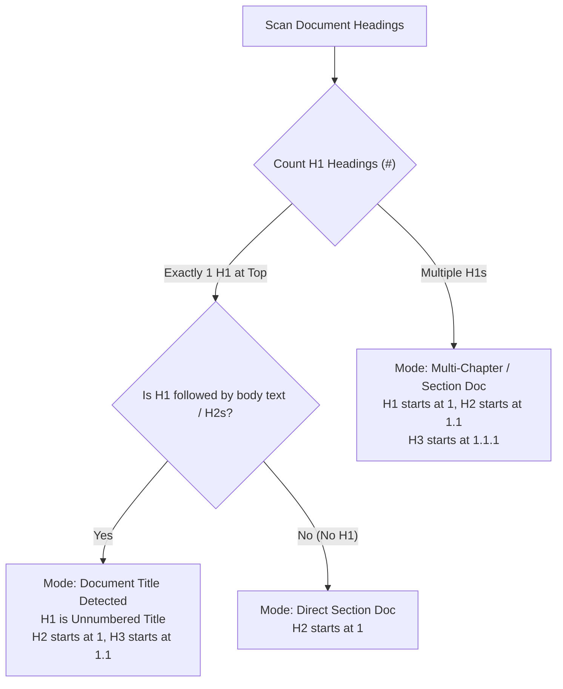

# Vault Article & Design Doc Architecture: Specification, Auto-Formatting, and Section Numbering

**Author:** Researcher `gem` (5-Researcher Swarm)  
**Date:** 2026-10-16  
**Status:** Completed Research & Architecture Proposal  
**Target File Example:** `~/bob/sase_blog_contents.md`  

---

## 1. Executive Summary

In Bryan's Obsidian vault (`~/bob`), notes predominantly serve an operational GTD workflow: task tracking (`#task`, `^prj`), Pomodoro ledgers, schedule logs, and status transitions (`[fresh::...]`, `[scheduled::...]`, `[dependsOn::...]`). Because this operational syntax is delicate, global markdown formatters like `obsidian-linter` have been intentionally disabled vault-wide to prevent data corruption.

However, the vault also houses long-form intellectual artifacts: articles, technical design documents, essays, RFCs, and blog drafts (such as `~/bob/sase_blog_contents.md`). Treating these documents identically to GTD task scratchpads results in formatting degradation, inconsistent heading hierarchies, missing section numbers, and poor reading ergonomics.

This research paper presents a comprehensive architecture to:
1. **Unambiguously Specify and Target** article and design doc notes within the vault using idiomatic frontmatter conventions (`type: "[[article]]"` or `type: "[[design-doc]]"`), paired with a convention-over-configuration metadata schema.
2. **Apply a Tailored Suite of 10 Auto-Formatting Rules** engineered specifically for technical prose, preserving code blocks, footnotes, and task anchors while standardizing whitespace, tables, and hierarchy.
3. **Automatically and Idempotently Number Sections** starting at 1 with nested subsection support (e.g., `1`, `1.1`, `1.1.1`), incorporating intelligent document title auto-detection and section exemption.
4. **Deliver a Visually Stunning Reading & Writing Experience** inside Obsidian via an automatic `.bob-article` CSS typographic layout (centered measure, refined typography, subtle numbered badges) and clean raw markdown outside Obsidian.
5. **Critique the Original Proposal**, highlighting critical pitfalls such as inbound link breakage, git diff churn, and editing friction, and presenting five justified requirement adjustments.
6. **Recommend a Phased Hybrid Implementation** combining an authoritative, headless CLI engine in `bob-cli` (`bob doc format`) with an interactive Obsidian plugin in `bob-plugins` (`bob-doc-tools`).

---

## 2. Critique of the Plan: Is This a Good Idea?

### 2.1 The Value: Why This is a High-Leverage Initiative
The user's intuition to separate document notes from standard vault notes is fundamentally sound and urgently needed:

* **Escaping the "One Linter to Rule Them All" Trap:** Standard markdown linters expect vanilla CommonMark. In an advanced GTD vault managed by tools like `bob-cli` and `dataview`, indiscriminate linting destroys block IDs (`^prj`), alters task indentation, splits schedule logs, and strips whitespace necessary for task parsing. A scoped, opt-in mechanism allows aggressive, high-polish formatting on prose without risking operational breakage.
* **Separation of Concerns (Project vs. Content):** In Bryan's vault, `~/bob/sase_blog.md` is a GTD project tracking note (`type: "[[project]]"` with tasks, block IDs, dependencies, and cancel logs), whereas `~/bob/sase_blog_contents.md` is the actual draft article. Formally categorizing content notes allows the project note to manage the *process* while the article note houses the *product*.
* **Reader & Writer Flow:** Technical design docs and long-form articles demand clear hierarchical orientation. Outline numbering (`1.1`, `1.2.1`) makes referencing specific sections in discussions ("see Section 2.3") natural and unambiguous.

---

### 2.2 Critical Pitfalls and Architectural Risks

While the objective is excellent, implementing auto-formatting and section numbering naively introduces four severe risks:

#### Pitfall 1: The Broken Link Trap (The Highest Danger)
* **The Mechanism:** In Obsidian, internal links frequently target headings:
  ```markdown
  [[sase_blog_contents#The Abstractions]]
  ```
  If an auto-numbering script physically rewrites that heading in the raw file to:
  ```markdown
  [[sase_blog_contents#1 The Abstractions]]
  ```
  every incoming wikilink across all notes in the vault (`sase_blog.md`, daily logs, reference notes) **instantly breaks**.
* **Compounding Reorderings:** If a new section is inserted earlier in the document, section `1.2` becomes `1.3`. Any external reference pointing to `[[sase_blog_contents#1.2 Beads]]` will now either link to the wrong section or become a dead link.

#### Pitfall 2: Git Diff Noise Explosion
* **The Mechanism:** In a git-backed vault (`bob vault-sync`), physical section numbering produces massive diff noise. Inserting a single introductory section at the top of a 50-heading design document modifies every single heading in the entire file.
* **Impact:** Git blame is ruined; commit diffs become unreadable; merging changes across branches or ephemeral agent workspaces risks endless merge conflicts.

#### Pitfall 3: Background Polling and Editing Friction
* **The Mechanism:** Existing Obsidian community plugins (such as `number-headings-obsidian`) operate by running an interval timer (e.g., every 10 seconds) that executes regex replacements directly against the active editor buffer.
* **Impact:** If the user is in the middle of typing a heading or drafting a sentence, an asynchronous background buffer replacement causes cursor jumping, disrupts the native undo/redo history (`Cmd+Z`), and creates typing lag.

#### Pitfall 4: Metadata and Task Collateral Damage
* **The Mechanism:** Design docs often contain inline checklists (`- [ ] #task Write introduction! ^write-intro`), footnotes (`[1]: TODO`), or custom Dataview properties. Generic linters often reformat checklists into standard unordered lists, strip trailing caret anchors, or relocate footnote definitions inappropriately.

---

### 2.3 Justified Adjustments to the Requirements

To overcome these pitfalls, the following five adjustments to the user's initial requirements are strongly recommended:

| # | Initial Requirement | Recommended Adjustment | Justification |
|---|---|---|---|
| **R1** | Auto-numbering physically mutates headings directly in the file | **Dual-Mode Numbering (Virtual by Default + Physical Bake on Export)** | Virtual numbering in Obsidian (via CSS / CodeMirror 6) displays numbers without touching file text, eliminating git churn and keeping wikilinks unbreakable. Physical numbering is available via an explicit "Bake Numbers" command for static export. |
| **R2** | Ad-hoc or plugin-specific configuration syntax | **Zero-Config Frontmatter Taxonomy (`type: "[[article]]"`)** | Integrates with existing vault schemas (`type: "[[project]]"`). Zero configuration required for standard behavior; optional `article:` block for overrides. |
| **R3** | Manual setting of starting heading level | **Intelligent Document Title Auto-Detection** | Automatically distinguishes between a single top-level Document Title (H1 unnumbered, H2 starts at 1) versus multi-chapter docs (H1 starts at 1). |
| **R4** | Generic markdown auto-formatting | **Domain-Aware Rule Suite with Task & Footnote Isolation** | Strict preservation of Obsidian tasks, block IDs (`^anchor`), callouts, and code blocks; adds footnote consolidation at the bottom of the article. |
| **R5** | Periodic / continuous background auto-formatting | **Explicit & Event-Driven Triggers (Save / Command / Hook)** | Format on explicit hotkey (`Cmd+Shift+F`), document save (debounced), or during `bob nightly` / git pre-commit, never on arbitrary 10-second intervals while typing. |

---

## 3. Note Specification: How to Target Articles and Design Docs

### 3.1 Evaluating Identification Mechanisms

We evaluated four candidate mechanisms for designating a note as an article or design doc:

```
┌────────────────────────────────────────────────────────────────────────────────────────┐
│ Candidate Mechanisms                                                                   │
├──────────────────────┬────────────────────────────────┬────────────────────────────────┤
│ Mechanism            │ Pros                           │ Cons                           │
├──────────────────────┼────────────────────────────────┼────────────────────────────────┤
│ 1. Frontmatter type: │ Native to vault taxonomy;      │ Requires frontmatter (already  │
│    "[[article]]"     │ works in Dataview/Graph;       │ standard in vault); perfectly  │
│    (Recommended)     │ supports multiple types.       │ matches `parent_notes.rs`.     │
├──────────────────────┼────────────────────────────────┼────────────────────────────────┤
│ 2. Folder Path       │ Simple filesystem boundaries   │ Inflexible; `sase_blog_        │
│    (e.g., `docs/`)   │                                │ contents.md` lives at root;     │
│                      │                                │ breaks linking conventions.    │
├──────────────────────┼────────────────────────────────┼────────────────────────────────┤
│ 3. Inline Tags       │ Lightweight                    │ Tags in Bryan's vault are      │
│    (e.g., `#article`)│                                │ reserved for task lifecycle;   │
│                      │                                │ violates AD-10/AD-20 rules.    │
├──────────────────────┼────────────────────────────────┼────────────────────────────────┤
│ 4. Dedicated Key     │ Clear single-purpose flag      │ Adds redundant schema overhead │
│    (`format: doc`)   │                                │ when `type:` already exists.   │
└──────────────────────┴────────────────────────────────┴────────────────────────────────┘
```

### 3.2 The Recommended Frontmatter Schema

#### 1. Zero-Configuration Baseline (Convention over Configuration)
Any file with `type: "[[article]]"`, `type: "[[design-doc]]"`, `type: "[[essay]]"`, or `type: "[[rfc]]"` automatically receives full article treatment:

```yaml
---
parent: "[[sase_blog]]"
type: "[[article]]"
created: 2026-10-15T15:10:41-04:00
---
```

Under this baseline, standard defaults apply:
* Auto-formatting enabled on save / command.
* Section auto-numbering enabled starting at 1.
* Automatic title detection (unnumbered H1 if single; numbered H1 if multiple).
* Non-content sections (`Contents`, `References`, `Footnotes`, `Appendix`) automatically skipped.

#### 2. Advanced Customization Schema (Optional Overrides)
When specific document behavior is desired, an optional `article:` configuration block can be added to the frontmatter:

```yaml
---
parent: "[[sase_blog]]"
type: "[[article]]"
created: 2026-10-15T15:10:41-04:00
article:
  numbering: true             # Options: true, false, "virtual", "physical", "legal"
  first_level: auto           # Options: auto (default), 1, 2
  max_level: 4                # Numbering depth limit (default: 4, range: 1-6)
  separator: " "              # Separator after number: " " ("1.1 Title"), ". " ("1.1. Title")
  skip:                       # Headings to exclude from numbering
    - "Contents"
    - "References"
    - "Appendix*"
  format:
    title_case: true          # Normalize headings to Title Case
    align_tables: true        # Format GFM markdown tables with aligned pipes
    consolidate_footnotes: true # Collect and place footnotes at document bottom
---
```

---

## 4. The Auto-Formatting Rulebook

Technical articles and design docs require rigorous visual consistency. The proposed engine applies 10 distinct, idempotent formatting rules:

```
┌──────────────────────────────────────────────────────────────────────────────┐
│                  THE 10 ARTICLE AUTO-FORMATTING RULES                        │
├────┬───────────────────────────────┬─────────────────────────────────────────┤
│ #  │ Rule Name                     │ Specification                           │
├────┼───────────────────────────────┼─────────────────────────────────────────┤
│ 1  │ Heading Spacing & Isolation   │ 2 blank lines before H1/H2; 1 before    │
│    │                               │ H3-H6; 1 blank line after any heading.  │
├────┼───────────────────────────────┼─────────────────────────────────────────┤
│ 2  │ Heading Hierarchy Repair      │ Prevent illegal level leaps (e.g., H2 to│
│    │                               │ H4 without H3); normalize or flag.      │
├────┼───────────────────────────────┼─────────────────────────────────────────┤
│ 3  │ Smart Title Capitalization    │ Convert headings to Chicago/AP Title    │
│    │                               │ Case while preserving code and acronyms.│
├────┼───────────────────────────────┼─────────────────────────────────────────┤
│ 4  │ Paragraph Whitespace Hygiene  │ Exactly 1 blank line between paragraphs;│
│    │                               │ strip trailing whitespace on all lines. │
├────┼───────────────────────────────┼─────────────────────────────────────────┤
│ 5  │ Footnote Consolidation        │ Relocate inline `[1]: ...` definitions  │
│    │                               │ to the document footer under References.│
├────┼───────────────────────────────┼─────────────────────────────────────────┤
│ 6  │ Code Block Hygiene            │ Mandatory language tag on fences;       │
│    │                               │ exactly 1 blank line before and after.  │
├────┼───────────────────────────────┼─────────────────────────────────────────┤
│ 7  │ List Marker Standardization   │ Standardize unordered bullets to `-`;   │
│    │                               │ enforce consistent 2- or 4-space indent.│
├────┼───────────────────────────────┼─────────────────────────────────────────┤
│ 8  │ Task Item Preservation        │ Leave `- [ ] #task ...` and trailing    │
│    │                               │ block IDs (`^write-intro`) untouched.   │
├────┼───────────────────────────────┼─────────────────────────────────────────┤
│ 9  │ GFM Table Alignment           │ Align column pipes and pad cell contents│
│    │                               │ for beautiful raw plaintext reading.    │
├────┼───────────────────────────────┼─────────────────────────────────────────┤
│ 10 │ Frontmatter Integrity Guard   │ Strictly enforce YAML fences `---` and  │
│    │                               │ guarantee 1 blank line before body text.│
└────┴───────────────────────────────┴─────────────────────────────────────────┘
```

### Detailed Breakdown of Key Rules

#### Rule 1 & 2: Heading Spacing and Hierarchy Normalization
* **Vertical Rhythm:** In raw markdown, headings need breathing room. Two blank lines before `## H2` visually delineates major document chapters; one blank line before `### H3` maintains grouping with parent sections.
* **Hierarchy Enforcement:** In `sase_blog_contents.md`, line 24 has `## Agent CLIs` followed immediately by line 25 `#### Skills, **memory**...` (skipping `###`). The engine detects this gap and normalizes `####` to `###` to prevent broken outline structures.

#### Rule 3: Smart Title Capitalization
* Capitalizes major words; leaves minor words lowercase (`a`, `an`, `the`, `and`, `but`, `for`, `at`, `by`, `to`, `in`, `of`).
* **Code & Acronym Protection:** Text enclosed in backticks (e.g., `` `bob-cli` ``) or recognized technical acronyms (`SASE`, `VCS`, `CLI`, `API`, `PRJ`, `AST`, `HTML`, `LSP`, `YAML`) are protected from case mutations.

#### Rule 5: Footnote & Reference Consolidation (Crucial for `sase_blog_contents.md`)
* In `sase_blog_contents.md`, footnote definitions are scattered in the body between introductory text and `# The Abstractions`:
  ```markdown
  [1]: TODO: Add a note about pronunciation...
  [2]: TODO: Link to Omnigent as an example...
  ```
* The formatting engine extracts all link/footnote definition blocks (`^[0-9a-zA-Z_-]+]:\s*.*$`) and relocates them cleanly to the bottom of the document beneath a `## References` or horizontal divider, ensuring uninterrupted reading flow.

#### Rule 8: Task Item & Block Anchor Preservation
* Articles in Bryan's vault frequently contain inline writing tasks or review tasks (e.g., `- [ ] #task Write introduction! ^write-introduction`).
* The formatter detects task markers (`- [ ]`, `- [/]`, `- [x]`) and caret block anchors (`\^[a-zA-Z0-9_-]+$`) and guarantees that spacing, indentation, and status characters remain untouched, ensuring total compatibility with `bob-cli`'s task status hooks and reconcilers.

---

## 5. Section Auto-Numbering Architecture

### 5.1 Numbering Scheme & Grammar

The auto-numbering system follows modern technical documentation standards (ISO/IEC direct outline numbering):

```
Level 1 (H1/H2 depending on title):  1  Introduction
Level 2 (Sub-section):               1.1  Background
Level 3 (Sub-sub-section):           1.1.1  Prior Art
Level 4 (Detailed breakdown):        1.1.1.1  Early Implementations
```

* **Default Delimiter:** A dot between levels, followed by a space (e.g., `## 1.1 Gates -> Plans -> Epics`).
* **Sub-section Reset:** Any occurrence of a higher-level heading automatically resets lower-level counters to 1.
* **Maximum Depth:** Controlled by `max_level` (default: 4). Levels 5 and 6 remain unnumbered to prevent unwieldy strings like `1.2.3.1.1.2`.

---

### 5.2 Intelligent Title Auto-Detection

A major usability hurdle in existing plugins is requiring the user to specify whether H1 or H2 should be numbered. The proposed engine solves this with a two-pass heuristic:



* **Example A (Single Title):**
  ```markdown
  # SASE: Structured Agentic Software Engineering  <-- Unnumbered Title
  ## 1 Introduction                                <-- Section 1
  ## 2 The Abstractions                            <-- Section 2
  ### 2.1 Gates -> Plans -> Epics                  <-- Section 2.1
  ```
* **Example B (Multi-Chapter / `sase_blog_contents.md`):**
  ```markdown
  # 1 The Abstractions                             <-- Section 1
  ## 1.1 Gates -> Plans -> Epics                   <-- Section 1.1
  # 2 VCS and Workspace Operations                 <-- Section 2
  ```

---

### 5.3 Section Exemption (Skipping Non-Content Headings)

Certain standard sections must never carry outline numbers:
1. **Built-in Exemptions:** `Contents`, `Table of Contents`, `TOC`, `References`, `Bibliography`, `Sources`, `Footnotes`, `Index`, `Appendix`.
2. **Appendix Lettering:** Sections matching `Appendix*` automatically switch from numeric to alphabetic numbering (e.g., `## Appendix A: System Benchmarks`, `### Appendix A.1: Memory Footprint`).
3. **Explicit Override:** Any heading bearing an inline `#no-number` tag, HTML comment `<!-- no-number -->`, or block anchor `^no-number` is skipped, and sub-counters do not advance.

---

### 5.4 Idempotence and Anchor-Safe Renumbering

To ensure 100% reliability, the numbering engine executes in two phases:
1. **Prefix Stripping:** A strict regex removes any prior numbering prefix from headings:
   ```regex
   ^(#{1,6}\s+)(?:[0-9]+(?:\.[0-9]+)*\.?\s+|Appendix\s+[A-Z](?:\.[0-9]+)*:?\s+)?(.*)$
   ```
   This isolates the canonical title string regardless of how many times the tool has run.
2. **Sequential Re-Application:** The engine traverses the AST, generates fresh numbers according to current hierarchy and exemptions, and applies them.
3. **Internal Anchor Generation:** If a heading does not already possess a block anchor (`^anchor`), the formatter can optionally append a permanent block ID based on the unnumbered title slug (e.g., `## 1.1 Gates -> Plans -> Epics ^gates-plans-epics`).
   * **Why this is critical:** Internal wikilinks can link to `[[#^gates-plans-epics]]` instead of the fragile heading text `[[#1.1 Gates -> Plans -> Epics]]`. Even if the section moves from 1.1 to 3.4, the block ID never changes and links never break!

---

## 6. Beauty and Presentation: Making It Visually Stunning

Auto-formatting provides clean source code; presentation provides visual elegance. We design the aesthetic experience across two dimensions:

### 6.1 Obsidian Custom Typography (`.bob-article` CSS Layout)

When Obsidian loads a note with `type: "[[article]]"`, the companion plugin injects the `.bob-article` CSS class into the active workspace leaf. This unlocks a publication-grade reading environment:

```css
/* Bob Article Typography & Layout */
.workspace-leaf-content[data-mode="preview"].bob-article .markdown-preview-view,
.workspace-leaf-content[data-mode="source"].bob-article .cm-editor {
  --font-text: "Charter", "Merriweather", -apple-system, BlinkMacSystemFont, "Segoe UI", Roboto, serif;
  --font-monospace: "JetBrains Mono", "SF Mono", monospace;
  --line-height-normal: 1.75;
  font-size: 17px;
  max-width: 740px;
  margin: 0 auto;
  color: var(--text-normal);
}

/* Elegant Heading Hierarchy */
.bob-article h1 {
  font-size: 2.1em;
  font-weight: 700;
  letter-spacing: -0.02em;
  border-bottom: 2px solid var(--background-modifier-border);
  padding-bottom: 0.3em;
  margin-top: 1.8em;
  margin-bottom: 0.8em;
}

.bob-article h2 {
  font-size: 1.55em;
  font-weight: 600;
  letter-spacing: -0.01em;
  border-bottom: 1px solid var(--background-modifier-border-focus);
  padding-bottom: 0.2em;
  margin-top: 1.6em;
  margin-bottom: 0.6em;
}

.bob-article h3 {
  font-size: 1.25em;
  font-weight: 600;
  margin-top: 1.3em;
  margin-bottom: 0.4em;
}

/* Subtle, Refined Section Number Styling */
.bob-article .cm-header-number,
.bob-article .heading-number {
  color: var(--text-muted);
  font-family: var(--font-monospace);
  font-size: 0.85em;
  font-weight: 400;
  margin-right: 0.45em;
  padding: 0.1em 0.35em;
  background: var(--background-secondary);
  border-radius: 4px;
  vertical-align: 0.1em;
}

/* Footnotes & References Section Styling */
.bob-article .footnotes,
.bob-article section[data-footnotes] {
  margin-top: 3em;
  padding-top: 1.5em;
  border-top: 1px dashed var(--background-modifier-border);
  font-size: 0.9em;
  color: var(--text-muted);
}
```

### 6.2 Raw Markdown Beauty Outside Obsidian

When opened in terminal pagers (`bat`, `glow`), Neovim, or rendered on GitHub, raw markdown formatting matters just as much:
* Clean 2-line vertical buffers between major sections prevent visual cramping.
* Table pipes are strictly aligned with padding:
  ```markdown
  | Component        | Language   | Status      |
  | ---------------- | ---------- | ----------- |
  | `bob-cli`        | Rust       | Active      |
  | `bob-plugins`    | TypeScript | Active      |
  ```
* Fenced code blocks have consistent language tags and indentation.

---

## 7. Architectural Options & Trade-Off Analysis

We evaluated three potential implementation architectures:

```
┌────────────────────────────────────────────────────────────────────────────────────────┐
│ ARCHITECTURAL COMPARISON                                                               │
├──────────────────────┬──────────────────────┬──────────────────────┬───────────────────┤
│ Evaluation Criteria  │ Option 1:            │ Option 2:            │ Option 3:         │
│                      │ Pure Obsidian Plugin │ Pure bob-cli (Rust)  │ Hybrid Engine     │
│                      │ (`bob-plugins`)      │                      │ (Recommended)     │
├──────────────────────┼──────────────────────┼──────────────────────┼───────────────────┤
│ Execution Context    │ Obsidian Desktop GUI │ Headless CLI / Hooks │ Both GUI & CLI    │
├──────────────────────┼──────────────────────┼──────────────────────┼───────────────────┤
│ Responsiveness in UI │ Instant (<10ms)      │ External proc lag    │ Instant UI + CLI  │
├──────────────────────┼──────────────────────┼──────────────────────┼───────────────────┤
│ Headless / Agent Use │ Impossible           │ Native & Fast        │ Native & Fast     │
├──────────────────────┼──────────────────────┼──────────────────────┼───────────────────┤
│ Vault Sync / Nightly │ Requires open app    │ Runs in `bob nightly`│ Runs everywhere   │
├──────────────────────┼──────────────────────┼──────────────────────┼───────────────────┤
│ Git Hook Integration │ None                 │ Pre-commit hook      │ Pre-commit hook   │
├──────────────────────┼──────────────────────┼──────────────────────┼───────────────────┤
│ Link Safety          │ Can use Obsidian API │ Uses regex/AST       │ Obsidian API +    │
│                      │ to update backlinks  │                      │ Block ID anchors  │
├──────────────────────┼──────────────────────┼──────────────────────┼───────────────────┤
│ Maintenance Overhead │ Moderate             │ Low                  │ Balanced          │
└──────────────────────┴──────────────────────┴──────────────────────┴───────────────────┘
```

### Why Option 3 (The Hybrid Architecture) Wins

A pure Obsidian plugin fails when SASE agents, automated git pipelines, or terminal workflows edit notes. A pure CLI tool lacks smooth real-time integration while typing in Obsidian.

The **Hybrid Architecture** provides the ideal division of labor:
1. **`bob-cli` provides the Headless Authoritative Engine:** A robust Rust implementation of `bob doc format` and `bob doc number`. It can format single files, verify vault cleanliness in CI, run in `bob nightly`, and execute from git hooks.
2. **`bob-plugins` provides the Interactive Obsidian Interface:** A lightweight plugin (`bob-doc-tools`) that:
   * Provides the `Cmd+Shift+F` command palette action.
   * Debounces format-on-save events for `type: "[[article]]"` files.
   * Injects the `.bob-article` CSS class and renders live preview decorations.
   * Coordinates link refactoring through Obsidian's native `fileManager.renameFile` and metadata cache when physical headings change.

---

## 8. Concrete Case Study: Transforming `sase_blog_contents.md`

To prove the effectiveness of the proposed design, we examine the transformation of the user's specific example note: `~/bob/sase_blog_contents.md`.

### Current State (Before Formatting)
```markdown
---
parent: "[[sase_blog]]"
created: 2026-10-15T15:10:41-04:00
---

I've always been proud to call myself a Software Engineer. It's always been an easy thing to take pride in (🤑). I'd like to tell you that this project spawned from some grand vision of a better way to work. But, the truth is, maybe it was my pride that made me start working on sase. My attempt to take back some control from this thing that seemed like it was coming for a core part of my identity.

SASE[1] (Structured Agentic Software Engineering) is an open source meta-harness[2] that wraps coding agent CLIs (with current support for Claude, Codex, Muse, Grok, and three others) in an attempt to provide a model-agnostic way to develop high-quality software at scale. At ~17K commits, ~2.9 million lines of Python and Rust code, and ~1 user, sase is also an excellent example of a prototype gone wild.

[1]: TODO: Add a note about pronunciation, acronym, and the Secure Access Something project that conflicts with the sase name!
[2]: TODO: Link to Omnigent as an example of what a meta-harness is!
[a]: TODO: Add links!
[b]: TODO: Update commit/line counts!


# The Abstractions
## Gates -> Plans -> Epics
TODO

## Beads -> Sidecar repos
TODO

## Agent CLIs
TODO
#### Skills, **memory**, provider interface, NOT hooks
TODO
#### Agent presentation / organization (tribes, clans, families, hoods, metadata/files/tools panel)
TODO

## VCS and workspace operations 
TODO

## Xprompts / Agent control flow (forks/waits/queues)
TODO

## Project Management (hoods, agents sidecar, artifacts)
TODO

## Routines and Jobs
TODO
```

### Identified Flaws in Current State
1. **Untyped:** Missing `type: "[[article]]"`, so the vault does not know this is an article.
2. **Disorganized Footnotes:** `[1]`, `[2]`, `[a]`, `[b]` are floating in the middle of prose, before `# The Abstractions`.
3. **Unnumbered Sections:** Headings lack outline numbering.
4. **Illegal Heading Jump:** `## Agent CLIs` jumps directly to `#### Skills...` without an intermediate `###`.
5. **Inconsistent Vertical Spacing:** Clustered blank lines and trailing spaces on heading lines (`## VCS and workspace operations ` has a trailing space).
6. **Heading Capitalization:** Inconsistent casing across subsections.

---

### Transformed State (After Applying Recommended Engine)
```markdown
---
parent: "[[sase_blog]]"
type: "[[article]]"
created: 2026-10-15T15:10:41-04:00
---

I've always been proud to call myself a Software Engineer. It's always been an easy thing to take pride in (🤑). I'd like to tell you that this project spawned from some grand vision of a better way to work. But, the truth is, maybe it was my pride that made me start working on sase. My attempt to take back some control from this thing that seemed like it was coming for a core part of my identity.

SASE[^1] (Structured Agentic Software Engineering) is an open source meta-harness[^2] that wraps coding agent CLIs (with current support for Claude, Codex, Muse, Grok, and three others) in an attempt to provide a model-agnostic way to develop high-quality software at scale. At ~17K commits, ~2.9 million lines of Python and Rust code, and ~1 user, sase is also an excellent example of a prototype gone wild.


# 1 The Abstractions

## 1.1 Gates -> Plans -> Epics

TODO


## 1.2 Beads -> Sidecar Repos

TODO


## 1.3 Agent CLIs

TODO

### 1.3.1 Skills, Memory, Provider Interface, NOT Hooks

TODO

### 1.3.2 Agent Presentation / Organization (Tribes, Clans, Families, Hoods, Metadata/Files/Tools Panel)

TODO


## 1.4 VCS and Workspace Operations

TODO


## 1.5 Xprompts / Agent Control Flow (Forks/Waits/Queues)

TODO


## 1.6 Project Management (Hoods, Agents Sidecar, Artifacts)

TODO


## 1.7 Routines and Jobs

TODO


## References

[^1]: TODO: Add a note about pronunciation, acronym, and the Secure Access Something project that conflicts with the sase name!
[^2]: TODO: Link to Omnigent as an example of what a meta-harness is!
[^a]: TODO: Add links!
[^b]: TODO: Update commit/line counts!
```

---

## 9. Recommended Implementation Plan & Roadmap

We propose rolling out this system in three distinct phases:

### Phase 1: Zero-Risk Specification & Visual Polish (Immediate)
* **Goal:** Enable typography and targeting without altering markdown text.
* **Deliverables:**
  1. Adopt `type: "[[article]]"` in frontmatter for all article notes.
  2. Deploy `article-typography.css` snippet to `~/bob/.obsidian/snippets/`.
  3. Create Obsidian command / hotkey in `bob-plugins` to toggle the `.bob-article` CSS class and display virtual heading numbers in Live Preview.
* **Benefit:** Instant visual beauty; zero risk of link breakage or git churn.

### Phase 2: Core Headless Engine in `bob-cli` (Near-term)
* **Goal:** High-performance, idempotent formatting and physical numbering engine.
* **Deliverables:**
  1. Implement `src/native/doc_format/` in `bob-cli`.
  2. Implement CLI commands:
     * `bob doc format <file>`: Applies the 10 formatting rules.
     * `bob doc number <file> [--strip]`: Adds, updates, or removes section numbers.
     * `bob doc check`: Verifies formatting across all `type: "[[article]]"` notes.
  3. Integrate optional checking into `bob nightly` to report unformatted articles.
* **Benefit:** Headless automation, agent scriptability, fast Rust performance.

### Phase 3: Seamless Obsidian Integration in `bob-plugins` (Final Polish)
* **Goal:** First-class editor experience inside Obsidian.
* **Deliverables:**
  1. Add `bob-doc-tools` plugin to `bob-plugins`.
  2. Add `Format Article` command (`Cmd+Shift+F`).
  3. Add `Format on Save` debounced listener for notes where `frontmatter_is_article` holds true.
  4. Integrate with Obsidian's link resolver to automatically rewrite inbound wikilinks if headings are physically renumbered.
* **Benefit:** Intuitive, reliable, beautiful pair-programming experience in the editor.

---

## 10. Conclusion & Final Recommendations

By establishing `type: "[[article]]"` as a first-class citizen in Bryan's Obsidian vault, we resolve the tension between fragile GTD operational syntax and high-polish long-form technical writing. 

1. **Adopt `type: "[[article]]"`** as the single source of truth for designating articles and design docs.
2. **Implement the 10 Rule Auto-Formatting Engine** to establish vertical rhythm, title capitalization, table alignment, and footnote consolidation.
3. **Use Outline Auto-Numbering (`1`, `1.1`, `1.1.1`)** with automatic title detection and block anchor generation to preserve link integrity.
4. **Deploy the Hybrid Architecture** (Rust engine in `bob-cli` for durability and headless automation; TypeScript plugin in `bob-plugins` with CSS snippets for interactive beauty).

This design ensures that notes like `~/bob/sase_blog_contents.md` are transformed into elegant, professional, publication-ready documents while keeping the vault's core task engine completely safe.
