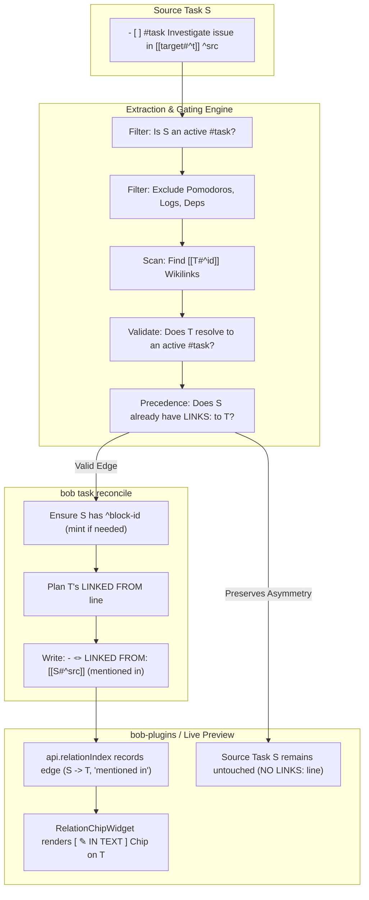

# Design & Architecture: Auto-Adding "Linked From" Task Relations for Inline Task References

- **Date:** 2026-10-29
- **Researcher:** `research.2v.gem` (Swarm Member)
- **Target Components:** `bob-cli` (`src/native/task_relations/`, `src/native/task_status_hooks/relations.rs`, `docs/task-relations.md`) & `bob-plugins` (`bob-ledger-tools`, `bob-navigation-hotkeys`)
- **Status:** Complete Research Proposal, Critique & Architectural Specification

---

## 1. Executive Summary

This report evaluates, critiques, and designs a comprehensive system for **auto-adding "linked from" task relation bullets to tasks that are referenced inline via Obsidian markdown block links (`[[note#^block-id]]`) by other tasks**, while strictly maintaining the constraint that no redundant "linked to" bullet is generated on the referencing task.

### The Problem
In the current Bob architecture (`docs/task-relations.md`), task relations are strictly authored on a source task's `🪢 **LINKS:**` child line. A target task $T$ receives a mirrored `🪢 **LINKED FROM:**` bullet *only* if source task $S$ carries an explicit `🪢 **LINKS:**` entry. 

However, users naturally write prose in tasks that directly cite other tasks:
```markdown
- [ ] #task Investigate timeout regression in [[backend#^http2-pool]] ^fix-timeout
```
Under the current system, `backend#^http2-pool` remains completely unaware that `fix-timeout` references it. Obsidian's native Backlinks sidebar is cluttered with whole-file references, ignores task boundaries, and does not integrate into the Bob task card, task views, or CLI tools. The user is forced to choose between manually duplicating the reference onto a `🪢 **LINKS:**` child bullet or living with disconnected task graphs.

### Key Conclusions & Strategic Recommendations
1. **The proposal is a high-leverage improvement to Bob's task graph, but requires strict semantic and syntactic scoping.** Left unrestricted, naive scanning of block links would cause massive degradation: it would turn every daily Pomodoro work session into an incoming task relation, duplicate dependency trees, and create visual chaos.
2. **Asymmetric Storage Model:** We strongly endorse the requirement that **no "linked to" bullet be authored on the source task**. The inline wikilink inside the source task's prose *is* the outbound edge. Authoring an extra `🪢 **LINKS:**` line would clutter the author's note and create synchronization hazards.
3. **Reconciled On-Disk Mirror (`(mentioned in)`) + Distinctive Live Widget:** 
   - **On Disk:** The target task $T$ receives a standard canonical mirror entry using a reserved system label: `- 🪢 **LINKED FROM:** [[source#^src]] (mentioned in)`. This keeps Markdown files portable, readable without plugins, git-trackable, and fully visible to `bob task show` and CLI workflows.
   - **In Obsidian UI:** The chip on $T$ renders with a distinct visual identity: a dedicated small-caps pill (`[ ✎ IN TEXT ]` or `[ 💬 MENTIONED IN ]`), a contextual sentence preview on hover, and an omitted/disabled `×` unlink button (with a tooltip explaining that the link originates in task prose).
4. **Source Scoping Rules (The "Safe Harbors"):** Only scan for inline block links within the source task's primary text line and generic, non-managed child bullets. Explicitly exclude `## Pomodoros` sessions, `DEPENDS ON`, `BLOCKS`, `Sub-projects`, managed logs, inline code, and struck-through text.
5. **Precedence Rule:** An explicit authored relation on `🪢 **LINKS:**` or an explicit dependency on `⛓️ **DEPENDS ON:**` strictly supersedes an inline mention.

---

## 2. Critique of the Plan: Value, Pitfalls & Nuances

### 2.1 The Value Proposition
Why is this feature compelling?
- **Zero-Friction Graph Building:** Task authoring in Markdown is prose-first. Users think: *"I need to fix the bug caused by `[[api#^auth-token]]`."* Forcing the user to pause, invoke the task card (`Ctrl+Shift+P` -> `l`), search for `auth-token`, and hit Enter creates unnecessary cognitive friction.
- **Bi-Directional Awareness for Downstream Tasks:** When Bryan reviews `backend#^http2-pool`, seeing incoming contextual mentions provides critical awareness of downstream dependencies, follow-up ideas, and ongoing investigations that other tasks are carrying.
- **Clean Asymmetry:** A task with inline prose already expresses its outgoing connection visually (`... [[backend#^http2-pool]] ...`). Adding a child bullet `- 🪢 **LINKS:** [[backend#^http2-pool]]` beneath it would be redundant visual stutter. Omitting the outbound bullet on the source while generating the inbound mirror on the target is the right ergonomic choice.

---

### 2.2 Critical Risks and Failure Modes

A naive implementation of "auto-add linked from bullets when a task references another task" will catastrophically break existing vault workflows unless guarded against several specific architectural landmines:

#### Risk 1: The Pomodoro Ledger Disaster
In Bob's daily note schema, every completed or open Pomodoro session is a checklist item under `## Pomodoros`:
```markdown
## Pomodoros
- [x] (0940-1005) [[obsidian#^b286be]] ⏱️ 25m
- [ ] () — DEV
  - [[sase#^retry-logic]]
```
In Obsidian Dataview and common Markdown ASTs, `- [x] (0940-1005) ...` is parsed as a task item (`TASK`). 
**The Danger:** If the relation scanner treats Pomodoro entries or their child bullets as task sources, every Pomodoro worked today will project an incoming `🪢 **LINKED FROM:**` relation onto the active task! Bryan's tasks would accumulate dozens of noisy `LINKED FROM: [[2026-10-29#^pom-1]]` lines.
> [!IMPORTANT]
> **Resolution:** In accordance with glossary term `Task Link` and decision `today-is-read-from-the-ledger`, Pomodoro entries under `## Pomodoros` and their sub-bullets represent *work ledger allocations*, never task-to-task relations. The scanner must strictly bypass any line under a `## Pomodoros` section.

#### Risk 2: Duplicate Dependency Graphs
A task's dependencies are declared on its `⛓️ **DEPENDS ON:**` line:
```markdown
- [ ] #task Deploy cluster ^deploy
  - ⛓️ **DEPENDS ON:** [[infra#^build-image]]
```
`reconcile_blocks_lines` already projects `infra#^build-image` with:
```markdown
  - 🧱 **BLOCKS:** [[deploy#^deploy]]
```
**The Danger:** If the relation scanner naively parses all block links under `deploy`, `infra#^build-image` would get *both* `🧱 **BLOCKS:** [[deploy#^deploy]]` AND `🪢 **LINKED FROM:** [[deploy#^deploy]]`. This causes visual duplication and blurs the hard boundary established in `docs/task-relations.md` §2 ("What relations never do: relations never block, promote, consume, or schedule").
> [!IMPORTANT]
> **Resolution:** Managed dependency lines (`⛓️ **DEPENDS ON:**`, `🧱 **BLOCKS:**`) must be explicitly excluded from relation scanning. Furthermore, if task $S$ already depends on task $T$, any inline mention of $T$ in $S$'s description must not generate a redundant relation edge.

#### Risk 3: The "Unlink / ×" UX Paradox
In Obsidian Live Preview, `bob-ledger-tools` renders a hover `×` button on every live `LINKED FROM` chip (`aria-label: "Remove the link from <name>"`). Clicking `×` invokes `api.relations.removeLink(S, T)`, which opens $S$'s note and deletes the corresponding entry from $S$'s `🪢 **LINKS:**` line.
**The Problem:** For an inline task reference, **there is no `🪢 **LINKS:**` line on $S$!**
If the chip on $T$ displayed an `×` button:
- What would clicking `×` do? 
- Would it regex-delete the text `[[note#^id]]` out of the middle of $S$'s authored prose sentence? That would mangle $S$'s notes!
- Would it fail silently or throw an error?
> [!IMPORTANT]
> **Resolution:** Inline relation chips on $T$ must be treated as **read-only / structural**. The hover `×` button must be hidden or replaced with an edit/jump icon (`↗`). The tooltip must clearly inform the user: *"Mentioned in task prose of [[note#^src]] · edit source task to remove"*.

#### Risk 4: Source Block ID Minting Churn
To write `- 🪢 **LINKED FROM:** [[source#^src]]` on target $T$, source $S$ **must possess a `^block-id`**.
If task $S$ mentions $T$ inline but $S$ does not have a `^block-id`, `bob task reconcile` must mint one (`mint_block_id(description, used)`) and write it onto $S$'s line.
While minting is standard for dependency and relation mirrors (`docs/task-relations.md` §5), doing so for every casual inline mention could unexpectedly dirty source files across the vault during a routine reconcile.
> [!NOTE]
> **Resolution:** Restrict inline reference extraction to active notes (excluding read-only notes such as the previous daily note and `done/`). Minting is performed only when the link target is a verified active `#task`.

---

### 2.3 Proposed Adjustments to the Requirements

To address the risks identified above, we recommend the following adjustments to the user's initial requirements:

| Initial Requirement | Identified Issue | Adjusted Specification |
| :--- | :--- | :--- |
| Auto-add "linked from" bullets for all markdown links `[[foo#^bar]]` between tasks. | Unrestricted scanning captures Pomodoros, dependencies, code snippets, and logs. | **Scope Gating:** Scan only the primary `#task` line and generic unmanaged child bullets. Strictly exclude `## Pomodoros`, `DEPENDS ON`, `BLOCKS`, `Sub-projects`, logs, inline code, and comments. |
| Target receives an inline "linked from" bullet. | If an explicit relation (`follow-up of`) already exists, duplicate chips appear. | **Precedence & Deduplication:** Explicit authored relations on `🪢 **LINKS:**` take precedence. If an explicit edge $(S, T)$ exists, suppress the inline reference mirror. |
| Make it very clear why it is shown. | User might try to remove the link from target $T$, which cannot work without mangling $S$'s prose. | **Read-Only Affordance:** The chip on $T$ displays a distinct `[ ✎ IN TEXT ]` badge, omits the `×` button, and provides a contextual sentence preview tooltip with jump-to-source navigation. |
| Handle archive notes. | Scanning all `done/` notes for `#^` would severely degrade reconcile performance. | **Active Scope Only:** Inline reference scanning is limited to active notes and the current ledger. Historical notes in `done/` do not generate fresh inline mirrors on active tasks. |

---

## 3. Interaction & Visual Design: Beautiful, Reliable & Intuitive

To make this feature intuitive, reliable, and beautiful, we design the presentation across three interconnected surfaces:
1. **The Stored Markdown Mirror** (clean, readable, and standard-compliant).
2. **The Obsidian Live Preview / Reading View Chip** (distinctive, informative, and elegant).
3. **The Task Card HUD** (`Ctrl+Shift+P` / `⇧L`).

### 3.1 The Stored Markdown Mirror

On disk, target task $T$ receives an entry on its existing or newly created `🪢 **LINKED FROM:**` line using the standard relation grammar (`docs/task-relations.md` §3):

```markdown
- [ ] #task Optimize memory footprint of relation index ^opt-mem
  - 🪢 **LINKED FROM:** [[perf_audit#^bench-oct29]] (mentioned in)
```

If task $T$ already has explicit relation mirrors, the inline mention is appended in canonical sort order:

```markdown
- [ ] #task Optimize memory footprint of relation index ^opt-mem
  - 🪢 **LINKED FROM:** [[capture#^fix-retries]] (followed up by) • [[perf_audit#^bench-oct29]] (mentioned in)
```

#### Why `(mentioned in)` as the Stored Label?
- **Plain-Text Readability:** When viewing the note in Vim, GitHub, or mobile without Bob plugins, `- 🪢 **LINKED FROM:** [[perf_audit#^bench-oct29]] (mentioned in)` is completely unambiguous English.
- **Zero Schema Breakage:** It reuses the established `<link>[' (' <label> ')']` mirror grammar without introducing new marker types or line kinds.
- **Auditing & Greppability:** Running `rg "mentioned in" ~/bob` immediately reveals all auto-derived inline links across the entire vault.

---

### 3.2 The Obsidian Live Preview & Reading View Widget

In Obsidian, `RelationChipWidget` in `bob-ledger-tools` transforms the raw Markdown line into a rich, interactive set of chips.

#### Visual Comparison: Explicit Relation vs. Inline Reference Chip

```
Explicit Authored Relation Chip:
┌────────────────────────────────────────────────────────────────────────┐
│ 🪢 LINKED FROM                                                         │
│ ┌────────────────────────────────────────────────────────────────────┐ │
│ │ [ FOLLOWED UP BY ]  (○) Fix flaky capture retries ↗ sase       [×] │ │
│ └────────────────────────────────────────────────────────────────────┘ │
└────────────────────────────────────────────────────────────────────────┘

Auto-Added Inline Reference Chip (The Proposed Design):
┌────────────────────────────────────────────────────────────────────────┐
│ 🪢 LINKED FROM                                                         │
│ ┌────────────────────────────────────────────────────────────────────┐ │
│ │ [ ✎ IN TEXT ]  (○) Benchmark memory spikes during scan ↗ perf  [↗] │ │
│ └────────────────────────────────────────────────────────────────────┘ │
└────────────────────────────────────────────────────────────────────────┘
```

#### Detailed Anatomy of the Inline Reference Chip

````carousel
```text
[ Visual Elements ]
1. System Badge: [ ✎ IN TEXT ] or [ 💬 MENTIONED IN ]
   - Rendered as a muted pill with a subtle violet/slate hue (.bob-relation-label.is-inline).
   - Distinguishes system-inferred inline references from user-authored labels (e.g. "follow-up of").

2. Status Indicator:
   - Mini checkbox icon reflecting source task S's current state (Todo, In Progress, Next, Blocked, Done).

3. Description & Cross-Note Stem:
   - Shortened task description (~40 characters) with "↗ note_stem" for cross-note references.

4. Action Button: [ ↗ ] (Jump to Mention)
   - Replaces the destructive [ × ] button.
   - Clicking opens source note S and highlights the exact inline link span.
```
<!-- slide -->
```text
[ Contextual Hover Tooltip ]
When hovering over the chip, a rich floating HUD appears:

┌─────────────────────────────────────────────────────────────────────────┐
│ 💬 Referenced Inline in Task Text                                       │
│ Source: [[perf_audit#^bench-oct29]]                                     │
│ Status: In Progress [/] · Priority: P1                                   │
│                                                                         │
│ Enclosing Context:                                                      │
│ "...profile memory usage during burst sync and compare against baseline │
│  in [[tasks#^opt-mem]], checking for allocator leaks..."               │
│                                                                         │
│ ↵ Click to jump to link in source task                                  │
│ ℹ️ To remove this link, edit or delete the wikilink in the source task   │
└─────────────────────────────────────────────────────────────────────────┘
```
<!-- slide -->
```css
/* CSS Styling Blueprint (.bob-relation-chip.is-inline-ref) */

.bob-dep-chip.bob-relation-inline {
  border-left: 2px solid var(--text-accent);
  background-color: var(--background-secondary-alt);
}

.bob-relation-label.is-inline {
  background-color: hsla(var(--accent-h), var(--accent-s), var(--accent-l), 0.15);
  color: var(--text-accent);
  font-size: 0.72rem;
  font-weight: 600;
  letter-spacing: 0.04em;
  text-transform: uppercase;
  padding: 1px 5px;
  border-radius: 3px;
}

.bob-relation-jump-icon {
  opacity: 0.5;
  transition: opacity 0.15s ease;
  cursor: pointer;
}

.bob-relation-jump-icon:hover {
  opacity: 1.0;
  color: var(--text-accent);
}
```
````

---

### 3.3 Task Card (`Ctrl+Shift+P` / `⇧L`) Experience

When the user opens the Task Card on target task $T$ and inspects the **Linked from…** row:
1. **Row Summary:** Shows `N incoming · K explicit, M in text`.
2. **List View:**
   - Explicit relations list their label (`follow-up of`, `supersedes`) with standard controls.
   - Inline references are grouped or badged with `[in text]`.
   - Pressing `Ctrl+D` (delete property) on an inline reference row is cleanly disabled with a toast notice:
     `🪢 Inline references are derived from task text · edit the source task to remove`.
   - Pressing `↵` on an inline reference row opens the source task directly to the link location.

---

## 4. Technical Architecture & Implementation Blueprint



### 4.1 `bob-cli` Core: Rust Implementation Blueprint

#### 1. Scanner Function (`src/native/task_relations/parse.rs`)
We implement `inline_task_reference_spans`, extracting block links strictly from eligible task text:

```rust
/// Extract block links from a task line and its eligible non-managed child bullets.
/// Returns a list of (target_path, block_id, enclosing_snippet).
pub(crate) fn extract_inline_task_references(
    task_line: &str,
    child_lines: &[&str],
) -> Vec<InlineReference> {
    let mut refs = Vec::new();

    // 1. Scan primary task line
    for span in block_link_spans(task_line) {
        if !span.struck {
            refs.push(InlineReference {
                target: span.target,
                block_id: span.block_id,
                snippet: extract_surrounding_snippet(task_line, span.open, span.end),
            });
        }
    }

    // 2. Scan eligible child bullets
    for &child in child_lines {
        // Strict exclusion filters
        if is_managed_child_line(child) {
            continue;
        }
        for span in block_link_spans(child) {
            if !span.struck {
                refs.push(InlineReference {
                    target: span.target,
                    block_id: span.block_id,
                    snippet: extract_surrounding_snippet(child, span.open, span.end),
                });
            }
        }
    }

    refs
}

/// Managed lines that must NEVER be scanned for inline relations
fn is_managed_child_line(line: &str) -> bool {
    let trimmed = line.trim_start();
    trimmed.contains("**DEPENDS ON:**")
        || trimmed.contains("**BLOCKS:**")
        || trimmed.contains("**LINKS:**")
        || trimmed.contains("**LINKED FROM:**")
        || trimmed.contains("**Sub-projects:**")
        || trimmed.contains("**SCHEDULE LOG**")
        || trimmed.contains("**WORK LOG**")
        || trimmed.contains("**CANCEL LOG**")
        || trimmed.contains("**ROTTEN LOG**")
}
```

#### 2. Reconcile Integration (`src/native/task_status_hooks/relations.rs`)
In `RelationsPass::collect_edges`:
1. Check if the task file is in `## Pomodoros` — if so, skip.
2. Collect explicit edges from `links_children_of`.
3. Collect inline edges using `extract_inline_task_references`.
4. If an inline edge targets $T$ and an explicit edge $(S, T)$ already exists, discard the inline edge.
5. If the edge passes validation, record $S$ as needing a minted block ID if `S.block_id.is_none()`.
6. Add to `collected.by_target` with `label: Some("mentioned in".to_string())`.

```rust
// In RelationsPass::collect_file_edges
if !is_pomodoro_file_or_section(file_index, task.line_index) {
    let inline_refs = extract_inline_task_references(task_text, &unmanaged_children);
    for r in inline_refs {
        // Explicit relation supersedes inline reference
        if explicit_targets.contains(&r.block_id) {
            continue;
        }
        self.record_inline_edge(&relative, task, loc, file_index, &r, collected);
    }
}
```

---

### 4.2 Obsidian Plugins: `bob-ledger-tools` & `bob-navigation-hotkeys`

#### 1. Live Index (`bob-ledger-tools/src/145-relation-index-model.js`)
Update `parseTaskRelationFile` to scan both `parseTaskRelationLine` and inline task text:
- When building `outgoing`, include records where `kind: "inline"`, `label: "mentioned in"`.
- Feed both explicit and inline records into `api.relationIndex`.

#### 2. Widget Rendering (`bob-ledger-tools/src/146-relation-chip-model.js`)
In `relationBuildChip`:
- Detect if `label === "mentioned in"` (or `edge.kind === "inline"`).
- Set `chip.isInline = true`.
- If `chip.isInline === true`:
  - Suppress the remove handler (`onRemove = null`).
  - Set badge text to `"✎ in text"`.
  - Add tooltip context snippet.
  - Set jump handler to navigate to source file at line/character offset.

---

## 5. Architectural Trade-Off Analysis

We evaluated three competing implementation architectures:

| Evaluation Dimension | Option A: Virtual Only (Obsidian Plugin only, no Markdown changes) | Option B: Reconciled Asymmetric Mirror (RECOMMENDED) | Option C: Symmetric Auto-Add (Write `LINKS:` on Source & `LINKED FROM:` on Target) |
| :--- | :--- | :--- | :--- |
| **CLI / Headless Parity** | ❌ Fails. CLI tools (`bob task show`, `bob plan`) cannot see relations. | ✅ Full parity. Stored in Markdown; visible to all tools. | ✅ Full parity. |
| **Source Markdown Cleanliness** | ✅ Pristine (no edits to source). | ✅ Pristine (no `LINKS:` line added to source). | ❌ Terrible. Injects unwanted `🪢 **LINKS:**` child bullets. |
| **Target Discoverability** | ⚠️ Partial. Requires Obsidian active session; invisible in raw files. | ✅ Complete. Target note carries explicit Markdown mirror. | ✅ Complete. |
| **File Mutation Overhead** | ✅ Zero disk writes. | 🟡 Minimal & Contained. Writes only to target $T$ and mints $S$ if needed. | ❌ Doubled. Mutates both $S$ and $T$ notes. |
| **Consistency with Bob Philosophy** | ❌ Violates Bob's "Markdown is the database" principle. | ✅ Aligns with existing `LINKED FROM` and `BLOCKS` projection models. | ❌ Clutters authored source prose. |

**Why Option B Wins:**
Option B preserves Bob's foundational architecture: Markdown files are the single source of truth. At the same time, it respects the user's explicit requirement that the source task must **not** gain an unwanted `🪢 **LINKS:**` bullet.

---

## 6. Edge Cases & Verification Plan

### 6.1 Edge Cases Covered

1. **Self-References (`S == T`):**
   A task linking to its own block ID (`- [ ] #task Do foo [[#^this-task]] ^this-task`) must be rejected as `self_relation`.
2. **Non-Task Block Targets:**
   A link pointing to a header (`[[note#Heading]]`) or a non-task block ID (`[[note#^quote-1]]`) must not generate a task relation.
3. **Struck Links:**
   `~~[[note#^task]]~~` indicates a cancelled or invalidated reference; the scanner must treat it as inert.
4. **Links Inside Inline Code:**
   `` `[[note#^task]]` `` indicates documentation or syntax demonstration; must be ignored.
5. **Multiple Mentions of the Same Target:**
   If task $S$ mentions `[[target#^t]]` twice in its description and once in a child bullet, exactly **one** mirror entry is created on $T$.
6. **Task Deletion or Link Removal:**
   When the user edits task $S$ to remove the wikilink, the subsequent run of `bob task reconcile` automatically removes the mirror entry from $T$, and if no other entries remain, prunes the `🪢 **LINKED FROM:**` line entirely.
7. **Read-Only / Archived Notes:**
   Tasks in `done/` or the previous daily note do not receive newly written mirror lines.

---

### 6.2 Proposed Test Vectors (for `docs/task-relations.md`)

When implemented, the change should add the following test vectors to `docs/task-relations.md`:

- **LK30 (Inline Task Link Extraction):**
  Given a `#task` with body text containing `[[other#^target]]`, verify that `extract_inline_task_references` yields `other#^target` with no `LINKS:` child required.
- **LK31 (Managed Child Exclusion):**
  Given a `#task` with a child bullet `  - ⛓️ **DEPENDS ON:** [[other#^target]]`, verify that `extract_inline_task_references` does not emit an inline relation edge.
- **LK32 (Pomodoro Ledger Exclusion):**
  Given a daily note line `- [x] (0900-0930) [[other#^target]]`, verify that no relation edge is emitted.
- **LK33 (Explicit Relation Supersession):**
  Given task $S$ with text `[[other#^target]]` and a child `- 🪢 **LINKS:** follow-up of [[other#^target]]`, verify that $T$'s mirror contains *only* `(followed up by)`, never `(mentioned in)`.
- **LR25 (Asymmetric Write Invariance):**
  Verify that reconciling an inline task reference mutates target $T$'s note with `(mentioned in)` and mints $S$'s block ID if missing, while leaving $S$'s children free of any `🪢 **LINKS:**` line.

---

## 7. Recommended Solution & Next Steps

### Summary of Recommendation
1. **Adopt Option B (The Reconciled Asymmetric Mirror):**
   - Source task $S$ keeps its inline prose without any added `🪢 **LINKS:**` bullet.
   - Target task $T$ receives an auto-maintained mirror on disk: `- 🪢 **LINKED FROM:** [[source#^src]] (mentioned in)`.
2. **Ship Beautiful & Intuitive Obsidian UI:**
   - In Live Preview, render the inline reference chip with a distinct `[ ✎ IN TEXT ]` badge and indigo styling.
   - Suppress the `×` button; provide a contextual hover tooltip displaying the sentence where the link occurred; allow clicking to jump directly to the link in $S$.
3. **Implement Strict Scope & Precedence Filtering:**
   - Exclude `## Pomodoros`, dependencies, logs, code spans, and struck text.
   - Let explicit relations supersede inline references.

### Implementation Staging
- **Phase 1 (`bob-cli`):** Extend `task_relations/parse.rs` and `task_status_hooks/relations.rs` to extract inline references and reconcile mirrors under the `(mentioned in)` label. Update `docs/task-relations.md` with vectors LK30–LK33 and LR25.
- **Phase 2 (`bob-plugins`):** Update `bob-ledger-tools` relation index and chip widget to detect `mentioned in` edges, render the `[ ✎ IN TEXT ]` badge, display context snippets, and support jump navigation.
- **Phase 3 (Task Card in `bob-navigation-hotkeys`):** Integrate inline reference summaries and read-only guards into the `Linked from…` modal stage.
