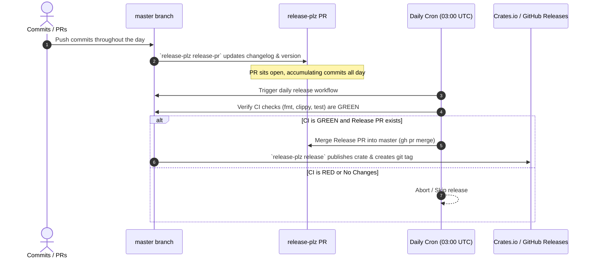

# Research Report: Automated Publishing Strategy for `bob-cli` via `release-plz` and Crates.io

- **Researcher**: `research.25.gem`
- **Date**: 2026-10-19
- **Repository**: `bob-cli` (`bobs-org/bob-cli`)
- **Status**: Complete

---

## 1. Executive Summary

The user has proposed establishing automated releases for `bob-cli` to a package registry (`cargo.io?`, i.e., [crates.io](https://crates.io)) using [`release-plz`](https://github.com/release-plz/release-plz) with a frequency constraint of **at most once a day**, contingent on **all CI checks being green**.

This report evaluates that proposal across four key dimensions:
1. **Registry & Naming Realities**: Clarification of the target registry (`crates.io`) and a critical finding: **`bob-cli` and `bob` are already registered and owned by third parties on crates.io**.
2. **Crate Health & Packaging Audit**: An audit of the `bob-cli` repository reveals that unconfigured packaging currently produces an **8.8 MB compressed (30.2 MB uncompressed)** tarball with 956 files—dangerously close to crates.io's hard 10 MB compressed limit—and lacks required licensing metadata. Furthermore, native C dependencies (`rquickjs` QuickJS C engine, `rusqlite` bundled) make compilation from source heavy for end users.
3. **Critique of the Daily Crates.io Publishing Model**: While `release-plz` is well-suited for automated changelog management and Conventional Commits semver calculation, publishing daily releases directly to an immutable registry like crates.io is fraught with operational drawbacks (registry pollution, rapid patch inflation, and permanent persistence of regressions). Pure source distribution via `cargo install` is also suboptimal for an end-user CLI application compared to prebuilt release binaries.
4. **Architectural Implementation**: We analyze three architectures to achieve "at most once a day when CI checks are green" and provide a production-ready implementation plan.

### Key Conclusions & Recommended Verdict
* **Is publishing a package using `release-plz` a good idea?** **Yes**, `release-plz` is an outstanding fit for `bob-cli` because the repository already strictly adheres to Conventional Commits (`feat:`, `fix:`, `docs:`), and `release-plz` automates changelog generation, PR creation, and release tagging with minimal boilerplate.
* **Is publishing directly to crates.io as `bob-cli` viable?** **No**. `bob-cli` is taken on crates.io by an AI agent framework crate (`longcipher/bob`). The crate must be renamed (e.g. to `bobs-cli` or `bob-vault-cli`) if publishing to crates.io. Binary names remain `bob`, `bob_pomodoro`, etc.
* **Is unattended daily automated publishing to crates.io advisable?** **No**. We recommend an adjusted cadence: use `release-plz` to continuously maintain an open Release PR (accumulating daily changes and changelogs), but require a scheduled daily auto-merge or human approval, coupled with **GitHub Releases distributing precompiled binaries** (via `taiki-e/upload-rust-binary-action` or `cargo-dist`).

---

## 2. Repository Audit & Baseline Findings

An inspection of the `bob-cli` repository (`master` branch, workspace #22) reveals several foundational constraints:

### 2.1 The Crates.io Namespace Collision
A search of crates.io confirms that both natural names are occupied:
* **`bob-cli`**: Registered by `longcipher/bob` ("CLI app for Bob - a general-purpose AI agent framework", version `0.3.2`, active).
* **`bob`**: Registered by `jperkin/bob` ("Fast, robust, powerful, user-friendly pkgsrc package builder", version `1.0.0`).

Because crates.io has a flat, global namespace without organization prefixes (unlike npm `@scope/package`), `bobs-org/bob-cli` **cannot** be published under `name = "bob-cli"` or `name = "bob"`.

Available alternatives on crates.io:
* `bobs-cli` (unclaimed as of October 2026)
* `bob-vault-cli` (unclaimed)
* `bob-pkm` (unclaimed)
* `bob-tools` (unclaimed)

> **Important**: Changing the package name in `Cargo.toml` to `bobs-cli` does **not** change the binary names. The `[[bin]]` tables in `Cargo.toml` (`name = "bob"`, `name = "bob_pomodoro"`, `name = "bob_notify"`, `name = "tmux_bob_pomodoro"`) ensure that running `cargo install bobs-cli` installs the binaries as `bob`, `bob_pomodoro`, etc., into `~/.cargo/bin`.

### 2.2 Missing License Metadata
Running `cargo package --no-verify` yields:
```text
warning: manifest has no license or license-file
```
Crates.io strictly enforces that every published crate must declare an SPDX license expression (e.g., `license = "MIT OR Apache-2.0"`) or reference a `license-file`. Without this, `cargo publish` fails immediately.

### 2.3 Package Bloat & Impending Crates.io Rejection
The current `Cargo.toml` includes:
```toml
include = [
    "/Cargo.toml",
    "/Cargo.lock",
    "/README.md",
    "/docs/**",
    "/assets/**",
    "/justfile",
    "/src/**",
    "/scripts/**",
    "/tests/**",
]
```
Running `cargo package` packages **956 files, totaling 30.2 MiB uncompressed and 8.8 MiB compressed**.
* Crates.io has a **hard limit of 10 MiB (10,485,760 bytes)** for compressed `.crate` files.
* At 8.8 MiB, `bob-cli` is consuming 88% of the maximum allowable package size. The bloat is driven by `tests/fixtures/**` (5.4 MB of synthetic Obsidian test vaults, PDFs, and JSON files) and `assets/**` (5.8 MB).
* Adding a few more test fixtures will cause `cargo publish` to be rejected outright by crates.io.
* **Remediation**: The `include` list must be pruned to only include build-essential sources: `Cargo.toml`, `Cargo.lock`, `README.md`, `LICENSE*`, and `/src/**`. Tests and large fixtures do not belong in a binary distribution crate.

### 2.4 Compilation Friction: Native C Dependencies
`bob-cli` is not a pure-Rust crate:
* `rquickjs = "0.12.1"`: Compiles the C-based QuickJS JavaScript engine from source.
* `rusqlite = { version = "0.40", features = ["bundled"] }`: Compiles SQLite C sources on macOS targets.
* `libc = "0.2"`, `lopdf = "0.40.0"`, `image = "0.25"`.

When users install via `cargo install <crate>`, cargo downloads sources and compiles all 150+ transitive dependencies, including native C code. This requires a working C compiler (`clang`/`gcc`), takes 2–5 minutes on modern multi-core machines, and can fail on platforms lacking C build tools. This argues strongly for providing precompiled binaries alongside or instead of pure crates.io source distribution.

### 2.5 Git Conventions & Branching
* **Default Branch**: The repository default branch is `master` (not `main`). Standard `release-plz` examples assume `main`, so workflows must be explicitly configured for `master`.
* **Commit Conventions**: Inspection of `git log` shows that 100% of commits follow Conventional Commits:
  - `feat(task-move): add snapshot-only task-move planner`
  - `fix(ref): preserve underline host occurrence and wrap pairing`
  - `docs(today-marks): document the display contract`
  This makes `release-plz` an ideal match, as it can parse every commit without custom regex re-mapping.
* **Existing CI**: There are currently **no GitHub Actions workflows** (`.github/workflows` does not exist). CI verification is defined entirely in `justfile` (`just check` runs `cargo fmt --check`, `cargo clippy --all-targets --all-features`, and `cargo test --no-fail-fast`).

---

## 3. Critique of the Proposed Plan

### 3.1 Clarification: `cargo.io` vs `crates.io`
There is no `cargo.io`. The official package registry for the Rust language ecosystem is **crates.io** (`https://crates.io`), managed by the Rust Foundation and the Cargo team. Cargo is the command-line tool; crates.io is the registry.

### 3.2 Is Publishing `bob-cli` to Crates.io a Good Idea?
**Verdict**: *Marginal benefit for significant overhead; secondary to GitHub Release binaries.*

#### The Argument For Crates.io
* Convenience for Rust developers: Anyone with `cargo` installed can run `cargo install bobs-cli`.
* Ecosystem discoverability: Appears on `crates.io`, `lib.rs`, and docs.rs.
* Automated tooling: Integrates with `cargo-update` (`cargo install-update`) and `cargo-binstall`.

#### The Argument Against Crates.io
* **End-user profile**: `bob-cli` is a personal GTD/Obsidian productivity harness designed by and for Bryan (with custom integrations for Bryan's Obsidian plugins, macOS menu-bar capture, and Google Keep). It is not a general-purpose library, nor is it a mass-market CLI utility like `ripgrep` or `bat`.
* **Source compilation penalty**: End users without a full Rust + C compilation environment cannot easily install it.
* **Immutability & Permanence**: Crates.io versions are **forever immutable**. Once published, a version cannot be deleted or re-released, only yanked. Every published release permanently consumes namespace and storage on crates.io.

### 3.3 Is Releasing "At Most Once a Day" a Good Idea?
**Verdict**: *Batched releasing is a sound instinct, but automated daily publishing to crates.io is problematic.*

#### Why Batching is Good
In standard continuous integration, releasing on every single merged PR can lead to 5–15 releases per day during active development. This causes:
1. Version inflation (`0.1.1` to `0.1.15` in one afternoon).
2. Fragmentation in changelogs.
3. Excessive notification spam for subscribers or downstream consumers.
4. Heavy crates.io registry churn.

Capping release frequency to **at most once a day** prevents this micro-release churn.

#### Why Daily Automated Releases to Crates.io Are Dangerous
1. **Patch Inflation**: Over a single year of daily active development, the crate will accumulate 250–350 patch versions on crates.io. Because each version is immutable, small mistakes, typo fixes, or intermediate refactors get permanently immortalized in the public registry.
2. **The "Green CI" Trap**: "Green CI" means tests passed, lints passed, and formatting passed. It does **not** mean the release is functionally free of regressions or that a newly introduced command-line behavior feels right in daily workflow. Releasing automatically to a public registry at 03:00 UTC without human smoke testing means that broken code gets pushed to end users while maintainers sleep.
3. **No Retraction**: If a bad build goes out on day N, you cannot fix it by overwriting `v0.1.42`; you must push `v0.1.43`.

### 3.4 The Superior Alternative: Binary Distribution & On-Demand / Cadence Releases
For CLI applications, modern Rust best practice is:
1. **GitHub Releases as the Primary Distribution Channel**:
   - Provide precompiled, statically linked binaries for `x86_64-unknown-linux-gnu`, `aarch64-unknown-linux-gnu`, `x86_64-apple-darwin`, and `aarch64-apple-darwin` (Apple Silicon).
   - Fast installation in seconds without compiling.
2. **`release-plz` for Release Management & Changelog Automation**:
   - Let `release-plz` manage versioning, Conventional Commits changelogs, and release PRs.
3. **Crates.io as an Optional / Secondary Mirror**:
   - Publish to crates.io under `bobs-cli` so `cargo install` and `cargo-binstall` work, but do not make it the sole or un-curated release channel.
4. **Cadence Adjustment**:
   - Let `release-plz` keep the Release PR continuously up to date on `master`.
   - Merge the Release PR **when ready** (either on a weekly cadence or via an explicit one-click approval), rather than unattended daily cron publishing.

---

## 4. How `release-plz` Works

`release-plz` divides release automation into two distinct operations:

```
[ Commits to master ] 
         │
         ▼
[ release-plz release-pr ] ──► Analyzes Conventional Commits
         │                 ──► Bumps version in Cargo.toml & Cargo.lock
         │                 ──► Updates CHANGELOG.md
         │                 ──► Opens / Updates single "Release PR" (branch: release-plz-...)
         │
    (Merge PR)
         │
         ▼
[ release-plz release ]    ──► Detects unreleased version in Cargo.toml
                           ──► Tags commit (e.g. v0.2.0)
                           ──► Runs `cargo publish`
                           ──► Creates GitHub Release with notes
```

### Critical Mechanism: `release` Does Not Edit `Cargo.toml`
A common misconception is that running `release-plz release` on a schedule will analyze commits and publish. **It will not.**
* `release-plz release` only publishes crates whose version in `Cargo.toml` is **already higher** than the version in the registry / git tags.
* The version in `Cargo.toml` is updated exclusively by `release-plz release-pr` (in a PR) or `release-plz update` (locally on the branch).
* Therefore, to release "at most once a day", you must coordinate how and when the version bump gets into `master`.

---

## 5. Architectural Options for "At Most Once a Day When CI Checks Are Green"

We evaluate three practical implementation patterns.

### Option 1: The Scheduled Daily Release PR Auto-Merge (Recommended for `release-plz` Native Design)

In this architecture, `release-plz` operates in its standard two-job PR model, but the PR is merged on a daily schedule if CI checks are green.



#### How it works:
1. **Continuous PR Maintenance**: Every push to `master` triggers a lightweight workflow that runs `release-plz release-pr`. If there are new `feat:` or `fix:` commits, `release-plz` updates the existing open Release PR branch (`release-plz-...`), updating `CHANGELOG.md` and incrementing the version in `Cargo.toml`.
2. **No Eager Releases**: The Release PR is *not* immediately merged. Commits accumulate over the course of the day into a single cohesive release draft.
3. **Daily Scheduled Gate**: A GitHub Actions workflow runs once per day (e.g., at 03:00 UTC).
   - It checks whether all required status checks on `master` are green.
   - It checks whether an open `release-plz` PR exists.
   - If green and PR exists: It automatically merges the PR using `gh pr merge --squash --auto` or `gh pr merge --admin`.
4. **Publishing Trigger**: Merging the PR creates a commit on `master` with the bumped `Cargo.toml`. This triggers the `release-plz release` job, which runs `cargo publish` to crates.io and publishes the GitHub release with tags.

#### Evaluation:
* **Meets "At Most Once a Day"**: Yes, exactly one merge can occur per 24 hours. If no changes landed, no PR exists, so 0 releases occur.
* **Meets "When CI Checks Are Green"**: Yes, the daily job checks commit status before merging.
* **Maintainer Override**: The maintainer can inspect the Release PR at any time or close it if a release should be withheld.

---

### Option 2: Scheduled Daily Direct Release (Cron-only, No PR)

In this architecture, no release PR is created. Instead, a scheduled job runs once a day, checks CI, updates `Cargo.toml` directly on `master`, and publishes.

#### How it works:
1. At 03:00 UTC, a GitHub Action runs on `master`.
2. Step 1 runs the full test suite (`cargo fmt --check`, `cargo clippy`, `cargo test`). If any step fails, the job halts immediately.
3. Step 2 installs `release-plz` and runs `release-plz update`.
4. Step 3 checks `git status --porcelain`. If `Cargo.toml` or `CHANGELOG.md` were modified:
   - The workflow commits the bump directly to `master`: `git commit -m "chore: release v... [skip ci]"`.
   - Pushes to `master`.
   - Runs `release-plz release` to publish to crates.io and GitHub Releases.

#### Evaluation:
* **Advantages**: Clean; no lingering PRs in the GitHub repository.
* **Disadvantages**: Requires granting the GitHub Action permission to push directly to protected `master` branches, bypassing pull request requirements. Furthermore, if the release fails halfway through (e.g., git commit succeeds but crates.io rejects), `master` is left with a release commit that wasn't published.

---

### Option 3: Continuous PR Maintenance with Human-Gated Merging (Recommended Alternative)

Instead of a cron bot merging the Release PR automatically:
1. `release-plz release-pr` keeps the Release PR always up to date.
2. CI verifies every PR and commit.
3. Bryan reviews and merges the Release PR when he is satisfied with the day's or week's work.
4. Merging the PR immediately triggers `release-plz release`.

#### Evaluation:
* This retains 100% of the automation benefits (changelog generation, semver calculation, tag creation, crates.io publishing) while eliminating the risk of unattended broken releases to an immutable registry.

---

## 6. Detailed Requirements Adjustments

Based on the research findings, we propose the following specific adjustments to the original requirements:

| # | Original Requirement | Finding / Reality | Recommended Adjustment |
|---|----------------------|-------------------|------------------------|
| **1** | Publish package as `bob-cli` | `bob-cli` is already taken on crates.io by `longcipher/bob`. | Rename crate package in `Cargo.toml` to **`bobs-cli`**. Preserve binary name `bob` via `[[bin]] name = "bob"`. |
| **2** | Target `cargo.io?` | Target is `crates.io`. Requires license metadata and <10MB package size. | Add `license = "MIT OR Apache-2.0"` to `Cargo.toml`. Prune `include` array to exclude test fixtures and assets. |
| **3** | Unconditional daily publishing | Crates.io versions are permanent; daily releases generate 300+ immutable versions/year. | Filter releases using `release_commits = "^(feat\|fix)"` in `release-plz.toml` so documentation or chore commits do not trigger daily version bumps. |
| **4** | Source distribution only (`cargo install`) | Compiling `rquickjs` (QuickJS C code) and `rusqlite` takes 2–5 minutes and requires C compilers. | Accompany `release-plz` with a **GitHub Release binary asset workflow** (multi-platform prebuilt binaries for Linux and macOS). |
| **5** | Branching assumption | Default branch is `master`, not `main`. | Explicitly configure all workflows and `release-plz` for `master`. |

---

## 7. Recommended Solution & Implementation Plan

### 7.1 Step 1: Update `Cargo.toml`

Modify `Cargo.toml` to:
1. Rename package to `bobs-cli`.
2. Add license specification.
3. Restrict `include` to eliminate the 8.8 MB fixture bloat.

```diff
--- a/Cargo.toml
+++ b/Cargo.toml
@@ -1,19 +1,18 @@
 [package]
-name = "bob-cli"
+name = "bobs-cli"
 version = "0.1.0"
 edition = "2024"
 description = "Bob command-line tools"
 repository = "https://github.com/bobs-org/bob-cli"
+license = "MIT OR Apache-2.0"
+readme = "README.md"
 default-run = "bob"
 include = [
     "/Cargo.toml",
     "/Cargo.lock",
     "/README.md",
-    "/docs/**",
-    "/assets/**",
-    "/justfile",
+    "/LICENSE*",
     "/src/**",
-    "/scripts/**",
-    "/tests/**",
 ]
```

*Verification*: Running `cargo package --list` should show only ~50 source files instead of 956 files, dropping compressed package size from 8.8 MiB to under 250 KiB.

---

### 7.2 Step 2: Add `release-plz.toml`

Create `release-plz.toml` in the repository root:

```toml
[workspace]
# Only create releases if there is at least one feat or fix commit
release_commits = "^(feat|fix)"

# PR configuration
pr_branch_prefix = "release-plz-"
pr_labels = ["release", "automated-pr"]

# Disable semver API checks on binary executables (bob-cli has no [lib])
semver_check = false

# Allow publishing even if working tree has untracked files in CI
publish_allow_dirty = false

[changelog]
# Standard Conventional Commits changelog layout
protect_breaking_commits = true
```

---

### 7.3 Step 3: Implement Continuous CI Gate (`.github/workflows/ci.yml`)

Create `.github/workflows/ci.yml` to establish the canonical verification gate that tests all pull requests and pushes to `master`:

```yaml
name: CI

on:
  push:
    branches: [master]
  pull_request:
    branches: [master]

concurrency:
  group: ci-${{ github.ref }}
  cancel-in-progress: true

jobs:
  check:
    name: Verify Codebase (fmt, clippy, test)
    runs-on: ubuntu-latest
    steps:
      - name: Checkout repository
        uses: actions/checkout@v4

      - name: Install Rust toolchain
        uses: dtolnay/rust-toolchain@stable
        with:
          components: rustfmt, clippy

      - name: Cache Cargo dependencies
        uses: Swatinem/rust-cache@v2

      - name: Run cargo fmt check
        run: cargo fmt --check

      - name: Run clippy
        run: cargo clippy --all-targets --all-features -- -D unused -A unused_extern_crates -A unused_macro_rules -D private_interfaces

      - name: Run tests
        run: cargo test --no-fail-fast
```

---

### 7.4 Step 4: Implement Release PR Maintenance (`.github/workflows/release-pr.yml`)

Create `.github/workflows/release-pr.yml` to automatically prepare and update the Release PR on every push to `master`:

```yaml
name: Release-plz PR

on:
  push:
    branches: [master]

jobs:
  release-plz-pr:
    name: Update Release PR
    runs-on: ubuntu-latest
    if: github.repository_owner == 'bobs-org'
    permissions:
      contents: write
      pull-requests: write
    concurrency:
      group: release-plz-pr-${{ github.ref }}
      cancel-in-progress: false
    steps:
      - name: Checkout repository
        uses: actions/checkout@v4
        with:
          fetch-depth: 0

      - name: Install Rust toolchain
        uses: dtolnay/rust-toolchain@stable

      - name: Run release-plz release-pr
        uses: release-plz/action@v0.5
        with:
          command: release-pr
        env:
          GITHUB_TOKEN: ${{ secrets.GITHUB_TOKEN }}
```

---

### 7.5 Step 5: Implement Daily Release Gate (`.github/workflows/daily-release.yml`)

Create `.github/workflows/daily-release.yml` to enforce the **at most once a day** constraint, checking that `master` CI is green before merging the Release PR:

```yaml
name: Daily Release Gate

on:
  schedule:
    # Run daily at 03:00 UTC
    - cron: '0 3 * * *'
  # Allow manual trigger from GitHub Actions UI
  workflow_dispatch:

jobs:
  check-and-merge:
    name: Verify CI & Merge Release PR
    runs-on: ubuntu-latest
    if: github.repository_owner == 'bobs-org'
    permissions:
      contents: write
      pull-requests: write
    steps:
      - name: Checkout repository
        uses: actions/checkout@v4

      - name: Check latest commit status on master
        env:
          GH_TOKEN: ${{ secrets.GITHUB_TOKEN }}
        run: |
          LATEST_SHA=$(git rev-parse HEAD)
          echo "Checking status for commit $LATEST_SHA on master..."
          
          # Query GitHub API for commit check runs
          STATUS=$(gh api repos/${{ github.repository }}/commits/$LATEST_SHA/check-runs \
            --jq '.check_runs[] | select(.name == "Verify Codebase (fmt, clippy, test)") | .conclusion')
          
          echo "CI conclusion: $STATUS"
          if [ "$STATUS" != "success" ]; then
            echo "CI check is not green (status: $STATUS). Skipping daily release."
            exit 0
          fi

      - name: Find and Merge Release PR
        env:
          GH_TOKEN: ${{ secrets.GITHUB_TOKEN }}
        run: |
          # Find open release PR created by release-plz
          PR_NUMBER=$(gh pr list --state open --label "release" --json number --jq '.[0].number')
          
          if [ -z "$PR_NUMBER" ] || [ "$PR_NUMBER" == "null" ]; then
            echo "No open release PR found. Nothing to release today."
            exit 0
          fi
          
          echo "Found open Release PR #$PR_NUMBER. Merging..."
          gh pr merge $PR_NUMBER --squash --delete-branch
```

---

### 7.6 Step 6: Implement Crates.io Publishing on Release Merge (`.github/workflows/release-publish.yml`)

When the Release PR is merged into `master`, this workflow triggers and executes `release-plz release`:

```yaml
name: Release Publish

on:
  push:
    branches: [master]

jobs:
  release-plz-release:
    name: Publish to Crates.io & Create GitHub Release
    runs-on: ubuntu-latest
    if: github.repository_owner == 'bobs-org'
    permissions:
      id-token: write  # Required for crates.io Trusted Publishing (OIDC)
      contents: write  # Required to push git tags & create GitHub releases
    steps:
      - name: Checkout repository
        uses: actions/checkout@v4
        with:
          fetch-depth: 0

      - name: Install Rust toolchain
        uses: dtolnay/rust-toolchain@stable

      - name: Run release-plz release
        uses: release-plz/action@v0.5
        with:
          command: release
        env:
          GITHUB_TOKEN: ${{ secrets.GITHUB_TOKEN }}
          # If using API token instead of OIDC, specify CARGO_REGISTRY_TOKEN:
          # CARGO_REGISTRY_TOKEN: ${{ secrets.CARGO_REGISTRY_TOKEN }}
```

---

### 7.7 Step 7: Precompiled Binary Release Assets (Secondary Distribution)

Add `.github/workflows/release-binaries.yml` to build multi-platform binaries whenever `release-plz` creates a GitHub Release:

```yaml
name: Release Binaries

on:
  release:
    types: [published]

jobs:
  upload-binaries:
    name: Build & Upload (${{ matrix.target }})
    runs-on: ${{ matrix.os }}
    permissions:
      contents: write
    strategy:
      matrix:
        include:
          - target: x86_64-unknown-linux-gnu
            os: ubuntu-latest
          - target: aarch64-unknown-linux-gnu
            os: ubuntu-latest
          - target: x86_64-apple-darwin
            os: macos-13
          - target: aarch64-apple-darwin
            os: macos-14
    steps:
      - name: Checkout repository
        uses: actions/checkout@v4

      - name: Install Rust toolchain
        uses: dtolnay/rust-toolchain@stable

      - name: Upload Rust Binaries
        uses: taiki-e/upload-rust-binary-action@v1
        with:
          bin: bob,bob_pomodoro,bob_notify,tmux_bob_pomodoro
          target: ${{ matrix.target }}
          tar: all
          token: ${{ secrets.GITHUB_TOKEN }}
```

---

### 7.8 Crates.io Authentication Setup

#### Option A: Trusted Publishing via OIDC (Recommended by Rust Foundation)
1. Perform the initial crate publish manually once from the local CLI:
   ```bash
   cargo publish --token <YOUR_PERSONAL_CRATES_IO_TOKEN>
   ```
   *(Crates.io requires the crate to exist before configuring OIDC).*
2. On crates.io, go to `bobs-cli` -> **Settings** -> **Trusted Publishers**.
3. Add a GitHub publisher:
   - **Repository owner**: `bobs-org`
   - **Repository name**: `bob-cli`
   - **Workflow filename**: `release-publish.yml`
   - **Environment**: (leave blank or `production`)
4. In `release-publish.yml`, ensure `permissions: id-token: write` is set. `release-plz` will automatically exchange the GitHub OIDC token for a short-lived crates.io token without requiring stored secrets.

#### Option B: Repository Secret (Traditional Token)
1. Generate an API token on crates.io with scopes `publish-new` and `publish-update`.
2. Add the token to GitHub repository settings: `CARGO_REGISTRY_TOKEN`.
3. Pass `CARGO_REGISTRY_TOKEN: ${{ secrets.CARGO_REGISTRY_TOKEN }}` in the release job.

---

## 8. Summary Checklist for Implementation

1. [ ] **Rename Crate**: In `Cargo.toml`, set `name = "bobs-cli"`.
2. [ ] **Add License & Prune Includes**: Add `license = "MIT OR Apache-2.0"` and prune `include` to `/src/**`, `README.md`, `LICENSE*`, `Cargo.toml`, and `Cargo.lock`.
3. [ ] **Configure `release-plz.toml`**: Add `release_commits = "^(feat|fix)"` and `semver_check = false`.
4. [ ] **Enable GitHub Actions Permissions**: In repo Settings -> Actions -> General -> Workflow Permissions, enable **"Allow GitHub Actions to create and approve pull requests"**.
5. [ ] **Add Workflows**: Commit `.github/workflows/ci.yml`, `release-pr.yml`, `daily-release.yml`, and `release-publish.yml`.
6. [ ] **First Publish**: Run manual `cargo publish` locally to claim `bobs-cli` on crates.io.
7. [ ] **Configure Crates.io OIDC**: Configure Trusted Publishing on crates.io pointing to `bobs-org/bob-cli`.
