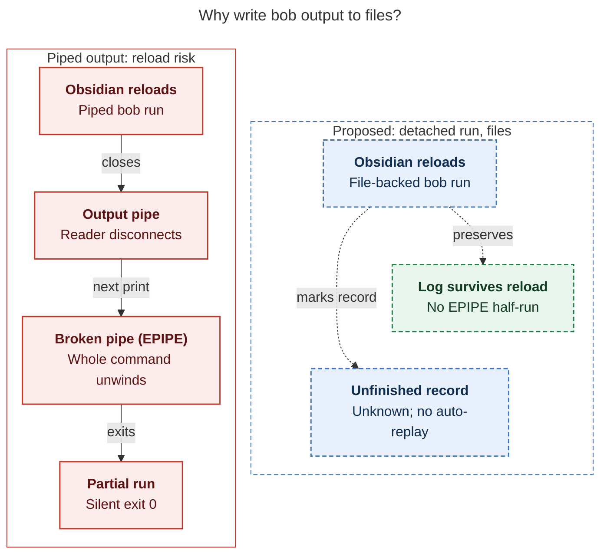

# Diagram proposals: A `:` bob command mode inside Obsidian

Proposals for the swarm linker, not a report. Each diagram restates only what the source
report says.

```yaml
source: research:202610/bob_colon_command_mode/bob_colon_command_mode__final.md
producer: research.5c.image
check: "mmdc 12.0.0 with the PDF-mirroring config rendered 1 of 1 Mermaid diagrams"
```

## reload-safety

```yaml
anchor: |-
  This removes the EPIPE half-run (F5), and logs survive a reload.
question: |-
  Why does file-backed output matter when Obsidian reloads?
illustrates: |-
  File-backed output removes the EPIPE half-run and preserves logs across reloads, while unfinished records become outcome unknown and are never replayed automatically.
caption: "After reload, pipes can stop bob silently; proposed file-backed output preserves logs, marks unfinished records unknown, and never replays them automatically."
review: "612.5×697 px, fit 100.0%; question and visual checks passed in two look rounds; two revisions (layout and automatic-only replay wording); broken-syntax probe rejected"
```


