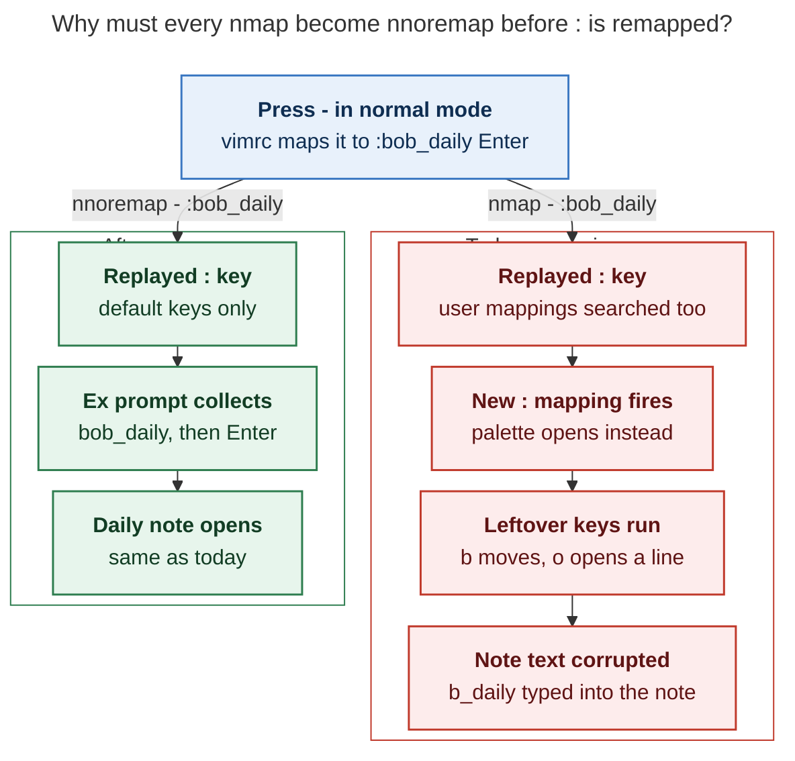
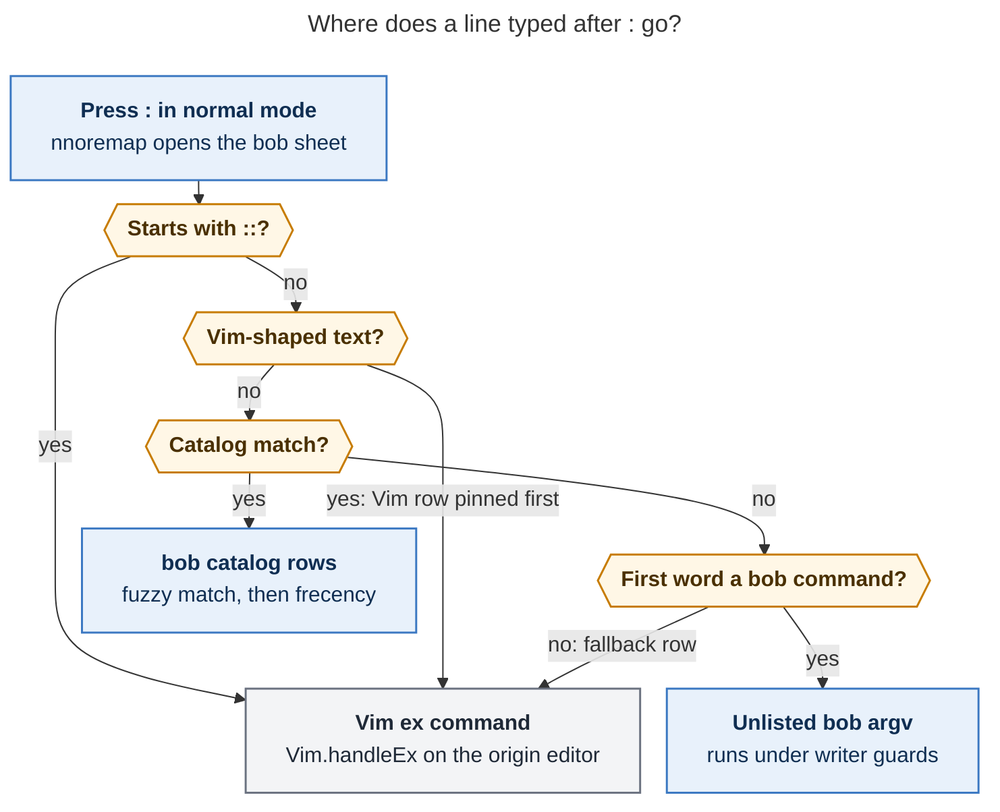
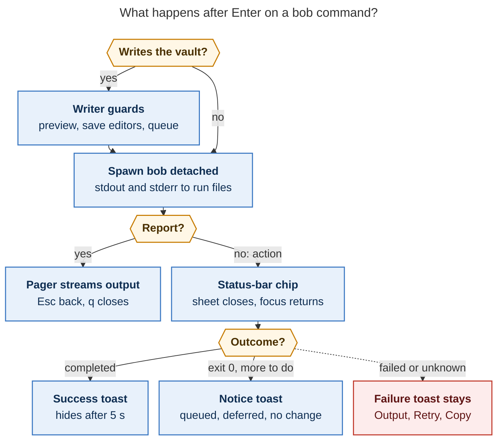
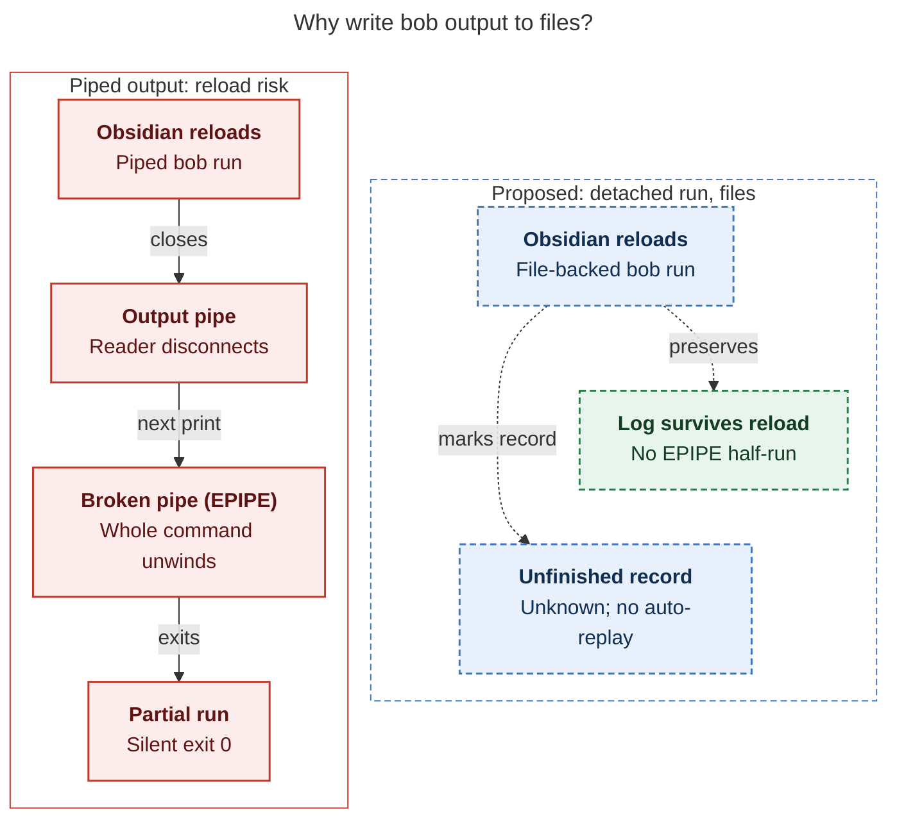

# A `:` bob command mode inside Obsidian: consolidated design and recommendation

> **Research query:** What is the best way to add a `:` keymap to Obsidian that opens a new
> bob command mode, so common `bob` commands can run without leaving Obsidian, with a
> well-chosen set of supported commands, easy filtering and selection, and a success or
> failure notification that can show the command's full output? Is this a good idea, would
> a different approach be better, and which requirement adjustments are justified, ending
> with a recommended solution that is intuitive, reliable, and beautiful?

![Infographic summarizing the proposed desktop bob command mode for Obsidian: find a command in one fuzzy-search sheet, make colon safe first by migrating nmap to nnoremap while double colon and g colon keep Vim's command line reachable, let bob-cli own the command catalog while the Obsidian plugin supplies context and interface, keep runs reliable with a detached bob writing saved output files, report three truthful outcomes through a pager, status chip, and toasts, and build in the order Vim safety, catalog, runner, command sheet, more commands](bob_colon_command_mode_infographic.png)

## Bottom line

**Build it, with three changes to the request.** A bob palette inside Obsidian is a good
idea. It ends the terminal round trip for the bob commands Bryan actually runs by hand. It
replaces four improvised "spawn bob, show a Notice" code paths with one runner. It also
makes bob's 60-odd user-facing commands easy to discover. The request as written needs
these changes:

1. **`:` can only be taken safely after a one-time vimrc migration.** Every one of the 16
   Bob mappings in `~/bob/obsidian_vimrc.md` is a *recursive* `nmap X :bob_*<CR>`. I read
   the CodeMirror Vim engine that Obsidian bundles. Once `:` is remapped by *any*
   mechanism (vimrc or plugin `mapCommand`), pressing `-` opens the palette instead. The
   leftover keys `bob_daily⏎` then run in normal mode: `b` moves, `o` opens a line, and
   `b_daily` is typed into the note. Changing `nmap` to `nnoremap` fixes this, preserves
   today's behavior, and is mandatory ([the colon key](#the-colon-key)).
2. **"Any bob command" should become a curated catalog that bob owns, plus an escape
   hatch for raw `bob …` arguments.** Sixteen leaves are the frozen `capture-*` protocol.
   About ten more only make sense in a terminal or never exit. Shell history shows Bryan's
   hand-run bob usage is dominated by `ref create`. The daily-workflow reports are
   automated or already shown inside Obsidian (see
   [the catalog](#which-commands-the-catalog-holds)).
3. **"Notify on completion" needs output that depends on the kind of command, and more
   than two outcomes.** A *report* (`plan`, `freshness`) should open straight into an
   output pager. An *action* (`vault-sync`, `ref create`) should run in the background
   with a status-bar chip, then a toast. Bob also exits 0 for queued or deferred work, and
   non-zero for some no-ops (`themes hide` on a hidden theme exits 1; `ready --check`
   exits 3). The notification must therefore say "completed", "needs attention", or
   "failed", not just green or red (see
   [the outcome classes](#notifications-and-the-output-pager)).

**Recommended shape** (phased in [the recommended solution](#recommended-solution)):

- A new desktop plugin, **`bob-command-mode`**, in bob-plugins.
- A **bottom command sheet** that uses the existing `bob-cnp` row style.
- A **detached runner** that writes output to files.
- A status chip, toasts, and one **output pager** that also serves as run history.
- A small, hidden, versioned catalog in bob-cli, **`bob __catalog --protocol 1`**, built
  like `__complete`.
- In the vault vimrc: the `nnoremap` migration, then `nnoremap : :bob_command<CR>`. Vim's
  own ex line stays reachable through `::`, through automatic routing of Vim-shaped text,
  and through a `g:` safety valve.

## About this report

*Lead researcher's synthesis · 2026-10-26 · merges five independent reports (`cdx`, `cld`,
`grk`, `mus`, `gem`) with my own checks against bob-cli `af416080` (bob 0.3.1), bob-plugins
`d9823d1`, Obsidian 1.14.5 (snap, athena), and obsidian-vimrc-support 0.10.2. **Verified**
means I re-checked the claim myself this session. Every probe was read-only.*

## Findings that shape the design

- **F1**
  - *Finding:* Obsidian's Vim (`lib/codemirror/vim.js` in `obsidian.asar`) stores
    `nmap X :cmd<CR>` as a `keyToKey` mapping. Replaying it with `noremap == false`
    matches **user mappings too**
    (`startIndex = noremap ? keyMap.length - defaultKeymapLength : 0`). Recursion
    protection skips only the *same* mapping.
  - *Status:* **Verified** (`doKeyToKey`, `matchCommand`)
  - *Consequence:* A remapped `:` hijacks all 16 `nmap … :bob_*<CR>` lines and corrupts
    note text. This applies equally to a plugin-defined `vim.mapCommand(':', …)`, which
    `cdx` proposed as a safer route. It is not safer.
- **F2**
  - *Finding:* With `nnoremap`, the replayed `:` searches only default keys and opens a
    **virtual prompt**. Following keys go to `sendKeyToPrompt`, and `<CR>` runs the ex
    command. A mapping that ends with the virtual prompt still open is turned into the
    real prompt (`finally { … showPrompt }`). `map()` treats `lhs == ':'` as an ordinary
    key mapping.
  - *Status:* **Verified**
  - *Consequence:* `nnoremap : :bob_command<CR>` works. `nnoremap g: :` is a working hatch
    to the native ex line. `gem`'s `nmap : …` plus `nmap g: :` is broken: `g:` would
    re-enter the palette.
- **F3**
  - *Finding:* All 16 vault mappings are `nmap`: `-`, `[[`, `]]`, `!`, `[<Space>`,
    `]<Space>`, `<C-j>`, `<C-k>`, `\<`, `\>`, `\\`, `]s`, `[s`, `[S`, `]S`, `Z`.
    vimrc-support passes each line to `Vim.handleEx`, and the built-in `nnoremap` is not
    overridden.
  - *Status:* **Verified**
  - *Consequence:* The migration is a mechanical 16-line edit.
- **F4**
  - *Finding:* Atuin history (athena, 237 bob runs): `ref create` 44 plus
    `highlights create` 13 (all in the last 90 days, 11 failures). `plugins sync`/`list`
    29 (none recently; agents now run it). Old `highlights-ref scan` 17 (13 failed).
    `bob -h` 25 (reading root help). `plan`, `freshness`, `ready`, `stats`, `reconcile`:
    ≤3 in total.
  - *Status:* **Verified** (matches `cld`)
  - *Consequence:* The flagship is **long-running `ref create` with full output kept**.
    Discoverability and per-host plugin deploys come next. Daily reports are
    nice-to-have. The Mac's history was not available.
- **F5**
  - *Finding:* `run_with_quiet_epipe`: once a print hits a closed pipe, bob **unwinds the
    whole command and exits 0 silently**.
  - *Status:* **Verified** (`src/runner.rs:863`)
  - *Consequence:* If Obsidian reloads while a writer is running over pipes, bob stops
    partway through. The runner should give bob **file-backed stdout/stderr** from a
    detached child.
- **F6**
  - *Finding:* The maintenance lock is `${XDG_RUNTIME_DIR:-/tmp}/bob_sync.lock`
    (`BOB_VAULT_SYNC_LOCK_FILE` overrides it).
  - *Status:* **Verified** (`ob.rs::default_lock_file`)
  - *Consequence:* `gem`'s hard-coded `/tmp/bob_sync.lock` is wrong on athena. JS must not
    peek at or take the lock. Bob arbitrates it. Pass `XDG_RUNTIME_DIR` through
    unchanged.
- **F7**
  - *Finding:* Exit codes are not uniform: `themes hide` exits 1 for "unknown theme,
    unchanged, lock busy, or I/O failure", and `ready --check` exits 3 for crowded notes.
    JSON shapes vary (some unversioned, `plan` schema 2, and so on).
  - *Status:* **Verified**
  - *Consequence:* Outcome classes need catalog exit-code hints and per-family adapters.
    Exit code alone is not the outcome.
- **F8**
  - *Finding:* Color and progress are TTY-gated (`Styler::detect` checks
    `stdout().is_terminal()`; `clip.rs` progress checks `stderr().is_terminal()`). There
    is no `CLICOLOR_FORCE` or `BOB_PROGRESS` today.
  - *Status:* **Verified**
  - *Consequence:* Without a small bob change, the pager has no color and `ref create`
    stays silent for minutes.
- **F9**
  - *Finding:* `bob __complete bash --protocol 1` answers in about 13 ms with
    `value⇥description⇥group⇥space`. `themes rename ''` offers only flags, with **no
    theme-name provider**.
  - *Status:* **Verified**
  - *Consequence:* Argument completion can reuse `__complete`. Add one theme-name
    provider.
- **F10**
  - *Finding:* Plugins spawn bob in four separate ways: ledger-tools `bobSpawnJson`
    (`execFile`, 20 s, 32 MiB, `BOB_DIR`, `NO_COLOR`), project-tasks `snapshotSpawnBob`
    (`ref create`, a 0-duration progress Notice, then a 10 s multi-line Notice),
    articles, and nav. **None adds to `PATH` for the child**, which matters on the Mac
    GUI.
  - *Status:* **Verified**
  - *Consequence:* One runner with an `api.commandMode` replaces the one-off notice
    styles. "Snapshot note to Highlights" is already `bob ref create` and should move onto
    it.
- **F11**
  - *Finding:* Precedents to reuse: theme rename **saves every touched open editor, and
    refuses on a failed save**. Rich `DocumentFragment` notice cards (`bob-nh-notice`,
    `api.notice` v1). Status-bar items in articles and ledger-tools.
    `FilteredPickerModal` (`bob-cnp-*`), which handles the Obsidian ≥ 1.14 `isOpen`
    pitfall.
  - *Status:* **Verified**
  - *Consequence:* The design copies house patterns instead of inventing new ones.
- **F12**
  - *Finding:* Cross-plugin use goes through `app.plugins.plugins[id].api` with feature
    detection. Plugins never import each other's `main.js`.
  - *Status:* **Verified** (`docs/develop/plugin-apis.md`)
  - *Consequence:* A new plugin cannot subclass nav's `FilteredPickerModal`. It copies the
    roughly 200-line picker core and the CSS vocabulary.
- **F13**
  - *Finding:* Obsidian merges external disk changes into unsaved editor text within its
    autosave window. Users report losing text when that merge goes wrong. Bob's own docs
    say an unsaved buffer "is not observable".
  - *Status:* From `cld`, cited sources
  - *Consequence:* Save dirty editors before any writer. Run one writer at a time. Bob's
    snapshot guards stay authoritative.

## Is this a good idea

**Yes, but the value is not where the request implies.** Running `bob plan` instead of
glancing at the `bob-plan` block saves little. The real gains are these:

1. **Closing the loop on long, failure-prone commands Bryan runs by hand.** `ref create`
   has a median of 12 s, a p90 of 233 s, and about 1 failure in 4 (`cld`'s timings). It
   needs to run in the background, keep its full output, and offer Retry.
2. **Per-host operations.** `bob-*` plugins are gitignored in the vault, so every machine
   has to run `bob plugins sync` itself. The same goes for "sync the vault now",
   "reconcile now", and `ref scan` on the Mac.
3. **Discoverability.** Twenty-five `bob -h` runs show Bryan reading root help. A palette with
   one-line descriptions, workflow sections, and `?` for full help is a better map.
4. **One run experience.** It replaces four notice styles and gives future features a
   runner to call.

**Real risks.** These are the `:` collision (F1), duplicating existing UIs (themes and
relations managers, Stats, Reading Board, task move, articles format-on-save), writers
racing the editor (F13), reloads interrupting writers (F5), the Mac GUI `PATH`, and scope
creep into a terminal emulator. Each has a mitigation [below](#design). A quieter risk: a
beautiful palette for commands that are already automated would be used rarely. That is
why the plan ships the runner and the high-value actions first, and lets run history show
what earns more breadth.

### Alternatives considered

- **Register bob commands only in Obsidian's Ctrl+P**
  - *Verdict:* **Keep as a complement**
  - *Why:* Fuzzy search, recents, and hotkeys come for free, but there is no argument
    entry, no output view, and the commands get lost among hundreds of others. Generate
    one native command per zero-argument catalog entry.
- **Shell commands community plugin**
  - *Verdict:* Rejected
  - *Why:* It uses hand-written shell strings with no bob catalog or completion, drifts
    from the CLI, looks unlike Bob, and runs `sh -c`, which is the wrong trust model for a
    vault writer.
- **Embedded terminal (xterm.js + node-pty)**
  - *Verdict:* Rejected
  - *Why:* It means leaving Obsidian inside Obsidian: no structured notifications, no
    clickable vault references, and native modules that break with Electron upgrades.
- **Resident bob daemon or HTTP API**
  - *Verdict:* Rejected for now
  - *Why:* A spawn costs about 10 ms. The thin-client record defers a daemon until spawn
    latency is the actual problem.
- **`:` commands in Bob Mac Capture**
  - *Verdict:* Later, reusing the catalog
  - *Why:* It is Mac-only, and `:` already means the task picker in capture. The
    `__catalog` JSON lets any frontend reuse the catalog.
- **Catalog hard-coded in the plugin**
  - *Verdict:* Rejected
  - *Why:* It would be a third copy of names, flags, and help, guaranteed to drift as bob
    ships daily.
- **A different trigger (`<Space>b`, `\b`) and leave `:` alone (`mus`)**
  - *Verdict:* **Fallback only**
  - *Why:* It is safer, but it ignores an explicit request whose risk is fully removed by
    the `nnoremap` migration (F1–F3). If Bryan declines the migration, use `\b`.
- **A plain `:bob <args>` ex command (`defineEx`)**
  - *Verdict:* Optional extra
  - *Why:* It is a cheap addition for typing into the native prompt, but it has no fuzzy
    list and no output view.

## Adjustments to the requirements

Each adjustment is called out against the request as written:

- **R1**
  - *As requested:* "a new `:` keymap"
  - *Adjusted to:* `:` opens command mode **in Vim normal mode only**, via
    `nnoremap : :bob_command<CR>` in the vault vimrc, **after** all 16 `nmap` lines become
    `nnoremap`. Visual-mode `:` stays native, so `'<,'>` ranges work. A registered
    command, `Bob: Command mode`, with no default hotkey, covers Reading view, Canvas, and
    other non-editor views.
  - *Why:* [F1–F3](#findings-that-shape-the-design). The vimrc is where every other Bob key
    lives (the `Z` precedent). A global Obsidian hotkey on `:` would fire while typing
    `[scheduled::]`, `09:30`, or URLs.
- **R2**
  - *As requested:* (implicit) replace Vim's `:`
  - *Adjusted to:* **Vim's ex line stays reachable.** `::` switches the sheet to Vim.
    Vim-shaped input (`%s/…`, `42`, `noh`, `sort`, any `exmap` name) pins a "Run as Vim
    `:…`" row first. Text that matches nothing falls back to Vim. `nnoremap g: :` opens
    the native prompt directly, even when the plugin is disabled.
  - *Why:* Muscle memory survives: `:%s/a/b/g⏎` and `:42⏎` work keystroke for keystroke.
    Without `g:`, a disabled plugin would leave `:` dead.
- **R3**
  - *As requested:* "support any bob command that might be useful"
  - *Adjusted to:* A **catalog that bob owns**, with an explicit inclusion rule and a
    bob-side test that every public leaf is classified. About 12 entries at launch and
    about 35 in total, plus surface rows that open existing Obsidian UIs. Any
    `bob <argv>` can still be typed as an unlisted run. It goes through no shell and gets
    writer guards. Excluded daemons and TTY commands are refused with a reason.
  - *Why:* Under the thin-client principle, command metadata cannot drift and help text
    is never copied.
- **R4**
  - *As requested:* "notified of its completion … full output somehow"
  - *Adjusted to:* **Presentation depends on kind.** Reports open the pager. Actions show
    a chip, then a toast. **Three outcome classes:** completed (success toast, 5 s); needs
    attention (queued, deferred, or no change; 8 s); failed or unknown (stays until
    dismissed). Full stdout and stderr are always one key away in the pager, which doubles
    as history. A long run that finishes while Obsidian is unfocused also raises an OS
    notification.
  - *Why:* F7. A toast saying "plan finished" adds nothing. A sticky toast over the note
    for a 4-minute `ref create` is hostile.
- **R5**
  - *As requested:* (implicit) run immediately
  - *Adjusted to:* **Writes are safe by construction.** Save dirty editors first and
    refuse if a save fails. One writer at a time; reads run in parallel. **Preview first**
    for broad rewrites (`themes`, `relations`, and `ref rename`; `task reroll`). A confirm
    card for writers with no dry run (`task archive`, `nightly`). `⇧↵` runs the dry run
    wherever one exists. Writers are never killed automatically.
  - *Why:* Bob's culture is "preview unless `--write`". Killing a multi-note writer
    halfway leaves half-done work.
- **R6**
  - *As requested:* (implicit) closing the UI ends the run
  - *Adjusted to:* **Runs outlive the sheet, the pager, and a plugin reload.** The child
    is detached with file-backed output, and history lives in host-local state.
  - *Why:* F5.
- **R7**
  - *As requested:* (implicit) an Obsidian-only change
  - *Adjusted to:* **Small bob-cli changes:** `__catalog --protocol 1`; honor
    `CLICOLOR_FORCE=1` and `BOB_PROGRESS=1` without a TTY; a theme-name completion
    provider.
  - *Why:* F8, F9.
- **R8**
  - *As requested:* —
  - *Adjusted to:* **Context-aware arguments.** The active note fills `NOTE` or `REF` slots
    as a removable chip. A clipboard URL is offered first for `ref create`. Context is
    captured when the sheet opens and is never silently retargeted.
  - *Why:* That is the point of running bob *from inside* Obsidian.
- **R9**
  - *As requested:* —
  - *Adjusted to:* **Desktop only** (`isDesktopOnly: true`).
  - *Why:* Obsidian mobile cannot spawn processes.

## Design

### The colon key

**The key: migrate the vimrc first, then take `:`.**



*Figure 1. Once `:` is remapped, a recursive `nmap` sends its replayed `:` to the new
mapping and types its leftover keys into the note. `nnoremap` keeps today's behavior.
This holds whether `:` is remapped in the vimrc or by a plugin's `mapCommand`.
(Mermaid CLI 12.0.0; rendered 615 × 715 px; fit 100%.)*

**Vault vimrc** (Bryan's hand-maintained file). Phase 0 ships the first two blocks alone.
`:` is bound only once the plugin exists:

```vim
" Every mapping that replays `:` must be non-recursive (see the research report).
nnoremap - :bob_daily<CR>
nnoremap ]s :bob_next_due<CR>
" … all 16 former nmap lines become nnoremap …

" Native Vim ex line, even if bob command mode is disabled.
nnoremap g: :

" `:` opens bob command mode; `::` inside it is Vim's ex line.
exmap bob_command obcommand bob-command-mode:open
nnoremap : :bob_command<CR>
```

**A lint so this stays safe.** On load, the plugin reads vimrc-support's `data.json` to
find `vimrcFileName`, then reads the vimrc. If any recursive `map` or `nmap` line has a
`:` on its right-hand side, it shows one notice naming the keys: "`-` and 15 others
replay `:`; change them to `nnoremap`."



*Figure 2. Bob owns `:`, but anything that looks like Vim still reaches Vim. Bob rows
stay listed below a pinned Vim row, so a typed bob name is never shadowed. (Mermaid CLI
12.0.0; rendered 798 × 1070 px; fit 81.8%.)*

**"Vim-shaped" is defined exactly, following `cld`.** Input is Vim-shaped when any of
these holds:

- it starts with a range or punctuation character (`% . $ ' , ; + - / ? & ~ ! <`) or a
  digit;
- it matches `^(s|g|v|substitute|global|vglobal)\W`;
- its first word is exactly a default CodeMirror Vim ex name (`w q wq x noh sort set
  normal reg marks undo redo …`), `obcommand`, `exmap`, or an `exmap` name read from the
  vimrc.

No bob root collides with these names, and bob names use hyphens, never underscores. The
Vim row runs `Vim.handleEx` against the editor captured when the sheet opened. Known
limits: a count before `:` (`5:`) is lost, which is rare in a notes editor.

### The command sheet

**Shape: a bottom sheet, not another centred modal.** This resolves a disagreement:
`cld` wanted a bottom sheet, while `cdx`, `grk`, and `gem` wanted centred `bob-cnp`
modals. The bottom sheet wins for four reasons:

- `:` means "command line" to a Vim user, and Obsidian's own Vim prompt opens at the
  bottom (`openDialog(…, { bottom: true })`).
- Bryan's fzf runs `--reverse --height 40%`: a bottom panel with the input on top.
- The note stays visible above the sheet while you choose.
- It looks different from Ctrl+P and the centred Task Card pickers, which tells the eye
  "bob command line" at once.

Build it as an Obsidian `Modal`, which keeps the focus trap and `scope`, with a
`bob-cmd-sheet` class that docks it:

- **Position:** bottom centre, matching the active pane's horizontal bounds.
- **Size:** width = pane − 48 px, at most 920 px; height up to 45 vh.
- **Motion:** slides up in 120 ms and honors `prefers-reduced-motion`.

```text
╭────────────────────────────────────────────────────── athena · bob 0.3.1 ─╮
│ bob ❯ sync▏                                                                │
├────────────────────────────────────────────────────────────────────────────┤
│ VAULT                                                                      │
│▌⟳  vault-sync run       Sync vault now                        syncs   ⇧↵   │
│    Pull, commit, and push through Git; conflicts kept in _conflicts/       │
│ ⓘ  vault-sync status    Report the last sync cycle             reads        │
│ TASKS AND PROJECTS                                                         │
│ ✎  projects sync        Sync project status and schedules      writes  ⇧↵  │
│ ⌁  :sync…               Run as Vim command                      vim         │
├────────────────────────────────────────────────────────────────────────────┤
│ ↵ run   ⇥ arguments   ⇧↵ preview   ? help   :: vim   esc back              │
╰────────────────────────────────────────────────────────────────────────────╯
```

*Layout sketch, not a rendered mockup.*

**Rows.** Rows are dense single lines, about 34 px, like fzf. **Only the selected row
expands** to show its one-line `about`. This merges `cld`'s dense rows with `cdx`'s
two-line detail without making every row tall.

- **Icon:** a Lucide icon chosen by effect: `book-open` reads, `pencil-line` writes,
  `refresh-cw` syncs, `globe` network.
- **Command path:** monospace, with matched characters in `--text-accent` at weight 600.
- **Title:** the human title in `--text-muted`.
- **Right-hand chips:**
  - the effect;
  - `⇧↵` when a preview exists;
  - a typical duration (`~12 s`, the median of the last ten local runs), shown only when
    it is over 2 s.
- **Selected row:** a 3 px accent bar, the same as `.bob-cnp-row.is-selected`.
- **Section headers:** small caps, in bob's `Section` order.

**Empty state (just `:`).**

1. **Recent:** the last four distinct command lines, each with ✓/✗, age, and duration.
   `↑`/`↓` over these rows is the command history.
2. **For this note:** a ref note gets `ref today` and `ref show`. An article gets
   `articles outline`. A clipboard URL gets `ref create <url>`.
3. **All commands**, grouped by section.

Unavailable rows stay visible with a reason ("Mac only", "Needs a newer bob") instead of
disappearing.

**Ranking.**

1. Fuzzy score and match highlights come from Obsidian's `prepareFuzzySearch`.
2. Catalog `keywords` widen matches: "push", "git", and "commit" find `vault-sync`;
   "keep" finds `gkeep`; "pdf" finds `ref create` and `ref scan`. Old aliases such as
   `task-status-hooks` lead to the canonical command.
3. Frecency, kept per host, only breaks ties.

A strong exact match always beats recency. The list never reorders under the cursor once
the user has started moving. Enter never runs a "best guess" when nothing matches.

**Argument mode.** Pressing Enter on a command that needs arguments, or `⇥` on any row,
turns the command path into a pill (`ref create`). Ghost placeholders (`‹TARGET›`) show
the expected arguments. Completions come from `bob __complete bash --protocol 1`,
debounced by 60 ms and grouped by the protocol's `group` column. The client handles two
directives:

- `!files-in` → vault notes, with the active note first;
- `!message` → hint text under the input.

Typed input uses shell-style quoting (`"a b"`) through a small tokenizer, never a shell.

**Keys** (house picker conventions plus Vim's ex line):

- **`↵`:** Run the selected row, or enter argument mode if arguments are required
- **`⇥`:** Complete the row into the input, or accept a completion; **never executes a
  write**
- **`⇧↵`:** Dry run, when the catalog lists a preview flag
- **`⌃↵`:** Skip preview-first or the confirm card (deliberate run)
- **`↑ ↓` / `⌃N ⌃P`:** Move the selection without changing the query (over Recent =
  history)
- **`?` at the end of the query:** Show `bob <path> --help` in the pager
- **`::`:** Switch the line to Vim ex (VIM pill)
- **`Esc`:** Back one stage; from the first stage, close; **never cancels a running job**
- **`⌫` on an empty query:** Close, like Vim's own prompt

Do not bind `j`, `k`, or `q` inside the input; they are search characters. **Opening the
sheet never spawns a process.** The catalog, recents, and frecency are already in memory.
The catalog is revalidated in the background when bob's path, mtime, or version changes.

### Running a command reliably



*Figure 3. Writers pass two guards before bob starts. Every run writes its output to
files. Reports stream into the pager; actions end in one of three toasts, and only
failures stay on screen. (Mermaid CLI 12.0.0; rendered 734 × 1092 px; fit 81.8%.)*

1. **Save before a write.** Before any run that is not `reads`, `await view.save()` every
   Markdown leaf with unsaved changes, including pop-outs. A failed save refuses the run,
   following the theme-rename precedent (F11). Saving once does not stop the user typing
   while bob runs, so bob's snapshot guards stay authoritative.
2. **One writer at a time.** A second writer queues ("queued behind `task reconcile`").
   Reads run in parallel. Starting an argv that is already running focuses that run
   instead of starting a duplicate. A double Enter starts one run.
3. **Detached, file-backed child.**
   - Command: `spawn(bobPath, argv, { cwd: vaultBase, detached: true, stdio: ['ignore', outFd, errFd] })`.
   - Files live in a **host-local** state directory outside the vault, for example
     `~/.local/state/bob/command-mode/runs/<run-id>.{out,err,json}`. The `json` file
     holds argv, resolved bob path and version, start time, exit code or signal, and
     outcome.
   - The plugin tails the files to stream output.
   - This removes the EPIPE half-run (F5), and logs survive a reload.
   - **v1:** the exit status is recorded while the plugin is alive. After a reload, an
     unfinished record becomes "outcome unknown — log preserved". A run is never
     replayed automatically, and a reused PID is never trusted.
   - **Later:** a tiny receipt (a `sh -c 'bob "$@"; echo $? >rc'` wrapper, or a bob env
     var) if re-attaching proves worth it.
   - Retention: 50 runs or 14 days.
4. **Environment.**
   - Start from `process.env`.
   - Set `BOB_DIR` to the vault base path. Never fall back to `~/bob` when the vault
     path cannot be resolved.
   - **Add the candidate directories to `PATH`** (`~/.cargo/bin`, `~/.local/bin`,
     `/opt/homebrew/bin`, `/usr/local/bin`) so tools bob shells out to (`pass`, Homebrew
     Python) work in the Mac GUI.
   - Set `COLUMNS` to the pager width in monospace glyphs.
   - Use `NO_COLOR=1` until `CLICOLOR_FORCE=1` and `BOB_PROGRESS=1` land.
   - Drop the test overrides `BOB_NOW` and `BOB_DAY_FILE`.
   - Keep `XDG_RUNTIME_DIR`, so the lock path matches the sync services (F6).
   - stdin is ignored, so pinentry-style prompts fail fast instead of hanging.
5. **Timeouts and cancelling.**
   - Each catalog entry has its own timeout. Reads default to 60 s. Writers default to
     180 s, which outlasts `task reconcile`'s 120 s retry budget. `ref create` gets
     900 s and `ref scan` 1800 s.
   - Reads can be cancelled and are killed on timeout.
   - **Writers are never killed automatically.** Past their budget, the chip turns amber
     ("still running past ~3 min") and offers an explicit **Stop (may leave partial
     work)**. This takes `cdx`'s line over `cld`'s automatic SIGTERM-then-SIGKILL.
6. **Afterwards.** `api.commandMode.onRunFinished(cb)` publishes `{argv, outcome,
   effect, invalidates}`, so ledger-tools can refresh its theme, relation, stats, and
   reading-board caches right away. Writes under hidden `.bob/` paths raise no vault
   events, so without this hook those caches wait for their staleness timers.

[The reload-safety diagram](#figure-reload-safety) follows a mid-run reload down both
paths: piped output can unwind bob partway, while the proposed file-backed run keeps its
log and marks an unfinished record unknown.

<div id="figure-reload-safety">



_After reload, pipes can stop bob silently; proposed file-backed output preserves logs, marks unfinished records unknown, and never replays them automatically._

</div>

### Notifications and the output pager

**Outcome classes.** These merge `cdx`'s taxonomy into three visual states:

- **Completed**
  - *Evidence:* Exit 0, and the adapter (if any) confirms the work is done
  - *Toast:* Green border, ✓, summary line, hides after 5 s
- **Needs attention**
  - *Evidence:* Exit 0 with queued, held, or deferred work (`ref create` intake queued,
    `ref scan` writes held), or a documented check or no-op code (`ready --check` = 3,
    `themes hide` "unchanged")
  - *Toast:* Amber border, ◐, bob's own reason, 8 s
- **Failed / unknown**
  - *Evidence:* Any other non-zero exit, a spawn error, malformed expected JSON, a
    timeout, or a reload before a terminal record
  - *Toast:* Red border, ✗, first meaningful stderr line, **stays**: Output · Retry · Copy
    command

Valid JSON, an empty stderr, or exit 0 alone never prove success. stderr often carries
progress, not failure. Where bob gives one exit code for several meanings (`themes hide`
exit 1), the adapter reads the typed JSON or stderr line to tell "unchanged" from a
failure.

Known failures get clearer wording:

- lock busy → "Another bob run holds the maintenance lock", with Retry;
- dirty paths → "Commit pending edits first", with **Sync vault, then retry**;
- `bob-not-found` → the paths tried, plus a link to settings.

At most one sticky failure toast per command; a newer one replaces the older.

**Status chip.** It reads `⟳ ref create · 0:42`, or `bob ×2` when two runs are active.
It appears only for runs over 400 ms. The tooltip shows the last progress line (once
`BOB_PROGRESS` exists), and a click opens the live run.

**OS notification.** A run over 15 s that finishes while Obsidian is unfocused raises
`new Notification(…)`. Clicking it opens the pager. This is a setting, on by default.

**The pager is one surface with two states, list and output.** For a report, the sheet
grows upward (about 80 vh, full pane width, at most 1200 px) and streams output. `Esc`
goes back to the command list with the query intact, so `plan` → `freshness` → `ready`
takes three keystrokes each. `q` closes. The pager contains:

- **Header:** a status pill (`● running`, `✓ exit 0`, `◐ queued`, `✗ exit 1`), the argv
  as copyable code, the start time, and the duration.
- **Body:** `--font-monospace` at 13 px, line-height 1.45, `white-space: pre`, scrolling
  horizontally. stderr lines carry a faint red gutter tick.
- **Color:** once `CLICOLOR_FORCE` lands, ANSI SGR codes map to theme variables, so light
  and dark themes work with no extra palette. Output is always rendered as text, never
  as Markdown or HTML.
- **Clickable vault references:** `note.md:23` jumps to line 23 (reusing nav's landing
  helpers), `note.md#^id` lands on the block, and `[[wikilinks]]` and vault-relative
  paths open, wherever bob prints them.
- **Keys:** `j k d u g G` scroll, `/` searches, `w` toggles wrap, `y`/`Y` copy the output
  or the command, `r` reruns (re-resolving context, never replaying stale write
  arguments), `[`/`]` step to older or newer runs, `:` opens the sheet, and `q` closes.
- **Previews:** for a dry run, the footer's primary action is **`⌃↵ Apply`**.

Commands registered with Obsidian: `Bob: Command mode`, `Bob: Show last output`, `Bob:
Rerun last command`, and one `Bob: <title>` per zero-argument catalog entry (stable id
`run-<entry-id>`). All of them can take hotkeys and show up in Ctrl+P. A "pin to tab"
`ItemView`, for watching long runs, can come later if history shows the need.

### What beautiful means here

- **Only Obsidian theme variables** (`--background-primary`, `--text-accent`,
  `--color-*`, `--radius-l`, `--shadow-l`). Light mode, dark mode, and community themes
  then work for free, as they do for `bob-cnp`.
- **Two typefaces with separate jobs:** monospace for anything you could type (paths,
  argv, output); the UI font for anything that explains it.
- **One accent per meaning** (meaning and colour):

  - **writes:** orange
  - **syncs:** blue
  - **network:** purple
  - **completed:** green
  - **needs attention:** amber
  - **failed:** red

  A 4 px left border carries the state on cards, matching `bob-nh-notice`.
- **Icon plus text for state, never colour alone.**
- **Calm motion:** the sheet slides 120 ms, the pager grows 90 ms, and the spinner is the
  only constant motion.
- **Quiet density:** single-line rows, small-caps section headers with 0.06 em tracking,
  and a `kbd` footer that matches the other Bob pickers.
- **Accessibility:** a combobox/listbox model, an announced selection and final outcome
  (never every streamed line), visible focus, and text scaling.
- **Performance budget:** opens in under 100 ms warm, filters in under 30 ms, and never
  spawns a process per keystroke.

## Which commands the catalog holds

**Inclusion rule.** A command is listed when a human runs it, it is useful while you are
looking at the vault, it needs no TTY input, it returns, and Obsidian has no better UI for
it. Where a better UI exists, the row **opens that UI** (a surface row) and offers "run
CLI" as a secondary action.

**Legend.** *reads* / *writes* / *syncs* (Git) / *net*. **R** = report, opens the pager.
**A** = action, chip then toast. **⇧↵** = dry run available.

### Ship first

**v1: ship first.** Rows by section, with their argv, kind, and notes:

- **Vault**
  - **Create reference**
    - *argv:* `ref create TARGET…`
    - *Kind:* writes + net · A ⇧↵
    - *Notes:* **Flagship** (F4). TARGET ← clipboard URL, else the active note. 900 s
      budget. `BOB_PROGRESS`. Move project-tasks' "Snapshot note to Highlights" onto this
      runner.
  - **Sync vault now**
    - *argv:* `vault-sync run`
    - *Kind:* syncs · A ⇧↵
    - *Notes:* Bare `vault-sync` = `run` is the grandfathered exception in
      `cli_rules.md`, so the catalog always spells it out.
  - **Vault sync status**
    - *argv:* `vault-sync status`
    - *Kind:* reads · R
    - *Notes:* —
  - **Scan Highlights library**
    - *argv:* `ref scan`
    - *Kind:* writes · A ⇧↵
    - *Notes:* `hosts: macos`. Shows "held" writes as *needs attention*.
- **Tasks**
  - **Reconcile task statuses**
    - *argv:* `task reconcile`
    - *Kind:* writes · A ⇧↵
    - *Notes:* The writer budget outlasts its 120 s retry.
  - **Sync projects**
    - *argv:* `projects sync`
    - *Kind:* writes · A ⇧↵
    - *Notes:* Offer reconcile afterwards, as the CLI notes.
- **Setup**
  - **Deploy plugins**
    - *argv:* `plugins sync`
    - *Kind:* writes `.obsidian/plugins` · A ⇧↵
    - *Notes:* Plugins are gitignored, so each host must deploy them itself. The success
      toast offers **Reload changed plugins** (ids from `-f json`). Command mode reloads
      itself last, after its run record is saved.
  - **Plugin versions**
    - *argv:* `plugins list`
    - *Kind:* reads · R
    - *Notes:* Runs a `git pull` by default; only when the user asks, never in the
      background.
- **Daily**
  - **Today's plan · Review queue · Ready lanes · Stats glance**
    - *argv:* `plan` · `freshness` · `ready [NOTE]` · `stats`
    - *Kind:* reads · R
    - *Notes:* Cheap once the pager exists. `ready` NOTE ← the active area or project
      note.
  - **Pomodoro status**
    - *argv:* `pomodoro status`
    - *Kind:* reads · toast
    - *Notes:* One line, shown in the toast. Empty output means no active session.
- **Help**
  - **`?` on any row; "bob help" row**
    - *argv:* `<path> --help`
    - *Kind:* reads · R
    - *Notes:* Serves the 25 `bob -h` help lookups.

**Surface rows (owned by the plugin, v1):**

- Pomodoro themes manager;
- Relation labels manager;
- Reading Board;
- Today (`bob-ledger-tools:open-today-daily-note`);
- Dash.

### Later additions

**v2: as history earns them.**

- **Themes and relations CLI writes.** Rename previews first. Needs the theme-name
  provider.
- **Task maintenance.**
  - `task reroll` previews first and applies with the preview's seed.
  - `task archive` gets a confirm card, since it has no dry run.
  - `nightly` gets a confirm card, with a warning on athena, where the timer owns it.
- **References.**
  - `ref today REF` (REF ← the active ref note).
  - `ref find/list/show/doctor`.
  - `ref jobs list/run`, labelled "this computer, all vaults".
  - `ref rename`, preview first.
- **Integrations.** `gkeep pull` (preview, then apply; depends on `pass` being on `PATH`)
  and `gkeep list/doctor`.
- **Articles.** `list/outline/format`. The current note goes through the bob-articles
  editor workflow, not a subprocess rewriting the file under the editor.
- **Query.** `query`, native engine, in a multiline editor.
- **Stats and projects.** `stats show/metrics` and `projects list`.
- **Named Pomodoro actions.** "Start next Pomodoro" → `bob capture '='`, with bob's
  `--dry-run` preview line.

### Excluded commands

**Excluded** (refused with a reason, even as raw argv):

- All `capture-*` protocol leaves: machine JSON, frozen.
- Free-text `capture`: Mac Capture owns the draft grammar. Revisit only as a thin client
  of `capture-parse` and `--dry-run`.
- `completion *`: shell only.
- `pomodoro notify` and `pomodoro tmux`: one never exits; the other prints a tmux line.
- `gkeep login`: a TTY cookie prompt, and credentials must stay out of logs.
- One-time migrations: `gkeep migrate-*`, `ref migrate-tasks`, `ref migrate-zorg`.
- `task move`: Ctrl+Shift+M is the better UI.
- `query --engine obsidian`: it would drive the Obsidian CLI from inside Obsidian.
- Hidden aliases are never separate rows; they resolve to the canonical path.

## Architecture and ownership

Each concern, with its owner and notes:

- **Command facts: argv, title, about, section, keywords, effects, preview flag, confirm
  policy, JSON flag, argument kinds, exit-code meanings, timeout class, hosts, exclusions
  with reasons**
  - *Owner:* **bob-cli**, `bob __catalog --protocol 1`
  - *Notes:* A static Rust table beside `SUBCOMMANDS`. It never reads the vault, so it is
    instant.
- **Argument candidates**
  - *Owner:* **bob-cli**, existing `__complete` protocol 1
  - *Notes:* Plus a theme-name provider.
- **Obsidian context (active note → `vault_note` slots, clipboard → `url`), surface rows,
  ranking, frecency, keys, sheet, pager, toasts, runner, history**
  - *Owner:* **`bob-command-mode` plugin**
  - *Notes:* Maps bob's argument *kinds* to context sources. bob declares the kinds; the
    plugin decides the context.
- **Grammar, previews, locks, writes, recovery**
  - *Owner:* **bob-cli**
  - *Notes:* Unchanged. The thin-client rule (`decisions:mac-capture-is-a-thin-client`)
    applied here by analogy.
- **Editor-aware transactions (articles format, task move, Task Card)**
  - *Owner:* Their existing plugins
  - *Notes:* Command mode opens or delegates; it never duplicates.

### Catalog contract

- **Name:** `__catalog` rather than `__palette` (`cld`) or a public `bob commands list`
  (`cdx`). It is frontend-neutral, so Mac Capture or a Raycast extension could reuse it.
  A hidden `__` protocol matches the `__complete` precedent. `cli_rules.md` requires a
  membership rule for any public group, and `bob --help` already serves humans.
- **Handshake:** the same `--protocol` min/max handshake as `__complete`.
- **JSON:** `schema_version`, `bob_version`, `sections[]`, `entries[]`, and
  `excluded[]` with reasons.
- **Compatibility:** an unknown effect is treated as `writes`, and unknown fields are
  ignored.
- **Tests in bob:**
  - every `argv` resolves to a leaf;
  - every preview flag exists on that leaf;
  - every argument name matches a clap positional;
  - **every public leaf is either an entry or excluded**, so a new command cannot go
    unclassified;
  - protocol roots never appear as entries.
- **Docs:** a `docs/` contract page next to `docs/completion.md`, then `just docs-gen`.
  The `:` hotkey goes in the bob-plugins plugin reference, per the `docs.md` routing.
- **Releases:** bob's crates.io releases ride the daily train, but Bryan's hosts track
  master, so the plugin can require `__catalog`. If it is missing, the sheet shows one
  "Update bob" row plus the native Ctrl+P commands.

### Plugin

A new **`bob-command-mode`** with the fragments build. Fragments, each with its job:

- **`010`:** catalog cache
- **`020`:** Vim routing and vimrc lint
- **`030`:** sheet
- **`040`:** argument mode
- **`050`:** runner
- **`060`:** toasts and chip
- **`070`:** pager and ANSI
- **`080`:** reference linkifier
- **`090`:** lifecycle

Do not grow `bob-navigation-hotkeys` (85,641 generated lines, 139 fragments). Copy the
picker core and the `bob-cnp` CSS vocabulary under a `bob-cmd-` prefix. Settings stay
minimal: a bob path override, OS notifications on or off, and history retention.

### Plugin API

`api.commandMode` v1 exposes:

- `run(argv, {presentation, title})` → `Promise<{outcome, exit, runId}>`;
- `openOutput(runId)`;
- `onRunFinished(cb)`.

Snapshot-to-Highlights, articles, and future features then share one runner and one
notice style.

## Where the reports disagreed

Each topic, with the reports' positions and the resolution and reason:

- **Taking `:`**
  - *Positions:* `cld`, `grk`: `nnoremap` after migrating. `cdx`: plugin `mapCommand` +
    `\:`. `gem`: `nmap :` + `nmap g: :`. `mus`: don't take `:`
  - *Resolution and reason:* **vimrc `nnoremap` after migrating.** F1 shows the
    migration is needed for *every* mechanism, including `cdx`'s. `gem`'s mappings are
    broken (F2). `mus`'s concern is fully removed by the migration.
- **Ex escape**
  - *Positions:* `::` (`cld`), `g:` (`grk`, `gem`), `\:` (`cdx`), automatic routing
    (`cld`, `gem`)
  - *Resolution and reason:* **`::` + Vim-shaped routing + `nnoremap g: :`** (verified to
    open the real prompt). `g:` also survives a disabled plugin.
- **Plugin home**
  - *Positions:* New plugin (`cdx`, `cld`, `mus`, `gem`) vs navigation hotkeys (`grk`, to
    reuse the picker)
  - *Resolution and reason:* **New plugin.** Own lifecycle and tests, a smaller blast
    radius, and copying about 200 lines beats coupling to the biggest plugin.
- **Catalog source**
  - *Positions:* Hidden bob protocol (`cld`; `grk` phase 2), public `bob commands list`
    (`cdx`), build-time snapshot (`mus`), JS table (`gem`)
  - *Resolution and reason:* **Hidden `__catalog`.** Facts live in bob, presentation in
    the plugin, and a coverage test stops drift.
- **Sheet shape**
  - *Positions:* Bottom sheet (`cld`) vs centred modal (others)
  - *Resolution and reason:* **Bottom sheet with `bob-cnp` row anatomy**
    ([the command sheet](#the-command-sheet)).
- **Output**
  - *Positions:* Pager by kind (`cld`), run record + history view (`cdx`), result pane
    inside the picker (`grk`), inspector modal (`gem`), JSON structured views (`mus`)
  - *Resolution and reason:* **One sheet ↔ pager surface**, reports into output and
    actions into toasts, history in the pager. Human text in v1; JSON views later, per
    family.
- **Process**
  - *Positions:* Detached, file-backed (`cld`) vs piped `spawn`/`execFile` (others)
  - *Resolution and reason:* **File-backed** (F5 verified).
- **Timeout of writers**
  - *Positions:* Automatic SIGTERM → SIGKILL (`cld`) vs never auto-kill (`cdx`)
  - *Resolution and reason:* **Never auto-kill writers**; explicit Stop with a warning.
- **Lock handling**
  - *Positions:* JS reads `/tmp/bob_sync.lock` (`gem`) vs bob owns it (`cdx`, `grk`)
  - *Resolution and reason:* **bob owns it**; `gem`'s path is wrong (F6).
- **`plugins sync`**
  - *Positions:* Include with reload (`cld`, `gem`) vs hide (`grk`, `mus`)
  - *Resolution and reason:* **Include in v1** with preview and a reload button: per-host
    deploy is a real in-Obsidian need.
- **`nightly`**
  - *Positions:* Include with confirm (`cld`, `gem`, `grk`) vs exclude (`mus`)
  - *Resolution and reason:* **v2, behind confirm**, with a warning where the timer owns
    it.
- **Capture**
  - *Positions:* Dedicated draft stage (`cdx`), v2 live preview (`cld`), exclude (`grk`,
    `gem`, `mus`)
  - *Resolution and reason:* **Named Pomodoro actions in v2**; free-text capture is out of
    scope.
- **Raw argv**
  - *Positions:* Allowed (`cld`, `grk`, `mus`) vs not in v1 (`cdx`)
  - *Resolution and reason:* **Allowed.** No shell, writer guards, and excluded commands
    refused.

Other report errors corrected here:

- `gem`: Obsidian *merges* external changes rather than overwriting them on autosave.
- `gem`: `pomodoro` is not just a tmux helper; `status` is the default.
- `mus`: "Remapping `:` would break all of them" is true only while the mappings stay
  `nmap`.

## Risks and open questions for Bryan

1. **Do you use Vim ex commands in Obsidian** (`:%s`, `:42`, `:sort`, `:noh`)? If rarely,
   ship only `::` and `g:`, and drop the automatic Vim-shape routing.
2. **Approve the `nmap` → `nnoremap` migration?** It is a prerequisite. If you decline,
   bind `\b` and leave `:` alone; a broken `]s` walk is worse than a less clever key.
3. **Which host matters most?** The Mac adds `PATH`/`pass` issues and hosts `ref scan`.
   athena is where `ref create` runs by hand. Test on both.
4. **After `plugins sync`, reload automatically or offer a button?** I recommend a
   button. Reloading uses Obsidian's private `app.plugins.disablePlugin`/`enablePlugin`,
   which no Bob plugin uses today, so it is new surface.
5. **Version drift across machines.** bob and the plugins deploy per host. The schema
   handshake plus the bob version in the sheet's header make a mismatch visible.
6. **Record the decision.** After acceptance, add a decisions record: "`:` is bob command
   mode; Vim ex stays reachable via `::`, Vim-shaped routing, and `g:`; all vimrc
   mappings that replay `:` are `nnoremap`". Use `/sase_memory_write`.

### Acceptance criteria

Merged from `cdx`:

- **Keyboard:** an insert-mode `:` stays text. A normal-mode `:` opens the sheet once.
  `-`, `]s`, and `Z` still work. `:%s` and `:42` keep working, and so does visual `:`.
- **Discovery:** `sync`, `keep`, `pdf`, and `task-status-hooks` find the right rows. No
  unlisted write runs just because its name matches.
- **Execution:** paths containing spaces, quotes, `$()`, or backticks stay literal
  arguments. Output over 1 MiB and multi-byte characters split across chunks are kept
  intact.
- **Outcomes:** each of these produces a distinct, truthful result: exit 0 with held or
  queued work, check and no-op codes, malformed JSON, ENOENT, a signal, and empty
  successful output.
- **Lifecycle:** closing and reopening keeps the run. A double Enter is one run. A reload
  leaves an honest "unknown" and the log. `plugins sync` never loses its own record.
- **Safety:** these are exercised on synthetic vaults with a fake bob executable: a save
  failure, edits during preview and apply, lock contention, and a concurrent timer sync.

## Recommended solution

Build **`:` bob command mode** as a bottom command sheet over a catalog that bob owns. Use
a write-safe, detached runner. Split output by kind: reports go to the pager, actions to
a chip and a toast. One pager serves as both the output view and the run history. Deliver
it in five phases, putting the reliability risk ahead of the presentation:

0. **Make `:` safe**
   - *Repo:* vault
   - *Scope:* Change all 16 `nmap … :bob_*<CR>` lines to `nnoremap`. Add
     `nnoremap g: :`. Check `-`, `]s`, `[s`, and `Z`. **Do not bind `:` yet.**
   - *Effort:* 10 min
1. **Contract**
   - *Repo:* bob-cli
   - *Scope:* `bob __catalog --protocol 1` (static table plus coverage tests); honor
     `CLICOLOR_FORCE` and `BOB_PROGRESS`; theme-name completion provider; contract docs
     and `just docs-gen`
   - *Effort:* ~1–1.5 days
2. **Runner first**
   - *Repo:* bob-plugins
   - *Scope:* New `bob-command-mode`: catalog cache, detached file-backed runner,
     save-before-write, writer queue, `PATH` and environment, status chip, three-class
     toasts, pager with clickable references, history, `api.commandMode` v1, and native
     commands for every zero-argument v1 entry. Move "Snapshot note to Highlights" onto
     it. **Useful through Ctrl+P alone.**
   - *Effort:* ~1.5–2 days
3. **The sheet**
   - *Repo:* bob-plugins + vault
   - *Scope:* Bottom sheet; ranking, Recent, and For-this-note; argument mode on
     `__complete`; preview and confirm; Vim routing and vimrc lint. **Then** add
     `nnoremap : :bob_command<CR>`.
   - *Effort:* ~1.5–2 days
4. **Breadth**
   - *Repo:* both
   - *Scope:* v2 rows as run history justifies them; JSON outcome adapters (`ref create`
     queued, `themes` unchanged); OS notifications; the decision record
   - *Effort:* as needed

Phase 2 comes before Phase 3 on purpose. The runner carries the real risk: editor races,
EPIPE, timeouts, and the Mac environment. It is useful through Ctrl+P before the sheet
exists, so the sheet becomes presentation on top of a tested core. The result is quick to
reach, honest about what happened, and calm to look at, without becoming a terminal or a
second copy of the CLI.

## Sources

**Swarm reports (this directory):**

- `bob_colon_command_mode__cdx.md`: outcome taxonomy, run records, acceptance matrix,
  write-safety rules.
- `bob_colon_command_mode__cld.md`: Vim recursion finding, usage data, bottom sheet, file-backed
  runner, catalog schema.
- `bob_colon_command_mode__grk.md`: `bob-cnp` reuse, surface rows, `g:` hatch, figures
  `obsidian_bob_command_mode__grk_{bind,run}.{png,svg}`.
- `bob_colon_command_mode__mus.md`: tiered catalog, build-time generation, history and audit.
- `bob_colon_command_mode__gem.md`: two-tier notification, inspector modal; its keymap and lock
  claims were corrected above.

**Verified by the lead researcher (read-only, 2026-10-26):**

- **Obsidian:** 1.14.5 `obsidian.asar` → `lib/codemirror/vim.js`: `doKeyToKey`,
  `sendKeyToPrompt`, `showPrompt`, `matchCommand` (`startIndex`),
  `exCommandDispatcher.map` and `nnoremap`.
- **Vault:** `~/bob/obsidian_vimrc.md` (16 `nmap` lines);
  `~/bob/.obsidian/plugins/obsidian-vimrc-support/{main.js,data.json}` (0.10.2: the
  overrides are `noremap`/`exmap`, not `nnoremap`); `community-plugins.json`.
- **bob-cli `af416080`:**
  - `src/runner.rs` (`run_with_quiet_epipe`);
  - `src/native/ob.rs` (`default_lock_file`);
  - `src/native/style.rs` and `highlights_ref/clip.rs` (TTY gating);
  - `docs/reference/cli/{themes,ready,task,plugins}.md` (exit codes, dry runs, pull
    behavior);
  - `docs/vault-git-sync.md`;
  - live `bob --help` and `bob __complete` probes.
- **bob-plugins `d9823d1`:**
  - `bob-ledger-tools/src/236-plugin-stats-data.js` (`bobSpawnJson` environment and
    limits);
  - `bob-navigation-hotkeys/src/{200-filtered-picker-modals,203-pomodoro-themes-manager-actions,280-notices-and-dates,285-unblocked-notice}.js`;
  - `bob-project-tasks/main.js` (snapshot `ref create` flow);
  - `docs/develop/plugin-apis.md`;
  - plugin manifests (`minAppVersion` 1.8.7).
- **Usage:** athena Atuin `history.db`, 237 bob invocations; only subcommand, exit code,
  and timestamp were tallied.
- **Memory:** `cli_rules.md`, `obsidian.md`, `docs.md`,
  `decisions:mac-capture-is-a-thin-client`, `decisions:bob-cli-releases-ride-a-daily-train`.

**Web (via the swarm reports):**

- [Obsidian command palette](https://obsidian.md/help/plugins/command-palette)
- [Notice API](https://docs.obsidian.md/Reference/TypeScript+API/Notice)
- [Obsidian 0.11.6 changelog (merging external changes)](https://obsidian.md/changelog/2021-03-09-desktop-v0.11.6/)
- [obsidian-vimrc-support](https://github.com/esm7/obsidian-vimrc-support)
- [Shell commands plugin](https://publish.obsidian.md/shellcommands)
- [Node.js child_process](https://nodejs.org/api/child_process.html)
- [WAI-ARIA combobox pattern](https://www.w3.org/WAI/ARIA/apg/patterns/combobox/)
- [Raycast search bar](https://manual.raycast.com/search-bar.md)
