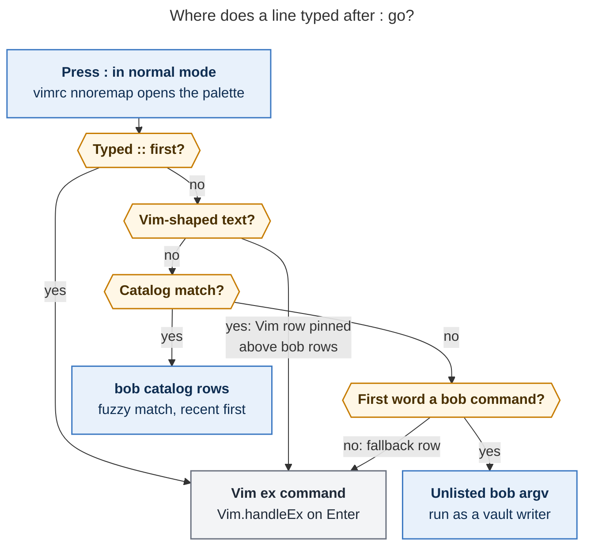
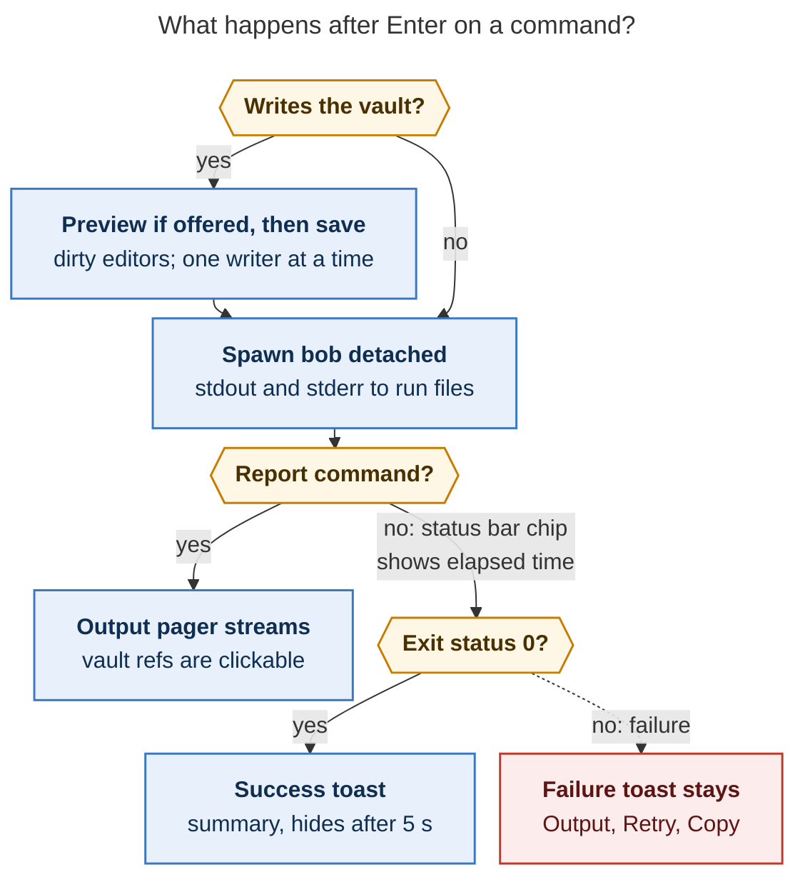

# A `:` bob command mode for Obsidian: critique, design, and recommendation

*Researcher cld · 2026-10-26 · bob-cli @ `e4825208` (bob 0.3.1), bob-plugins @ `04c61c7`,
Obsidian 1.14.5 (snap, athena), obsidian-vimrc-support 0.10.2. Every "verified" claim
below was checked on athena with read-only probes. That includes reading the CodeMirror
Vim source bundled in Obsidian's `obsidian.asar`.*

---

## 1. Bottom line

**Build it, but not literally as specified.** A bob palette inside Obsidian is a good
idea. bob has 60 user-facing leaf commands, and today you have to leave Obsidian to run
any of them. The plugins also handle bob output four different ways, each one built for
a single feature. The request as written has three problems:

1. **Making `:` the palette key in the obvious way would break Bryan's Vim setup.** All 16
   mappings in `obsidian_vimrc.md` (`-`, `[[`, `]]`, `]s`, `[s`, `Z`, …) are recursive
   `nmap X :bob_*<CR>` lines. Obsidian's Vim engine replays their `:` through user
   mappings. Once `:` is remapped, pressing `-` would open the palette, and the leftover
   keys `bob_daily<CR>` would run as normal-mode keys: `b`, then `o` (opens a new line),
   then the rest is typed into the note. The fix is cheap: change `nmap` to `nnoremap`.
   It is also mandatory (§2.1).
2. **"Any bob command" is the wrong scope.** Of the 76 leaf commands, 16 are frozen JSON
   protocol endpoints, and about 10 more only make sense in a terminal. Those are shell
   completion, `pomodoro notify`, interactive logins, and one-time migrations. Shell
   history also shows that Bryan rarely runs the daily-workflow commands by hand, because
   they are automated or already shown in Obsidian. Hand use is dominated by
   `ref create`, `plugins sync/list`, and `ref scan`. The palette should run a **catalog
   owned by bob** (about 14 commands at launch, about 38 in total), plus an escape hatch
   for raw commands.
3. **"Notify on completion" needs two output paths, not one.** For a *report* (`plan`,
   `freshness`, `ready`, `stats`) the output is the whole point, so it should open
   straight into an output pager. An *action* (`vault-sync`, `task reconcile`,
   `ref create`) should run in the background: a status-bar chip while it runs, then a
   toast with the result. In both cases the full output stays one keystroke away in the
   same pager, which also serves as the run history.

**Recommended shape:**

- **bob-cli** adds a hidden, versioned `bob __palette --protocol 1` catalog. Its JSON
  follows the same pattern as `__complete`.
- Argument completion reuses the existing `bob __complete` protocol 1.
- bob-cli adds two small frontend switches: `CLICOLOR_FORCE` for color and
  `BOB_PROGRESS` for progress lines.
- **bob-plugins** gets a new `bob-command-mode` plugin. It provides a command sheet
  docked at the bottom of the window, a detached runner that writes output to files, a
  status chip, toasts, and the pager.
- **The vault vimrc** switches to `nnoremap` and binds `nnoremap : :bob_command<CR>`.
  Vim's own ex line stays reachable: type `::` or anything that looks like Vim.

Estimated effort: about 1–1.5 days for bob-cli, about 3–4 days for the plugin, and
10 minutes for the vimrc.

---

## 2. What exists today (verified)

### 2.1 Vim `:` in Obsidian, and why the naive remap breaks things

| Fact | Evidence |
| --- | --- |
| Obsidian's Vim (`@replit/codemirror-vim`, bundled in `obsidian.asar`) stores `nmap X :cmd<CR>` as a **`keyToKey`** mapping, not as an ex call. `doKeyToKey` replays each key through `vimApi.handleKey(cm, key, 'mapping')`. | `exCommandDispatcher.map`: `{ keys: lhs, type: 'keyToKey', toKeys: rhs, noremap: !!noremap }`. Only `lhs` values that start with `:` become ex→ex mappings. |
| With `noremap == false` (that is, `nmap`), replayed keys are matched against **user mappings too**. With `noremap`, only the default keymap is searched. | `matchCommand`: `var startIndex = noremap ? keyMap.length - defaultKeymapLength : 0;` |
| During a replay, `:` opens a *virtual* prompt. The prompt collects the keys that follow and runs them as an ex command on `<CR>`. This is how every existing vimrc mapping works today. | `showPrompt`: `if (keyToKeyStack.length) { … virtualPrompt = options; return; }` |
| Recursion protection skips only the **same** mapping. Remapping `:` therefore turns `-` → `:` → *your* `:` mapping. The rest of `-`'s keys (`bob_daily<CR>`) then reach normal mode as plain keys. | `doKeyToKey`: `if (keyToKeyStack.indexOf(fromKey) != -1) return;` |
| All **16** mappings in `~/bob/obsidian_vimrc.md` are `nmap X :bob_*<CR>`, and all are recursive. They are `-`, `[[`, `]]`, `!`, `[<Space>`, `]<Space>`, `<C-j>`, `<C-k>`, `\<`, `\>`, `\\`, `]s`, `[s`, `[S`, `]S`, and `Z`. | The vimrc file itself (hand-maintained in the vault, git-synced). |
| obsidian-vimrc-support passes every vimrc line to `Vim.handleEx`, so `nnoremap` works natively. Its `exmap` + `obcommand` pair is how every Bob key reaches a plugin command. | `loadVimCommands` → `codeMirrorVimObject.handleEx(cmEditor, line)`. |
| The plugins already map Vim keys in code: ledger-tools maps `\p`, nav maps tab pin and jump keys, and the cycler maps its keys. All use `vim.defineAction` + `vim.mapCommand`. | `bob-ledger-tools/src/300-plugin-vim-and-snippets.js`, `bob-navigation-hotkeys/src/620-…`, `task-status-cycler/src/140-plugin-vim.js`. |
| **Obsidian's native `:` prompt is a bottom dialog**, and `<BS>` on an empty prompt closes it. | `showPrompt` → `cm.openDialog(…, { bottom: true, … })`; `onPromptKeyDown`: `keyName == '<BS>' && input == ''` closes. |

### 2.2 bob's command surface and the hooks a frontend can reuse

| Fact | Evidence |
| --- | --- |
| There are 30 root commands. 12 are the frozen `capture-*` protocol and 18 are user-facing. In total there are **76 leaf commands, 16 of them protocol**. The command tree is a static table (`SUBCOMMANDS`, `Section`, `ALIASES`). | Recursive `--help` walk; `src/runner.rs`. |
| `bob __complete <zsh\|bash> --protocol 1 -- bob <words>` answers live with `value⇥description⇥group⇥space`. It supports directives (`!files-in`, `!message`) and vault-aware providers: routes, tasks, Pomodoros, plugins, levels, metrics, relation labels, vault notes, and article notes. Most calls take **7–12 ms**. Vault slots are capped at a 150 ms deadline. | Probes; `src/native/completion/{protocol,providers}.rs`. |
| Completion gap: `themes hide/unhide/color/rename` has **no theme-name provider**; only the flags complete. | `bob __complete bash --protocol 1 -- bob themes rename ''` |
| Color and progress are **gated on a TTY**. `Styler::detect()` turns color on only when stdout is a TTY and `NO_COLOR` is unset. The progress lines from `ref create`, the web clipper, and collection capture print only when stderr is a TTY. Width comes from `$COLUMNS` (default 100). | `src/native/style.rs`; `highlights_ref/create.rs:15`, `clip.rs:368`, `collection.rs:1092`. |
| Writers already protect themselves against editor races: a bob lock, a 2 s quiet period, snapshot preflight, atomic renames, and retries. But the docs say plainly that **"An unsaved Obsidian buffer is not observable, and a save can still race the final check."** | `docs/task-status-hooks.md` (~L876), `docs/randomize.md` (~L258). |
| Obsidian merges an external disk change with editor text that has not been saved yet, inside its 2 s autosave window. It has done this since 0.11.6. Forum users report lost text when that merge goes wrong. | [Obsidian 0.11.6 changelog](https://obsidian.md/changelog/2021-03-09-desktop-v0.11.6/); [forum thread](https://forum.obsidian.md/t/editor-add-a-toggle-to-disable-automatic-merging-of-changes-non-obsidian-sync/14874/) |
| If bob's stdout reader goes away, bob **stops at its next print and exits 0 silently**. `run_with_quiet_epipe` catches the EPIPE print panic and unwinds the whole command. For a writer whose parent (Obsidian) reloads mid-run, this means a silent half-run. | `src/runner.rs` ~L853–890. |

### 2.3 How the plugins run bob today

- There are **four separate copies** of "resolve bob and spawn it": ledger-tools
  `bobSpawnJson` / `statsResolveBobPath`, `articleSpawnBob`, nav `677-plugin-ref-pdf-open`,
  and `bob-project-tasks` `snapshotSpawnBob`. They all set `BOB_DIR` and `NO_COLOR=1`. The
  GUI-safe candidate list is `~/.cargo/bin`, `~/.local/bin`, `/opt/homebrew/bin`, and
  `/usr/local/bin`. **None of them adds to `PATH` for the child process**, so on the Mac
  any tool bob shells out to (`pass`, Homebrew Python) is missing from the GUI `PATH`.
- Results are shown in **one-off ways**. "Snapshot note to Highlights" shows a plain
  `new Notice("Snapshotting …", 0)`, then a 10 s text notice, with no output viewer and
  no retry. Relation-label writes go through the ledger-tools API. Stats and the Reading
  Board use fetches that serve cached data while refreshing in the background.
- There is an established visual vocabulary to reuse:
  - The `bob-cnp-*` picker: icon header, search row, rows with icon/title/path/meta/badges,
    and a `kbd` footer. It moves the selection with Ctrl+N/P and arrows.
  - The `bob-nh-notice` card: a 4 px left border in the level colour, on
    `--background-primary`.

### 2.4 What Bryan actually runs (athena shell history)

From Atuin and `~/.zsh_history` (athena only; the Mac's history was not available):

| Command (aliases folded in) | Runs | Notes |
| --- | ---: | --- |
| `ref create` / `highlights create` | **57** | median **12.1 s**, p90 **233 s**, max 307 s; **11 of 44 timed runs exited non-zero** |
| `dataview` (now `query`) | 61 | engine development, not daily use |
| `plugins sync` / `plugins list` | **32** | median 0.1 s, max 24.9 s |
| bare `bob` (reading help) | **26** | the palette also helps discovery |
| `highlights-ref scan` / `scan` | 18 | 13 of 17 exited non-zero |
| `plan`, `freshness`, `ready`, `stats`, `reconcile`, `projects sync` | ≤ 3 total | already automated or already rendered in Obsidian |

Read-only timings measured today: `plan` 443 ms, `freshness` 980 ms, `ready` 897 ms,
`stats` 222 ms, `projects list` 169 ms, `task reconcile --dry-run` 2.3 s,
`vault-sync status` 6 ms, `pomodoro status` 8 ms. Human output is about 100–110
columns wide and uses Unicode sparklines and tables.

---

## 3. Is this a good idea?

**Yes, with a narrower purpose than the request implies.** The win is not running
`bob plan` instead of looking at the `bob-plan` block. The win is three things:

1. **Closing the loop on the commands Bryan does run by hand.** `ref create` (long and
   often failing) needs to run in the background with full output kept. `plugins sync`
   is a dev loop that needs "reload changed plugins" afterwards. `ref scan` (Mac),
   "sync the vault now", and "reconcile now" round out the list.
2. **Discoverability.** 26 bare `bob` runs show Bryan reading help. A palette with
   one-line descriptions, sections, and `?` for full help is a better map than
   `bob --help`.
3. **One run experience** in place of four improvised notice styles. Other plugins can
   call it through an API (§7.7).

Costs and risks, each with its mitigation:

| Risk | Why it matters | Mitigation |
| --- | --- | --- |
| `:` collides with Vim ex | Verified to corrupt notes via recursive `nmap` replays, and `:%s`, `:sort`, `:noh`, `:42` would disappear | `nnoremap` migration, a vimrc lint at plugin load, Vim fallback rows, and `::` (§7.1) |
| Duplicating existing Obsidian UIs | Themes manager, relation-label manager, Stats page, Reading Board, Ctrl+Shift+M task move, and bob-articles format-on-save already exist | Leave out `task move`; ship themes, relations, and articles in v2 only; prefer rows that point to the existing UI |
| Writes racing the editor | bob cannot see unsaved buffers; Obsidian's merge has lost text before | Save every dirty Markdown view **before** spawning a writer; one writer at a time (§7.3) |
| Obsidian reloads during a write | bob exits 0 halfway through when stdout breaks | Detached child with **file-backed stdout/stderr** (§7.3) |
| Mac GUI environment | `pass` (gkeep token) and Homebrew tools are not on `PATH`; pinentry can hang | Add the candidate directories to the child's `PATH`; close stdin (`'ignore'`); give each command a timeout; mark environment-sensitive rows |
| Two repos must evolve together | bob and the plugins install independently and are versioned separately per machine | An additive JSON contract with `schema_version`; unknown fields are ignored; an unknown `effect` is treated as a write |
| Scope creep into "a terminal in a modal" | High maintenance, low value | A bob-owned catalog with an explicit inclusion rule (§6); raw argv only as an escape hatch |

**Would I take a different approach?** Only in ways that matter structurally: the
catalog should live in bob, not in the plugin; argument completion should reuse
`__complete`; broad rewrites should preview first; and the pager should double as the
run history instead of adding a sidebar view. I considered and rejected several
alternatives (§5). One is worth keeping as a *complement*: register each zero-argument
catalog entry as a native Obsidian command too. Hotkeys and Ctrl+P then come free.

---

## 4. Requirement adjustments (called out)

| # | As requested | Adjusted to | Why |
| --- | --- | --- | --- |
| **R1** | "a new `:` keymap" | `:` opens bob command mode **in normal mode only**, through `nnoremap : :bob_command<CR>` in the vault vimrc. All 16 existing `nmap … :bob_*<CR>` lines become `nnoremap`. Visual-mode `:` stays native (`'<,'>` ranges). An Obsidian command (`Bob: Command mode`, hotkey of Bryan's choice) covers Reading view, Stats, Canvas, and other non-editor views. | §2.1: a recursive `:` remap corrupts notes. The vimrc is where every other Bob key is declared. |
| **R2** | (implicit) replace Vim's `:` | **Vim's ex line stays reachable.** `::` forces Vim. Vim-shaped text (`%s/…`, `42`, `noh`, `sort`, `bob_daily`, …) pins a "Run as Vim `:…`" row first. When nothing matches, the fallback row is Vim. `Vim.handleEx` runs against the editor that opened the sheet. | Muscle memory survives: `:%s/a/b/g↵` and `:42↵` keep working keystroke for keystroke. |
| **R3** | "support any bob command that might be useful" | A **catalog owned by bob** (`bob __palette`). It has 14 commands at launch and about 38 in total. It has an explicit inclusion rule, and the 16 protocol endpoints plus about 12 terminal-only commands are excluded. Any `bob <argv>` can still be typed as an *unlisted* run. | Under the thin-client rule (`decisions:mac-capture-is-a-thin-client`), metadata cannot drift and a third copy of the help text is never needed. |
| **R4** | "notified of its completion … full output somehow" | **Output depends on the kind of command.** Reports open the output pager directly. Actions show a status-bar chip while running, then a toast: success hides itself after 5 s, failure stays until dismissed. A long run (> 15 s) that finishes while Obsidian is unfocused also sends a desktop notification. The full output is always in the pager. `[`/`]` there move through past runs. | A toast that only says "plan finished" adds nothing. A persistent toast covering the note for a 4-minute `ref create` is hostile. |
| **R5** | (implicit) run immediately | **Writes are safe by construction:** save dirty editors first; one writer at a time; **preview-first** for broad rewrites (`themes rename`, `relations rename`, `ref rename`, `task reroll`); a confirm card for `nightly` and `task archive`, which have no dry run; `⇧↵` runs a dry run wherever one is offered. Running writers cannot be cancelled. | Bob's own culture is "preview unless `--write`", and killing a multi-note writer mid-way leaves it half done. |
| **R6** | (implicit) Obsidian-only change | **Small bob-cli changes:** `__palette`; `CLICOLOR_FORCE=1` and `BOB_PROGRESS=1` honoured on a non-TTY; a theme-name completion provider. | Without these the pager shows no color, and `ref create` stays silent for minutes. |
| **R7** | — | **Context-aware arguments.** The active note fills `NOTE` and `REF` slots as a removable chip. A URL on the clipboard is offered first for `ref create`. | That is the point of running bob *from inside* Obsidian. |
| **R8** | — | **Desktop only.** On mobile the palette shows one "needs the desktop app" row. | Obsidian mobile cannot spawn processes. |

---

## 5. Alternatives considered

| Option | Verdict | Why |
| --- | --- | --- |
| **A. Register bob commands as native Obsidian commands (Ctrl+P)** | **Keep as a complement** | Fuzzy search, recents, and hotkey binding come free. But there is no argument entry, no output view, and the commands get mixed in with hundreds of others. Generate them from the same catalog. |
| **B. Shell commands community plugin** ([docs](https://publish.obsidian.md/shellcommands)) | Rejected | It is configuration only, with variables, output channels, and a terminate button in realtime mode. But it gets no completion from bob, its catalog drifts as hand-written config, its look does not match Bob's, and it puts a core workflow on a third-party dependency. |
| **C. An embedded terminal plugin** (xterm.js + node-pty) | Rejected | You get the real zsh with completion. But it means "leaving Obsidian inside Obsidian": no notifications, no clickable vault references, and native modules that break when Electron upgrades. |
| **D. A resident bob daemon or HTTP API** | Rejected for now | Spawning costs about 7–12 ms. The thin-client record defers a daemon until spawn latency is the problem. |
| **E. Put `:` commands in Bob Mac Capture** | Later, reusing the same catalog | It is Mac only, and Obsidian on athena would not get it. The `__palette` JSON lets any frontend reuse the catalog. |
| **F. Catalog hard-coded in the plugin** | Rejected | That would be a third copy of command names, flags, and help, with descriptions guaranteed to drift. bob already owns `about`, sections, and completion. |
| **G. A centred modal like the other Bob pickers** | Rejected for `:` | Bryan's eye goes to the bottom on `:` (the native prompt is `bottom: true`). His fzf runs `--reverse --height 40% --border` (verified env), which is a bottom panel with the input on top. A bottom sheet signals "command line, not search" while keeping the `bob-cnp` row vocabulary. |

---

## 6. Which commands (the catalog)

**Inclusion rule.** A command is included when it is something a human runs, it is
useful while you are looking at the vault, it needs no TTY input, and Obsidian does not
already have a better UI for it.

Legend: **reads** / **writes** / **syncs** (git push/pull) / **net**; **R** = report
(opens the pager), **A** = action (chip, then toast); **⇧↵** = dry run available.

| Section | Row title | argv | Kind | Context and notes | Phase |
| --- | --- | --- | --- | --- | --- |
| Daily | Today's plan | `plan` | reads · R | — | **v1** |
| Daily | Review queue | `freshness` | reads · R | `note.md:23` rows are clickable | **v1** |
| Daily | Ready lanes | `ready [NOTE]` | reads · R | NOTE ← active area/project note (optional chip) | **v1** |
| Daily | Pomodoro status | `pomodoro status` | reads · toast | One line; shown inline in the toast | **v1** |
| Daily | Stats glance | `stats` | reads · R | 14 wide columns; set `COLUMNS` | **v1** |
| Daily | Stats detail / metric catalog | `stats show METRIC…` / `stats metrics` | reads · R | metric completion already exists | v2 |
| Daily | Themes: hide · unhide · color · rename · list | `themes …` | writes (journal) · A; rename previews first | Needs the theme-name provider (R6); the nav themes manager already exists | v2 |
| Daily | Capture | `capture TEXT…` | writes · A ⇧↵ | Live `--dry-run` preview line; `=` Pomodoro operators | v2 |
| Tasks | Reconcile task statuses | `task reconcile` | writes · A ⇧↵ | Retries for up to 120 s by default, so the timeout must be longer | **v1** |
| Tasks | Sync projects | `projects sync` | writes · A ⇧↵ | — | **v1** |
| Tasks | Projects list | `projects list` | reads · R | — | v2 |
| Tasks | Re-roll priorities | `task reroll` | writes · A, previews first | — | v2 |
| Tasks | Archive done tasks | `task archive` | writes · A, confirm card | Script command with no dry run | v2 |
| Tasks | Relations: list · hide · unhide · rename | `relations …` | writes · A; rename previews first | The relation-labels manager exists | v2 |
| Vault | **Sync vault now** | `vault-sync run` | syncs · A ⇧↵ | — | **v1** |
| Vault | Vault sync status | `vault-sync status` | reads · R | — | **v1** |
| Vault | Nightly maintenance | `nightly` | writes + syncs · A, confirm card | Long | v2 |
| Vault | Articles: list · outline · format · adopt | `articles …` | reads / writes | NOTE ← active; bob-articles already formats on save | v2 |
| Vault | Query (advanced) | `query --source …` | reads · R | Result paths are clickable | v2 |
| Vault | **Create reference** | `ref create TARGET…` | writes + net · A ⇧↵ | TARGET ← clipboard URL, else the active note; timeout 15 min; `BOB_PROGRESS` | **v1** |
| Vault | Pull reference into today | `ref today REF` | writes · A ⇧↵ | REF ← active ref note | **v1** |
| Vault | Scan Highlights library | `ref scan` | writes · A ⇧↵ | Meant for the host with the Highlights library (the Mac); 13 of 17 athena runs exited non-zero, so bob's `hosts` field should decide where it is offered | **v1** (Mac) |
| Vault | Find, list, show, doctor, jobs list/run | `ref find …` etc. | reads (jobs run writes) | REF ← active | v2 |
| Vault | Rename reference | `ref rename REF NAME` | writes · A, previews first | REF ← active | v2 |
| Vault | PDF sync / marker (advanced) | `ref sync PDF`, `ref marker PDF` | — | Mac only | v2 |
| Integrations | Pull Google Keep inbox | `gkeep pull` | writes + net · A ⇧↵ | Depends on the environment (`pass`) | v2 |
| Integrations | Keep list / doctor | `gkeep list`, `gkeep doctor` | reads · R | — | v2 |
| Setup | **Deploy plugins** | `plugins sync` | writes `.obsidian/plugins` · A ⇧↵ | The success toast offers **Reload changed plugins** (ids come from `-f json`) | **v1** |
| Setup | Plugin versions | `plugins list` | reads · R | — | **v1** |

**Excluded:**

- All 16 `capture-*` protocol leaves (machine JSON, frozen protocol).
- `completion *` (shell only).
- `pomodoro notify` and `pomodoro tmux` (a blocking wait and tmux output).
- `gkeep login` (needs an interactive cookie).
- `gkeep migrate-*`, `ref migrate-tasks`, and `ref migrate-zorg` (one-time migrations).
- `task move` (Ctrl+Shift+M is the better UI).

Every row also supports `?`, which shows `bob <path> --help` in the pager.

---

## 7. Design

### 7.1 The key, and living alongside Vim



*Figure 1. Bob owns `:`, but anything that looks like Vim goes to Vim. `::` always goes
to Vim, and text that matches nothing falls back to Vim, unless its first word is a real
bob command. (Rendered 758 × 1094 px; fits the page at 81.6 %.)*

**Vault vimrc change** (Bryan's file, hand-maintained):

```vim
" `:` opens bob command mode; `::` inside it is Vim's ex line.
exmap bob_command obcommand bob-command-mode:open
nnoremap : :bob_command<CR>
" Every mapping that replays `:` must be non-recursive once `:` is remapped.
nnoremap - :bob_daily<CR>
nnoremap ]s :bob_next_due<CR>
" … (all 16 existing nmap lines → nnoremap)
```

**"Vim-shaped" is defined exactly.** Any one of these makes the input Vim-shaped:

- it starts with a range or punctuation character (`% . $ ' , ; + - / ? & ~ ! <` or a
  digit);
- it matches `^(s|g|v|substitute|global|vglobal)\W`;
- its first word is exactly a name from CM-Vim's default ex command list (`w q wq x noh
  nohlsearch sort set normal reg marks undo redo d y j m …`), `obcommand`, `exmap`, or
  an `exmap` name the plugin reads from the vimrc (`bob_daily`, …).

No bob root collides with these names, and bob names use hyphens, never underscores.

**A lint step to stay safe.** At load, the plugin finds the vimrc through
vimrc-support's `data.json` → `vimrcFileName` and reads it. If any `map` or `nmap` line's
right-hand side contains `:` while `:` is mapped, it shows one notice naming the
offending keys ("`-` and 15 others replay `:`; change them to `nnoremap`").

Known limitation: a count before `:` (`5:`) is dropped. Vim's own `:.,.+4` range is
lost. It is rare in a notes editor.

### 7.2 The command sheet (palette)

**Placement and shape.** The sheet docks to the bottom centre of the window and lines up
with the active pane's horizontal bounds:

- width = pane width − 48 px, at most 920 px;
- height grows up to 45 vh;
- the input sits on the sheet's top edge and results list downward, the same layout as
  Bryan's fzf;
- it slides up in 120 ms and honours `prefers-reduced-motion`.

It reuses the `bob-cnp` row anatomy and colour tokens. Only the frame differs.

```
╭──────────────────────────────────────────────────────── athena · bob 0.3.1 ─╮
│ bob ❯ sync▏                                                                  │
├──────────────────────────────────────────────────────────────────────────────┤
│ VAULT                                                                        │
│▌⟳  vault-sync run       Sync vault now                         syncs   ⇧↵   │
│ ⓘ  vault-sync status    Report the last reconcile cycle         reads        │
│ TASKS AND PROJECTS                                                           │
│ ✎  projects sync        Sync project status and schedules       writes  ⇧↵   │
│ ⌁  :sync…               Run as Vim command                       vim          │
├──────────────────────────────────────────────────────────────────────────────┤
│ ↵ run   ⇥ arguments   ⇧↵ preview   ? help   :: vim   esc close               │
╰──────────────────────────────────────────────────────────────────────────────╯
```

**Rows.**

- Each row starts with a Lucide icon chosen by effect: `book-open` reads,
  `pencil-line` writes, `refresh-cw` syncs, `globe` network.
- The command path is in monospace, with the matched characters in `--text-accent` at
  weight 600.
- The human title follows in `--text-muted`.
- On the right are chips:
  - effect: `reads` muted, `writes` `--color-orange`, `syncs` `--color-blue`,
    `net` `--color-purple`;
  - `⇧↵` when a preview exists;
  - a typical duration, `~12 s`. This is the median of the last ten local runs and is
    shown only when it is over 2 s.
- The selected row has a 3 px accent bar on the left, matching `bob-cnp-row.is-selected`.
- Section headers are small caps in bob's workflow order (`Section` order from bob).

**Empty state (just `:`).** Three groups, then the full catalog:

- **Recent:** the last 4 distinct command lines, each with ✓/✗, age, and duration.
  `↑`/`↓` over these rows *is* the command history.
- **For this note:** suggestions from context. A ref note gets `ref today` and
  `ref show`. An article gets `articles outline`. A URL on the clipboard gets
  `ref create <url>`.
- **All commands**, grouped by section.

**Ranking.** Fuzzy match, using Obsidian's `prepareFuzzySearch` for the score and the
character highlights. Then frecency: frequency × recency decay, stored per machine in
the plugin's `data.json`, as in [Raycast's ranking](https://manual.raycast.com/search-bar.md).
Catalog `keywords` widen matches: "push", "git", and "commit" find `vault-sync`; "keep"
finds `gkeep`; "highlights" and "pdf" find `ref create` and `ref scan`.

**Argument mode.** Enter on a command that needs arguments, or `⇥` on any row, turns the
command path into a non-editable pill (`themes rename`). Ghost placeholders `‹OLD› ‹NEW›`
show the argument names. Completions come from
`bob __complete bash --protocol 1 -- bob <path> <words>`, debounced by 60 ms and grouped
by the protocol's `group` column. The client handles the directives:

- `!files-in` → vault Markdown files, with the active note first;
- `!message` → hint text under the input.

Context slots arrive pre-filled as a chip (`📄 sase_blog.md`; Backspace removes it).
Typed input is tokenised with shell-style quoting, so `ref create "a b"` works.

**Keys.** These follow the house picker conventions plus Vim's ex line:

| Key | Action |
| --- | --- |
| `↵` | Run the selected row (or enter argument mode if arguments are required) |
| `⇥` | Complete the row into the input / accept a completion |
| `⇧↵` | Preview with a dry run (when the catalog says one exists) |
| `⌃↵` | Run now: skip preview-first or the confirm card |
| `↑ ↓` / `⌃N ⌃P` | Move the selection (over Recent rows = history) |
| `?` at the end of the query | Show `--help` for the selected command in the pager |
| `::` | Switch the line to Vim ex mode (VIM pill) |
| `Esc` | Clear the query; a second `Esc` or `⌃[` closes |
| `⌫` on an empty query | Close the sheet (the same as Vim's prompt, §2.1) |

The sheet must open in under one frame. The catalog, recents, and frecency come from
memory, refreshed from `data.json` at load. Opening the sheet never spawns a process.
The catalog is revalidated in the background when bob's path, mtime, or version changes.

### 7.3 Running a command reliably



*Figure 2. Writers get two guards before bob starts: they save dirty editors and run
one at a time. Every run writes its output to files. Reports stream into the pager;
actions end in a toast, and a failure toast stays up. (Rendered 619 × 1032 px; fits the
page at 86.5 %.)*

1. **Save editors before a write.** For every `markdown` leaf with unsaved changes,
   `await view.save()` before spawning any non-`reads` run. bob then sees what is on
   screen, and its 2 s quiet period starts from those saves. Obsidian will reload
   bob's write cleanly instead of merging it.
2. **One writer at a time.** A second writer queues ("queued behind `task reconcile`").
   `reads` runs go in parallel. Starting an identical argv that is already running
   focuses the existing run instead of starting it again.
3. **Detached, file-backed child.**
   - Command: `spawn(bobPath, argv, { detached: true, stdio: ['ignore', outFd, errFd] })`.
   - Files live under `~/.local/state/bob-cli/command-mode/runs/<run-id>.{out,err,json}`,
     where `<run-id>.json` holds argv, start time, exit status, and pid.
   - The plugin tails both files for streaming.
   - Why: if Obsidian reloads, bob no longer hits EPIPE and stops silently (§2.2), and
     the run's log survives the reload.
   - On reload the plugin re-attaches to any run whose pid is still alive. Without a
     parent, the exit status is recorded by a 1-line `sh -c 'bob "$@"; echo $? > rc'`
     wrapper.
   - Retention: the last 50 runs or 7 days.
4. **Environment.**
   - `BOB_DIR` is the vault base path.
   - `PATH` gains the existing candidate directories (`~/.cargo/bin`, `~/.local/bin`,
     `/opt/homebrew/bin`, `/usr/local/bin`) when they are missing.
   - `COLUMNS` is the pager's width in characters, measured from the monospace glyph
     width, so bob's tables fit.
   - `CLICOLOR_FORCE=1` and `BOB_PROGRESS=1` once bob supports them (R6). Until then,
     `NO_COLOR=1`.
   - stdin is ignored, so nothing can wait for typed input, and pinentry-curses fails
     fast instead of hanging.
5. **Timeouts and cancel.**
   - Each catalog entry has its own timeout. The default is 180 s, so it outlasts
     reconcile's 120 s retry budget. `ref create` gets 900 s and `ref scan` gets 1800 s.
   - Only `reads` runs have a **Cancel** button. For writers the chip says "can't be
     cancelled safely", because cancelling half-way leaves a multi-note write half done.
   - On timeout the plugin sends SIGTERM, then SIGKILL after 5 s, and reports "timed
     out: bob may have changed files; see output". A timed-out run is never retried
     automatically.
6. **Afterwards.** Fire `app.workspace.trigger('bob:command-finished', {argv, ok, effect,
   invalidates})`. ledger-tools can then refresh its caches right away: themes and
   relations journals, stats, and the reading board. Writes under hidden `.bob/` paths
   produce no vault events, so without this hook they would wait for the 10-minute
   staleness timer.

### 7.4 Notifications and output

- **Running.** A status-bar item appears, for example `⟳ bob ref create · 0:42`. With
  two or more runs it reads `bob ×2`. Its tooltip shows the last progress line, and a
  click opens the pager on the live run. It only appears for runs that last longer than
  400 ms.
- **Success toast.** This is a `Notice` with a `DocumentFragment` styled as a
  `bob-nh-notice` card (`messageEl`; see the
  [Notice API](https://docs.obsidian.md/Reference/TypeScript+API/Notice)). It has a
  green left border, `✓`, the command in monospace, and one summary line: the catalog's
  `summary` hint, defaulting to the first non-empty stdout line. Meta text reads
  `2.3 s · 08:41`. Actions are **Output** and **Copy**. It hides itself after 5 s.
- **Failure toast.** Red border, `✗`, and the first non-empty stderr line. Known
  failures get clearer wording:
  - lock busy → "Another bob run holds the maintenance lock", with Retry;
  - dirty paths → "Commit pending edits first", with a **Sync vault, then retry** button;
  - `bob-not-found` → the list of paths tried and a link to settings.

  Actions: **Output · Retry · Copy command**. Duration 0, so it stays until dismissed.
- **Away notification.** A run longer than 15 s that finishes while Obsidian is
  unfocused also raises an OS notification through `new Notification(…)`. Clicking it
  focuses Obsidian and opens the pager.
- **Output pager.** One component serves reports, failures, previews, and history:
  - a modal of 88 vw × 82 vh, at most 1200 px;
  - a sticky header with a status pill (`● running` / `✓ exit 0` / `✗ exit 1`), the argv
    as copyable code, and the start time and duration;
  - a body in `--font-monospace`, 13 px, line-height 1.45, `white-space: pre`, scrolling
    horizontally;
  - ANSI SGR mapped to theme variables (`--color-red/green/yellow/blue/cyan`; dim →
    `--text-faint`; bold → 600), so light and dark themes both work with no extra
    palette;
  - stderr lines carry a faint red gutter tick;
  - **vault references become links**: `note.md:23` lands on line 23 (with a Vim jump,
    reusing nav's landing helpers), `note.md#^id` lands on the block, `[[wikilinks]]`,
    and vault-relative paths;
  - keys `j k d u g G` scroll, `w` toggles wrap, `y` / `Y` copy output / command, `r`
    reruns, `[` `]` step to older / newer runs, `:` opens the sheet, and `q`/`Esc`
    closes;
  - for a preview run, the footer shows the primary action **`⌃↵ Apply`**.

### 7.5 What "beautiful" means here (visual rules)

- **Use only Obsidian theme variables** (`--background-primary`, `--text-accent`,
  `--color-*`, `--radius-l`, `--shadow-l`). Light and dark modes and community themes
  then work for free, as they do for `bob-cnp`.
- **Two typefaces with distinct jobs:** monospace for anything you could type (command
  paths, argv, output) and the UI font for anything that explains it (titles, help,
  hints).
- **One accent per state:** orange for writes, blue for syncs, green for success, red
  for failure. A 4 px left border carries the state on cards, the same as Bob's existing
  notices.
- **Calm motion:** the sheet slides up 120 ms, the pager fades 90 ms, and the spinner is
  the only constant motion.
- **Dense but quiet rows:** 32 px rows, chips at `--font-ui-smaller`, small-caps section
  headers with 0.06 em tracking, and a `kbd` footer that matches the other Bob pickers.

### 7.6 The bob-cli contract

**`bob __palette --protocol 1`** is hidden, like `__complete`. It speaks JSON, takes the
same `--protocol` min/max handshake, and exits 0. It never reads the vault, so it is
instant. The catalog is a static Rust table next to `SUBCOMMANDS`:

```json
{
  "schema_version": 1,
  "bob_version": "0.3.1",
  "sections": [{ "id": "daily", "title": "Daily workflow" }, …],
  "entries": [
    {
      "id": "ref.create",
      "argv": ["ref", "create"],
      "title": "Create reference",
      "about": "Create a Highlights-ready PDF from a vault note, Markdown, a PDF, or a URL",
      "section": "vault",
      "keywords": ["highlights", "pdf", "clip", "url"],
      "effect": ["writes", "net"],
      "presentation": "action",
      "confirm": "none",
      "preview": ["--dry-run"],
      "args": [{ "name": "TARGET", "required": true, "repeat": true,
                 "context": ["clipboard_url", "active_note"] }],
      "summary": "first_line",
      "timeout_s": 900,
      "hosts": ["any"],
      "invalidates": ["refs"]
    }
  ]
}
```

- `effect` values: `reads | writes | syncs | net`.
- `presentation` values: `report | action | toast`.
- `confirm` values: `none | preview | ask`.
- `context` values: `active_note | clipboard_url`.
- `hosts` values: `any | macos`.

Unknown `effect` values must be treated as `writes`.

**Tests in bob:**

- every `argv` resolves to a leaf (reuse the alias test's `resolve_path`);
- every `preview` flag exists on that leaf;
- every `args[].name` matches a clap positional;
- excluded protocol roots never appear.

**Docs:**

- a `docs/palette.md` contract;
- help prose under the `__complete` section of `docs/completion.md`;
- `just docs-gen`;
- the plugin hotkey goes in the plugin reference, per `docs.md` routing.

**Frontend switches** (about 6 call sites):

- `CLICOLOR_FORCE=1` turns on color in `Styler::detect`, `runner.rs:1224`,
  `nightly.rs:312`, and `highlights_ref/cli.rs:220`. `NO_COLOR` still wins.
- `BOB_PROGRESS=1` makes the TTY-gated progress `eprintln!`s print plain lines
  (`create.rs`, `clip.rs`, `collection.rs`).

**Completion:** add a theme-name `Kind`, including hidden themes for `unhide`, copying
the relation-label provider.

### 7.7 Where the code lives, and how it connects

- **A new plugin, `bob-command-mode`**, in bob-plugins, built with the fragments build:
  - `010` catalog and cache;
  - `020` Vim routing and vimrc lint;
  - `030` sheet view;
  - `040` argument mode;
  - `050` runner;
  - `060` toasts and status chip;
  - `070` pager and ANSI;
  - `080` reference linkifier;
  - `090` lifecycle.

  Do not add it to `bob-navigation-hotkeys`. That plugin is already 83k generated lines,
  and this feature has its own settings, lifecycle, and tests. Enable the plugin once in
  the git-synced `community-plugins.json`, then run `bob plugins sync` on each machine.
- **Bob path:** take it from ledger-tools `api.stats` when present, as
  `bob-project-tasks` does. Otherwise use the shared candidate list.
- **`api.commandMode` v1:**
  - `run(argv, {presentation, title})` → `Promise<{ok, exit, runId}>`;
  - `openOutput(runId)`.

  "Snapshot note to Highlights", the articles plugin, and future features can then
  share the runner, toasts, and pager instead of building a fifth notice style.
- **Obsidian commands generated from the catalog:** `Bob: Command mode` (open),
  `Bob: Show last output`, `Bob: Rerun last command`, and one `Bob: <title>` per
  zero-argument entry (stable id `run-<entry-id>`). These can be bound to hotkeys and
  appear in Ctrl+P.
- **Settings (minimal):** bob path override, a toast duration, OS notifications on/off,
  and history retention.

---

## 8. Risks and open questions

- **Does Bryan use Vim ex commands in Obsidian today** (`:%s`, `:sort`, `:noh`,
  `:<line>`)? If not, the Vim fallback can be cut back to `::` alone. Keep the
  `nnoremap` migration either way.
- **Which machine runs Obsidian more?** The Mac adds `PATH`/`pass` problems and hosts
  `ref scan`. athena is where `ref create` and `plugins sync` actually run (§2.4). Test
  on both.
- **Detached writers and reload.** The re-attach path is new code. If it proves fragile,
  a simpler first version is acceptable: file-backed output with exit status recorded
  only while the plugin is alive. That still removes the EPIPE stop.
- **Catalog freshness across machines.** bob and the plugins are deployed per machine and
  drift. Earlier research found athena's vault running nav 2.16.0 while the repo was at
  2.31.0. The additive schema covers this. The palette footer shows the bob version, so
  mismatches are visible.
- **Decision record.** Once the design is accepted, record "`:` is bob command mode; Vim
  ex stays reachable through `::` and Vim-shaped fallback" in the decisions web, through
  `/sase_memory_write`.

---

## 9. Recommended solution

Build **`:` bob command mode** as a bottom command sheet that runs a bob-owned catalog,
with output split by kind and a runner that is safe for writes. Do it in four phases:

| Phase | Repo | Scope | Effort |
| --- | --- | --- | --- |
| **0. Make `:` safe** | vault | Change all 16 `nmap … :bob_*<CR>` to `nnoremap`. Confirm `-`, `]s`, and `Z` still work. Do not bind `:` yet. | 10 min |
| **1. Contract** | bob-cli | `bob __palette --protocol 1` (static table plus tests), honour `CLICOLOR_FORCE` and `BOB_PROGRESS`, theme-name completion kind, `docs/palette.md` | 1–1.5 days |
| **2. Runner first** | bob-plugins | New `bob-command-mode` plugin: catalog cache, detached file-backed runner, save-before-write, writer queue, status chip, toasts, output pager with ANSI and clickable references, `api.commandMode` v1, and generated Obsidian commands for the 14 v1 entries. This is useful with Ctrl+P alone. | 1.5–2 days |
| **3. The sheet** | bob-plugins + vault | Bottom sheet with fuzzy and frecency ranking, Recent and For-this-note groups, argument mode backed by `__complete`, preview and confirm flows, Vim routing and vimrc lint; then add `nnoremap : :bob_command<CR>` to the vimrc. | 1.5–2 days |
| **4. Breadth** | both | The v2 catalog rows, the `capture` dry-run preview line, OS notifications, and moving "Snapshot note to Highlights" onto `api.commandMode`. | as needed |

Phase 2 comes before Phase 3 on purpose. The runner holds the reliability risk (editor
races, EPIPE, timeouts, the Mac environment), and it delivers value through Ctrl+P
before the sheet exists. The sheet is then mostly presentation on top of a tested core.

---

## Sources

**Verified in local checkouts and on athena:**

- `~/bob/obsidian_vimrc.md`.
- `~/bob/.obsidian/plugins/obsidian-vimrc-support/{main.js,data.json}`.
- `/snap/obsidian/current/app/resources/obsidian.asar`: CodeMirror Vim
  `exCommandDispatcher.map`, `doKeyToKey`, `matchCommand`, `showPrompt`, `processEx`,
  and `handleEx`.
- bob-cli: `src/runner.rs` (SUBCOMMANDS, sections, aliases, `run_with_quiet_epipe`),
  `src/native/completion/{mod,protocol,providers,present}.rs`,
  `src/native/style.rs`, `src/native/highlights_ref/{create,clip,collection,cli}.rs`,
  `docs/task-status-hooks.md`, and `docs/randomize.md`.
- bob-plugins:
  - `plugins/bob-ledger-tools/src/236-plugin-stats-data.js`, `172-plugin-relation-labels.js`,
    and `300-plugin-vim-and-snippets.js`;
  - `plugins/bob-navigation-hotkeys/src/200-filtered-picker-modals.js`,
    `285-unblocked-notice.js`, `620-plugin-dash-and-vim-jumps.js`, and `styles.css`
    (`bob-cnp`, `bob-nh-notice`);
  - `plugins/bob-articles/src/030-plugin.js`;
  - `plugins/bob-project-tasks/main.js` (snapshot command).
- Memory: `decisions:mac-capture-is-a-thin-client`,
  `decisions:idle-capture-shows-ledger-agenda`, `cli_rules.md`, `docs.md`, and
  `obsidian.md`.
- Prior research: `research:202610/slash_task_goto_in_obsidian/slash_task_goto_in_obsidian__final.md`.
- Usage data: athena Atuin `history.db` (92,445 commands, 237 bob runs) and
  `~/.zsh_history`; only subcommand counts and durations were extracted.
- Live probes: `bob __complete …`, the read-only command timings listed in §2.4, and
  `bob capture --dry-run`.

**Web:**

- [Obsidian Notice API](https://docs.obsidian.md/Reference/TypeScript+API/Notice)
- [Notice.setMessage](https://docs.obsidian.md/Reference/TypeScript+API/Notice/setMessage)
- [Obsidian 0.11.6 changelog (merging external changes)](https://obsidian.md/changelog/2021-03-09-desktop-v0.11.6/)
- [Forum: toggle to disable automatic merging](https://forum.obsidian.md/t/editor-add-a-toggle-to-disable-automatic-merging-of-changes-non-obsidian-sync/14874/)
- [Shell commands plugin docs](https://publish.obsidian.md/shellcommands)
- [Shell commands: output channels](https://publish.obsidian.md/shellcommands/Output+handling/Output+channels)
- [Raycast fallback commands](https://manual.raycast.com/fallback-commands)
- [Raycast search bar and ranking](https://manual.raycast.com/search-bar.md)
