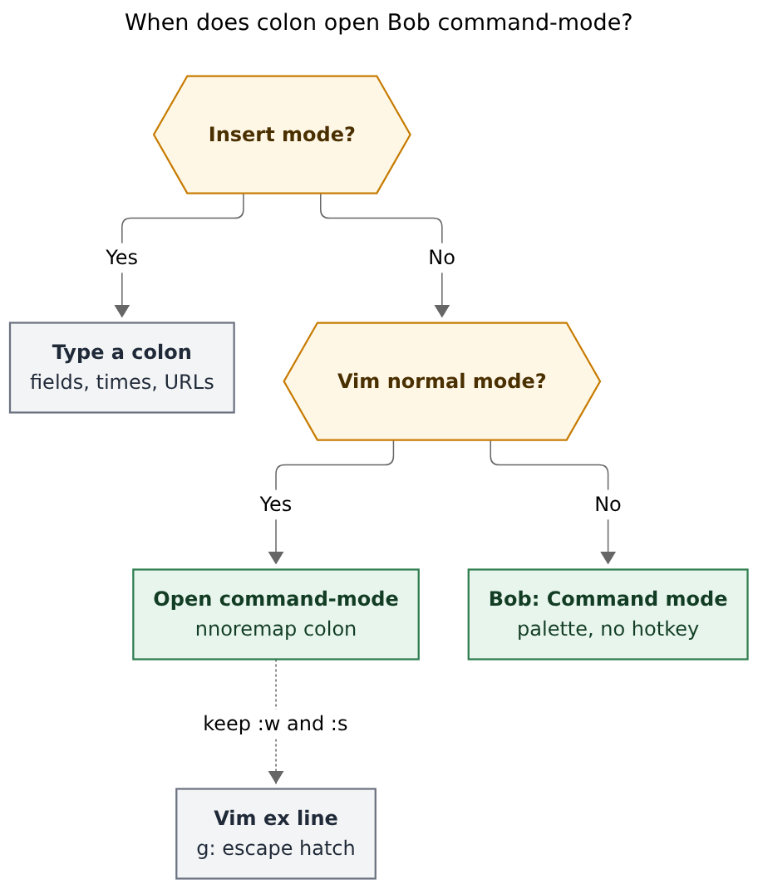
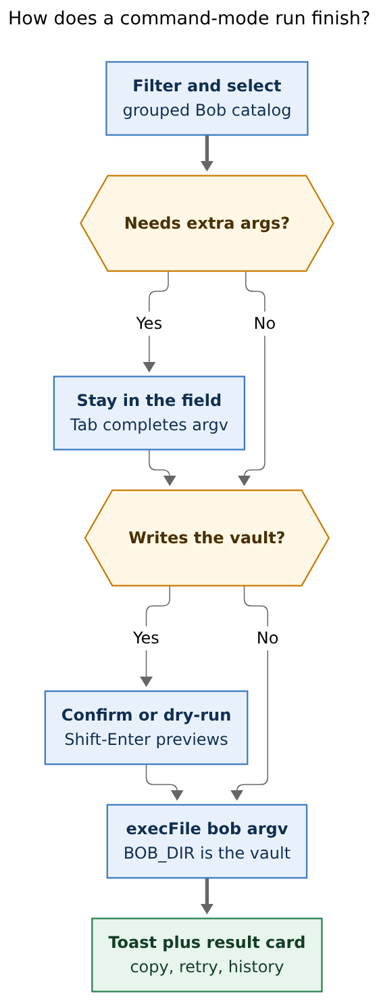
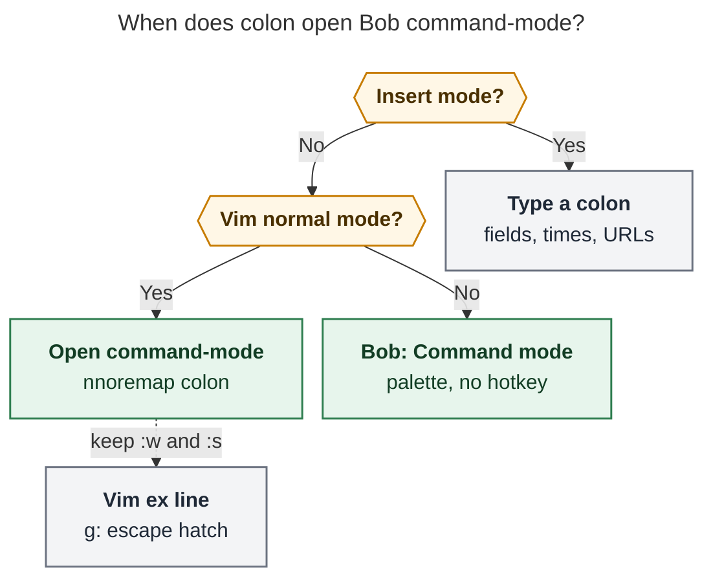
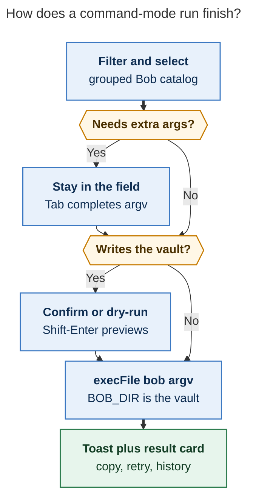

# A `:` Bob command-mode inside Obsidian

*Researcher: grk · 2026-10-26 · independent swarm report*

**Verdict.** Yes — add a Bob command-mode palette inside Obsidian. Bind it from
Vim **normal mode** with a **non-recursive** `:` map, keep insert-mode `:` as
a typed character, and show every run's result in a toast plus a full output
card. Build it on the existing Child Note Picker (`bob-cnp`) chrome and the
existing desktop `execFile` spawn path. Do **not** dump the entire CLI into
the picker, do **not** steal `:` as a global Obsidian hotkey, and do **not**
install a generic shell plugin.

---

## 1. Recommendation in one page

The want is real: Bryan already lives in Obsidian with Vim, and the commands
that still send him to a terminal are the ones without a first-class plugin
surface (`vault-sync`, `gkeep`, `task reconcile`, `query`, `ref list` /
`ref find`, `plugins list`, dry-runs). A `:` command-mode is the right
*mnemonic*. The implementation has to be a **Bob-native palette**, not a
terminal stuffed into a modal.

**Do this:**

1. **Register `bob-navigation-hotkeys:command-mode`** with no default Obsidian
   hotkey (same pattern as `Z` / zoom-image). The command is available from
   Obsidian's palette as **Bob: Command mode**, so it works without an
   editor and on Reading view.
2. **Bind `:` only in Vim normal mode**, and only after converting today's
   recursive `nmap` lines in `~/bob/obsidian_vimrc.md` to `nnoremap`. Then:
   ```
   exmap bob_command_mode obcommand bob-navigation-hotkeys:command-mode
   nnoremap : :bob_command_mode<CR>
   nnoremap g: :
   ```
   `g:` keeps Vim's ex line (`:w`, `:s`, `:obcommand`, line jumps). Insert
   mode still types a colon, which is required for `[scheduled::]`, `09:30`,
   URLs, and capture `:query` tokens.
3. **Reuse `FilteredPickerModal`** (`bob-cnp-*` styles). Fuzzy-filter with
   the existing subsequence matcher (`fuzzyMatchesText`), spaces as AND,
   Ctrl-N / Ctrl-P / arrows, Tab to complete argv, Enter to run, Shift-Enter
   to dry-run when the command has `-d`, Esc to dismiss.
4. **Catalog is mixed.** Each row is either a **surface** (open the themes
   manager, relation labels, Reading Board, dash, today) or a **bob argv**
   (spawn `bob` with `execFile`, `BOB_DIR` = vault root, `api.stats.bobPath`).
   Group empty-query rows by the same help sections `bob --help` already
   uses (Daily workflow, Tasks and projects, Vault, Integrations, Setup).
   Recents sit on top.
5. **Notify with a result card, not a `Notice` dump.** Every run ends in a
   compact toast (`✓ bob plan · 0.4s` / `✗ bob vault-sync · exit 1`). Click
   the toast, or press `:` then `Ctrl-O`, to open a monospace result card:
   argv, exit, duration, stdout, stderr, Copy, Retry. Keep the last ~20 runs
   in plugin `data.json`.
6. **Spawn policy is the existing desktop contract.** `Platform.isDesktopApp`,
   argv array (never `sh -c`), timeouts, `maxBuffer`, one mutating bob at a
   time. Mutators check unsaved buffers the way theme rename already does,
   default to `--dry-run` when that flag exists, and confirm before a live
   write.

**Do not do this:** bind `:` globally; `nmap :` without converting the vimrc;
parse `bob --help` in JavaScript; wrap a community Shell Commands / Local
Runner plugin; put `capture-*` protocol helpers, `gkeep login`,
`pomodoro notify`, or casual `plugins sync` in v1; call
`bob query --engine obsidian` from inside the app.

---

## 2. Is this a good idea?

**Yes, with the binding and catalog discipline in §4–§6.** The goal — run
common `bob` commands without leaving Obsidian — is already half-solved for
the daily verbs that have plugin UIs, and unsolved for the CLI-shaped rest.
A command-mode that *prefers those UIs* and *runs bob for the rest* is
coherent with how Bob is built: clap is the grammar, plugins are thin
renderers (`decisions:mac-capture-is-a-thin-client` is the same rule on a
different surface).

What is right in the request:

- **A filter-and-select window** is the right shape. Bob already owns a
  command-palette-class picker (`FilteredPickerModal` in
  `bob-navigation-hotkeys/src/200-filtered-picker-modals.js`, styled as
  "Child Note Picker" in `styles.css`). Themes manager, relation labels,
  task-move, yank-path, and successor offers all sit on that chrome. A new
  visual language would look worse and cost more.
- **Completion notification plus full output** is the right close. Today's
  `Notice` usage is a 3.5s toast (`bob-articles`) or a 10s multi-line dump
  (`bob-project-tasks` snapshot). That is enough for "snapshot created" and
  nowhere near enough for `bob plan`, `bob query`, or a failed
  `vault-sync`. A toast *and* a result card matches the Unblocked card
  (`api.notice` v1) plus the Stats error card (`statsErrorModel`).
- **Vim `:` as the trigger** matches the rest of the vault. `obsidian-vimrc-support`
  is enabled. `obsidian_vimrc.md` already dispatches Bob commands *through*
  the ex line (`nmap ]s :bob_next_due<CR>`). `:` is the muscle for "run a
  named command." Helix, Kakoune, and VS Code's command palette all use a
  filterable list under a prompt; that hybrid is what to build.

Costs that are real and acceptable:

- One more modal on `bob-navigation-hotkeys`, which is already large
  (v2.56.4, 139 source fragments). The picker superclass and vimrc pattern
  are already there, so the incremental UI is small; the spawn/result work
  is the real code.
- Converting the vimrc from `nmap` to `nnoremap` is a one-time vault edit
  and a prerequisite for stealing `:`.
- A curated overlay has to be updated when bob grows commands. A hidden
  `bob __catalog` protocol (phase 2) removes that drift.
- Desktop-only spawn. Mobile already degrades the themes manager to a
  Notice; command-mode does the same.

The idea is a bad idea if it is implemented as "a terminal in a modal" or
as "every clap leaf, including `capture-complete`." Those versions fight
Mac Capture, fight the review walk, and dump protocol internals into a
daily key.

---

## 3. Critique of the stated plan

The request:

> add a new `:` keymap to Obsidian that triggers a new bob command-mode
> … support any bob command that might be useful to run from Obsidian
> … easy to filter commands and select one
> … notified of its completion (on success or failure) with support for
> showing the full command output

### 3.1 What to keep

- **A dedicated Bob window**, not a pile of extra rows in Ctrl+P. Obsidian's
  command palette already fuzzy-matches and, since 1.8.3, pins recents
  ([Command palette](https://obsidian.md/help/plugins/command-palette)).
  Mixing forty bob leaves into that list hides them among Dataview,
  Templater, and Tasks. Register **Bob: Command mode** there, plus a short
  list of daily verbs (plan, vault-sync status, gkeep list) if they earn
  it. The `:` window is the real surface.
- **Filter then select.** Subsequence fuzzy matching is already how Task
  Card stages and relation rows work (`fuzzyMatchesText`). Spaces-as-AND
  is how Mac Capture pickers work. Copy that; do not invent a third matcher.
- **Success and failure both notify**, and the full output is reachable.
  Keep that requirement. Change only the *widget* (toast + card, §7).

### 3.2 Required adjustments

Call these out as changes to the request.

**A1. `:` is Vim-normal-only, with a `g:` escape hatch.**
A global Obsidian hotkey on `:` would fire while typing. That breaks
`[scheduled::]`, `[fresh::]`, `09:30`, URLs, and the capture grammar's
`:query` token (docs/capture.md: a single-token `:` item is the task
picker, never a capture). The plugin command itself gets **no default
hotkey**. The vimrc owns `:`, the same way it owns `Z`.

**A2. Convert `nmap` → `nnoremap` before mapping `:`.**
Every daily Bob gesture in `obsidian_vimrc.md` is a *recursive* `nmap`
whose right-hand side goes through `:` (`]s`, `[s`, `-`, `!`, `Z`, `[[`,
`]]`, `\\`, …). `nmap : :bob_command_mode<CR>` would make `]s` open
command-mode instead of jumping. vimrc-support already documents
`noremap` / `nnoremap`. The Z-image work used the same vimrc as the
dispatch bus; this feature sits on that bus and must not short it.

**A3. "Any useful bob command" is a curated catalog plus a raw escape,
not the clap dump.**
Useful from Obsidian ≠ every leaf. Protocol helpers (`capture-complete`,
`capture-parse`, `capture-rewrite`, …) exist for Mac Capture. Daemons
(`pomodoro notify`) never return. TTY prompts (`gkeep login` reads a
hidden cookie from a TTY, docs/gkeep.md). `plugins sync` overwrites
`main.js` of the running plugins. `query --engine obsidian` shells out
to the Obsidian CLI against a vault that is already open. Those stay out
of the default list. A `!` raw-argv row can still run a listed argv for
power use, still through `execFile`.

**A4. Prefer an existing plugin surface when one exists.**
`bob themes` already has **Pomodoro themes**. `bob relations` already has
**Relation labels**. `bob stats` already has the Stats block. `bob plan` /
Ready / freshness already render in the daily note and the `]s` walk.
`bob articles` already formats on save. Running the CLI *instead* of
opening those UIs is a downgrade. Those rows should say **Open themes**
and call `openPomodoroThemesManager()`, with a small "Run CLI" suffix
action if the literal stdout is wanted.

**A5. Capture stays in Mac Capture.**
`bob capture` is a grammar with live preview, similar-tasks, successor
offers, and inbox routing. A one-shot prompt in command-mode cannot
replace that. Curated Pomodoro operators (`Start Pomodoro` → `bob capture
'='`) are fine as named actions. Free-text capture is not.

**A6. Output needs a result card, and `Notice` is the toast only.**
`new Notice(lines.join("\n"), 10000)` (project-tasks snapshots) clips,
cannot copy, and cannot retry. Keep a short toast for completion; put
the bytes in a card that reuses `bob-cnp` plus a monospace pane.

**A7. Spawn is argv `execFile`, desktop-only, lock-aware.**
This matches `bobSpawnJson` in ledger-tools, `snapshotSpawnBob` in
project-tasks, and articles' `child_process.spawn`. A generic shell
(`bash -c`) is how the community [Shell commands](https://github.com/Taitava/obsidian-shellcommands)
plugin works; Bryan does not have it installed, and it is the wrong
trust model for a vault-writing CLI.

**A8. Mutators default to dry-run and refuse dirty buffers.**
`bob task reconcile --dry-run`, `bob task reroll --dry-run`,
`bob gkeep pull -d`, `bob vault-sync run --dry-run` already exist.
Theme rename already refuses an unsaved buffer
(`203-pomodoro-themes-manager-actions.js`). Command-mode must do the
same before `vault-sync`, `task archive`, `nightly`, or `gkeep pull`.

---

## 4. The colon landmine

Bryan's Vim layer is not "a few extra keys." It is the dispatch bus.

Evidence, 2026-10-26, vault `~/bob`:

- Community plugins include `obsidian-vimrc-support`, `bob-navigation-hotkeys`,
  `bob-ledger-tools`, `bob-vim-surround`, `task-status-cycler`.
- `obsidian_vimrc.md` header: "Bob command mappings managed by
  obsidian-vimrc-support." JavaScript vimrc commands are disabled.
- Pattern for every Bob gesture:
  ```
  exmap bob_next_due obcommand bob-navigation-hotkeys:jump-to-next-due-task
  nmap ]s :bob_next_due<CR>
  ```
- Plugin-side Vim maps use `CodeMirrorAdapter.Vim.mapCommand` for
  backslash-family keys (`\s` pin tab, `\p` `\P` `\o` `\O` pomodoro
  units). `:` is not among them.
- Image zoom is the precedent for "palette command, vimrc owns the letter":
  the plugin registers `zoom-image-on-line` with no default hotkey; the
  vimrc maps `Z`.

[vimrc-support](https://github.com/esm7/obsidian-vimrc-support) is explicit:
`exmap` aliases an Ex command, and `nmap` requires the colon on the
right-hand side. After Obsidian 1.7.2, those maps also need `<CR>`.
CodeMirror Vim `nmap` is recursive. A recursive remap of `:` rewrites
every existing Bob gesture.

**Adjustment A1–A2 in one picture:**



*Caption: Insert mode types a colon. Vim normal mode with `nnoremap :`
opens command-mode. `g:` keeps the Vim ex line. The Obsidian command
palette opens the same picker and has no default hotkey.*

Rendered size: 608 × 714 px; fit scale: 100%. Mermaid CLI
`@mermaid-js/mermaid-cli@12.0.0`.

If converting the vimrc to `nnoremap` is refused, **do not steal `:`**.
Bind `\b` (backslash family already used for Bob) or `g:` and leave the
ex line alone. A broken `]s` walk is a worse outcome than a less-clever
key.

---

## 5. Which commands belong

`bob --help` is the membership list. Use its six sections as picker
groups. Overlay a **policy** (surface / run / hide) in the plugin so the
clap tree can grow without a JavaScript rewrite of help text.

### 5.1 Run as bob (v1)

| Row | argv | Why it belongs |
| --- | --- | --- |
| Plan | `plan` | Read-only budget; useful when the daily note is not focused |
| Freshness | `freshness` | Queue listing; `]s` walks it, the CLI shows the whole list |
| Ready | `ready` | Per-note cap report |
| Stats | `stats` | Glance; Stats block is the pretty view, CLI is the export |
| Pomodoro | `pomodoro` | Status of the current session |
| Vault-sync status | `vault-sync` `status` | The question "did the last cycle work?" |
| Plugins list | `plugins` `list` | Sync drift without deploying |
| Projects | `projects` | ^prj inventory |
| Themes list | `themes` | CLI listing; Open-themes is the sibling surface row |
| Relations list | `relations` | Same split |
| Ref list / find / show / doctor | `ref` … | Reading queue and lookup without leaving the note |
| Query | `query` | Needs args; native engine only |
| Gkeep list / doctor | `gkeep` / `gkeep` `doctor` | Inbox drain preview |
| Today's ledger | `capture-pomodoros` | The one protocol helper that is a user report |

### 5.2 Run as bob, behind confirm (v1.5)

| Row | argv | Guard |
| --- | --- | --- |
| Vault-sync | `vault-sync` | Confirm; shares `bob_sync.lock` with nightly, reconcile, reroll, move, writing `ref scan` / `ref rename` (docs/vault-git-sync.md) |
| Task reconcile | `task` `reconcile` `-d` default | Live run confirms |
| Task reroll | `task` `reroll` `-d` default | Same |
| Task archive | `task` `archive` | Confirm; whole-vault rewrite |
| Gkeep pull | `gkeep` `pull` `-d` default | Live pull confirms; network + Keep archive |
| Ref scan / sync / today | `ref` … | Scan holds `bob_sync.lock` then `scan.lock` |
| Nightly | `nightly` | Long, lock, archive + two syncs; confirm |
| Articles (current note) | `articles` | Prefer the articles plugin; CLI as fallback |

Shift-Enter always means dry-run when `-d` / `--dry-run` exists.

### 5.3 Surface rows (open a plugin UI)

| Row | Opens |
| --- | --- |
| Pomodoro themes | `open-pomodoro-themes-manager` |
| Relation labels | `open-relation-labels-manager` |
| Reading Board | ledger-tools Open Reading Board |
| Dash | `open-dash-tasks` (Ctrl+0) |
| Today | `bob-ledger-tools:open-today-daily-note` (vimrc `-`) |
| Task Card | `set-bullet-property` when a task is under the cursor |

### 5.4 Hide from the default list

| Command | Reason |
| --- | --- |
| `capture`, `capture-complete`, `capture-parse`, `capture-rewrite`, `capture-related`, `capture-sections`, `capture-targets`, `capture-task-id`, `capture-task-sections`, `capture-tasks`, `capture-templates`, `capture-pomodoro-name` | Mac Capture protocol; unfinished `:` / `/` queries are teaching errors, not palette verbs |
| `completion` `install` / `uninstall` | Setup; once a year |
| `pomodoro` `notify` | Long-running daemon |
| `pomodoro` `tmux` | tmux status-line helper |
| `gkeep` `login` | Hidden TTY cookie prompt |
| `plugins` `sync` | Overwrites running `main.js`; offer only as a confirmed "deploy and reload" later |
| `query` `--engine obsidian` | Would invoke Obsidian CLI from inside Obsidian |
| Hidden aliases (`highlights`, `move-done-tasks`, `randomize`, …) | Help prints the canonical path (`cli_rules.md`) |

A later **Raw** row (`!` prefix) can type an arbitrary argv still passed to
`execFile(["bob", ...])`. It does not restore hidden daemons to the
fuzzy list.

### 5.5 Arguments

Zero-arg reporters run on Enter.

Commands that need values stay in the same modal: selecting `query`
replaces the filter with `query --source ` and Tab talks to
`bob __complete zsh --protocol 1 -- …` (docs/completion.md). The plugin
already knows how to spawn bob; this is one more read-only spawn.
Simple whitespace splitting plus `"quoted"` tokens is enough. No shell.

Curated stubs for v1: `query --source `, `query --tasks `,
`ref find `, `ref show `, `gkeep pull -i `.

---

## 6. Architecture

Three existing pieces already do the hard parts. Command-mode composes
them. An eighth plugin would have to duplicate `FilteredPickerModal` or
export it; that cost is not worth a folder.

| Piece | Owner | Job |
| --- | --- | --- |
| Clap tree / `__complete` | bob-cli `src/native/completion/` | Source of truth for names, sections, flags |
| `bobPath` + `execFile` | bob-ledger-tools `api.stats` v2 / `bobSpawnJson` | Resolve binary, set `BOB_DIR`, `NO_COLOR`, timeout, maxBuffer |
| Picker chrome + vimrc command | bob-navigation-hotkeys `FilteredPickerModal` | Filter, keys, modal lifecycle (Obsidian ≥ 1.14 `isOpen` pitfall already handled) |
| Colon map | `obsidian_vimrc.md` | `nnoremap :` after `nmap` → `nnoremap` conversion |

Phase 2 adds a hidden protocol next to `__complete`:

```
bob __catalog --protocol 1
```

JSON envelope: `ok`, `schema_version`, `commands[]` with `argv`, `about`,
`section`, `json_flag`, `dry_run_flag`. The plugin overlay adds `kind`
(read / write / surface / hidden), `timeout_ms`, and `surface_command_id`.
Do not parse `--help`. Do not nest a public `bob commands` until the
hidden protocol has a caller; `cli_rules.md` wants a noun with a
membership rule, and `completion` is already "inspect the command tree."

Spawn rules, copied from code that already works:

- Desktop app only (`Platform.isDesktopApp === false` → notice, same as
  snapshots).
- `execFile(resolved.path, args, { env, timeout, maxBuffer })`.
- `env.BOB_DIR = vault.adapter.basePath`.
- Timeouts: 20s default (`BOB_SPAWN_TIMEOUT_MS`), 120s for vault-sync /
  archive / gkeep pull / ref scan (project-tasks snapshots already use
  120s). Show elapsed time on the toast.
- One mutating process at a time. A second mutator waits or refuses with
  "bob is already running `vault-sync`."
- If the maintenance lock is held, bob already errors; surface that
  stderr on the result card. Do not busy-loop.
- After a successful write, request editor reloads for changed paths
  when Obsidian still has them open.



*Caption: The picker filters locally. Extra arguments stay in the same
field. Vault writes confirm or dry-run first. bob is spawned as argv,
never a shell. A toast always lands; the result card holds the full
output.*

Rendered size: 374 × 986 px; fit scale: 90.5%. Mermaid CLI
`@mermaid-js/mermaid-cli@12.0.0`.

---

## 7. UX: intuitive, reliable, beautiful

Beauty here means **the picker Bryan already trusts**, not a new skin.

### 7.1 Window

- Class `bob-cnp-modal` / `bob-cnp` as-is (min 320px, max 960×840, theme
  variables, accent focus ring on the search field).
- Header icon: `terminal-square` or `prompt`. Title **Bob**. Subtitle
  `12 commands · Daily workflow` or `Showing 3 of 40`.
- Search placeholder: `plan, gkeep, query --source`.
- Results grouped with quiet section labels matching `bob --help`.
- Row: icon, **title** (`Plan`), path/argv (`bob plan`), about as muted
  subtitle, badges on the right (`read`, `write`, `dry-run`, `open`).
- Selected row: accent left bar (already `.bob-cnp-row.is-selected`).
- Footer: `↑ ↓` Navigate · `^N ^P` Move · `⇥` Complete · `↵` Run ·
  `⇧↵` Dry-run · `esc` Dismiss. Same chip language as the themes
  manager (`POMODORO_THEMES_MANAGER_HINTS`).

### 7.2 Keys

Match relation-card and picker conventions
(`decisions:relation-card-tab-accepts-ctrl-d-hides`):

| Key | Action |
| --- | --- |
| Type | Filter; subsequence + spaces-AND on title, argv, about, aliases, section |
| ↓ / Ctrl-N | Next row |
| ↑ / Ctrl-P | Previous row |
| Tab | If a row is selected, replace the field with its argv (complete). If the field already looks like argv, ask `bob __complete` |
| Enter | Run the selected row, or run the field if it already is a complete argv |
| Shift-Enter | Add dry-run flag when available |
| Ctrl-O | Open the last result card without running |
| Ctrl-H | Show hidden/protocol rows |
| Ctrl-D | Pin/unpin a recent (optional v1.5; hide is the wrong verb here) |
| Esc / Ctrl-[ / q | Dismiss without running |
| `!` as first character | Raw argv mode |

### 7.3 Recents

Obsidian 1.8.3 already promotes recents in Ctrl+P. Do the same: last
runs, device-local in `data.json`, still subject to the filter. Recents
are per host on purpose (athena vs Mac).

### 7.4 Running and done

- Selecting a read-only command **keeps the modal open** and fills a
  result pane under the list (Helix-style). A second Enter on another
  row replaces it. Esc closes.
- Selecting a mutator **closes the picker** (so the user can see the
  vault change), shows a persistent progress toast, then the completion
  toast.
- Completion toast: accent bar, `✓` / `✗`, argv, duration. Failure stays
  8–10s and auto-opens the result card. Success stays ~4s.
- Result card: command, cwd/BOB_DIR, exit, duration, stdout, stderr.
  Monospace (`--font-monospace`). Copy all / copy stdout. Retry. Open as
  a scratch Markdown file in a new tab (optional, v1.5) for giant
  `query` output.
- Human CLI text with `NO_COLOR=1` (every current spawn already sets
  this). Pretty JSON rendering for commands that have `-f json` can wait;
  v1 shows what a terminal would have printed.

### 7.5 Empty, missing bob, timeout

Reuse `statsErrorModel`: "bob was not found" with the tried paths and a
Retry. Timeout names the seconds. Schema mismatch (once `__catalog`
exists) says to update bob-cli and the plugin together.

---

## 8. Alternatives I would not take

| Approach | Why it loses |
| --- | --- |
| **Ctrl+P only** | Mixes bob with every Obsidian command; no argv; no output card; `:` unused |
| **Enhance the Vim ex bar** | Tiny, no grouping, no result card, fights vimrc-support, hard to style |
| **Community Shell commands** ([Taitava](https://github.com/Taitava/obsidian-shellcommands)) | Generic `bash -c`, settings-defined strings, no clap catalog, not installed |
| **Local Runner** sidebar | A terminal tab; no filterable Bob catalog |
| **Commander macros** | vimrc-support even suggests Commander for chaining; still not a bob catalog |
| **New `bob-command-mode` plugin** | Eighth plugin to sync; cannot reuse `FilteredPickerModal` without an API export |
| **Put it in Mac Capture** | Capture is a draft grammar (`:` already means task-link picker there). Wrong surface |
| **`bob query --engine obsidian` as the engine** | Recursive Obsidian CLI; native engine is the one to call from inside the app |

The closest *good* cousins are Helix's `:` prompt (filterable commands),
VS Code's command palette (fuzzy + recents), and Raycast (pick, then
arguments). Command-mode should feel like those, in `bob-cnp` clothes.

---

## 9. Recommended solution

**Ship a Bob command-mode palette on Navigation Hotkeys, bound from the
vimrc with `nnoremap :`, spawning bob through ledger-tools' resolver,
with a toast-plus-result-card close.**

### Phase 0 — usable this week

1. Convert `obsidian_vimrc.md` `nmap` → `nnoremap` (behavior-preserving).
2. Add `command-mode` to `bob-navigation-hotkeys` (no default hotkey).
3. `FilteredPickerModal` subclass with the curated **read-only + surface**
   rows from §5.1 and §5.3.
4. Spawn via `api.stats.bobPath()` + the project-tasks `execFile` shape.
5. Result card + completion toast.
6. Vimrc:
   ```
   exmap bob_command_mode obcommand bob-navigation-hotkeys:command-mode
   nnoremap : :bob_command_mode<CR>
   nnoremap g: :
   ```
7. Tests: stub `execFile`, filter cases, "desktop only" notice, dirty-buffer
   skip (even if mutators are not in this phase).
8. Docs: plugin reference paragraph; vimrc snippet; name the feature
   **Bob command-mode** so it never collides with capture's `:` picker.

### Phase 1 — arguments and mutators

- Argv field + `bob __complete`.
- Confirm / dry-run for §5.2.
- Unsaved-buffer gate.
- Recents.
- Lock-busy and timeout copy that names the running command.

### Phase 2 — catalog protocol

- `bob __catalog --protocol 1` from the same clap tree as `__complete`.
- Plugin overlay for hide/surface/timeout.
- Decision record for the `:` binding (immutable once accepted, per
  memory-web rules).

### What "done" looks like

From a task note in Vim normal mode: `:` → type `gkeep` → Enter → see
the Keep / vault listing in the result pane. `:` → `sync` → highlight
**Vault-sync status** → Enter → JSON-or-human status without opening a
terminal. `:` → **Pomodoro themes** → Enter → the existing manager, no
CLI. `g:` → Vim's `:` bar still substitutes. `i` then `:` still types a
colon on the task line.

---

## 10. Open questions for Bryan

These are the only choices that change the recommendation. Everything
else above can ship as specified.

1. **Is converting the vimrc to `nnoremap` acceptable?** If no, bind `\b`
   and keep `:`.
2. **Should `g:` be the Vim ex hatch, or `::`?** `g:` is easier to type
   after the steal; `::` is closer to "colon then colon."
3. **Does `bob plan` in command-mode show CLI text, or jump to the daily
   note's plan block?** I would show CLI text for `plan` (it is a report)
   and use a surface row for **Open today**.
4. **Is `plugins sync` ever allowed from Obsidian?** I would keep it
   hidden until there is a reload-plugins follow-up.
5. **Result history in `data.json` (device) or a vault note?** Device.
   Vault notes would sync noise across hosts.

---

## 11. Sources

Read-only evidence, 2026-10-26.

**bob-cli (this workspace)**

- `docs/reference/cli/index.md` — command tree and help sections
- `docs/completion.md` — `bob __complete` protocol 1
- `docs/reference/json-outputs.md` — per-family JSON, no shared envelope
- `docs/vault-git-sync.md` — `bob_sync.lock` membership
- `docs/gkeep.md` — `login` TTY cookie prompt
- `docs/dataview.md` — `--engine obsidian` requires a running app
- `src/runner.rs` — sections, aliases, group members
- `src/native/completion/tree.rs` — exhaustive clap tree
- `sase/memory/cli_rules.md` — no hard-renames; nest under a noun

**bob-plugins (linked checkout)**

- `plugins/bob-navigation-hotkeys/src/200-filtered-picker-modals.js`
- `plugins/bob-navigation-hotkeys/styles.css` — `bob-cnp-*`
- `plugins/bob-navigation-hotkeys/src/620-plugin-dash-and-vim-jumps.js` —
  `mapCommand`, vim adapter replacement
- `plugins/bob-navigation-hotkeys/src/490-plugin-lifecycle.js` — commands,
  including themes/relations with no default hotkey
- `plugins/bob-navigation-hotkeys/src/285-unblocked-notice.js` — notice card
- `plugins/bob-ledger-tools/src/236-plugin-stats-data.js` — `bobSpawnJson`,
  20s timeout, `NO_COLOR`, `apiStatsBobPath`
- `plugins/bob-project-tasks/main.js` — 120s snapshot spawn, multi-line Notice
- `plugins/bob-articles/src/030-plugin.js` — spawn + 3.5s Notice
- `docs/bob-navigation-hotkeys.md`, `docs/develop/plugin-apis.md`
- `docs/index.md` — inventory; nav 2.56.4, ledger-tools 1.72.0;
  `isDesktopOnly: false` on both

**Vault `~/bob` (read-only)**

- `obsidian_vimrc.md` — `exmap` + recursive `nmap` through `:`
- `.obsidian/community-plugins.json` — vimrc-support on; Shell commands /
  Commander / Local Runner off
- `.obsidian/hotkeys.json` — no bare `:` binding

**Prior research (different topic, same binding lesson)**

- `research:202610/obsidian_z_image_inspection` — vimrc owns `Z`; plugin
  command has no default hotkey
- `research:202610/slash_task_goto_in_obsidian` — capture `:` is a task
  picker on Mac Capture; this Obsidian feature must use a different name

**External**

- [Obsidian command palette](https://obsidian.md/help/plugins/command-palette)
  — fuzzy match, recents since 1.8.3, pins
- [obsidian-vimrc-support](https://github.com/esm7/obsidian-vimrc-support) —
  `exmap`, `noremap`, post-1.7.2 `<CR>` requirement
- [Shell commands plugin](https://github.com/Taitava/obsidian-shellcommands) —
  desktop-only `child_process`, user-defined shell strings
- [Obsidian plugin Commands API](https://docs.obsidian.md/Plugins/User+interface/Commands)

---

## Appendix. Figure sources

Mermaid CLI `@mermaid-js/mermaid-cli@12.0.0`, PDF-mirroring config
(neutral, DejaVu Sans, `useMaxWidth: false`).




