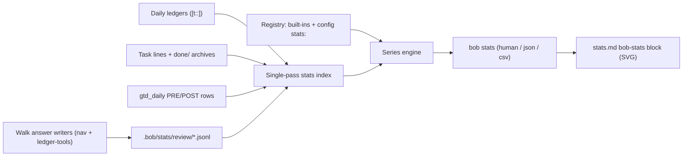

# Daily Stats for Bob: Consolidated Research, Critique, and Recommendation

> **Research query:** How should I start tracking daily habits and stats that each boil
> down to a single integer per day (morning GTD review tasks processed with the `]s`
> keymap, Pomodoro hours and minutes worked, tasks completed, and tasks created), so
> that new metrics are easy to add later and any metric's progress is easy to visualize
> over an adjustable time period? Is this a good idea, would a different approach be
> better, which other v1 metrics and requirement adjustments are justified, and what
> intuitive, reliable, and beautiful solution do you recommend?


## Bottom line

**Build it, but as a mirror of data you already produce. Do not build it as a new
logging habit.**

1. **Derive almost every number at read time from the vault.** Pomodoro minutes,
   task completions, task creations, cancellations, and the PRE/POST checklist
   already carry dates (`[t::]`, `[completion::]`, `[created::]`, `[cancelled::]`).
   A derived metric costs zero daily effort. It also arrives with its full
   history the day it ships.
2. **Record one thing the vault forgets: review-walk answers.** `[fresh::]` keeps
   only the latest date and lanes are re-reviewed daily, so yesterday's review
   count is already being overwritten. Append one JSON line per answer, at the
   moment of answering, to a per-host [journal](#the-review-journal).
   [**Ship this writer first.**](#phased-plan) Every day it is missing is data you
   cannot recover.
3. **Use one engine and two thin views.** A `bob stats` [engine](#architecture) in
   bob-cli owns every metric definition. Two renderers consume its JSON: a terminal
   glance and a `stats.md` [page in Obsidian](#ux-design), drawn by bob-ledger-tools
   with hand-rolled SVG.
4. **Make it a weekly instrument, not a daily scoreboard.** Your weekly prune
   already says *"check hours and created vs closed."* Several accepted decisions
   name [numeric reopen triggers](#why-it-is-worth-building) (for example, lane
   keep rate above 90%) that nothing measures today. Stats should answer those
   questions. It should not award points.
5. **I adjusted the requirements; see
   [Explicit requirement adjustments](#explicit-requirement-adjustments).** The main
   changes:
   - Count review *decisions*, not chores.
   - Exclude recurring instances from task counts.
   - Add Dropped, Net flow, Review closed, and Keep rate.
   - Store typed values, where missing is not zero.
   - No streaks, and no targets by default.

## Is this a good idea? (critique)

### Why it is worth building

- **You already do it by eye.** The `#gtd #post Weekly prune` row in
  `gtd_daily.md` says *"check hours and created vs closed."* That sentence is
  this feature's spec.
- **Your system has numeric reopen triggers that nothing measures:**
  - `review-walk-is-tiered`: the lane keep rate stays above 90%, and PRE rows are
    skipped on most mornings.
  - `answering-advances-the-walk`: `<C-o>` after an answer becomes routine.
  - `task-lanes-are-sticky`: about 2–3 tasks a day of lane growth.

  Stats turn these from feelings into evidence. That makes this
  **instrumentation for a system you actively tune**, not vanity tracking.
- **The marginal cost is near zero.** The Tasks plugin already stamps `created`,
  `completion`, and `cancelled`, and every closed Pomodoro already carries
  `[t::]`. Only the review count needs a new writer.
- **The research supports self-monitoring, with conditions:**
  - Monitoring goal progress improves attainment by about d = 0.40 across 138
    studies. The effect is stronger when progress is recorded physically
    (Harkin et al. 2016).
  - Lapses come mainly from upkeep burden and forgetting (Epstein et al. 2015).
  - "Tracking too many things" is the top pitfall (Choe et al. 2014).

  Automatic capture plus a small metric set addresses all three.

### Where it goes wrong and what this design does about it

| Risk | Evidence | Mitigation |
| --- | --- | --- |
| **Manual logging decays** | Your zorg habit log ran **2023-10-31 → 2026-02-22 (826 daily files)**. "Skipping …" entries grew from 0 files (2023) to 10 (2024), 51 (2025), and **53 of 53 (2026)**, then the log stopped. *(Verified. grk's "2024-05-22 – 06-27" covered only the `@HABIT` subset.)* | Zero daily entry in v1. Manual metrics are possible later, but only opt-in and never prompted. |
| **Goodhart / rubber-stamping** | `review-walk-is-tiered` already names rubber-stamping as a cost. Done counts invite task-splitting. | Every output metric gets a counterweight: Reviewed ↔ Keep rate and Review time; Done ↔ Created and Net flow. No targets on counts by default. |
| **Streak anxiety** | Broken streaks reduce later engagement (Silverman & Barasch 2023). After GitHub removed its streak counter, token single-commit days fell (Moldon et al. 2020). | No streak counters. Booleans show "N of M days," which recovers after a bad week. |
| **Productivity theater** | Quantifying an activity can raise output while lowering enjoyment (Etkin 2016). | Neutral colors for volumes. Status colors are reserved. The page is reviewed weekly, not checked hourly. |
| **Building crowds out doing** | GTD-named Pomodoros were **30 of 66** closed sessions over Oct 4–11 (verified). cld measured GTD at 49% of worked minutes in the walk's first week, falling to about 24% by Oct 8–10. | Ship in small phases, each useful alone. The first phase is tiny and passive. |
| **Yet another dashboard** | You already have `dash.md`, the review footer, `bob plan`, and `bob ready`. | Stats answers only one question, "how has this week/month gone?" It never shows what is due now or what you are doing. |

### Would I take a different approach

The alternatives considered:

| Approach | Verdict | Reason |
| --- | --- | --- |
| Hand-entered daily integers (frontmatter or a habit note) plus Tracker or Heatmap | ✗ | Your 826-file log already ran this experiment. Tracker has been stale since 2024. It can't feed a CLI. |
| DataviewJS dashboard computing everything live | Prototype only | A second implementation of every definition. It has no review data. It is slow over a year. |
| Nightly materialization into daily-note frontmatter (gem) | ✗ | Copies data the vault already holds. Late or back-dated edits make past snapshots wrong. Every nightly churns daily notes. This repeats the `#today`-tag mistake that `today-is-read-from-the-ledger` retired. |
| Bases over daily-note properties | Later, as a table view | No native chart view through Obsidian 1.14.x. The only chart layout is a young community plugin ("Charts for Bases," about 100 downloads). It still needs stored per-day properties. |
| External tool (Exist.io, Grafana, SQLite) | ✗ | Data leaves the vault, plus a service to run, plus a second capture surface. |
| **Derive what the vault keeps, journal what it forgets; one Rust engine; thin renderers** | **✓** | One definition per metric, with free history. One tiny writer. It matches "bob owns every fact" (`mac-capture-is-a-thin-client`, `idle-capture-shows-ledger-agenda`). |

**A cheaper fallback** if you want to test the idea before building the page:
ship the journal and a terminal-only `bob stats` ([Phases 1–2](#phased-plan)), then
use them in two weekly prunes before building the Obsidian page.

## Verified facts that drive the design

I re-checked every load-bearing claim where the reports disagreed or where
evidence was thin. (Inputs and method are listed in
[About this report](#about-this-report).)

| # | Fact | How verified | Consequence |
| --- | --- | --- | --- |
| F1 | **Review stamps evaporate.** cld counted 56 tasks still stamped `[fresh:: 2026-10-10]` on the morning of Oct 11. By mid-morning, after today's walk, I counted **52**. Oct 4 and Oct 5 retain only **10** and **7**. cld's git comparison found 14–30% of each day's stamps from Oct 7–10 already overwritten. `pending_interval: 1` and `next_interval: 1` in `~/.config/bob/config.yml` explain why. | grep over the vault; config | **Refutes mus's read-time stamp proxy.** Any "reviewed" count derived from `[fresh::]` is wrong within 24 hours. |
| F2 | A stamp count is also the wrong concept. It includes daytime stamps (links, Alt+N). It misses answers that don't stamp (Ctrl+Enter close, drop, checklist completion). | `docs/freshness.md` §§6/13; nav code | Record answers, not stamps. This also rules out grk's nightly latch of `refreshed_today` and gem's `upkeep_today`. |
| F3 | **The walk already tracks "answered today," but only in memory.** `addReviewAnsweredKeys` (`bob-navigation-hotkeys/src/536-plugin-review-advance.js:160`) keeps `{day, keys, texts}`. It is fed by resolving outcomes in `continueReviewWalkAfter` (`:340`, `:421`) and by checklist completion (`535-…:265`). It resets on reload (`490-plugin-lifecycle.js:336`). Stay answers (Alt+F, Ctrl+Alt+F, lane keep) go through `finishFreshStamp` (`530-…:228`). | read code | The journal persists a set the walk already computes. This is a small, well-located change. |
| F4 | **A move is not an answer.** The move-park path (`537-plugin-review-move-park.js`) never calls `addReviewAnsweredKeys`. The moved row stays due until you stamp or close it. | read code | Resolves the cdx/cld conflict: moves don't count. The later stamp or close does. |
| F5 | **Plugins persist nothing and never spawn `bob`.** There are zero `saveData`, `localStorage`, `adapter.append`, or `child_process` uses in `plugins/*/src`. | grep | The journal is the first plugin-written data file. Spawning `bob` is a new precedent (see [Obsidian data path](#obsidian-data-path)). |
| F6 | **The walk has nine tiers now:** PRE → NEW → PROJECTS → PENDING → NEXT → **RECURRING** → TICKLER → ROTTEN → POST. REFERENCES was removed in schema 13 (`docs/freshness.md:461`; `FRESHNESS_TIER_ORDER` in `bob-ledger-tools/src/100-freshness-evaluate.js:680`). The `review-walk-is-tiered` memory roster still lists REFERENCES. | read code/docs | The journal should record the evaluator's tier string verbatim rather than copy a roster. That memory summary is stale. |
| F7 | **Pomodoro parity is easy.** All **957 of 957** closed ledger rows in 130 daily notes since 2026-06-02 carry `[t::]`. The heading query sums `t` over completed rows under `## Pomodoros`. | grep | `worked` = Σ`t` of closed rows equals the heading exactly. A range-derived fallback is only a guard, and it emits a warning. |
| F8 | **Raw task counts are polluted:** <ul><li>7 of 25 tasks created on Oct 6 are recurring instances.</li><li>The daily template creates one `[*] #task [[gtd_daily]] [created::…] ^gtd` Task Link every day.</li><li>`#ref` tasks are mostly SASE research reading tasks (`ref/chat/…`).</li><li>Oct 6 had 94 completions, including bulk triage.</li></ul> | grep; `_templates/daily.md` | Exclude recurring instances and the daily `^gtd` link by default. Break `#ref` out as a visible part instead of hiding it. |
| F9 | **The Tasks query engine is too heavy for stats:** `bob query --tasks` takes **6.44 s and 1.58 GB RSS**. By comparison, `bob freshness list` takes 1.62 s and `bob plan` takes 0.59 s. cld's one-pass Python scan computed all v1 metrics in 0.47 s. | timed | The stats engine needs its own single-pass index with simple filters. It must not use the Tasks DSL. |
| F10 | **Custom plugins are not in vault git.** They deploy per machine via `bob plugins sync`, and the vault `.gitignore` excludes them. | `.gitignore` | Any machine running the Stats block has `bob` installed. cdx's mobile-rendering concern does not apply: Bob plugins never reach mobile. |
| F11 | **There is precedent for tracked machine data in a dot-dir.** `.bob/` exists, and `.gitignore` already allowlists `!/.bob/gkeep/imports/*.json`. | `.gitignore` | Put the journal under `.bob/stats/`, allowlisted the same way. Obsidian hides dot-dirs from the file explorer. |

## Where the reports disagreed and how I resolved it

| Topic | Positions | Resolution |
| --- | --- | --- |
| **How to count `]s` reviews** | mus: derive from `fresh:: == D`.<br>gem: `upkeep_today`/`fresh`.<br>grk: nightly latch of `refreshed_today`.<br>cdx: one immutable receipt file per operation plus a crash-recovery outbox.<br>cld: per-host append-only JSONL written at answer time. | **cld's journal.** [F1/F2](#verified-facts-that-drive-the-design) rule out the first three. cdx's receipt tree (about 18k files a year, plus an outbox protocol) is over-built for a personal counter. Distinct-row semantics (below) already make double-writes harmless. Keep cdx's good parts: schema and definition versions, an explicit health signal, and "never silently zero." |
| **Unit of the review count** | cdx: every answer event.<br>cld: distinct rows answered per day. | **Distinct rows per day**, with answers-by-outcome as parts. This is robust to double presses, reloads, and two machines, and it matches "how many items did I process." |
| **PRE/POST in the review count** | cdx: include.<br>cld/grk: separate. | **Separate.** About six constant chores a day would flatten the signal. The journal still records them, so `tiers: all` is a config change. PRE becomes the Habits metric and POST becomes Review closed. |
| **Do moves count?** | cdx: yes.<br>cld: no. | **No** (F4). The walk itself does not treat a move as an answer. |
| **Store derived values?** | gem: nightly frontmatter.<br>Everyone else: no. | **Never store what the vault keeps** (see [Would I take a different approach](#would-i-take-a-different-approach)). |
| **Obsidian data path** | cld: spawn `bob stats -f json`.<br>cdx: JS mirror with shared fixtures.<br>gem: JS over the Tasks cache.<br>grk/mus: "render Bob's JSON." | **Spawn `bob`, cached** (F10). The plan and freshness evaluators already pay a "two evaluators" tax under conformance vectors. A third mirror of task semantics is the cost to avoid. |
| **Chart renderer** | cdx: bundle Chart.js.<br>cld/grk/mus/gem: hand-rolled SVG. | **Hand-rolled SVG.** A few hundred points at most, zero-dependency plugin precedent, theme variables, and accessible DOM. |
| **Hero visualization** | grk: contribution grid.<br>cdx/cld/gem: bars. | **Bars for magnitude** (position beats color for comparing amounts). A **calendar grid** is the view for booleans and consistency (Review closed, Habits). |
| **Pomodoro default** | grk: "work" minutes excluding GTD.<br>Others: total. | **Total** (what you asked for, equal to the heading). GTD minutes are a companion metric (`review_time`), and every day breaks down by theme. |
| **Manual metrics** | cdx: editor in v1.<br>gem: energy rating.<br>grk: reserved slot.<br>mus: defer.<br>cld: opt-in `field` kind. | **Ship the `field` kind, enable no manual metric, no editor, and never prompt.** Your log history (see [Where it goes wrong](#where-it-goes-wrong-and-what-this-design-does-about-it)) is the deciding evidence. |
| **View state** | grk: rewrite the fence on chip clicks.<br>Others: session state. | **Session state.** The fence holds defaults. Clicks never write the vault, so there are no git commits from browsing. |
| **Name** | Stats (cld/mus/gem), Pulse (grk), Progress (cdx). | **`bob stats` / `stats.md`.** It is your own word and the most guessable CLI noun. "Progress" implies a direction that neutral metrics lack. "Pulse" is a fine brand if you prefer it. |
| **Default range** | 30 days (cdx/grk/mus), 4 weeks (cld). | **4 weeks.** 28 days holds exactly four of each weekday, so averages aren't skewed by weekday mix. |
| **Sequencing** | The journal ships in phase 2 (cld) or phase 3 (grk). | **Journal first** (see [Phased plan](#phased-plan)). Derived metrics backfill themselves; review answers never will. |

## Explicit requirement adjustments

| # | You asked for | I recommend | Why |
| --- | --- | --- | --- |
| **R1** | One integer per metric per day | **One typed number per day:** count, minutes, bool, or percent (stored as integers: minutes, 0/1, basis points). Plus optional **parts** (breakdowns) and a quality flag. **Missing is `null`, never 0.** | Review closed is a bool and Keep rate is a ratio. "No data" must not look like "bad day." `docs/dashboard.md` already rules that unavailable counts show `–`, never 0. |
| **R2** | Morning GTD review tasks completed via `]s` | **Reviewed** = distinct walk rows resolved by a walk answer on day D in the decision tiers (NEW…ROTTEN). Recorded at answer time. Attributed to the walk's day, not to "morning" by clock. **PRE chores → Habits; POST closeout → Review closed.** | Stamps evaporate and miscount ([F1/F2](#verified-facts-that-drive-the-design)). Chores are constant. The closeout is the actual missable habit: it was missed Oct 5 and Oct 7. |
| **R3** | Pomodoro hours and minutes | **Worked** in integer minutes, displayed `4h 10m`. Must equal the daily heading. Parts by session theme (`— NAME`). | One canonical unit, and one truth with what you already see (F7). |
| **R4** | Tasks completed | **Done** = non-recurring tasks whose status *type* is DONE, with `completion` = D, excluding the daily-note `^gtd` link. **Dropped** (`cancelled` = D) is its own metric. | Recurring chores add 6–10 a day of noise (F8). Triage drops are real GTD output (Oct 6 alone had 47, per cld). |
| **R5** | Tasks created | **Created** uses the same exclusions and is shown as **neutral**. Add **Net flow** = Created − Done − Dropped. | Capturing is healthy, not a target. Net flow is the weekly prune's actual question. |
| **R6** | Easy to add metrics later | **A metric is a config entry over a small fixed set of *kinds*.** Derived kinds arrive with full history; recorded kinds start at a visible `since` date. A new *kind* is a small code PR. | "Easy" must mean no migration and honest history. No arbitrary user code. |
| **R7** | Visualize over an adjustable period | Presets **7D / 4W / 3M / 1Y / All**, plus a custom range and ‹ › shifting. **Default 4W.** Optional comparison with the prior period of the same length. **Today is partial**: drawn hollow and excluded from medians and deltas. | Prevents the morning "slump" artifact. A missed week ages out quickly, which gives you a clean slate after a lapse. |
| **R8** | (new) | **No streak counters. No targets by default.** Booleans show "N of M days met." | See [Where it goes wrong](#where-it-goes-wrong-and-what-this-design-does-about-it). |
| **R9** | (new) | **Home it in the weekly prune, not the daily note.** | Weekly is where the numbers inform decisions; daily is where they become targets. |

## The v1 metric catalog

**How I chose the extra metrics.** A v1 metric must pass three tests:

1. It is automatic.
2. It answers a question you already ask: the weekly prune, or a decision's reopen
   trigger.
3. It either is a counterweight or has one.

Everything that failed a test went to "later" or "rejected."

### Headline metrics in the overview row

| ID | Label | Unit | Definition | Parts | History on day 1 |
| --- | --- | --- | --- | --- | --- |
| `worked` | Worked | minutes | Σ `[t::]` of closed `[x]` rows under `## Pomodoros` in `YYYY/YYYYMMDD.md`. Open rows are excluded (they are plans). A range fallback applies only if `t` is absent, with a warning. | theme (top 5 + other) | 2026-06-02 → |
| `reviewed` | Reviewed | count | Distinct walk rows with ≥ 1 counted answer on D in tiers NEW, PROJECTS, PENDING, NEXT, RECURRING, TICKLER, ROTTEN (see [The review journal](#the-review-journal)) | tier, outcome | from journal ship date |
| `review_closed` | Review closed | bool | The `#gtd #post` *Morning review* row was completed on D | — | 2026-10-04 → |
| `done` | Done | count | Non-recurring tasks, status type DONE, `completion` = D, excluding the daily `^gtd` link | kind (task / prj / ref), note | vault adoption → (imported back-dates flagged) |
| `created` | Created | count (neutral) | Non-recurring `#task` lines with `created` = D, same exclusions | kind, inbox vs elsewhere | vault adoption → |
| `net` | Net flow | signed count (↓ good) | `created − done − dropped` | — | same as inputs |

### Secondary metrics

These are available in detail views and on the page.

| ID | Unit | Definition | Why it earns a place |
| --- | --- | --- | --- |
| `dropped` | count | Non-recurring, status type CANCELLED, `cancelled` = D | Pruning is output, and it feeds Net flow |
| `habits` | ratio, plus a per-chore grid | PRE chores completed on D ÷ PRE chores due on D | Your existing `#gtd #pre` rows are already the habit list. Measures the "PRE skipped on most mornings" trigger. |
| `keep_rate` | percent | Keeps ÷ answers in PENDING + NEXT, counting the last answer per row per day | The lane keep-rate trigger, measured directly. Counterweight to Reviewed. |
| `review_time` | minutes | `worked` restricted to theme `GTD` (configurable) | The cost side of the ritual. Counterweight to Reviewed. |
| `sessions` | count | Closed Pomodoros on D | Separates one long slog from many fragments |

### Later metrics

Each of these is one config entry or one kind away.

- **Lane sizes at end of day** (NEXT, PENDING, NEW, ROTTEN) and **walk due at
  start.** These are point-in-time *state*, so they need a nightly `snapshot`
  kind. Attractive because the weekly prune enforces ≤ 15 NEXT and ≤ 10 PENDING.
- **Day start** (first closed session's start time). Cheap to derive, but it is
  a sleep-schedule question. Add it when you want it.
- **Plan follow-through** (Today-linked tasks that were worked or closed). This
  needs a careful definition: open placeholder Pomodoros are a lineup, not a
  commitment, so a naive ratio punishes healthy over-planning.
- **Open backlog reconstruction.** It is only approximate for deleted tasks and
  undated rows. Prefer the snapshot kind.
- **Manual metrics** (exercise, sleep, energy 1–5) through the `field` kind,
  written by you as `energy:: 4` in a daily note. Opt-in only, never prompted.

### Rejected metrics

| Candidate | Why |
| --- | --- |
| "Stamps today" | Wrong in both directions (F1/F2) |
| Productivity score, tasks per hour, automated "insights" | They imply causality the data can't support, and they invite gaming |
| Streak counts | See [Where it goes wrong](#where-it-goes-wrong-and-what-this-design-does-about-it) |
| Commits, words, lines written | Vanity metrics with no decision attached |
| Time in Obsidian | Needs telemetry, and nothing acts on it |

## Architecture

### Principle

> **Derive what the vault keeps; record only what the vault forgets; define every
> metric once, in bob.**



### Engine

The engine lives in `src/native/stats/` in bob-cli.

**Index.** One pass over the vault, using the same exclusions as freshness
(`_templates`, `_conflicts`, dot-dirs). It includes `done/` archives, because
archiving must never change history. It reuses existing parsers rather than the
Tasks query engine (F9):

- **Ledger:** reuse the `pomodoro.rs` and `capture_pomodoros.rs` helpers for
  sections, closed rows, `t`, and theme names.
- **Tasks:** the native task parser. Two cdx implementation notes apply here:
  - Test status **type DONE**, not the broad `is_done` helper, which also matches
    cancelled and non-task statuses.
  - `RichTask` does not expose the completion date yet. It needs an additive
    field.
- **Daily-note fields:** frontmatter and inline `key:: value`, for the `field`
  kind.
- **Journal:** files from every host, unioned.

**Registry.** Each definition has an ID, label, unit, direction (up / down /
neutral), kind and its parameters, an aggregate (sum / mean / median / rate /
days_met), `since`, and `version`. Built-ins are written *as config entries in
code*, so every built-in exercises the user path.

**Series.** For every date in the range, the engine returns:

- `value` (or `null`);
- `parts`;
- `quality` (`ok | partial | missing | not_tracked`);
- `provisional` (true for today).

It also returns a summary: total, median per day, mean, p25/p75, the prior
period's median and the delta, days with data, and days met.

### Metric kinds

These are the v1 kinds.

| Kind | Parameters | Notes |
| --- | --- | --- |
| `pomodoro` | `measure: minutes \| count`, `themes`, `exclude_themes` | Closed rows only |
| `tasks` | `event: created \| done \| dropped`, `tags_any`, `tags_all`, `in: [note]` (residence, including notes whose `parent` chain reaches it), `kind: task \| prj \| ref`, `recurring: exclude \| only \| include` (default `exclude`) | Simple fields only, no Tasks DSL (F9) |
| `checklist` | `tags: [#gtd, #pre]` or `match: "…"`; `measure: ratio \| count \| bool` | Due = instances scheduled on D; done = completed on D |
| `field` | `field`, `source: frontmatter \| inline \| either` | Reads the day's note only |
| `formula` | `expr` over other metric IDs (`+ − × ÷ ( )`) | `null` if any input is null |
| `journal` | built-in selectors | `reviewed`, `keep_rate`. Not user-extensible in v1 |
| `snapshot` *(later)* | `source: freshness.counts.<x>` | Recorded nightly; for state metrics |

**Adding a metric later** is a few lines in `~/.config/bob/config.yml`, and a
derived one gets its whole history at once:

```yaml
stats:
  range: 4w
  overview: [worked, reviewed, done, created, net, review_closed]
  metrics:
    sase_worked: { label: SASE time, kind: pomodoro, themes: [SASE] }
    job_done:    { label: Job tasks done, kind: tasks, event: done, in: [job] }
    floss:       { label: Floss, kind: checklist, match: "Floss teeth", measure: bool }
    energy:      { label: Energy, kind: field, field: energy, unit: scale }
```

`bob stats metrics` lists every metric with its definition, source, `since`
date, and whether it is derived or recorded.

### The review journal

This is the one new writer.

**Location.**

- One file per month per host: `.bob/stats/review/YYYY-MM.<host>.jsonl`.
- Add `!/.bob/stats/**/*.jsonl` to the vault `.gitignore`, following the
  `.bob/gkeep/imports` precedent (F11).
- Each machine appends only to its own file, so git never conflicts. Readers
  union the files.
- At about 50–80 answers a day, expect tens of KB a day and single-digit MB a
  year.

**Event (schema v1):**

```json
{"v":1,"ts":"2026-10-12T05:41:07-04:00","day":"2026-10-12","host":"apollo",
 "kind":"review.answer","tier":"next","outcome":"keep",
 "key":"sase.md#^fix-failed-agents","plugin":"bob-navigation-hotkeys@2.x"}
```

- `tier` is the evaluator's string, copied verbatim (F6).
- `outcome` is one of: `keep · done · drop · defer · lane · route · today ·
  sequence · card · checklist · decay:<action>`.
- `key` is the walk's own row key.

**What counts** (all must start on a validated landing and commit a write):

| Counts | Doesn't count |
| --- | --- |
| Resolving outcomes in `continueReviewWalkAfter` (complete, lane commit/release, route, link-today, resolving Task Card) | `]s` / `[s` / `]S` navigation and skips |
| Stay answers through `finishFreshStamp` on a landed row: Alt+F, Ctrl+Alt+F, the Alt+Shift+F lane keep | Ctrl+Shift+M moves (F4). A later answer on the moved row counts. |
| Decay-card decisions (`notNow`, `level:N`, `lessOften`, `reword`, `drop`, `keep`) | Esc, refusals, no-op writes, unlink/reopen |
| PRE/POST checklist completions (recorded, but outside `reviewed` by default) | Off-landing daytime stamps, automation, sync, reloads |

**Who writes it.**

- bob-ledger-tools gains an `api.stats` namespace (v1) with `append(event)`.
  It runs a serialized queue on `app.vault.adapter.append` and gets the host
  name from `os.hostname()`.
- bob-navigation-hotkeys calls one helper, `recordReviewAnswer(origin, outcome,
  refs)`, at the three paths above. These are the same places that already feed
  `addReviewAnsweredKeys` (F3). Recording, navigation, and the task write stay
  independent: an answer whose write succeeded but whose next landing failed
  still counts.
- **On write failure:** show a Notice ("Review answer not recorded"), keep the
  event in an in-memory retry queue, and never fail the answer itself.

**Reading semantics.**

- `reviewed(D)` = the number of distinct `key`s with a counted answer in
  decision tiers on `day = D`. Duplicate lines from double presses, reloads, or
  two hosts are harmless.
- `keep_rate` uses the last answer per key per day.

**Gap detection.** If `review_closed(D)` is true but no host journaled anything
for D, then `reviewed(D)` is `null` with the warning "journal missing for D:
plugin outdated or write failed." It is never 0. `bob stats` also prints the
last event time per host, so a stale plugin shows up within a day.

**Backfill.** Start clean. An approximate history from vault git (Oct 4 → ship)
is possible. If you ever want it, it belongs behind a hidden command and drawn
hatched as `approx`.

### Obsidian data path

- **Fetching.** The `bob-stats` block runs `bob stats -f json …` with
  `child_process.execFile`. It is always async, has a timeout, and only runs
  while the block is on screen. A **Bob path** setting (default
  `~/.cargo/bin/bob`) is needed because GUI-launched Obsidian on macOS lacks the
  shell PATH.
- **Caching.** Stale-while-revalidate in memory, keyed by range and metrics. It
  revalidates on:
  - the Tasks `cache-update` event, debounced about 2 s;
  - the existing minute tick, for day rollover;
  - range changes;
  - `api.stats.append`.

  While refetching, the chart keeps its previous frame at reduced opacity, with
  no spinner and no layout jump.
- **Failure.** If `bob` is missing or errors, show an actionable card ("bob not
  found at …; set Bob path in Bob Ledger Tools settings"), never empty charts.
- **Performance budget.** `bob stats` under 300 ms on the full vault (measured in
  CI on the fixture, logged on the real vault).
- **Fallback.** If spawning proves fragile, use an untracked
  `.bob/stats/cache.json` written by the CLI.

This is a deliberate new precedent: the Obsidian twin of
`mac-capture-is-a-thin-client`. It is worth recording as a decision once it
ships.

### CLI

The CLI follows `cli_rules`. `bob stats` is a read-only report, so it is
top-level, in **Daily workflow**, alphabetical after `ready`. Bare `bob stats`
defaults to the flag-only, read-only `overview`.

```text
bob stats [overview] [-c|--compare] [-f|--format human|json|csv] [-g|--group day|week|month] [-r|--range 4w]
bob stats show <METRIC>... [-c] [-f …] [-g …] [-r …]
bob stats metrics [-f human|json]
```

- `--range` accepts `7d | 4w | 3m | 1y | all | YYYY-MM-DD..YYYY-MM-DD`.
- `--group` is chosen automatically when omitted: day up to 90 days, week up to a
  year, month beyond that.
- JSON is `schema_version: 1`. Renderers decode it defensively, the way the Mac
  app uses `decodeIfPresent`.

## UX design

All mockup values are illustrative (see [About this report](#about-this-report)).

### Where it lives

- **`stats.md`** has `parent: "[[dash]]"`, alias *Stats*, and one `bob-stats`
  block.
- It is linked from the dash **Browse** row, and the weekly prune row changes
  "check hours and created vs closed" to `[[stats]]`.
- An Obsidian command **Open Stats** gives keyboard access.
- The daily note does not change in v1. Today's number is already in the
  Pomodoro heading.
- The quick switcher will show `status.md` as a near-name; that is acceptable.

Three questions, three places, so Stats never becomes another queue:

| Question | Place |
| --- | --- |
| What am I doing now? | Capture agenda, `bob pomodoro`, the ledger |
| What is due this morning? | `]s`, the footer, dash Review chips |
| **How has this week/month gone?** | **Stats** |

### The page

```text
Stats                         [7D] [4W] [3M] [1Y] [All] [custom ▾]  ‹ ›   ☐ vs prior
Sep 13 – Oct 10 · today in progress
──────────────────────────────────────────────────────────────────────────────────────
 Worked        Reviewed      Done          Created       Net flow      Review closed
 4h 50m /day   44 /day       12 /day       18 /day       −6 /day       5 of 7 days
 ▲ 6% vs prior keep 82%      ▲ 9×          ▲ 40%         ▼ shrinking   ●●○●○●●
 ▁▃▅▆▅▇▆▅• 4h  ‥‥‥▅▆▇▅• 41  ▁▁▂▁█▃▄• 38   ▃▄▃▅▄▅• 28    ▆▅▆▃▁▂• −17
──────────────────────────────────────────────────────────────────────────────────────
 Worked · daily minutes                                   [Bars | Calendar]  [Table]
 6h ┤                 ▆
 4h ┤ ▅ ▆   ▇ ▆  ▇ ▆ ██ ▆  ▅      ── 7-day rolling median   ░ p25–p75 normal band
 2h ┤ █ █ ▃ █ █ ▄█ █ ██ █ ▃█ ▯   (▯ today, hollow · ▨ no data, hatched)
 0  ┼──────────────────────────
     Sep 13          Sep 27          Oct 10
 by theme   SASE 41% · BOB 22% · JOB 14% · GTD 12% · other 11%
──────────────────────────────────────────────────────────────────────────────────────
 Tue, Oct 6 · 5h 00m · 10 sessions · GTD 3h 35m · BOB 50m · …       [Open daily note]
```

**What appears below the focus chart depends on the metric:**

- **Done, Created, Net:** a *flow* chart. Created bars point up and Done +
  Dropped bars point down, with a Net line. Parts by kind (task / prj / ref).
- **Reviewed:** answers by tier and outcome, Review time, and Keep rate with a
  90% reference line. That line is the decision trigger.
- **Review closed, Habits:** a calendar grid (weekday rows × week columns), plus
  the PRE chore × day grid (● done · ○ missed · blank = not due).

### Interaction

**Controls**

- **Filters sit in one row above everything** and scope every tile, chart, and
  table, so the numbers always agree.
- **Clicking a tile** switches the focus chart.
- **Range state is session-only.** The fence sets only the defaults.

**Hover and selection**

- **Hovering a bar or cell** shows a tooltip with the value first, then the date
  and parts. The hit target is larger than the mark.
- **Clicking or pressing Enter** pins the day detail. **Open daily note** ties
  every number back to its ledger.
- **Keyboard:** `j`/`k` changes the metric, `h`/`l` shifts the window, Enter
  opens the day. There is the same detail on focus as on hover.

**Honest data states**

- Each metric has a **Definition** popover: what is counted, the unit, the
  source, the `since` date, and known limits (for example, "Created = recorded
  origin date; Keep imports keep their Keep date").
- **Missing data:** a day before `since`, a journal gap, or no daily note is
  hatched and shows `–`. A real zero is a selectable baseline mark.
- **Before tracking starts:** "Tracking since Oct 12." No alarm.
- A **Table** toggle shows the same values, quality flags, and a CSV copy. It is
  the accessible route and the source of exact numbers.

### Visual system

The visual system is beautiful by construction.

**Form**

- Stat tiles for the headline row.
- Bars for magnitude.
- A 2 px rolling-**median** line, which resists triage spikes such as Oct 6.
- A gray p25–p75 band for "normal."
- A calendar grid only for booleans and consistency.
- **Never a dual axis:** minutes and counts are separate small multiples.

**Color identity.** One fixed hue per metric, never reassigned by rank. Marks
carry the color; all text uses Obsidian text tokens.

| Metric | Light | Dark |
| --- | --- | --- |
| Worked | `#eb6834` | `#d95926` |
| Reviewed | `#6250d6` | `#9085e9` |
| Done (also Habits) | `#1baf7a` | `#199e70` |
| Created | `#2a78d6` | `#3987e5` |
| Dropped, prior period, context | `--text-muted` gray | same |

**Palette validation.** I re-ran the dataviz validator on this palette:

- **Adjacent pairs pass** in both modes. The worst CVD ΔE is 23.1 in light and
  17.3 in dark.
- **Created blue and Reviewed violet fail as an all-pairs comparison** (normal ΔE
  10.5, deutan ΔE 4.5). **Rule: Reviewed and Created never share a plot.** Flow
  charts use only blue, aqua, and gray.
- **Light-mode aqua is 2.74:1** against the surface. Done marks therefore need
  direct labels or the table view.

**No judgment colors on volumes.**

- Status colors (good / warning / critical) stay reserved.
- Deltas use ▲/▼ plus words, in text color. Created's delta is uncolored.
- Net flow uses "growing / shrinking."
- A met goal (only if you ever add goals) is ✓ plus a label, never bare green.

**Marks and chrome**

- Bars ≤ 24 px wide, with a 4 px rounded data end, square at the baseline, and
  2 px surface gaps.
- 1 px solid hairline grid.
- Today is a hollow outlined bar.
- Missing days use the 45° texture fill. Approximate data uses the same texture
  at 135°.

**Chrome and polish**

- Use the `bob-plan` chip chrome: small-caps labels, a 2 px accent start-border,
  and a `color-mix()` accent wash.
- Tile values use proportional figures. Tables and axes use tabular figures.
- Respect `prefers-reduced-motion`.
- Labels go in with `textContent`.
- Check light, dark, high contrast, and narrow panes.

### Terminal glance

The terminal glance is `bob stats`:

```text
bob stats · Sun 2026-10-11 · 4 weeks · Sep 13 – Oct 10 · vs Aug 16 – Sep 12

                 Sep 13 ─────────────── Oct 10   yesterday   median/day   vs prior
  Worked         ▅▆▃▇▆▅▂▄▆▇▅▆▄▃▅▇█▅▄▆▅▆▃▅▆▄▅▄     4h 10m      4h 50m     ▲ 6%
  Reviewed       ······················▆▇▅▆▇▅      41          44         since Oct 12
  Done           ▁▁▂▁▁▁▃▁▁▂▁▂▁▁▂▁▁▁▃▂▄▁█▃█▃▄▅     38          3          ▲ 9×
  Created        ▃▄▃▅▃▂▃▄▃▂▄▃▃▃▂▃▄▄▃▄▃▄▅▃▄▅▅▅     28          15         ▲ 40%
  Net flow       ▆▅▆▆▅▆▆▅▆▆▅▅▆▆▅▅▆▆▄▅▁▃▁▃▂▂▃▂     −17         +9         shrinking
  Review closed  ·······················●○●○●●   ✓           5 of 7 days

  today so far: Worked 25m · Done 0 · Created 1      journal: apollo 05:41 ✓
```

- Each row's hue is its identity, and values stay in plain text color.
- `·` marks null days.
- The output falls back to plain text under `NO_COLOR` or a non-TTY, using
  `Styler::detect()`.

## Reliability plan

1. **Golden fixture vault** with hand-computed daily values for every built-in.
   It covers:
   - archived tasks in `done/`;
   - reopened tasks;
   - recurring instances;
   - the daily `^gtd` link;
   - tasks without `created`;
   - `[-]` versus custom DONE statuses;
   - a daily note with no Pomodoros (`null`);
   - a range-only ledger row;
   - multi-host journals with duplicate keys;
   - leap day, DST, and midnight-boundary answers.
2. **Oracle test for Worked.** Evaluate the template's own heading expression
   with bob's native Dataview engine on the fixtures, and assert it equals
   `worked`.
3. **Shared journal conformance vectors.** The vectors map nav outcomes to
   counted or not counted, and both the JS writer tests and the Rust reader use
   them. This is the existing freshness practice.
4. **Determinism and safety.**
   - `BOB_NOW` pins dates.
   - `bob stats` never writes. Only the journal appends.
   - JSON grows additively.
5. **Health surfaced.**
   - Last journal event per host.
   - Gap warnings.
   - A count of rows excluded for invalid dates. cdx found about 600 tasks
     without `created` and about 220 `x` rows without `completion`; these are
     shown once as a series limitation and never assigned to a day.
6. **Performance.** `bob stats` under 300 ms (see
   [Obsidian data path](#obsidian-data-path)). There is no full-vault scan on any
   review hotkey.

## Phased plan

| Phase | Repos | Deliverable | Useful alone? |
| --- | --- | --- | --- |
| **1. Start the clock** | bob-plugins (ledger-tools `api.stats` v1, nav `recordReviewAnswer`), vault `.gitignore`, bob-cli `docs/stats.md` journal contract | The review journal is written at every counted answer, with a failure Notice. | ✅ Data you can never recover starts accruing. It is small enough to land this week. |
| **2. Engine + CLI** | bob-cli | Index, registry, `stats:` config, the kinds `pomodoro` / `tasks` / `checklist` / `field` / `formula` / `journal`, all [headline](#headline-metrics-in-the-overview-row) and [secondary](#secondary-metrics) metrics, `bob stats` overview / show / metrics in human / json / csv, goldens, docs | ✅ Use it at the next weekly prune. Phases 1 and 2 can run in parallel. |
| **3. Obsidian page** | bob-plugins (ledger-tools), vault (`stats.md`, dash link, prune link) | The `bob-stats` block: tiles, focus chart, flow / habits / calendar panels, table, day drill-down, spawn + cache, Bob path setting | ✅ The beautiful part |
| **4. Polish (optional)** | bob-cli, plugins | `snapshot` kind (lane sizes, walk due) in `bob nightly`; POST-closeout toast ("Review closed · 41 answered · 1h 40m · keep 82%"); a one-line daily `strip` view if the weekly page proves itself | Optional |

**After four weeks of use:** keep the metrics that changed a decision or gave
useful reassurance, and hide (don't delete) the rest. Consider goals only then,
and only on metrics with a real desired direction.

## Open questions for you

1. **Which machines run the morning walk?** Per-host files handle any mix. It
   matters for testing and for the macOS Bob path setting.
2. **Should Reviewed include PRE/POST rows?** I recommend no. It is a one-line
   config change if you want the raw walk count.
3. **Should `#ref` reading closes count in Done?** I recommend yes, shown as a
   separate *ref* part with a filter. Say so if you'd rather exclude them.
4. **Goals:** I recommend none for the first four weeks.
5. **Approximate review backfill from vault git (Oct 4 → ship):** I recommend
   no, and starting clean.

**Side finding.** The `decisions:review-walk-is-tiered` roster still lists a
REFERENCES tier. The code and docs moved to RECURRING in schema 13
([F6](#verified-facts-that-drive-the-design)). That memory summary needs a refresh
at your request.

## Recommended solution

Build **Stats**: a derived-first daily metrics engine in bob-cli (`bob stats`),
with a single Obsidian page (`stats.md`) drawn by bob-ledger-tools.

- **Data.**
  - Derive every metric the vault keeps durably at read time, from one
    single-pass index. Never write derived values anywhere.
  - Record exactly one new fact: **review-walk answers**. Each answer is one
    JSON line, appended at answer time to a per-host monthly
    [journal](#the-review-journal) under `.bob/stats/review/`.
  - The journal is written through a new `api.stats` in bob-ledger-tools, called
    from the three answer paths in bob-navigation-hotkeys.
  - [**Ship the journal first.**](#phased-plan) It is the only data that can't be
    backfilled.
- **Metrics.**
  - Headline: **Worked, Reviewed, Review closed, Done, Created, Net flow.**
  - Secondary: **Dropped, Habits, Keep rate, Review time, Sessions.**
  - Every metric is typed, with `null` distinct from zero, today partial,
    recurring instances and the daily `^gtd` link excluded, `#ref` shown as a
    part, no streaks, and no default targets.
- **Extensibility.** A new metric is a few lines of `stats:` config over a
  small set of kinds. Derived ones arrive with full history; recorded ones show
  their `since` date.
- **UX.**
  - One calm page reviewed weekly: range presets (default 4 weeks) with prior
    comparison, a headline tile row, and one focus bar chart with a
    rolling-median line and normal band.
  - Context panels per metric: flow, habits, calendar.
  - Click-through to the daily note, and a table view.
  - Theme-native SVG, fixed metric hues validated in light and dark, and no
    judgment colors on volumes.
  - A matching colored terminal glance for the shell.

**Success criterion:** you can open Stats during the weekly prune, understand the
week in about a minute, trust where every number came from, and make one useful
adjustment. If the page ever makes a day feel like a score to beat, the design
has failed.

## About this report

Lead researcher consolidation · 2026-10-11 · Inputs: five independent reports
(`cdx`, `cld`, `grk`, `mus`, `gem`, in this directory) plus my own verification
against the live vault (`~/bob`), bob-cli `ab9fbaf`, and bob-plugins `6a5178c`.
Nothing in any repo or the vault was changed. All mockup values are
illustrative.

## Sources

**Internal (verified this session)**

- Vault: `_templates/daily.md`, `gtd_daily.md`, `2023–2026/*_habit.md`,
  `.gitignore`, `~/.config/bob/config.yml`.
- bob-cli `docs/freshness.md` (schema 13).
- bob-plugins `bob-navigation-hotkeys/src/{490,520,530,535,536,537,538}-*.js`
  and `bob-ledger-tools/src/100-freshness-evaluate.js`.
- Decision records: `review-walk-is-tiered`, `answering-advances-the-walk`,
  `task-move-never-advances-the-walk`, `today-is-read-from-the-ledger`.
- Memory: `cli_rules`.

**External (cited across the five reports)**

- Self-monitoring and lapses:
  - Harkin et al. 2016, goal-progress monitoring meta-analysis:
    <https://www.apa.org/pubs/journals/releases/bul-bul0000025.pdf>
  - Etkin 2016, the hidden cost of personal quantification:
    <https://scholars.duke.edu/publication/1134328>
  - Epstein et al. 2015, lived informatics:
    <https://my.eng.utah.edu/~cs5540/au16/readings/PersonalInformatics-Epstein2015.pdf>
  - Choe et al. 2014, quantified-selfers' pitfalls:
    <https://www.microsoft.com/en-us/research/publication/understanding-quantified-selfers-practices-collecting-exploring-personal-data/>
- Data model: Exist.io typed attributes and null days:
  <https://developer.exist.io/reference/object_types/>
- Obsidian tooling:
  - Tracker maintenance status:
    <https://www.obsidianstats.com/plugins/obsidian-tracker>
  - Obsidian 1.14.4 changelog (no native Bases chart view):
    <https://obsidian.md/changelog/2026-10-01-desktop-v1.14.4/>
  - Charts for Bases (community):
    <https://community.obsidian.md/plugins/charts>
- Chart accessibility: Chart.js canvas accessibility caveat:
  <https://www.chartjs.org/docs/latest/general/accessibility.html>
- Visualization:
  - Tufte, sparkline theory and practice:
    <https://www.edwardtufte.com/notebook/sparkline-theory-and-practice-edward-tufte/>
  - Graphical perception fundamentals:
    <https://flowingdata.com/2010/03/20/graphical-perception-learn-the-fundamentals-first>
