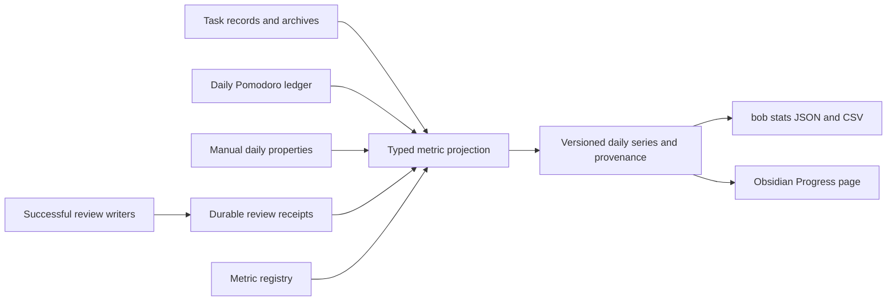

# Daily Progress for Bob

**Recommendation:** Build a focused **Progress** page inside Obsidian, backed by a small Bob metrics contract. Derive Pomodoro minutes and task counts from existing vault records; persist successful review answers because the vault does not retain their history. Add a typed metric registry and a simple daily-value editor so future integer metrics require configuration rather than another bespoke dashboard.

This is a good idea when it helps answer a practical weekly question. It becomes a poor idea if “more tasks, more review, more hours” turns into a score for having a good day. Design this as a personal instrument panel, with provenance and gentle trends, rather than a productivity competition.

The difficult part is recording the right facts reliably. A charting plugin alone cannot solve that problem.

## 1. Scope, method, and confidence

I researched independently. I did not locate, read, or consult the other four researchers’ reports, chats, or findings.

I inspected the current bob-cli checkout, opened bob-plugins and two upstream charting repositories through `sase repo open`, read the relevant SASE memory through its audited interface, ran two aggregate read-only `bob query` checks, and consulted primary research and official documentation. No implementation or vault mutation was performed.

Repository snapshots inspected:

| Repository | Commit |
| --- | --- |
| bob-cli | `ab9fbafa42c8559a55bafa61a86ac2d25d365b3c` |
| bob-plugins | `6a5178cd335119b6dfe7864d3861e1b00ca26603` |
| pyrochlore/obsidian-tracker | `933fa7537580fe79ecf567e83d5cb45ba18139e0` |
| phibr0/obsidian-charts | `663814645bbad2e47df2d151cb982fff24a2a0f7` |

Confidence is high about the source-model problems and available integration points. The proposed UX, storage layout, and performance budgets are design judgments, not measured prototype results. I did not inspect the daily note’s literal inline-query expression; its exact parity needs verification during implementation.

## 2. Critique: worthwhile feedback, weak productivity proxies

There is evidence for monitoring progress: Harkin and colleagues’ experimental meta-analysis covered 138 studies and 19,951 participants and found an average improvement in goal attainment of about `d = 0.40`. This supports useful feedback, but does not establish that Bob task counts measure meaningful knowledge work. [Harkin et al., published paper](https://www.apa.org/pubs/journals/releases/bul-bul0000025.pdf)

There is also a cost. Etkin’s six experiments found that quantifying activities could increase activity while reducing enjoyment and intrinsic motivation. These experiments do not predict Bryan’s response, but they argue against making every tracked quantity a target. [Etkin, university-hosted publication abstract](https://scholars.duke.edu/publication/1134328)

My design conclusions:

- **Pomodoro time measures logged effort.** A productive breakthrough and an unproductive session can take the same time. Time is useful for capacity and consistency, not as a value score.
- **Completed tasks measure throughput at the current task granularity.** Splitting one task into ten changes the number without creating ten times the value. Routine chores and important project work should be distinguishable when inspecting the result.
- **Created tasks measure intake.** A higher number is neither inherently good nor bad. Do not color a busy capture day as success or failure.
- **Review processing measures maintenance.** High counts might mean useful clarification, excessive backlog, or repeated rubber stamping. Pair the count with an explicit closeout signal and outcome details.
- **Context matters.** A weekly sentence such as “family travel; shorter workdays” can explain a chart better than another metric. Permit day notes and source drilldown; do not invent automated causal explanations.

Start with automatic collection and review the page once a week. After four weeks, retain metrics that changed a decision or provided useful reassurance. Hide the others without deleting their data. Rest days should look like ordinary days, not broken streaks.

## 3. What Bob already supplies—and what it does not

### 3.1 Pomodoro time has a useful existing implementation

Bob’s `completed_summary_for` counts completed ledger entries and prefers recorded `[t:: ...]` duration over a range-derived fallback. A conformance test specifically checks that a 60-minute range with `[t:: 25m]` contributes 25 minutes, not 60. Reuse and generalize this logic to an explicit daily-note input rather than rebuilding a duration parser in the dashboard. [Summary implementation and test](https://github.com/bobs-org/bob-cli/blob/ab9fbafa42c8559a55bafa61a86ac2d25d365b3c/src/native/capture_pomodoros.rs#L381)

An aggregate query over recent daily notes found real 5-, 10-, 15-, 25-, 50-, 60-, and 75-minute durations. Therefore “Pomodoro count × 25” would be incorrect. One older note also retained an open timed row: an open row’s planned duration must not silently count as completed work.

**Unresolved parity point:** Bryan’s current inline query may sum a different set of rows, including open rows. Before changing that display, compare its literal predicate with the reusable completed-summary contract. Preserve an intentional planned-time display as a separately labeled quantity; do not silently change it.

### 3.2 Creation and completion dates support projections, with limitations

Tasks stores creation and completion fields, and Bob has a native parser that respects the vault’s configured Tasks statuses and task filter. Archiving moves task blocks into `done/`; this preserves useful source records but can rename block IDs on collisions. [Task index](https://github.com/bobs-org/bob-cli/blob/ab9fbafa42c8559a55bafa61a86ac2d25d365b3c/src/native/dataview/tasks/index.rs#L24), [archive ID handling](https://github.com/bobs-org/bob-cli/blob/ab9fbafa42c8559a55bafa61a86ac2d25d365b3c/src/native/collect_done/archive.rs#L24)

Two implementation details matter:

1. The parser’s general `is_done` helper includes cancelled and non-task status types. The completed-task metric must test **status type `DONE`**, not that broad helper. [Status types](https://github.com/bobs-org/bob-cli/blob/ab9fbafa42c8559a55bafa61a86ac2d25d365b3c/src/native/dataview/tasks/task.rs#L64)
2. `RichTask`, currently exposed to freshness consumers, has `created` but does not expose the completion date; the underlying task model does. A stats adapter needs a small additive extension or access to the underlying parsed field. [RichTask projection](https://github.com/bobs-org/bob-cli/blob/ab9fbafa42c8559a55bafa61a86ac2d25d365b3c/src/native/dataview/tasks/mod.rs#L105)

A scoped DQL census returned **3,498 `#task` rows, 2,902 with creation dates, and 2,527 `x` rows of which 2,303 had completion dates**. That is 596 undated creation records and 224 undated `x` completion records. These are exploratory counts, not final production metrics: the query used a literal `x` symbol rather than the full custom-status registry, excluded templates/conflicts, and included archived and hidden rows. Ambiguous-link warnings also occurred. The census establishes that historical dates are incomplete; it does not certify every source’s provenance or assign missing records to a day.

Another subtlety: Google Keep import preserves the Keep note’s original creation date. Thus `created` means the recorded origin date, **not the date imported into Bob**. Keep this useful convention. If later desired, “Tasks captured into Bob” is a separate event metric. [Keep creation-date writer](https://github.com/bobs-org/bob-cli/blob/ab9fbafa42c8559a55bafa61a86ac2d25d365b3c/src/native/gkeep/render.rs#L501)

Reopening can remove a completion date; deleting a task removes its evidence. Consequently these projections describe the vault’s currently retained records, and historical values can be corrected. They cannot reconstruct every past completion gesture or deleted task. A full lifecycle audit log would solve a different, substantially larger problem.

### 3.3 Review history cannot be recovered from freshness or the footer

A task’s `[fresh:: date]` stores its **latest** human confirmation. The next review replaces it. Creation, automation, completion, cancellation, and recurring rows have different freshness behavior. An arbitrary daytime edit can stamp an open task without constituting a walk answer. [Stamping contract](https://github.com/bobs-org/bob-cli/blob/ab9fbafa42c8559a55bafa61a86ac2d25d365b3c/docs/freshness.md#L502)

The footer exposes queue positions and current due counts; those are not completed-review counts. Its `refreshedToday` census counts current stamps, and `upkeepToday` has a narrower lane-related meaning. Neither records historical `]s` processing. [Freshness count semantics](https://github.com/bobs-org/bob-plugins/blob/6a5178cd335119b6dfe7864d3861e1b00ca26603/plugins/bob-ledger-tools/src/110-freshness-queue.js#L132)

Bob already has a valuable seam: synchronous `reviewWalk.capture(editor)` captures a validated landing before a gesture; `reviewWalk.continue(origin, outcome)` receives the resulting write outcome. However, stay answers, moves, and checklist completion have additional paths. Instrument actual successful answers across those paths, not just successful navigation continuation. [Review gesture API](https://github.com/bobs-org/bob-plugins/blob/6a5178cd335119b6dfe7864d3861e1b00ca26603/plugins/bob-navigation-hotkeys/src/536-plugin-review-advance.js#L18), [checklist completion](https://github.com/bobs-org/bob-plugins/blob/6a5178cd335119b6dfe7864d3861e1b00ca26603/plugins/bob-navigation-hotkeys/src/535-plugin-review-checklist-walk.js#L174)

The inspected code/docs currently contain a RECURRING tier and process references through ordinary tiers, while some loaded memory summaries retain an older REFERENCES roster. The metrics contract should consume the current evaluator’s tier labels and version, rather than embed a copied roster from this report.

## 4. Requirements I would adjust explicitly

| Original idea | Recommended adjustment | Reason |
| --- | --- | --- |
| One integer per metric/day | An integer **or missing**, plus quality, unit, and provenance | Zero, unavailable, partial, and not-yet-tracked convey different facts. |
| Morning GTD review tasks completed | **Review items processed:** committed answers on validated walk landings | Keeping, releasing, deferring, routing, and dropping are useful processing without completing the underlying task. Navigation alone is not processing. |
| Morning | Attribute the **review ritual** to its recorded Bob day, regardless of clock hour | A review at noon is still the same ritual. Avoid an arbitrary morning cutoff. |
| Pomodoro hours and minutes | Store integer **minutes**; display `4h 10m` | One canonical quantity avoids inconsistent hour/minute pairs and fractional rounding. |
| Tasks completed each day | Count currently retained DONE records dated that day | Practical v1; every historical checkbox transition would require a broader event system. |
| Tasks created each day | Count retained records by their recorded creation date, including preserved import origin dates | Respects Bob’s existing meaning. “Imported today” is a different metric. |
| Easy future metrics | Support builtin projections and manual daily scalar properties through a typed registry | A configuration change should cover a new integer habit; a novel automatic signal still needs an adapter. |
| Visualize progress | Default to one metric, one range, daily values with an optional weekly trend | Clarity and comparison matter more than adding chart types. |
| Reliable totals | Show coverage and unresolved evidence; avoid pretending backfills are exact | Existing undated records and unsupported collectors make blanket completeness claims false. |

These changes preserve all four requested views. They clarify their meaning rather than adding a new daily administrative ritual.

## 5. The v1 metric set

### 5.1 Four requested metrics

| Stable ID | Display label | Exact v1 definition | Historical behavior |
| --- | --- | --- | --- |
| `review_processed` | Review items processed | Sum committed, accepted target answers from the review journal for the recorded day. Include checklist answers; retain tier/outcome detail. | Available prospectively from collection start; no fabricated historical backfill. |
| `pomodoro_minutes` | Focus time | Sum completed top-level Pomodoro ledger entries in the canonical daily note. Prefer valid recorded duration; otherwise valid range fallback. | Backfill from retained daily notes; edits/reopens update totals. |
| `tasks_completed` | Tasks completed | Number of in-scope task records with configured status type DONE and valid completion date equal to the day. | Include active notes and `done/`; revisions can change history. |
| `tasks_created` | Tasks created | Number of in-scope retained task records with a valid creation date equal to the day, regardless of current status. | Preserve origin dates; distinguish automatic/routine rows when source evidence permits. |

For task metrics, count each real task row, including task subtasks. Plain Pomodoro checkboxes are not tasks merely because they are checkboxes. Honor Tasks’ configured task membership. Exclude templates, conflicts, generated copies, embedded/query renderings, and sample material through explicit scope rules; include real archived records. A `#hide` tag should not erase actual historical work. GTD chores belong in the requested **total**; an optional “work tasks only” filter should be clearly labeled and consistently apply to both creation and completion.

Do not silently suppress recurring occurrences: they are real retained task records. Their creation metadata may reflect the generator’s rules rather than a new human capture. Make this visible in the definition and offer a routine/recurring breakdown only where the parser can support it. Do not infer an unavailable human-vs-automation origin from a title or file timestamp.

For duration parsing, a present but malformed `[t::]` is a quality problem. Do not quietly fall back and advertise an exact total. Range-only legacy rows can be counted with explicit fallback provenance. Warn about overlaps and duplicate-looking sessions; do not silently merge their time, since the recorded ledger may intentionally differ from elapsed wall time.

### 5.2 Additional metrics worth tracking

**Add one fifth metric: `review_closed`, displayed as “Review closed.”** Record `0/1` from the explicit supported completion of the terminal POST closeout. Closing with skipped commitments is still a recorded closeout, with that remaining-count detail visible. It is not proof that every commitment was reviewed, and the system must not auto-complete the ritual. This provides a useful consistency signal alongside a review-volume count.

**Retain review outcomes as detail from day one.** For example: keep, complete, release, schedule, route, link-today, drop, and change cadence. A keep share can reveal a review that produces few decisions. Show `18 of 20 answers were keeps`, rather than proclaiming that a particular percentage proves waste. A new metric can later expose this data without recollection.

**Make completed Pomodoro sessions available as an optional derived metric.** It costs little once parsing exists and can help explain session patterns, but should not be a default hero card or substitute for minutes.

**Good optional manual candidates:** exercise minutes or a binary exercise habit, reading minutes, and a private energy rating of 1–5. Offer these as examples in Add metric, initially disabled. Add at most one personally useful manual value; do not impose an elaborate nightly check-in.

**Defer:** review duration inferred from idle gaps; task/hour efficiency; productivity scores; burnout prediction; task-size weighting; backlog history snapshots; longest-streak competitions; mood correlations; automated “insights.” Intake minus completions is also **not** a valid backlog-change metric when cancellations, deletions, recurrence, and imports are omitted. These ideas require more evidence or encourage questionable conclusions.

## 6. UX: a Progress page that belongs in Bob

Create `dash_progress.md` with `parent: "[[dash]]"`, alias Progress, a quiet backlink, and one `bob-metrics` block. Add a simple Progress navigation link without changing existing Review/Work/Browse counts or badge semantics. Include an Obsidian command, **Open Progress**, for keyboard access.

The entry page should be comfortable at a glance and reveal complexity only when requested.

```text
← Dashboard                                    Progress

[ Focus time          ▾ ]      [ 30 days ▾ ]   ‹  ›   Today
                                Sep 12 – Oct 11

TODAY                   LAST 7 COMPLETE DAYS
2h 15m · in progress    22h 40m

Focus time                                    [ Bars | Calendar ]
  h
  8 ┤
  6 ┤     ▂   ▅          ▄        ▃
  4 ┤ ▃ ▆ █ ▂ █  ▄  ▃   █  ▅  ▆  █
  2 ┤ █ █ █ █ █  █  █   █  █  █  █     ··· today
  0 ┼──────────────────────────────────────────────────────
       Sep 12              Sep 26                 Oct 11
       daily minutes                 ─ 7-day average

Recorded on 29 of 30 days         [Definition] [Data table]

Selected: Tue, Oct 6 · 4h 10m                [Open daily note]
7 completed sessions · one range-derived duration
[Show sessions]
```

**All values in this sketch are illustrative**, not a representation of Bryan’s measured history.

### Interaction

- **Metric picker:** the four requested metrics plus Review closed; optional favorites produce small quiet cards, not a wall of equally loud charts.
- **Range presets:** 7 days, 30 days, 90 days, year, and custom inclusive dates. Previous/next shifts by the selected calendar window; Today returns to the current window. Persist view preferences locally without rewriting the note on every click.
- **Granularity:** daily bars for short ranges; explicit weekly aggregation for long ranges. Counts and minutes sum; binary habits use days met; ratings use an average. Week buckets follow the vault/user’s week-start convention. Partial edge weeks are labeled.
- **Trend:** optional seven-day trailing average in the same units. Load the six prior days needed for the first displayed value. Leave the trend broken when required observations are missing; do not interpolate invented days.
- **Selection:** hover reveals a compact tooltip; click or keyboard selection pins a day’s detail. Enter opens the day/source. Today receives a quiet open marker and “in progress”; exclude it from completed-period comparisons.
- **Calendar:** a compact secondary view for consistency over 90 days/year. Bar charts remain the default for magnitude. Use fixed, metric-specific intensity thresholds or a clearly explained legend; a range change must not silently turn the same value darker.
- **Definition:** one short explanation of what is counted, its units, source, collection start, and limitations. This is where recorded creation versus import date is explained.
- **Evidence:** a drawer lists the included sessions, task records, or review events, with available source links. A deleted or renamed source does not destroy an event; show its captured description and explain why the link is unavailable.
- **Data table/export:** the same values, coverage, and partial-period flags in a keyboard-accessible table and CSV. Export must match what the chart shows.

Use text such as “29 days recorded” and “Tracking started Oct 15,” not an alarm for a day with unknown data. A known zero should remain selectable at the baseline. An unknown day uses a neutral gap/pattern and `—`; never a zero-height bar that looks like failure.

### Visual design

Use Obsidian’s actual theme tokens for backgrounds, text, borders, and one restrained accent. Favor generous spacing, tabular numerals, lightly rounded controls, crisp axes, and a large chart. The duration formatter is `4h 10m`, not `4.1667`. Keep a stable zero baseline for count/duration bars. Do not put minutes and tasks on competing Y axes.

Avoid success-green/red judgments on volumes. Targets should be optional and available only when the metric definition has a meaningful desired direction; “higher is better” is not the default. A binary habit can show days met without making an unrecorded day red.

The design must work in light and dark themes, narrow panes, and high contrast. Respect reduced motion. Provide actual buttons and a data-table route for all pointer actions; color and hover alone cannot carry meaning.

## 7. Architecture: derive existing facts, record otherwise-lost answers



### 7.1 Keep one authority for each fact

- Task metadata remains authoritative for the task-date projections.
- Daily ledger entries remain authoritative for worked minutes.
- Manual daily properties remain authoritative for custom daily values.
- The new journal is authoritative only for supported review answers and explicit closeouts.
- Caches and displayed daily totals are disposable projections, not independent counters.

Do **not** increment a shared YAML counter whenever the cursor moves or freeze all derived totals at midnight. Those approaches create races, lose retrospective corrections, and fail when a device was asleep. Do not introduce a synced SQLite database as the canonical record; derived local indexes are sufficient here.

### 7.2 A bounded metric registry

A proposed registry at `_metrics/registry.yaml` contains stable IDs, labels, units, source kind, legal range, and interval aggregation. This is proposed schema, not existing syntax:

```yaml
schema_version: 1
metrics:
  pomodoro_minutes:
    label: Focus time
    source: builtin.pomodoro_completed_minutes
    unit: minutes
    aggregate: sum
  reading_minutes:
    label: Reading
    source: daily_property
    property: metrics.reading_minutes
    unit: minutes
    aggregate: sum
    minimum: 0
  exercise:
    label: Exercise
    source: daily_property
    property: metrics.exercise
    unit: boolean
    aggregate: days_met
    minimum: 0
    maximum: 1
```

A daily note can contain:

```yaml
metrics:
  reading_minutes: 20
  exercise: 1
```

Omission means missing; zero means an explicitly recorded zero. Store one scalar per metric/day. Repeated Save replaces the daily value rather than adding another observation. Editing a label never changes an ID or orphans history. Deactivating a metric hides it while preserving values.

The Add metric dialog asks for name, unit/type, and optional bounds; it chooses a unique ID and sensible aggregation. Then **Record value** opens a date and value editor for that day. This gives future habits a two-step user flow with no JavaScript to write. Frontmatter edits use guarded note writes and preserve other properties and formatting. The same-day multi-device editing risk remains the existing daily-note sync conflict risk and must be reported, not concealed.

New builtin signals still require source code and tests. Extensibility means separating adapters from the registry, reducer, and UI; it does not mean evaluating arbitrary user expressions. Reject duplicate IDs, incompatible units, invalid integers, and unknown source adapters with a clear repair message.

### 7.3 Review receipts: integration and semantics

Create an operation ID when a supported review action starts on a validated landing. Capture day, tier, target/occurrence references, and before-state evidence. Once the action commits, emit only the **accepted target answers**, with outcome and after-reference. Deduplicate retries by operation ID plus target index; never by task title alone.

The counting primitive is a **processing answer**, not a globally unique task identity. If Bryan deliberately makes a task due again and processes it again that day, it counts as another answer. This is an explicit refinement of the requirement and avoids pretending note paths, line numbers, or block IDs are permanent global identities. A later distinct-task metric would need stronger identity across moves and recurring occurrences.

| Gesture/result | Count in `review_processed`? |
| --- | --- |
| `]s`, `[s`, endpoint jump, revisit, or skip | No |
| Successful keep on a due landed row, Alt+F or Ctrl+Alt+F | Yes, even when it stays |
| Successful landed completion, cancellation/drop, lane answer, schedule, or resolving card answer | Yes |
| Successful landed move/route that processes the item | Yes; preserve its stay/park navigation behavior |
| Supported PRE/POST completion | Yes, through its checklist writer path |
| Successful link-today answer on a supported landed item | Yes |
| Escape, refusal, no-op, unresolved target, or merely opening a modal | No |
| Ordinary daytime stamp away from a walk landing | No |
| Automation, sync, seed, or task-index reload | No |
| Partial counted action | Only accepted targets that were due queue items in that review action’s captured scope |

A counted navigation jump answers zero items. A counted processing gesture can answer several. Validate each target’s eligibility against the captured scope and successful write result; “the modal contained five tasks” is not evidence that five were processed.

Use a shared receipt sink from all relevant writer paths. `continueReviewWalkAfter` is useful context but cannot be the sole sink: it excludes non-advancing outcomes and has stale/boundary checks for navigation. Likewise, if writing succeeded and the next landing failed, the completed answer still counts. Navigation, recording, and mutation outcomes must be independent.

Keep the established move rule, the Alt+F stay rule, checklist boundary behavior, sticky lanes, and ledger-derived Today semantics. No new review mode or keymap is required.

### 7.4 Durable storage without a shared append hotspot

For v1 I favor one immutable JSON receipt **per operation**, which can contain multiple accepted targets:

```text
_metrics/review/2026/10/15/<operation-uuid>.json
```

A receipt should include schema and definition version, operation ID, writer/version, recorded Bob day, timestamp with timezone, accepted targets with tier/outcome and before/after references, and closeout details when applicable. Store no more task text than needed for useful source evidence. Commit this plain data through Bob’s existing vault sync.

Unique filenames avoid two devices editing the same daily counter or JSONL tail. Partition by day, index locally, and never parse this tree in a review hotkey. For example, 50 operations/day creates about 18,250 small files/year: this is a real cost to measure, not an assumption of unlimited scalability. Later compaction can produce immutable chunks with verified coverage and retained operation IDs; leave automated deletion/retention out of v1.

**Important limitation:** a task mutation and a separate receipt are not one atomic filesystem transaction. UUIDs solve duplicate delivery, not this crash window. Use a durable local outbox prepared before the mutation, publish the committed receipt after success, and retry with the same ID. An interrupted preparation must be recovered only when there is trustworthy commit evidence; matching the current task text is not universally sufficient after concurrent edits. If the outcome is ambiguous, retain an unresolved entry and mark the day partial rather than invent a success.

If receipt publication fails, preserve the successful task work, retain the outbox record, and show a concise “Review history pending” notice plus health detail on Progress. Never quietly drop an event. The outbox must survive app restart and be inspected before reusing IDs. This achieves auditable recording with explicit ambiguous states; it should not be advertised as an unconditional exactly-once transaction across all writers.

### 7.5 Daily series and source quality

A JSON response should return every date in the requested range, stable metric and definition IDs, unit, value/known subtotal, quality, reasons, source references, and as-of revision. An illustrative point:

```json
{
  "date": "2026-10-15",
  "value": 250,
  "unit": "minutes",
  "quality": "recorded",
  "provisional": false,
  "sources": [{"path": "2026/20261015.md", "line": 24}],
  "definition_version": 1
}
```

Use a small quality vocabulary: recorded, partial, missing, and not-tracked. Today’s unfinished status is a separate provisional flag, since a valid subtotal can still be provisional. Invalid rows yield partial results with excluded-row detail; when the source cannot be read safely, show missing.

For undated historical tasks, the number of excluded records is known globally but their dates are not. Surface this limitation once for the series and mark the backfill appropriately; do not assign the records to every day, to today, or to file mtime. Before review collection starts, render not-tracked. Unsupported plugin versions or unresolved outbox entries can make a later day partial. An absent daily note is not automatically a zero-focus day.

A zero requires a successful evaluation of a source with the relevant coverage. Historical dates are treated as date-only facts. For new events persist an explicit Bob day and timezone at recording; do not rebucket old events when viewing from another machine. Preserve overnight sessions on their owning ledger day for v1 and document that convention. Do not add a midnight-splitting algorithm that disagrees with the daily ledger.

### 7.6 Ownership and performance

Add the automatic projections and JSON/CSV read interface to bob-cli, tentatively **`bob stats`**. This belongs at top level because it is a read-only report, not a `bob task` writer. Examples of proposed public options are `--metric/-m`, `--start/-s`, `--end/-e`, `--format/-f`, and `--aggregate/-a`; final help and completion must follow the project’s CLI rules.

Put the Progress renderer, manual editor, and receipt sink in a focused `bob-metrics` plugin in the bob-plugins source repo. Navigation, task-status-cycler, and block-id-prompt publish verified review results through a small versioned API. Keep collection enabled even when the Progress page is closed. Do not require the Mac capture app to understand chart or metric grammar; future clients can consume Bob’s JSON.

Obsidian rendering cannot depend exclusively on spawning the Rust CLI, because that does not supply mobile rendering. Use the existing Bob pattern of small pure JavaScript adapters/reducers and Rust adapters with **shared semantic fixtures**, plus host-specific data access. Prefer the parsed Tasks model over rendered DOM. Ensure active editor writes and saved-vault snapshots are reconciled so the page does not double count unsaved and saved copies.

Scan sources once per refresh, group all requested dates in one pass, and cache contributions by source fingerprint and semantic/config version. On Obsidian vault/metadata events, debounce and invalidate affected contributions; use generation tokens to discard stale async responses and component cleanup on unload. Never run a full-vault query per chart point or badge, and never query on every hover.

Targets to validate on Bryan’s actual vault: recent-range interactions from cache feel immediate (roughly under 100 ms); cached year views render in a few hundred milliseconds; cold indexing shows an honest loading state; recording does no full-vault scan. These are acceptance targets, not observed performance figures.

## 8. Alternatives and renderer choice

| Approach | Strength | Gap for this request | Judgment |
| --- | --- | --- | --- |
| Existing inline query + a hand-written DataviewJS chart | Quick way to inspect known time/task records | Review history still absent; arbitrary code grows as metrics and coverage rules multiply | Useful prototype, weak final architecture |
| Obsidian Tracker | Handles daily fields, ranges, bars/lines/months and summary expressions | Does not understand Bob’s committed review answers, archive semantics, or operation recovery | Good for simple manual habits; optional consumer of exported scalars |
| Obsidian Charts + DataviewJS | Flexible chart rendering; accepts Chart.js payloads through `window.renderChart` | Still needs Bob’s metric projection and deliberate range/quality UX | Viable presentation prototype, not the data authority |
| Obsidian Bases alone | Useful daily-record tables and properties within Obsidian | Does not supply the reviewed Bob-specific historical adapter or receipt collector | Complementary evidence table, not the whole feature |
| Separate habit SaaS / standalone web app | Can supply polished generic dashboards | Adds a second capture surface and source synchronization for facts already in Bob | Poor v1 fit |
| Focused Bob metrics + Progress plugin | Understands existing workflows, source evidence, and future scalar metrics | Requires bounded custom engineering and upkeep | Recommended |

Tracker’s inspected docs support `frontmatter`, `dvField`, task/text sources, `startDate`/`endDate`, and month/bar/line views. Its expression docs explicitly treat missing values as null unless filled by a penalty or replacement. It is not inherently incapable of honest gaps; the missing piece is Bob’s source contract and collector. [Tracker input parameters](https://github.com/pyrochlore/obsidian-tracker/blob/933fa7537580fe79ecf567e83d5cb45ba18139e0/docs/InputParameters.md), [missing-value expressions](https://github.com/pyrochlore/obsidian-tracker/blob/933fa7537580fe79ecf567e83d5cb45ba18139e0/docs/Expressions.md#L99)

Charts documents a DataviewJS integration taking standard Chart.js data. Its inspected package uses Chart.js 3.9.1; this is a snapshot observation, not a recommendation to pin that old version. [Charts integration](https://github.com/phibr0/obsidian-charts/blob/663814645bbad2e47df2d151cb982fff24a2a0f7/docusaurus/docs/Dataview%20Integration.mdx), [package dependencies](https://github.com/phibr0/obsidian-charts/blob/663814645bbad2e47df2d151cb982fff24a2a0f7/package.json)

**Renderer recommendation:** bundle a reviewed, pinned minimal Chart.js build inside the Bob plugin for the bars and same-unit trend. Own the DOM controls, evidence drawer, and accessible table; implement the small calendar as a simple HTML grid. This gets established chart scaling/interaction while allowing Bob-specific polish, and avoids relying on another plugin’s global hook or update lifecycle. Evaluate bundle size and the existing fragment-build integration before committing to a version.

Chart.js explicitly notes that canvas content is not screen-reader accessible by itself. Add descriptive text and the real data table; an ARIA label alone is not equivalent to navigable source data. [Chart.js accessibility documentation](https://www.chartjs.org/docs/latest/general/accessibility.html)

ECharts can support more elaborate charts and accessibility descriptions/patterns, but those features are opt-in and do not eliminate the need for an accessible interaction design. Its extra chart vocabulary does not address the hardest v1 requirements. Reconsider it if the product later needs advanced exploration, not merely for a decorative first chart. [ECharts accessibility guidance](https://echarts.apache.org/handbook/en/best-practices/aria/)

Custom SVG is a credible lightweight alternative at a few hundred points, but then Bob owns scales, labels, hit testing, and interaction robustness. I would spend custom effort on the source contract and excellent controls first.

## 9. What must be proved before shipping

The following are substantive acceptance checks, not tests that simply restate renderer code:

1. **Ledger parity:** current daily inline-query behavior is understood; completed totals agree with the generalized summary. Variable durations, valid range fallback, malformed explicit duration, empty ledger, overnight range, overlap warning, open/reopened sessions, and historical correction all behave as documented.
2. **Task-source correctness:** active/archive moves do not change totals; custom DONE counts while CANCELLED/NON_TASK do not; subtasks count once; hidden historical records remain; templates/conflicts/copies do not inflate results; undated rows remain visible as limitations; import origin dates stay preserved.
3. **Review attribution:** navigation counts zero; successful stay answers, moves, checklist completions, and resolving answers count; cancel/no-op/automation count zero. Partial batches, duplicate callbacks, recurring occurrences, and a successful answer followed by a failed next landing are covered.
4. **Recovery:** restart at each outbox/mutation/publication boundary, including ambiguous outcomes. Replaying a receipt never increments again. Two devices create distinct receipts without editing a shared file. Source-conflict evidence makes affected results partial; it is not double counted as another task.
5. **Dates and coverage:** leap day, DST, timezone changes, midnight-boundary actions, missing daily notes, pre-collection dates, partial weeks, and today’s provisional values have explicit fixtures. Inclusive custom ranges and interval shifting are stable.
6. **Extensibility:** create, record, edit, zero, clear, relabel, and hide a manual metric without changing source code. CLI, Obsidian chart, table, and CSV agree on the same fixtures and definition version.
7. **UX and performance:** keyboard-only drilldown, source opening, light/dark/high-contrast themes, narrow panes, reduced motion, stale async refreshes, plugin unloading, and large-range indexing are verified. Measure the receipt-file cost and cold-cache time on a copy of the real vault.

Keep the implementation sequence small: establish metric definitions and source fixtures; build the time/task read projections and a polished single-chart page; wire durable review recording and recovery; add the generic manual-value editor and secondary calendar; then verify the full supported writer matrix. Earlier slices are useful for review, but the full requested v1 is complete only when review recording and custom metrics work.

Do not perform a mass date repair, reseed freshness, repurpose task status, or alter the review ritual as part of rollout. Backfill retained time/task evidence with its stated limitations; start review activity collection honestly from an explicit installation boundary.

## 10. Recommended solution

Build **Bob Progress**: a native-feeling Obsidian page with a metric picker, adjustable calendar ranges, daily bars and a quiet weekly trend, optional consistency calendar, and clickable evidence. Ship the four requested metrics plus the explicit Review closed flag; keep targets and manual habits optional.

Back it with **typed, versioned daily series**, derived from existing ledger/task records, and **immutable operation receipts for actual review answers**. Use a small configurable daily-property adapter for new integer habits. Make missing/partial data and historical revisions visible, and keep every source rebuildable without a server or canonical synced database.

This is worth implementing. Its success criterion should be that Bryan can understand a week and make a useful adjustment in about a minute, while trusting where every number came from—not that the charts make every day look like an opportunity to score higher.
