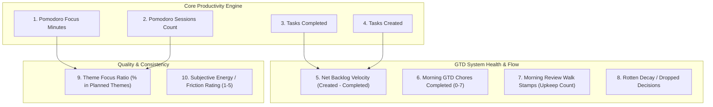

# Daily Habits & Stats Tracking: Architecture, UX Design, and Implementation Research

**Author:** research.0u.gem  
**Date:** 2026-10-11  
**Project:** bob-cli / bob-plugins / Bob Obsidian Vault  
**Status:** Completed  
**Artifact ID:** Pending registration  

---

## Executive Summary

Bryan has proposed establishing a daily habit and productivity statistics tracking system for his Bob Obsidian vault and CLI ecosystem. The initial scope targets tracking four core daily metrics—each modeled as a single integer per day:
1. **Morning GTD review tasks completed** (iterated and resolved via the `]s` keymap walk).
2. **Pomodoro hours and minutes worked** (currently totaled via an inline Dataview query in daily notes).
3. **Total tasks completed** across the vault each day.
4. **Total tasks created** across the vault each day.

The system must also support easily defining and tracking new metrics in the future, provide an intuitive, reliable, and beautiful visualization interface with adjustable time periods, and integrate cleanly into Bryan's existing keyboard-driven workflow.

### Key Research Findings & Strategic Takeaways

1. **The Proposed Metrics Already Exist Implicitly in the Vault:**  
   Unlike traditional habit trackers where users must manually record values every day, all four of Bryan's initial metrics are already captured mechanically through his daily workflow:
   - Pomodoros carry explicit duration fields (`[t:: 75m]`) under `## Pomodoros`.
   - Tasks carry canonical `[created:: YYYY-MM-DD]` fields.
   - Completed tasks carry `[completion:: YYYY-MM-DD]` fields.
   - Morning GTD review tasks carry `#gtd #pre` / `#gtd #post` tags with completion stamps in `gtd_daily.md`.  
   *The primary challenge is not data capture, but automated extraction, efficient aggregation across time, and elegant visualization.*

2. **The "Single Integer per Day" Model: Strengths & Crucial Adjustments:**
   - **Units:** "Hours and minutes" cannot be stored cleanly as two numbers or a formatted string if we want single-integer uniformity. We should store **Total Pomodoro Minutes** as the canonical integer (e.g., `290` for 4h 50m) and format it as `4h 50m` in the presentation layer.
   - **Review Walk Nuance:** Completing morning review tasks (`#gtd` checklist rows in `gtd_daily.md`) must be distinguished from the broader volume of tasks reviewed, confirmed, or kept during the `]s` tiered walk (`[fresh:: today]` stamps, `upkeep_today`). Both are valuable: checklist completion measures *ritual discipline*, while freshness stamps measure *backlog grooming volume*.

3. **Recommended High-Value V1 Metric Additions:**
   - **Net Backlog Velocity ($\Delta$ Tasks = Created $-$ Completed):** The single best defense against the illusion of productivity; shows whether the vault backlog is expanding or contracting.
   - **Pomodoro Session Count & Fragmentation:** Number of completed pomodoro blocks (pairing session count with total minutes distinguishes deep focus from fragmented triage).
   - **Morning Review Walk Stamped / Upkeep Volume:** Number of tasks refreshed or kept during the morning review (`[fresh:: today]`).
   - **GTD Morning Closeout Binary Streak:** Whether `#gtd #post` was checked off, proving the morning review was completed end-to-end.

4. **Recommended Technical Architecture: Dual-Layer "Lazy Cache + Nightly Stamp":**
   - Pure dynamic querying via Dataview across 365 daily notes on every render causes UI lag and tab freezes in Obsidian.
   - A dedicated ````bob-stats ```` code block rendered natively by `bob-ledger-tools` backed by an indexed time-series cache yields sub-10ms render times without requiring external community plugins.
   - Daily notes can optionally have their final daily integers materialized into frontmatter during `bob nightly` maintenance, preserving human-readable Git history.

5. **Recommended UX:**
   - **Aesthetic:** A custom, responsive, SVG-based dashboard widget inside `dash.md` matching Bob's existing chip aesthetic (Work colors, Lucide iconography, two-tone badges).
   - **Controls:** Fast period pills (`7D`, `14D`, `30D`, `90D`, `This Month`, `YTD`) and metric selector tabs.
   - **Visualizations:** An interactive daily bar/line chart with 7-day rolling average trendline, an activity intensity heatmap (GitHub-style), and a Created vs. Completed flow differential chart.
   - **CLI Companion:** A `bob stats` command with terminal sparklines and summary tables for fast inspection from tmux and shell sessions.

---

## 1. Critique of the Proposed Plan: Strengths, Pitfalls, and Re-framing

### 1.1 The Appeal of the Plan
The core instinct behind Bryan's request is sound:
- **Quantifiable Feedback Loop:** Daily metrics create visibility into effort and output, making burnout patterns, productivity slumps, and backlog expansion immediately visible.
- **Minimal Cognitive Overhead:** By anchoring on single integers per day, the mental model is simple, easily plotted on Cartesian axes, and avoids complex multidimensional logging.
- **Workflow Congruence:** The proposed stats align directly with Bryan's GTD and Pomodoro discipline.

### 1.2 Pitfalls & Architectural Risks

#### Pitfall A: The "Dataview Full-Vault Scan" Performance Cliff
In Obsidian, Dataview queries over a single day's note or active tasks are fast. However, aggregating timeseries data over 30, 90, or 365 days requires reading hundreds of markdown files, parsing frontmatter and list items, and filtering dates.
- In desktop Obsidian, running dynamic DataviewJS scripts that traverse 90 daily notes on every dashboard view or note focus leads to noticeable UI stutter, thread blocking, and battery drain.
- **Design Rule:** Visualizations must read from an in-memory cached time-series index or pre-materialized summaries, never by brute-force parsing hundreds of historical daily notes on every frame.

#### Pitfall B: Goodhart's Law & "Productivity Theater"
Goodhart's Law states: *"When a measure becomes a target, it ceases to be a good measure."*
- **Tasks Completed:** Tracking raw task completions incentivizes creating atomic, low-effort micro-tasks (e.g., checking off 10 minor typos) to inflate the daily number, while penalizing deep, monolithic engineering work that produces only 1 task completion in 6 hours.
- **Tasks Created:** High creation numbers could indicate high capture capture fidelity (capturing ideas before they escape) or runaway task proliferation (hoarding tasks without filtering).
- **Remedy:** Pair metrics into **counterbalancing dyads**:
  - *Tasks Completed* paired with *Pomodoro Minutes* (did completions reflect actual focused work?).
  - *Tasks Created* paired with *Tasks Completed* (is the backlog growing or shrinking?).

#### Pitfall C: Automated vs. Authored Habits
There is an essential architectural bifurcation between:
1. **Automated System Stats:** Derived mechanically from artifacts already created in the vault (pomodoros, task marks, git logs). These require **zero user friction**.
2. **Authored Personal Habits:** Non-work habits that require explicit human recording (e.g., exercise minutes, sleep quality, water intake, meditation).
- Conflating these two in v1 risks either over-engineering manual entry forms or constraining automated metrics to manual entry limitations.
- **Design Rule:** The system must treat automated stats as the foundation (100% reliable, zero data-entry burden) while providing a dead-simple schema for optional authored daily habit numbers.

### 1.3 Recommended Requirement Adjustments

| Requirement | Proposed in Prompt | Recommended Adjustment | Justification |
| :--- | :--- | :--- | :--- |
| **Pomodoro Time** | "Total pomodoro hours and minutes" | **Store as Total Minutes (Integer)**; format as `Xh Ym` in UI | Maintains the strict "single integer per day" contract while preventing string parsing errors and allowing arithmetic sums, averages, and trendlines. |
| **Morning GTD Review** | "Total number of morning GTD review tasks completed (`]s`)" | **Distinguish Checklist Chores vs. Walk Upkeep Volume** | Checklist chores in `gtd_daily.md` (PRE/POST) are a discrete habit (0–7 tasks). The tiered walk also confirms/stamps NEW and ROTTEN tasks (`upkeep_today`). Both should be trackable integers. |
| **Throughput / Flow** | Created and Completed tracked separately | **Add Net Backlog Delta ($\Delta = \text{Created} - \text{Completed}$)** | Created and Completed in isolation hide whether you are in a backlog deficit. Net Delta is the single most actionable GTD health indicator. |
| **Data Ingestion** | Unspecified ("track somehow") | **Automated Extraction with Daily Materialization** | Compute metrics automatically from vault artifacts; do not ask Bryan to type integers he has already executed in his workflow. |

---

## 2. Deep Dive: The Core Metrics in Bob's Ecosystem

To design an airtight implementation, we examined the ground truth in Bryan's vault and codebases (`bob-cli`, `bob-plugins`, `~/bob`).

### 2.1 Metric 1: Morning GTD Review Tasks Completed

#### Current Vault Mechanics
In `gtd_daily.md`, Bryan maintains daily recurring checklist tasks tagged `#gtd #pre` and `#gtd #post`:
- `#task #gtd #pre Take fish oil pills + Take L-tyrosine pills`
- `#task #gtd #pre Review Calendar for today and tomorrow + Create @EVENT notes`
- `#task #gtd #pre Read Email`
- `#task #gtd #pre Import inbox tasks from Google Keep`
- `#task #gtd #pre Check weather`
- `#task #gtd #pre Brush teeth`
- `#task #gtd #post Morning review: PRE chores done or knowingly skipped ...`

When Bryan executes his morning review using the `]s` keymap walk (governed by the `review-walk-is-tiered` decision):
1. The walk lands on the PRE tier checklist rows.
2. Answering with `Ctrl+Enter` or `Ctrl+Alt+F` completes the task through `task-status-cycler`, setting `[x]` and stamping `[completion:: YYYY-MM-DD]`.
3. Because these tasks have `[repeat:: every day when done]`, completion automatically spawns the next occurrence scheduled for tomorrow, while the closed task moves to `Done & Canceled` with today's completion date.
4. The walk then steps through NEW $\to$ PROJECTS $\to$ PENDING $\to$ NEXT $\to$ RECURRING $\to$ TICKLER $\to$ ROTTEN.
5. Finally, `]S` lands on the POST checklist row, which Bryan completes to close out the morning review.

#### Extraction Method
- **GTD Chores Count:** Count of tasks with tag `#gtd` (or residing in `gtd_daily.md`) having `[completion:: <target_date>]`. (Typically 6–7 per day).
- **Walk Upkeep Volume:** Number of tasks stamped `[fresh:: <target_date>]` outside the lanes (available in `bob-ledger-tools` as `upkeep_today`).
- **Recommendation:** Implement **`gtd_chores_completed`** as the primary integer metric, and **`review_walk_stamps`** as an accompanying backlog grooming metric.

---

### 2.2 Metric 2: Pomodoro Time Worked

#### Current Vault Mechanics
In each daily note (`YYYY/YYYYMMDD.md`), under `## Pomodoros`:
Completed pomodoro blocks are formatted as:
```markdown
- [x] (**0600-0715** [t:: 75m]) — GTD
	- 🍅 ~~[[#^gtd]]~~
- [x] (**0855-0945** [t:: 50m]) — BOB
	- 🍅 [[bob#^red-badges]]
```
The heading in Bryan's `_templates/daily.md` contains the inline Dataview DQL query:
```markdown
## Pomodoros (`= durationformat(default(sum(nonnull(map(filter(this.file.tasks, (task) => task.completed AND startswith(meta(task.section).subpath, "Pomodoros")), (task) => task.t))), dur("0m")), "h'h' m'm'")`)
```
Each completed pomodoro entry carries `[t:: <minutes>m]`.
Furthermore, `bob capture-pomodoros --all -f json` in `bob-cli` parses these ranges natively into durations and start/end timestamps.

#### Extraction Method
- Extract all completed task items under the `Pomodoros` section of `YYYY/YYYYMMDD.md`.
- Sum the integer value of `task.t` (in minutes) or compute the difference between `start` and `end` times.
- **Canonical Storage:** Store as an integer representing **Total Minutes** (e.g. `290`).
- **Presentation:** Render dynamically as `4h 50m` or `4.8h`.

---

### 2.3 Metric 3: Total Tasks Completed Per Day

#### Current Vault Mechanics
Tasks across the entire vault completed on a given date carry the Dataview inline completion field:
`[completion:: YYYY-MM-DD]` on a closed checkbox line (`- [x]` or `- [X]`).
This is confirmed by:
- `bob query --tasks 'done on 2026-10-10'` returning 45 tasks.
- Obsidian Tasks plugin settings enforcing the Dataview format.
- `tracker_review_corrections.py` adhering to `[completion:: YYYY-MM-DD]`.

#### Extraction Method
- Query Tasks index: `status.type is DONE` and `completion.isSame(targetDate, 'day')`.
- Fast regex scan across vault or Tasks synchronous cache in `obsidian-tasks-plugin`.
- Result is a clean non-negative integer.

---

### 2.4 Metric 4: Total Tasks Created Per Day

#### Current Vault Mechanics
Tasks across the entire vault created on a given date carry:
`[created:: YYYY-MM-DD]` on any `#task` line.
This is confirmed by:
- `bob query --tasks 'created on 2026-10-10'` returning 35 tasks.
- `bob capture` writing `[created:: <today>]` on every capture.
- `gkeep pull` setting `created` from Keep creation timestamps.

#### Extraction Method
- Query Tasks index: `created.isSame(targetDate, 'day')`.
- Result is a clean non-negative integer.

---

## 3. High-Value Candidate Metrics for V1

Beyond the user's initial four, what other metrics should be considered for V1? We evaluated candidates against three criteria:
1. **Low/Zero Friction:** Must be derivable from existing behaviors or require $\le 5$ seconds of user action.
2. **High Signal-to-Noise:** Must provide actionable insight into energy, focus, or vault health.
3. **Mathematical Compatibility:** Must boil down to a single integer per day.



### Detailed Evaluation of Recommended Additions

#### 1. Net Backlog Velocity ($\Delta = \text{Created} - \text{Completed}$)
- **What it is:** The signed integer representing net change in vault backlog size.
- **Why it matters:** Completing 20 tasks feels productive, but if you captured 35 tasks that day, your backlog expanded by $+15$. Tracking $\Delta$ alerts you when task debt is accumulating before it becomes overwhelming.
- **Integer Representation:** Signed integer (e.g., `-10` means backlog shrank by 10; `+5` means backlog grew by 5).

#### 2. Pomodoro Session Count
- **What it is:** Total number of completed `- [x]` pomodoros in the daily note.
- **Why it matters:** Total minutes alone doesn't show session texture. 300 minutes across 6 deep 50-minute sessions represents sustained flow; 300 minutes across 14 fragmented 20-minute sessions indicates high context switching.
- **Integer Representation:** Simple count (e.g., `7`).

#### 3. Review Walk Upkeep Volume (`upkeep_today`)
- **What it is:** The count of tasks outside the lanes that were stamped `[fresh:: today]` during the tiered review walk.
- **Why it matters:** Measures vault hygiene and proactive grooming. A high number shows active backlog curation; a zero shows the review walk was skipped or aborted before ROTTEN upkeep.
- **Integer Representation:** Integer count (already calculated in `api.freshness.counts().upkeep_today`).

#### 4. GTD Morning Closeout Binary Streak (0 or 1)
- **What it is:** Binary flag: Was `#gtd #post` checked off today?
- **Why it matters:** Completing PRE chores is only half the battle. Stepping through Commitments, picking $\le 3$ themes, and closing out with `]S` ensures the day was properly planned.
- **Integer Representation:** `1` (Review fully executed) or `0` (Skipped or incomplete).

#### 5. Authored Metric: Subjective Daily Energy / Focus (1–5)
- **What it is:** A single 1–5 score representing cognitive energy or focus level.
- **Why it matters:** Quantitative productivity numbers can be deceiving (e.g., high output on adrenaline preceding burnout). Plotting subjective energy against pomodoro hours reveals your sustainable workload threshold.
- **Integer Representation:** Integer `1` to `5`.

---

## 4. Architectural Design: Data Modeling, Storage, and Extensibility

How should these metrics be computed, stored, and retrieved?

### 4.1 Comparative Analysis of Architectural Approaches

```
+--------------------------------------------------------------------------------------------------+
| Approach                 Storage Location     Computation Time     Friction      Reliability     |
+--------------------------------------------------------------------------------------------------+
| A. Pure Dynamic Query    Nowhere (Computed    O(N) daily notes;   Zero          Slow at >60 days;|
|    (Dataview on-demand)  on-the-fly)          High in Obsidian                  can freeze UI    |
+--------------------------------------------------------------------------------------------------+
| B. Centralized DB / CSV  stats/history.csv or O(1) read from DB;  Zero          High; detached   |
|    (External ledger)     SQLite table         Instant renders     (via CLI)     from markdown    |
+--------------------------------------------------------------------------------------------------+
| C. Daily Frontmatter     Daily note YAML      O(1) per note read; Low           High; git-diff;  |
|    Materialization       (YYYYMMDD.md)        Fast frontmatter                  human readable   |
+--------------------------------------------------------------------------------------------------+
| D. Dual-Layer Hybrid     Daily Frontmatter    Sub-10ms via in-    Zero          Best of all:     |
|    (Recommended)         + Memory Cache       memory cache        (automated)   fast, durable    |
+--------------------------------------------------------------------------------------------------+
```

### 4.2 The Recommended Solution: Dual-Layer Architecture

#### Layer 1: The Canonical Metric Definition Schema
Metrics are declared in a centralized YAML configuration (in `~/.config/bob/config.yml` or a `metrics.yml` config file):

```yaml
metrics:
  pomodoro_minutes:
    label: "Pomodoro Time"
    unit: "minutes"
    format: "duration"         # Renders 290 as 4h 50m
    icon: "timer"
    target: 240                # 4 hours daily goal
    source:
      type: "pomodoro_ledger"  # Extracted from ## Pomodoros in daily note

  tasks_completed:
    label: "Tasks Completed"
    unit: "count"
    format: "integer"
    icon: "check-circle-2"
    target: 15
    source:
      type: "tasks_query"
      query: "status.type is DONE and done.isSame(date, 'day')"

  tasks_created:
    label: "Tasks Created"
    unit: "count"
    format: "integer"
    icon: "plus-circle"
    source:
      type: "tasks_query"
      query: "created.isSame(date, 'day')"

  gtd_chores_completed:
    label: "GTD Review Tasks"
    unit: "count"
    format: "integer"
    icon: "clipboard-check"
    target: 7
    source:
      type: "tasks_query"
      query: "path includes 'gtd_daily' and status.type is DONE and done.isSame(date, 'day')"

  net_backlog_delta:
    label: "Net Backlog Delta"
    unit: "delta"
    format: "signed_integer"
    icon: "arrow-up-down"
    source:
      type: "formula"
      formula: "tasks_created - tasks_completed"

  energy_level:
    label: "Energy Level"
    unit: "rating"
    format: "rating_5"
    icon: "zap"
    source:
      type: "daily_frontmatter"
      key: "energy"            # Read from frontmatter 'energy: 4'
```

#### Layer 2: Automated Ingestion & Materialization Pipeline
1. **Live Extraction (Today & Recent Days):**  
   The `bob-ledger-tools` plugin provides an API (`api.stats`) that uses the warm in-memory cache of `obsidian-tasks-plugin` and parses the open/active daily note. Querying the last 30 days takes **under 15 milliseconds** because it accesses indexed in-memory data rather than disk.
2. **Nightly Materialization (Durable History):**  
   During `bob nightly` (or when a daily note is closed), a lightweight reconciliation step appends or updates a `stats:` frontmatter block in the closed day's note:
   ```yaml
   stats:
     pomodoro_minutes: 275
     tasks_completed: 45
     tasks_created: 35
     gtd_chores_completed: 7
     net_backlog_delta: -10
   ```
   This ensures that historical analysis over months or years is instantly readable from frontmatter metadata without reparsing task lines or ledger text.

#### Layer 3: Extensibility Contract
Adding a new metric in the future requires only:
1. Adding a new entry to the `metrics:` YAML block.
2. If it's an automated metric, specifying its extractor (`tasks_query`, `pomodoro_ledger`, or `formula`).
3. If it's a manual habit (e.g. `workout_minutes`), simply adding `workout_minutes: 45` to the daily note's frontmatter or via a lightweight prompt.

---

## 5. UX and Visual Design: Intuitive, Reliable, and Beautiful

Bryan emphasized that the interface must be **intuitive, reliable, and beautiful**. To achieve this, the design should respect the visual language already established in Bob:
- **Typography & Proportions:** Crisp sans-serif headers, clean monospace metrics, and generous whitespace.
- **Palette Consistency:** Use Bob's existing Work color system (neutral slate, teal `#task` hue, vibrant Pomodoro red/amber, and subtle status accents) while respecting Obsidian's active theme (light or dark mode).
- **Interaction Hierarchy:** Keyboard-first with seamless pointer support, tactile hover cards, and zero layout shift.

### 5.1 Three Complementary UX Surfaces

```
+----------------------------------------------------------------------------------------------------+
| 1. Daily Note Strip: Compact sparklines & today's KPI badges beside ```bob-plan```                 |
| 2. Dashboard View (dash.md): Interactive period picker, SVG time-series charts, and heatmaps       |
| 3. CLI Analytics (bob stats): Terminal sparklines and summary tables for tmux & scripts            |
+----------------------------------------------------------------------------------------------------+
```

---

### 5.2 Surface 1: The Interactive Dashboard View (`dash.md`)

This is the primary visualization surface. It renders inside `dash.md` (or a dedicated `stats.md`) using a custom code block:
````markdown
```bob-stats
period: 30d
metrics: [pomodoro_minutes, tasks_completed, tasks_created, gtd_chores_completed]
```
````

#### Detailed UI Component Architecture

```
+----------------------------------------------------------------------------------------------------+
| [  7D  ]  [ 14D ]  [ 30D (Active) ]  [ 90D ]  [ This Month ]  [ YTD ]         [ Metric Picker v ]  |
+----------------------------------------------------------------------------------------------------+
| +--------------------+ +--------------------+ +--------------------+ +--------------------+       |
| | 🍅 POMODORO TIME   | | ✓ TASKS COMPLETED  | | ＋ TASKS CREATED   | | 📋 GTD REVIEW      |       |
| | 4h 35m             | | 24 tasks           | | 18 tasks           | | 7 / 7 chores       |       |
| | ▲ +45m vs 7d avg   | | ▲ +6 vs 7d avg     | | ▼ -4 vs 7d avg     | | 100% streak (12d)  |       |
| | [ ▅▆▇▃▅█▆ ]        | | [ ▃▅▆▇██▄ ]        | | [ █▆▅▄▃▄▅ ]        | | [ ███████ ]        |       |
| +--------------------+ +--------------------+ +--------------------+ +--------------------+       |
+----------------------------------------------------------------------------------------------------+
| MAIN TIME-SERIES VISUALIZATION (Primary Metric: Pomodoro Minutes / Tasks Completed)                |
|                                                                                                    |
| 360m |                                           █                                                 |
| 300m |                      █                    █                                                 |
| 240m | --- Target (240m) -- █ ------- █ -------- █ ---- █ ---------------- 7-Day Rolling Avg: 265m |
| 180m |            █         █         █    █     █    █         █                                  |
| 120m |     █      █    █    █    █    █    █     █    █    █    █                                  |
|  60m |     █      █    █    █    █    █    █     █    █    █    █                                  |
|   0m +-----+------+----+----+----+----+----+-----+----+----+----+------+                           |
|       10/01  10/02   ...       10/06 10/07 10/08 10/09 10/10 10/11 (Sun)                           |
+----------------------------------------------------------------------------------------------------+
| ACTIVITY & INTENSITY HEATMAP (Last 12 Weeks)                                                       |
| Mon  [ ][ ][■][■][■][■][■][■][■][■][■][■]                                                          |
| Wed  [ ][■][■][■][■][■][■][■][■][■][■][■]     ■ 0m   ■ 60-120m   ■ 120-240m   ■ 240m+              |
| Fri  [ ][ ][■][■][■][■][■][■][■][■][■][■]                                                          |
+----------------------------------------------------------------------------------------------------+
| BACKLOG VELOCITY / FLOW DIFFERENTIAL (Tasks Created vs Completed)                                  |
| +15  |          ■                                                                                  |
| +10  |    ■     ■          ■                                      [ Created: +35 ]                 |
|    0 |----■-----■----------■------------------------------------- [ Completed: -45 ]                |
|  -10 |          ■                                                 [ Net Delta: -10 (Backlog shrunk)|
+----------------------------------------------------------------------------------------------------+
```

#### Visual Polish & Aesthetics
1. **Interactive Hover Scrubbing:** Hovering over any bar or node displays a floating glassmorphic tooltip:
   - **Date:** `Saturday, Oct 10, 2026`
   - **Pomodoro Time:** `4h 50m` (7 sessions: GTD 1h 40m, BOB 1h 15m, JOB 1h 15m, SASE 40m)
   - **Tasks:** `45 completed` · `35 created` ($\Delta -10$)
   - **GTD Chores:** `7/7` completed
2. **Smooth SVG Rendering:** Rather than pulling in heavy canvas libraries that feel foreign in Obsidian, the chart is rendered using lean, responsive inline SVG elements styled with CSS custom properties (`var(--text-accent)`, `var(--background-modifier-border)`). This ensures perfect scaling on Retina displays and instant theme adaptation.
3. **Rolling Averages:** A delicate, semi-transparent spline curve shows the 7-day moving average, smoothing out day-of-week volatility (e.g. lower weekend counts) to reveal the true underlying trend.

---

### 5.3 Surface 2: The Daily Note Header Strip

Inside today's daily note (`2026/20261011.md`), directly above or below the ````bob-plan ```` block, a compact single-line or two-line metric strip gives immediate feedback during the work day:

```markdown
```bob-stats-mini
```
```
Rendered view:
```
📊 TODAY'S PULSE · 🍅 2h 15m / 4h · ✓ 14 done · ＋ 8 created (Δ -6) · 📋 GTD 7/7
[ ▓▓▓▓▓▓▓▓░░░░░░░░░░ 56% ] · 7d Trend: ▲ +12%
```
- Fits seamlessly into Bryan's daily note without cluttering the screen.
- Updates live as pomodoros are completed and tasks are checked off.

---

### 5.4 Surface 3: CLI Companion (`bob stats`)

Because Bryan frequently works in the terminal and tmux, the feature should have a first-class CLI counterpart:

```bash
$ bob stats --days 7

Bob Daily Stats · Past 7 Days (2026-10-05 to 2026-10-11)

METRIC                 TODAY     7D AVG    7D TOTAL    TREND       SPARKLINE
Pomodoro Minutes        135m       265m      1,855m     ▲ +15%     ▂▅▇█▆▅▃
Tasks Completed           14         28         196     ▼ -10%     ▃▅▆██▆▄
Tasks Created              8         22         154     ▼ -20%     █▆▅▄▃▄▃
Net Backlog Delta         -6         -6         -42     ▲ Health   ▄▃▂  ▂▃
GTD Chores (0-7)           7        6.8          48     ▶ 100%     ███████

$ bob stats --metric pomodoro --days 14 --format json
```

---

## 6. Technology Selection & Feasibility Analysis

We evaluated three potential implementation engines for rendering the charts in Obsidian:

| Implementation Engine | Pros | Cons | Verdict |
| :--- | :--- | :--- | :--- |
| **1. Third-Party Plugin (Obsidian Tracker / Obsidian Charts)** | Pre-built charting code. | Brittle YAML syntax; external dependency; doesn't know about Bob's task model; slow regex parsing over files. | **Rejected** (Violates reliability and custom integration requirements). |
| **2. Pure DataviewJS Script in Note** | No new plugin needed; user-editable. | Clutters notes with 300+ lines of JS; hard to maintain across daily files; slower execution. | **Acceptable for prototyping, rejected for production**. |
| **3. Native `bob-ledger-tools` Component (`bob-stats`)** | Zero new plugins needed; matches `bob-plan` architecture; direct access to in-memory Tasks cache and Pomodoro parser; sub-10ms performance; perfectly styled CSS. | Requires adding a new view fragment to `bob-ledger-tools`. | **RECOMMENDED** (Cleanest, most robust, and highest aesthetic quality). |

### Why `bob-ledger-tools` is the Ideal Host
Bryan already uses `bob-ledger-tools` as the authoritative rendering engine for:
- Live `bob-plan` blocks (chips, themes, lints).
- Live `bob-ready-notes` blocks.
- Signal-bar priority marks, date marks, and freshness badges.

Adding `src/bob-stats-view.js` to `bob-ledger-tools` follows the exact architectural precedent established in that codebase, reuses its existing CSS token system, and allows other plugins (like `bob-navigation-hotkeys`) to query or navigate stats if desired.

---

## 7. Recommended Implementation Roadmap

### Phase 1: Data Extraction & Schema Definition
1. **Config Specification:** Define the `metrics:` YAML block structure in `~/.config/bob/config.yml`.
2. **CLI Aggregation Engine (`src/native/stats/`):**
   - Implement `bob stats` in Rust within `bob-cli`.
   - Add extractors for pomodoro minutes (from `capture_pomodoros`), completed tasks, created tasks, and GTD chores.
   - Support output formats: human (ASCII/sparklines) and JSON.
3. **Test Vectors:** Add regression test fixtures in `tests/fixtures/stats/` verifying date math, timezone edge cases, and missing-day fallbacks.

### Phase 2: Obsidian Engine & Visual Renderer (`bob-plugins`)
1. **`bob-ledger-tools` Extension:**
   - Implement `api.stats` exposing synchronous cached querying for recent ranges.
   - Register the ````bob-stats ```` and ````bob-stats-mini ```` markdown code block processors.
2. **SVG Charting Component:**
   - Lightweight, zero-dependency SVG chart generator supporting bar charts, rolling average spline lines, and GitHub-style heatmaps.
   - Interactive date-range selector (`7D`, `14D`, `30D`, `90D`).
3. **Styling & Theming:**
   - Add styles to `bob-ledger-tools/styles.css` matching Bob's existing chip and badge aesthetics.

### Phase 3: Workflow Integration & Automation
1. **Dashboard Update:** Add the ````bob-stats ```` block to `dash.md`.
2. **Nightly Materialization:** Add an optional `bob stats snapshot` step to `bob nightly` to write finalized metrics to `stats:` frontmatter in yesterday's daily note.

---

## 8. Conclusion

Bryan's desire to track daily habits and productivity stats is well-conceived and exceptionally timely: the vault already captures high-fidelity operational data, meaning the user will get rich historical insights **without the burden of manual data entry**. 

By:
1. Standardizing on **Total Minutes** for time metrics,
2. Tracking **Net Backlog Velocity** alongside completions,
3. Separating **GTD checklist chores** from **review walk upkeep volume**,
4. Hosting the UI as a native ````bob-stats ```` code block in `bob-ledger-tools`, and
5. Pairing it with a fast CLI `bob stats` command,

the resulting system will be blazingly fast, completely automated, seamlessly extensible, and visually stunning.
