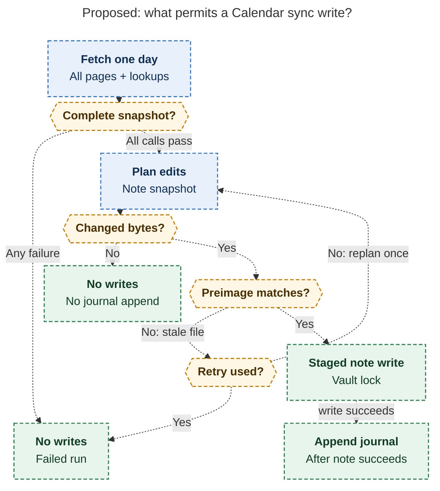

# Diagram proposals: `bob gcal`: Google Calendar events as daily-note Event Tasks

Proposals for the swarm linker, not a report. Each diagram restates only what the source
report says.

```yaml
source: research:202610/bob_gcal_daily_events/bob_gcal_daily_events__final.md
producer: research.2w.image
check: "mmdc 12.0.0 with the PDF-mirroring config rendered 1 of 1 Mermaid diagrams; Puppeteer --no-sandbox"
```

## sync-write-gates

```yaml
anchor: |-
  On a stale file, retry once, then exit 1 and let the next tick try again.
question: |-
  After the daily note exists, what must succeed before sync can write the note and then the journal?
illustrates: |-
  After the day's note exists, a complete snapshot and changed plan reach the preimage-checked staged write, a stale file gets one retry, and the journal follows note-write success.
caption: A failed fetch or exhausted retry stops writes; an unchanged plan writes nothing; the journal follows a successful note write.
review: "695.920×1158 px, fit 77.1%; question, source-trace and visual checks passed; 1 revision, 2 looks; failure arrows are alternatives"
```


