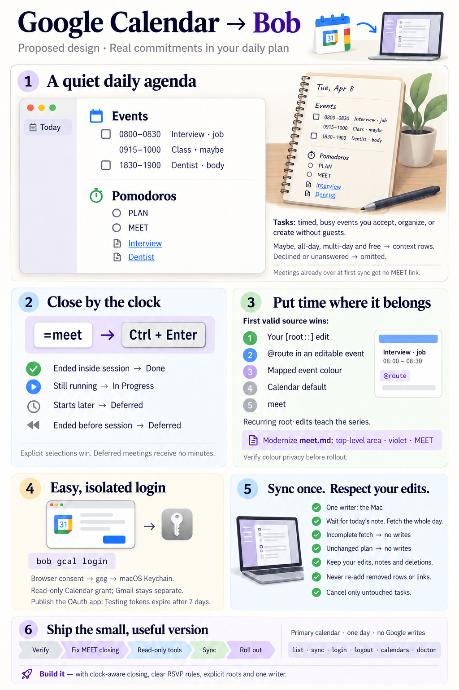
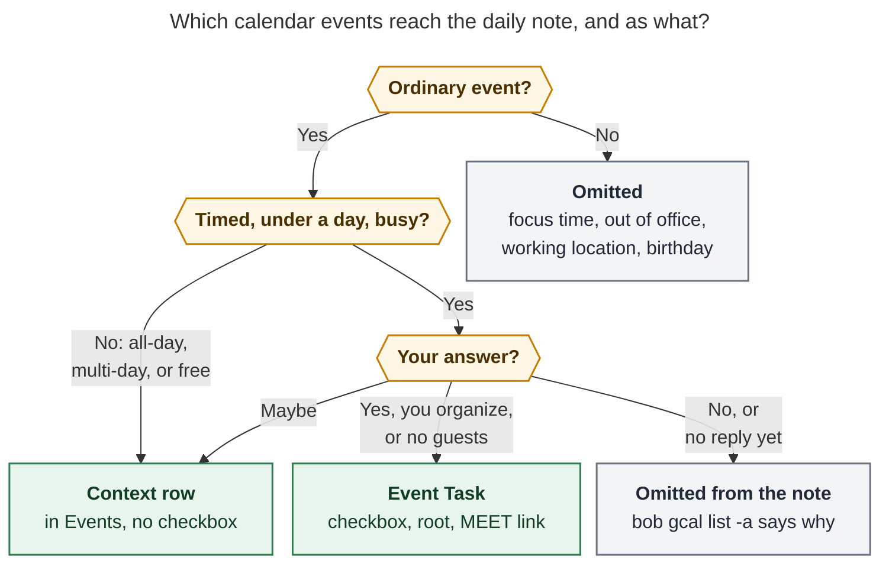
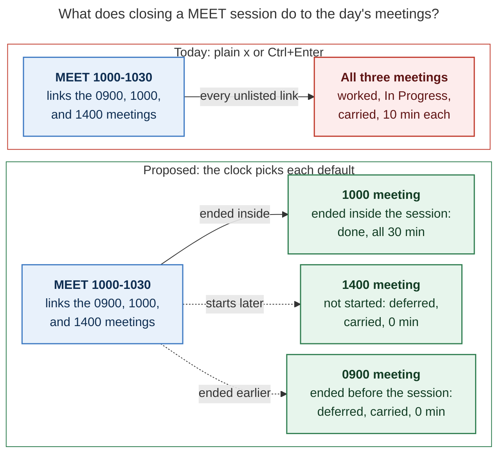
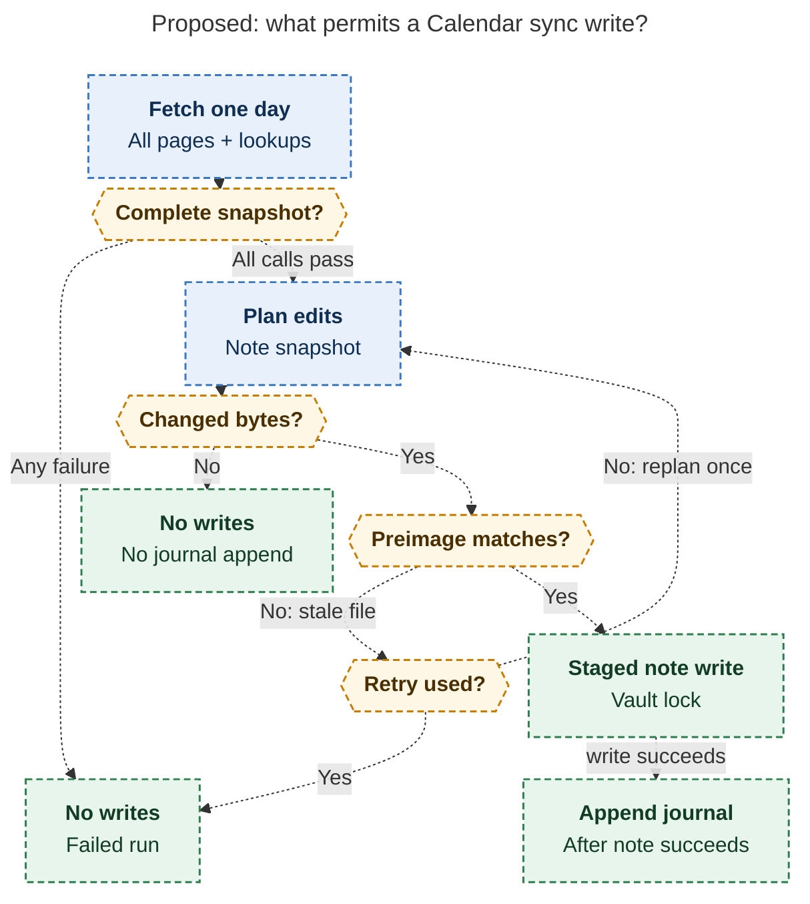

# `bob gcal`: Google Calendar events as daily-note Event Tasks

> **Research query:** How should I sync the Google Calendar events I've RSVPed to into
> my Obsidian vault as tasks: a new `bob gcal` command (with which subcommands?), tasks
> in a new "Events" H2 above "Pomodoros" in my daily file, an auto-created MEET pomodoro
> linking them, easy and intuitive Google Calendar login, and `[root::]` defaulting to a
> modernized `meet.md` area note, with a way for an event to name a different root?
> Critique the plan (is it a good idea, or would a different approach be better?),
> adjust the requirements where justified, and recommend an intuitive, reliable, and
> beautiful solution.



## Bottom line

1. **Build it, in the shape you asked for.** The plan follows a pattern the vault
   already uses. Today's `^gtd` task is a daily-note task with
   `[root:: gtd_daily]`. Daily-note tasks are already kept out of the review walk,
   freshness, the per-note Ready cap, and `## Tasks` grouping. Their Next `[*]` also
   clears once they are unlinked, so meetings cannot pile up in Next. Four of the five
   researchers reached this independently. grk's alternative is a durable task in
   `meet.md` plus a non-task Events row. It fixes a sticky-Next problem that daily-note
   residence does not have ([verified below](#what-the-evidence-says)), so I reject it.
2. **The real design problem is closing a MEET session, not creating one.** A plain `x`
   or Ctrl+Enter marks *every* linked meeting as worked and In Progress, carries it
   forward, and splits the minutes evenly. So a 10:00 session holding the day's 14:00
   meeting gives it a third of the time and an In Progress lane. Only cld caught this.
   **Adjustment:** Event Task links get a
   [clock-aware close default](#meet-as-one-queue-closed-by-the-clock). A meeting that
   ended inside the session is done. A meeting that has not started, or that ended
   before the session began, is deferred. Explicit selections still win. The resulting
   flow is `=meet` when a meeting starts and Ctrl+Enter when it ends.
3. **"RSVPed" means "going".** A checkbox means a timed, busy commitment you said yes to:
   you accepted it, you organize it, or it has no guests. **Maybe** answers,
   all-day, multi-day, and free events become [*context rows*](#requirement-adjustments)
   in Events, without a checkbox. Declined and unanswered invitations stay out of the
   note. This matters in practice: half of the events in the sampled six weeks were one
   recurring invite answered Maybe.
4. **[Choosing a root](#choosing-the-root-for-each-event): first match wins.**
   1. Your edit to the task's `[root::]`. On a recurring event, the edit is remembered
      for the series.
   2. An `@route` token in an event you can edit.
   3. The event's colour, mapped in config.
   4. The calendar.
   5. The default, `meet`.

   The invitations that most need another root, such as interviews, are the ones you
   cannot edit. That is why the vault edit and colour come before any in-event syntax.
   None of the sampled events uses a colour, so colour is a free channel. This refutes
   grk's assumption that colours already carry priority.
5. **[Login](#easy-login-on-day-one-and-in-week-ten) wraps the `gog` already installed
   on the Mac and apollo.** It uses an isolated `--client bob-gcal` token bucket and
   read-only scope, behind a small adapter protocol with a `BOB_GCAL_ADAPTER` test hook.
   Calendar is currently unauthorized: gog returns `403 insufficientPermissions`,
   because the existing grant is Gmail-only. The device ("enter a code") flow cannot
   carry Calendar scopes. An OAuth app left in **Testing** gets refresh tokens that
   expire after 7 days, so publish it.
6. **[One writer: the Mac.](#where-it-runs)** Templater creates daily notes only there.
   Vault-sync resolves conflicts with "remote wins, local version quarantined". A writer
   on apollo racing your live ledger edits would push its version over yours. Other
   hosts get read-only `list` and `doctor`.
7. **[Six subcommands:](#the-bob-gcal-command)** `calendars`, `doctor`, `list` (the bare
   default), `login`, `logout`, `sync`. Rejected: `root`, `pull`, `prune`, `setup`,
   `open`, `watch`, `push`.
8. **`meet.md` must become a [top-level area](#modernizing-the-meet-area-note) before
   `[root:: meet]` means anything.** Today its `parent: [[work]]` is unquoted YAML,
   which parses as a nested list, so Bob's walk stops at the note itself. R11 then
   reports `no_home` and every event lands in `@unfiled`. Give it `theme: MEET` and
   **`color: violet`**. The `color: blue` that cld and gem proposed collides with
   `dev.md`.
9. **[Sync proposes once](#how-sync-works); after that the vault is yours.**
   - A run that changes nothing writes no bytes.
   - Deleted lines and links are never re-added.
   - Edited spans are never overwritten.
   - A declined or deleted event cancels an *untouched* task with a `❌ CANCEL LOG`
     reason.
   - Bookkeeping lives in a per-host, union-merged `.bob/gcal/<host>.jsonl`.

## Is this a good idea?

**Yes.** Calendar commitments are the one part of the day Bob cannot see. The vault
already has the primitives this needs:

- daily-note residence with `[root::]`;
- the R9 carve-out;
- the capture link planner;
- `plan_task_cancel`;
- per-host journals;
- the gkeep adapter discipline.

Most of the feature is composition.

**The honest caveat is volume.** At about 0.3 events a day, typing saved is not the
payoff. The real value is:

1. Today's plan, the idle Mac Capture agenda, and `bob plan` show real commitments
   without a manual calendar check.
2. Meeting minutes land on the right root in Stats and the Day Strip. For example,
   interviews go to `job`, not `@unlinked`.
3. Each meeting gets a durable anchor for its notes and follow-ups.

Those are worth having. They do not justify a large, clever system, so v1 should stay
narrow:

- one primary calendar;
- one day at a time;
- full-day snapshots, with no incremental sync;
- no in-Google writes;
- no `root` command.

**Would I take a different approach?** I would keep your user-facing shape and change
four rules underneath it: [the close default](#meet-as-one-queue-closed-by-the-clock),
[the inclusion rule](#requirement-adjustments),
[the root precedence](#choosing-the-root-for-each-event), and
[the writer host](#where-it-runs). Alternatives I weighed and rejected:

- **Durable `#gcal` task per series in `meet.md`; Events rows are not tasks**
  - *Who proposed:* grk
  - *Why not:* Fixes sticky Next, which daily residence already avoids. It also adds a
    freshness, Ready-cap, and lane carve-out, a second surface per meeting, and series
    tasks that never close
- **Read-only `bob-events` fence rendered at read time**
  - *Who proposed:* grk (as a v2 view), cdx (fallback)
  - *Why not:* Always fresh and beautiful, but it gives no Task Links, attribution, or
    durable notes
- **One MEET placeholder per meeting**
  - *Who proposed:* cld, gem, grk (all rejected it for now)
  - *Why not:* Blocked today by `duplicate_open_pomodoro_name`. It also does not fix the
    close default: a plain `x` still carries and marks In Progress. Revisit when
    `bob.md ^same-type-pom-dups` lands
- **Auto-log closed MEET sessions from accepted events**
  - *Who proposed:* cld (as a later opt-in)
  - *Why not:* Fabricates attendance and overlaps hand-logged sessions
- **Secret iCal URL; community Obsidian calendar plugins; two-way sync**
  - *Who proposed:* All five, in various forms
  - *Why not:* A bearer-credential URL with weak RSVP data; plugins writing the vault
    behind Bob's back; one stray `x` declining a meeting for a dozen people

## Requirement adjustments

These are deliberate changes to your wording:

- **A1. Tasks for "all events I RSVPed to"**
  - *I recommend:* **Task** = timed (under a day), busy, ordinary event that you
    accepted, organize, or that has no guests. **Context row** (no checkbox) = Maybe,
    all-day, multi-day, or free. **Omitted** = declined, unanswered, focus time, out of
    office, working location, birthday. Primary calendar only by default
  - *Why:* A checkbox should mean commitment. Maybe is your most common answer, and it
    is not one. An all-day event is not a meeting (figure below)
- **A2. Auto-create a MEET Pomodoro linking all events**
  - *I recommend:* One untimed `- [ ] () — MEET`, **appended after the last open
    entry**. It is created only when at least one Event Task is linked, and reused if
    an open MEET entry already exists. Each link is written **once** and never
    re-added. Events that already ended before first sync get a task but no link. MEET
    stays in the plan budget (not `plan.exempt`)
  - *Why:* PLAN keeps the bare `=`. Meetings honestly use attention. `plan.exempt` is a
    blunt switch that does several jobs (`research:202610/plan_theme_exemption.md`)
- **A3. (not asked)**
  - *I recommend:* **Clock-aware close default for Event Task links**
    ([MEET close](#meet-as-one-queue-closed-by-the-clock))
  - *Why:* Without it, the MEET placeholder misreports time and lanes on every ordinary
    close
- **A4. Name the root in the Google event**
  - *I recommend:* The precedence in [the bottom line](#bottom-line): your vault edit
    (learned per series), then `@route`, colour, calendar, and `meet`
  - *Why:* Invitations can't be edited, and those are the events that need a
    non-default root
- **A5. (implied)**
  - *I recommend:* **Read-only** Google scope. Bob never writes to Calendar
  - *Why:* Every root channel above works read-only
- **A6. Events are tasks in the daily note**
  - *I recommend:* Yes, as a **recorded residence exception**: "Event Tasks" join `^gtd`
  - *Why:* `glossary:area-note` currently says `^gtd` is the only one
- **A7. (implied)**
  - *I recommend:* Bob **never creates daily notes**. Sync waits for Templater's note.
    The Obsidian daily-note creation path calls `bob gcal sync` so Events appear at once
  - *Why:* Templater syntax cannot be rendered by Bob
- **A8. (implied)**
  - *I recommend:* **Single writer host: the Mac**
  - *Why:* [Where it runs](#where-it-runs)
- **A9. Default root `meet` → modernized `meet.md`**
  - *I recommend:* Top-level area, `theme: MEET`, `color: violet`; legacy body untouched
  - *Why:* `dev` already owns blue ([meet note](#modernizing-the-meet-area-note))



*Only a timed, busy "yes" becomes a checkbox and a MEET link. Maybe, all-day,
multi-day, and free events still show as context. Declined and unanswered invitations
appear only in `bob gcal list -a`.* Rendered with Mermaid CLI 12.0.0 at 785.5 × 784 px,
fit 83.1%.

Rule details:

- **"Ordinary"** means `eventType` is `default` or `fromGmail`.
- **"Your answer"** comes from the `attendees[].self` entry on *your* calendar copy. On a
  shared calendar, `self` describes that calendar's copy, not necessarily you, which is
  one more reason to default to primary.
- **Changes on the Google side are honored after the first write:**
  - A Maybe that becomes Yes is upgraded to a task and gains its link.
  - A Yes that becomes No cancels the task if it is untouched.
  - A Yes that becomes Maybe is left as is and reported.
- **Config:**
  - `gcal.tentative: context | task` (default `context`).
  - `gcal.calendars` adds non-primary calendars.

## What the evidence says

These checks settle the points where the five reports disagreed. Paths are relative to
bob-cli unless stated otherwise.

- **Daily-note Next `[*]` clears once unlinked and stale. Sticky lanes apply only
  outside daily notes**
  - *Evidence:* `docs/task-status-hooks.md` (intro and transition table: "`[*]` in a
    canonical daily note … unreachable … `[ ]`"); `decisions:task-lanes-are-sticky` R9
    carve-out
  - *Consequence:* grk's and mus's "meetings pin Next forever" holds only if tasks live
    in an area note. Daily residence avoids it
- **A plain close marks every linked task worked (🍅), In Progress, and carried**
  - *Evidence:* `docs/capture.md`, "Sub-bullet classification"; `x0!1` is the explicit
    fix
  - *Consequence:* Without a new default, MEET sessions misreport meetings that haven't
    happened
- **Closed-session minutes are split evenly among linked tasks**
  - *Evidence:* `docs/pomodoro-homes.md` R5
  - *Consequence:* Future meetings left in a session steal its time
- **Ctrl+Enter's close is a separate JavaScript implementation**
  - *Evidence:* bob-plugins `plugins/task-status-cycler/src/060-pomodoro.js`
    (worked-on, deferred, and carried logic)
  - *Consequence:* Any close-rule change ships in Rust and JS together, under shared
    test vectors
- **A new named entry goes after the last completed entry, otherwise before the first
  entry**
  - *Evidence:* `docs/capture.md`, named creation and placement
  - *Consequence:* Reusing that planner would put MEET above PLAN in the morning. Sync
    must append it instead
- **Only one open *timed* Pomodoro is allowed**
  - *Evidence:* `docs/reference/cli/task.md` ("multiple non-empty open timed Pomodoros
    fail")
  - *Consequence:* Pre-timed per-meeting entries are impossible. Use one untimed `()`
    placeholder
- **Residence exceptions are listed explicitly**
  - *Evidence:* `glossary:area-note`: "The only exceptions are each daily note's
    templated `^gtd` task and closed tasks … moved into `done/`"
  - *Consequence:* Event Tasks need a recorded exception: a decision record plus a
    glossary edit
- **`[root:: X]` is reporting-only; an unusable X falls back silently**
  - *Evidence:* `docs/pomodoro-homes.md` R11 (`missing`, `ambiguous`, `no_home`)
  - *Consequence:* Sync must validate a root before writing it; `meet.md` must be an
    area first
- **`meet.md` is not an area**
  - *Evidence:* Vault: no `type`, unquoted `parent: [[work]]`; `work.md` is also a zorg
    note
  - *Consequence:* Hard prerequisite
    ([Modernizing the meet area note](#modernizing-the-meet-area-note))
- **Area hues in use: body green, cash magenta, dev *blue*, gtd orange, job aqua, love
  yellow**
  - *Evidence:* Top-level area frontmatter
  - *Consequence:* `meet` should take violet; red is the only other free hue
- **Plan budget: `max_themes: 3`, `max_links: 13`, `exempt: [PLAN]`;
  `themes: MEET: blue`**
  - *Evidence:* `~/.config/bob/config.yml`
  - *Consequence:* MEET already exists as a configured type. Budget pressure is small at
    real volumes
- **Archive moves closed blocks only from notes with ≥10 closed tasks, and repairs
  links**
  - *Evidence:* `src/native/collect_done/mod.rs` (`DEFAULT_THRESHOLD = 10`),
    `link_repair.rs`
  - *Consequence:* Daily event history is rarely archived, and archiving does not break
    links. Sync must treat a vanished line as a tombstone, never re-create it
- **Bob never creates daily notes; Templater does, on the Mac**
  - *Evidence:* `_templates/daily.md` uses Templater syntax; capture refuses a missing
    daily note
  - *Consequence:* gem's and grk's "create the note from the template" is not viable.
    Sync waits
- **Vault-sync conflict policy: remote content wins in place; the local copy goes to
  `_conflicts/`**
  - *Evidence:* `docs/vault-git-sync.md`, "Conflict policy"
  - *Consequence:* Writing the hottest file (today's ledger) from another host risks
    quarantining your live edits
- **`gog` v0.44.0: apollo has a Gmail-only grant (minted 2026-10-27) and Calendar
  returns 403. The Mac has gog installed but unconfigured, plus `uv` and `bob`**
  - *Evidence:* `gog --json auth list`; read-only `gog calendar calendars`; `ssh mac`
    probe
  - *Consequence:* Login must add a Calendar grant. Isolating it keeps `sase_gmail` safe
- **`gog calendar events` defaults to `--max 10`; `--all` across calendars continues
  past a failing calendar**
  - *Evidence:* `gog calendar events --help`; cdx's read of gog source
    (`internal/cmd/calendar_list.go`)
  - *Consequence:* Call one calendar per process with `--all-pages`, and treat any
    failure as an incomplete snapshot
- **The work already exists by hand**
  - *Evidence:* `bob.md ^sync-gcal-meets` ("Use `[root::meet]` for 'meeting tasks'!");
    `gtd_daily` `#pre` "Review Calendar for today and tomorrow + Create @EVENT notes"; a
    hand-made MEET session in `2026/20261028.md`
  - *Consequence:* This automates an existing habit; it doesn't invent one

**The calendar's shape**, primary calendar, Sep 28 to Nov 7 (aggregate only):

- **12 events**, about 0.3 a day.
- **6** are instances of one weekly invitation answered **Maybe**.
- **3** are events you organize: two with one guest who hasn't replied, and one with no
  guests.
- **1** is an accepted outside invitation. Its join link exists only in
  `conferenceData` (Teams; there is no `hangoutLink`), its declared time zone is not
  yours, and its description is call boilerplate full of URLs and `@`.
- **1** is an accepted timed event spanning four days.
- **1** is a free, recurring all-day event.
- **0** events set a colour.

## What the daily note looks like

Fictional events, real syntax:

````markdown
- [*] #task [[gtd_daily]] [root:: gtd_daily] [created::2026-10-30] ^gtd

```bob-plan

```

## Events

- **all day** School holiday
- [ ] #task **0800-0830** Product interview [📅](https://www.google.com/calendar/event?eid=… "Open in Google Calendar") [📹](https://teams.microsoft.com/… "Join call") [root:: job] [theme:: MEET] ^product-interview
- **0915-1000** Toddler class · *maybe* [📅](https://www.google.com/calendar/event?eid=… "Open in Google Calendar")
- [ ] #task **1830-1900** Dentist [📅](https://www.google.com/calendar/event?eid=… "Open in Google Calendar") [📍](https://www.google.com/maps/search/?api=1&query=… "Main St Dental") [root:: body] [theme:: MEET] ^dentist

## Pomodoros

- [ ] () — PLAN
	- [[#^gtd]]
- [ ] () — MEET
	- [[#^product-interview]]
	- [[#^dentist]]
````

**Why it looks this way:**

- **One clock language.** `**HHMM-HHMM**` is the ledger's own typography, so Events
  and Pomodoros read as siblings. Rows are sorted all-day first, then by start time.
- **Checkbox = commitment; bare row = context.** No emoji prefix on rows, so the agenda
  stays quiet and the checkbox carries the meaning.
- **Link badges follow the house style.** `📅` is the identity link: Google's `htmlLink`,
  in the same style as gkeep's `[💡](… "Open in Google Keep")`. `📹` appears only when
  there is a join link. Use `hangoutLink`, else the video entry point in
  `conferenceData` (the sampled interview had only that), else a URL in `location`.
  `📍` appears for a physical location. Never import descriptions or attendee lists.
- **Readable block IDs.** IDs are minted from the title by the existing block-ID minter
  and are unique within the note. They never change, even when the title does. The MEET
  ledger then reads `[[#^dentist]]`, not `[[#^gcal-2a68f9c71d40]]` (cdx's hash IDs).
  Identity lives in the journal, not the ID.
- **`[root:: X]` on every task**
  ([Choosing the root for each event](#choosing-the-root-for-each-event)).
  **`[theme:: MEET]`** is written only when X's default type is not MEET
  (`docs/task-types.md` PT13). For example, `job` defaults to WRITE, so `[root:: job]`
  needs it; `[root:: meet]` does not, after
  [the `meet.md` modernization](#modernizing-the-meet-area-note). Both fields go
  through Bob's shared setters, so the planned `[type::]` storage migration covers them.
- **Fields left out:**
  - `[created::]`: the note's date already says when, and Stats' created counts stay a
    measure of captured work.
  - `[scheduled::]` (mus): a future date would mark the task Blocked.
  - `[id::]` (mus): that field is derived from the Depends-On line, so writing it
    conflicts with task dependencies.
- **Times are in the vault's `timezone:`** (America/New_York), whatever zone the event
  declares. Day windows are built from local midnights, so DST days are not assumed to
  be 24 hours. Note that `timeMin` bounds an event's *end* and `timeMax` bounds its
  *start*.
- **Titles are data.** Reuse gkeep's escaper for `#task`, a trailing `^id`, `%%`, `::`,
  and leading list or heading markers. A stripped `@route` token never shows in the
  title.
- **`## Events` appears on demand,** immediately above `## Pomodoros`. Event-free days
  stay clean, and the Templater template doesn't change. Lines you add by hand are kept
  and sorted with Bob's.
- **No sync timestamps or stale badges in Markdown.** Freshness and failures show in
  `bob gcal list` and `doctor`, never as churn in the note.

### Who owns each part of an Event Task

- **Checkbox**
  - *Owner:* You
  - *Sync behavior:* Never changed, except cancelling an *untouched* task when the
    event is declined, deleted, or moved to another day
    ([How sync works](#how-sync-works))
- **Time span, title, `📅` `📹` `📍`**
  - *Owner:* Google
  - *Sync behavior:* Updated in place only while byte-identical to what Bob last wrote;
    otherwise kept and reported once as `kept_edit`
- **`[root:: …]`**
  - *Owner:* Precedence
    ([Choosing the root for each event](#choosing-the-root-for-each-event))
  - *Sync behavior:* Your edit wins, and on a recurring event it teaches the series
- **`[theme:: MEET]`, block ID**
  - *Owner:* Bob, once
  - *Sync behavior:* Written at creation and never rewritten
- **Child bullets (meeting notes)**
  - *Owner:* You
  - *Sync behavior:* Never touched
- **MEET Task Link**
  - *Owner:* Bob, once
  - *Sync behavior:* Never re-added or moved; removed only with a cancel
- **The whole line**
  - *Owner:* You
  - *Sync behavior:* If you delete or move it, it is tombstoned and never re-added

## MEET as one queue closed by the clock

**Today/lanes.** Linking an Event Task under the open MEET placeholder makes it Today and
raises it to Next `[*]`. That is what you want for a fixed commitment. After the day, the
R9 carve-out returns an unlinked daily-note `[*]` to `[ ]`, with one day of grace when
yesterday's ledger referenced it directly. Nothing accumulates in Next.

**Starting.** `=meet` (or the Obsidian start gesture) starts the placeholder in place.
Because MEET is appended after the other open entries, a bare `=` still starts PLAN or
your first planned session. A late-accepted meeting that arrives while a MEET session is
running is appended to that running entry. This avoids a second open MEET entry and the
`duplicate_open_pomodoro_name` lint.

**Closing.** Here is the new rule ([A3](#requirement-adjustments)). An *Event Task* is a
`#task` in a canonical daily note's `## Events` whose description starts with a
`**HHMM-HHMM**` span. For each Event Task link that the close does not list explicitly,
compare the event with the session's start S and close time C:

- **Ended inside it (end ≤ C, end > S)**
  - *Default outcome:* **Complete** `[x]`, counted
  - *Why:* You ran a MEET session through it
- **Running at close (start < C < end)**
  - *Default outcome:* **In Progress**, carried (today's default)
  - *Why:* You closed mid-meeting
- **Not started (start ≥ C)**
  - *Default outcome:* **Deferred**: removed from the session, carried, not counted, not
    started
  - *Why:* You can't have worked a meeting that hasn't begun
- **Ended before the session started (end ≤ S)**
  - *Default outcome:* **Deferred**
  - *Why:* A missed meeting, or one logged elsewhere, must not steal minutes or be
    marked done

The last case is my refinement of cld's A3. cld would mark a meeting that ended hours
before the session as done.

- **Explicit selections still win:** `x1`, `!2`, `~3`, `*4`. Wildcard `!` and `*` never
  select a not-started Event Task link.
- **Ordinary links are unchanged.**
- **Deferred links are not counted,** so the R3 and R5 attribution rules need no change.
- **Back-to-back meetings in one session** still split its minutes evenly (R5). That is
  an accepted imprecision for v1.
- **No Google needed.** The rule applies to hand-written Event Tasks too, so it ships and
  pays off first.



*Under today's rules, a plain close gives meetings that haven't happened a share of the
minutes and an In Progress lane. Under the proposed rule, each meeting's own time decides
its outcome, so the plain gesture is correct.* Rendered with Mermaid CLI 12.0.0 at
696.3 × 744 px, fit 93.8%.

**Where the other reports landed:**

- cdx kept the queue untimed and peeled each meeting into its own session by moving links.
  That is correct, but every meeting needs a manual move.
- gem expected `N<ctrl+shift+m>` peeling.
- grk and mus did not address the close.

Per-meeting placeholders, once `^same-type-pom-dups` lands, would still need this rule,
because a plain `x` carries and marks In Progress regardless of the container. A3 is the
fix in either design.

**Other MEET behaviors:**

- **Budget.** MEET counts as one of three themes, and each link counts toward
  `max_links: 13`. At about 0.3 meetings a day this is harmless. If meeting-heavy days
  start tripping `plan_link_cap_exceeded`, add a narrow rule that Event Task links don't
  count toward links. Do not exempt MEET.
- **Cleanup.** Reconcile already deletes a childless placeholder after its meetings are
  done or cancelled.
- **Checking off directly.** Ctrl+Enter on an Event Task line completes it, and hooks
  retire its link as struck history. That is the path for meetings you don't time.

## Modernizing the meet area note

The modernized `meet.md`:

```yaml
---
parent: "[[area]]"
type: "[[area]]"
color: violet
theme: MEET
aliases:
  - Meetings
tags:
  - meet
id: meet
generated_from_zorg: true
# keep every existing zorg_* provenance key, as job.md does
---
Meetings, appointments, and calls. Calendar events land in each day's `## Events`
with `[root:: meet]` unless the event names another root (see `bob gcal`).

Related notes:
- [[the_monthly]] | The Monthly Meeting w/ %thazel Reports
- [[all_hands]]   | All-hands Meetings
- [[recur_meet]]  | Recurring Meetings

## Tasks

## 2024-01-24.Wed
…every legacy line and all `^z-…` IDs unchanged…
```

- **Top-level, not under `work` or `job`.** Meetings span every part of life, and a
  root-level area is also an `@meet` capture route. `work.md` is an untyped zorg note,
  so migrating that chain is out of scope.
- **`theme: MEET`** makes every `[root:: meet]` task suggest MEET without writing a
  field.
- **`color: violet`** gives `meet` its own hue in the Day Strip's root-parent bar.
  `blue` would merge it with `dev`. The MEET *type* pill stays blue, because type and
  root are different dimensions.
- **Additive only.** Insert the intro and `## Tasks` above the dated H2s. `## Tasks`
  ends at the first dated heading, so the legacy notes need no demotion and none of the
  roughly 515 inbound `[[meet…` references break. `done_tasks:` is written by
  `bob task archive` on first use, so there is no need to pre-create
  `done/meet_done.md`, despite gem's suggestion.
- **`doctor` proves resolution.** It checks that `meet` resolves to the area `meet.md`,
  not to `_generated/tag_pages/*/meet.md`. Exact vault paths win under R1, but a wrong
  guess would silently send every event to `@unfiled`.

## Choosing the root for each event

First match wins:

1. **Your vault edit.** You change `[root:: …]` on the synced task. The journal knows
   what Bob wrote, so any difference is yours and is kept for that occurrence. **On a
   recurring event, the edit is also recorded for the series** and applied to future
   occurrences. Sync reports it, for example "Weekly 1:1 → job (learned from your
   2026-10-29 edit)". A later edit, including a change back, re-teaches the series.
   *This learning rule is my addition; see
   [open question 3](#open-questions-for-bryan).*
2. **An `@route` token in an event you can edit.** Use either the last word of the title
   ("Dentist @body") or a description line that is only `@body`. This is capture's own
   "this belongs to X" grammar, so there's nothing new to learn. The token must resolve
   through Bob's route resolver to an area or root project; otherwise sync ignores it
   and warns. Invitation boilerplate is full of `@`. The token is stripped from the
   rendered title. Remember that guests can see titles and descriptions.
3. **The event's colour**, mapped in config: `gcal.colors: {tomato: job, sage: body}`.
   This is the only in-Calendar channel that works on invitations you can't edit, and
   you can set it from the phone app, including for a whole series. Nothing in your
   sampled calendar uses colour today. *To verify in the Phase 0 spike:* Google's docs
   don't say whether a guest's colour change is private to their copy (cld found a
   third-party claim that it is).
4. **The event's calendar:** `gcal.calendars[].root`, for example a Health calendar
   mapped to `body`.
5. **Default:** `gcal.root`, which defaults to `meet`.

Every candidate goes through the R11 resolver before it is written. Duplicate, invalid,
missing, ambiguous, and `no_home` values all fall back to the next source with a warning.
`root_field_not_root` is reported with R11's hint. A root override never makes the task
inherit project blocking, because it does not move the task.

Rejected channels:

- **`bob-root: job` or `bob:root=job` description lines**
  - *Who proposed:* cdx, mus, grk
  - *Why not:* A second syntax for what `@route` already means; and like `@route`,
    unusable on invitations
- **`[root:: job]` in the title or description**
  - *Who proposed:* gem
  - *Why not:* Awkward to type on a phone, and visible to guests
- **Private `extendedProperties`**
  - *Who proposed:* mus
  - *Why not:* Needs write scope and a Bob command; there is no Calendar UI for it
- **Regex rules on titles or organizers**
  - *Who proposed:* gem
  - *Why not:* Surprising and hard to discover
- **A `bob gcal root EVENT NOTE` command**
  - *Who proposed:* cdx, grk
  - *Why not:* The task line already is the UI. Series learning covers recurring
    events, and colour covers invitations before they sync

## Where it runs

**The Mac, by construction.** The writer is the Mac: a LaunchAgent (`StartInterval 300`
plus `RunAtLoad`), managed by chezmoi like the vault-sync agent.
`gcal.writer: kellys-macbook-pro` makes the choice explicit: `sync` on any other host
exits 2 with the hint. Why the Mac:

- **Daily notes only exist there first.** Templater creates them when Obsidian opens the
  day. If the Mac is off, there is no note to write anyway.
- **Conflicts can't overwrite your work.** Vault-sync's conflict policy is "remote wins,
  local copy quarantined". Sync inserts MEET links into the same ledger region you are
  editing live. If apollo were the writer, its commit would be the "remote" side on the
  Mac, and your edits would be the side moved to `_conflicts/`. Writing locally, as
  capture already does, removes that risk.
- **Login is easy there.** The browser is local, so login is one click, and the macOS
  Keychain holds the token unattended. It also avoids `pass` and GPG pinentry hangs
  (`research:202610/apollo-pass-pinentry-hang.md`).
- **The Google token stays off the servers.** Prudent after this month's athena incident
  reports.

**Trigger on creation.** When `bob-navigation-hotkeys` creates today's note, it runs
`bob gcal sync -q` as a thin-client call, so Events appear immediately, not up to five
minutes later. This is a small bob-plugins change.

**Other hosts.** apollo and athena can run `list` and `doctor`; if `list` needs live
data there, it requires its own login. `doctor` reports which host synced last, from the
journal's `host` field.

**Commits.** Like capture, sync writes files and leaves committing to vault-sync. gkeep
commits only because it archives notes in Keep afterward, and Calendar has no such step.

## How sync works

**One bounded, idempotent reconciliation.** One run handles one day, by default today.
Other days are allowed only when their note exists; a past day can be repaired, but only
today ever gains MEET links.

1. **Preconditions.** If the day's note or its `## Pomodoros` section is missing, exit 0
   with `waiting for 2026/20261030.md`.
2. **Fetch, outside any lock, one calendar per adapter call:**
   - single events, ordered by start, all pages;
   - a window from local midnight to local midnight;
   - a field mask that leaves out everyone else's attendee data.

   For each journal entry that disappeared, do a targeted lookup to tell *deleted* from
   *moved*. If any call fails, the snapshot is **incomplete**: write nothing and exit 1.
   A 403, an offline state, or a lost calendar is never evidence that events were
   cancelled.
3. **Classify** each event (inclusion figure above) and **pick its root**
   ([root precedence](#choosing-the-root-for-each-event)).
4. **Fold the journal**, `.bob/gcal/*.jsonl`, into per-occurrence state. The occurrence
   key is calendar ID, instance ID, and `iCalUID`. For recurring events, the instance ID
   embeds the original start, so it survives a reschedule.
5. **Plan against an in-memory snapshot** of the note:
   - insert new rows in time order;
   - three-way update of managed spans;
   - cancel untouched tasks for declined, deleted, or moved-away events through
     `plan_task_cancel`, with a `❌ CANCEL LOG` reason such as "Declined in Google
     Calendar" or "Moved to Fri 2026-10-31 in Google Calendar";
   - tombstone vanished lines;
   - **adopt** a task whose `📅` URL matches but which has no journal record (crash
     recovery);
   - create or reuse the MEET placeholder, and add links once through the capture link
     planner.

   "Untouched" means not done, not In Progress, and not linked under any closed
   Pomodoro. A worked task is left alone and reported.
6. **No-op check.** A byte-identical plan writes nothing and appends nothing, so most
   ticks touch no file.
7. **Write** once, using capture's preimage-checked staged write under the vault lock.
   On a stale file, retry once, then exit 1 and let the next tick try again. Append the
   journal only after the note write succeeds.

[The sync write-gates diagram](#figure-sync-write-gates) traces how a proposed sync run
reaches the preimage-checked write: a complete snapshot, a changed plan, at most one
stale-file retry, then the journal append.

<div id="figure-sync-write-gates">



_A failed fetch or exhausted retry stops writes; an unchanged plan writes nothing; the journal follows a successful note write._

</div>

**Failures and behavior:**

- **Google unreachable, 5xx, quota:** No writes; exit 1; backoff; `-q` stays silent;
  `doctor` shows the last error
- **`invalid_grant`:** No writes; exit 2. About 7 days after login this means "your
  OAuth app is still in Testing: publish it, then `bob gcal login`". At most one macOS
  notification a day (polish)
- **Note edited during planning:** Retry once, then exit 1
- **Crash between note write and journal append:** Next run adopts the row by its `📅`
  URL; no duplicate
- **You deleted or archived a row:** Tombstoned; never re-created
- **Root no longer resolves:** Keep the old root on existing rows, use the default for
  new rows, and warn

**Journal.** `.bob/gcal/<host>.jsonl` follows the established pattern
(`decisions:theme-prefs-live-in-per-host-journal`): `v: 1`, append-only, folded
last-writer-wins, `merge=union` in `.gitattributes`, and a `!/.bob/gcal/*.jsonl`
allowlist entry in `.gitignore`. Records carry the occurrence key, note path, block ID,
hashes of each managed span, link-written and tombstone flags, learned series roots, and
host. They never carry titles, descriptions, or attendees. Credentials live in gog's
store (Keychain on the Mac), never in the vault.

**Not in v1.** `syncToken` incremental sync: it can't be combined with time bounds, and a
day's snapshot is a few kilobytes. Push channels: they need public HTTPS. Pre-creating
future days.

## The bob gcal command

`bob gcal` sits in the **Integrations** help section, after `gkeep`. Its membership
rule: *commands that read Google Calendar or project it into the vault.* Subcommands and
options are alphabetical, every public long option has a short alias, and output is
colour-coded with Bob's root hues (respecting `NO_COLOR`). Exit codes follow gkeep: 0
success (including "nothing to do" and "waiting for today's note"), 1 runtime failure,
2 usage or setup. JSON output carries `schema_version: 1` and never includes tokens,
descriptions, or attendees.

**Subcommands:**

- **`bob gcal calendars [-f/--format table|json]`**
  - *Purpose:* Calendars with ID, access role, colour, and inclusion or root status, so
    config is copy-paste
  - *Writes:* —
- **`bob gcal doctor [-b/--bob-dir DIR] [-f/--format human|json]`**
  - *Purpose:* Checklist with a fix for each failure: gog presence and version, client,
    token refresh, scopes and Testing-mode diagnosis, calendars, `meet` resolution,
    today's note and `## Pomodoros`, journal allowlist, writer host and last sync
  - *Writes:* —
- **`bob gcal [list] [-a/--all] [-b/--bob-dir DIR] [-D/--day DAY] [-f/--format table|json]`**
  - *Purpose:* Bare default; read-only. The day's events beside the vault: time, RSVP,
    root and its source, and what `sync` would do. `-a` adds omitted events with
    reasons. The footer lists unresolved past Event Tasks from the last 7 days
  - *Writes:* —
- **`bob gcal login [-a/--account EMAIL] [-c/--client FILE] [-m/--manual]`**
  - *Purpose:* One-time consent and a live check
  - *Writes:* Token store
- **`bob gcal logout`**
  - *Purpose:* Remove Bob's Calendar grant only; vault data stays. Prints how to revoke
    access at Google
  - *Writes:* Token store
- **`bob gcal sync [-b/--bob-dir DIR] [-D/--day DAY] [-d/--dry-run] [-f/--format human|json] [-q/--quiet]`**
  - *Purpose:* Reconcile one day; `-d` prints the exact note diff from the same planner
  - *Writes:* Daily note, journal

**Rejected subcommands:**

- `pull`: gkeep's verb means *drain*. This is an idempotent reconcile.
- `prune` (mus): cancellation of untouched tasks belongs inside `sync`.
- `root` (cdx, grk): see
  [Choosing the root for each event](#choosing-the-root-for-each-event).
- `setup` (cdx): folded into `login` and `doctor`.
- `open` (gem): a browser shortcut that doesn't earn a slot.
- `watch`, `push`, and event create/update/RSVP: out of scope, and `gog calendar`
  already has them.

Also add Integrations rows in `src/native/catalog/table.rs`, so Obsidian command mode
offers *Bob: Calendar list / sync / doctor* (grk). Releases ride the daily train. These
are additive commands, so no `!` breaking-change marker is needed.

```text
$ bob gcal
bob gcal · Fri 2026-10-30 · primary · synced 3 min ago (kellys-macbook-pro)
TIME         EVENT               RSVP       ROOT                VAULT
all day      School holiday      ✓ own      —                   context
08:00–08:30  Product interview   ✓ going    ■ job    colour     task · MEET
09:15–10:00  Toddler class       ? maybe    —                   context
12:00–12:30  Design review       · no reply                     not synced · reply in Calendar
18:30–19:00  Dentist             ✓ own      ■ body   @route     task · MEET
2 tasks (2 under MEET) · 2 context · 1 awaiting reply

$ bob gcal sync
bob gcal sync · 2026/20261030.md
  + task     08:00–08:30  Product interview   ■ job   via colour tomato
  + task     18:30–19:00  Dentist             ■ body  via @body
  + context  all day      School holiday
  + MEET     created () — MEET · linked 2
✓ Events +2 tasks, +2 context · Pomodoros +1 entry, +2 links
```

## Easy login on day one and in week ten

**Recommended path.** `bob gcal login` drives the `gog` already installed on the Mac,
using its own **`--client bob-gcal`** credentials and token bucket and **read-only**
scope. Removing or re-consenting Bob's grant can then never touch the Gmail token
`sase_gmail` depends on.

```text
$ bob gcal login
Google Calendar · one-time setup · read-only

1/3  OAuth client   ✓ bob-gcal (Desktop app)
2/3  Sign in        Opening your browser… (or open https://accounts.google.com/o/oauth2/v2/auth?…)
                    ✓ granted: view your calendars (read-only)
3/3  Check          ✓ 8 calendars (syncing 1: primary) · today: 2 tasks, 2 context

Token stored by gog in the macOS Keychain. Remove it with: bob gcal logout
Next: bob gcal sync -d    preview today's Events
```

- **No client yet.** Step 1 prints a short checklist instead of an error:
  1. Enable the Calendar API in your existing Cloud project. The client gog already
     uses on apollo can be reused.
  2. Make sure the consent screen is **External and published**. It can stay
     unverified for personal use.
  3. Download a **Desktop app** client.
  4. Run `bob gcal login -c ~/Downloads/client_secret_….json`.
- **Over SSH, or with `-m`.** Use gog's manual or remote flow and paste the redirect URL.
  The device "enter a code" flow is not allowed for any Calendar scope, and the old
  out-of-band (OOB) copy-paste flow was retired in 2023.
- **The 7-day trap.** In Testing mode, refresh tokens for sensitive scopes expire after
  7 days. Apollo's gog Gmail token was minted 2026-10-27, too recently to tell which mode
  the project is in, so check it in the Cloud Console during Phase 0. Tokens also lapse
  after 6 months unused.
- **Scope honesty.** gog's `--readonly` maps Calendar to `calendar.readonly`, which reads
  all calendars. A native client could narrow that to `calendar.events.readonly` plus
  `calendar.calendarlist.readonly`. Say so in `login`; no write scope is needed for
  anything in v1.

**The adapter boundary.** This is consensus across all five reports. Rust owns all
meaning; the transport only fetches. `src/native/gcal/adapter.rs`:

- invokes gog by argv, with no shell;
- passes `--no-input --readonly --json --client bob-gcal --account …`;
- sends one calendar per process, `--all-pages`, and explicit `--from/--to` with offsets;
- runs in its own process group with a timeout (factor out gkeep's hardened runner
  rather than copying it);
- validates gog's version and the JSON fields it needs;
- normalizes everything into Bob's own event model.

`BOB_GCAL_ADAPTER` swaps in a fake, so no test touches Google. If gog proves unsuitable,
a pinned `uv run --script` Python adapter can implement the same protocol (cld's design)
without changing anything above it. Examples: missing fields, schema drift, or Keychain
access from launchd. Native Rust HTTP is rejected: Bob has no HTTP or TLS stack today,
and this feature doesn't justify one.

## Configuration

```yaml
gcal:
  account: <your gmail>          # checked against the token
  writer: kellys-macbook-pro     # the one host that runs sync
  root: meet                     # default [root::]
  calendars:                     # default: [primary]
    - id: primary
    # - id: <health calendar id>
    #   root: body
  colors: {}                     # e.g. {tomato: job, sage: body}
  tentative: context             # context | task
  timeout_secs: 60
```

A missing block means defaults, and unknown keys are ignored. Invalid YAML is an error,
which is gkeep's parser posture.

## What changes where

**bob-cli:**

- **`src/native/gcal/`** mirrors gkeep's layout:
  - `cli` (registered in `src/runner.rs`, Integrations), `config`, and `adapter`;
  - `model`, `classify` (inclusion), `root` (precedence), and `render` (grammar and
    escaping);
  - `journal` (on the shared preference-journal code), `plan`, `sync`, `list`,
    `doctor`, and `ui`.
- **The close rule:** `src/native/capture_pomodoro_close/selection.rs`, the default
  resolution for Event Task links.
- **Tests:** a fake-adapter harness, as in gkeep's tests.

**bob-plugins:**

- **Required:** mirror the close rule in `task-status-cycler`
  (`src/060-pomodoro.js`) under shared conformance vectors, as with the
  `today_tasks`/`isToday` precedent.
- **Required:** call `bob gcal sync -q` after `bob-navigation-hotkeys` creates today's
  note.
- **Optional:** in `bob-ledger-tools`, paint Events time spans as pills and mute context
  rows.
- **Afterward:** deploy with `bob plugins sync`.

**Bob Mac Capture:** nothing is required, under the thin-client decision. Linked Event
Tasks already appear in the idle agenda. A later time chip would be an additive
`capture-pomodoros --tasks` field.

**chezmoi:** the LaunchAgent plist and the `gcal:` config block.

**Vault:**

- `meet.md` ([Modernizing the meet area note](#modernizing-the-meet-area-note));
- the `.gitignore` and `.gitattributes` lines ([How sync works](#how-sync-works));
- reword the `gtd_daily` `#pre` task from "Review Calendar for today and tomorrow + Create
  @EVENT notes" to "Review Calendar for today and tomorrow". Conflict-checking and
  tomorrow's preparation stay manual; note creation is automated.

**Docs and memory**, through `/sase_memory_write` for memory files:

- **New docs:** `docs/gcal.md` (the contract), a generated
  `docs/reference/cli/gcal.md`, and a guide.
- **Edited docs:** `docs/reference/vault-format.md` (the Events section and the Event
  Task grammar), `docs/capture.md` (the close rule), and `docs/pomodoro-homes.md`.
- **Decision records:**
  - "Calendar events are daily-note Event Tasks" (the residence exception);
  - "`bob gcal` is read-only and proposes once";
  - "Event Task links close by the clock".
- **Glossary:** a new **Event Task** strand, and the Area Note strand's exception list
  gains Event Tasks.

**Acceptance tests.** Use recorded, redacted fixtures throughout. Each family must cover:

- **Identity and idempotency:**
  - a second run is byte-identical;
  - a recurring exception moved within its day keeps its identity;
  - a series split shows as a replacement, never a fuzzy title match;
  - the same title with different IDs stays two events.
- **Inclusion:**
  - accepted, Maybe, declined, and unanswered;
  - organizer with no attendee list;
  - the shared-calendar `self` trap;
  - free, all-day, multi-day, and non-default event types.
- **Dates:**
  - DST forward and back;
  - an event declared in another time zone;
  - a meeting crossing midnight;
  - the all-day exclusive end date;
  - an empty intermediate page.
- **Ownership:**
  - edited title or root;
  - completed or cancelled task;
  - deleted row or removed link, never resurrected;
  - adoption after a crash.
- **Close rule:** all four
  [close cases](#meet-as-one-queue-closed-by-the-clock); explicit-selection precedence;
  wildcards; Rust and JS conformance.
- **Failure:**
  - a page-two failure gives an incomplete snapshot and no writes;
  - malformed JSON;
  - a gog version mismatch;
  - `invalid_grant`;
  - a stale preimage;
  - a non-writer host refusing.
- **Integration:**
  - links resolve and attribute to the right root in Stats;
  - Next clears the next day;
  - MEET is appended after PLAN, and a bare `=` still starts PLAN;
  - the archive threshold.

After that, run one small real-account check: an accepted event, a recurring exception, a
reschedule, a cancellation, and a second no-op run.

## Open questions for Bryan

1. **Close default for meetings that ended inside the session:** Complete (recommended),
   or the conservative In Progress? The not-started and ended-earlier rows alone fix
   time attribution.
2. **Maybe events:** context rows (recommended), or unlinked tasks you can pull in with
   one gesture (cld's choice)? Context rows keep old daily notes free of dangling open
   tasks.
3. **Series learning:** should one root edit on a recurring meeting teach its future
   occurrences (recommended)?
4. **Colour privacy:** spike it. Recolour an invitation and check from the organizer's
   side. If colour turns out not to be private, drop the colour channel.
5. **`meet` hue:** violet (recommended) or red?
6. **Missed meetings:** leave them open in their daily note and surface them in
   `bob gcal list` (recommended), or cancel them automatically the next morning?
   I'd avoid automatic cancelling: it fabricates an outcome.

## Recommended solution

Ship `bob gcal` as a **read-only, Mac-hosted, propose-once projection** of the primary
calendar's timed, busy, "yes" events into each daily note's `## Events`. It is backed by
one appended MEET placeholder and a clock-aware close, in five phases, each usable on
its own:

**Phase 0 — Spike and decisions (about half a day).**

- On the Mac, store a Desktop client under gog's `bob-gcal` client name and grant
  read-only Calendar access.
- Confirm the consent screen is published, not in Testing.
- Confirm gog's event JSON carries the needed fields: `attendees[].self` and
  `responseStatus`, `eventType`, `transparency`, `colorId`, `conferenceData`,
  `recurringEventId`, `originalStartTime`, `iCalUID`, and `htmlLink`.
- Test colour privacy on an invitation.
- Write the three decision records.

**Phase 1 — Vault and contracts (no Google needed).**

- Modernize `meet.md` as a top-level area with `theme: MEET` and `color: violet`.
- Specify the Event Task grammar and the `## Events` section.
- Implement the clock-aware Event Task close in Rust and in Obsidian's Ctrl+Enter, with
  shared vectors.

Hand-typed meetings get the `=meet` / Ctrl+Enter flow immediately.

**Phase 2 — Read-only integration.**

- The `src/native/gcal/` skeleton and the gog adapter, with the `BOB_GCAL_ADAPTER` fake.
- `login`, `logout`, `doctor`, `calendars`, and `list`, plus catalog rows, help, and
  completion.

**Phase 3 — The writer.**

- `sync`: the inclusion rule; the root precedence (vault edit and series learning, then
  `@route`, colour, calendar, `meet`); rendering and escaping; the journal; three-way
  span updates; cancels through `plan_task_cancel`; MEET appended once with links
  written once.
- The no-op guarantee, the incomplete-snapshot guard, and preimage-checked writes.
- `docs/gcal.md` and its guide.

**Phase 4 — Rollout.**

1. Run `bob gcal sync -d`, then `bob gcal sync`, on the Mac.
2. Enable the chezmoi LaunchAgent: every 5 minutes, plus at load.
3. Add the daily-note-creation trigger.
4. Reword the `#pre` checklist task.
5. Confirm with `bob gcal doctor` on apollo that it reports the Mac as the writer.

**Phase 5 — Polish (optional).**

- Paint Events time pills in `bob-ledger-tools`.
- A Mac agenda time chip.
- A notification when auth expires.
- Exempt Event Task links from `max_links` only if busy days trip the cap.
- Revisit one MEET placeholder per meeting once `^same-type-pom-dups` lands.

The day this buys you:

1. Open Obsidian, and `## Events` shows the day's real commitments. Each is rooted where
   its time belongs: interviews under `job`, the dentist under `body`, everything else
   under `meet`. Maybes and all-day events appear as quiet context.
2. A MEET placeholder sits after your planned work, holding the meetings you said yes
   to.
3. Type `=meet` when a meeting starts and press Ctrl+Enter when it ends.
4. The meeting is done, its minutes land on the right root, and the later meetings wait
   their turn. There are no numbers to type, no fabricated time, and nothing to clean up
   tomorrow.

## Scope and inputs

**Request.** Add a `bob gcal` command (choose the subcommands carefully) that syncs
the Google Calendar events Bryan has RSVPed to into a new `## Events` H2 above
`## Pomodoros` in the daily note, as tasks. Auto-create a MEET Pomodoro whose Task
Links point at those events. Make Google login easy. Give each task `[root:: meet]` by
default, modernize `~/bob/meet.md` into a real area note, and let an event name a
different root. Lead the design so it is intuitive, reliable, and beautiful. Critique
the plan, adjust the requirements where justified, and recommend a solution.

**Consolidated report**, 2026-10-29. Merges five independent reports
([cdx](bob_gcal_daily_events__cdx.md), [cld](bob_gcal_daily_events__cld.md),
[grk](bob_gcal_daily_events__grk.md), [mus](bob_gcal_daily_events__mus.md),
[gem](bob_gcal_daily_events__gem.md)) with new verification. Checked against
bob-cli `30e093ac`, bob-plugins `68db3fb`, `gog` v0.44.0 on apollo and the Mac, the
live `~/bob` vault and `~/.config/bob/config.yml`, and a read-only look at six weeks of
the primary calendar, reported here only in aggregate.

## Sources

**Swarm reports**, in this directory:

- [cdx](bob_gcal_daily_events__cdx.md): ownership-aware projection, gog transport
  adapter, the snapshot-completeness rule, and the failure taxonomy.
- [cld](bob_gcal_daily_events__cld.md): the close-semantics finding (A3), the inclusion
  rule, colour routing, Mac runner, `meet.md` collisions, and the aggregate calendar
  shape.
- [grk](bob_gcal_daily_events__grk.md): sticky-Next and residence critique, the catalog
  rows, the series-task alternative, and its figures in
  `google_calendar_vault_event_sync__grk_assets/`.
- [mus](bob_gcal_daily_events__mus.md): reusing gog, the gkeep skeleton, and per-date
  sync.
- [gem](bob_gcal_daily_events__gem.md): the parser-safety check of `## Events` above
  `## Pomodoros`, and the timed-placeholder hazard.

**bob-cli** at `30e093ac`:

- `docs/task-status-hooks.md` (daily-note Next clearing)
- `docs/capture.md` (sub-bullet classification, close selections, named-entry placement)
- `docs/pomodoro-homes.md` (R1, R3, R5, R11)
- `docs/plan.md` (budget, exempt, Today)
- `docs/reference/cli/task.md`
- `docs/concepts/today-and-the-pomodoro-ledger.md`
- `docs/vault-git-sync.md` (conflict policy)
- `src/native/collect_done/` (archive threshold and link repair)
- `src/native/task_cancel/mod.rs` (`plan_task_cancel`)
- `src/runner.rs` (Integrations section)

**bob-plugins** at `68db3fb`: `plugins/task-status-cycler/src/060-pomodoro.js`, and the
`POMODOROS_HEADING_RE` scoping in four plugins.

**Memory**, read with an audit: `cli_rules.md`, `tailnet.md`, `glossary:area-note`,
`glossary:pomodoro`, `glossary:root-parent`, `glossary:task-link`,
`decisions:task-lanes-are-sticky`, and `decisions:theme-prefs-live-in-per-host-journal`.

**Vault and host:**

- `_templates/daily.md`, `meet.md`, `work.md`, `job.md`, `gtd_daily.md`, `bob.md`
  (`^sync-gcal-meets`, `^same-type-pom-dups`), and `2026/20261028.md`;
- top-level area `color:` values, `.gitignore`, `.gitattributes`, and
  `~/.config/bob/config.yml`;
- `gog` v0.44.0 (`auth list`, `calendar calendars`, `calendar events --help`,
  `auth add --help`) on apollo, and a presence check of gog, `uv`, and `bob` on the Mac;
- the primary calendar, Sep 28 to Nov 7, read only through the connected Google Calendar
  tool and reported only in aggregate.

**Google documentation**, as cited by cdx and cld and checked 2026-10-29:

- [OAuth for desktop apps (loopback, PKCE, public clients)](https://developers.google.com/identity/protocols/oauth2/native-app)
- [Limited-input device flow allowed scopes](https://developers.google.com/identity/protocols/oauth2/limited-input-device#allowedscopes)
- [Refresh-token expiration (Testing 7-day, 6-month idle)](https://developers.google.com/identity/protocols/oauth2#expiration)
- [OOB flow migration](https://developers.google.com/identity/protocols/oauth2/resources/oob-migration)
- [Calendar API scopes](https://developers.google.com/workspace/calendar/api/auth)
- [Events resource](https://developers.google.com/workspace/calendar/api/v3/reference/events)
- [Events: list (`timeMin` bounds end, `timeMax` bounds start)](https://developers.google.com/workspace/calendar/api/v3/reference/events/list)
- [Synchronize resources efficiently (`syncToken` versus time bounds)](https://developers.google.com/workspace/calendar/api/guides/sync)
- [Extended properties (private versus shared copies)](https://developers.google.com/workspace/calendar/api/guides/extended-properties)
- [Recurring events and instance identity](https://developers.google.com/workspace/calendar/api/guides/recurringevents)
- [Unverified apps and personal use](https://support.google.com/cloud/answer/13464323?hl=en)

**Colour privacy is unverified.** No official Google page found states whether a guest's
colour change is private ([event visibility help](https://support.google.com/calendar/answer/34580?hl=en-GB)
is the nearest). Phase 0 tests it directly.
