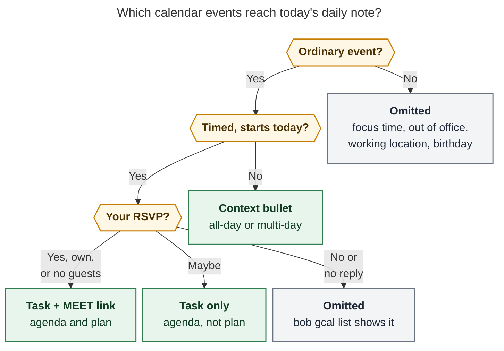
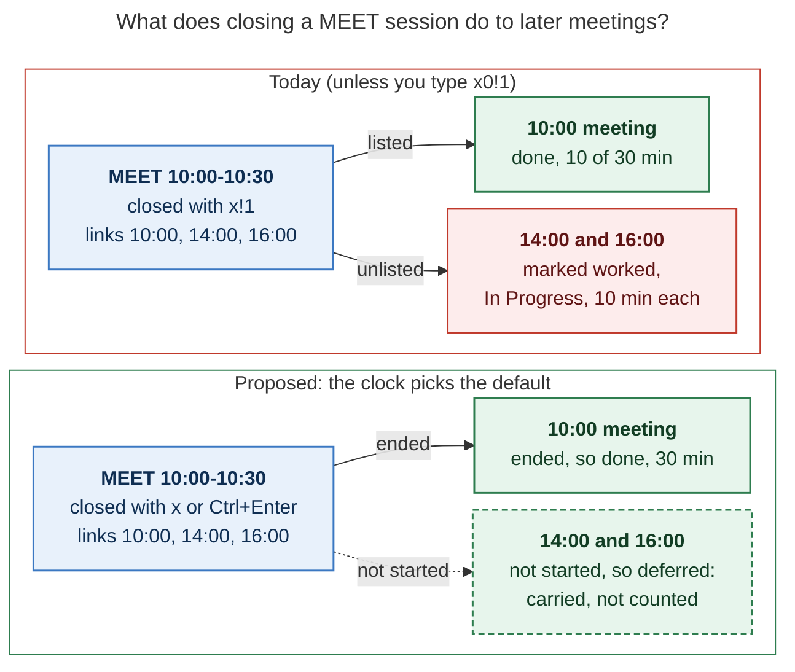

# `bob gcal`: Google Calendar events as daily-note tasks

> **Research query:** Add a `bob gcal` command (choose its subcommands carefully) that
> syncs the Google Calendar events Bryan has RSVPed to into a new `## Events` H2 section
> above `## Pomodoros` in the daily note, as tasks. Auto-create a MEET Pomodoro whose
> Task Links point at those events. Make Google login easy and intuitive. Use the new
> `[root:: <root>]` field, default `meet` (modernize `~/bob/meet.md` into a proper area
> note), and let an event name a different root. Lead the design: intuitive, reliable,
> beautiful. Critique the plan, adjust requirements where justified, and end with a
> recommended solution.
>
> Researcher: cld (one of five in the swarm). Date: 2026-10-29. Checked against bob-cli
> `d0603a5d` (the `bob themes` → `bob types` rename), the live `~/bob` vault,
> `~/.config/bob/config.yml`, current Google OAuth and Calendar API docs, and a
> read-only, aggregate look at the shape of Bryan's calendar.

## Bottom line

1. **Build it. The plan fits the vault's grain.** Daily-note residence plus `[root::]` is
   exactly how `^gtd` already works (`[root:: gtd_daily]` in `_templates/daily.md`).
   Daily-note tasks are already excluded from the review walk, freshness, the per-note
   Ready cap, and `## Tasks` grouping, so calendar imports cannot pollute the backlog
   ([evidence](#what-exists-today)). MEET sessions are already built by hand today
   (`2026/20261028.md` has one).
2. **One MEET placeholder holding every meeting misattributes time unless the close rule
   changes (the biggest finding).** A closed Pomodoro splits its minutes evenly across
   all its Task Links (homes R5). Today, closing a MEET session with `x!1` or
   Ctrl+Enter marks the not-yet-held meetings as worked and In Progress, and gives them
   a share of the minutes. `x!` completes them outright. The correct incantation,
   `x0!1`, exists but nobody will type it. **Adjustment:** Event Tasks get a time-aware
   close default: *not started → deferred, ended → done, in progress → In Progress*
   ([A3](#a3-the-clock-picks-the-close-default-for-event-task-links), [figure](#figure-close)).
3. **Append the MEET placeholder; never let it jump the queue.** Reusing capture's
   named-entry creation as is would insert MEET *before* the morning PLAN entry, so a bare
   `=` would start MEET instead of the review
   ([A2](#a2-one-meet-placeholder-appended-links-added-once)).
4. **"Events I RSVPed to" needs a precise rule.** Yes, organizer, or no-guest events
   become tasks linked under MEET. Maybe events become tasks with no link. No reply and
   No are omitted. All-day and multi-day events become plain context bullets. Focus,
   out-of-office, working-location, and birthday events are skipped. Default to the
   primary calendar only ([A1](#a1-a-precise-inclusion-rule), [figure](#figure-inclusion)).
5. **Pick each event's root with a four-step precedence, not a single tag.** You can't
   edit the title or description of events you're *invited* to, and those are the ones
   that need a non-default root (an interview → `job`). First match wins:
   1. your vault edit;
   2. an `@route` token in an event you own;
   3. the event's color, mapped in config;
   4. the event's calendar.
   Otherwise the default is `meet`
   ([A4](#a4-root-precedence-vault-edit--route-token--event-color--calendar--meet)).
6. **Login: a Desktop OAuth client with a loopback redirect, run once on the MacBook.**
   - Google does not allow the device ("enter this code") flow for any Calendar scope,
     so that option is out.
   - Tokens from apps left in "Testing" expire after 7 days. Publish the app to
     production; it can stay unverified.
   - Over SSH, paste the redirect URL instead.
   - Request read-only scopes only, and store the token in the Keychain, not `pass`.
     Unattended `pass` reads have already hung `apollo`
     ([auth](#auth-making-login-easy)).
7. **Six subcommands, no more:** `calendars`, `doctor`, `list` (the bare default), `login`,
   `logout`, `sync` ([command design](#command-design)).
8. **Reliability rule: bob proposes once, then you own it.** Sync is idempotent:
   - A no-op run writes no bytes.
   - It never re-adds a task or link you deleted, and never overwrites a span you edited.
   - It cancels an untouched task when the event is declined or deleted, leaving a
     `❌ CANCEL LOG` entry.
   - It records what it wrote in a per-host union-merged journal,
     `.bob/gcal/<host>.jsonl`, the same pattern as the type and relation journals
     ([sync algorithm](#sync-algorithm)).
9. **Fix `meet.md` before relying on `meet` as a root.** Today it is a legacy zorg note
   whose parent is `[[work]]`, which is not an area. Two `_generated/tag_pages/*/meet.md`
   files share its basename. It must become a top-level area with `color: blue` and
   `theme: MEET`, and `doctor` must prove that `meet` resolves to it
   ([A9](#a9-modernize-meetmd-as-a-top-level-area)).

The rest of this report backs these claims and ends with the
[recommended solution](#recommended-solution).

## What exists today

### The vault and its rules

- **Daily note layout** (`_templates/daily.md`, `2026/20261029.md`): front matter, title,
  prev/next links, the `^gtd` task carrying `[root:: gtd_daily]`, an empty `bob-plan`
  block, then `## Pomodoros` with a `- [ ] () — PLAN` placeholder linking `[[#^gtd]]`.
  Bob never creates daily notes. Templater does, when Obsidian opens the day. Capture
  and `task-status-hooks` refuse to run without one (`docs/capture.md` guards).
- **The ledger** is `## Pomodoros…` up to the next `## ` heading
  (`docs/reference/vault-format.md`). So an `## Events` H2 above it changes nothing for
  any ledger parser.
- **The request is already a task.** `bob.md` holds
  `^sync-gcal-meets` ("Sync meeting events directly from Google Calendar!"). Its note
  reads "Use `[root::meet]` for 'meeting tasks'!". It superseded the Keep note
  `gkeep_inbox#^meeting-tasks`.
- **MEET sessions already happen by hand.** `2026/20261028.md` has a closed
  `(**1125-1225**) — MEET` linking two `job` tasks. `config.yml` sets `themes: MEET: blue`.
- **Vocabulary moved today.** Commit `d0603a5d` renamed `bob themes` to `bob types`:
  MEET is now a **task type**. The task field is still `[theme:: X]` and the config key
  is still `themes:`, until a later storage phase adds `[type::]`
  (`docs/task-types.md` PT1). This report says "MEET type".

### Root parents, types, and time attribution

- **`[root:: X]` is reporting-only "as-if residence"** (`docs/pomodoro-homes.md` R11).
  Time and task metrics attribute as if the checkbox lived in X. It never changes
  blocking, caps, review, routing, move, or archive. Missing, ambiguous, or invalid
  values silently fall back to the task's own note: `@unfiled` for a daily-note task.
- **Root resolution** uses an exact vault path first, then a unique case-insensitive
  basename (`DiskHomeSource` in `src/native/pomodoro_homes/resolve.rs`).
- **The type suggestion walk starts at the root** (`docs/task-types.md` PT13). A
  `[root:: meet]` task inherits `meet.md`'s `theme:` default. A `[root:: job]` task
  inherits `job.md`'s `theme: WRITE`, which is not MEET.
- **Links that count** (homes R3): direct child bullets that are exactly one block link
  (plain, embedded, or struck). Deferred `[[…]]#` bodies do **not** count.
  **R5:** a closed session's minutes are divided evenly among its distinct linked tasks.
- **Close outcomes** (`src/native/capture_pomodoro_close/selection.rs`). An unlisted
  link falls back to `marker.ledger_outcome()`, and for a plain link that is
  **In Progress**. When any `<N>` list is typed (`x0`, `x1`), unlisted links become
  **Deferred** instead: removed from the session, carried, not started. `!` with no
  number completes every remaining link. Obsidian Ctrl+Enter mirrors the bare-`x` close
  in JavaScript (`task-status-cycler`), so the rule lives in two places.
- **Named-entry creation** (capture `=name`, `bob ref today -p`) inserts the placeholder
  "after the last completed entry's block, otherwise before the first entry". A bare `=`
  starts "the first entry in document order that is open, a placeholder, and untimed".
- **Plan budget** (`docs/plan.md`): MEET counts as one type toward `max_themes: 3`. Each
  event link counts toward `max_links` (13 in Bryan's config). The
  `duplicate_open_pomodoro_name` lint fires when two open entries share a component.
  Prior research (`research:202610/plan_theme_exemption.md`) found that `plan.exempt`
  "does about ten jobs", so adding MEET to it is a blunt tool.
- **Daily-note tasks are already out of every backlog surface:**
  - freshness `in_scope` and `walk_scope` exclude canonical daily notes;
  - plan R7 per-note lists exclude them;
  - `## Tasks` grouping excludes them;
  - task-status-hooks' R9 carve-out clears a daily-note `[*]` once it is unlinked and
    stale.

### Integration precedent: `bob gkeep`

`src/native/gkeep/` is about 16,500 lines of Rust. Its approach has proven out, and gcal
should copy it:

- **Adapter.** A pinned Python adapter (`scripts/gkeep_adapter.py`) runs through
  `uv run --script` and speaks JSON over stdin/stdout. It runs in its own process group
  with a parent watchdog and a timeout. `BOB_GKEEP_ADAPTER` swaps in a fake, so tests
  never touch Google.
- **Credentials.** Configured through `token_command` / `token_store_command`. Tokens
  never appear in argv, logs, or JSON.
- **Commands.** `login` and `doctor` exist, and the bare `bob gkeep` runs `list`.
- **Identity.** A visible link (`[💡](url "Open in Google Keep")`) plus vault-synced
  receipts, with no hidden markers in the Markdown.
- **No network stack.** `Cargo.lock` has no HTTP or TLS crate at all (no `ureq`,
  `reqwest`, `rustls`, or `hyper`).
- **Sync cadence.** The Mac's vault-sync LaunchAgent runs every 15 seconds
  (`docs/vault-git-sync.md`), so cross-host propagation is fast.

### `meet.md` today

- A 70-line legacy zorg conversion: `parent: [[work]]`, where `work.md` is itself a zorg
  note, not an area. There is no `type`, `color`, or `theme`.
- It holds 22 `^z-…` block IDs and dated H2 meeting notes. About 440 vault lines link to
  `[[meet]]`.
- `find` shows two more files named `meet.md`: `_generated/tag_pages/topic/meet.md` and
  `_generated/tag_pages/context/meet.md`. Exact-path-first resolution should still pick
  the root file, but a wrong guess would silently send every event to `@unfiled`. That
  is why `doctor` must check it.

### The shape of the calendar (read-only, aggregate)

I listed calendars and read three weeks of the primary calendar (Oct 15 – Nov 4) through
the connected Google Calendar tool. I did not read the secondary calendars. No event
details appear in this report.

| Observation | Design consequence |
| --- | --- |
| 8 calendars: primary, 5 owned secondary calendars (work schedule, health, recurring items, surf days, time blocks), Birthdays, US Holidays | Syncing "all calendars" would flood the note; default to primary and map others explicitly |
| 8 primary events in 3 weeks (≈0.4/day) | The MEET placeholder usually holds 0–2 links; budget pressure is small |
| 3 of 8 are instances of one recurring invitation answered **Maybe** | "Tentative" is common and needs a deliberate rule |
| 2 events Bryan organizes with one guest who hasn't replied; 1 solo event without guests | Own and no-guest events have no meaningful RSVP and must count as "going" |
| 1 accepted invitation from an outside organizer, whose description is video-call boilerplate full of `@` characters, in a non-local event time zone | `@route` parsing must be strict; render in the configured `timezone` |
| 1 accepted timed event spanning about four days | Multi-day timed events are context, not meetings |

## Is this a good idea?

**Yes.** Meetings are the largest block of time that is fixed in advance and still logged
by hand. The vault already has every primitive needed:

- Templater-made daily notes;
- `[root::]`;
- daily-note exclusions from review;
- the capture link planner;
- the cancel machinery;
- per-host journals;
- the gkeep adapter pattern.

Most of the feature is composition, not new concepts. Doing it well means fixing
the eight problems below. The [requirement adjustments](#requirement-adjustments)
answer each one.

1. **The ledger was not built for queued fixed-time work.** Pomodoro links mean "work
   I did or will do in this session". A MEET placeholder holding a whole day's
   meetings breaks that at close time: R5 splits the minutes, and unlisted links
   become In Progress ([A3](#a3-the-clock-picks-the-close-default-for-event-task-links)).
2. **Placement hijacks the morning.** Created by the existing planner, MEET would come
   before PLAN, so a bare `=` would start a meeting instead of the review
   ([A2](#a2-one-meet-placeholder-appended-links-added-once)).
3. **"RSVPed" is ambiguous.** Own events have no RSVP. Maybe is common. All-day and
   multi-day events aren't meetings ([A1](#a1-a-precise-inclusion-rule)).
4. **An in-event tag can't reach invitations.** You can't edit the title or description
   of events you're invited to. Those are exactly the events that need a non-`meet` root
   ([A4](#a4-root-precedence-vault-edit--route-token--event-color--calendar--meet)).
5. **The `meet` default duplicates the MEET type.** Stats already measures meeting time
   by type. A root answers a different question: *which part of life the time went to*.
   `meet` is a fine catch-all for meetings you haven't classified, but the insight comes
   from the override. So overriding must be cheap and work in bulk (by color, by
   calendar).
6. **A periodic writer in a Git-synced vault on three hosts can do damage.**
   - Rewriting a note every five minutes creates merge churn.
   - Re-adding what you deleted is infuriating.
   - Overwriting your edits is worse.

   Sync needs strict idempotency and a "hands off after first write" rule
   ([A7](#a7-bob-proposes-once-then-you-own-it), [sync algorithm](#sync-algorithm)).
7. **Google's auth has sharp edges.**
   - The device flow is not allowed for Calendar scopes.
   - Tokens from apps left in Testing die every 7 days.
   - The OOB copy-paste flow is gone.
   - Unattended `pass` reads can hang.

   "Easy login" means designing around all four ([auth](#auth-making-login-easy)).
8. **`meet.md` is not ready**, and its basename is not unique
   ([A9](#a9-modernize-meetmd-as-a-top-level-area)).

Nothing here argues for a different overall approach. I would keep the user-facing shape
(an Events section, a MEET placeholder, `[root::]`). I would change the rules underneath.

## Requirement adjustments

Each adjustment states what was asked, what I propose, and why.

### A1. A precise inclusion rule

*Asked:* all events Bryan RSVPed to that day. *Proposed:* the rule in the figure, with
config overrides.

<a id="figure-inclusion"></a>



*Only a "yes" lands in the plan. A "maybe" stays on the agenda, unanswered invitations
stay in `bob gcal list`, and all-day events give context without a checkbox.*

The rule in words:

- **Ordinary** means `eventType` is `default` or `fromGmail` (reservations and
  flights from Gmail are worth seeing).
- **Your RSVP** is the `attendees[].self` entry's `responseStatus`:
  - `accepted` counts as yes.
  - An event with no attendees, or with `organizer.self`, also counts as yes.
  - `tentative` counts as maybe.
  - `needsAction` and `declined` are omitted.
- **Timed, starts today:** `start.dateTime` falls in the local day, and the event lasts
  under 24 hours. Everything else (all-day `start.date` events, and timed events longer
  than a day) becomes a context bullet.
- **Calendars:** `primary` only by default. Add others in `gcal.calendars`.
- **Already ended at first sight** (the daily note was created late): the task is
  written, but no MEET link is added. Planning work in the past is false.
- **Config knobs:** `gcal.tentative: list | link | hide` (default `list`) and
  `gcal.all_day: context | hide` (default `context`).

Why "maybe = listed but not planned": the Today and Next lanes mean commitment. A maybe is
not one, yet it belongs on the day's agenda.

### A2. One MEET placeholder, appended; links added once

*Asked:* auto-create a MEET Pomodoro with links to all events. *Proposed:*

- If today's ledger has an open MEET entry (key match through `normalize_component`),
  add links there, in event order.
- Otherwise append `- [ ] () — MEET` **after the last open entry**. Never put it before
  PLAN or any other planned entry, so a bare `=` keeps starting what it starts today.
  Start meetings with `=meet` (or `se` + Tab on the MEET line).
- Each event's link is written **once**:
  - It is never re-added after you remove or move it.
  - It is removed only when the event is cancelled (A7).
- The link write goes through the capture link planner, as `bob ref today` does. The
  task becomes Next `[*]` and appears in TODAY. Dedupe and staged atomic writes come
  free.
- A late-accepted meeting may arrive while a MEET session is running. It is appended to
  that entry, and A3 defers it at close, so no duplicate open MEET entry (and no
  `duplicate_open_pomodoro_name` lint) is ever created.

### A3. The clock picks the close default for Event Task links

*Asked:* nothing. This is the hidden requirement that makes A2 correct. *Proposed:*

- **Define an Event Task** as a `#task` line in a canonical daily note's `## Events`
  section whose description starts with a bold `**HHMM-HHMM**` span. The span is in the
  note's local time; an end before the start crosses midnight.
- **Give an unlisted Event Task link a time-based default** when its session closes. The
  same applies to the blanket `!` and `*` selections:

| Event at close time | Default outcome | Why |
| --- | --- | --- |
| Not started (start ≥ close) | **Deferred**: removed from the session, carried, not started, not counted | You can't have worked on a meeting that hasn't begun |
| Ended (end ≤ close) | **Complete** | You ran a MEET session through it; you attended |
| In progress | **In Progress** (today's default) | You closed mid-meeting; it carries so you can restart |

Explicit selections (`x1`, `!2`, `~3`, `*4`) still win, and non-event links are
unchanged.

The table is a choice. If "ended → done" feels presumptuous, the conservative variant
keeps In Progress and changes only the not-started row. That row alone fixes
attribution.

<a id="figure-close"></a>



*Today, later meetings take a share of the session's minutes and become In Progress.
Under the proposed rule, each meeting's own time decides, and the plain gesture is
correct.*

The resulting flow is the beautiful part: **`=meet` when the meeting starts,
Ctrl+Enter (or `x`) when it ends.** Nothing to number. Hand-written Event Tasks
("dentist 15:00" typed into `## Events`) get the same behavior without Google, so the
contract stands alone.

**Cost:** two implementations. Rust capture close (`selection.rs` default resolution)
and the Obsidian `task-status-cycler` close must change together, under shared
conformance vectors (the `today_tasks` / `isToday` precedent). R3 needs no change,
because deferred links are already uncounted.

### A4. Root precedence: vault edit → `@route` token → event color → calendar → `meet`

*Asked:* default `meet`, plus a way to name the root in the Google Calendar event.
*Proposed:* first match wins.

1. **Your vault edit.** You change `[root:: …]` on the synced task. It stays yours for
   that occurrence: the journal knows what bob wrote, so a difference means you edited
   it.
2. **An `@route` token in an event you own:**
   - either the *last* word of the title (`Coffee chat @job`), or
   - a description line that is *only* `@job`.

   It is the same `@route` word capture teaches. It resolves through the R11 resolver,
   must reach an area or project, and is stripped from the rendered title. Strictness
   matters: invitation boilerplate is full of `@`. A plain "any `@word`" scan would match
   mail addresses and call IDs.
3. **The event's color** maps to a root in config: `gcal.colors: {tomato: job, sage: body}`.
   It is the **only** in-calendar signal for invitations you can't edit. Google Calendar
   lets you recolor any event on your calendar, including from the phone app, and the
   color applies to the whole series. Color is also beautiful: your calendar colors and
   Bob's root hues start telling the same story. *Verify in the spike:* third-party docs
   say a guest's color change is private to their copy, but Google's API reference is
   silent on it.
4. **The event's calendar** (`gcal.calendars[].root`), for owned calendars such as
   Health → `body`.
5. **Default:** `gcal.root`, defaulting to `meet`.

Rejected:

- **Title or description tags as the only mechanism.** They fail on invitations, and on
  events you organize the tag is visible to your guests.
- **Writing a private extended property per event.** Invisible and ideal in theory, but
  it needs the read-write `calendar.events` scope and a bob command to set it. Read-only
  is worth more (A5).
- **Regex rules on titles or organizers.** Surprising, and hard to discover.

**Type follows the root's default walk, PT13 style.** With root `meet` (`theme: MEET`),
the task carries no type field. With any root whose default is not MEET (`job` defaults
to WRITE), sync writes `[theme:: MEET]`. That is the PT13 write rule: set it only when
it differs from the inherited type. The type is then right in every picker and menu.

### A5. Read-only, always

The scopes are `calendar.events.readonly` ("View events on all your calendars") and
`calendar.calendarlist.readonly` (to name calendars and read colors). bob never writes
to Google: no RSVP from Obsidian, and no IDs stored in events. Every request uses
`maxAttendees=1`, so Google returns only *your* attendee entry and other people's
addresses are never downloaded. The vault receives only time, title, links, and the
chosen root. Descriptions are read for the `@route` line and then discarded.

### A6. `## Events` is a vault concept; Google is one writer

- **Placement.** The section sits between the `bob-plan` block and `## Pomodoros`, so
  the note reads budget → fixed commitments → sessions.
- **Created on demand.** It appears only when there is something to show, so event-free
  days stay clean and the Templater template does not change.
- **You can add to it.** Lines you add are kept and sorted with bob's lines by time.
  Your own Event Tasks follow A3.

### A7. Bob proposes once, then you own it

| Part of an event task | Owner | Sync behavior |
| --- | --- | --- |
| Checkbox status | You | Never changed, except cancel (below) |
| `**HHMM-HHMM**` span, title, `📅` `📹` `📍` links | Calendar | Updated when the event changes, **only if the span is still byte-identical to what bob last wrote**; otherwise kept and reported once as `kept_edit` |
| `[root:: …]` | Calendar until you edit it | A4 precedence; same three-way rule |
| `[theme:: MEET]` | Bob, once | Written at creation when needed |
| Block ID | Bob, once | Minted from the title; never changes, even if the title does |
| Child bullets (your meeting notes) | You | Never touched |
| MEET Task Link | Bob, once | Never re-added, moved, or removed except on cancel |
| The whole line | You | Deleted or moved by you → tombstoned; never re-added for that day |

**Cancel rule:** an event that is declined, deleted, or moved to another day cancels its
task, but only while the task is unworked. Unworked means: not done, not In Progress,
and not linked under any *closed* Pomodoro.

- The cancel reuses `plan_task_cancel`, so it writes the vault's own
  `❌ **CANCEL LOG**` entry, for example "Declined in Google Calendar" or "Moved to Fri
  2026-10-31 in Google Calendar".
- The open MEET link goes in the same write. Reconcile would remove it anyway.
- A worked or finished task is left alone and reported.

A cancelled meeting stays visible as history: marked `[-]`, with the reason.

Calendar-side transitions are honored after the first write. A Maybe that becomes a Yes
gains its MEET link. Vault-side changes are never undone.

### A8. One runner: the MacBook

The scheduled runner is a LaunchAgent on the Mac (`com.bbugyi.bob-gcal-sync`,
`StartInterval 300` plus `RunAtLoad`), managed by chezmoi like the vault-sync agent.
Why the Mac:

- Templater creates the daily note there.
- Obsidian edits it there, so local writes avoid cross-host merges.
- A browser is local, so login is one click.
- The Keychain holds the token unattended.
- Keeping a Google token off athena is prudent, given this repo's October reports on an athena
  Plex compromise.

**Single runner by construction:**

- Only a host that ran `bob gcal login` has a token.
- `doctor` elsewhere reports which host last synced, using the journal's `host` field.
- Manual `bob gcal sync` works on any host that is logged in. A duplicate run is a no-op
  thanks to idempotency.
- The `bob_sync.lock` / compare-and-swap writes cover the rest.

### A9. Modernize `meet.md` as a top-level area

The proposed front matter:

```yaml
---
parent: "[[area]]"
type: "[[area]]"
color: blue
theme: MEET
aliases:
  - Meetings
tags:
  - meet
id: meet
done_tasks: "[[done/meet_done]]"
generated_from_zorg: true
# …keep the existing zorg_* provenance keys, as job.md and love.md do
---
Meetings, appointments, and calls. Calendar events land in each day's
`## Events` section with `[root:: meet]` unless the event names another root
(see `bob gcal`).

Related: [[the_monthly]] · [[all_hands]] · [[recur_meet]] · [[job]]

## Tasks

<!-- legacy meeting notes below, unchanged -->
## 2024-01-24.Wed
…
```

- **Top level, not under `job`.** Meetings span every part of life. A top-level area
  also makes `@meet` a capture route.
- **`color: blue`** matches `themes: MEET: blue`, so the root bar in Stats and the MEET
  pill share a hue.
- **`theme: MEET`** makes every `[root:: meet]` task suggest MEET with no field written.
- **Keep every legacy byte below `## Tasks`.** The dated H2 sections and all 22 `^z-…`
  IDs stay as they are. `## Tasks` ends at the next H2, so the old headings need no
  demotion, and no link breaks.
- **`doctor` must check resolution:** `meet` → `meet.md`, not either
  `_generated/tag_pages/*/meet.md`.

### A10. Leave the plan budget alone in v1

- **MEET counts as one type, as it should**: meetings consume attention.
- **Event links count toward `max_links` (13)**, which is harmless at about 0.4 events a
  day. If meeting-heavy days start tripping `plan_link_cap_exceeded`, the right fix is a
  narrow rule ("Event Task links don't count toward `max_links`"). Do not add MEET to
  `plan.exempt`: it mutes and exempts in about ten places.

## Auth: making login easy

### What Google allows (verified 2026-10-29)

| Option | Verdict | Evidence |
| --- | --- | --- |
| **Desktop OAuth client + loopback redirect + PKCE** | **Use it.** One click when a browser is local | Loopback (`http://127.0.0.1:port`) is supported for Desktop clients (deprecated only for mobile); "Always use PKCE"; "Desktop apps are public clients" so the client JSON is not a real secret |
| Device ("enter a code") flow | **Not possible** | Allowed scopes are only `email`/`openid`/`profile`, `drive.appdata`, `drive.file`, `youtube`, `youtube.readonly`; no Calendar scope |
| OOB copy-paste code | **Gone** | All clients blocked since 2023-01-31 (still allowed for Testing apps, whose tokens expire weekly anyway) |
| Secret iCal URL | Fallback only | No OAuth, but: a bearer URL that grants permanent full read, whole-calendar downloads, your own RRULE/EXDATE/RECURRENCE-ID expansion, and no event colors (so no A4 step 3) |
| Reuse `gog` (already installed, Gmail-only grant on this host) | Spike only | Fast to try, but couples bob to another tool's JSON and auth store |
| Service account | Not applicable | Workspace-only domain-wide delegation; this is a consumer account |

**The 7-day trap.** An External app left in "Testing" gets refresh tokens that "expire in
7 days" unless it requests only name/email/profile. Calendar scopes don't qualify. The
fix is to *publish* the app to production. An unverified app with sensitive scopes still
works for its owner, behind Google's "unverified app" warning; the 100-user cap is
irrelevant here. Other limits: tokens die after 6 months unused, and there are 100
refresh tokens per account per client.

### `bob gcal login`, designed

```text
$ bob gcal login
Google Calendar · one-time setup · read-only

1/3  OAuth client   ✓ ~/.config/bob/gcal/client.json · Desktop app "bob"
2/3  Sign in        Opening your browser… (or open https://accounts.google.com/o/oauth2/v2/auth?…)
                    ✓ bryanbugyi34@gmail.com granted: view events, view calendar list
3/3  Check          ✓ 8 calendars (syncing 1: primary)
                    ✓ Fri 2026-10-30: 2 events you're going to, 1 maybe

Token stored in the macOS Keychain (bob-gcal). Revoke any time: bob gcal logout
Next: bob gcal sync -d    preview today's Events section
```

- **No client yet.** Step 1 prints a short checklist instead of an error:
  1. Create a project.
  2. Enable the Google Calendar API.
  3. Configure the consent screen as External and **publish it**.
  4. Create an OAuth client of type **Desktop app**.
  5. Run `bob gcal login -c ~/Downloads/client_secret_….json`.

  Bryan already did this once for gog. If that project's client is a standard Desktop
  client JSON, step 1 reduces to "enable the Calendar API there and import the file".
- **Over SSH** (`SSH_CONNECTION` set, no display), or with `-m/--manual`: print the URL
  and say *"After you approve, your browser will show 'This site can't be reached'. Copy
  the whole address and paste it here."* That is the loopback flow without a local
  listener, the same approach as `gog auth add --manual`.
- **Token storage.**
  - macOS: Keychain by default.
  - Elsewhere: a 0600 file under `$XDG_CONFIG_HOME/bob/gcal/`.
  - `token_command` / `token_store_command` remain as overrides, matching gkeep.
  - Unattended runs must never depend on `pass`. `research:202610/apollo-pass-pinentry-hang.md`
    found an orphaned pinentry that blocked every later secret read; its advice was "a
    narrowly scoped service credential instead of depending on the interactive GPG
    cache". A read-only Calendar refresh token is exactly that.
- **`doctor`** recognizes `invalid_grant` about 7 days after login and says *"your OAuth
  app is still in Testing: publish it, then run `bob gcal login` again."*

## Command design

`bob gcal` lives in the **Integrations** help section next to `bob gkeep`. Every long
option has a short alias, options are alphabetical, and colors follow `NO_COLOR`
(cli_rules).

| Command | Purpose | Writes? |
| --- | --- | --- |
| `bob gcal [list]` `[-a/--all] [-b/--bob-dir] [-D/--day DAY] [-f/--format table\|json]` | Today's events beside the vault: time, RSVP, root and its source, and what sync would do. `-a` adds skipped calendars and event types with reasons. Bare `bob gcal` = `list` (a flag-only, read-only default, allowed by the CLI rules) | No |
| `bob gcal sync` `[-b] [-D/--day DAY] [-d/--dry-run] [-f human\|json] [-q/--quiet]` | Reconcile one day's note (default today); `-d` prints the exact note diff | Daily note + journal |
| `bob gcal login` `[-c/--client FILE] [-m/--manual]` | One-time OAuth, then a live check | Token store |
| `bob gcal logout` | Revoke the grant at Google and delete the local token | Token store |
| `bob gcal doctor` `[-b] [-f human\|json]` | Checklist: config, client, token refresh, scopes, calendars, root resolution (`meet` → `meet.md`), daily note and `## Pomodoros`, journal allowlist, `uv`, runner host and last sync | No |
| `bob gcal calendars` `[-f table\|json]` | Calendars with ID, access role, color, and included/root status, so config is copy-paste | No |

**Rejected subcommands:**

- `pull` (gkeep's verb means *drain*; this is an idempotent reconcile).
- `push`, `rsvp`, `tag` (read-only by design).
- `watch` / daemon (Google push needs a public HTTPS endpoint; a 5-minute poll is
  enough).
- `today` (that is `list`), `setup` (folded into `login`), `reset` (rare; see the open
  questions).
- Anything under `bob task` (reserved for vault-wide task rewrites; sync touches one
  note).

**Exit codes** follow gkeep:

- **0** — success. This includes "nothing to do" and "waiting for today's daily note".
- **1** — runtime failure: authorization rejected, network, adapter, or a
  compare-and-swap conflict.
- **2** — usage or setup: no config, client, or token, or an invalid configured root.

JSON carries `schema_version: 1` and never includes tokens, descriptions, or attendees.

`bob gcal list`:

```text
bob gcal · Fri 2026-10-30 · primary · synced 3 min ago (macbook)
TIME         EVENT                      RSVP        ROOT                 VAULT
all day      Family trip · day 4 of 4   ✓ going     —                    context
08:00–08:30  Product interview          ✓ going     ■ job   color        task · MEET
09:15–10:00  Weekly class               ? maybe     ■ meet  default      task
12:00–12:30  Design review              · no reply                       not synced · reply in Calendar
16:00–16:45  Dentist                    ✓ own       ■ body  calendar     task · MEET
3 tasks (2 planned under MEET) · 1 context · 1 awaiting reply   → bob gcal sync
```

`bob gcal sync`, first run, then a later run:

```text
bob gcal sync · 2026/20261030.md
  + event  08:00–08:30  Product interview      ■ job   via color tomato
  + event  09:15–10:00  Weekly class · maybe   ■ meet  not planned
  + event  16:00–16:45  Dentist                ■ body  via calendar Health
  + MEET   created () — MEET · linked 2
✓ Events +3 · Pomodoros +1 entry, +2 links

bob gcal sync · 2026/20261030.md
  ~ event  Dentist moved 16:00 → 15:30
  − event  Weekly class declined → canceled (❌ CANCEL LOG)
  = kept   Product interview title (you edited it)
✓ Events 2 changed
```

## The daily note

What a synced day looks like. The root, type, block ID, and link targets are real syntax;
the events are fictional.

````markdown
- [ ] #task [[gtd_daily]] [root:: gtd_daily] [created::2026-10-30] ^gtd

```bob-plan

```

## Events

- 🗓️ **all day** Family trip · day 4 of 4 [📅](https://www.google.com/calendar/event?eid=… "Open in Google Calendar")
- [ ] #task **0800-0830** Product interview [📅](https://www.google.com/calendar/event?eid=… "Open in Google Calendar") [📹](https://meet.google.com/… "Join the call") [root:: job] [theme:: MEET] ^product-interview
- [ ] #task **0915-1000** Weekly class · *maybe* [📅](https://www.google.com/calendar/event?eid=… "Open in Google Calendar") [root:: meet] ^weekly-class
- [ ] #task **1600-1645** Dentist [📅](https://www.google.com/calendar/event?eid=… "Open in Google Calendar") [📍](https://www.google.com/maps/search/?api=1&query=… "Main St Dental") [root:: body] [theme:: MEET] ^dentist

## Pomodoros

- [ ] () — PLAN
	- [[#^gtd]]
- [ ] () — MEET
	- [[#^product-interview]]
	- [[#^dentist]]
````

The line grammar matches the house style:

- **`**HHMM-HHMM**`** is the ledger's own timespan typography, so Events and Pomodoros
  read as siblings.
- **`📅`** is the identity link (gkeep's `💡` pattern). Its `eid` encodes the event
  instance and calendar, and sync matches the exact emitted URL against the journal.
  `📹` appears when the event has a conference link, and `📍` when it has a location.
- **No `[created::]`.** The note's date already says when, and Stats' created counts
  stay a measure of captured work, not calendar imports.
- **Block IDs** come from `mint_block_id` on the title, unique within the note
  (`^gtd` is taken). Titles are data, never markup: reuse gkeep's escaper (`#task`,
  trailing `^id`, `%%`, `::` runs, leading list and heading markers). Times render in
  the configured `timezone` (America/New_York), whatever time zone the event declares.

## Sync algorithm

One run, for one day (default today):

1. **Preconditions.** Is today's note present, with `## Pomodoros`? If not, exit 0 with
   `waiting for 2026/20261030.md`. Bob does not create daily notes; Templater stays the
   only creator, and the next tick catches up.
2. **Fetch** through the adapter. For each configured calendar, call `events.list` with:
   - `singleEvents=true`, `orderBy=startTime`, and `maxAttendees=1`;
   - `timeMin` and `timeMax` at local midnights (timeMin bounds the *end* and timeMax the
     *start*, both exclusive);
   - a `fields` mask.

   Dedupe across calendars by `iCalUID` plus original start time. No sync tokens: they
   are incompatible with time bounds, and a one-day window is a few kilobytes.
3. **Classify** each event with A1 and pick its root with A4. A root that does not
   resolve or has no home falls back to the default and raises a warning. It is never
   written as an invalid field.
4. **Fold the journal** `.bob/gcal/*.jsonl` for the day into a per-event state.
   - Each state holds: the block ID, a hash of each managed span as last written,
     whether a link was added, tombstones, and the writing host.
   - Records are append-only, one `O_APPEND` per event, and merged with `merge=union`
     (the type and relation journal pattern).
   - They store no descriptions, attendees, or titles, only span hashes.
5. **Plan against an in-memory snapshot** of the note:
   - insert new event tasks in time order;
   - update managed spans the three-way rule allows;
   - cancel per A7;
   - tombstone lines that vanished;
   - **adopt** a task whose `📅` link matches but which has no journal record (crash
     recovery);
   - add MEET links through the capture link planner (A2).
6. **No-op check.** If the plan is byte-identical, write nothing and append nothing, so
   most ticks change no file.
7. **Write** once with capture's preimage-checked atomic replace. If the file changed
   during planning, retry once, then exit 1; the next tick retries. Append the journal
   only after the note write succeeds.

| Failure | Behavior |
| --- | --- |
| Google unreachable or 5xx | No writes; exit 1; `-q` stays silent; `doctor` shows the last error |
| `invalid_grant` | No writes; exit 2 with the Testing-mode hint; one macOS notification per day (polish) |
| Note edited during planning | Compare-and-swap retry once, then exit 1 |
| Crash after write, before journal | Next run adopts by `📅` link; no duplicate |
| Two hosts sync at once | Same plan, same bytes; Git merges identical edits; the union journal merges |
| You deleted an event task | Tombstoned; never re-added that day |

## Implementation architecture

### Code changes

**bob-cli:**

- `src/native/gcal/` mirrors gkeep's module layout:
  - `cli`, `config`, `adapter` (factor gkeep's process-group, watchdog, and timeout
    runner into a shared helper rather than copying it);
  - `model` (normalized events), `classify` (A1), `root` (A4), `render` (line grammar
    and escaping);
  - `journal` (on the existing `pref_journal` module), `plan`, `sync`, `list`,
    `doctor`, `ui`.
- `scripts/gcal_adapter.py` holds pinned `google-auth`, `google-auth-oauthlib`, and
  `requests`, run with `uv run --script`.
  - Its ops are `authorize`, `whoami`, `calendars`, `events`, `event`, and `revoke`.
  - It returns normalized JSON, so Rust owns all the meaning.
  - `BOB_GCAL_ADAPTER` is the test hook, so tests never touch Google.
- Register the command in `src/runner.rs` (Integrations); add the adapter to Cargo
  `include`.
- Change the capture close (`capture_pomodoro_close/selection.rs`) for A3.

**Why an adapter, not native Rust:**

- Bob has no HTTP or TLS stack today.
- The gkeep runner is already hardened.
- Google's Python auth library handles loopback and PKCE correctly.
- The Rust/adapter boundary leaves room to go native later without changing any
  contract.

The one launchd hazard is finding `uv`. Resolve it by absolute path (`~/.local/bin/uv`,
`/opt/homebrew/bin/uv`, or `gcal.uv`), and have `doctor` check it.

### Cross-repository work

- **bob-plugins:** mirror the A3 close rule in `task-status-cycler`'s Ctrl+Enter close,
  under shared vectors. Optional: style `## Events` time spans as pills.
- **Bob Mac Capture:** nothing required (thin-client decision). Linked event tasks
  already appear in the idle agenda. Later, if wanted, `capture-pomodoros --tasks` can
  add an `event: {start, end}` object and the app can show a time chip.
- **chezmoi:**
  - the LaunchAgent plist;
  - the `gcal:` block in `config.yml`;
  - on Linux hosts only, an optional systemd user timer.
- **Vault:**
  - `meet.md` (A9);
  - `.gitignore` `!/.bob/gcal/*.jsonl`;
  - `.gitattributes` `.bob/gcal/*.jsonl merge=union`.

### Docs and memory

- **New docs:** a `docs/gcal.md` contract, a generated `docs/reference/cli/gcal.md`, and
  a guide `docs/guides/sync-google-calendar.md`.
- **Edits:**
  - `vault-format.md` (Events section);
  - `capture.md` close (A3);
  - `pomodoro-homes.md` (Event Tasks and roots);
  - `task-types.md` (event type field).
- **Decision records** (written through `/sase_memory_write`):
  - "Calendar events are daily-note Event Tasks";
  - "`bob gcal` is read-only and proposes once";
  - "Event links defer until they start".
- **Glossary:** a new "Event Task" strand, and the Area Note strand's list of residence
  exceptions (today `^gtd` and `done/`) gains Event Tasks.

### Configuration

```yaml
gcal:
  account: bryanbugyi34@gmail.com   # checked against the token
  root: meet                        # default [root::]
  type: MEET                        # the Pomodoro name that queues events
  calendars:                        # default: [primary]
    - id: primary
    # - name: Health                # by summary or id
    #   root: body
  colors: {}                        # e.g. {tomato: job, sage: body}
  tentative: list                   # list | link | hide
  all_day: context                  # context | hide
  timeout_secs: 60
  # token_command / token_store_command: overrides; default Keychain or 0600 file
```

## Alternatives considered

| Alternative | Why not |
| --- | --- |
| Events as tasks in `meet.md` (no root field needed) | Residence there puts them in the review walk, freshness, the Ready cap and `## Tasks` grouping; no day agenda |
| One MEET placeholder per meeting | Clean close semantics, but open duplicates are unsupported today (`^same-type-pom-dups` is Blocked on the types epic) and clutter the ledger; revisit then |
| Sync writes the deferred `[[…]]#` marker on future links and strips it at start time | Uses an existing primitive, but it depends on the timer firing at each start, and a stray `#` is ugly |
| Auto-log closed MEET sessions from accepted events | Accurate minutes with zero gestures, but it fabricates attendance and overlaps hand-logged sessions; a possible later opt-in |
| Add MEET to `plan.exempt` | Mutes and exempts in about ten places (prior research); a narrow link rule is better if ever needed |
| Secret iCal URL, `gog`, native Rust HTTP | See [auth](#auth-making-login-easy) and [architecture](#implementation-architecture) |

## Open questions for Bryan

1. **Close default for ended meetings:** Complete (proposed) or In Progress (the
   conservative variant)?
2. **Maybe events:** listed without a link (proposed), linked, or hidden?
3. **Color privacy:** Is recoloring an invitation private to your copy? (Spike: recolor
   an invite and check from the organizer's side.)
4. **Restoring a deleted event:** Undo or `git` is enough for v1. Add
   `sync --restore` only if it comes up.
5. **The Events section on past days:** Never touch closed days (proposed), or allow
   `--day` repairs for yesterday?

## Recommended solution

Ship `bob gcal` in five phases. Each phase is usable on its own.

**Phase 0 — Spike and decisions (½ day).**

- Publish the OAuth app and test the color-privacy question.
- Confirm that `[root:: meet]` resolves to `meet.md` with the `_generated` collisions
  present.
- Record the three decision records.

**Phase 1 — Event Tasks and the clock-based close (bob-cli + bob-plugins).**

- Specify the Event Task grammar and the `## Events` section in `docs/`.
- Implement A3 in capture close and the Obsidian close, with shared conformance
  vectors, so hand-written events work first.
- Modernize `meet.md` (A9) and add the journal allowlist.

**Phase 2 — Auth (bob-cli).**

- Build the adapter.
- Add `bob gcal login`, `logout`, `doctor`, and `calendars`.
- Add the `gcal:` config, Keychain/file token storage, and the Testing-mode diagnosis.

**Phase 3 — The writer (bob-cli).**

- Build `bob gcal list` and `bob gcal sync`:
  - the inclusion rule (A1) and root precedence (A4);
  - rendering and escaping;
  - the journal and three-way updates;
  - cancel through `plan_task_cancel`;
  - MEET links through the capture link planner, appended after open entries (A2);
  - the no-op guarantee and compare-and-swap writes.
- Write the `docs/gcal.md` contract and the guide.

**Phase 4 — Rollout (chezmoi + Mac).**

1. `bob gcal login` on the MacBook.
2. `bob gcal sync -d`, then `bob gcal sync`.
3. Enable the LaunchAgent (every 5 minutes, plus at load).
4. `bob gcal doctor` on the other hosts shows the Mac as the runner.

**Phase 5 — Polish (optional).**

- An auth-expiry notification.
- A time chip in the Mac agenda.
- Obsidian time-span pills.
- Revisit per-meeting Pomodoros once same-type duplicates land.
- Exempt event links from `max_links` only if meeting-heavy days trip the cap.

The daily experience this buys:

1. Open Obsidian. Within five minutes, `## Events` lists the day's real meetings, each
   rooted where its time belongs.
2. A blue MEET placeholder queues the ones you said yes to.
3. Type `=meet` when a meeting starts and press Ctrl+Enter when it ends.
4. The minutes land on the right root, with no numbers to type.

## Sources

Google documentation, fetched 2026-10-29:

- [OAuth 2.0 for TV and limited-input devices: allowed scopes](https://developers.google.com/identity/protocols/oauth2/limited-input-device)
- [OAuth 2.0 for iOS & desktop apps: loopback, PKCE, public clients](https://developers.google.com/identity/protocols/oauth2/native-app)
- [Using OAuth 2.0: refresh token expiration (Testing 7-day, 6-month idle, 100-token limit)](https://developers.google.com/identity/protocols/oauth2#expiration)
- [OOB flow migration and compliance dates](https://developers.google.com/identity/protocols/oauth2/resources/oob-migration)
- [Calendar API: Events resource](https://developers.google.com/workspace/calendar/api/v3/reference/events)
- [Calendar API: events.list](https://developers.google.com/workspace/calendar/api/v3/reference/events/list)
- [Calendar API: OAuth scopes](https://developers.google.com/workspace/calendar/api/auth)
- [Calendar API: synchronize resources efficiently](https://developers.google.com/workspace/calendar/api/guides/sync)
- [Calendar API: extended properties](https://developers.google.com/workspace/calendar/api/guides/extended-properties)
- [Google Cloud: unverified apps and the 100-user cap (FAQ)](https://support.google.com/cloud/answer/13463817)
- [Simple Calendar docs: guests set their own event colors (third-party, unverified)](https://docs.simplecalendar.io/google-calendar-pro-event-colors/)

Repository and vault, as of bob-cli `d0603a5d`:

- `docs/gkeep.md`, `src/native/gkeep/`, `docs/pomodoro-homes.md` (R3, R5, R11),
  `docs/task-types.md` (PT1, PT5, PT13), `docs/plan.md`, `docs/capture.md` (named
  starts, linking, closing), `src/native/capture_pomodoro_close/selection.rs`,
  `docs/freshness.md`, `docs/task-status-hooks.md`, `docs/vault-git-sync.md`,
  `src/native/task_root.rs`, `src/native/pomodoro_homes/resolve.rs`,
  `src/native/capture_block_ids.rs`, `src/native/task_cancel/`, `Cargo.lock`
- `~/bob/_templates/daily.md`, `2026/20261028.md`, `2026/20261029.md`, `bob.md`
  (`^sync-gcal-meets`), `meet.md`, `job.md`, `love.md`, `gtd_daily.md`,
  `~/.config/bob/config.yml`
- Prior research: `research:202610/plan_theme_exemption.md`,
  `research:202610/apollo-pass-pinentry-hang.md`
- The live calendar via the connected Google Calendar tool (calendar list plus three
  weeks of the primary calendar, read-only, reported only in aggregate)
