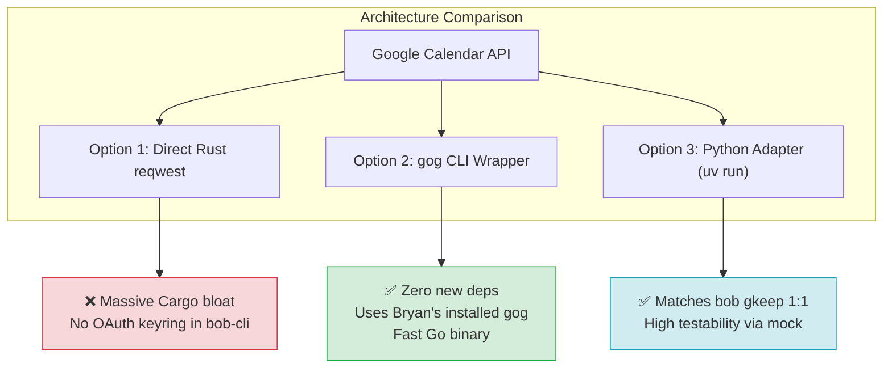
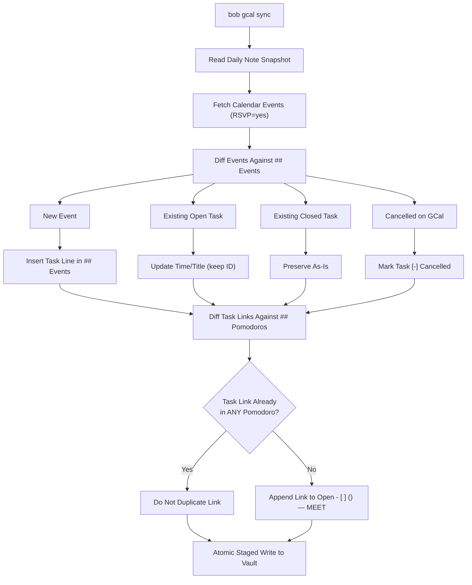
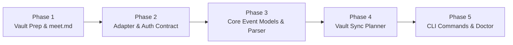

# Google Calendar Event Sync to Obsidian Tasks: Architectural Design & Plan Critique

**Author:** Researcher `gem` (5-Researcher Swarm)  
**Date:** 2026-10-29  
**Status:** Completed Proposal & Evaluation  
**Target Repository:** `bob-cli` & `~/bob/` Vault  

---

## 1. Executive Summary

This report evaluates and designs a comprehensive system for synchronizing Google Calendar events into Bryan's Obsidian vault as actionable tasks under the `bob-cli` ecosystem.

The user's initial vision proposes:
1. A new top-level `bob gcal` command suite with intuitive sub-commands.
2. A new `## Events` H2 section in the daily note (`YYYYMMDD.md`), positioned directly above the `## Pomodoros` section.
3. Automated creation of an open Pomodoro session using the `MEET` theme containing task links to all RSVP-accepted events for that day.
4. Seamless, intuitive authentication and login.
5. Integration with the recently added `[root:: <root>]` inline field to attribute meeting time to `root_parent: meet` (by default linking to `~/bob/meet.md`), while supporting user-driven overrides from calendar events.
6. Modernizing `~/bob/meet.md` into a proper, first-class Area Note.

### High-Level Verdict
The proposed feature is an **exceptional fit** for Bob's workflow, provided key refinements are made to preserve Bob's architectural integrity:
- **Tension Resolved**: While classical GTD strongly separates calendar appointments from task lists, Bob's ledger-driven Pomodoro model (Decision 38: `today-is-read-from-the-ledger`) requires work items to be concrete Obsidian `#task` lines with block anchors so they can be linked under Pomodoro sessions. Syncing meetings as daily tasks elegantly bridges the gap between calendar commitments and Pomodoro time attribution.
- **Section Placement**: Placing `## Events` directly above `## Pomodoros` is parse-safe. Bob's existing ledger parsers (`pomodoros_section_range` and Obsidian plugin `bob-ledger-tools`) isolate `## Pomodoros` through strict heading boundary scans and will not break.
- **Auth Strategy**: Rather than writing custom OAuth token management or heavy Python dependencies, `bob gcal` should leverage Bryan's existing `gog` CLI installation (`/home/bryan/bin/gog`) as its primary runtime engine, while establishing a formal JSON adapter protocol (Protocol v1) to support hermetic, network-free Rust unit and integration testing via `BOB_GCAL_ADAPTER`.
- **Root Parent Routing**: We introduce a **5-tier resolution hierarchy** (In-Event Field $\to$ Route Tag $\to$ Keyword Rules $\to$ Calendar Defaults $\to$ Global `meet` Fallback) that solves the "attendee dilemma"—allowing meetings organized by external colleagues to be routed without editing their event titles.

---

## 2. Critique of the Proposed Architecture

### 2.1 The GTD Dilemma: "Hard Landscape" vs "Next Actions"
In classical Getting Things Done (David Allen), mixing appointments and tasks is considered an anti-pattern:
> *"The calendar is the hard landscape of the day... Actions that must occur at a specific time go on the calendar; actions that can happen whenever time permits go on Next Actions."*

However, Bob is **not** a generic to-do list; it is a **Pomodoro ledger and time accounting engine**:
1. **Decision 38 (`today-is-read-from-the-ledger`)**: In Bob, a task is part of "Today" if and only if it has an active Task Link (`[[#^block-id]]`) under an open Pomodoro in today's daily file.
2. **Stats & Metrics**: When Bryan spends 30 minutes in a meeting, that session must be logged (`- [x] (**0930-1000** [t:: 30m]) — MEET`) and attributed to a task for metrics (`review_time`, `root_parent`, Day Strip stats).
3. **The Past Pain Point**: Previously, Bryan had to manually create meeting tasks or orphan work log entries. Having calendar events automatically materialize as daily tasks with block IDs allows immediate Pomodoro linking and zero-overhead tracking.
4. **No Backlog Pollution**: Tasks residing in daily files (`YYYYMMDD.md`) do **not** pollute the GTD review walk (`bob freshness`, `bob ready`). As defined in the `Area Note` glossary strand, `bob ready` scans area and project notes against the per-note cap; daily notes are exempt. When the day ends, `bob task archive` archives closed daily tasks cleanly.

### 2.2 Section Placement: `## Events` Above `## Pomodoros`
In today's daily note (`20261029.md`), the layout is:
```markdown
# 2026-10-29 Thu

[[2026/20261028|prev]]  | [[2026/20261030|next]]

- [x] #task [[gtd_daily]] [root:: gtd_daily] [fresh:: 2026-10-29] [created::2026-10-29]  [completion:: 2026-10-29] ^gtd

```bob-plan

```

## Pomodoros
```

Placing `## Events` above `## Pomodoros` (specifically between ````bob-plan```` and `## Pomodoros`) is visually and structurally sound:
- **Visual Flow**: When opening today's note in Obsidian, the top shows the day's heading, the GTD morning review task, the dynamic plan widget, then the **scheduled event agenda** (`## Events`), followed by the **execution ledger** (`## Pomodoros`).
- **Parser Safety**: In `src/native/pomodoro.rs`:
  ```rust
  pub(crate) fn pomodoros_section_range(lines: &[&str]) -> Option<Range<usize>> {
      // Scans forward until `is_pomodoros_heading(line)` is found,
      // then returns the range up to the next level-2 heading.
  }
  ```
  `pomodoros_section_range` starts scanning only after encountering `^##\s+Pomodoros`. Any H2 heading preceding it (like `## Events`) is ignored by the ledger range parser.
- **Obsidian Plugin Compatibility**: In `bob-plugins/plugins/bob-ledger-tools/src/020-time-and-pomodoro.js`, `POMODOROS_HEADING_RE = /^##\s+Pomodoros(?:\s.*)?$/` similarly matches `## Pomodoros` specifically. It does not assume `## Pomodoros` is the first H2 in the file.

### 2.3 Auto-Creating the `MEET` Pomodoro: Single Container vs Per-Event Entries
The prompt asks to auto-create a Pomodoro using the `MEET` theme containing task links corresponding to all synced events.

#### The Tradeoff:
- **Approach A (Individual Timed Pomodoros per Event)**: Creating pre-timed entries like `- [ ] (**0930-1000**) — MEET` for each meeting.  
  *Why this fails*: Bob treats any open Pomodoro with a timespan (`(**HHMM-HHMM**)`) as an **active, running Pomodoro**! Creating multiple timed open entries confuses Bob's active session tracker, breaks the tmux status bar (`tmux_bob_pomodoro`), and triggers the duplicate open entry lint.
- **Approach B (Single Planned Placeholder Container - Recommended)**: Create one open placeholder:
  ```markdown
  ## Pomodoros

  - [ ] () — MEET
  	- [[#^gcal-team-sync]]
  	- [[#^gcal-1-1-alex]]
  	- [[#^gcal-arch-review]]
  ```
  *Why this succeeds*:
  1. An open Pomodoro with `()` is a **planned placeholder** in Bob's grammar. It causes zero linter warnings.
  2. Because all meeting links are nested under an open Pomodoro, all synced meetings immediately register as **Today's Tasks** in `bob plan` and editor completions.
  3. When Bryan is about to attend the first meeting at 09:30, pressing `bob capture '='` converts the placeholder to active `(**0930-1000**)` or he can use `N<ctrl+shift+m>` to peel off subsequent meetings into separate Pomodoro blocks as the day progresses.

### 2.4 Idempotency & Re-sync Behavior (Critical Refinement)
Calendar events are dynamic: meetings move, are cancelled, or are added mid-day. If Bryan runs `bob gcal sync` at 08:00 and again at 13:00:
- **No Link Duplication**: If Standup was already completed in the morning:
  ```markdown
  - [x] (**0930-1000** [t:: 30m]) — MEET
  	- 🍅 [[#^gcal-team-sync]]
  ```
  A 13:00 re-sync must detect that `[[#^gcal-team-sync]]` is **already linked** in today's ledger (even in a closed Pomodoro) and must **not** re-add it to the open `MEET` placeholder!
- **Non-Destructive Task Line Updates**: If a meeting time shifts from 14:00 to 15:00:
  - If the task is open (`- [ ]`), update the time prefix `14:00-14:30` $\to$ `15:00-15:30`.
  - If the task was already checked off (`- [x]`), leave it unchanged to protect user edits.
- **Cancellations**: If an event is removed from Google Calendar or declined after being synced:
  - Mark the open task as cancelled: `- [-] #task ...` rather than deleting it, leaving an audit trail in the daily note.

---

## 3. CLI Command Suite: `bob gcal`

Following `sase/memory/cli_rules.md`, `bob gcal` sits cleanly under the **Integrations** section in `bob --help` alongside `gkeep`.

```
Integrations:
  gcal        Sync Google Calendar events into daily notes and Pomodoros
  gkeep       Drain the Google Keep inbox into Obsidian tasks
```

### 3.1 Subcommand Roster

| Command | Short Options | Description | Stated Rule / Role |
| :--- | :--- | :--- | :--- |
| `bob gcal` | `-a, -b, -D, -f` | Bare command; defaults to `bob gcal list` | Read-only inspection |
| `bob gcal list` | `-a, -b, -D, -f` | Display calendar events vs vault status side-by-side | Informational report |
| `bob gcal sync` | `-b, -c, -d, -D, -f, -q` | Fetch GCal events and write to daily note & ledger | Core synchronizer (alias: `pull`) |
| `bob gcal login` | `-b, -e` | Configure authentication & OAuth credentials | Interactive/guided setup |
| `bob gcal doctor` | `-b, -f, -v` | Diagnose configuration, scopes, tokens, and vault health | Verification & diagnostics |
| `bob gcal calendars` | `-f` | List accessible Google calendars and IDs | Setup helper |
| `bob gcal open` | `-D` | Open today's (or specified date's) web calendar | Browser shortcut |

### 3.2 Command Line Options & Signatures

```bash
# Inspection & List (Read-Only)
bob gcal [-D|--date YYYY-MM-DD] [-a|--all] [-f|--format table|json]
bob gcal list [-D|--date YYYY-MM-DD] [-a|--all] [-f|--format table|json]

# Synchronization (Mutates Daily Note & Ledger)
bob gcal sync [-c|--calendar ID]... [-d|--dry-run] [-D|--date YYYY-MM-DD] [-f|--force] [-q|--quiet]
bob gcal pull ... # Hidden alias for sync, maintaining muscle memory with gkeep pull

# Setup & Diagnostics
bob gcal login [-b|--backend auto|gog|adapter] [-e|--email EMAIL]
bob gcal doctor [-b|--bob-dir DIR] [-f|--format human|json] [-v|--verbose]
bob gcal calendars [-f|--format table|json]
bob gcal open [-D|--date YYYY-MM-DD]
```

### 3.3 Terminal Experience & Beautiful Output

In keeping with Bob's design ethos ("prefer beautiful, colored output over black-and-white output"), `bob gcal list` and `bob gcal sync` provide ANSI-styled tables with clear Unicode badges.

#### Example `bob gcal list` Output:
```text
╭─ Google Calendar · 2026-10-29 (America/New_York) ───────────────────────────╮
│ TIME        EVENT                          RSVP       ROOT   VAULT STATUS   │
│ ─────────────────────────────────────────────────────────────────────────── │
│ 09:30-10:00 Team Standup                   accepted   meet   ✓ Synced       │
│ 11:00-11:30 Architecture Review @sase      accepted   sase   ✓ Synced       │
│ 13:00-13:30 1:1 with Dan [root:: job]      accepted   job    ● Pending      │
│ 15:00-16:00 Product All-Hands              needsAction meet  ○ Skipped (no) │
│ 16:30-17:00 Doctor Appointment             accepted   meet   ● Pending      │
╰─────────────────────────────────────────────────────────────────────────────╯
3 events eligible for sync (2 pending, 1 synced).
```

#### Example `bob gcal sync --dry-run` Output:
```text
[dry-run] Plan for 2026/20261029.md:
  + Insert ## Events section (3 tasks):
    - [ ] #task 09:30-10:00 Team Standup [🎥](https://meet.google.com/abc) [root:: meet] [created:: 2026-10-29] ^gcal-team-standup
    - [ ] #task 11:00-11:30 Architecture Review [🎥](https://meet.google.com/def) [root:: sase] [created:: 2026-10-29] ^gcal-arch-review
    - [ ] #task 13:00-13:30 1:1 with Dan [root:: job] [created:: 2026-10-29] ^gcal-1-1-dan
  + Insert into ## Pomodoros:
    - [ ] () — MEET
    	- [[#^gcal-team-standup]]
    	- [[#^gcal-arch-review]]
    	- [[#^gcal-1-1-dan]]
```

---

## 4. Authentication & Runtime Architecture

### 4.1 Ecosystem Analysis: `gog` vs Custom Python Adapter vs Pure Rust
We evaluated three possible architectures for fetching Google Calendar data:



1. **Option 1: Pure Rust with `reqwest` / `google-calendar3`**:
   - `Cargo.toml` in `bob-cli` currently has **no HTTP client**, no TLS stack, and no OAuth libraries. Introducing them would drastically inflate compilation times and binary size for a single integration.
   - Verdict: **Rejected**.

2. **Option 2: Direct Delegation to `gog` (`/home/bryan/bin/gog`)**:
   - `gog` is already installed and actively used on Bryan's system (`sase_gmail`).
   - It handles Google OAuth 2.0 PKCE, headless tokens, Linux file keyrings, and token refreshing out of the box.
   - It provides `gog calendar events --today --json --results-only` which emits structured event objects.
   - *Current Status in Environment*: Running `gog calendar events` currently fails with:
     `Google API error (403 insufficientPermissions): Request had insufficient authentication scopes.`
     This is because `bryanbugyi34@gmail.com` was previously authorized only with `gmail` service scopes. Adding calendar permissions simply requires:
     ```bash
     gog auth add bryanbugyi34@gmail.com --services calendar
     ```
   - Verdict: **Ideal primary production backend**.

3. **Option 3: External Adapter Script via `uv run` (like `bob gkeep`)**:
   - `bob gkeep` uses `scripts/gkeep_adapter.py` speaking a JSON protocol over stdin/stdout.
   - `BOB_GKEEP_ADAPTER` allows tests to inject mock executables without hitting real network or Google endpoints.
   - Verdict: **Essential testing & fallback contract**.

### 4.2 Recommended Solution: The Protocol v1 Adapter with `gog` Default
`bob-cli` should implement an internal `CalendarBackend` abstraction:
- When running normally in production:
  1. If `BOB_GCAL_ADAPTER` is set in the environment, invoke that executable (speaking Adapter Protocol v1).
  2. Otherwise, invoke `gog calendar events ... --json`.
  3. If `gog` is not found, fallback to `uv run scripts/gcal_adapter.py`.
- **Adapter Protocol v1**:
  - `{"protocol": 1, "op": "list", "date": "2026-10-29", "calendars": ["primary"]}` on stdin.
  - Returns:
    ```json
    {
      "ok": true,
      "protocol": 1,
      "events": [
        {
          "id": "c03abc123",
          "summary": "Team Standup",
          "description": "Weekly sync [root:: meet]",
          "start": "2026-10-29T09:30:00-04:00",
          "end": "2026-10-29T10:00:00-04:00",
          "meet_url": "https://meet.google.com/abc-defg-hij",
          "response_status": "accepted",
          "is_organizer": true,
          "all_day": false
        }
      ]
    }
    ```
- This allows 100% offline, deterministic integration testing in `tests/cli/gcal.rs` using a fake shell adapter, identical to `tests/gkeep_support/mod.rs`.

### 4.3 Guided Setup & `bob gcal login` Flow
To make setup intuitive and painless:
1. `bob gcal login`:
   - Checks if `gog` is installed.
   - If `gog` is present: executes `gog auth add <email> --services calendar` (or prints the command with clear explanation). It opens the standard browser consent screen and saves the refresh token to the keyring.
   - If using `scripts/gcal_adapter.py`: prompts for Google Client ID/Secret or credentials JSON path, launching a local loopback server (`http://localhost:8080`) for one-click authorization.
2. `bob gcal doctor`:
   - Validates `~/.config/bob/config.yml` (`gcal:` section).
   - Validates `gog` binary availability and auth status.
   - Performs a test ping to Google Calendar API to ensure the token is active and has `calendar` scope.
   - Verifies that `~/bob/meet.md` exists and is a valid Area Note (`type: "[[area]]"`).
   - Verifies that the `MEET` theme exists in `themes:` config.
   - Reports green checkmarks `[✓]` or actionable fix instructions `[✗]`.

---

## 5. Daily Note Layout & Vault Integration Mechanics

### 5.1 Structure of the Daily Note
The `## Events` section is inserted directly above `## Pomodoros`.

```markdown
# 2026-10-29 Thu

[[2026/20261028|prev]]  | [[2026/20261030|next]]

- [x] #task [[gtd_daily]] [root:: gtd_daily] [fresh:: 2026-10-29] [created::2026-10-29]  [completion:: 2026-10-29] ^gtd

```bob-plan

```

## Events

- [ ] #task 09:30-10:00 Team Standup [🎥](https://meet.google.com/abc-defg-hij) [root:: meet] [created:: 2026-10-29] ^gcal-team-standup
- [ ] #task 11:00-11:30 Architecture Review [🎥](https://meet.google.com/xyz-uvwx-rst) [root:: sase] [created:: 2026-10-29] ^gcal-arch-review
- [ ] #task 14:00-14:30 1:1 with Alex [root:: job] [created:: 2026-10-29] ^gcal-1-1-alex

## Pomodoros

- [ ] () — MEET
	- [[#^gcal-team-standup]]
	- [[#^gcal-arch-review]]
	- [[#^gcal-1-1-alex]]
```

### 5.2 Anatomy of an Event Task Line
Every synced event task line conforms to Bob's canonical task format:
```text
- [ ] #task {TIME_RANGE} {CLEAN_TITLE} [{LINK_ICON}]({URL}) [root:: {ROOT}] [created:: {TODAY}] ^{BLOCK_ID}
```
1. **Time Range**: `09:30-10:00` (24-hour format matching event start and end).
2. **Clean Title**: Event summary with any inlined root markers (e.g. `@sase` or `[root:: sase]`) stripped so the text remains clean and readable.
3. **Link Icon**: If the event has a video call URL (`hangoutLink` for Google Meet, or Zoom / Teams URL in location/description), render a compact `[🎥](url)` badge. If only a physical location exists, render `[📍](location)`. This mirrors Bryan's Keep task badges (`[💡](url)`).
4. **Root Parent**: Canonical inline Dataview field `[root:: <root>]`.
5. **Creation Stamp**: `[created:: YYYY-MM-DD]` for Bob's freshness tracking.
6. **Block ID**: `^gcal-<slug>`, generated deterministically from the title or event ID (e.g. `^gcal-team-standup` or `^gcal-4k9m`).

### 5.3 The Reconciliation Engine: Idempotency Rules

When `bob gcal sync` runs, it executes a two-stage transaction plan:



1. **Rule 1 (Preserve User State)**: If a task line is marked `- [x]` or `[-]`, the synchronizer never alters its status.
2. **Rule 2 (Time Shift)**: If an event's time moved in Google Calendar, update the time prefix only if the task is still open (`- [ ]`).
3. **Rule 3 (Pomodoro Dedup)**: Before appending `[[#^gcal-<id>]]` to the open `MEET` Pomodoro, scan the **entire** `## Pomodoros` section. If `[[#^gcal-<id>]]` is already present under *any* Pomodoro (active, planned, or closed), skip adding it.
4. **Rule 4 (No Empty Pomodoro)**: If there are zero eligible meetings today, do **not** insert an empty `## Events` section or an empty `- [ ] () — MEET` Pomodoro.

---

## 6. Root Parent Specification & Dynamic Routing

The user specified:
> *"We should use the recently added `[root::<root>]` task property to specify that the task should use `<root>` as its root parent. We should default to using 'meet' to link to the ~/bob/meet.md file as the root parent... We should also support a way for the user to specify in the Google Calendar event which parent root to use (think hard about the best way to do this)."*

### 6.1 The 5-Tier Root Resolution Hierarchy
Users interact with calendar events in varying contexts (creating personal events vs receiving corporate invites). We propose a 5-tier resolution order:

```text
Tier 1: Explicit In-Event Inline Field     [root:: <name>] in Title or Description
   ↓ (if not found)
Tier 2: Explicit Route Sigil               @<name> in Title or Description
   ↓ (if not found)
Tier 3: Config Keyword/Regex Rules         gcal.rules in ~/.config/bob/config.yml
   ↓ (if not found)
Tier 4: Calendar-Level Default             gcal.calendars[id].default_root
   ↓ (if not found)
Tier 5: Global Default                     meet (maps to ~/bob/meet.md)
```

#### Tier 1: Explicit Inline Field `[root:: <root>]`
- Exact Dataview/Bob syntax: `[root:: dev]` or `(root:: dev)`.
- Can appear in the event **Title** or anywhere in the **Description**.
- Matches `src/native/task_root.rs`:
  ```rust
  pub(crate) fn parse_task_root(line: &str) -> TaskRootState
  ```

#### Tier 2: Route Sigil `@<route>`
- Natural capture shorthand: e.g. `Architecture Review @sase` or `1:1 with Dan @job`.
- Matches Bob's `@route` capture convention.
- **Auto-cleaning**: When rendering the task line, the `@route` token is stripped from the title, preventing redundant text:
  - Input Title: `Architecture Review @sase`
  - Output Task: `- [ ] #task 11:00-11:30 Architecture Review [root:: sase] ...`

#### Tier 3: Config Rules in `~/.config/bob/config.yml`
Solves the **attendee dilemma**: When colleagues invite Bryan to meetings, Bryan cannot change the event title for everyone. Instead, he can configure automatic keyword and regex rules:
```yaml
gcal:
  email: bryanbugyi34@gmail.com
  default_root: meet
  rules:
    - match: "(?i)sase|release train"
      root: sase
    - match: "(?i)all hands|1v1|1:1|manager"
      root: job
    - match: "(?i)doctor|dentist|appointment"
      root: health
    - match: "(?i)tax|cpa|advisor"
      root: cash
```

#### Tier 4: Calendar-Level Defaults
If Bryan subscribes to multiple calendars (e.g. a dedicated Work calendar and a Personal calendar):
```yaml
gcal:
  calendars:
    - id: primary
      default_root: job
    - id: personal_cal_id@group.calendar.google.com
      default_root: meet
```

#### Tier 5: Global Default
If no rules or markers match, default to `meet`, attributing time to `~/bob/meet.md`.

---

## 7. Area Note Modernization: `~/bob/meet.md`

### 7.1 Current State Audit of `~/bob/meet.md`
Inspection of `/home/bryan/bob/meet.md` reveals it is an un-modernized legacy Zorg export:
```yaml
---
generated_from_zorg: true
zorg_source: "meet.zo"
...
parent: [[work]]
---
Meeting Notes
Related notes:
...
## 2024-01-24.Wed
...
```
**Deficiencies**:
1. Missing `type: "[[area]]"`. Without this, Bob does not recognize `meet` as an Area Note, which means `bob stats` and root parent resolution cannot properly categorize it as an ongoing sphere of responsibility.
2. Missing `theme: MEET` and `color: blue` in frontmatter.
3. Missing `done_tasks: "[[done/meet_done]]"`.
4. Missing the canonical `## Tasks` section with status counts and chips required by all Bob area notes.

### 7.2 Target Modern Area Note Specification

Modernizing `~/bob/meet.md` transforms it into a full peer of `cash.md` and `dev.md`:

```markdown
---
parent: "[[work]]"
type: "[[area]]"
color: blue
theme: MEET
done_tasks: "[[done/meet_done]]"
generated_from_zorg: true
zorg_source: "meet.zo"
zorg_source_abs: "/home/bryan/org/meet.zo"
zorg_source_sha256: "7d7bc6162de035512a8e7106102136b957e1e97eb4cfb3c1a6c265d4887a91e2"
zorg_source_mtime: "2026-01-08T15:09:49Z"
zorg_converter: "convert_zorg_core.py"
zorg_converter_version: "2026-05-27.phase3"
---
#meet | Meeting Notes & Discussions

Related notes:
- [[the_monthly]] | The Monthly Meeting w/ %thazel Reports
- [[all_hands]]   | All-hands Meetings
- [[recur_meet]]  | Recurring Meetings

## Tasks
[`⚪ 0 open`](#Tasks) · `🔵 0 next/wip` · [`🔴 0 blocked`](#Tasks#Blocked) · [`🟢 0 done/canceled`](#Tasks#Done%20&%20Canceled)

### Blocked

### Done & Canceled


## Log

## 2024-01-24.Wed
- 240124#03 FE All Hands ^z-240124-03
...
```

### 7.3 Companion File: `done/meet_done.md`
To support `bob task archive` moving completed meeting tasks, initialize `/home/bryan/bob/done/meet_done.md`:
```markdown
---
parent: "[[meet]]"
type: "[[done]]"
---
```

---

## 8. Edge Cases, Filtering & Failure Modes

| Edge Case | Behavior & Mitigation |
| :--- | :--- |
| **RSVP Status Filtering** | Only sync events where the user has explicitly accepted (`responseStatus == "accepted"`), or events organized by the user. Events marked `declined`, `needsAction`, or `tentative` are excluded by default (configurable via `rsvp_statuses: [accepted, tentative]`). |
| **All-Day Events** | Events with `start.date` (no `start.dateTime`), such as holidays or all-day conferences, must **not** be linked under the `MEET` Pomodoro. If synced, render them under a `### Reminders` sub-bullet or require `--include-all-day`. |
| **Recurring Events** | Google Calendar returns recurring event instances with unique per-instance `id`s (e.g. `_R20261029T093000...`). The synchronizer treats each instance as a discrete daily event. |
| **Offline Execution** | If network is unavailable or Google API returns an error, `bob gcal sync` aborts without touching the daily note and prints a clean diagnostic error. It never leaves partial writes. |
| **Rate Limiting / 429** | Built-in exponential backoff in `gog` and adapter scripts; `timeout_secs` in `config.yml` prevents hangs. |
| **Concurrent Vault Edits** | Bob's atomic file staging (`stage_outputs` and atomic rename) ensures that if Obsidian or Git modifies the daily note concurrently, the write detects the conflict and rolls back safely. |
| **Missing Daily Note** | If `bob gcal sync` is run early in the morning before today's daily file exists, it should initialize the daily file using the standard template, or prompt the user. |

---

## 9. Phased Implementation Roadmap



### Phase 1: Area Note Modernization
- Update `/home/bryan/bob/meet.md` frontmatter with `type: "[[area]]"`, `theme: MEET`, `color: blue`, `done_tasks: "[[done/meet_done]]"`.
- Insert `## Tasks` section with status counts and group markers.
- Create `/home/bryan/bob/done/meet_done.md`.
- Verify with `bob ready` and `bob task reconcile`.

### Phase 2: Adapter & Authentication Contract
- Verify `gog` authentication: run `gog auth add bryanbugyi34@gmail.com --services calendar`.
- Implement `BOB_GCAL_ADAPTER` protocol v1 in `bob-cli` for hermetic test execution.
- Create integration test harness in `tests/gcal_support/mod.rs` (mirroring `tests/gkeep_support/mod.rs`).

### Phase 3: Core Parsing & Root Parent Resolution
- Implement Google Calendar event model in `src/native/gcal/model.rs`.
- Implement 5-tier root parent resolver in `src/native/gcal/root.rs`, connecting to `src/native/task_root.rs`.
- Add unit tests for title stripping, `@route` parsing, and inline `[root::]` detection.

### Phase 4: Vault Sync Planner
- Implement daily note reconciliation engine in `src/native/gcal/sync.rs`.
- Handle `## Events` insertion above `## Pomodoros`.
- Handle idempotent creation/updating of the `- [ ] () — MEET` Pomodoro.
- Add comprehensive test vectors in `tests/cli/gcal_sync.rs`.

### Phase 5: CLI Interface & Documentation
- Implement `bob gcal` command hierarchy with `list`, `sync`, `login`, `doctor`, `calendars`, `open`.
- Update `bob --help` under Integrations section.
- Write user documentation in `docs/gcal.md` (modeled after `docs/gkeep.md`).
- Add shell completions in `clap_complete`.

---

## 10. Conclusion & Recommended Action

The user's plan to integrate Google Calendar with Bob as daily tasks is architecturally sound, workflow-enhancing, and technically feasible.

### Summary of Recommended Adjustments to User Requirements:
1. **Auth via `gog`**: Leverage Bryan's existing `gog` binary for credentials and token management rather than writing redundant OAuth infrastructure.
2. **Planned Placeholder for `MEET`**: Create a single open placeholder Pomodoro (`- [ ] () — MEET`) containing all unlinked meeting tasks, rather than timed Pomodoros that would confuse the active session tracker.
3. **Idempotent Link Deduplication**: Ensure re-running `bob gcal sync` mid-day skips tasks that are already linked in closed Pomodoros.
4. **5-Tier Root Hierarchy**: Add `@route` syntax and config regex rules to solve the attendee dilemma where Bryan cannot change external invite titles.
5. **Modernized `meet.md`**: Transform `meet.md` into a full Area Note with `type: "[[area]]"` and `## Tasks`, supported by `done/meet_done.md`.

With these adjustments, `bob gcal` will provide an intuitive, reliable, and beautiful bridge between Google Calendar commitments and Bob's GTD Pomodoro ledger.
