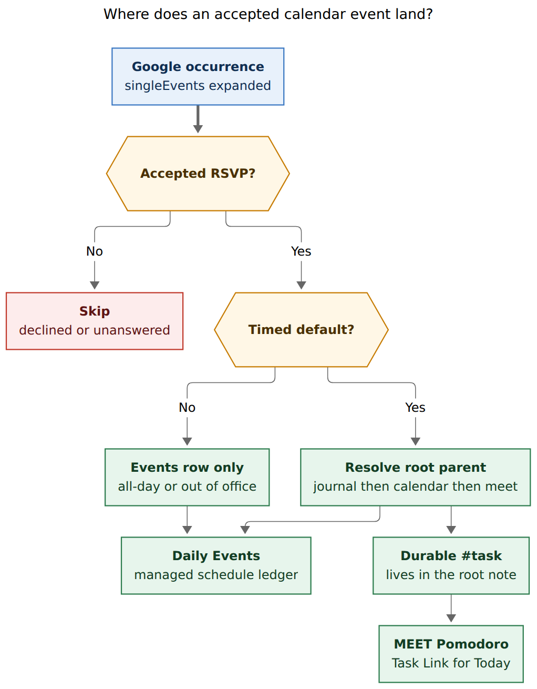
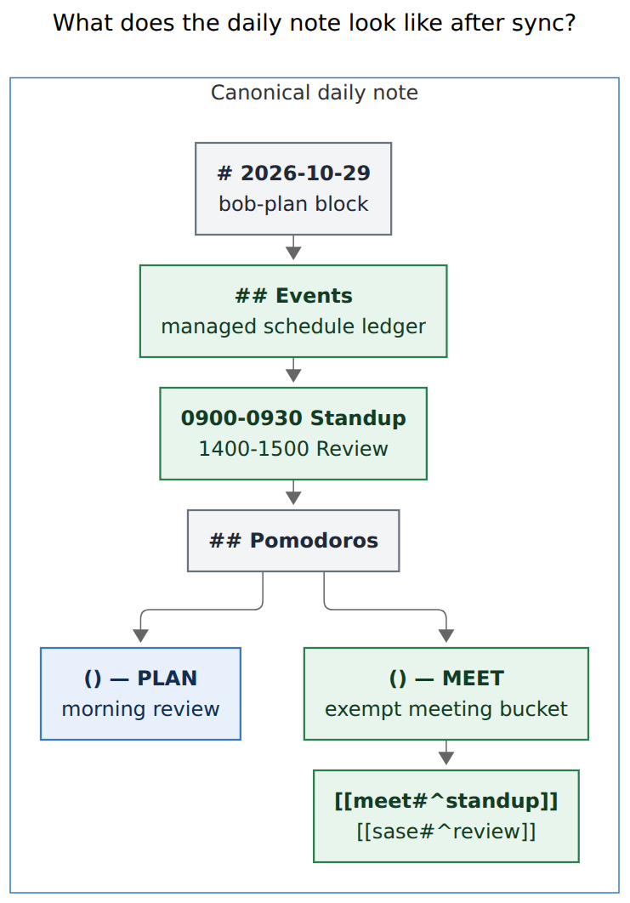
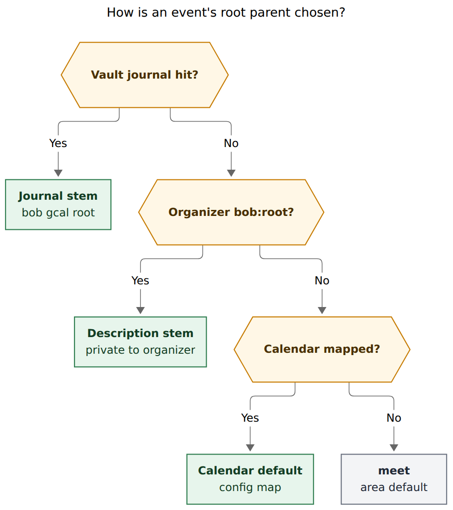

# How should Bob sync Google Calendar into the daily ledger?

- **Researcher:** grk
- **Date:** 2026-10-29
- **Question:** What is the best way to add Google Calendar events to the Bob vault as tasks, including a `bob gcal` command, a daily `## Events` section, an auto-created MEET Pomodoro, easy login, and `[root::]` routing that defaults to `meet.md`?
- **Verdict:** Build it. Treat Calendar as a *schedule source*, Keep-style as a *drain*, and the Pomodoro ledger as the only Today membership list. Put a managed `## Events` heading above `## Pomodoros`, file durable `#task` rows in the resolved root note (default `meet.md`, modernized into a real area), and auto-create one exempt `— MEET` Pomodoro that links those tasks. Do **not** author `#task` lines in the daily note. Login should open a browser (PKCE loopback), optionally wrapping the already-installed `gog` CLI after adding Calendar scopes.

---

## 1. In one breath

The want is real: meetings are the one part of the day Bob currently cannot see, `meet.md` is an untyped Zettelkasten dump (0 tasks, `parent: work`), and `[root::]` exists specifically so a task can attribute to `meet` while the checkbox lives wherever it lives. The original sketch — RSVP’d events become daily-note tasks, plus one MEET Pomodoro that Task-Links all of them — collides with three settled rules: tasks stay in area/project notes, Today is dedicated Task Links under *open* Pomodoros, and linking a Ready task raises it to sticky Next.

The design that survives those rules is a **three-surface projection**:

1. **Daily `## Events`** — a machine-owned schedule ledger (times, title, Meet URL, RSVP chip). Checkboxes here mean “attended”, and they are **not** `#task`.
2. **Durable `#task` in the root note** — one task per series (or one-off), filed in `meet.md` or another area/project, carrying `[root:: <stem>]` and `[theme:: MEET]`. Identity lives in `.bob/gcal/`, Keep-style, so Git sync carries it.
3. **One exempt `— MEET` Pomodoro** — created only when the day has at least one timed accepted event; its children are dedicated Task Links to those durable tasks. PLAN stays the morning session; MEET sits beside it as the meeting bucket.

Auth is the easy part if we refuse to copy Keep’s cookie scrape. Google Calendar has an official API. Bryan already has `gog` authorized for Gmail (`bryanbugyi34@gmail.com`); Calendar currently 403s with `insufficientPermissions`. `bob gcal login` should add `calendar.readonly` (and only `calendar.events` if we ever PATCH Google), open the system browser, and store nothing in argv/logs/JSON.

```text
bob gcal login          # browser PKCE, or gog auth add --services calendar --readonly
bob gcal doctor         # config, account, token, calendars, meet.md, git
bob gcal                # list today's accepted events vs the vault (default)
bob gcal sync -d        # preview Events + tasks + MEET Pomodoro
bob gcal sync           # write, verify, commit
bob gcal root <ref> sase
```

---

## 2. Critique of the plan

The plan as stated: add `bob gcal` with several subcommands; render RSVP’d events as tasks in a new `## Events` H2 above `## Pomodoros`; auto-create a MEET Pomodoro that Task-Links all of them; make login easy; stamp `[root::]` (default `meet`); let a Calendar event name a different root; modernize `meet.md` into an area note.

### What is right

- **A nested `bob gcal` noun is the house rule.** `cli_rules.md` nests when one noun has several verbs. `bob gkeep` is the template: `list` (bare default), `pull`/`sync`, `login`, `doctor`. Calendar belongs in the Integrations help section next to Keep.
- **Meetings belong on the daily note as a ledger, above Pomodoros.** The day has a schedule before it has sessions. `_templates/daily.md` already seeds `() — PLAN` with `[[#^gtd]]`; Events should be the heading the template grows, the way Pomodoros already is.
- **`[root::]` is the right attribution knob.** R11 in `docs/pomodoro-homes.md` starts the home walk at the named note. `^gtd` already uses `[root:: gtd_daily]`. A meeting task that should roll up to `sase` or `job` is exactly this field.
- **`meet.md` needs to become an area.** Live vault: `type` empty, `parent: work` (plain text, not a wikilink), no `theme`, no `color`, 0 tasks, ~3 KB of dated meeting notes plus links to `the_monthly`, `all_hands`, `recur_meet`. Until it is `type: "[[area]]"`, `[root:: meet]` falls through to `@unfiled`.
- **Official Calendar beats Keep’s unofficial adapter.** Keep has no public API, so `bob gkeep` scrapes via `gkeepapi`. Calendar v3 is a supported Google API with `events.list`, `singleEvents=true`, attendee `responseStatus`, `htmlLink`, `hangoutLink` / `conferenceData`, and `extendedProperties.private`.
- **One MEET Pomodoro for the day’s meetings is the right grain.** Per-event timed Pomodoros would flood the ledger and the theme cap. A named bucket matches how PLAN already groups morning review.

### What is wrong

1. **`#task` lines in the daily note violate residence.** `docs/concepts/today-and-the-pomodoro-ledger.md`: “Tasks themselves never move into the daily note.” The only blessed daily-note checkbox is templated `^gtd`. An Events row that *looks* like a task will be treated as a task by freshness (daily notes are excluded from the walk, which then hides them from review while still creating them), by `bob task archive`, and by anyone grepping `#task`.
2. **Auto-linking every RSVP into an *open* MEET Pomodoro makes every meeting Today and, worse, sticky Next.** Linking a Ready task raises `[*]` (`decisions:task-lanes-are-sticky`). Unlinking when the Pomodoro closes does **not** lower the lane. A week of standups would pin a dozen series tasks in Next forever.
3. **Auto-created tasks without a `fresh` stamp are NEW.** “Creation and automation never do” stamp freshness. A busy calendar would dump NEW-walk rows into `meet.md` every morning.
4. **MEET is a context name, not a kind-of-work.** The six-month theme audit (`research:202610/work_kind_pomodoro_theme_set`) recommended PLAN / BUILD / FIX / READ / WRITE / CHORE. MEET is closer to PLAN: a day-structure bucket. It should be a configured type with a `meet.md` area hue, and **exempt** so it does not steal one of the three `plan.max_themes` slots. Exempt entries also ignore links for the *budget*; Today still counts those links.
5. **You cannot write `bob:root=sase` into events you do not organize.** The description is owned by the organizer. Attendees cannot edit it. Private extended properties work, but they need `calendar.events` write scope and have no Calendar UI. The intuitive per-event control is a **vault journal** (`bob gcal root`), plus a calendar→root map for whole calendars.
6. **`bob gcal pull` is the wrong verb.** Keep *drains* notes and archives them. Calendar events stay on Google. The write is a projection. Call it `sync`.
7. **Login must not be Keep’s DevTools cookie ritual.** `bob gkeep login` asks for an `oauth_token` cookie from accounts.google.com. That is the opposite of intuitive. Calendar can do RFC 8252 loopback + PKCE, or wrap `gog auth add --services calendar --readonly`.
8. **A plugin that syncs Calendar into daily notes is the wrong owner.** Community plugins (google-sync, Sync Google Calendar, obsidian-gcal-sync) either two-way-patch Google, dump a note per event, or fight Dataview. Bob already owns vault writes, Git commits, and the ledger scanner. Calendar must go through `bob`, the way Keep does.

The plan’s *goal* (see today’s meetings in the vault, attributed to `meet` or a chosen root, with a MEET session to spend) is good. The working example (daily-note `#task` rows + sticky auto-link) is a bad cut. Treat this as a **ledger-plus-area** feature with a Keep-shaped CLI and a Calendar-shaped data model.

---

## 3. Justified requirement adjustments

These change the user’s wording. They are deliberate.

| Original implication | Adjustment | Why |
| --- | --- | --- |
| Events are `#task` rows in the daily `## Events` section | `## Events` is a managed **schedule ledger**. Rows may be checkboxes, but they are not `#task`. The GTD `#task` lives in the root note. | Daily notes are not task homes. The Pomodoros scanner, freshness, archive, and Today definition all assume that. |
| Auto-create a MEET Pomodoro linking every Events row | Create **one** exempt `— MEET` placeholder, only when the day has ≥1 timed accepted event. Reconcile its dedicated Task Links. Leave PLAN first. | One bucket tracks meeting time without exploding the theme cap. Empty days stay empty. |
| Linking those tasks is enough | Add a **`#gcal` carve-out**: a MEET-ledger link does not promote Ready → Next. Today membership still applies while the Pomodoro is open. Completing the Events checkbox does not complete the durable task. | Sticky Next would pin every recurring meeting. Appointments are constraints, not next actions. |
| New tasks follow normal freshness | `#gcal` tasks are excluded from NEW / ROTTEN / the Ready cap. Bryan can still Alt+N or link them under a non-MEET Pomodoro to pull them into the ordinary lanes. | Automation must not flood the morning walk. |
| Specify the root *in the Google event* (description / title) | **Resolution order:** vault journal (`bob gcal root`) → organizer-only `bob:root=<stem>` in the description → `gcal.calendars` map → `meet`. | Attendees cannot edit descriptions. A vault journal works for invited events, Git-syncs, and needs only readonly Calendar scope. |
| Default root `meet` as a file link | File the durable task **in** the resolved root note, and always write `[root:: <stem>]`. `meet.md` becomes a top-level area (`type: [[area]]`, `parent: [[area]]`, `theme: MEET`). | Residence plus `[root::]` matches how `^gtd` already attributes to `gtd_daily`. |
| `bob gcal` with “various subcommands” left open | Bare = `list`. Mutations: `sync`, `root`. Setup: `login`, `logout`, `doctor`. Read: `calendars`. Hidden alias `calendar`. | Same membership rule as `gkeep` / `plugins` / `freshness`. |
| Easy login, unspecified | Browser PKCE loopback; if `gog` is on PATH, wrap `gog auth add --services calendar --readonly --force-consent`. Tokens via `pass` or gog’s keyring. Never a cookie paste. | Calendar is an official API. Keep’s scrape is a regrettable exception. |
| Sync implied as a drain | One-way Google → vault. Google stays source of truth for whether an event exists. Checking a vault row never deletes or edits the Calendar event. | Two-way sync is how every Obsidian Calendar plugin gets dangerous. |
| Run whenever | `bob gcal sync` is the verb. Optional launchd/cron in the morning. Do **not** fold it into `bob nightly` by default (nightly is vault-sync → archive → vault-sync). | Nightly is Git maintenance. Calendar is a morning schedule refresh. |
| MEET counts as an ordinary theme | Configure `MEET` under `themes:` with the `meet` area hue, and add `MEET` to `plan.exempt`. | Auto-creating it must not consume the 3-theme budget. Stats still records MEET minutes. |

---

## 4. Recommended architecture

### 4.1 Three surfaces, one occurrence



*An expanded Google occurrence is RSVP-filtered, then written to the daily Events ledger, a durable task in the resolved root note, and a Task Link under today’s MEET Pomodoro. All-day and out-of-office rows stop at Events.*

Rendered size: 680.9 × 874 px; fit scale: 95.9%. Mermaid CLI 12.0.0.

**Include** an occurrence when all of these hold:

- `eventType` is `default` (focusTime / birthday / workingLocation / fromGmail stay out of MEET; `outOfOffice` may appear as an all-day Events row).
- `status` is not `cancelled`.
- `transparency` is `opaque` (busy). Free/`transparent` events are skipped unless `--include-free`.
- Bryan is the organizer (`organizer.self`) **or** the self-attendee `responseStatus` is `accepted` or `tentative`.
- `needsAction` and `declined` are skipped. Tentative rows render with a dim `tentative` chip; `--exclude-tentative` drops them.

`singleEvents=true` expands recurrences. The day window is the vault timezone (`timezone:` in config.yml, same clock as `BOB_NOW` / daily-note selection). `timeMin`/`timeMax` are that local day in RFC3339 with offset.

**All-day** rows (holidays, OOO, `start.date` without `dateTime`) write to Events only. They do not create MEET Task Links: they are not timed work.

### 4.2 Daily note after sync



*A managed Events heading sits above Pomodoros. Accepted timed meetings become Task Links under one exempt MEET session, beside the morning PLAN entry.*

Rendered size: 493.3 × 709 px; fit scale: 100%.

Canonical shape (illustrative):

```markdown
# Thursday, 2026-10-29

```bob-plan
```

## Events

- [ ] (**0900-0930** [t:: 30m]) [[meet#^staff-standup|Staff standup]] [📹](https://meet.google.com/abc-defg-hij "Join Google Meet")
- [ ] (**1400-1500** [t:: 60m]) [[sase#^design-rev|Design review]] tentative [📹](https://meet.google.com/xyz "Join Google Meet")

## Pomodoros

- [ ] () — PLAN
  - [[#^gtd]]
- [ ] () — MEET
  - [[meet#^staff-standup]]
  - [[sase#^design-rev]]
```

Design notes for beauty and parser peace:

- **Times match Pomodoro typography** (`(**0900-0930** [t:: 30m])`) so the day has one clock language.
- **The Events checkbox is attendance**, persisted in `.bob/gcal/` so a later sync does not uncheck it.
- **The title is a Task Link** to the durable task, so clicking the agenda jumps to the home note. The Events row itself stays non-`#task`, so `capture_pomodoros::scan` (which only reads `## Pomodoros`) and Today (which only counts dedicated Task Links under open Pomodoros) ignore it.
- **Meet URLs** prefer `hangoutLink`, else `conferenceData.entryPoints` of type `video`, else `htmlLink`.
- **`## Events` is machine-owned** the way Sub-projects lines are: sync rewrites the section between the H2 and the next H2. User prose below the last event row is preserved if it sits after a blank line; anything inside the generated block is replaced. Pin local annotations on the durable task (Work Log), not on the Events row.
- **Insert the heading immediately above `## Pomodoros`.** If the daily note is missing, create it from `_templates/daily.md` (already `type: [[day]]` with a PLAN seed) after inserting an empty `## Events`. If `## Pomodoros` is missing, refuse with a doctor-style hint, the way capture already does.
- **MEET reconciliation** rewrites only dedicated Task Links it previously wrote (receipts name the block ids). Bryan’s extra children under `— MEET` (notes, extra links) stay. If he already started the session (`(**0920-0950** [t:: 30m]) — MEET`), sync keeps the timespan and only refreshes links. If he renamed it away from a pure `MEET` component, sync leaves it alone and creates a sibling only when no MEET component remains.

### 4.3 Durable tasks

Filed at the end of `## Tasks` in the resolved root note (create the heading on an area that lacks one, same as `bob task move`).

```markdown
- [ ] #task #gcal Staff standup [theme:: MEET] [root:: meet] [created:: 2026-10-29] ^staff-standup
  - 📅 [Open in Calendar](https://calendar.google.com/calendar/event?eid=…)
```

- **One task per series** (`iCalUID`, else `recurringEventId`, else `id`). Occurrences share the task; the Events row is the per-day projection.
- **One-offs** share the same path: one task, many days if the event is dragged.
- **Block id** is a stable slug from the summary plus 7 hex of `sha256(iCalUID)` if the slug collides (`staff-standup`, `staff-standup-3f9c2e1`).
- **`#gcal`** is the carve-out tag: freshness skip, Ready-cap skip, MEET-link does not sticky-promote. A later non-MEET link or Alt+N is a human gesture and behaves normally.
- **Do not auto-complete** when the meeting’s end time passes. Closing the MEET Pomodoro retires Today membership (links become history). The series task stays open until Bryan completes or cancels it.
- **Title updates** from Google rewrite the description span only, Keep-style, when the receipt says the vault title still matches the last-seen summary (a hand edit wins until the next Google title change after a `--force` or an explicit `sync --reset-title`).

### 4.4 Root parent



*Root parent is the vault journal, then an organizer-only `bob:root=` hint, then the calendar-to-note map, then `meet`.*

Rendered size: 652.1 × 736 px; fit scale: 100%.

| Priority | Source | Who can set it | Needs Calendar write? |
| --- | --- | --- | --- |
| 1 | `.bob/gcal/roots.jsonl` via `bob gcal root <ref> <stem>` | Bryan, for any event including invites | No |
| 2 | Description line `bob:root=<stem>` (whole line, trimmed, ASCII) | Organizer only; warn and ignore on events where `organizer.self` is false | No |
| 3 | `gcal.calendars[].root` in config.yml | Bryan, per calendar | No |
| 4 | `gcal.default_root` (default `meet`) | Config | No |

Resolution of `<stem>`: exact area or `root: true` project, then `project_name_aliases`, case-insensitive. A subproject without `root: true` walks up to its root parent and prints a `root_field_not_root` warning, matching R2. Unknown stems refuse that event’s task write and still list it in Events as unfiled.

Rejected per-event channels, with reasons:

- **Title suffix `@sase` / `[sase]`** — visible to every attendee; pollutes the Calendar UI.
- **Event colorId** — 11 colors, already used for human priority; collisions are guaranteed.
- **`extendedProperties.private.bobRoot`** — correct Google-side store, but needs `calendar.events` write and has no UI. Offer it later as `bob gcal root --push` once readonly login has earned trust.
- **Location field** — already holds rooms and addresses.

The journal is last-writer-wins per `iCalUID`, host-agnostic, vault-synced — the same shape as `.bob/themes/<host>.jsonl` except Calendar roots should **not** be per-host. One file, Git is the merge.

---

## 5. `bob gcal` command tree

Membership rule: verbs that talk to Google Calendar or project its events into the vault. Help section: Integrations, immediately after `gkeep`. Hidden alias: `calendar` → `gcal` (byte-identical, no deprecation output).

Bare `bob gcal` runs `bob gcal list`, flag-compatible, same as Keep.

| Subcommand | Role | Network | Default |
| --- | --- | --- | --- |
| `list` | Today’s accepted events beside vault rows | yes (`-s vault` is offline) | bare |
| `sync` | Project Events + durable tasks + MEET Pomodoro | yes | |
| `root` | Set/clear the vault journal root for a series | no | |
| `calendars` | List calendars and configured roots | yes | |
| `login` | Browser (or gog) Calendar consent | yes | |
| `logout` | Forget the stored Calendar grant | local | |
| `doctor` | Config, account, token, adapter, calendars, `meet.md`, git | mixed | |

Alphabetical inside the group: `calendars`, `doctor`, `list`, `login`, `logout`, `root`, `sync`.

Do **not** add `create` / `update` / `rsvp` / `delete`. `gog calendar` already has those, and two-way event mutation is out of scope.

### Flags (every public long option has a short alias)

Shared: `-b/--bob-dir`, `-f/--format human|json` (list also accepts `table`), `-h/--help`.

`list`: `-s/--source both|gcal|vault`, `-D/--date YYYY-MM-DD` (default today), `-a/--all` (include declined / unanswered / free), `-T/--exclude-tentative`.

`sync`: `-d/--dry-run` (print the exact Markdown), `-D/--date`, `-C/--no-commit`, `-q/--quiet`, `-T/--exclude-tentative`. Exit 0 when there is nothing to write.

`root`: `bob gcal root <ref> <stem>` and `bob gcal root --clear <ref>`. `<ref>` is the 7-hex of `sha256(iCalUID)` shown in `list`, or a unique title prefix.

`login`: `-e/--email`, `--backend gog|oauth` (default: `gog` when `gog` is on PATH, else `oauth`).

`doctor`: same checklist energy as `bob gkeep doctor` (`config|account|token|adapter|calendar|meet|git`).

JSON is schema_version 1, additive, tokens never in output. Human tables are colored.

### Catalog

Add Integrations rows next to Keep in `src/native/catalog/table.rs` so Obsidian command-mode (`research:202610/bob_colon_command_mode`) can offer **Bob: Calendar list / sync / doctor** without a special case. `sync` is `Policy::PreviewFirst` with `-d`. Timeout ~60s for list, ~120s for sync.

---

## 6. Authentication (the part that has to feel obvious)

### What exists today

- `gog` v0.44.0 is installed and `gog --json auth status` reports `bryanbugyi34@gmail.com` with credentials on disk.
- `gog calendar calendars` returns **403 insufficientPermissions**. The current grant is Gmail-shaped; Calendar is a separate service (`https://www.googleapis.com/auth/calendar` in `gog auth services`).
- `gog auth add EMAIL --services calendar --readonly` is the documented way to add it, with a system-browser loopback and a `--manual` paste fallback.
- bob-cli has **no HTTP/OAuth crate** (`Cargo.toml` has clap, chrono, serde, sha2, …). Networked Google I/O already goes through a subprocess adapter (`scripts/gkeep_adapter.py`, `BOB_GKEEP_ADAPTER`).

### Recommended login, in the order the user sees it

```text
$ bob gcal login
Google Calendar login · bryanbugyi34@gmail.com

  1. A browser window will open.
  2. Choose the Google account that owns your calendar.
  3. Allow “See and download any calendar you can access using Google Calendar”.
  4. Return here. This prompt waits until the browser comes back.

Opening http://127.0.0.1:… (Ctrl-C to cancel)
✓ Calendar reachable · 3 calendars · 6 events today
→ bob gcal doctor
```

Implementation:

1. **Prefer `gog` when present.** `bob gcal login` execs `gog auth add <email> --services calendar --readonly --force-consent` (include_granted_scopes so Gmail is kept). Then `gog calendar calendars --json` as the reachability check. Tokens stay in gog’s keyring. This is the shortest path on this machine.
2. **Fallback `oauth` backend** for a public bob-cli: `scripts/gcal_adapter.py` via `uv run --script`, `google-auth-oauthlib.flow.InstalledAppFlow.run_local_server`, PKCE, Desktop client id. Refresh token piped to `gcal.token_store_command` (default `pass insert -m -f gcal/refresh_token`), read back with `gcal.token_command`. Mirror Keep’s “token never in argv/logs/JSON” rule.
3. **Scope is readonly.** `https://www.googleapis.com/auth/calendar.readonly` covers `calendarList.list` + `events.list`. Do not request `calendar` or `calendar.events` in v1. Root overrides live in the vault. gog’s default Calendar scope is the full write scope; `--readonly` is the flag that keeps the consent screen honest.
4. **Unverified-app warning.** A Desktop OAuth client in Testing shows Google’s “this app isn’t verified” interstitial and refresh tokens expire after 7 days. For Bryan, gog’s already-published client sidesteps that. For a public `oauth` backend, document “add yourself as a test user” and treat 7-day expiry as a doctor warning (`token_expires`).
5. **`doctor` is the setup UI after login**, not a wall of YAML. Failures name the next command (`→ bob gcal login`, `→ set gcal.email in ~/.config/bob/config.yml`).

### Config

```yaml
gcal:
  email: bryanbugyi34@gmail.com
  backend: gog          # gog | oauth  (default: gog if on PATH)
  token_command: pass show gcal/refresh_token
  token_store_command: pass insert -m -f gcal/refresh_token
  default_root: meet
  calendars:
    - id: primary
      root: meet
    # - id: sase@group.calendar.google.com
    #   root: sase
  include_tentative: true
  include_free: false
  timeout_secs: 60
```

Missing file → defaults. Unknown keys ignored. Invalid YAML is an error. Same parser posture as `gkeep:`.

`BOB_GCAL_ADAPTER` replaces the spawn for tests, byte-for-byte the Keep trick.

---

## 7. Modernize `meet.md`

Live shape today (Dataview, no body dump): untyped, `parent: work`, 0 tasks, ~3094 bytes of dated meeting notes, wikilinks to `the_monthly`, `all_hands`, `recur_meet` (those three also untyped, `parent: meet`). `work.md` itself is untyped (`parent: h2_role`). This is pre-Bob Zettelkasten parentage, not an area chain.

Target:

```yaml
---
type: "[[area]]"
parent: "[[area]]"
theme: MEET
color: purple
---
# Meet

Ongoing meetings and the people they belong to.

## Tasks

## Notes
```

- **Top-level area**, not a child of `job`. Personal and work meetings share a calendar.
- **`theme: MEET`** so new tasks inherit the type (PT13 note defaults). Combined with `[theme:: MEET]` on generated lines, capture pickers and Stats agree.
- **`color: purple`** (or whatever slot is free) so the Day strip’s root-parent bar and the MEET type pill match. Hue order is config → pin → exempt mute → unconfigured mute → area → hash; configuring the type color makes MEET visible even while exempt.
- **Move the historical notes under `## Notes`.** Do not convert them into tasks. `the_monthly` / `all_hands` / `recur_meet` can stay as child notes; give them `parent: "[[meet]]"` wikilinks in a later cleanup, not in v1.
- **`ready_cap: off`** while `#gcal` exclusion is new, then revisit. A calendar can outrun the default cap of 5 even with the carve-out.
- **Preserve every existing byte** outside frontmatter and the new headings. This is a vault edit, committed with the feature, not a silent rewriter.

Also add `## Events` to `_templates/daily.md` above `## Pomodoros`, empty, so new days have the heading before the first sync.

---

## 8. Identity, transactions, and sync

Copy Keep’s *discipline*, drop Keep’s *drain*.

**Receipts** in vault `.bob/gcal/series/<sha256(iCalUID)>.json`:

```json
{
  "ical_uid": "…",
  "event_id": "…",
  "recurring_event_id": "…|null",
  "calendar_id": "primary",
  "title": "Staff standup",
  "root": "meet",
  "note": "meet.md",
  "block_id": "staff-standup",
  "html_link": "https://calendar.google.com/…",
  "updated": "2026-10-29T12:00:00Z",
  "occurrences": {
    "2026-10-29": { "attended": false, "start": "09:00", "end": "09:30" }
  }
}
```

**Journal** `.bob/gcal/roots.jsonl` for `bob gcal root` (and a host-local `$XDG_STATE_HOME/bob-cli/gcal/journal.jsonl` for sync attempts, 0600, no event bodies).

**Transaction** (one lock, all-or-nothing), modeled on `bob gkeep pull` / capture:

1. Snapshot Calendar (`events.list` with `singleEvents=true`, `orderBy=startTime`, `timeMin`/`timeMax` for the day; paginate `nextPageToken`).
2. Plan against in-memory snapshots of the daily note and every target root note.
3. Take `bob_sync.lock`.
4. Re-read; abort on stale.
5. Atomic write + fsync + parse-verify (Events section bounds, every Task Link resolves, every `[root::]` parses `Set`).
6. Persist receipts.
7. One Git commit when the vault is a worktree: `bob gcal sync: 2026-10-29 (6 events)`.
8. Dry-run prints the Markdown and writes nothing.

**Incremental `syncToken`:** skip in v1. Tokens cannot combine with `timeMin`/`timeMax`, and a morning command that fetches one day is tiny. Full day list is the reliable query. Revisit tokens only if we add a 15-minute daemon.

**Cancellations / declined RSVPs:** drop the Events row, drop the MEET Task Link, leave the durable series task (the series still exists). A cancelled one-off can stay open for Bryan to cancel by hand, or `sync` can `#gcal`-complete it with a Work Log line `cancelled on Google` — I would **leave it open** in v1 and report `orphaned: N` in the summary.

**Multi-host:** receipts live in the vault, so Apollo and the Mac converge through Git the way Keep imports do. The Google token is per-host (gog keyring / pass). `doctor` says when the token is missing on a host that is about to sync.

---

## 9. Collision with the rest of Bob (and how to not lose)

| Surface | Risk | Guard |
| --- | --- | --- |
| Today | Open MEET links make meetings Today | Desired, while the MEET Pomodoro is open. Close it (or `=x`) to retire them. |
| Sticky Next | Auto-link would pin series tasks in `[*]` | `#gcal` + MEET-ledger carve-out. Document it as a new decision record. |
| Theme budget | Auto MEET consumes 1 of 3 | `plan.exempt` includes `MEET`. |
| Link budget | 8 meetings → 8/10 links | Exempt entries ignore links for the budget (`docs/plan.md`). Today still lists them. |
| Freshness / `]s` | New tasks are NEW | `#gcal` out of NEW/ROTTEN/Ready cap. |
| Idle capture agenda | MEET appears as a Later/Next row | Good: Bryan sees the day’s meetings when the panel is empty. |
| `capture_pomodoros::scan` | A new H2 could steal the Pomodoros range | Scanner already stops at the next `## `. Events *above* Pomodoros is the safe side. Events *inside* Pomodoros would be a bug. |
| Mac Capture | Thin client; no grammar change | No Mac work in v1 unless we add a `gcal` catalog row. Agenda JSON grows a MEET entry automatically. |
| Plugins | Events rows need a clock style | v1 is source-beautiful Markdown. v2: bob-ledger-tools paints Events times and 📹 chips the way it paints Pomodoros. |
| `bob nightly` | Tempting hook | Keep nightly Git-only. Morning launchd calls `bob gcal sync` after `vault-sync` if we automate it at all. |
| Ready cap on `meet.md` | Series tasks pile up | `#gcal` excluded; `ready_cap: off` on the area until that is proven. |

A new decision record is required before implementation:

> **Calendar occurrences are a ledger. `#gcal` tasks are attribution handles.** A dedicated Task Link under an open Pomodoro whose name components are exactly `{MEET}` (plus any exempt components) does not raise Ready → Next. Freshness and the per-note Ready cap ignore `#gcal`. Today, Stats, and `[root::]` still honor them.

Without that record, auto-linking is unsafe.

---

## 10. Implementation shape (bob-cli)

House style is Keep: clap tree in `src/native/gcal/cli.rs`, adapter subprocess, config next to `gkeep:`, tests with a fake adapter and a fixture vault. Do **not** add `reqwest` / Google client crates to the Rust binary in v1.

```
src/native/gcal/
  cli.rs config.rs adapter.rs
  login.rs logout.rs doctor.rs
  list.rs calendars.rs
  plan.rs render.rs sync.rs root.rs
  model.rs receipts.rs journal.rs ui.rs
scripts/gcal_adapter.py          # oauth backend
tests/gcal_cli.rs tests/gcal_sync.rs tests/gcal_support.rs
docs/gcal.md                     # contract, like docs/gkeep.md
docs/reference/cli/gcal.md       # just docs-gen
```

Phases (each a shippable PR on the daily train):

1. **CLI skeleton + login/doctor + list (read-only).** No vault writes. Fake adapter. Help, completion, catalog.
2. **`meet.md` area + `themes.MEET` + `plan.exempt` + daily template `## Events`.** Vault + chezmoi config. Can land without Calendar.
3. **`sync` Events section only.** Durable tasks still off. Proves heading insertion, timezone, RSVP filter, dry-run.
4. **Durable tasks + `[root::]` + receipts + `bob gcal root`.**
5. **MEET Pomodoro reconcile + `#gcal` carve-out** (hooks + capture link promotion + freshness + ready cap). This is the decision-record PR.
6. **Plugin paint** (optional): Events times, tentative chip, 📹 as a compact glyph.

Exit codes: 0 success including empty; 1 runtime (auth, network, lock, stale, verify); 2 usage/setup. Same as Keep.

---

## 11. Alternatives considered

| Alternative | Why it loses |
| --- | --- |
| Obsidian community Calendar plugins | They write the vault behind Bob’s back, often two-way. Today, homes, and Git commits would desync. |
| Read-time `bob-events` fence like the Day strip | Beautiful and always fresh, but no Git history of the day’s schedule and no Task Links for attribution. Could be a v2 *view* on top of the written ledger, not a replacement. |
| ICS secret URL, no OAuth | Easiest paste, weakest RSVP (`PARTSTAT` is inconsistent), no calendar list, URL is a credential. Reject as a backend. |
| Native Rust Google client | New HTTP stack in a CLI that has so far refused one. Adapter subprocess is the house pattern and the test hook. |
| One timed Pomodoro per event | Explodes the ledger; fights how Bryan starts named sessions. Config flag later (`gcal.pomodoro: bucket\|per-event`) if the bucket feels too coarse. |
| Two-way: checking a task declines the event | One accidental `x` on a standup would ping 12 coworkers. Google stays write-protected. |
| Description-only root hints | Fails for invited events, which are most of a real calendar. |
| Putting `#task` in Events “because `[root::]` needs a task line” | True that `[root::]` is a task field — so the task lives in `meet.md`, and Events *links* to it. |

---

## 12. Is this a good idea?

Yes, with the adjustments in §3.

Bob already proved the Google→vault pattern on Keep, already proved managed generated lines (Sub-projects, BLOCKS, LINKED FROM), already proved reporting-only `[root::]`, and already proved an exempt named Pomodoro (PLAN). Calendar is the missing *morning input*: what the world has already committed Bryan to, before he picks BUILD/READ work.

The naive version is how GTD systems drown: forty “attend standup” next actions, a polluted Today, a theme budget spent on meetings. The three-surface version keeps Google as the schedule, `meet.md` as the home, and the Pomodoro ledger as the only Today list, with a narrow `#gcal` exception so attribution does not become commitment.

I would build it in that shape. I would not put `#task` in the daily note. I would not two-way sync. I would not ship login as a cookie paste.

---

## 13. Recommended solution

Ship **`bob gcal`** as a Keep-shaped Integrations command that projects **accepted, busy, default-type** Google Calendar occurrences into three places:

1. A machine-owned **`## Events`** heading immediately above **`## Pomodoros`** on `YYYY/YYYYMMDD.md` — schedule rows, Pomodoro-style times, Meet links, attendance checkboxes, **no `#task`**.
2. A durable **`#gcal` `#task`** in the resolved root note, always carrying `[root:: <stem>]` and `[theme:: MEET]`, identity in `.bob/gcal/series/`. Default root `meet`.
3. **One exempt `() — MEET` Pomodoro** (created when the day has timed accepted events) whose dedicated Task Links point at those tasks. PLAN remains the morning session. A MEET-ledger link does **not** sticky-promote Next.

**Root resolution:** `bob gcal root` journal → organizer `bob:root=` line → `gcal.calendars` map → `meet`.

**Login:** open a browser; wrap `gog auth add --services calendar --readonly` when `gog` is present (it is, and Calendar is currently unauthorized); otherwise PKCE via `scripts/gcal_adapter.py` + `pass`. Readonly scope only.

**`meet.md`:** top-level area, `theme: MEET`, historical notes moved under `## Notes`, `## Tasks` added. Configure `MEET` in `themes:` and `plan.exempt`.

**CLI:** `list` (bare), `sync`, `root`, `calendars`, `login`, `logout`, `doctor`. Dry-run before write. One Git commit. Tests never touch live Calendar.

**Decision record** before phase 5: Calendar occurrences are a ledger; `#gcal` tasks are attribution handles.

That is the design I would implement.

---

## Sources

### Bob (this checkout)

- `docs/concepts/today-and-the-pomodoro-ledger.md` — tasks stay in home notes; Today is open-Pomodoro Task Links.
- `docs/plan.md` — theme/link budget; exempt entries ignore links for the budget; Today still counts them.
- `docs/pomodoro-homes.md` R1–R4, R11 — `[root::]` starts the home walk; session names never choose a home.
- `docs/gkeep.md` + `src/native/gkeep/` — nested Integrations command, adapter, login/doctor/list/pull, receipts, token hygiene.
- `docs/reference/vault-format.md` — area notes, task anatomy, `[root::]` / `[theme::]` placement.
- `docs/task-types.md` PT13 — area `theme:` defaults; `[root::]` redirects the suggestion walk.
- `src/native/task_root.rs` — canonical `[root:: NOTE]` parse/write; invalid if empty or contains `[]|#^`.
- `src/native/pomodoro.rs` `pomodoros_section_range` — first `## Pomodoros`, stops at the next H2.
- `src/native/config/plan.rs` — default `max_themes: 3`, `exempt: [PLAN]`.
- `cli_rules.md` — nest under a noun; bare group may default to a flag-only read-only member; Integrations section.
- `decisions:task-lanes-are-sticky`, `today-is-read-from-the-ledger`, `pomodoro-theme-is-one-component`, `mac-capture-is-a-thin-client`, `theme-hue-is-config-pin-exempt-area-hash`.
- Glossary: Area Note, Pomodoro, Pomodoro Theme, Root Parent, Task Link, Inbox File.
- Live vault via `bob query`: `meet.md` untyped, `parent: work`, 0 tasks; `gtd_daily.md` is the model sub-area (`type: area`, `parent: gtd`, `theme: PLAN`); `_templates/daily.md` already seeds PLAN + `[[#^gtd]]`.
- `gog --json auth status` / `gog calendar calendars`: Gmail authorized; Calendar 403 insufficientPermissions.
- `Cargo.toml`: no HTTP/OAuth dependencies; adapters are subprocesses.
- `research:202610/work_kind_pomodoro_theme_set` — MEET is a context bucket, like PLAN.

### Google Calendar API

- [OAuth 2.0 for Desktop Apps](https://developers.google.com/identity/protocols/oauth2/native-app) — PKCE, loopback `127.0.0.1`, public client.
- [Calendar API scopes](https://developers.google.com/workspace/calendar/api/auth) — `calendar.readonly` vs `calendar.events.readonly` vs write scopes (sensitive).
- [Events: list](https://developers.google.com/calendar/v3/reference/events/list) — `singleEvents`, `timeMin`/`timeMax`, `orderBy=startTime`, attendees `responseStatus`.
- [Synchronize resources efficiently](https://developers.google.com/workspace/calendar/api/guides/sync) — `nextSyncToken` cannot combine with `timeMin`/`timeMax`; 410 Gone on stale tokens.
- [Extended properties](https://developers.google.com/workspace/calendar/api/guides/extended-properties) — `private` is per calendar copy; 44-char keys; no Calendar UI.
- [Event types](https://developers.google.com/workspace/calendar/api/guides/event-types) — `default`, `outOfOffice`, `focusTime`, `workingLocation`, `birthday`, `fromGmail`.
- Testing-app refresh tokens expire after 7 days until the OAuth client is in production.

### Other

- `gog calendar` (v0.44.0) already speaks events/calendars/RSVP/private-prop filters; wrong owner for vault writes, right optional *transport*.
- Obsidian plugins (google-sync, Sync Google Calendar, yowainwright/obsidian-gcal-sync, Sasoon/obsidian-gcal-sync): per-event notes or two-way patches; useful as a warning, not a design to copy.
