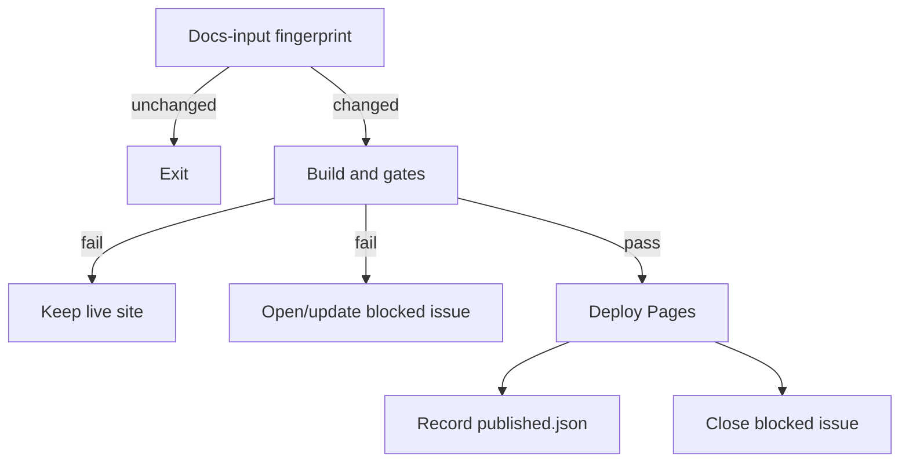
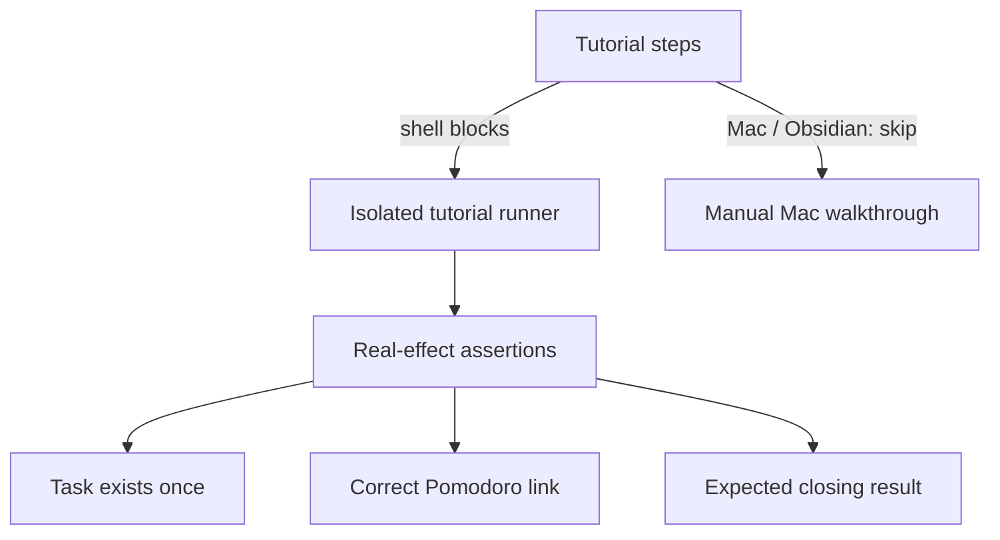
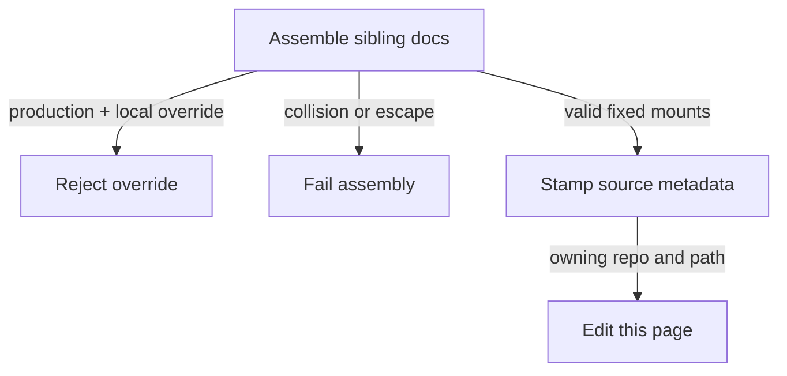

# Diagram proposals: Bob public documentation: one Diátaxis site on GitHub Pages

Proposals for the swarm linker, not a report. Each diagram restates only what the source
report says. All three describe the proposed design, not an implemented system.

```yaml
source: research:202610/bob_public_docs_site/bob_public_docs_site__final.md
producer: research.24.image
check: "mmdc 12.0.0 rendered 3 of 3 Mermaid diagrams"
```

## publication-gates

```yaml
anchor: |-
  A failed gate never deploys, so the last good site stays live.
illustrates: |-
  Unchanged fingerprints exit; failed gates keep the last good site live and open or update one blocked issue, which closes on the next success.
caption: Proposed publishing gates preserve the live site and track one blocked-publish issue.
```



## tutorial-verification

```yaml
anchor: |-
  It runs the tutorial's shell blocks in an isolated `HOME`, XDG
illustrates: |-
  The tutorial runner asserts real effects in isolation, while Mac and Obsidian steps are skipped and walked by hand on a Mac.
caption: Proposed tutorial checks combine automated effect assertions with manual Mac and Obsidian verification.
```



## assembly-safeguards

```yaml
anchor: |-
  **Stamp provenance.** The assembler writes `source:` front matter into the mounted
illustrates: |-
  Production refuses local overrides, assembly fails on path collisions or escapes, and source metadata points Edit this page at the owning repo and path.
caption: Proposed assembly rejects unsafe inputs and preserves page ownership through source metadata.
```


