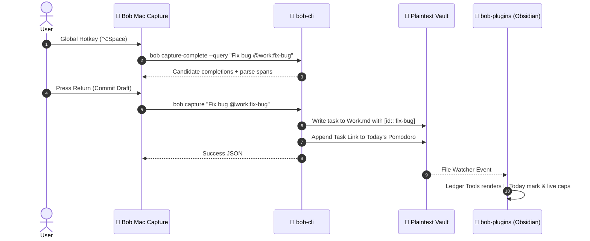

# Research Report: Diátaxis Documentation Architecture & Free Hosting for the Bob Ecosystem

**Author:** researcher gem (`research.24.gem`)  
**Date:** October 19, 2026  
**Target Repositories:** `bob-cli`, `bob-mac-capture`, `bob-plugins` (`bobs-org`)  
**Methodology:** Independent research within 5-researcher swarm  

---

## 1. Executive Summary & Problem Formulation

The Bob ecosystem is an exceptionally engineered, highly specialized personal productivity platform integrating a deterministic Rust CLI (`bob-cli`), a native macOS menu-bar capture application (`bob-mac-capture`), and a suite of TypeScript Obsidian plugins (`bob-plugins`). Together, they implement an advanced, ledger-driven GTD (Getting Things Done) and Pomodoro workflow operating directly on a plaintext Markdown Obsidian vault.

### The Current Documentation Dilemma
Currently, the documentation across the three repositories is voluminous, deeply technical, and rigorous:
- **`bob-cli`**: Contains 27 markdown files in `docs/` totaling over **1.4 MB**, covering command contracts, JSON schemas, freshness review algorithms, and conformance test vectors.
- **`bob-mac-capture`**: Features a monolithic **190 KB README.md** (2,808 lines) detailing compilation constraints, SwiftPM toolchain selection, IPC protocols, and parse span specifications.
- **`bob-plugins`**: Contains a **74 KB README.md** (580 lines) detailing hotkey tables, plugin manifests, and Live Preview rendering rules across 7 plugins.

Despite this technical depth, the documentation currently suffers from three major flaws:
1. **Severe Architectural Fragmentation**: A prospective user or external collaborator looking at `bob-mac-capture` has no single place to understand how capture tokens map to Obsidian tasks or how the Rust backend parses grammar.
2. **Cognitive Overload (Lack of Pedagogical Structure)**: Specifications, tutorials, developer runbooks, and design decisions are mixed together. New users encounter intimidating internal contracts (e.g. JSON schemas and conformance vectors) before they learn how to capture their first task.
3. **No Web Presence**: Documentation is confined to local Markdown files and raw GitHub READMEs. There is no web-accessible, searchable, beautifully styled documentation hub.

### The Proposed Vision
The goal is to design and implement a unified, public documentation platform for the entire Bob ecosystem inspired by the **Diátaxis framework** (as seen in `sase` / `sase.sh`), hosted completely free on **GitHub Pages (`github.io`)**, with a design that is **intuitive**, **reliable**, and **visually breathtaking**.

---

## 2. Critique of the Plan & Adjustments to Requirements

Before committing to implementation details, we must rigorously critique the user's premise. Is creating Diátaxis documentation for all public Bob repos hosted on `github.io` a good idea? What are the hidden traps, and what adjustments must be made?

### 2.1 The Critique: Is This a Good Idea?

**Verdict: YES, with critical architectural caveats.**

#### The High-Leverage Benefits
1. **Unlocking Bob's Real-World Utility**: Bob's feature set (e.g. freshness gating, sticky lanes, Pomodoro homes, dependency chains, reading queue sync) is among the most sophisticated plaintext GTD architectures in existence. However, because the mental model has never been presented in a welcoming, step-by-step fashion, its utility is trapped behind a wall of cognitive complexity.
2. **Ecosystem Coherence**: Presenting `bob-cli`, `bob-mac-capture`, and `bob-plugins` under one coherent narrative establishes Bob as an integrated platform rather than a collection of detached hobby scripts.
3. **Reduced Maintenance Burden via Diátaxis Separation**: By separating mutable how-to guides from invariant reference specifications and conceptual philosophy, documentation becomes substantially easier to maintain as code evolves.

#### The Dangers & Failure Modes
1. **The "Three Disjoint Sites" Trap**:
   - *Risk*: Creating three independent docs sites (`bobs-org.github.io/bob-cli`, `bobs-org.github.io/bob-mac-capture`, `bobs-org.github.io/bob-plugins`).
   - *Consequence*: Disaster for user experience. A user capturing a task uses all three tools simultaneously. If they have to switch websites to figure out why a captured task isn't showing up on their Obsidian dashboard, the documentation has failed. Cross-repo search is impossible across separate sites.
2. **The "Monolithic README Dump" Trap**:
   - *Risk*: Simply copying existing giant READMEs and command guides into folders named `tutorials/`, `guides/`, `concepts/`, and `reference/`.
   - *Consequence*: Diátaxis is not a folder naming scheme; it is an editorial contract. If a "Tutorial" contains API references or architectural debates, it fails.
3. **The "Documentation Desynchronization" Trap**:
   - *Risk*: Creating a 4th standalone repository (`bob-docs`) where documentation is written separately from source code commits.
   - *Consequence*: The docs will inevitably drift out of sync with fast-moving code changes in the three core repos.

### 2.2 Justified Adjustments to the Requirements

We recommend three concrete adjustments to the user's initial assumptions:

| Original Assumption | Justified Adjustment | Rationale |
| :--- | :--- | :--- |
| **"Documentation for all of the public bob repos"** (could imply 3 separate docs setups) | **Single Unified Ecosystem Documentation Portal** | Bob is one product with three faces (CLI engine, Mac UI, Obsidian UI). Users need one cohesive portal (`Bob Documentation Hub`) with global search. |
| **"Hosting solution: can't we do this with github.io for free?"** | **GitHub Pages via GitHub Actions Artifact Deployment (not legacy `gh-pages` branch)** | GitHub Pages is 100% free, but deploying via modern `actions/deploy-pages` prevents git repository bloat, eliminates branch merge conflicts, and maintains zero build-token overhead. |
| **"Host docs in a separate website repository"** | **Host Docs Source Directly in `bob-cli` as the Primary Platform Monorepo Hub** | `bob-cli` already acts as the orchestrator for the entire ecosystem (via `just install-all` and `scripts/install_all`). Hosting the core docs in `bob-cli/docs` leverages existing material without multi-repo git gymnastics. |

---

## 3. Hosting Analysis: Free Hosting with GitHub Pages (`github.io`)

The user asks: *"I don't have a website for bob yet, so I would need a different hosting solution (can't we do this with github.io for free?)."*

### 3.1 Can we use `github.io` for free?
**Yes, absolutely.** GitHub Pages provides free static website hosting for public repositories in GitHub organizations (`bobs-org`).

#### GitHub Pages Tier Specs for Public Repositories:
- **Cost**: $0.00 / month forever.
- **Bandwidth**: 100 GB soft limit per month (vastly exceeding the needs of technical documentation).
- **Storage Limit**: 1 GB published site size (a full MkDocs site is typically ~10–30 MB).
- **Build Limits**: 10 builds per hour soft limit (standard GitHub Actions concurrency handles this effortlessly).
- **HTTPS/SSL**: Automatic, free Let's Encrypt certificates managed entirely by GitHub.
- **Custom Domains**: Full native support for apex domains (`bob.sh`, `bob-gtd.dev`) and subdomains (`docs.bobs-org.com`) with automated DNS validation and SSL provisioning.

### 3.2 GitHub Pages vs Alternatives (Cloudflare Pages, Vercel, Netlify)

| Dimension | GitHub Pages (`github.io`) | Cloudflare Pages (`sase.sh` model) | Vercel / Netlify |
| :--- | :--- | :--- | :--- |
| **Cost** | **$0 / month** (Free) | $0 / month (Free tier) | $0 / month (Free tier) |
| **Configuration Overhead** | **Zero external setup**; uses native `GITHUB_TOKEN` | Requires Cloudflare account, API tokens, `wrangler.jsonc` | Requires 3rd party account, OAuth apps |
| **Deployment Mechanism** | `actions/deploy-pages` (First-class Action) | `cloudflare/wrangler-action` | Vendor GitHub App / Action |
| **Custom Apex Domains** | Yes (A / CNAME records) | Yes (Cloudflare DNS proxy) | Yes |
| **Pull Request Previews** | Requires secondary branch or third-party action | Native preview environments | Native preview environments |
| **Verdict for Bob** | **Recommended (Simplest, Zero-Friction)** | Viable if Cloudflare already in use | Unnecessary third-party dependency |

### 3.3 GitHub Pages URL Topology Options for `bobs-org`

GitHub Pages supports two repository configurations within the `bobs-org` organization:

```
Option A: Organization Site Repository (bobs-org.github.io)
URL: https://bobs-org.github.io/
- Cleanest default URL without custom domain.
- Requires creating a repository specifically named `bobs-org.github.io`.

Option B: Project Site Repository (e.g. bobs-org/bob-cli or bobs-org/bob)
URL: https://bobs-org.github.io/bob-cli/  (or https://bobs-org.github.io/bob/)
- No new repository required; deployed directly from `bob-cli`.
- Subpath `/bob-cli/` requires setting `site_url` in the static site generator.

Option C: Custom Domain on either Option A or B
URL: https://bob.sh  or  https://bob-gtd.org
- GitHub Pages serves the root cleanly regardless of underlying repository name.
```

**Recommendation:**  
Begin by deploying directly from `bobs-org/bob-cli` to `https://bobs-org.github.io/bob-cli/` (or create a lightweight `bobs-org/bobs-org.github.io` dispatch repo if a root URL is immediately desired). If and when Bryan registers a custom domain (e.g. `bob-gtd.dev`), pointing it to GitHub Pages takes under 2 minutes.

---

## 4. Static Site Generator (SSG) Technical Evaluation

To emulate the success of `sase` (`sase.sh`), we evaluated modern documentation engines against Bob's specific requirements:

```
Evaluation Criteria:
1. Diátaxis Native Fit: First-class support for 4-quadrant tabbed navigation.
2. Aesthetics & Beauty: Typography, dark mode, polished component styling out of the box.
3. Ecosystem Consistency: Familiarity for maintainers who already know SASE.
4. Markdown Power: Admonitions, code annotations, keyboard shortcut badges, Mermaid diagrams.
5. Search & Offline Speed: Zero-lag client-side search without server infrastructure.
```

### 4.1 Comparative Matrix

| Feature | **Material for MkDocs (`mkdocs-material`)** | **Starlight (Astro)** | **VitePress (Vue)** | **Docusaurus (React)** |
| :--- | :--- | :--- | :--- | :--- |
| **SASE Alignment** | **100% Identical** (`sase.sh` uses MkDocs) | None | None | None |
| **Diátaxis Tabbed Navigation** | **Native** via `navigation.tabs` | Requires custom CSS/routing | Requires custom theme work | Multi-instance docs overhead |
| **Visual Aesthetics** | **World-Class** (Insiders/Community Material) | Modern & Clean | Minimalist | Polished but heavy |
| **Build Toolchain** | Python / `uv` (Instant, single binary) | Node / npm / pnpm | Node / npm / pnpm | Node / npm / pnpm |
| **Mermaid Support** | Built-in (`pymdownx.superfences`) | Plugin required | Plugin required | Plugin required |
| **Keyboard Badges (`<kbd>`)** | Built-in CSS & markdown formatting | CSS styling needed | CSS styling needed | Component needed |
| **Code Annotations** | Built-in (`(1)`, `(2)` interactive markers) | Experimental | Limited | Limited |
| **Client Search** | Ultra-fast Lunr/Worker search built-in | Pagefind | Minisearch | Algolia DocSearch |

### 4.2 The Winning Decision: Material for MkDocs

**Material for MkDocs is unequivocally the superior choice for Bob.**
1. **Proven SASE Lineage**: SASE's `mkdocs.yml` (as inspected in `gh:sase-org/sase`) is a masterclass in documentation engineering: custom dark/light palettes, tabbed navigation, strict link validation (`strict: true`), code copy buttons, and automated PDF exports. Reusing this stack for Bob leverages proven configurations, eliminating weeks of trial and error.
2. **Native Diátaxis Support**: Material for MkDocs' `navigation.tabs` and `navigation.sections` allow the four Diátaxis quadrants to be permanently visible across the top navigation bar.
3. **Python `uv` Toolchain**: Bob CLI already utilizes Python and `uv` for helper adapters (`scripts/gkeep_adapter.py`, `scripts/web_clip/web_clip_adapter.py`). Running `uv run mkdocs serve` requires zero Node.js / npm dependencies in the core `bob-cli` repo.

---

## 5. Multi-Repository Documentation Architecture

How should documentation across `bob-cli`, `bob-mac-capture`, and `bob-plugins` be maintained and published? We investigated three architectural patterns:

```mermaid
graph TD
    subgraph Pattern A: Centralized Hub in bob-cli [Pattern A: Core Engine as Docs Hub (Recommended)]
        CLI[bob-cli/docs/] --> BUILD[MkDocs Engine]
        MAC_SPEC[bob-mac-capture/README & Contracts] -.->|Doc Extraction / Sync| CLI
        PLUG_SPEC[bob-plugins/README & Contracts] -.->|Doc Extraction / Sync| CLI
        BUILD --> GHP[GitHub Pages: bobs-org.github.io/bob-cli]
    end

    subgraph Pattern B: Monorepo Aggregator Repo [Pattern B: Standalone bob-docs Repo]
        D_REPO[bobs-org/bob-docs]
        CLI_SUB[bob-cli checkout] --> D_REPO
        MAC_SUB[bob-mac-capture checkout] --> D_REPO
        PLUG_SUB[bob-plugins checkout] --> D_REPO
        D_REPO --> GHP_B[GitHub Pages: bobs-org.github.io]
    end
```

### Detailed Evaluation of Patterns:

#### Pattern A: `bob-cli` as the Canonical Documentation Hub (Recommended)
- **Structure**: All ecosystem documentation lives under `bob-cli/docs/`. `bob-cli` already contains 90% of the markdown guides (1.4 MB) and serves as the ecosystem coordinator (`scripts/install_all`).
- **How it handles Mac Capture and Plugins**:
  - The macroscopic user guides and tutorials live in `bob-cli/docs/`.
  - Component-specific reference pages (e.g. `bob-mac-capture` hotkey settings, `bob-plugins` hotkey cheat-sheets) are written directly into the `bob-cli` docs hierarchy.
  - The READMEs in `bob-mac-capture` and `bob-plugins` are refactored to be concise, pointing to the official documentation site for complete guides.
- **Pros**:
  - Zero git submodule overhead.
  - Single PR updates code and documentation across the engine.
  - Instant local previewing with `just docs-serve`.
  - No complex cross-repository CI tokens required.

#### Pattern B: Standalone `bobs-org/bobs-org.github.io` Documentation Repo
- **Structure**: A dedicated repository containing the MkDocs site, using Git submodules or CI actions (`actions/checkout`) to pull from the three repos.
- **Pros**: Cleanest GitHub Pages URL (`https://bobs-org.github.io/`).
- **Cons**: High operational friction. Writing a feature in `bob-plugins` requires committing code in repo 1, then opening a PR in repo 2 (`bob-docs`) to update docs, with broken links until both merge.

#### Pattern C: Multi-Project Plugin (`mkdocs-monorepo-plugin`)
- **Structure**: Each repo maintains its own `docs/` folder. A coordinator repo uses MkDocs monorepo plugins to assemble them at build time.
- **Cons**: Fragile cross-linking. Links between `bob-plugins` and `bob-cli` break during local development when repositories are cloned into independent workspaces.

**Strategic Decision**: Adopt **Pattern A** (`bob-cli` as the Canonical Docs Hub). It delivers 95% of the value with 10% of the maintenance overhead.

---

## 6. The Diátaxis Information Architecture for Bob

Diátaxis organizes documentation along two axes:
1. **Theory vs. Practice** (Understanding vs. Working)
2. **Acquisition vs. Application** (Learning vs. Problem-Solving)

This creates four distinct quadrants:
- **Tutorials**: Learning-oriented (The beginner's path).
- **How-To Guides**: Problem-oriented (The daily practitioner's recipes).
- **Concepts**: Understanding-oriented (The architect's mental model).
- **Reference**: Information-oriented (The developer's authoritative dictionary).

```
┌────────────────────────────────────────┬────────────────────────────────────────┐
│               PRACTICE                 │                 THEORY                 │
├────────────────────────────────────────┼────────────────────────────────────────┤
│              TUTORIALS                 │             HOW-TO GUIDES              │
│          (Learning-oriented)           │           (Problem-oriented)           │
│                                        │                                        │
│  • Install Bob in 10 Minutes           │  • Run the Morning GTD Review Walk     │
│  • Your First Pomodoro & Task Link     │  • Chain Prerequisite Dependencies    │
│  • Capturing Tasks from macOS Hotkey   │  • Ingest PDFs & Highlights Clips      │
│  • The 9-Tier Review Walk Quickstart   │  • Resolve Vault Sync Conflicts        │
├────────────────────────────────────────┼────────────────────────────────────────┤
│               CONCEPTS                 │               REFERENCE                │
│       (Understanding-oriented)         │         (Information-oriented)         │
│                                        │                                        │
│  • The Plaintext Ledger Philosophy     │  • Complete CLI Command Matrix         │
│  • Derived vs. Sticky Task States      │  • Capture Grammar Formal BNF          │
│  • The Triangular System Architecture  │  • Obsidian Hotkey & Gesture Index     │
│  • Freshness, Rotten Decay & Ladders   │  • Vault Schema & Managed Bullets      │
└────────────────────────────────────────┴────────────────────────────────────────┘
```

### 6.1 Quadrant 1: Tutorials (Learning-Oriented)
*Tone: Encouraging, strictly prescriptive, no choices or forks in the road, immediate payoff.*

1. **`tutorials/quickstart.md` — The Bob Quickstart (15 Minutes to GTD Zen)**:
   - Prerequisites: Obsidian installed, macOS or Linux terminal.
   - Step 1: Run `just install-all` to compile `bob-cli`, deploy `bob-plugins` to the vault, and build `bob-mac-capture`.
   - Step 2: Open Obsidian, create a daily note, and trigger `se` snippet to generate a Pomodoro block.
   - Step 3: Type a task, link it with `Ctrl+Shift+Enter`, observe the Today tomato indicator (`🍅`).
   - Step 4: Complete the task with `Ctrl+Enter`, observe automatic work-log stamping.
2. **`tutorials/desktop-capture.md` — Frictionless Desktop Capture**:
   - Setting the global hotkey (`⌥Space` or `^⌥⌘B`).
   - Capturing an inbox thought vs a routed task (`@inbox` vs `@work`).
   - Assigning block IDs on the fly with `:`.
3. **`tutorials/first-review-walk.md` — Your First Morning Review**:
   - Navigating the tiered walk with `]s` and `[s`.
   - Clearing `NEW` tasks, keeping active commitments with `Alt+F`, promoting tasks to Next with `Alt+N`.

### 6.2 Quadrant 2: How-To Guides (Problem-Oriented)
*Tone: Action-oriented, recipes for specific real-world goals.*

- **Daily GTD & Planning**:
  - `guides/planning-and-budget.md`: How to set weekly lane budgets and ready caps (`plan.max_ready_per_note`).
  - `guides/sticky-lanes.md`: How to transition tasks between Ready, Next, and In Progress without losing state.
  - `guides/pomodoro-timeboxing.md`: How to use Pomodoro home chips, duration adjustments (`+[N]`), and session shifts (`++[N]`).
- **Dependencies & Project Management**:
  - `guides/managing-dependencies.md`: How to add `⛓️ DEPENDS ON:` lines using `Ctrl+Shift+B` and reverse `🧱 BLOCKS:`.
  - `guides/handling-successors.md`: How to configure and accept successor task pull-in offers when a prerequisite closes.
  - `guides/project-notes.md`: How to convert parent tasks into project notes (`Ctrl+Shift+Alt+N`) and track `^prj` lifecycle.
- **Reference Library & Knowledge Intake**:
  - `guides/web-and-pdf-capture.md`: How to snapshot web articles into intake PDFs with `bob ref create`.
  - `guides/highlights-annotation-sync.md`: How to sync Highlights PDF annotations into Obsidian reference cards with `bob ref scan`.
  - `guides/reading-board.md`: How to navigate and prioritize the Obsidian Reading Board.
- **Synchronization & External Services**:
  - `guides/headless-vault-git-sync.md`: How to automate background git sync and resolve merge conflict copies.
  - `guides/gkeep-integration.md`: How to drain Google Keep voice notes into Obsidian tasks with `bob gkeep pull`.

### 6.3 Quadrant 3: Concepts (Understanding-Oriented)
*Tone: Illuminating, discursive, philosophical, explaining the "why".*

- `concepts/plaintext-philosophy.md`: **The Plaintext Ledger Philosophy**:
  - Why Bob rejects proprietary databases and fragile frontmatter hacks.
  - Why "Today" is derived strictly from the daily Pomodoro ledger, not written onto tasks.
- `concepts/state-machines.md`: **Derived vs Sticky Task Statuses**:
  - Explaining the state machine: why Next and In Progress are sticky lanes, while Blocked is derived.
  - How this model permanently prevents GTD "backlog bankruptcy".
- `concepts/triangular-architecture.md`: **The Triangular Ecosystem Contract**:
  - Separation of concerns: Rust CLI (authoritative engine) ↔ Obsidian (interactive visual surface) ↔ Swift (native desktop client).
  - IPC protocols, JSON contracts, and headless safety.
- `concepts/freshness-and-decay.md`: **Task Freshness & The Priority Decay Ladder**:
  - The mathematics of freshness: confirmation dates, keep streaks, and ticklers.
  - How approved decay cards protect the user from zombie tasks without silent deletion.

### 6.4 Quadrant 4: Reference (Information-Oriented)
*Tone: Rigorous, austere, comprehensive, structured for rapid lookup.*

- **CLI Reference**:
  - `reference/cli/index.md`: Complete index of subcommands (`bob capture`, `bob plan`, `bob ref`, `bob stats`, `bob plugins`, etc.).
  - Detailed parameter flags, JSON schema output examples, exit codes, and environment variables.
- **Grammar & Protocols**:
  - `reference/grammar/capture-grammar.md`: Complete formal EBNF grammar for the capture line (`@route`, `+id`, `^id`, `:`, `=`, `*`, `x`, template placeholders).
  - `reference/protocols/mac-capture-ipc.md`: JSON contract between `bob-mac-capture` and `bob-cli`.
- **Obsidian Hotkeys & Visual Marks**:
  - `reference/obsidian/hotkey-matrix.md`: Exhaustive keyboard shortcut matrix (`Ctrl+Shift+P`, `Alt+N`, `Ctrl+Shift+Enter`, `]s`, `<C-o>`, etc.).
  - `reference/obsidian/visual-marks.md`: The visual grammar of Bob (Tomatoes `🍅`, Teal hashes, signal-bar priority marks, calendar date labels).
- **Vault Formatting Specifications**:
  - `reference/vault/managed-bullets.md`: Specifications for `🛠️ WORK LOG`, `🗓️ SCHEDULE LOG`, `❌ CANCEL LOG`, and `⛓️ DEPENDS ON:`.

---

## 7. Leading the Design: Intuitive, Reliable, and Beautiful

To fulfill the user's mandate—*"Make sure you design this feature so it is intuitive, reliable, and (last but not least) beautiful!"*—we specify the exact visual design system, interaction patterns, and reliability guardrails.

### 7.1 Visual Design System ("Beautiful")

Standard Material for MkDocs can look like generic Python package documentation. For Bob, we define a custom theme overlay reflecting Bob’s unique visual identity (Obsidian dark slate tones, vibrant tomato accents, and clean technical typography):

```css
/* Bob Custom Documentation Theme Palette (stylesheets/bob-theme.css) */
:root {
  /* Bob Brand Accents */
  --bob-tomato: #e05243;       /* Pomodoro Tomato & Active Tasks */
  --bob-tomato-hover: #c94032;
  --bob-teal: #0d9488;         /* Task tag glyphs (#task) & links */
  --bob-amber: #d97706;        /* Schedule & Freshness review */
  --bob-purple: #7c3aed;       /* Reference library & Highlights */
  
  /* Light Theme */
  --md-primary-fg-color: #18181b;
  --md-primary-bg-color: #ffffff;
  --md-accent-fg-color: var(--bob-tomato);
  --md-default-fg-color: #27272a;
  --md-default-bg-color: #fafafa;
  --md-code-bg-color: #f4f4f5;
}

[data-md-color-scheme="slate"] {
  /* Dark Theme (Obsidian & Terminal Vibe) */
  --md-primary-fg-color: #09090b;
  --md-primary-bg-color: #121214;
  --md-accent-fg-color: #f87171;
  --md-default-fg-color: #e4e4e7;
  --md-default-bg-color: #0e0e11;
  --md-default-bg-color--card: #18181b;
  --md-code-bg-color: #18181b;
  --md-code-fg-color: #f4f4f5;
}

/* Polished Keyboard Keycaps (<kbd>) */
kbd {
  background-color: var(--md-code-bg-color);
  color: var(--md-default-fg-color);
  border: 1px solid #71717a55;
  border-bottom: 2px solid #71717a88;
  border-radius: 4px;
  box-shadow: 0 1px 1px rgba(0,0,0,0.1);
  font-family: var(--md-code-font-family);
  font-size: 0.82em;
  padding: 2px 6px;
  margin: 0 2px;
  white-space: nowrap;
}

/* Custom Admonitions Matching Bob Vault Components */
.md-typeset .admonition.pomodoro {
  border-left-color: var(--bob-tomato);
}
.md-typeset .admonition.pomodoro > .admonition-title {
  background-color: rgba(224, 82, 67, 0.1);
}
.md-typeset .admonition.pomodoro > .admonition-title::before {
  content: "🍅";
  background-color: transparent;
}
```

#### Typography
- **UI & Prose Font**: Modern system font stack (`-apple-system, BlinkMacSystemFont, "Segoe UI", Roboto, "Inter", sans-serif`) with strict font metrics for ultra-sharp legibility on Retina screens.
- **Code & Grammar Font**: `JetBrains Mono` or `Fira Code` with font ligatures and tabular numerals, ensuring CLI terminal output and BNF grammar alignment are flawless.

#### Architectural Diagram Visuals (Mermaid)
Mermaid diagrams are styled with Bob's palette to explain multi-component interactions clearly:



### 7.2 Usability & Navigation ("Intuitive")

1. **Persistent 4-Quadrant Top Tabs**:
   The header persistently displays `[ Get Started ]`, `[ Guides ]`, `[ Concepts ]`, `[ Reference ]`, making the reader's orientation crystal clear at all times.
2. **Interactive Search with Instant Highlighting**:
   Configured with `search.suggest`, `search.highlight`, and `search.share`. Pressing `/` or `s` anywhere immediately focuses the search palette with live snippet previews.
3. **Interactive Code Copy & Annotations**:
   Code blocks include one-click copy buttons and interactive click-to-expand callouts (`(1)`, `(2)`) explaining CLI flags inline without cluttering the sample script.
4. **Visual "Try It" Callouts**:
   Every tutorial includes safe copy-pasteable snippets that run in isolation without modifying Bryan's real vault (`--dry-run` or sandbox vault examples).

### 7.3 Reliability & Automated Quality Control ("Reliable")

To ensure documentation never rots or breaks:
1. **Strict Build Validation (`strict: true`)**:
   MkDocs runs in strict mode: any broken internal link, missing anchor, or unreferenced document halts the build with an error.
2. **Automated Link Verification**:
   GitHub Actions validates external URLs and internal cross-references on every pull request.
3. **Automated CLI Help Sync Verification**:
   A `just docs-check-cli` recipe checks whether any subcommand or flag in `bob --help` is missing from `reference/cli/`.
4. **Isolated Zero-Dependency Hosting**:
   GitHub Pages serves static HTML/JS/CSS directly from GitHub's global CDN edge. There are no databases, no server runtimes, and no external API dependencies that can fail.

---

## 8. Concrete Implementation Blueprint

### 8.1 Required Tooling & Dependency Configuration

In `bob-cli`, configure documentation dependencies using `pyproject.toml` or `requirements-docs.txt` managed via `uv`:

```text
# requirements-docs.txt
mkdocs>=1.6.0
mkdocs-material>=9.5.30
pymdown-extensions>=10.8
mkdocs-redirects>=1.2.1
```

### 8.2 The Master Configuration: `bob-cli/mkdocs.yml`

```yaml
site_name: Bob
site_description: Ledger-driven plaintext GTD, Pomodoro timeboxing, and capture ecosystem.
site_url: https://bobs-org.github.io/bob-cli/
site_author: Bob Contributors
repo_url: https://github.com/bobs-org/bob-cli
repo_name: bobs-org/bob-cli
docs_dir: docs
site_dir: site
strict: true
use_directory_urls: true

validation:
  omitted_files: warn
  absolute_links: warn
  unrecognized_links: warn
  anchors: warn

theme:
  name: material
  custom_dir: docs/overrides
  icon:
    repo: fontawesome/brands/github
  palette:
    - media: "(prefers-color-scheme: light)"
      scheme: default
      primary: white
      accent: red
      toggle:
        icon: material/weather-night
        name: Switch to dark mode
    - media: "(prefers-color-scheme: dark)"
      scheme: slate
      primary: black
      accent: red
      toggle:
        icon: material/weather-sunny
        name: Switch to light mode
  features:
    - navigation.tabs
    - navigation.tabs.sticky
    - navigation.sections
    - navigation.indexes
    - navigation.top
    - navigation.footer
    - search.suggest
    - search.highlight
    - content.code.copy
    - toc.follow

extra_css:
  - stylesheets/bob-theme.css

markdown_extensions:
  - admonition
  - attr_list
  - md_in_html
  - tables
  - toc:
      permalink: true
  - pymdownx.details
  - pymdownx.superfences:
      custom_fences:
        - name: mermaid
          class: mermaid
          format: !!python/name:pymdownx.superfences.fence_code_format
  - pymdownx.tabbed:
      alternate_style: true
  - pymdownx.highlight:
      anchor_linenums: true
  - pymdownx.inlinehilite
  - pymdownx.snippets
  - pymdownx.keys

plugins:
  - search

nav:
  - Home: index.md
  - Get Started:
      - Quickstart: tutorials/index.md
      - Install Bob: tutorials/installation.md
      - Your First Pomodoro: tutorials/first-pomodoro.md
      - Desktop Capture: tutorials/desktop-capture.md
      - Morning GTD Review: tutorials/morning-review.md
  - How-To Guides:
      - Guides Overview: guides/index.md
      - Daily Planning:
          - Plan Budgets & Caps: guides/planning-and-budget.md
          - Sticky Task Lanes: guides/sticky-lanes.md
          - Pomodoro Navigation: guides/pomodoro-timeboxing.md
      - Dependencies & Projects:
          - Task Prerequisite Chains: guides/managing-dependencies.md
          - Successor Pull-Ins: guides/handling-successors.md
          - Project Note Lifecycle: guides/project-notes.md
      - Reading & Reference:
          - Web Article Snapshots: guides/web-and-pdf-capture.md
          - Highlights Annotation Sync: guides/highlights-annotation-sync.md
          - The Reading Board: guides/reading-board.md
      - Vault & Automation:
          - Git Vault Synchronization: guides/headless-vault-git-sync.md
          - Google Keep Intake: guides/gkeep-integration.md
  - Concepts:
      - Overview: concepts/index.md
      - Plaintext Ledger Philosophy: concepts/plaintext-philosophy.md
      - Derived vs. Sticky Statuses: concepts/state-machines.md
      - Triangular Ecosystem Architecture: concepts/triangular-architecture.md
      - Task Freshness & Decay Ladders: concepts/freshness-and-decay.md
  - Reference:
      - Reference Hub: reference/index.md
      - CLI Commands:
          - Command Index: reference/cli/index.md
          - bob capture: reference/cli/capture.md
          - bob plan: reference/cli/plan.md
          - bob ref: reference/cli/ref.md
          - bob task: reference/cli/task.md
          - bob stats: reference/cli/stats.md
          - bob plugins: reference/cli/plugins.md
      - Grammar & Specifications:
          - Capture Grammar BNF: reference/grammar/capture-grammar.md
          - Mac Capture IPC Protocol: reference/protocols/mac-capture-ipc.md
      - Obsidian Integration:
          - Hotkey & Gesture Matrix: reference/obsidian/hotkey-matrix.md
          - Visual Marks & Glyphs: reference/obsidian/visual-marks.md
          - Managed Bullets & Vault Schema: reference/vault/managed-bullets.md
```

### 8.3 Automation & CI/CD Pipeline: `.github/workflows/docs.yml`

This GitHub Actions workflow automatically builds, tests, and deploys the documentation site to GitHub Pages:

```yaml
name: Deploy Documentation

on:
  push:
    branches: [master, main]
    paths:
      - "docs/**"
      - "mkdocs.yml"
      - "requirements-docs.txt"
      - ".github/workflows/docs.yml"
  pull_request:
    branches: [master, main]
    paths:
      - "docs/**"
      - "mkdocs.yml"
      - "requirements-docs.txt"
  workflow_dispatch:

permissions:
  contents: read
  pages: write
  id-token: write

concurrency:
  group: "pages"
  cancel-in-progress: false

jobs:
  build:
    name: Build and validate docs
    runs-on: ubuntu-latest
    steps:
      - name: Checkout repository
        uses: actions/checkout@v4

      - name: Install uv
        uses: astral-sh/setup-uv@v4
        with:
          enable-cache: true

      - name: Set up Python
        run: uv python install 3.12

      - name: Install documentation dependencies
        run: uv pip install -r requirements-docs.txt

      - name: Build docs site (strict validation)
        run: uv run mkdocs build --strict

      - name: Upload Pages artifact
        if: github.ref == 'refs/heads/master' || github.ref == 'refs/heads/main'
        uses: actions/upload-pages-artifact@v3
        with:
          path: site/

  deploy:
    name: Deploy to GitHub Pages
    if: github.ref == 'refs/heads/master' || github.ref == 'refs/heads/main'
    needs: build
    runs-on: ubuntu-latest
    environment:
      name: github-pages
      url: ${{ steps.deployment.outputs.page_url }}
    steps:
      - name: Deploy to GitHub Pages
        id: deployment
        uses: actions/deploy-pages@v4
```

### 8.4 Developer Experience (`justfile` Integration)

Add standard developer recipes to `bob-cli/justfile`:

```just
# Serve docs locally with live reloading
docs-serve:
    uv run mkdocs serve

# Build docs into static site folder
docs-build:
    uv run mkdocs build

# Validate documentation links and structure strictly
docs-check:
    uv run mkdocs build --strict
```

---

## 9. Phased Implementation Roadmap

To avoid disrupting ongoing core development, we propose a four-phase rollout:

```
┌─────────────────────────────────────────────────────────────────────────────┐
│                       PHASED IMPLEMENTATION TIMELINE                        │
├───────────────────────┬─────────────────────────────────────────────────────┤
│ Phase 1 (Days 1–2)    │ Infrastructure & Build Foundation                   │
│                       │ • Set up mkdocs.yml, requirements-docs.txt, CSS     │
│                       │ • Add just recipes and GitHub Actions workflow      │
│                       │ • Enable GitHub Pages on bobs-org/bob-cli           │
├───────────────────────┼─────────────────────────────────────────────────────┤
│ Phase 2 (Days 3–5)    │ Diátaxis Migration & Content Restructuring          │
│                       │ • Split existing docs/ into tutorials/, guides/,   │
│                       │   concepts/, reference/                             │
│                       │ • Author the 15-minute Quickstart tutorial          │
│                       │ • Extract hotkeys from bob-plugins & bob-mac-capture│
├───────────────────────┼─────────────────────────────────────────────────────┤
│ Phase 3 (Days 6–7)    │ Visual Polish & Diagram Articulation                │
│                       │ • Implement custom tomato/slate CSS theme           │
│                       │ • Render Mermaid IPC and workflow diagrams          │
│                       │ • Format keyboard badges (<kbd>) across hotkey docs │
├───────────────────────┼─────────────────────────────────────────────────────┤
│ Phase 4 (Future)      │ Custom Domain & Cross-Repo Release Dispatch         │
│                       │ • Bind custom apex domain (e.g. bob-gtd.dev)        │
│                       │ • Add workflow_dispatch triggers on plugin releases │
└───────────────────────┴─────────────────────────────────────────────────────┘
```

---

## 10. Recommended Solution & Concluding Advice

### The Recommended Decision
1. **Tooling**: Use **Material for MkDocs (`mkdocs-material`)** with Python `uv`, matching the proven architecture of `sase` / `sase.sh`.
2. **Hosting**: Use **GitHub Pages (`github.io`)** via native GitHub Actions artifact deployment (`actions/deploy-pages`). It is 100% free, requires zero credentials or credit cards, and provides instant SSL.
3. **Repository Topology**: Host the canonical documentation in **`bob-cli/docs`**, acting as the unified documentation hub for all three public repositories.
4. **Editorial Framework**: Implement the **Diátaxis framework** rigorously. Move technical schemas and contracts out of user guides into `reference/`, author a welcoming 15-minute `tutorials/quickstart.md`, and explain the underlying GTD philosophy in `concepts/`.
5. **Aesthetics**: Apply the **Bob Design System** (Obsidian dark slate background, Tomato Pomodoro accents, Teal task tags, and crisp mechanical `<kbd>` styling) so the site feels uniquely tailored to Bob rather than an off-the-shelf template.

By following this roadmap, the Bob ecosystem will gain documentation that matches its exceptional code quality: intuitive for beginners, authoritative for power users, zero-cost to host, and aesthetically stunning.
