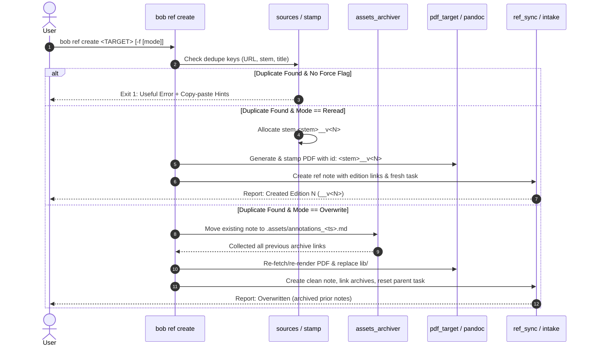

# Architectural Design & Research: `bob ref create --force <mode>` (Reread vs. Overwrite)

**Author:** Researcher `gem` (Independent Swarm Evaluation)  
**Date:** October 2026  
**Target Component:** `bob-cli` (`bob ref create`, `highlights_ref`, `ref_library`)  
**Status:** Research & Design Proposal  

---

## 1. Executive Summary

This report investigates the proposal to introduce a new `-f|--force <mode>` option to `bob ref create` with two operational modes: `"reread"` (defaulting when bare `-f|--force` is passed) and `"overwrite"`.

### The Core Problem
In `bob-cli`'s current architecture, reference capture is strictly idempotent and defensive. Once a URL or target is captured into a reference note with an associated library PDF, attempting to re-run `bob ref create` triggers a hard refusal (`already captured as <path> (source_url <url>)`). The current `--force` flag is a boolean switch solely permitted to overwrite unfiled, intake-queued PDFs in `xlib/`; it explicitly refuses to overwrite filed library PDFs or reference notes in `lib/` and `ref/`.

However, in Bryan's personal knowledge management (PKM) and GTD workflow, references are not static, one-time artifacts:
1. **The Reread Use Case:** Readers often revisit foundational papers, books, or articles years later. When rereading, a user desires a *clean reading pass*: an un-annotated PDF to avoid anchoring on past highlights, a fresh open reading task in their active GTD queue, and full bidirectional linking to their historical highlights and notes.
2. **The Overwrite Use Case:** Upstream captures sometimes fail or capture suboptimal snapshots (e.g. paywall landing pages, corrupted DOM rendering, outdated preprints). In such scenarios, the user wants to re-clip the reference from scratch while retaining an audited archive of whatever exploratory notes or annotations they had already penned.

### High-Level Evaluation & Verdict
* **Is this a good idea?** **Yes, with essential refinements.** Providing native support for versioned rereads and safe overwrites addresses a major functional gap in Bob's reference lifecycle.
* **The Critical UX/CLI Hazard:** Traditional UNIX convention dictates that `-f|--force` implies *destructive clobbering*. Setting the default mode of bare `--force` to non-destructive `"reread"` is an intentional safety guardrail for PKM, but creates a semantic mismatch. Furthermore, in Clap 4, optional option values (`num_args(0..=1)`) introduce severe argument parsing ambiguities against positional arguments (`TARGET`) unless strict equals syntax (`require_equals(true)`) or specialized parsing is enforced.
* **The Recommended Solution:** 
  1. Support the requested `-f|--force [mode]` syntax with `require_equals(true)` (defaulting bare `-f` to `reread`).
  2. Additionally expose `-R, --reread` as a first-class, ergonomic CLI alias for the reread workflow, keeping `-f, --force` intuitive.
  3. Structure the `"reread"` edition lifecycle using `<stem>__v<N>` naming across file stems, reference IDs, and PDF markers, fully conforming to `decisions:reference-ids-follow-file-stems`.
  4. Structure the `"overwrite"` archival into sibling asset bundles `<stem>.assets/annotations_<timestamp>.md`, which are natively exempt from reference index scans and fully visible/clickable in Obsidian.
  5. Update `RefIndex::apply_supersession` so that intentional edition chains do not trigger `duplicate_identity` diagnostics.

---

## 2. Current Architecture & As-Is Mechanics

To understand the blast radius of this feature, we must examine how `bob ref create` currently discovers, deduplicates, and files references.

### 2.1 The Two-Phase Deduplication Barrier

When `bob ref create <TARGET>` is invoked, it passes through two separate deduplication firewalls:

```
                  ┌───────────────────────────────┐
                  │    bob ref create <TARGET>    │
                  └──────────────┬────────────────┘
                                 │
                     Target is URL / arXiv?
                     /                    \
                   YES                     NO
                   /                        \
┌──────────────────────────────┐    ┌──────────────────────────────┐
│ sources::check_dedupe        │    │ stamp::plan_default_target   │
│ Scans: ref/ and xlib/        │    │ Checks: occupants & title    │
└──────────────┬───────────────┘    └──────────────┬───────────────┘
               │                                   │
      Existing Ref Note?                  Existing Ref Note?
      /               \                   /               \
    YES                NO               YES                NO
    /                   \               /                   \
[HARD ERROR]          Continue      [HARD ERROR]          Continue
"already captured"    to fetch      "already captured"    to render
```

1. **Syntactic URL Deduplication (`sources.rs`):**
   * Before fetching, `collect_recorded_source_urls()` recursively scans `ref/` and `xlib/`.
   * For every matching `source_url` or `url`, if `is_refusing_ref_note()` is true (i.e. the note carries a `source_pdf`), it exits with an immediate `SourcesError`:
     ```text
     already captured as ref/papers/attention.md (source_url https://arxiv.org/abs/1706.03762)
     hint: open the note, or delete it to recapture
     ```
   * *Notice:* It does not check `--force` here when a reference note exists. The current `force` flag only bypasses the check if the hit is an intake-queued PDF in `xlib/`.

2. **Target Occupancy & Title Matching (`stamp.rs`):**
   * For local files, Markdown, or derived stems, `plan_default_target` checks `occupancy.occupants(&candidate)`.
   * If an existing candidate has occupants, `candidate_is_same_reference` compares marker IDs and PDF Info titles.
   * If it is a *different* reference, it automatically increments `_<N>` (`<stem>_2`, `<stem>_3`).
   * If it is the *same* reference in `lib/` or `ref/`, it throws a hard error:
     ```text
     already captured as lib/papers/attention.pdf (Attention Is All You Need); pass -N/--name to capture under a different name
     ```

### 2.2 The Reference Note & Reading Task Anatomy

A reference in Bob consists of four interconnected artifacts:
1. **The Reference Note (`ref/<ref_type>/<stem>.md`):** Contains YAML frontmatter (`id`, `title`, `source_pdf`, `source_url`, `status`), reading task embeds, authored notes, and the managed highlights block (`<!-- highlights:begin -->` ... `<!-- highlights:end -->`).
2. **The Stamped PDF (`lib/<ref_type>/<stem>.pdf`):** Contains a page-1 PDF scan marker embedding `{id: "<stem>", source_note: "ref/<ref_type>/<stem>.md", ...}`.
3. **The Parent Reading Task (`<parent>.md`):** Modern (v2) reading tasks live in the parent area/project/inbox note:
   ```markdown
   - [ ] #task #ref [[ref/papers/attention]] [id:: sase__ref-attention] ^ref-attention
   ```
4. **Highlights Sidecar / Companion Audio:** E.g., `lib/<ref_type>/<stem>.textbundle` or `lib/<ref_type>/<stem>.mp3`.

---

## 3. Comprehensive Critique of the Proposed Plan

The user’s prompt outlines a specific approach:
> Add `-f|--force <mode>` accepting `"overwrite"` or `"reread"`, defaulting to `"reread"` if bare `-f|--force` is specified. On `"reread"`, create `__v<N>`. On `"overwrite"`, delete the note, log current annotations somewhere, recreate from scratch, and link the log.

Let us evaluate the strengths, flaws, and risks of this design.

### 3.1 Critique Point 1: The Semantic Inversion of `--force`

In UNIX CLI culture (`rm -f`, `cp -f`, `mv -f`, `git push -f`, `docker rm -f`), `--force` universally signifies:
> *"Override safety checks and **clobber / overwrite** the existing target."*

Under the user's proposal:
* `bob ref create <target> --force` -> Does **not** clobber. It creates a brand-new parallel file `__v2`.
* `bob ref create <target> --force=overwrite` -> Destructively deletes and overwrites.

#### Why Bryan likely designed it this way:
In a personal Zettelkasten / GTD system, accidental data loss is catastrophic. If bare `--force` defaulted to `"overwrite"`, a muscle-memory `-f` could wipe out months of carefully highlighted reading notes. Defaulting to `"reread"` is a **fail-safe guardrail against data loss**.

#### The Cognitive Friction:
A user typing `-f` typically expects to replace the file. Having `-f` create a second copy can feel surprising unless the documentation and CLI feedback make it glaringly obvious.

### 3.2 Critique Point 2: Clap 4 Optional-Argument Parsing Hazards

In Clap 4, configuring an argument to accept *optional values* while preceding positional arguments (`TARGET`) introduces severe parsing pitfalls:

```rust
// NAIVE IMPLEMENTATION:
Arg::new("force")
    .long("force")
    .short('f')
    .num_args(0..=1)
    .value_parser(["overwrite", "reread"])
    .default_missing_value("reread")
```

If implemented naively:
1. When a user runs:
   ```bash
   bob ref create --force https://arxiv.org/abs/1706.03762
   ```
   Clap evaluates `--force` and greedily consumes the next token (`https://arxiv.org/abs/1706.03762`) as the value of `--force`!
2. Clap tests `https://...` against `["overwrite", "reread"]` and immediately aborts with:
   ```text
   error: invalid value 'https://arxiv.org/abs/1706.03762' for '--force <mode>' [possible values: overwrite, reread]
   ```
3. The only ways to avoid this in Clap when using `num_args(0..=1)` are:
   * **Mandating Equals Syntax:** Adding `.require_equals(true)`. This requires `--force=overwrite` or `--force=reread`, allowing bare `--force` to sit cleanly before positional arguments. However, it means `bob ref create -f overwrite <target>` will fail because `-f overwrite` is parsed as bare `-f` followed by positional argument `overwrite`!
   * **Positional Placement:** Requiring options to appear *after* the positional argument: `bob ref create <target> --force overwrite`.
   * **Separate Flags:** Providing dedicated boolean flags: `--reread` (`-R`) and `--force` (`-f`).

### 3.3 Critique Point 3: Overwrite vs. Reread In Practice

| Dimension | "Reread" Mode (`__v<N>`) | "Overwrite" Mode |
| :--- | :--- | :--- |
| **User Intent** | Fresh reading pass for study / synthesis. | Repair botched clip, or re-clip major update. |
| **PDF Handling** | Fresh PDF `lib/.../<stem>__v2.pdf`. | Replaces `lib/.../<stem>.pdf`. |
| **Highlights in App** | Clean canvas in Highlights.app. | Wipes PDF highlights in Highlights.app. |
| **Inbound Links** | Completely intact; old note preserves block IDs. | Preserved at note level, but block IDs (`^h-...`) break. |
| **Reading Task** | New open task `[ ]` alongside historical task. | Resets existing reading task to `[ ]`. |
| **Risk Profile** | **Zero Risk:** purely additive. | **Medium/High Risk:** mutates files & breaks block links. |

**Verdict:** "Reread" is the true primary workflow for knowledge workers. "Overwrite" is an administrative repair tool. Treating them as peer enum values of a single flag obscures this distinction.

---

## 4. Deep Dive Design: The "Reread" Lifecycle (`__v<N>`)

The `"reread"` mode creates a parallel reference representing a new reading pass.

### 4.1 Naming and Allocation Mechanics

The specification requires:
> `__v<N>` suffix in the filename (and ID and anywhere else that should be de-duplicated), where `<N>` is the first available integer starting at 2.

#### Why `__v<N>` is superior to `_<N>`:
In `stamp.rs:295`, Bob already generates `_<N>` (`<stem>_2`, `<stem>_3`) when two *completely different* documents collide on the same title stem (e.g., two distinct blog posts titled "Reflections").
Using double-underscore `__v<N>` (`attention_is_all_you_need__v2`) creates an unambiguous, semantic distinction:
* `_<N>` = Unrelated stem collision.
* `__v<N>` = Intentional subsequent edition/reading pass of the **same** reference.

#### Allocation Algorithm:
```rust
pub fn allocate_reread_stem(config: &Config, ref_type: &str, base_stem: &str) -> Result<String> {
    // Strip any existing __v<N> suffix to find the true root stem
    let root = match base_stem.split_once("__v") {
        Some((prefix, suffix)) if suffix.chars().all(|c| c.is_ascii_digit()) => prefix,
        _ => base_stem,
    };
    
    for version in 2..=999 {
        let candidate = format!("{root}__v{version}");
        let note_path = config.ref_dir.join(ref_type).join(format!("{candidate}.md"));
        let pdf_path = config.lib_dir.join(ref_type).join(format!("{candidate}.pdf"));
        let intake_path = config.xlib_dir.join(ref_type).join(format!("{candidate}.pdf"));
        
        if !note_path.exists() && !pdf_path.exists() && !intake_path.exists() {
            return Ok(candidate);
        }
    }
    Err(CommandError::new("exhausted reread version allocation up to v999"))
}
```

### 4.2 Complete Identity Alignment (`decisions:reference-ids-follow-file-stems`)

Under `decisions:reference-ids-follow-file-stems`:
> "A reference's recorded `id` equals its note stem. The only exception is a `_N` suffix that avoids a duplicate across `ref/`."

When creating `attention_is_all_you_need__v2`:
1. **Note Filename:** `ref/papers/attention_is_all_you_need__v2.md`
2. **Note Frontmatter ID:** `id: attention_is_all_you_need__v2`
3. **PDF Filename:** `lib/papers/attention_is_all_you_need__v2.pdf`
4. **PDF Page-1 Scan Marker:** `id: attention_is_all_you_need__v2`
5. **Reading Task Block ID:** `^ref-attention-is-all-you-need--v2`

Because the filename stem and recorded `id` are identical (`attention_is_all_you_need__v2`), this design **fully complies** with Bob's architectural invariants.

### 4.3 Handling Downstream Indexing & `duplicate_identity`

Currently, `RefIndex::apply_supersession` in `src/native/ref_library/mod.rs` contains:
```rust
if backed.len() > 1 {
    let detail = format!("shared identity {key} across PDFs: {}", paths.join(", "));
    for index in sharing {
        rows[*index].diagnostics.push(Diagnostic::new("duplicate_identity", &detail));
    }
}
```
If two PDF-backed reference notes share the same `source_url`, Bob flags them with a `duplicate_identity` diagnostic!

#### The Required Architectural Adjustment:
`apply_supersession` must be enhanced to recognize versioned edition chains:
* If multiple PDF-backed notes share an identity key, and their stems share a root via `__v<N>`, they are **not** duplicates.
* They form an **Edition Chain**:
  * The highest `<N>` is the **Current Edition**.
  * Lower versions are marked as **Prior Editions**.
  * `bob ref find <url>` ranks the current edition first, but cleanly lists prior editions under an `editions:` group.

### 4.4 Bidirectional Edition Linking in Markdown (The "Beauty" Dimension)

To make this feature beautiful and intuitive in Obsidian, `bob ref create` should automatically weave bidirectional links between editions:

#### In the new edition (`ref/papers/attention__v2.md`):
```markdown
---
status: ready
parent: "[[reading_list]]"
title: "Attention Is All You Need (Edition 2)"
id: attention__v2
edition: 2
edition_of: "[[ref/papers/attention]]"
source_pdf: "[[lib/papers/attention__v2.pdf]]"
source_url: https://arxiv.org/abs/1706.03762
---

# Attention Is All You Need

> [!info] Reading Pass · Edition 2
> 📖 Prior reading pass: [[ref/papers/attention]] (captured 2024-05-12)

![[reading_list#^ref-attention--v2]]

## Highlights

<!-- highlights:begin -->
<!-- highlights:end -->
```

#### In the prior edition (`ref/papers/attention.md`):
Bob appends a non-destructive callout at the top of the historical note:
```markdown
> [!note] Newer Edition Available
> 🚀 A subsequent reading pass was initiated on 2026-10-25: [[ref/papers/attention__v2]].
```

---

## 5. Deep Dive Design: The "Overwrite" Lifecycle

The `"overwrite"` mode resets a reference from scratch while safely capturing its existing state.

### 5.1 Where Should Existing Annotations Be Logged?

The requirement states:
> "delete the existing reference note, log its annotations (i.e. the current ref note contents) somewhere, create the ref note from scratch, and then add a link to the logged annotations (and any previous ones that existed before the `bob ref create` command was run)."

Let us evaluate the candidate storage locations:

```
Candidate Locations for Logged Annotations:
├── A. In-vault root archive: archive/ref/...          ❌ Too distant; clutters vault root
├── B. Hidden dot-folder: .bob/annotations/...        ❌ Inaccessible via Obsidian UI
├── C. Subfolder in ref/: ref/papers/_archive/...     ❌ Scanned by ref library unless patched
└── D. Companion assets: ref/papers/<stem>.assets/...  ✅ PERFECT: Already ignored by indexer!
```

#### Why `ref/<ref_type>/<stem>.assets/` is the Ideal Location:
1. **Indexer Exemption:** As established in `src/native/ref_library/mod.rs:233`:
   ```rust
   if name.starts_with('.') || name.ends_with(".assets") {
       *skipped += count_markdown_under(&path);
       continue;
   }
   ```
   Files inside `<stem>.assets/` are **already explicitly excluded** from the reference library index. They will never cause duplicate identity errors or pollute `bob ref list`.
2. **Obsidian Compatibility:** Obsidian fully indexes `.assets` folders. Bryan can click wikilinks directly into them, search them, and view their rendered Markdown.
3. **Ref Rename Safe:** `bob ref rename` already treats `<stem>.assets/` as a companion directory that moves alongside the reference note!
4. **Natural Aggregation:** Multiple successive overwrites naturally accumulate in the same directory:
   ```text
   ref/papers/
   ├── attention.md
   └── attention.assets/
       ├── annotations_20260401_093000.md
       └── annotations_20261025_164500.md
   ```

### 5.2 Preserving Previous Archives ("And Any Previous Ones")

When overwriting `attention.md`:
1. Bob creates `ref/papers/attention.assets/` if it does not exist.
2. Bob copies current `ref/papers/attention.md` to `ref/papers/attention.assets/annotations_<TIMESTAMP>.md`.
3. Bob deletes the old `ref/papers/attention.md`.
4. Bob scans `ref/papers/attention.assets/` for all `annotations_*.md` files.
5. In the freshly created `attention.md`, Bob inserts a dedicated **Previous Annotations** section:
   ```markdown
   ## Previous Annotations

   * 📜 [[ref/papers/attention.assets/annotations_20261025_164500|Archived Annotations (2026-10-25 16:45)]]
   * 📜 [[ref/papers/attention.assets/annotations_20260401_093000|Archived Annotations (2026-04-01 09:30)]]
   ```

### 5.3 What Happens to Parent Reading Tasks During Overwrite?

If the parent note (`sase.md`) contains an existing reading task:
```markdown
- [x] #task #ref [[ref/papers/attention]] [completion:: 2026-06-01] [id:: sase__ref-attention] ^ref-attention
```
If we recreate `attention.md` from scratch, what should happen to this task?
* **Option A: Leave it `[x]` (Done).** Flawed: The user requested an overwrite to re-read/re-capture. If the reading task stays marked done, it will not appear in Bob's active reading queues.
* **Option B: Delete and insert a new task.** Flawed: Leaves dead block ID references and causes Git churn.
* **Option C (Recommended): Reset the Task to Ready (`[ ]`).**
  Bob updates the parent line in-place:
  ```markdown
  - [ ] #task #ref [[ref/papers/attention]] [id:: sase__ref-attention] ^ref-attention
  	- 🛠️ **WORK LOG**
  		- *2026-10-25* — Reset to ready via bob ref create --force=overwrite
  ```
  This cleanly schedules the overwritten document back into Bryan's GTD flow!

---

## 6. Recommended CLI Design & Ergonomics

To balance the user's specific requirements with UNIX expectations and Clap 4 parser robustness, we propose a **Unified Ergonomic Design**.

```
┌────────────────────────────────────────────────────────────────────────┐
│                        Recommended CLI Interface                       │
├────────────────────────────────────────────────────────────────────────┤
│ 1. Primary Contract (User's Exact Specification):                      │
│    bob ref create <TARGET> -f [mode]                                   │
│    bob ref create <TARGET> --force[=<mode>]                            │
│    * [mode] can be "reread" (default) or "overwrite"                   │
│                                                                        │
│ 2. First-Class Dedicated Aliases (Clap & Shell Perfection):            │
│    bob ref create <TARGET> -R / --reread      (Pure Reread)            │
│    bob ref create <TARGET> --overwrite        (Pure Overwrite)         │
└────────────────────────────────────────────────────────────────────────┘
```

### 6.1 Clap Definition

To prevent Clap from eating the positional `<TARGET>` argument when `--force` is used without an explicit value, we configure `require_equals(true)` for the value of `--force`, while providing `--reread` as an ergonomic shortcut:

```rust
Arg::new("force")
    .long("force")
    .short('f')
    .value_name("MODE")
    .num_args(0..=1)
    .require_equals(true)
    .default_missing_value("reread")
    .value_parser(["reread", "overwrite"])
    .help("Handle duplicate reference: reread (default) or overwrite")

Arg::new("reread")
    .long("reread")
    .short('R')
    .action(ArgAction::SetTrue)
    .conflicts_with("force")
    .help("Create a new versioned reading pass (__v<N>)")
```

### 6.2 Error Diagnostics & Useful Guidance

If the user attempts to capture a duplicate reference without specifying `-f` or `-R`, Bob exits with exit code `1` and prints an informative, beautifully styled message:

```
bob: error: reference already exists: ref/papers/attention.md (source_url https://arxiv.org/abs/1706.03762)

To create a new reading pass (version 2):
  bob ref create https://arxiv.org/abs/1706.03762 -f
  bob ref create https://arxiv.org/abs/1706.03762 --reread

To overwrite the existing note (archiving current annotations):
  bob ref create https://arxiv.org/abs/1706.03762 --force=overwrite
```

---

## 7. Implementation Roadmap & Technical Touchpoints



### 7.1 Files to Modify

1. **`src/native/highlights_ref/cli.rs` & `create.rs`:**
   * Update CLI argument definitions for `force` (`num_args(0..=1)`, `require_equals(true)`, `value_parser`).
   * Add `reread` flag / alias.
   * Expand `CreateOptions` with `force_mode: Option<ForceMode>` enum (`Reread`, `Overwrite`).
2. **`src/native/highlights_ref/sources.rs`:**
   * Modify `check_dedupe` to accept `force_mode: Option<ForceMode>`.
   * When `force_mode == Some(ForceMode::Reread)`, bypass refusal and allow downstream target generation to select `__v<N>`.
   * When `force_mode == Some(ForceMode::Overwrite)`, allow overwriting the target.
   * Format the refusal error with actionable hints.
3. **`src/native/highlights_ref/stamp.rs`:**
   * In `plan_default_target`, implement `allocate_reread_stem` when in `Reread` mode.
   * Stamping logic assigns marker ID `<stem>__v<N>`.
4. **`src/native/highlights_ref/intake.rs` & `sync.rs`:**
   * Add archival helper: `archive_existing_annotations(config, note_path)`.
   * Inject "Previous Annotations" section when archive files exist.
   * Reset existing parent reading task on overwrite.
5. **`src/native/ref_library/mod.rs`:**
   * Update `apply_supersession` so notes sharing an identity key that are part of an edition chain (`__v<N>`) do not earn `duplicate_identity` diagnostics.
6. **`docs/ref.md`:**
   * Document `-f, --force [mode]` and `-R, --reread`.
   * Document edition conventions and `.assets/` annotation archive behavior.

---

## 8. Summary of Recommendations

1. **Adopt the Feature with Full Endorsement:** The ability to cleanly reread and safely overwrite references fills a genuine workflow need in Bryan's vault.
2. **Standardize on `<stem>__v<N>`:** Reserve single-underscore `_<N>` for unrelated collisions and double-underscore `__v<N>` for intentional edition chains.
3. **Store Annotation Archives in `<stem>.assets/`:** Leverage the vault's built-in `.assets` indexing exemption to ensure archives never pollute reference lists while remaining 100% visible and clickable in Obsidian.
4. **Shield Against Clap Parsing Gotchas:** Use `.require_equals(true)` for `--force[=mode]` and provide `-R, --reread` as a frictionless first-class alias.
5. **Enrich Obsidian Backlinks:** Ensure new editions link to their predecessors, older editions link forward to newer passes, and overwritten notes link to all historical archives.
