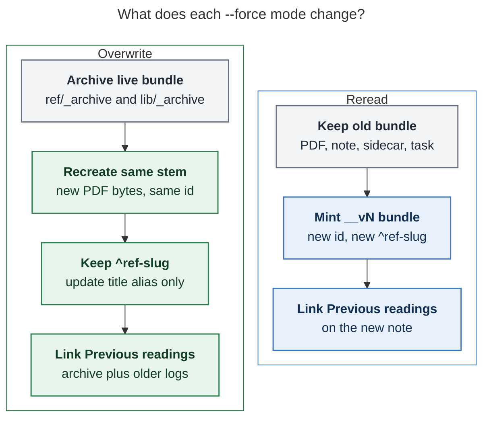
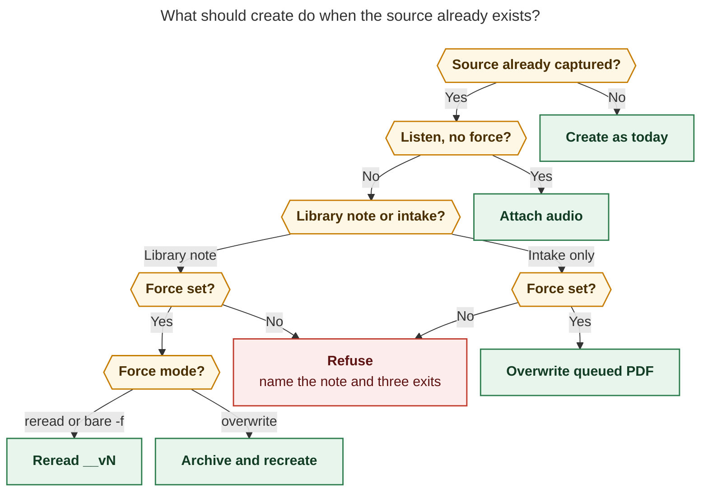

# `bob ref create --force reread|overwrite`

Researcher: grk  
Date: 2026-10-25  
Scope: bob-cli `bob ref create` duplicate-source handling, reference identity, Highlights bundles, vault ingest

## Verdict

Build this. The need is real: the current refusal already tells Bryan to **delete the note and recapture**, which is the unsafe version of the gesture he is asking to make first-class.

Do not treat this as a boolean “clobber it” switch, and do not treat it as a note-only rewrite. A reference is a **bundle** (PDF, sidecar, assets, audio, ref note, v2 reading task) whose identity is split across `source_url`, the file stem / `id`, and the `^ref-<slug>` task. The beautiful design is two recapture gestures on the flag that already exists:

| Gesture | What it is | Default? |
| --- | --- | --- |
| **reread** | A new reading pass. Old bundle stays. New bundle is `__vN`. | Yes, for a library hit. |
| **overwrite** | Replace the live copy in place. Archive the old note (and its bundle), recreate the same stem, keep the reading task, link the archive. | Explicit `--force overwrite` only. |

Bare `-f` / `--force` should mean **reread** on a library hit, and should keep today’s meaning on a **queued intake PDF** (overwrite that PDF). Automatic producers (`ingest_url`, `bob ref jobs`, `bob gkeep pull`) never recapture.

The stated plan is directionally right and under-specified in the places that would desync Highlights, Today, and `bob ref find`. The adjustments below are the difference between a lovely command and a second copy of the “delete it to recapture” footgun.


## Recommended solution in one page

```text
bob ref create <TARGET> [-f|--force[=reread|overwrite]]
```

- No flag + PDF-backed library hit → **exit 1**, with a hint that names the note and the three exits (`show`, `--force` / `--force=reread`, `--force=overwrite`).
- `-f` / `--force` / `--force=reread` + library hit → **reread**: install `<stem>__vN` (first free N ≥ 2), new `id`, new reading task, `reread_of: <canonical-stem>`, unmanaged `Previous readings:` links, old bundle untouched.
- `--force=overwrite` / `--force overwrite` + library hit → **overwrite**: copy the live bundle into `ref/_archive/` and `lib/_archive/`, recreate the original stem, **keep** `^ref-<slug>` and inbound task links, seed `Previous readings:` with the new archive plus any archives already linked.
- Either force mode + **intake-only** hit → today’s intake overwrite (there is no note to version).
- `--listen` without force → today’s attach-audio path.
- `ingest_url` / jobs / Keep → still `AlreadyInLibrary` / `AlreadyQueued`.

That is the design. The rest of this report is why, what to change in the request, and how to land it without breaking the library.

## Current behavior, measured from this tree

`bob ref create` already has `-f, --force` as a **boolean**, help text “Overwrite an existing target PDF” (`src/native/highlights_ref/create.rs`). It is **not** a recapture of a library note.

Three different “already exists” machines sit on top of each other:

### 1. URL identity (`source_url` / `url`)

`sources::check_dedupe` runs **before any fetch**. A PDF-backed ref note is a hard refusal even with `--force`:

```text
already captured as ref/blogs/existing.md (source_url https://…)
hint: open the note, or delete it to recapture
```

Covered by `highlights_create_folded_refuses_library_and_dedupe_collisions_early` (`tests/cli/highlights/create.rs`): a captured URL **must refuse even with `--force`**, and the adapter must not run.

A queued intake PDF refuses without `--force` and overwrites **the same intake path** with `--force`. A legacy note with the URL but no `source_pdf` warns and captures a fresh copy (`legacy_hits`). `--listen` on a refusing hit **attaches** audio to the existing PDF (`attach.rs`); it does not recapture.

Collections refuse the whole invocation if any part is already PDF-backed or queued. `--force` overwrites only a queued collection with the **same URL set**.

`ingest_url` (capture worker, `bob gkeep pull`) uses the same dedupe with `force = false` and returns `AlreadyInLibrary` / `AlreadyQueued`. `bob ref create` never calls `ingest_url`.

### 2. Stem occupancy (`<stem>`, `<stem>_2`, …)

`plan_default_target` walks `<stem>`, `<stem>_2`, … `<stem>_999`. A candidate occupied by a **different** reference is skipped. A candidate occupied by the **same** reference:

- library PDF or ref note → refuse (`already captured as …`; hint is `--listen`)
- intake-only → refuse without `--force`, overwrite with `--force`

`--force` never selects another reference’s candidate. The recorded `id` follows the **final** output basename (`decisions:reference-ids-follow-file-stems`, `docs/ref.md`).

### 3. Vault-note snapshots (`source_note`)

Vault notes already have a reread story: default name `<note-stem>_<YYMMDD>`. A second snapshot **the same day** refuses with `already queued` (use `-f` to replace the queued PDF) or `already captured`. A later day creates another dated snapshot **without** `--force`. Create never rewrites earlier snapshot notes; it only hints when one is still `ready` with 0 highlights.

So: URL/PDF library hits cannot be duplicated at all; vault notes already version by date; `--force` only clobbers **intake** (and exact `-o` targets, and different-bytes companion audio).

### What “already captured” actually owns

A modern reference is not a markdown file:

| Piece | Role |
| --- | --- |
| `lib/<type>/<stem>.pdf` | Highlights document; page-1 marker `id` = stem |
| sidecar / `.textbundle` | Live Highlights annotations |
| `ref/<type>/<stem>.md` | Projection + unmanaged user prose |
| `ref/<type>/<stem>.assets/` | Image selections keyed with `^h-` |
| companion audio | Same stem beside the PDF |
| v2 reading task in the parent | `- [m] #task #ref [[ref/…\|Title]] ^ref-<slug>` |
| managed embed in the ref note | `![[parent#^ref-<slug>]]` |

`^h-` IDs hash the PDF path plus payload. The v2 block ID is `ref-<slug>` of the stem (`slug_ref_stem` turns every non-alphanumeric run into `-`, so `foo__v2` becomes `ref-foo-v2`). Today joins on `(task.path, task.block_id)`. Scan walks every PDF under `lib/`. The index flags several PDF-backed notes sharing a URL key as `duplicate_identity`. `bob ref show <URL>` treats any other multi-match as `ambiguous reference`.

Deleting “the ref note” and running create again is therefore **not** a recapture. It orphans the reading task, leaves the PDF/sidecar live for Highlights, and invites the next scan to resurrect or fight the leftover bundle.

## Critique of the stated plan

The request is the right product question: **I already have this source; I want another copy, or I want this copy remade.** Four gaps in the literal wording would make the feature unlovely or unsafe.

### 1. `-f|--force <mode>` collides with a live flag, and with sibling `-f` meaning format

`-f, --force` is already a public boolean on create. `bob ref scan`, `bob ref list`, and `bob ref show` use `-f` for `--format`. `bob plugins sync` and `bob freshness seed` use `-F/--force` because `-f` is format.

Changing the same flag from `ArgAction::SetTrue` to an optional value is a **parse** change, not just a help change:

- Combined shorts such as `-fd` and `-fL` currently mean force+dry-run and force+listen. An optional value makes `-fd` look like MODE `d`.
- `bob ref create --force https://…` currently sets the boolean and takes the URL as `TARGET`. An optional value can steal the URL as MODE unless the parser only consumes `reread` / `overwrite`.
- `bob ref create URL --force overwrite` with `require_equals(true)` would leave `overwrite` as a **second TARGET** (create is variadic) and try a nonsense collection.

The user’s space-separated `-f overwrite` is the form we should accept. The implementation has to lock that with tests, not clap folklore.

### 2. “Delete the existing reference note” is the wrong overwrite unit

Overwrite that only deletes `ref/<type>/<stem>.md` leaves the PDF in `lib/`, the sidecar, assets, audio, and the v2 reading task. Scan will either refuse the new note’s destination or rebuild the old identity. Highlights may still have the old PDF open (`decisions:open-pdf-writes-are-coordinated`).

Overwrite has to be **archive the live bundle, then recreate the same stem**. The reading task stays: that is how Today, Depends-On, and relations survive. The user asked to delete the note, not the GTD object.

### 3. “Log annotations somewhere” is underspecified, and the note is not the annotation store

The live Highlights annotations live in the sidecar / TextBundle. The ref note’s managed region is a **projection**, plus unmanaged prose outside `<!-- highlights:begin -->`. Logging “the current ref note contents” is the right **Obsidian** artifact (quotes, comments, `^h-` IDs, user prose). It is not a restore of the Highlights document unless the PDF and sidecar are archived too.

A git blob is not a log Bryan can click. The log has to be a vault note with a stable wikilink.

### 4. Reread as a second PDF-backed note with the same `source_url` is currently a health error

`apply_supersession` emits `duplicate_identity` when two PDF-backed notes share a URL key. `bob ref show <URL>` becomes `ambiguous reference`. If reread mints `__vN` and we do nothing else, every intentional second pass looks like library corruption.

Reread needs a recorded family (`reread_of`, `reading_pass`) and the index must treat that family as **one source, several passes**, not as a duplicate-identity failure.

### 5. Defaulting bare `--force` to reread is right for library hits and wrong if it also rewrites intake

Today `--force` on a queued PDF is the way you recapture a bad clip **before** a note exists. Scripts and vault-note same-day snapshots depend on it. Bare `--force` must keep that intake meaning. Reread is the default only when a **library note** is the hit.

### 6. `__v<N>` is a good reading-pass marker; it must not reuse `_N`

`_2`, `_3` already mean “this stem was taken by a **different** reference.” A reread of `attention_is_all_you_need` that landed on `attention_is_all_you_need_2` would look like a collision suffix, not a second pass. `__v2` is greppable and already rhymes with the reserved `__final` audio-script suffix. N starts at 2 so the original stays unsuffixed. Do **not** rename the original to `__v1` (that would be an annotated rename).

### 7. Automatic create paths must not grow this flag

If jobs or Keep pull ever passed `--force reread`, a retried clip would mint `__v2`, `__v3`, … forever. Recapture is a **human** gesture on `bob ref create` only.

## Requirement adjustments (explicit)

These change the request. Each is justified.

1. **Keep `-f/--force` as the family name, make MODE optional, default missing value `reread`.** Honor the requested spelling. Implement it so a following positional TARGET is never consumed as MODE. Regression-test `create --force URL`, `create URL --force`, `create URL --force overwrite`, `create URL --force=overwrite`, and combined shorts. If clap 4.6 cannot keep `-fd` / `-fL`, document `--force -d` / `--force --listen` and drop combined-short force; do not silently steal `d` or `L` as a mode.

2. **Intake-only hits: any `--force` still overwrites the queued PDF.** There is no note, no reading task, no annotation log. This preserves today’s boolean `--force` success path. Both MODE values do the same thing here; help should say so.

3. **Overwrite archives the bundle, then recreates the same stem.** It does not `rm` the note and hope. It does not mint a new `^ref-<slug>` when the stem is reused. It does not reset the reading-task checkbox unless `-s` is passed.

4. **The annotation log is a skipped archive note, plus the PDF/sidecar/assets/audio moved beside it.** Path convention:

   ```text
   ref/_archive/<type>/<stem>__<YYYYMMDDTHHMMSS>.md
   lib/_archive/<type>/<stem>__<YYYYMMDDTHHMMSS>.pdf
   ```

   plus sidecar, `.textbundle`, `.assets/`, and companion audio under the same timestamped stem. Scan, create occupancy, and URL dedupe **skip** `_archive/` the way they skip hidden directories and `*.assets/`. Obsidian wikilinks still resolve. `bob ref show` on an exact archive path still prints the logged note.

5. **Previous-reading links live in unmanaged body**, one blank line under the managed embed (and audio), **outside** `<!-- highlights:begin -->`, so scan will not clobber them:

   ```markdown
   Previous readings: [[ref/_archive/blogs/foo__20261025T093015]] · [[ref/_archive/blogs/foo__20260901T120000]]
   ```

   Harvest existing `Previous readings:` links (and a `previous_readings` frontmatter list if present) from the note about to be archived, then prepend the new archive. Frontmatter `reread_of` / `reading_pass` / `archived_from` are **note-local**, like `created`: they never join the PDF marker projection.

6. **Reread records a family and suppresses `duplicate_identity` for that family.** New note gets `reread_of: <canonical-stem>` and `reading_pass: N`. `bob ref find <URL>` lists every live pass. `bob ref show <URL>` prefers the newest **open** pass and lists siblings under `also:` (`foo__v2 (reread 2)`). Exact stem/id remains unique.

7. **`--listen` without force stays attach.** `--force reread --listen` narrates the **new** PDF. `--force overwrite --listen` narrates the replacement. Do not attach to a bundle you are about to archive.

8. **Vault-note dated snapshots stay the reread mechanism for `source_note`.** Do not require `--force` to snapshot a note on a new day. Same-day queued snapshot keeps today’s `-f` intake overwrite. Same-day **library** snapshot plus `--force overwrite` replaces today’s snapshot (archive it first). `--force reread` on a vault note is allowed but unusual (`<stem>_<YYMMDD>__v2`).

9. **Collections: force applies only to the same URL set.** A single URL that is already a **part** of a collection still refuses, with a hint naming the collection. Do not silently extract a part into `__v2`. Reread/overwrite of the full set versions or replaces the collection as one reference.

10. **Open Highlights PDF: overwrite refuses (or coordinates) ; reread never touches it.** Follow `decisions:open-pdf-writes-are-coordinated`. On Linux, refuse overwrite when an internal reading probe says the PDF is in use; otherwise replace after the archive copy. Never use `.forReplacing`.

11. **Dry-run prints the plan and writes nothing.** Including archive destinations, `__vN` stem, inherited parent, and `Previous readings:` preview.

12. **This is a CLI contract change.** `--force` on a library hit goes from “always error” to “reread.” Mark the landing commit `feat(ref)!` if parse or success-path scripts change; the boolean `--force` success path for intake must keep working. Do not edit `Cargo.toml` / `CHANGELOG.md` (release train). Docs: `just docs-gen` plus `docs/highlights-create.md` Dedupe section. Completion: `Kind::Choices` for MODE.

13. **No Mac panel and no plugin UI in v1.** Bob Mac Capture stays a thin client. Obsidian “Snapshot note to Highlights” already shells out to create; `-f` without a value keeps working. A Refs “Recapture…” card can wait until the CLI is boring.

## Recommended CLI design

### Help shape

Keep options alphabetical. Replace the current force help with something a person can scan:

```text
-f, --force[=MODE]    Recapture a source that already exists
                      MODE: reread (default) | overwrite
```

After-help (Dedupe paragraph, not a novel):

- Bare `-f` / `--force` is `reread` when a library note owns the source.
- `--force overwrite` archives that note and recreates it in place.
- A queued intake PDF is overwritten under either MODE (today’s `--force`).
- Without `--force`, a library hit refuses and prints the three exits.

### Clap sketch

```rust
Arg::new("force")
    .long("force")
    .short('f')
    .value_name("MODE")
    .num_args(0..=1)
    .default_missing_value("reread")
    .value_parser(["reread", "overwrite"])
    .help("Recapture a source that already exists: reread (new __vN note) or overwrite (archive and replace). Bare -f means reread. A queued intake PDF is overwritten under either mode.")
```

Use `default_missing_value`, **not** `default_value`: an absent flag must remain `None`.

Do **not** set `require_equals(true)`. That would make `--force overwrite` a second TARGET. The value parser is what stops `--force --listen` from eating `--listen`.

If `bob ref create --force URL` fails clap 4.6.6’s parser (URL is not a MODE), add a 15-line argv shim in `create::run` that only treats the next word as MODE when it is exactly `reread` or `overwrite` (case-insensitive). Lock both spellings with CLI tests. This is the one clap pitfall that is allowed to add code.

Fallback, only if combined shorts or TARGET stealing cannot be made safe: keep `-f/--force` as a boolean reread/intake-overwrite gate and add `-F, --overwrite` (short is free on create). That is clap-native and matches `plugins` / `freshness`, but it is **not** the requested spelling. Prefer making the requested spelling work.

### Exit status and copy

Reuse `report_create_error`: first line after `error:`, then `hint:`. Proposed library-hit refusal (no force):

```text
bob ref: error: already captured as ref/papers/attention_is_all_you_need.md (source_url https://arxiv.org/abs/1706.03762)
hint: bob ref show attention_is_all_you_need
hint: bob ref create <URL> --force            # new reading pass → attention_is_all_you_need__v2
hint: bob ref create <URL> --force overwrite  # archive the live note and recapture in place
hint: bob ref create <URL> --listen           # attach audio to the existing PDF
```

Color the `error` token as today. Put the existing note path in the first line so a script can grep it. Do not mention `__vN` in the error unless the next free stem is not `__v2` (if `__v2` is taken, say `__v3`).

Invalid MODE:

```text
bob ref: error: invalid --force mode 'clobber'
hint: use --force, --force=reread, or --force=overwrite
```

Overwrite while the PDF is open:

```text
bob ref: error: lib/papers/attention_is_all_you_need.pdf is open in Highlights
hint: close it, or use --force reread to leave it alone and make a __vN copy
```

Ambiguous overwrite (two live PDF-backed notes, no `reread_of` family):

```text
bob ref: error: source matches more than one live reference: ref/blogs/a.md, ref/blogs/b.md
hint: pass the note you mean as -o/--output, or reread from a chosen stem with -N
```

### Dry-run lines (library reread)

```text
force: reread
renamed: attention_is_all_you_need.md already captured; using attention_is_all_you_need__v2
previous: [[ref/papers/attention_is_all_you_need]]
parent: sase · inherited from existing reference
writes: none
```

### Dry-run lines (library overwrite)

```text
force: overwrite
archive: ref/papers/attention_is_all_you_need.md → ref/_archive/papers/attention_is_all_you_need__20261025T093015.md
keep: reading task ^ref-attention-is-all-you-need in sase.md
previous: [[ref/_archive/papers/attention_is_all_you_need__20261025T093015]] · [[ref/_archive/papers/attention_is_all_you_need__20260901T120000]]
writes: none
```

## What each mode does to the bundle



**Caption.** Reread is additive. Overwrite is replace-in-place after an archive copy, and it is the only mode that is allowed to reuse the stem and the reading-task identity.



**Caption.** Force is a human override on `bob ref create`. Listen-without-force stays attach. Intake and library hits share the flag and split on MODE only when a live note exists.

These figures were not pre-rendered with mermaid-cli on this host (`mmdc` is not installed). They follow the research-PDF palette so a later render can freeze SVG/PNG.

## Identity rules

Follow the accepted decisions; do not reopen them here.

| Key | Reread | Overwrite |
| --- | --- | --- |
| `source_url` / dedupe key | Copied (same source) | Copied |
| File stem | `<canonical>__vN` | Unchanged |
| Frontmatter `id` / PDF marker `id` | Follows new stem | Unchanged (stem reused) |
| `^ref-<slug>` | New (`ref-foo-v2`) | Unchanged |
| Title | New capture’s title | New capture’s title; update the reading-task alias if it changed |
| `created` | Now | Now on the new note; archive keeps the old `created` |
| `captured` | New web-capture date | New web-capture date |
| Parent | Inherited from the existing note unless `-P` is passed | Unchanged (task stays in its residence) |
| Highlights `^h-` IDs | New PDF path → new IDs (correct) | New PDF bytes at the same path → new IDs on the next Mac scan; old IDs live in the archive note |
| Inbound wikilinks to the stem | Still point at v1 | Still point at the live note (same path) |
| Task Links / Today | Unchanged on v1; v2 is a new task | Survive because the block ID survives |

Canonical stem for `__vN`: strip a trailing `__v<digits>` if someone rereads a reread (`foo__v2` → next is `foo__v3`, not `foo__v2__v2`). Occupancy: first free N ≥ 2, skipping names taken anywhere under `xlib/`, `lib/`, or `ref/` except `_archive/`. Cap at `__v999` with the same “pass `-N`” failure as today’s `_999` walk.

`-N/--name` on a reread sets the **canonical** name to version; we still add `__vN` if that name’s URL identity collides. If Bryan wants a totally different identity for the same URL, that is this command, not `-N` alone: today `-N` does not bypass URL dedupe, and it should not start doing so without `--force`.

`--output` remains an exact path. Overwrite of that exact library PDF is `--force overwrite` plus the open-PDF guard. Do not collision-suffix an exact path (today’s rule).

## Archive format (overwrite)

The archived markdown is the **byte-for-byte live note** plus a thin frontmatter overlay (preserve unknown keys):

```yaml
archived_from: attention_is_all_you_need
archived_at: 2026-10-25T09:30:15-0400
ref_role: archive
```

Do not rewrite `^h-` IDs. Do not strip unmanaged prose. Do not run scan against `_archive/`. The live note is then created from scratch with `default_note_body`, after which create inserts the `Previous readings:` line in the unmanaged slot.

If the live note already had `Previous readings:` or `previous_readings:`, copy that list onto the new live note and prepend the archive we just wrote. That is the “and any previous ones that existed before the command was run” clause.

Restore is out of scope for v1. Git plus the archive note is enough. Do not invent `bob ref restore`.

## Index, find, show, doctor

- Skip `_archive/` in `collect_recorded_source_urls`, default-target occupancy, and scan’s PDF walk.
- When several live PDF-backed notes share a URL key **and** form a reread family (`reread_of` / `__vN` / canonical stem), do **not** emit `duplicate_identity`. Emit a non-warning fact, e.g. `reading_passes: 2`, on each row.
- Unrelated duplicate PDFs (no family metadata, no `__vN` relation) still get `duplicate_identity`. That remains a health error.
- `bob ref list` shows each live pass as its own row. A finished v1 and an open v2 is the expected picture of a reread.
- Doctor should not nag reread families. It may count `N reread families` as an info row later; not required for v1.

This is an additive JSON shape for find/list/show (`reread_of`, `reading_pass`). No envelope version bump if those keys are omitted when unset, matching how `sections` is omitted when empty.

## Locks, git, ingest-at-birth

Overwrite and reread are create-time intake, so they take `bob_sync.lock` then `scan.lock`, pull, write, one scoped commit, push (`decisions:references-are-ingested-at-birth`). One commit contains:

- **Reread:** new PDF, new note, parent-note reading-task insert, optional audio.
- **Overwrite:** archive adds (rename/copy), live PDF+note replacement, optional parent alias edit, optional audio.

If intake cannot run, reread may queue `<stem>__vN.pdf` in `xlib/` with the usual `queued:` line. Overwrite must **not** queue a second live identity and leave the old library note in place; if locks/offline prevent a safe archive+replace, refuse and keep the library as it is. That is stricter than ordinary create, and it is correct: overwrite is a transaction against an existing reference.

`--dry-run` takes no locks.

## What I would not do

| Alternative | Why not |
| --- | --- |
| Separate `bob ref recapture` verb | Recapture **is** create. A second verb splits help and completion for one human question. |
| `--reread` and `--overwrite` as two booleans | Valid clap; needs two shorts; not the requested spelling. Fallback only. |
| Default MODE `overwrite` | Destructive default. Reread is the safe “I want this again.” |
| Git history as the annotation log | Not clickable in Obsidian; does not survive rewrite + compact as a wikilink. |
| In-note `## Previous annotations` dumping the old body into the new note | Mixes two PDFs’ highlights in one managed region; scan will smash it. |
| Rename original to `__v1` on first reread | Annotated rename; churns `id`, marker, `^h-`, Today. |
| Reuse `_N` collision suffix for passes | `_2` already means “other reference took this stem.” |
| Vault-note dates replaced by `__vN` | Dated snapshots already work and encode *when*. |
| Jobs/Keep growing `--force` | Automatic reread loops. |
| Reset the reading task to `ready` on overwrite | Silent status change. Hint if it is still `read` / `wip`; let Bryan reopen. |
| Mac Recapture card in the same PR | Thin-client rule; CLI first. |

## Implementation sketch (for the later plan)

Land in bob-cli only, tests first, docs-gen last.

1. **`ForceMode { Reread, Overwrite }`** in `create.rs`. Parse as above. `CreateOptions.force: Option<ForceMode>` replaces `bool` for library/intake branching; intake treats `Some(_)`.
2. **`sources::check_dedupe`** grows a mode. Library hit + `None` → today’s error with the new hint. Library + `Reread` → return the hit as `DedupeHit::Reread { note, canonical_stem, next_stem }`. Library + `Overwrite` → `DedupeHit::Overwrite { note }`. Intake + `Some(_)` → skip as today. Skip `_archive/` and `ref_role: archive`.
3. **`plan_reread_target`** next to `plan_default_target`. Walk `__v2`…`__v999` with the same occupancy map, excluding `_archive/`.
4. **`archive_reference_bundle`** copies note, PDF, sidecar, assets, audio to `_archive/`, then deletes/replaces the live paths. Refuse if the live PDF is open. Stamp `archived_from` / `archived_at` / `ref_role`.
5. **`previous_readings` harvest/insert** on the unmanaged slot. Shared by both modes.
6. **Scan / occupancy / index** skip `_archive/`. Family-aware `apply_supersession`.
7. **Listen:** if `options.force.is_some()`, do not enter `attach_for_dedupe_hit`; create the new/replaced PDF then listen.
8. **Ingest paths:** leave `force = false`.
9. **Tests** in `tests/cli/highlights/create.rs` (and collection, attach, ingest, find, show, scan skip). This is the contract.
10. **Docs:** `docs/highlights-create.md` Dedupe, `docs/ref.md` identity paragraph, help after_help, `just docs-gen`. New decision: *A forced create is a reread family or an archived replace; automatic ingest never duplicates a PDF-backed source.*

Hidden alias `bob ref clip` inherits the flag for free.

Suggested test names (behavior, not implementation):

- `create_refuses_library_url_without_force_and_names_three_exits`
- `create_force_rereads_library_url_as_stem_v2`
- `create_force_reread_skips_taken_v2_and_uses_v3`
- `create_bare_force_is_reread_for_library_and_intake_overwrite_for_queue`
- `create_force_overwrite_archives_note_pdf_and_keeps_reading_task`
- `create_force_overwrite_harvests_existing_previous_readings`
- `create_force_overwrite_refuses_while_pdf_open`
- `create_listen_without_force_still_attaches`
- `create_force_reread_listen_narrates_the_new_pdf`
- `create_collection_part_still_refuses_inside_a_packet`
- `ingest_url_never_rereads`
- `find_lists_reread_family_without_duplicate_identity`
- `show_url_prefers_newest_open_pass`
- `scan_skips_lib_archive_pdfs`
- `create_force_before_url_does_not_treat_url_as_mode`
- `create_force_overwrite_space_is_mode_not_a_second_target`

## Risks

- **Vault size.** Reread and overwrite both keep the old PDF. That is the honest cost of not destroying Highlights work. `_archive/` is still git-tracked if `lib/` is; mention it in help.
- **Highlights open on overwrite.** Must refuse or coordinate. A replace under an open tab is how you get “The file has been changed by another application.”
- **Same-path new PDF, old sidecar.** Overwrite must move the sidecar into `_archive/` **before** the new PDF is installed, or Highlights will apply old annotations to new bytes.
- **Parent-note alias edit on overwrite.** Small, but it is a second file in the commit. Preimage-check it like v2 birth.
- **`__vN` in the 44-character `^ref-<slug>` budget.** Long stems already truncate; versioned stems truncate sooner. Acceptable; `-N` exists.
- **People who learned `-f` as intake clobber** using it on a library URL and getting `__v2` instead of a replace. That is the point of defaulting to the safe gesture; the error they used to get was not a replace either. Help and the refusal hint have to teach `--force overwrite` in one line.
- **Combined shorts.** Test them. Combined-short force is the only place I would accept a small UX regression.

## Is this a good idea?

Yes. The library already has three half-stories for “I have this source”:

- vault notes version by date
- intake PDFs can be force-overwritten
- library URLs tell you to delete the note

The missing story is the one Bryan actually hits: **an article or paper that is already a live reference.** Reread is how you read something twice. Overwrite is how you throw away a bad capture without throwing away the quotes. Both belong on `create`, behind the flag that already means “I know this collides.”

I would not invent a new subcommand, I would not default to destruction, and I would not let automation recapture. I would take the requested `-f|--force [MODE]` spelling, keep intake compatibility, archive on overwrite instead of deleting, version rereads with `__vN`, and teach find/show that a reread family is not corruption.

That is the design I would implement.
