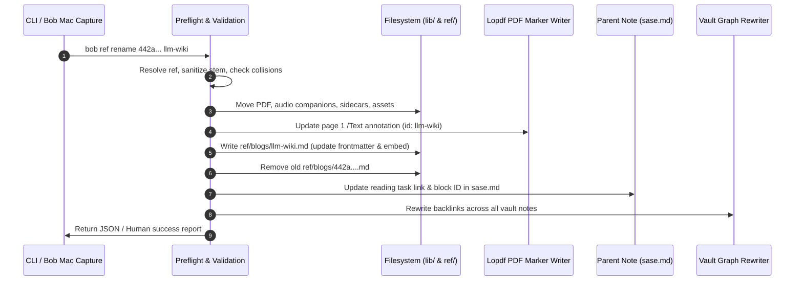

# Research Report: Design and Architecture for `bob ref rename` and Bob Mac Capture Integration

**Author:** Researcher `gem` (Independent Investigation)  
**Date:** October 2026  
**Target Repositories:** `bob-cli`, `bob-mac-capture`  
**Focus Reference:** `ref/blogs/442a6bf555914893e9891c11519de94f.md` (`karpathy/llm-wiki.md`)  

---

## 1. Executive Summary

This research investigates the proposed `bob ref rename` CLI command and its corresponding Bob Mac Capture ref panel keymap. The motivating problem is concrete: captured references can easily end up with opaque, unintelligible filename stems (such as `442a6bf555914893e9891c11519de94f.pdf`, created from Andrej Karpathy's GitHub Gist on LLM wikis).

### High-Level Verdict: Is This a Good Idea?
**Yes, but with critical caveats.** Providing an automated mechanism to rename references is essential for library ergonomics. However, **treating this as a simple filesystem rename is catastrophic**. In the Bob architecture, a "reference" is not a standalone PDF file; it is a distributed, synchronized graph spanning five distinct tiers:
1. The PDF and companion media in `lib/` (or `xlib/`).
2. The Obsidian reference note in `ref/` with its rigid frontmatter properties and TextBundle asset subdirectories.
3. The page-1 `/Text` annotation marker embedded inside the PDF binary.
4. The active v2 reading task located in an area/project/inbox parent note (`sase.md`).
5. The Obsidian vault link graph (wikilinks, block embeds, and Pomodoro ledger references).

If a naive CLI tool or macOS gesture simply moves the PDF or renames the note on disk, the next run of `bob ref scan` will desynchronize: it will fail to match the reading task candidate, create duplicate "phantom" reading tasks, orphan old notes, or crash on dirty collision checks.

### Recommended Solution Summary
1. **Engine in `bob-cli`:** Implement `bob ref rename` as an atomic, multi-entity migration orchestrator under the `Library` subcommand group. It must transactionally move the PDF, rename the ref note, rewrite frontmatter and embeds, update the embedded PDF marker via `lopdf`, update the parent reading task in the area/project note, and perform vault-wide link graph rewrites (reusing the battle-tested rewrite engine from `migrate-tasks`).
2. **Thin-Client macOS Integration in `bob-mac-capture`:** Strictly adhering to Architecture Decision 6 (`mac-capture-is-a-thin-client`), Bob Mac Capture must not manipulate files directly. It should expose `⇧⌘R` (Shift-Command-R) and a `⌘K` action ("Rename…") that presents an inline `RefsRenameCardView` in the panel, auto-suggesting a clean slug derived from the document's title. When submitted, it dispatches `bob ref rename <id> <new_stem> --format json` through `BobProcessClient` and refreshes the catalog.
3. **Capture-Time Root Cause Fix:** In parallel with post-hoc renaming, patch `clip_url.rs` so that hex hashes (MD5, SHA, Gist IDs) are rejected during URL slug derivation, allowing `bob ref create` to automatically fall back to the actual document title (e.g. `karpathy-llm-wiki` or `llm-wiki`) at birth.

---

## 2. Anatomy of a Bob Reference: The Five-Tier Synchronization Graph

To safely implement renaming, we must first map every piece of state that constitutes a reference in `bob`:

```
+-----------------------------------------------------------------------------------+
|                                 A BOB REFERENCE                                   |
+-----------------------------------------------------------------------------------+
  │
  ├─► Tier 1: Library & Media Files
  │   ├── PDF: lib/<ref_type>/<stem>.pdf (e.g. lib/blogs/442a....pdf)
  │   ├── Companion Audio: lib/<ref_type>/<stem>.(mp3|m4a|ogg|opus) [optional]
  │   └── Sidecars: lib/<ref_type>/<stem>.(textbundle|md) [optional]
  │
  ├─► Tier 2: Obsidian Reference Note
  │   ├── Note File: ref/<ref_type>/<stem>.md
  │   ├── Frontmatter Metadata:
  │   │   ├── id: <stem>
  │   │   ├── source_pdf: lib/<ref_type>/<stem>.pdf
  │   │   ├── source_pdf_sha256: <hash>
  │   │   └── highlights_marker_base: JSON snapshot containing id
  │   ├── Extracted Assets: ref/<ref_type>/<stem>.assets/ [optional]
  │   └── Body Embed: ![[<parent_note>#^ref-<slug>]]
  │
  ├─► Tier 3: Binary PDF Annotation Marker
  │   └── Page 1 /Text Annotation (Lopdf Object):
  │       ├── status: ready
  │       ├── parent: <parent_note>
  │       ├── title: <title>
  │       └── id: <stem>
  │
  ├─► Tier 4: Area/Project Parent Reading Task (v2 Contract)
  │   └── In <parent_note>.md (e.g. sase.md):
  │       - [ ] #task #ref [[ref/<ref_type>/<stem>|<title>]] [created::...] ^ref-<slug>
  │
  └─► Tier 5: Vault-Wide Backlink Graph
      ├── Obsidian Wikilinks: [[ref/<ref_type>/<stem>]] across daily/project notes
      └── Pomodoro Ledger References: [[<parent_note>#^ref-<slug>]] in daily notes
```

### The Strict Path-Binding Contract (`io.rs`)
In `src/native/highlights_ref/io.rs`, `ref_note_path()` establishes an immutable invariant:
```rust
if let Ok(relative_pdf_path) = pdf.strip_prefix(&config.lib_dir) {
    let mut note_relative_path = relative_pdf_path.to_path_buf();
    note_relative_path.set_extension("md");
    // ...
}
```
The Highlights synchronization engine requires a strict 1:1 correspondence between `lib/<category>/<stem>.pdf` and `ref/<category>/<stem>.md`. If a user renames the PDF file in Finder, `bob ref scan` immediately treats the PDF as a new unindexed document, attempts to create a fresh note, and fails or duplicates reading tasks.

---

## 3. Investigation of the Case Study: `442a6bf555914893e9891c11519de94f`

Inspection of Bryan's vault reveals the exact state of the motivating reference:

```bash
$ bob ref show 442a6bf555914893e9891c11519de94f
karpathy/llm-wiki.md
○ QUEUED · queued since 2026-10-15 · blogs · external · ref/blogs/442a6bf555914893e9891c11519de94f.md
📖 Reading task  sase · Ready → [[sase#^ref-442a6bf555914893e9891c11519de94f]]
  source    https://gist.github.com/karpathy/442a6bf555914893e9891c11519de94f
  pdf       lib/blogs/442a6bf555914893e9891c11519de94f.pdf
  parent    sase
```

### Why Did This Happen? (Root Cause in `clip_url.rs`)
Tracing `bob ref create` when clipping web URLs:
1. Source URL: `https://gist.github.com/karpathy/442a6bf555914893e9891c11519de94f`.
2. Playwright/Defuddle successfully extracted the document title: `karpathy/llm-wiki.md`.
3. However, `stem_from_url()` in `src/native/highlights_ref/clip_url.rs` parsed the path segments: `["karpathy", "442a6bf555914893e9891c11519de94f"]`.
4. `stem_from_segment()` evaluated the last segment:
   ```rust
   if candidate.is_empty()
       || candidate.len() <= 2
       || candidate.chars().all(|c| c.is_ascii_digit())
       || is_date_part(&candidate)
       || SKIPPED_SEGMENTS.contains(&candidate.to_lowercase().as_str())
   {
       return None;
   }
   ```
5. Because `442a6bf555914893e9891c11519de94f` contains hexadecimal alphabetic characters (`a`, `b`, `d`, `e`, `f`), it did **not** trigger `candidate.chars().all(|c| c.is_ascii_digit())`.
6. Therefore, the 32-character hexadecimal Gist ID was accepted as the filename stem.
7. Consequently, the intake and library files were minted with this hash, which propagated to the PDF marker `id`, frontmatter `id`, ref note path, parent task link target, and parent task block ID (`^ref-442a6bf555914893e9891c11519de94f`).

---

## 4. Critique of the Plan

### Is `bob ref rename` a Good Idea?
**Yes.** Even if capture-time heuristics are perfected, post-hoc renaming is unavoidable:
- URLs frequently lack meaningful slugs (e.g. arXiv ID numbers like `1706.03762`, DOI strings, or CMS endpoints like `index.php?id=123`).
- Manual intake: PDFs dropped directly into `xlib/` often have camera-scanned names (`Scan_20261015.pdf`) or generic titles (`download.pdf`, `manuscript.pdf`).
- Evolution of understanding: Bryan may capture a paper under an author's working title and later want to file it under the published acronym (e.g. `attention-is-all-you-need` -> `transformer`).

### Critical Pitfalls of a Naive Implementation

#### 1. The "Phantom Duplicate" Sync Loop Trap
If the rename tool only renames the PDF and the reference note, but forgets the parent reading task in `sase.md`:
1. `sase.md` still contains `[[ref/blogs/442a...|...]]`.
2. When `bob ref scan` runs, `RefTaskIndex::build()` scans `sase.md`.
3. When `sync.rs` queries `ctx.index.candidates("ref/blogs/new_stem.md")`, it finds **zero** candidates because the link in `sase.md` still points to the old path.
4. `sync.rs` concludes that `lib/blogs/new_stem.pdf` is an unfiled birth. It executes `plan_birth_task()`, which inserts a **second reading task** into `sase.md`.
5. The original task in `sase.md` pointing to `442a...` becomes an orphan.

#### 2. The Block ID Immutability vs. Cleanliness Dilemma
In `sase.md`:
`- [ ] #task #ref [[ref/blogs/442a...|karpathy/llm-wiki.md]] ... ^ref-442a6bf555914893e9891c11519de94f`
- **If the block ID is kept unchanged:** The block ID retains the ugly hash `^ref-442a...`. While historical Pomodoro ledger entries (`[[sase#^ref-442a...]]`) remain unbroken, source files look messy.
- **If the block ID is renamed to `^ref-llm-wiki`:** All existing references in today's or past daily notes would break unless rewritten.
- **Resolution:** A proper rename command should update the block ID to match the new slug, and leverage a graph rewriter to update all backlink occurrences across the vault. Furthermore, a `--keep-block-id` flag should be available for risk-averse renames on older, heavily cited references.

#### 3. Concurrent Document Locks in Highlights.app
If Highlights.app or Apple Preview has `lib/blogs/442a....pdf` open when `bob ref rename` moves the file on disk:
- In macOS, file coordination can handle certain in-place moves if coordinated, but uncoordinated POSIX `rename()` calls can break file descriptors or cause Highlights to write an autosave conflict copy (`442a... (conflict).pdf`).
- Preflight should check whether the target PDF is open or locked, and prompt/warn if Highlights is active.

#### 4. Conflation of "Stem Rename" vs. "Title Rename"
A reference has both:
- A **filename stem** (slug): e.g. `442a6bf555914893e9891c11519de94f` (or `llm-wiki`).
- A **display title**: e.g. `karpathy/llm-wiki.md`.
In the Karpathy example, the title was already correct (`karpathy/llm-wiki.md`), but the stem was misnamed. In other situations, a user may want to change the title, or change both. The command interface must clearly distinguish between them.

---

## 5. Required Adjustments to Requirements

The research reveals five mandatory adjustments to the initial specification:

1. **Transactional Multi-Tier Scope:**
   `bob ref rename` must not just rename files; it must update the PDF file, the note file, companion audio, sidecars, image assets, note frontmatter, PDF binary marker, parent reading task, and body embed as an all-or-nothing transaction.
2. **Vault-Wide Graph Rewrite Integration:**
   Renaming a reference note changes its canonical wikilink target (`[[ref/blogs/old]]` -> `[[ref/blogs/new]]`). The command must scan and rewrite markdown links and block ID citations across the entire vault, adapting the proven rewriter in `src/native/ref_library/migrate_tasks/rewrite.rs`.
3. **Capture-Time Hash Filter (Root Cause Prevention):**
   Do not just build a repair tool; eliminate the source of the problem. `stem_from_segment()` in `clip_url.rs` must reject hex hashes and UUIDs so that Gists and hashes automatically fall back to the parsed document title during `bob ref create`.
4. **Dual Mutation Capability (Stem vs. Title):**
   Allow renaming the stem, the title, or both simultaneously:
   `bob ref rename <REF> <NEW_STEM> [-t|--title <NEW_TITLE>]`.
5. **Safe Mac Capture Protocol:**
   Per Decision 6 (`mac-capture-is-a-thin-client`), Bob Mac Capture must never attempt file moves or regex replacements. It must invoke `bob ref rename <path> <new_stem> --format json` and react to the returned JSON report.

---

## 6. Technical Specification: `bob ref rename` CLI Command

### CLI Placement and Compliance with `cli_rules.md`
- **Command Group:** `Library` (in `HELP_GROUPS` alongside `find`, `list`, `show`, `migrate-tasks`, `migrate-zorg`).
- **Help Text:** Clear, complete, scannable, with short aliases for all public long options.

```text
bob ref rename <REFERENCE> <NEW_STEM> [OPTIONS]

Rename a library reference, its PDF, companion media, reading task, and vault links

Arguments:
  <REFERENCE>  Target reference to rename (stem, relative path, or search query)
  <NEW_STEM>   New filename stem (without .pdf or .md extension)

Options:
  -d, --dry-run             Preview all planned renames and file rewrites without writing
  -f, --force               Allow renaming even if the Git worktree has uncommitted changes
  -F, --format <FORMAT>     Output format: human or json [default: human]
  -k, --keep-block-id       Retain the existing parent task block ID instead of updating it
  -t, --title <TITLE>       Update the document title in frontmatter, H1, marker, and task link
  -h, --help                Print help
```

### Preflight & Target Resolution
1. **Source Resolution:** Reuses `crate::native::ref_library::resolve::resolve_query()`. Accepts a path (`ref/blogs/442a...md`), a stem (`442a...`), or a query. If resolution yields 0 or >1 matches, it fails with helpful diagnostic hints.
2. **Stem Sanitization:**
   - Strips leading/trailing whitespace.
   - Strips accidental `.pdf` or `.md` extensions.
   - Validates that the stem contains only safe filename characters (`[a-zA-Z0-9_-]`), contains no path separators (`/`, `\`), and is not reserved (`.`, `..`).
   - Confirms `new_stem != old_stem`.
3. **Destination Collision Verification:**
   Before modifying anything, asserts that none of the target paths exist:
   - `lib/<ref_type>/<new_stem>.pdf`
   - `ref/<ref_type>/<new_stem>.md`
   - `lib/<ref_type>/<new_stem>.*` (audio companions)
   - `lib/<ref_type>/<new_stem>.(textbundle|md)` (sidecars)
   - `ref/<ref_type>/<new_stem>.assets/` (asset directories)
4. **Git Safety Check:** Checks if the vault repository is clean; requires `-f, --force` if modified files exist in `lib/`, `ref/`, or the parent note.

### Transactional Execution Pipeline



1. **Step 1: Move Filesystem Assets:**
   - `fs::rename(old_pdf, new_pdf)`
   - Move companion audio and sidecars if present.
   - Move `ref/<type>/<old_stem>.assets/` to `ref/<type>/<new_stem>.assets/`.
2. **Step 2: Update PDF Marker Binary:**
   - Load `new_pdf` with Lopdf.
   - Locate page-1 `/Text` annotation.
   - Update `id` to `new_stem` (and `title` if `-t` was passed).
   - Atomic save with fsync (`atomic_save_pdf`).
   - Recalculate `source_pdf_sha256`.
3. **Step 3: Write New Reference Note & Delete Old Note:**
   - Update frontmatter: `id: new_stem`, `source_pdf: lib/.../new_stem.pdf`, `source_pdf_sha256: <new_hash>`, and recalculate `highlights_marker_base` JSON.
   - If title updated: update frontmatter `title` and H1 header.
   - Update body embed: `![[<parent>#^ref-<new_slug>]]`.
   - Atomically write `ref/<type>/<new_stem>.md`.
   - Remove `ref/<type>/<old_stem>.md`.
4. **Step 4: Update Parent Reading Task:**
   - Locate reading task in parent note (`sase.md`) via `RefTaskIndex`.
   - Update link: `[[ref/<type>/<old_stem>|<title>]]` -> `[[ref/<type>/<new_stem>|<title>]]`.
   - Update block ID: `^ref-<old_slug>` -> `^ref-<new_slug>` (unless `--keep-block-id` was specified).
   - Write parent note atomically.
5. **Step 5: Vault-Wide Backlink Graph Rewrite:**
   - Adapt `src/native/ref_library/migrate_tasks/rewrite.rs`.
   - Scan all vault Markdown files for:
     - `[[ref/<type>/<old_stem>]]` -> `[[ref/<type>/<new_stem>]]`
     - `[[ref/<type>/<old_stem>|...]]` -> `[[ref/<type>/<new_stem>|...]]`
     - If block ID was changed: `[[<parent>#^ref-<old_slug>]]` -> `[[<parent>#^ref-<new_slug>]]`.
   - Atomically write modified files.
6. **Rollback Handler:**
   If any step fails mid-flight, an inverse journal rolls back moved files and restores previous note contents.

---

## 7. Bob Mac Capture Ref Panel Integration Design

### Architectural Principles
Bob Mac Capture is a native macOS frontend (Swift / AppKit / SwiftUI). Architecture Decision 6 governs this interaction:
> **Bob Mac Capture Is A Thin Client Of bob** (`mac-capture-is-a-thin-client`) - Bob Mac Capture never parses capture grammar, computes previews, or writes the vault; it runs bob, renders the spans, candidates, and previews bob returns, and submits each draft as one bob capture call.

All file operations, PDF edits, and vault mutations must remain strictly inside `bob-cli`.

### Keyboard Shortcut Mapping
Reviewing `Sources/BobMacCapture/Refs/RefsKeyRouter.swift`:
- `Cmd+R` is currently mapped to **Refresh Library** (`.refresh`).
- `Cmd+S` is currently mapped to **Scan Library** (`.scan`).
- `Cmd+Y` is currently mapped to **Copy Card** (`.showCopyCard`).
- `Cmd+K` is currently mapped to **Actions Menu** (`.showActions`).
- Standard Finder shortcut `Return` is already mapped to **Open in Highlights**.

**Recommended Keymap:** `⇧⌘R` (Shift-Command-R).
- In `RefsKeyRouter.swift`:
  ```swift
  case KeyCode.r:
      if flags == .command {
          return .refresh
      }
      if flags == [.command, .shift] {
          return .showRenameCard
      }
      return nil
  ```
- Ergonomic, memorable, and avoids colliding with `Cmd+R`.

### ⌘K Actions Menu Entry
In `Sources/BobMacCapture/Refs/RefsActionsMenu.swift`:
- Add `case rename` to `RefsAction`.
- Title: `"Rename Reference…"`
- Key equivalent: `"R"` with `[.command, .shift]`.
- Place in Section 1 alongside `Open Note` and `Reveal in Finder`.

### UI Design: `RefsRenameCardView`
Following the pattern established by `RefsCopyCardView`:
1. When `⇧⌘R` is pressed, `RefsPanelModel` sets `activeRenameTarget = item`.
2. In `RefsPanelView.swift`, the inspector column smoothly transitions to display `RefsRenameCardView`.
3. **Card Content:**
   - Header: Tile icon + `"RENAME REFERENCE"`.
   - Context: Shows current filename (`442a6bf555914893e9891c11519de94f.pdf`) and document title (`karpathy/llm-wiki.md`).
   - Input Field: An `NSTextField` styled with the Bob design system, **pre-populated with an intelligent slug suggestion derived from the title** (e.g. `llm-wiki` or `karpathy-llm-wiki`).
   - Summary Note: *"Will rename PDF, reference note, and update reading task in [[sase]]."*
   - Footer: `↵ Commit Rename` · `Esc Cancel`.
4. **Execution Flow:**
   - Pressing `Return` triggers `fetcher.rename(path: item.path, newStem: newStem)`.
   - A subtle progress spinner appears.
   - On success: `RefsPanelModel` clears the card, updates selection to the new path, displays a transient HUD banner (`"Renamed to llm-wiki"`), and triggers a background catalog refresh (`refresh(reason: .rename)`).
   - On error: The banner displays the actionable error returned by `bob` (e.g. `"Destination lib/blogs/llm-wiki.pdf already exists"`).

---

## 8. Root Cause Prevention: Patching `clip_url.rs`

To prevent misnamed references from being created in the first place, patch `stem_from_segment()` in `src/native/highlights_ref/clip_url.rs`:

```rust
fn is_opaque_hex_or_hash(segment: &str) -> bool {
    // 32-char MD5/Gist ID, 40-char SHA1, 64-char SHA256, or UUID
    let len = segment.len();
    if (len == 32 || len == 40 || len == 64) 
        && segment.chars().all(|c| c.is_ascii_hexdigit()) 
    {
        return true;
    }
    // UUID with hyphens (8-4-4-4-12 = 36 chars)
    if len == 36 && segment.contains('-') 
        && segment.replace('-', "").chars().all(|c| c.is_ascii_hexdigit()) 
    {
        return true;
    }
    false
}
```

By adding `is_opaque_hex_or_hash(&candidate)` to the rejection check in `stem_from_segment()`, `stem_from_url()` will return `None` for Gist URLs. As a result, `create.rs` and the web clip pipeline will automatically fall back to deriving the stem from the human-readable document title (`karpathy-llm-wiki`), eliminating the defect at intake.

---

## 9. Recommended Implementation Plan

### Phase 1: Prevention in `bob-cli`
- **File:** `src/native/highlights_ref/clip_url.rs`
- Add opaque hash / UUID rejection to `stem_from_segment()`.
- Add unit tests verifying that Gist IDs and MD5 hashes fall back to title-based slugging.

### Phase 2: Core Rename Engine in `bob-cli`
- **New Module:** `src/native/ref_library/rename/`
- Implement `plan_rename()`, validating source reference, destination availability, and git status.
- Implement atomic execution: file moves, marker binary rewrite via Lopdf, frontmatter update, parent task update, and vault backlink graph rewrite (reusing `migrate_tasks/rewrite.rs`).
- Implement JSON report serialization (`schema_version: 1`).

### Phase 3: CLI Subcommand `bob ref rename`
- **Files:** `src/native/highlights_ref/cli.rs`, `src/native/ref_library/cli.rs`
- Register `rename` in `HELP_GROUPS` under `"Library"`.
- Implement CLI flags: `-t, --title`, `-d, --dry-run`, `-f, --force`, `-k, --keep-block-id`, `-F, --format`.
- Integration tests using temporary fixture vaults.

### Phase 4: Bob Mac Capture Integration
- **`RefsFetching.swift`:** Add `func rename(path: String, newStem: String, title: String?) async throws -> RefsRenameResponse`.
- **`RefsKeyRouter.swift`:** Bind `⇧⌘R` to `.showRenameCard`.
- **`RefsActionsMenu.swift`:** Add `"Rename Reference…"` to Section 1.
- **`RefsRenameCardView.swift`:** Implement the overlay card with auto-slug generation, input validation, and keyboard handling.
- **`RefsPanelModel.swift`:** Wire up rename execution, selection update, HUD toast, and library refresh.

---

## 10. Conclusion

The user's plan to add `bob ref rename` and a corresponding Mac Capture ref panel keymap addresses a genuine workflow deficiency. However, implementing it purely as a file rename would corrupt the reference library. 

By treating reference renaming as a coordinated five-tier graph migration, implementing `⇧⌘R` in the native Mac capture panel, and simultaneously patching capture-time slug generation to reject opaque hashes, `bob` will gain a robust, permanent solution that repairs existing misnamed items like `442a6bf555914893e9891c11519de94f` and prevents future occurrences.
