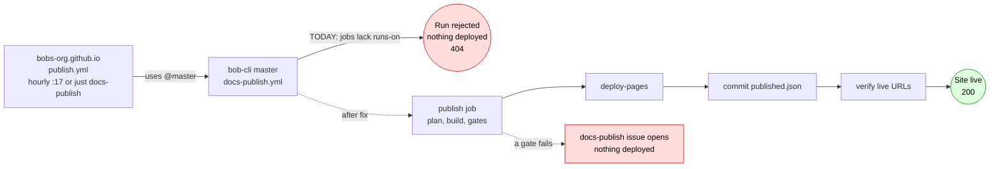

# Why https://bobs-org.github.io/ Still Returns 404

**Date:** 2026-10-20 (checked live around 10:30 UTC) · **Epic:** `bob-cli-a0` → phase
`bob-cli-a0.5` → launch bead `bob-cli-a0.5.1.5` (still IN_PROGRESS)

## TL;DR

The site has **never been deployed**. The docs content, the host repo, and GitHub Pages
are all set up. But GitHub rejects every publish run, because the shared publish
workflow in `bob-cli` has no `runs-on:` runner on any of its jobs. Last night's launch
agent wrote the fix but never landed it on `bob-cli` `master`.

**To go live:** push the `runs-on: ubuntu-latest` fix to `bob-cli` `master`, then run
`just docs-publish` (or wait for the next hourly run at `:17`).

## How Publishing Works And Where It Breaks

## What Is Already Done

| Piece | State |
| --- | --- |
| Docs content and build gates (`docs/`, Zensical, `just docs-check`) | ✅ On `bob-cli` `master` `8ba29959`; docs-check passed |
| Host repo `bobs-org/bobs-org.github.io` | ✅ Public, branch `main`, bootstrap commit `e9f447ab` |
| GitHub Pages settings | ✅ Enabled, `build_type: workflow`; the `github-pages` environment allows `main` |
| Host workflows `publish.yml` (hourly) and `weekly.yml` | ✅ Both call `bobs-org/bob-cli/.github/workflows/docs-*.yml@master` |
| Source repos (`bob-cli`, `bob-plugins`, `bob-mac-capture`) | ✅ All public, so the host can call and check them out |
| Action version pins (checkout v6, setup-node v7, deploy-pages v4, …) | ✅ All 9 tags exist |
| **`runs-on` in `bob-cli` reusable workflows** | ❌ 0 of 7 jobs have it (5 in `docs-publish.yml`, 2 in `docs-weekly.yml`) |
| A Pages deployment / `published.json` manifest | ❌ None yet |

## Why It 404s

A Pages site with `build_type: workflow` serves nothing until an `actions/deploy-pages`
job succeeds. None ever has:

1. **First manual dispatch** (`just docs-publish`, about 01:20 EDT): GitHub returned
   **HTTP 422**, *"Required property is missing: runs-on"*, before any run started
   (`bob-cli-a0.5.1.5` note #1).
2. **Hourly scheduled run** [39405915133](https://github.com/bobs-org/bobs-org.github.io/actions/runs/39405915133)
   (10:09 UTC) failed in **0 s** with *"likely failed because of a workflow file issue"*.
   No jobs started.

The host calls `@master`, so every hourly run will fail the same way until `bob-cli`
`master` changes.

The fix exists only in the launch agent's uncommitted worktree. The agent ran on apollo.
It added `runs-on: ubuntu-latest` to all 7 jobs and runner assertions to both workflow
tests. Its last note (04:00 EDT) says these edits are "pending SASE finalization". They
are not on `origin/master`, and no branch or PR carries them. The phase stopped there.

## What To Do

1. **Land the runner fix in `bob-cli`.**
   - Add `runs-on: ubuntu-latest` to every job in
     `.github/workflows/docs-publish.yml` (`publish`, `deploy`, `record`, `verify`,
     `report`) and `.github/workflows/docs-weekly.yml` (`weekly`, `report`).
   - Add the regression test (every job with `steps:` declares `runs-on`) to
     `test_publish_workflow.py` / `test_weekly_workflow.py`.
   - Run `just docs-check` and push to `master`.
   - *Recommended route:* resume or re-run `bob-cli-a0.5.1.5`, since it also owns the
     remaining launch proof. If its apollo worktree is gone, a hand edit is about 7 lines.
2. **Publish.** From `bob-cli`, run `just docs-publish` (it dispatches the host workflow
   and watches it). Or just wait for the next `:17` hourly run. The host repo needs no
   changes.
3. **Confirm.** `just docs-status` should show a `published.json` manifest and a live
   `/build.json`. `curl -I https://bobs-org.github.io/` should return `200`. Allow a
   minute or two after deploy.
4. **If a gate fails:** this will be the first time the production gates run on a GitHub
   runner, so expect possible surprises, e.g. the Cargo build of `bob` or the Node plugin
   inventory. A failed gate deploys nothing and opens a `docs-publish` issue on the host
   repo. Fix the cause in source, push, and repeat step 2.

**Not needed to go live**, but still open:

- The rest of `bob-cli-a0.5.1.5`: no-op run, broken-link drill and recovery, weekly run,
  and evidence.
- The Mac Capture README site links.
- `bob-cli-a0.13`'s final sweep.

## Evidence

- `grep -c runs-on .github/workflows/docs-*.yml` on `origin/master` `8ba29959` → 0 and 0.
- `gh api repos/bobs-org/bobs-org.github.io/pages` → `build_type: workflow`,
  `public: true`; `curl -I https://bobs-org.github.io/` → `404`.
- `gh run list -R bobs-org/bobs-org.github.io` → one run, `failure`, `0s`; there are no
  check runs, consistent with a workflow-validation rejection.
- `git ls-remote origin` → only `master`; `gh pr list` → none open.
- Host `main` has no branch protection, so the `record` job can push `published.json`.
  The workflow creates the `docs-publish` label on first failure.
- Beads `bob-cli-a0`, `bob-cli-a0.5`, `bob-cli-a0.5.1`, `bob-cli-a0.5.1.5` (notes),
  and plan `plan:202610/docs_gated_publication.md` (Phase launch).
