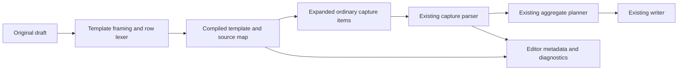

# Bulk capture templates: syntax, implementation boundaries, and recommendation

Researcher: cdx  
Date: 2026-10-15  
Scope: independent design research; no feature implementation or production vault writes.

## Assessment

This is a good addition if it stays a small, explicit way to generate an ordinary capture batch. It fits repeated entries such as job applications: the destination, title shape, and child bullets remain fixed while a few values change. The existing batch planner already supplies most of the execution behavior.

I would retain the proposed zero-based placeholders, but require an explicit declaration, define a small quoting language for values, and preserve source locations through expansion. The difficult work is integrating the editor protocol correctly, not replacing strings.

My preferred input is:

```text
@@template:
Apply to {0}! @job_2026_apply_29:{1}
- **URL**: {2}

Foobar foo http://foobar.com/career/some_foo_job
Bazbuz baz http://bazbuz.com/career/some_baz_job
```

The blank line between template and values is required. Blank lines between value rows are optional, so the exact row spacing in the question remains accepted.

This report uses only my own source inspection, official external documentation, and read-only experiments. I did not consult the other swarm researchers, their reports, or their transcripts.

## What the current implementation establishes

The inspected revisions are:

- bob-cli: `47e85f65e00dc953c25416b475b21fe0ee4bea92`.
- bob-mac-capture: `9f58448a035b3592c2d7e5dbd5a3d0abf0a9f111`.

These are inspection anchors, not a claim that the installed executable was built from those revisions.

### There is already one appropriate execution path

Blank or whitespace-only lines separate capture items. Each item contains a parent line and the established two levels of authored child bullets. The CLI parses the draft, then plans all items against in-memory note and daily-note snapshots. Later items see earlier planned changes. The shared writer checks disk preimages and attempts rollback on failures. This is the right execution machinery for generated captures; it should not be replaced with one subprocess per row.

The rollback mechanism is not a cross-process database transaction: concurrent edits and rollback failures retain their existing documented limits. Background reference processing also remains asynchronous after its queueing step. Templates should inherit those limits, rather than promise stronger atomicity. See [the batch contract](https://github.com/bobs-org/bob-cli/blob/47e85f65e00dc953c25416b475b21fe0ee4bea92/docs/capture.md#multi-item-capture), [the planner](https://github.com/bobs-org/bob-cli/blob/47e85f65e00dc953c25416b475b21fe0ee4bea92/src/native/capture/plan.rs), and [the writer](https://github.com/bobs-org/bob-cli/blob/47e85f65e00dc953c25416b475b21fe0ee4bea92/src/native/capture/commit.rs).

### Splitting already has more behavior than “split on blank lines”

`capture_language/draft.rs` handles LF, CRLF, and bare CR with original UTF-8 byte offsets. It removes declaration-only `@@...` lines before item splitting. It also recognizes URL-only lists and splits session-operator chains into multiple items. Therefore, running the ordinary splitter on raw template values is wrong: a value row could be mistaken for declarations, URLs, or commands before it is substituted. Template framing must happen before this stage. See [draft splitting](https://github.com/bobs-org/bob-cli/blob/47e85f65e00dc953c25416b475b21fe0ee4bea92/src/native/capture_language/draft.rs).

### The example creates commitments, not just two inbox entries

In existing capture grammar, `@job_2026_apply_29:foo` with body text creates a Pomodoro-linked task. The exclamation mark in `Apply to Foobar!` is ordinary title punctuation. A caret, `@job_2026_apply_29^foo`, would instead create a task with a block ID without this linking request.

I ran `bob capture-parse --format json` on the question's original and expanded forms:

| Input | Observed result |
| --- | --- |
| Original, without a declaration | Three items; the first has `invalid_pomodoro_block_id` because `{1}` is not an ID. |
| Expanded form | Two `pomodoro_task` items, IDs `foo` and `baz`, no lexical diagnostics. |
| Ordinary `Explain {0} in Python` followed by another item | Valid ordinary tasks; braces currently have no template meaning. |
| `@@template:` followed by a template and values | `invalid_global_destination` in the current parser. |

A dry run against a disposable fixture with no eligible open Pomodoro refused the expanded form. With an open `- [ ] ()` entry, it returned two captures:

```markdown
- [*] #task Apply to Foobar! [created::2026-10-15] ^foo
	- **URL**: http://foobar.com/career/some_foo_job

- [*] #task Apply to Bazbuz! [created::2026-10-15] ^baz
	- **URL**: http://bazbuz.com/career/some_baz_job
```

The fixture files remained unchanged. These probes validate present behavior and assumptions; they do not test a template implementation.

The requirement should explicitly preserve this existing distinction between `:` and `^`. I would not silently change the example to caret syntax. See [the grammar overview](https://github.com/bobs-org/bob-cli/blob/47e85f65e00dc953c25416b475b21fe0ee4bea92/docs/capture.md#grammar-at-a-glance).

### The Mac app should remain a renderer and process client

The accepted thin-client decision puts grammar, completion, preview, and writes in bob-cli. The app currently sends the entire draft to `capture-parse`, calls `capture --dry-run --no-clip` for continuous preview, and submits the original draft through one `capture` invocation. It already normalizes the legacy single-result shape and additive `captures[]` batch shape.

The app should gain template presentation, not its own expander. A Swift-only implementation would immediately diverge from CLI input, preview, completion, error handling, and future clients. See [the process client](https://github.com/bobs-org/bob-mac-capture/blob/9f58448a035b3592c2d7e5dbd5a3d0abf0a9f111/Sources/CaptureCore/BobProcessClient.swift) and [the documented batch integration](https://github.com/bobs-org/bob-mac-capture/blob/9f58448a035b3592c2d7e5dbd5a3d0abf0a9f111/README.md).

## Critique of the idea

The useful abstraction is “one capture shape applied to rows of arguments.” Calling subsequent inputs “templates for the first input” reverses the roles and obscures what is being parsed. I would consistently call them **value rows**.

The benefit is substantial for a short batch with shared structure. It reduces repetitive routing and child-bullet editing, and makes one correction to the template apply to every item. It also composes naturally with the existing whole-batch preview.

There are real costs:

- Positional fields are easy to swap. Exact arity and an expanded preview are necessary; silently ignoring extra fields would turn copy mistakes into bad captures.
- Real company names contain spaces, quotes, and apostrophes. Plain whitespace splitting only supports the toy case.
- A wrong constant route or scheduling marker affects every generated item. The preview must expose destination and capture kind as clearly as it exposes the title.
- Live editing has two representations: the visible template plus values, and generated capture text. Reporting positions from the latter against the former breaks highlighting and edits.
- General templating quickly attracts conditionals, named variables, saved libraries, CSV import, and transformations. Those are separate product decisions, not prerequisites for this example.

I would ship a deliberately small feature if this repeated-entry workflow is common. For a rare one-off import, an external script that emits ordinary capture text into stdin already supplies most of the value at much lower maintenance cost. The question does not establish usage frequency, so this judgment is based on fit to the demonstrated workflow rather than measured demand.

I would not build a full template engine, a separate Mac “mail merge” subsystem, or a saved-template database in the first release.

## Syntax choices

### Activation matters more than brace style

| Choice | Advantages | Problems | Judgment |
| --- | --- | --- | --- |
| Infer template mode from `{0}` in the first item | Shortest example | Reinterprets existing prose, code, and literal braces; malformed templates become difficult to distinguish from ordinary captures | Reject |
| A `--template` flag only | Explicit for scripts | Requires app state separate from draft text; a pasted draft loses its meaning; all protocol calls need matching state | Not the primary interface |
| `@template` or bare `@@template` | Familiar marker family | Already valid local/global destinations named `template` | Reject |
| `%template` | Short | Already a clipboard-header marker when recognized in the terminal marker region | Reject |
| A new punctuation header such as `%%template` or `#!template` | Explicit and compact | Allocates another marker family; older Bob may treat some forms or incomplete drafts as ordinary content | Viable, less coherent |
| A fenced `bob-template` block | Strong visible boundaries; can later support blank lines | More typing and editor complexity than current capture blocks need | Good if richer templates become a requirement |
| Exact standalone `@@template:` header | Reuses draft-metadata vocabulary, remains self-contained, currently invalid as a destination | Slightly unusual keyword in a destination-oriented family; must intercept it before generic `@@` handling | Recommended |

The final colon is intentional. `@@template` is an existing route declaration; `@@template:` is not. The inspected strict parser explicitly refuses colons in global destinations. I also dry-ran `@@template:` alone and with a simple title template: both returned exit 2 and an unsupported-global-destination error.

This gives the new header a useful compatibility property: the observed current Bob refuses it before writing. That is not a guarantee about every historical or future binary; preserve this behavior with an explicit compatibility fixture. See [global declaration validation](https://github.com/bobs-org/bob-cli/blob/47e85f65e00dc953c25416b475b21fe0ee4bea92/src/native/capture_language/draft.rs).

Recognize the header only as the exact first nonblank physical line, allowing trailing horizontal whitespace. Inline occurrences, a second header, or a header appearing later should be errors. A misspelled `@@...` header should continue to fail through normal declaration validation.

### Keep the proposed numbered placeholders

Use only `{0}`, `{1}`, and so on. Zero-based positions match the example and the familiar Python-style positional convention. Literal braces use `{{` and `}}`. Python provides a much larger format language; only the small positional and brace-escaping conventions are useful here. See [Python's format-string specification](https://docs.python.org/3/library/string.html#format-string-syntax).

GNU Parallel is a useful precedent for mapping input columns into one repeated template, including a later named-header extension. Its positions begin at one, so its exact syntax should not be copied without considering the different convention. See [GNU Parallel's tutorial](https://www.gnu.org/software/parallel/parallel_tutorial.html).

Recommended validation:

- At least one placeholder is required.
- Indices are canonical ASCII decimal numbers: `0`, or a nonzero digit followed by digits.
- Used indices must form the contiguous set `0..N-1`. Repetition and reordering are valid; skipped indices are rejected.
- Every row must supply exactly `N` fields. Missing and extra values both fail.
- Reject `{}`, negative indices, `{01}`, named fields, formatting specifiers, attribute access, and unmatched braces with a precise template diagnostic.
- Expand once. A value containing `{1}` remains that text; inserted values are not scanned again for placeholders.

Dense indices and strict arity are deliberate requirements adjustments. They catch a missing URL, a company name accidentally split into two fields, and an unused column rather than discarding data.

Named placeholders such as `{company}` would improve larger templates, but they require another binding convention or header row. Defer them until positional templates prove useful.

### Define quoted values instead of saying “split on spaces”

I recommend a small, documented whitespace-and-double-quote lexer:

| Rule | Meaning |
| --- | --- |
| Spaces and tabs outside quotes | Separate fields; runs count as one separator |
| `"Foobar Labs"` | One field containing a space |
| `""` | One explicitly empty field |
| `"Acme ""Research"""` | The value `Acme "Research"` |
| Apostrophes and backslashes | Ordinary characters |
| `#`, `$`, backticks, `;`, `&` | Ordinary value characters; no shell evaluation or comments |
| Physical newline | Ends the value row; no multiline quoted fields |
| Closing quote | Must be followed by a separator or end of line |
| Quote in an unquoted field | Error; quote the complete field |

For example:

```text
"Foobar Labs" foo https://example.com/jobs/foo
O'Reilly oreilly https://example.com/jobs/oreilly
"Acme ""Research""" acme https://example.com/jobs/acme
```

The doubled-quote convention is familiar from [RFC 4180](https://www.rfc-editor.org/rfc/rfc4180.html), but this proposal is **not CSV**: its separators and single-line record restrictions differ. Do not advertise CSV or spreadsheet-paste compatibility.

A shell-style lexer is a credible alternative and `shlex` is already a direct Rust dependency. It saves implementation work. However, apostrophes and backslashes gain shell quoting meanings, which are awkward for organization names and pasted paths. Python's [shlex documentation](https://docs.python.org/3/library/shlex.html) describes this as shell-like lexical analysis, and the [Rust crate](https://docs.rs/shlex/latest/shlex/) provides that family of behavior. I prefer a small dedicated scanner with explicit source spans over importing shell conventions into this data-entry surface.

Do not auto-detect CSV, TSV, pipes, or multiple quoting dialects. If spreadsheet import becomes a real requirement, add an explicitly selected format with its own contract.

## Proposed behavior and justified requirement adjustments

1. **Explicit opt-in:** add `@@template:`; ordinary captures containing braces remain byte-compatible with present behavior.
2. **One template per draft:** the first nonempty block after the header is the template. It retains the normal parent-plus-authored-bullets shape. The first blank line ends it.
3. **Values, not captures:** every subsequent nonblank physical line is one value row. Blank lines there are cosmetic. Rows are not parsed as independent captures before expansion.
4. **Exactly one output item per row:** the template and header are never captured. A row that expands into zero or multiple items fails. No nesting, mixing with ordinary capture blocks, or multiple templates in version one.
5. **Strict, finite substitution:** use the placeholder and row rules above; no expressions, loops, defaults, environment expansion, files, includes, or network access.
6. **Ordinary capture semantics after expansion:** the output goes through existing capture parsing and validation, including route and block-ID constraints. Preserve all existing capture kinds that yield one item; do not create separate template-specific writers.
7. **One original draft, one aggregate submission:** preview and mutation use the same backend preparation path.
8. **No global declarations in version-one template drafts except the header:** reject other whitespace-delimited `@@...` declaration tokens in template source and generated items. A fixed local `@route` in the template already provides the common destination; normal CLI destination flags can retain their established rules.

The last restriction is intentional scope control. A naïve expansion of a fixed `@@work` would duplicate a singleton declaration, while a value containing `@@other` could change the whole batch's destination. Proper support would resolve fixed source declarations once, prohibit declarations originating in values, and preserve precedence through a prepared-draft model. That is feasible later, but not needed for the demonstrated use case. Reject the unsupported combination explicitly rather than misinterpret it.

These are source templates, not literal-data slots in a typed capture AST. Quoting groups a value row; it does not escape Bob capture markers in generated text. For example, an inserted terminal `p:1` can retain ordinary capture meaning. Arbitrary untrusted import data would need a different literal-field contract. This choice preserves the requested equivalence to manually expanded capture input and must be documented prominently.

There is no new silent cleanup: do not slugify invalid IDs, truncate surplus values, deduplicate rows, or skip failures. Repeated IDs should meet the existing planner's duplicate/existing-task behavior. In particular, check that any existing-task action produced by repeated identifiers is shown accurately rather than assumed to be another new task.

A successful template draft with one row still captures one item and may use the existing single-result JSON shape. A zero-row draft never captures the template as a fallback.

## Implementation boundaries

### Add a pure preparation layer in bob-cli

Use a shared preparation stage inside `capture_language`, before generic draft splitting:



The non-template branch should continue through the existing path without changing its output. Template detection, placeholder compilation, arity checking, and expansion must be pure: no vault access, clipboard reads, or network calls.

A prepared representation should own generated strings and record their origins. Current `CaptureItem<'a>` values borrow from one source string, so manufacturing borrowed items from temporary expansion buffers is a poor fit. Keep generated storage alive explicitly, then obtain owned parsed results and origin metadata. See [the capture model](https://github.com/bobs-org/bob-cli/blob/47e85f65e00dc953c25416b475b21fe0ee4bea92/src/native/capture_language/model.rs).

Compile placeholders once, then render each row in source order. Use checked size arithmetic and bound the generated text before allocation. Initial limits such as 1,000 rows and 1 MiB of expanded text are reasonable candidates to benchmark, not measured thresholds or requirements established by this research. Report a refusal, never partial truncation.

Do not recursively call the public capture command, spawn row subprocesses, or run a general-purpose evaluator. Feed all valid results into the one existing `plan_capture_batch` operation, retaining its priority seed, clipboard planning, duplicate checks, ledger ordering, budgets, and successor-offer behavior.

### Preserve original source locations

Maintain mappings from generated segments to:

- Constant source ranges in the template.
- The placeholder's source range.
- The corresponding raw value token range and row number.

A single replacement can appear several times in the output. A quoted value can also lose delimiters or collapse doubled quotes. Exact character-for-character reverse mapping is therefore not always possible or necessary; the whole raw field is a valid diagnostic target.

For an invalid block ID substituted into `@route:{1}`, highlight the row's ID field and report the associated template placeholder as secondary context. For a constant malformed marker, highlight the template marker and identify which row exposed it. Arity errors highlight the original value row.

All returned editor ranges must remain half-open UTF-8 byte offsets into the **original submitted draft**. Do not send offsets into generated text, or normalize CRLF and then count against the original buffer. The app validates these ranges and converts them to Swift/UTF-16 positions; malformed or overlapping spans are rejected. See [the parse endpoint contract](https://github.com/bobs-org/bob-cli/blob/47e85f65e00dc953c25416b475b21fe0ee4bea92/src/native/capture_parse.rs) and [Mac range conversion](https://github.com/bobs-org/bob-mac-capture/blob/9f58448a035b3592c2d7e5dbd5a3d0abf0a9f111/Sources/CaptureCore/CaptureTextRanges.swift).

Do not blindly project every generated semantic span back to source. Repeated constants can produce duplicate or overlapping source spans. Emit a nonoverlapping set of original-source spans for the header, placeholders, and row fields; add ordinary marker highlighting only where the mapping is unambiguous.

### Extend the existing protocol additively

Recommended optional additions:

| Endpoint | Addition |
| --- | --- |
| `capture-parse` | `template` metadata: template source range, field count, row count, and row ranges; source spans for the directive/placeholders/values |
| `capture-parse items[]` | One semantic item per successfully expanded row, with its source range pointing to that row and optional `template_row` origin metadata |
| `capture` success | Optional template summary; each existing capture result may carry its original row number/range |
| `capture` failure | Existing `ok: false` and `error`, plus optional structured code and source/row metadata |
| `capture-complete` | Template-aware context decisions and original-source replacement ranges |
| `capture-rewrite` | A template-aware no-op initially; do not apply generic absorption to value rows |

Keep version 1 for additive parse/completion/rewrite fields. The app expects those endpoint versions and decodes optional fields tolerantly. `capture` itself currently has no `schema_version`; do not casually add a required version check to its legacy envelope.

Preserve existing JSON exactly for non-template drafts. Template headers and template definitions contribute no entry to `captures[]`. The ordinary top-level compatibility result is the first generated capture.

For incomplete editing, return the existing style of lexical diagnostics/needs rather than trying to execute partial rows. A trailing unterminated quote or missing trailing values can be an incomplete state in `capture-parse`; strict submission rejects them. An earlier malformed row is an error. A header with no template or a template with no values should produce a useful instruction and no mutating fallback.

### Integrate editor behavior deliberately

The raw value region must be opaque to ordinary capture completion: `@...`, `%`, `!`, `=`, or `:` typed there are values, not picker requests. The backend must return no ordinary picker context for those positions.

Completion in fixed template marker components can be supported where the replacement maps directly to a constant source range. Completion of placeholder numbers is optional. Do not implement completion by globally replacing holes with an arbitrary `x`: the same hole can occur where a number, route, ID, or whole capture is expected.

For version one, returning unchanged text from `capture-rewrite` for template drafts is preferable to letting global-declaration absorption or separator-switching modify data. Any later typing assist should be enabled only with source-mapping and semantic-preservation tests. See [the current rewrite rules](https://github.com/bobs-org/bob-cli/blob/47e85f65e00dc953c25416b475b21fe0ee4bea92/src/native/capture_language/rewrite.rs) and [completion classification](https://github.com/bobs-org/bob-cli/blob/47e85f65e00dc953c25416b475b21fe0ee4bea92/src/native/capture_language/completion.rs).

## Mac app behavior

The app should keep the user's template and values visible and editable. Do not replace the editor contents automatically with expanded text.

Decode Bob's optional template metadata and show a compact “Template · 2 captures · 3 fields” summary above the existing ordered preview. Each generated card should retain its ordinary destination and action details, with a source-row association useful for errors. A one-row draft remains one capture.

The preview should make clear that the example links tasks to a Pomodoro and may hit existing planning caps. Display the backend's full result, not a home-grown reconstruction of a task title.

When a template row is incomplete, show the backend's editing instruction and suppress doomed continuous dry runs, as the app already does for certain incomplete picker states. Keep the entire draft on a submission failure and close the panel only after aggregate success. Continue using `--no-clip` for continuous preview.

The app may style the header, placeholders, and value fields from backend spans; it must not recognize or expand the syntax independently. No separate persistent “template mode” switch is needed. An explicit “expand into editor” action can be considered later, but is not required for capture.

Compatibility expectations:

| App | Bob | Expected behavior |
| --- | --- | --- |
| New | New | Template-aware editing and complete batch preview |
| Old | New | Ordinary expanded capture results remain readable; new optional styling/summary may be absent |
| New | Observed current Bob | Unsupported declaration error; keep the draft and explain that Bob needs updating |
| Old | Observed current Bob | Existing unsupported-declaration refusal |

Do not translate old-Bob failure into a plain capture retry or an app-side expansion fallback. Validate the first two combinations with real fixtures, particularly the old app's behavior on new parse spans and incomplete states.

The relevant app files are `Sources/CaptureCore/CaptureModels.swift`, `BobProcessClient.swift`, `CaptureTextRanges.swift`, and `Sources/BobMacCapture/CapturePanelModel.swift` / `CapturePanelView.swift`. Work there must follow the Mac repo's compilation requirements: portable checks plus best-effort actual macOS compilation/type-checking for the macOS targets. No Swift was changed or compiled during this research.

## Acceptance evidence to require from an implementation

The highest-value test is semantic equivalence: a template draft and its manually expanded ordinary draft must produce equivalent planned edits and capture results, apart from source-origin metadata and the template summary. Use the same clock, configuration, vault snapshots, and priority-roll seed.

| Area | Cases that should be covered |
| --- | --- |
| Core example | Two exact titles, routes, IDs, URL children, order, and ledger links |
| Ordinary compatibility | Literal braces and existing batch drafts remain unchanged without the header |
| Template definition | Header alone, no template, no rows, misplaced/duplicate header, invalid child indentation |
| Placeholders | Repeated/reordered positions, literal braces, unmatched braces, gaps, unsupported forms, oversized indices |
| Row lexer | Spaces/tabs, names with spaces, apostrophes, quotes, doubled quotes, explicit empties, trailing whitespace |
| Incomplete editing | Missing values or quote on final row; earlier invalid row; strict submit refuses both |
| Record boundaries | Adjacent rows, blank-separated rows, leading/trailing blanks, LF/CRLF/bare CR |
| Source locations | Emoji, accented text, repeated holes, quoted fields, error ranges and completion replacements |
| Metadata isolation | `@@` in template or generated values refuses; header is not a capture; values never activate raw pickers |
| Existing semantics | `:` versus `^`, existing IDs, invalid IDs, schedule/priority, child bullets, clipping modes, one-item actions |
| Aggregate failure | A later row's conflict leaves the batch unwritten; disk-preimage and rollback behavior remains covered |
| Protocol | Single-row legacy shape, multi-row captures count, additive decode, no new fields on ordinary drafts |
| Client orchestration | One aggregate mutating process, original draft survives errors, stale preview results stay discarded |
| Compatibility | Current Bob rejects new header; new Bob/old app handles additive fields acceptably |
| Limits | Bounded expansion, no recursion/evaluation, no truncation, no excessive generated allocation |

For source mapping, include a case where a field appears twice in the template and a case where doubled quotes change its decoded length. These catch bugs that ASCII-only happy paths miss.

Do not require a fresh broad rewrite of the writer's tests: reuse its existing guarantees and add meaningful template-to-planner integration coverage. One failure-in-later-row test is more informative than many assertions that mirror the substitution loop.

## Delivery scope and remaining uncertainties

The first increment should establish the grammar/preparation model and JSON fixtures in bob-cli, then wire it into ordinary planning and all editor endpoints. Document the header, quoting rules, strict arity, global-declaration restriction, and the fact that substitutions produce ordinary capture source. The Mac change should then decode and present that already-stable contract, with compilation and fixture validation before release.

No new command or option is required. Input through stdin is sufficient for scripts, and the app already passes the complete draft as one argument. Do not introduce `bob capture template`: capture's positional free text would conflict with a subcommand, and project CLI rules prohibit subcommands beneath `capture`.

This research does not establish performance limits, actual usage frequency, or whether spreadsheet paste is a near-term need. Those are worth checking during implementation and trial use. They do not justify preemptively adding CSV/TSV detection, named headers, saved templates, or a second transport.

## Recommended solution

Implement an explicitly declared, inline bulk template in bob-cli using the exact first-line header `@@template:`, the proposed zero-based `{0}` placeholders, and one quoted value row per generated capture. Accept optional blank lines between rows, enforce exact arity, substitute once, preserve source ranges, and reject additional global declarations in version one.

Route the expanded items through the existing aggregate parser/planner/writer, with additive parse and result metadata. Keep Bob Mac Capture a thin client that shows the expanded batch and backend diagnostics while retaining the original editable draft. Ship this narrow feature before considering saved templates or richer data formats.
