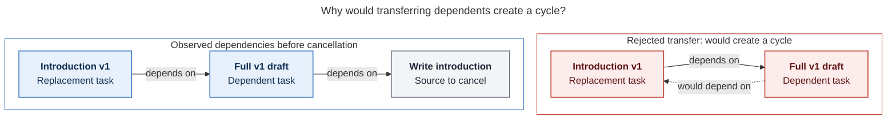
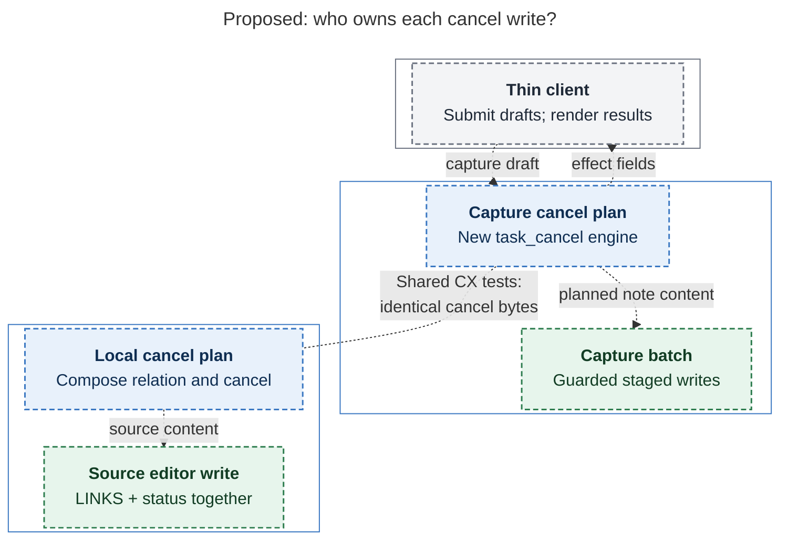

# Diagram proposals: Cancel labels: relation labels that cancel their source task

Proposals for the swarm linker, not a report. Each diagram restates only what the source
report says.

```yaml
source: research:202610/cancel_labels_for_task_relations/cancel_labels_for_task_relations__final.md
producer: research.2r.image
check: "mmdc 12.0.0 with the PDF-mirroring config rendered 2 of 2 Mermaid diagrams; Puppeteer --no-sandbox; malformed-input check exited nonzero"
```

## transfer-cycle

```yaml
anchor: |-
  while `^intro-v1` depends on `^v1-draft`. Re-pointing would have
question: |-
  Why would transferring dependents create a cycle?
illustrates: |-
  Moving dependents onto the survivor would have created a cycle in the `^v1-draft` / `^intro-v1` case.
caption: "Transferring the full draft's prerequisite to its replacement would create a cycle; standard cancellation recovery avoids that transfer."
review: "729.047x505 px, fit 89.5%; reader question, arrow directions, labels, and source checks passed; 1 revision, 2 look rounds"
```



## cancel-ownership

```yaml
anchor: |-
  Keep the JS planner and do not route Obsidian through `bob capture`:
question: |-
  Who plans cancellation, who writes it, and who only renders it?
illustrates: |-
  bob owns capture while Obsidian keeps its JS planner and local editor writes, with shared CX vectors keeping both engines' cancel bytes identical.
caption: "bob owns Mac capture; Obsidian keeps its local editor writer, and shared CX vectors test both cancellation engines against identical bytes."
review: "423.523x1125.69 px, fit 79.3%; reader question, ownership, data arrows, shared-test line, labels, and source checks passed; 1 revision, 2 look rounds"
```


