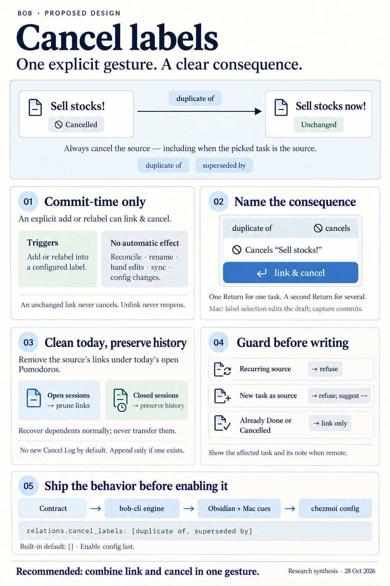
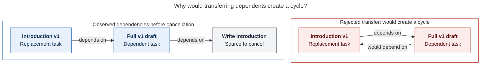
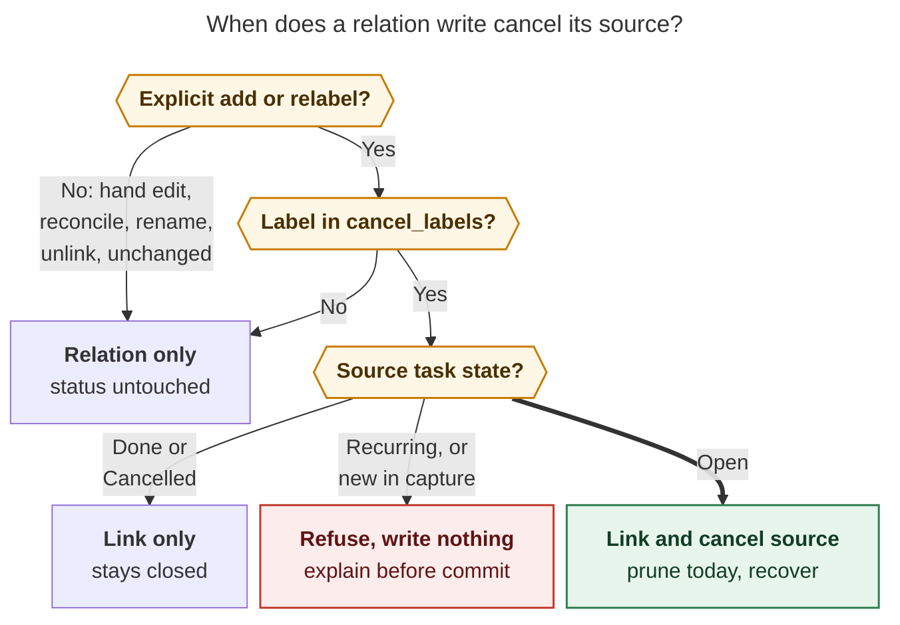
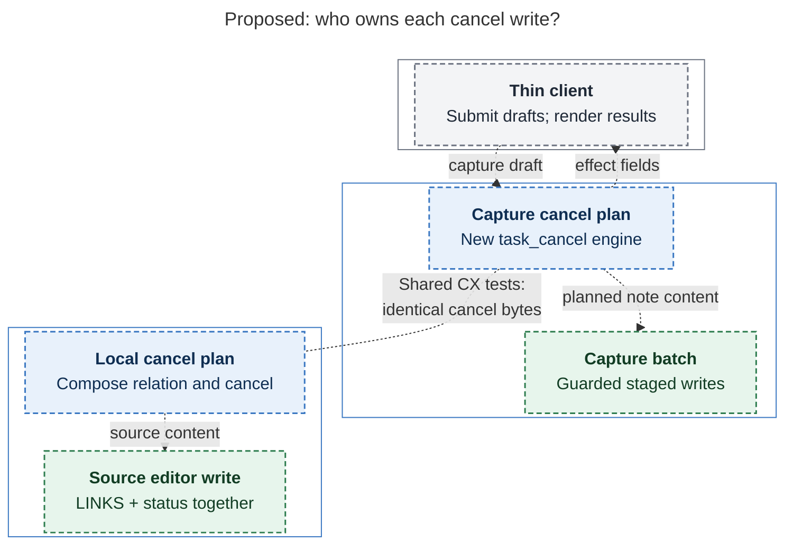

# Cancel labels: relation labels that cancel their source task

> **Research query:** How should bob let configured relation descriptions (starting with
> "duplicate of" and "superseded by", configured in the chezmoi repo) automatically cancel
> the source task, clearly show when a selected description would cancel, and remove the
> cancelled task's links from the current daily file just like other cancels? Is this a
> good idea, would a different approach be better, and what requirement adjustments and
> recommended solution make the design intuitive, reliable, and beautiful?



## Bottom line

**Build it, as a compound gesture and not as a property of the relation.**
[You already do this by hand](#evidence-that-you-already-do-this-by-hand). All three
vault relations that use these labels were followed by a manual cancel within seconds or
in the same sync window. None of those cancels wrote a Cancel Log, and two of them pruned
the task's link from that day's open Pomodoro. The feature should write those same bytes
in one gesture instead of two.

The whole design comes down to [one rule](#the-rule):

> **When an explicit relation gesture adds a cancel label to an open task, or relabels
> one of its links to a cancel label, the same gesture cancels that task (the
> relation's source) exactly as Task Card Cancel would. Nothing else cancels because of
> a label, and nothing ever reopens because of one.**

The rule fires once, at the moment you commit. It is never a state that reconcile keeps
enforcing, so relations stay inert as data: reconcile, mirrors, renames, hand edits,
sync, and config changes never touch a status. That narrow carve-out is what lets the
feature coexist with the inertness contract relations shipped with.

The pieces:

- **Config.** `relations.cancel_labels: [duplicate of, superseded by]` in
  [chezmoi's `home/dot_config/bob/config.yml`](#config-in-chezmoi). bob's built-in
  default is `[]`.
- **Indication.** [One ⊘ vocabulary on every surface](#the-indication). It always
  *names* the task that will be cancelled, and the Return hint changes to
  **↵ link & cancel**.
- **Engines.** [A new Rust `task_cancel` engine](#bob-cli-ships-first) for capture `~` /
  `~~` (the path Mac Capture uses). In Obsidian,
  [the existing nav cancel planner is folded into the relation writer](#bob-plugins-nav).
- **Rollout.** The chezmoi config [lands last](#rollout-and-verification), after every
  client can show the cue.

---

## What exists today

Verified facts, each with its evidence:

- **Relations are contractually inert: a relation write never changes a status, and
  "Closes, cancels, reopens → None". The glossary says the same:**
  `docs/task-relations.md` §§2, 8, 13.2 (LR18/LX13/LG13), 14; `glossary:task-relation`
- **The Obsidian relation stage _tells you so_: "Links only · never blocks, schedules, or
  changes status" and "does not block":** nav `305-relation-stage-copy.js:31,53,70`
- **RV1 forbids the word "description" in code and contracts, because bob uses it for
  task text. The request's "relation descriptions" are _relation labels_:**
  `docs/task-relations.md` §16
- **Label identity is `relation_label_key`: trim, collapse whitespace, strip one
  trailing `:`, Unicode lowercase:** `src/native/relation_labels/mod.rs`
- **The `relations:` config block has one key, `linked_from_lines`. Your chezmoi file
  has no `relations:` block, and it sets `timezone: America/New_York`:**
  `src/native/config/relations.rs`; chezmoi `home/dot_config/bob/config.yml`
- **Task Card cancel (`planTaskCancelBatch`) writes `[-]`, upserts
  `[cancelled:: date]`, skips closed tasks, and refuses recurring ones. It writes a
  `❌ CANCEL LOG` entry only for a non-empty reason, or a 🤷 fallback when a log already
  exists. The open set is ` `, `/`, `*`, `?`:** nav `240-cancel-and-lanes.js`;
  `010-requires-and-config.js:18`; `380-picker-cancel-and-lane.js:178`
- **Cancel orchestration writes the source in one editor transaction. When today's note
  is a different file, it prunes that note afterwards and reports
  `Pomodoro links not removed` on failure, never rolling back. It then calls cycler
  `recoverBlockedDependents`, which never makes successor offers:** nav
  `540-plugin-decay-picker-and-cancel.js:691–900`; `550-…:141–222`;
  `docs/task-dependencies.md`
- **The immediate prune and reconcile _differ_. The immediate prune removes a dedicated
  link bullet with its subtree, removes only the token from mixed prose, and leaves
  struck links. Reconcile removes the whole list-item subtree, struck forms included.
  Both touch only open Pomodoros in today's note:** `docs/task-status-hooks.md`
  "Canceled Task References" (lines 145–190)
- **The nav relation writer composes each source note's LINKS edit, mints ids, then
  calls `stageWrite(source.path, …)`; LINKED FROM mirrors are best-effort follow-ups.
  Its header says it "never … touches Pomodoros (LG13)":** nav
  `594-plugin-relation-edit.js:1–5, ~380`
- **_bob-cli has no general cancel writer._ `[cancelled::]` is written only by the
  reference-task paths. Capture can complete (`task_complete`, with scoped ledger
  retirement and `recover_blocked_dependents`) but cannot cancel:**
  `src/native/task_complete/{retirement,recovery}.rs`; grep of `cancelled::`
- **Capture distinguishes `Added` / `Relabeled` / `Unchanged` relation actions:**
  `src/native/capture/relations.rs:509–869`
- **In the Mac relation card, Return inserts the label into the draft and does not
  commit. The card already warns in amber, before capture, about the `||` one-off hide
  consequence:** bob-mac-capture `docs/keyboard.md` "Relation card keys"
- **Mac capture warnings can be structured `{code, message}` objects, and the success
  card renders _every_ bob-authored warning message. That gives older clients a channel
  to show new consequences:** `CaptureModels.swift:2985–3035`
  (`hides_existing_relation_label`); `CapturePanelView.swift:4182`
- **⊘ is the vault's Cancelled status glyph:** `docs/reference/vault-format.md:69`
- **Cancelling a `^prj` sets project `status: canceled` and recovers residents that were
  blocked only by the project. Open residents are _not_ cancelled:**
  `docs/projects.md:158`; `docs/task-status-hooks.md:520–526`
- **A walk landing advances once after "a resolving Task Card commit". Unlink, reopen,
  refusals, and no-op writes stay put:** `decisions:answering-advances-the-walk`

## Evidence that you already do this by hand

`bob relations list -a` shows 7 labels and 24 links; `superseded by` has 2 links and
`duplicate of` has 1. I re-checked cld's trace of all three in vault git:

- **`cash.md` "Sell stocks!" _duplicate of_ "Sell stocks now!":** Relation in
  `f85bcfff`, then `8d0ddbcc` at 07:27:22, **16 s later**: `[ ]`→`[-]` plus
  `[cancelled:: 2026-10-22]`. No Cancel Log. The *older* task was the one retired.
- **`sase_blog.md` "Write introduction!" _duplicate of_ `^intro-v1` (later relabelled
  _superseded by_):** `8aa12ea4`: relation and cancel in one sync window. S was Next
  `[*]`. **Its link was removed from today's Pomodoro.** Dependent `^v1-draft`
  recovered `[?]`→`[ ]`. No Cancel Log.
- **`sase_blog.md` "Flesh out tasks…" _superseded by_ `^review-tasks`:** `08bc4a2e`: S
  was Next `[*]` and linked under the same open Pomodoro as T. The cancel removed S's
  link and left T's. No Cancel Log.

What this establishes:

1. **The demand is real but small**: three uses in a week. Size the feature to match:
   one config list and one rule, not a relation-effects engine.
2. **The bytes are settled**: `[-]`, `[cancelled:: date]`, the LINKS line, no Cancel
   Log, and a prune of today's open-Pomodoro link.
3. **Direction is "whichever task is worse", not "the newer one".** The UI must name the
   task it will cancel.
4. **Moving dependents onto the survivor would have been wrong.** `^v1-draft` depended on
   "Write introduction", while `^intro-v1` depends on `^v1-draft`. Re-pointing would have
   created a **cycle**. Standard recovery was correct.
5. **Relabelling from one cancel label to another happens**, so on an already-cancelled
   task it must be a no-op.
6. **No open task carries either label today**, so turning the config on needs no
   migration.

[The transfer-cycle diagram](#figure-transfer-cycle) traces the `^v1-draft` and
`^intro-v1` dependency chain, showing why moving dependents onto the survivor would have
created a cycle.

<div id="figure-transfer-cycle">



_Transferring the full draft's prerequisite to its replacement would create a cycle; standard cancellation recovery avoids that transfer._

</div>

## Is this a good idea?

**Yes, with conditions.** It removes a two-step habit. It closes the window in which a
duplicate is linked but still open: still in Ready, still counting against the note's
ready cap, still walking in `]s`. It also routes the Pomodoro prune and dependent
recovery through the same path every cancel already uses. Duplicate-closes-the-issue is
also the industry norm:

- **YouTrack's** Duplicates workflow sets the issue's state when a duplicates link is
  added.
- **Linear's** "Mark as duplicate of" moves the issue to a Duplicate (cancelled-type)
  status.
- **GitHub's** "Close as duplicate" and `gh issue close --duplicate-of` close the issue
  with a duplicate reason.

You chose YouTrack's door: the link drives the state. I keep that, with two deliberate
departures. There is no reopen-on-unlink, because that would turn the relation back
into an enforced state. There is no context or dependency transfer, because the vault
shows a transfer would have made a cycle.

The risks are real, and every one must be designed out:

- **Semantic creep.** The relations research warned against "links that promote, block,
  close, or get consumed".
  - *Why it matters:* Most of your recent decision records exist because authored and
    derived state got tangled.
  - *Answer:* One carve-out, at commit time only, written as a new decision record.
    `docs/task-relations.md` §2 is amended, not deleted, and still lists everything that
    never cancels.
- **Continuous enforcement** (reconcile cancels any open task carrying a cancel label)
  - *Why it matters:* It would mass-apply when the config lands, re-cancel a
    deliberately reopened task forever, and fire on pastes, agent edits, and sync.
  - *Answer:* Rejected outright.
- **A surprise cancel**
  - *Why it matters:* Choosing a label feels low-stakes; closing a task is not.
  - *Answer:* The task is named before commit on every surface, and Return's label
    changes.
- **Wrong-direction cancel**
  - *Why it matters:* With `~~` or `⇧L`, the *picked* task is the source. A remote task
    in another note gets cancelled.
  - *Answer:* The cue names the task, plus its note when that note is not the active
    one. It never says only "cancels source".
- **False unblock**
  - *Why it matters:* "A superseded by B" releases A's dependents even though B isn't
    done.
  - *Answer:* Accepted. This is standard cancel behavior: the preview says "unblocks
    dependents", and released tasks get `[unblocked:: today]` and resurface as TICKLER
    in the next morning review, so you see them. No automatic transfer (cycle evidence
    [above](#evidence-that-you-already-do-this-by-hand)).
- **Engine drift** between Rust, JS, and Swift
  - *Why it matters:* Two engines already implement relations.
  - *Answer:* bob owns capture. Swift renders only bob's flags and strings. Rust and nav
    share one vector table for the cancel bytes.
- **Old client + new config**
  - *Why it matters:* An older Mac app would commit a cancel without showing the cue.
  - *Answer:* The config lands last. bob also emits a structured warning that existing
    clients already render on the success card
    ([bob-mac-capture and older clients](#bob-mac-capture-and-older-clients)).

**Would I take a different approach?** No. I'd take the same approach with a stricter
trigger. I considered a dedicated "Mark duplicate" gesture, a cancel-reason prompt
between link and cancel, a reconcile rule, and a generic relation-effects engine, and
rejected all four ([alternatives rejected](#alternatives-rejected)). The one addition I
recommend is a **second door into the same writer** ([Phase 2](#open-questions-for-you)):
"⊘ Cancel as duplicate of…" in the Task Card Cancel stage, for the moment you think
"cancel this" rather than "link this".

### Alternatives rejected

- **Reconcile enforces "an open task with a cancel label is cancelled" (with or without
  YouTrack-style reopen-on-unlink):** Silent cancels on hand, agent, and sync edits;
  mass-apply on config change; fights a deliberate reopen forever.
- **Hard-code the two labels in bob:** You asked for config, and an empty default
  protects other vaults.
- **Keep the Cancel reason prompt between link and cancel:** The label *is* the reason.
  A second prompt makes the fused gesture ugly.
- **New "Mark duplicate" keymap as the primary door:** Two UIs for one meaning. It is
  acceptable later as a *shortcut into the same writer* (Phase 2).
- **Transfer dependents to T (Linear-style merge):** Would have created
  [a cycle in your vault](#figure-transfer-cycle); silently rewrites other tasks'
  Depends-On lines.
- **Labels that cancel the _target_ (`supersedes`):** Two directions break "cancel
  labels cancel their source". The inverse hint teaches the flip.
- **Plugin-only MVP:** Mac Capture would silently not cancel, and the same label would
  behave differently by surface.
- **`relations.auto_cancel_mode: prompt|auto` (mus fallback):** A mode is one more thing
  to forget; the single-confirm design already is the fast path.
- **Generic relation-effects engine:** Far more surface than two labels need. Reopen
  this only if a second effect is ever requested.

## Requirement adjustments

Every adjustment, called out explicitly:

- **A1 [RENAMED]**
  - *As requested:* "relation descriptions"
  - *Adjusted to:* **Cancel labels**: the relation labels listed in
    `relations.cancel_labels`
  - *Why:* RV1 bans "description" in contracts. "Cancel label" reads naturally in UI,
    docs, config, and glossary.
- **A2 [KEPT, tightened]**
  - *As requested:* Configure `duplicate of`, `superseded by` in chezmoi
  - *Adjusted to:* `relations.cancel_labels` in `home/dot_config/bob/config.yml`. bob
    defaults to `[]`. Do **not** add `merged into` yet.
  - *Why:* Bryan opts in; other vaults are unaffected. `merged into` is the obvious
    third label, but you didn't ask for it.
- **A3 [ADDED]**
  - *As requested:* (when "automatically" fires)
  - *Adjusted to:* **Only at an explicit commit**: capture `~`/`~~`, the Links /
    Linked-from stages, and counted batches, on **add** or **relabel *into*** a cancel
    label. **Never** on reconcile, `relations rename`, hand edits, agent edits, unlink,
    mirrors, sync, config changes, or an `Unchanged` re-add. **Never reopens.**
  - *Why:* Keeps relations inert as data and avoids every continuous-enforcement
    hazard.
- **A4 [ADDED]**
  - *As requested:* (which task)
  - *Adjusted to:* Always the **source**, the side the label is phrased from ("S
    duplicate of T" cancels S). With `~~` or `⇧L`, that is the *picked* task.
  - *Why:* Labels read from S's side. Your own usage cancels older and newer tasks
    alike.
- **A5 [ADJUSTED]**
  - *As requested:* "remove any task links in the current daily file"
  - *Adjusted to:* Remove links under **today's open Pomodoros only**, using the Task
    Card Cancel prune semantics. Closed Pomodoros, links elsewhere in the note, and
    other days stay.
  - *Why:* That is what "just like other cases where we cancel tasks" means in the
    code. Closed Pomodoros record work that actually happened.
- **A6 [ADDED]**
  - *As requested:* (Cancel Log)
  - *Adjusted to:* **No new Cancel Log.** The LINKS entry directly beneath is the
    reason. If the task *already* keeps a log, prepend `*date* — 🪢 duplicate of [[T]]`
    so its history has no gap.
  - *Why:* Matches your three hand-made cancels and the existing empty-reason rule. One
    fact lives in one place. [Open question 1](#open-questions-for-you).
- **A7 [ADDED]**
  - *As requested:* (dependents)
  - *Adjusted to:* Standard cancel recovery: no successor offers, no dependency
    transfer.
  - *Why:* Consistent with every cancel; transfer would have created a cycle.
- **A8 [ADDED]**
  - *As requested:* (refusals)
  - *Adjusted to:* Refuse **before** writing for: a recurring source (Task Card
    parity), a source that is a task being created by this capture (hint: use `~~`),
    and an item that would both cancel and complete/start/link the same task.
  - *Why:* A refusal shown on the label row is better than a half-applied write.
- **A9 [ADDED]**
  - *As requested:* "clear indication"
  - *Adjusted to:* One ⊘ vocabulary on every surface, always naming the task. Return
    becomes **↵ link & cancel**. A batch that cancels several tasks needs a second
    Return.
  - *Why:* Single-task selection is already deliberate. Several cancels at once deserve
    the existing two-press pattern.
- **A10 [ADDED]**
  - *As requested:* (review walk)
  - *Adjusted to:* Cancelling the `]s`-landed row through this gesture advances the
    walk once. Cancelling a *remote* source from the landed target stays.
  - *Why:* `answering-advances-the-walk`. The `cash.md` case was most likely a
    morning-review answer.
- **A11 [ADDED]**
  - *As requested:* (scope across repos)
  - *Adjusted to:* A Rust cancel engine in bob-cli is required, not optional.
  - *Why:* The Mac app is a thin client of `bob capture`. Without the engine,
    `|"duplicate of"` from the Mac would silently not cancel.

## Design

### The rule

**Figure 1.** Only an explicit add or relabel *into* a configured cancel label cancels an
open source task. The cancel prunes the task's live links in today's open Pomodoros and
recovers its blocked dependents. Done or cancelled sources get the link only. Recurring
sources, and sources born in the same capture, are refused before anything is written.
Every other path leaves status untouched.



*Rendered with `@mermaid-js/mermaid-cli` 12.0.0 using the PDF-mirroring config:
723.8 × 780 px, fit scale 90.2%.*

### Config in chezmoi

```yaml
# Task relations (docs/task-relations.md in bob-cli).
relations:
  # linked_from_lines: true   # write 🪢 LINKED FROM mirrors (default)
  # Committing a link with one of these labels also cancels the task the label
  # is phrased from ("S duplicate of T" cancels S). Matched like relation
  # labels (case, spacing, trailing colon ignored). Empty cancels nothing.
  cancel_labels:
    - duplicate of
    - superseded by
```

- **Matching** uses `relation_label_key`. `Duplicate  Of:` matches; `duplicated by`,
  `supersedes`, and `dup of` do not. There is no substring or fuzzy matching.
- **Parsing fails toward fewer cancels.** A missing key or `[]` is a valid empty policy.
  A non-list value or a malformed entry warns
  (`invalid relations.cancel_labels …`) and is skipped. A config error can only
  produce fewer cancels, never more, and never disables `linked_from_lines`.
- **Hide is not disable.** A hidden or `||` one-off cancel label still cancels when
  typed, because hiding only affects suggestions (`relation-label-hide-is-suggestions-only`).
  To turn the effect off, change the config.
- **Catalog overlay.** Configured cancel labels appear in suggestions and
  `bob relations list -a` even with zero uses, marked as configured and never promoted.
  This keeps the policy discoverable after a rename or in a fresh vault.
- **Not the per-host journal.** `.bob/relations/<host>.jsonl` holds suggestion
  preferences (hide, unhide, rename). Lifecycle policy is host-wide YAML, like
  `linked_from_lines`, and you asked for chezmoi.

### Which task is cancelled

- **Task Card `l` (Links to) → `⇧↵` label**
  - *Source S (cancelled):* the task under the cursor
  - *Target T (survives):* the picked task
- **Task Card `⇧L` (Linked from) → `⇧↵` label**
  - *Source S (cancelled):* **the picked task**, possibly in another note
  - *Target T (survives):* the task under the cursor
- **Capture `@note+id ~t:id|"duplicate of"`**
  - *Source S (cancelled):* the routed existing task
  - *Target T (survives):* the picked task
- **Capture `New task ~~old:id|"superseded by"`**
  - *Source S (cancelled):* **the picked existing task**
  - *Target T (survives):* the new task. This is the "capture the replacement, retire
    the old one" draft.
- **Capture `New task ~old:id|"duplicate of"`**
  - *Source S (cancelled):* the task being captured
  - *Target T (survives):* **refused**: "‘New task’ is new — it would be born
    cancelled. To retire ‘old’, use `~~`."
- **Counted `N Ctrl+Shift+L` / marked rows**
  - *Source S (cancelled):* each source
  - *Target T (survives):* one target; needs a second Return
    ([one confirmation except for batches](#one-confirmation-except-for-batches))

### What one commit writes

Every step below is existing cancel behavior; the only new part is composing them.

1. **S's note, one write.** The LINKS add or relabel, then `[-]` plus an upserted
   `[cancelled:: today]` on S's task line, using bob's configured timezone. A Cancel Log
   entry is written only per [A6](#requirement-adjustments). Because LINKS and status
   live on the same task, they always land together: one Obsidian undo step, one staged
   file in a capture batch.
2. **T's LINKED FROM mirror.** The usual best-effort courtesy write; reconcile remains
   the authority.
3. **Today's daily note.** Prune S's links under open Pomodoros with Task Card Cancel's
   dedicated-bullet/token semantics. In capture, this joins the same staged batch. In
   Obsidian, it folds into the same transaction when the daily note is the source note.
   Otherwise it is a follow-up that reports `Pomodoro links not removed` on failure,
   with reconcile as the backstop.
4. **Recovery.** S's blocked dependents recover through the existing engines. For a
   `^prj`, that includes residents blocked only by the project. No successor offers.
5. **Feedback.** One composed notice or result names the cancel, the prune count, and
   who was unblocked.

For the `cash.md` case, the result is byte-identical to what you wrote by hand:

```markdown
- [-] #task Sell stocks! [fresh:: 2026-10-16] [created::2026-10-12] [priority::high] [scheduled:: 2026-10-22] [cancelled:: 2026-10-22] ^sell-stocks
	- 🪢 **LINKS:** duplicate of [[dev_plex_hack_patch#^sell-stocks-now]]
```

### Edge cases

- **S is Ready, Next, In Progress, or Blocked (`[?]`):** Cancel.
- **S is a `^prj`:** Cancel, as Task Card `x` does. The copy says **"cancels project ‘X’
  · its N open tasks stay open"**, because project cancel does not cancel residents.
- **S already Done:** Link only; never convert Done to Cancelled. Muted "stays Done".
- **S already Cancelled (including cancel label → cancel label relabel):** Link/relabel
  only; keep the original date. Muted "already Cancelled".
- **S recurring:** Cancel-label rows are disabled before commit, with "repeats — cancel
  it with Obsidian Tasks first". In capture, the item is refused.
- **T is Cancelled or archived:** Allowed. Amber caveat: "‘T’ is Cancelled too". T is
  never changed.
- **Same edge, same label key (`Unchanged`):** No cancel, no log. The badge reads
  "already linked". Repeated Return and retries are safe.
- **Relabel away from a cancel label, or unlink:** S stays Cancelled. The notice says
  "stays Cancelled · reopen with Alt+]".
- **Reopen S later:** S stays open. Reconcile and saves never re-cancel. A *new*
  explicit add/relabel can cancel again.
- **Inverse label typed (`supersedes`, `duplicated by`):** No cancel. Hint:
  "‘supersedes’ never cancels · to retire ‘T’, flip (`~~` / ⇧L) and use ‘superseded
  by’".
- **Hand edit adds a cancel label to LINKS:** No cancel; the mirror still updates.
  Optionally a once-per-burst hint: "cancel labels cancel from the Links stage or
  capture".
- **`bob relations rename` into or out of a cancel label:** Never cancels. The preview
  warns that "‘duplicate of’ is a cancel label in config.yml — update
  `relations.cancel_labels`". bob does **not** edit config, because chezmoi owns that
  file.
- **Two cancel-label edges on one source in one batch:** Cancel and prune once. If a log
  is written, list the triggering relations in authored order.
- **`linked_from_lines: false`:** Still cancels and prunes; only the mirror is skipped.
- **Today's note absent:** Report zero links, and never create the note. An
  *unreadable* note is a failure, not zero.
- **Midnight rollover or config change between preview and commit:** Re-plan at commit.
  If the consequence changed, show it and require a fresh Return.

## The indication

Name the task, change the verb, use ⊘, stay calm.

**Color and glyph vocabulary.** Cancelling here is an intended decision, not an error.

- **⊘ plus text** marks the intended consequence. ⊘ is already the vault's Cancelled
  glyph, and the text means meaning never depends on color alone (WCAG 1.4.1). It is
  rendered in the existing Cancelled-status tint.
- **Amber** stays reserved for caveats (target already cancelled; the `||` hide warning,
  as today).
- **Red** stays reserved for errors and refusals.

So: no red badge, and no strikethrough on a task that hasn't been cancelled yet. gem's
red, uppercase, struck-through treatment would read as an error and borrow
strikethrough, which Bob uses for closed ledger children (`~~[[child]]~~ ✅/❌`).

### Obsidian Links stage

Task Card `l` / `⇧L` → `⇧↵`.

```text
🪢 Link with a relation
⊘ Sell stocks! — duplicate of → Sell stocks now!
[ dup                                                           ]
▸ 🔗 duplicate of                    used 1× · ⊘ cancels
   🔗 implements                      used 10×
⊘ Cancels “Sell stocks!” · removes its links from today's open Pomodoros · unblocks dependents
↵ link & cancel   ⇥ accept   ⌃D hide   esc back
```

- **Row:** a trailing `⊘ cancels` meta on rows whose key is configured. Typed rows get
  it too.
- **Live sentence** (`relationStageLiveSentence`): the source gets a ⊘ prefix and is
  dimmed. With `⇧L` and a source in another note, add the note name:
  `⊘ Old auth ticket (auth_legacy) — superseded by → Fix auth bug`.
- **Consequence strip:** for that selection only, "Links only · never blocks, schedules,
  or changes status" is replaced by the Task Card Cancel effects phrase, reused verbatim
  from `380-picker-cancel-and-lane.js`. For a `^prj`, append "· its N open tasks stay
  open". Already-closed sources show "already Cancelled · link only". The subtitle's
  "does not block" stays.
- **Footer:** `↵ link` becomes `↵ link & cancel`.
- **Notice after commit:** one composed card. Example:
  `🪢 Sell stocks! — duplicate of → Sell stocks now! · ⊘ cancelled · removed 1 Pomodoro link · unblocked 1`.
  Never show a relation toast followed by an unrelated cancel toast.

### One confirmation except for batches

For a single source, **selecting the label and pressing Return is the confirmation.**
The label stage is already a deliberate stage, and both the sentence and the Return
hint name the consequence. I rejected cdx's extra in-card review stage: it makes the
common case slower to protect a rare one, and Task Card Cancel's own undo story is no
stronger.

When the commit would cancel **two or more** tasks (counted `N Ctrl+Shift+L`, or several
marked rows), the first Return shows a banner, `⊘ Cancels 3 tasks — ↵ again to confirm`,
and the second commits. Escape writes nothing. This mirrors the two-press danger banner
the Task Card already uses for a recommended decay-cancel (`docs/task-card.md` in
bob-plugins).

### Bob Mac Capture

The relation card is a **draft** step: Return inserts the label into the draft and does
not commit. So the indication has three layers, all authored by bob:

```text
╭─ 🪢 Link with a relation ─────────────────────────────────────────────╮
│  ⊘ Sell stocks!   ( duplicate of )  →  Sell stocks now!               │
│  │ dup▌                                                               │
│ ▌ duplicate of        ⇄ duplicated by      ⊘ cancels   1 link    ⇥    │
│  ⊘ Cancels “Sell stocks!” · Ready → Cancelled                         │
│  ↩ insert   ⌃N ⌃P move   ⌃D hide   esc back                          │
╰───────────────────────────────────────────────────────────────────────╯
```

1. **Card:** a row capsule (`circle.slash` plus "cancels"), a dimmed ⊘ source in the
   sentence, and bob's one-line verdict in the slot the `||` warning uses.
2. **Draft:** the `|"duplicate of"` label span gets the ⊘ tint.
3. **Preview and success:** a row under the 🪢 row, for example
   `⊘ cancels “Write introduction” · Next → Cancelled · removes 1 Pomodoro link · unblocks “Finish full v1 draft”`.
   Dry runs say *would cancel / would remove / would unblock*. If the app shows a submit
   hint, it reads `capture & cancel 1 task`.

### CLI and catalog

```text
RELATIONS  7 labels · 24 links · 2 hidden · 2 cancel
  superseded by             2 links     ⇄ supersedes       ⊘ cancels source
  duplicate of              1 link      ⇄ duplicated by    ⊘ cancels source
```

Capture's human output gets a `⊘ cancelled “…”` row, and zsh descriptions read
`N links · cancels source`. bob-ledger-tools chips stay unchanged; the cancelled source
already renders as Cancelled.

## Reliability and architecture

### Three layers, one authority per surface

1. **Policy.** Normalized label key → `cancel_source | none`, plus config validity.
2. **Pure effect plan.** Resolved edge delta and task snapshots → source transitions,
   optional log, daily prune, refusals, and impact summary.
3. **Existing writers.** Apply the per-note postimages with their current editor and disk
   guards, then run recovery.

Do **not** call the relation writer, wait, then call the cancel UI handler. gem sketched
this, and both handlers own notices, modal closing, undo, and line positions. Compose the
plans *before* the write.

### bob-cli ships first

- `config/relations.rs`: `cancel_labels: BTreeSet<String>` of keys, fail-toward-fewer
  parsing, and warnings.
- **New `task_cancel` engine beside `task_complete`**:
  - the line rewrite (`[-]`, `[cancelled::]` upsert);
  - Cancel Log prepend only when a log already exists;
  - a scoped cancelled-link prune that matches the **immediate** Task Card semantics,
    built on the reconcile structural planner the way `retirement.rs` is (not
    reconcile's whole-subtree rule, and not a full `bob task reconcile` run);
  - `recover_blocked_dependents` and `project_close` recovery.
- **Shared "CX" cancel vectors** consumed by this engine and by nav's
  `planTaskCancelBatch` / `planDeferredPomodoroLinkCleanup` tests, so both engines write
  identical bytes. This engine is also the groundwork for a future capture cancel
  gesture.
- **Capture `~` / `~~`** (`capture/relations.rs`): when the action is `Added` or
  `Relabeled` and the key is configured, stage the cancel, prune, and recovery in the same
  `CaptureBatchPlanner` batch. The capture path is all-or-nothing, with dry-run parity.
  Add the refusals `relation_cancels_new_task` and
  `relation_cancel_conflicts_with_owner_action`.
- **Additive JSON (`schema_version` stays 1):**
  - `capture-complete relation_label` rows gain `cancels_source: true`.
  - The response gains a cheap
    `relation_cancel {source, verdict: cancels|already_closed|recurring|new_task, message}`
    that resolves only the token's source.
  - `capture-parse` spans gain `cancels_source`.
  - Per-item `relation_cancels[] {source, label, action, previous_status, cancel_log,
    pomodoro_links_removed, recovered[], message}`.
  - `relations list` rows gain `cancels_source`.
- `relations rename` preview warnings ([edge cases](#edge-cases)).

### bob-plugins nav

- `loadRelationsCancelLabels()`, cloned from the mtime-cached `linked_from_lines` loader
  in `020-config-load-and-tasks.js`.
- In `applyRelationEdit` (`594-plugin-relation-edit.js`), after `planned.report` shows
  the edge as `added`/`relabeled` with a configured key, fold `planTaskCancelBatch` into
  that source's `content` **before** `stageWrite`. This puts LINKS, status, and the
  optional log in one write and one undo group.
- Extract the post-write half of `applyTaskCancelFromEditor` and `finishTaskCancelNotice`
  into a shared helper: deferred prune, `recoverBlockedDependents`, and notice chips.
  Today `finishTaskCancelNotice` also closes the picker and shows its own card; the
  helper must return results so the relation path can show **one** composed notice.
- Stage copy ([Obsidian Links stage](#obsidian-links-stage)), the batch banner
  ([one confirmation except for batches](#one-confirmation-except-for-batches)), walk
  advance through `reviewWalk`, and an amended header comment (LG13).
- Keep the JS planner and do not route Obsidian through `bob capture`: unsaved buffers,
  same-note transactions, and undo stay local. Shared vectors keep both engines honest.

[The cancel-ownership diagram](#figure-cancel-ownership) traces the proposed ownership:
bob owns capture, Obsidian keeps its JS planner and editor write, and shared CX vectors
keep both engines' cancel bytes identical.

<div id="figure-cancel-ownership">



_bob owns Mac capture; Obsidian keeps its local editor writer, and shared CX vectors test both cancellation engines against identical bytes._

</div>

### bob-mac-capture and older clients

Decode the new fields with `decodeIfPresent` and render the
[Mac indication](#bob-mac-capture); Swift decides nothing
(`mac-capture-is-a-thin-client`). For **old-client safety**, bob also emits a structured
capture warning `{code: "relation_cancelled_source", message: "⊘ cancelled “…” (duplicate of “…”)"}`.
This follows the existing `hides_existing_relation_label` pattern, and today's success
card already renders every bob warning message. An outdated app therefore still *says*
what happened. Newer apps match on `code` and render it in the ⊘ style instead of
orange.

I rejected cdx's mandatory acknowledgement token for effectful commits. It would make
every CLI `|"duplicate of"` capture fail until retried with a flag, to guard a
version-skew window that the rollout order already closes on a single-user setup. If
that window ever proves real, it is a clean later hardening.

### Atomicity, stated honestly

- **Capture (CLI/Mac):** S's LINKS + status + log, T's mirror, and today's prune share
  one staged, preimage-checked batch with rollback on ordinary failures. That is not
  crash-atomic, but it matches every other capture.
- **Obsidian, source note = daily note:** One editor transaction, one undo.
- **Obsidian, separate notes:** S's note commits (one undo for LINKS + status). The
  mirror and daily prune are follow-ups; a failure shows a chip and reconcile heals it.
  This is the same contract Task Card Cancel ships with.

Ctrl+Z restores the source note only, never the daily-note prune. That is true of Task
Card Cancel today; gem's claim that undo "reverts the entire transaction" is wrong for
cross-note writes. A guarded cross-note Undo would be valuable for *all* cancels, not
just this one, so it belongs in a separate feature.

## Where the researchers disagreed

Each question, the positions taken, the call, and the deciding evidence:

- **Fire on relabel _into_ a cancel label?**
  - *Positions:* cdx, cld, grk: yes · mus: creation only
  - *Call:* **Yes**; `Unchanged` never fires
  - *Deciding evidence:* A relabel is an explicit "this is now a duplicate" choice, and
    capture already distinguishes `Relabeled` from `Unchanged`.
- **Cancel Log?**
  - *Positions:* cdx, grk, mus, gem: always · cld: only if a log exists
  - *Call:* **Only if a log exists** ([open question 1](#open-questions-for-you))
  - *Deciding evidence:* All three hand cancels have no log. The LINKS line sits
    directly beneath. The existing empty-reason rule already behaves this way.
- **Extra confirmation**
  - *Positions:* cdx: in-card review stage · mus: explicit accept · cld, grk, gem:
    selection is confirmation
  - *Call:* **Selection is confirmation; a second Return only for 2+ cancels**
  - *Deciding evidence:* The label stage is already deliberate. The two-press banner
    has precedent (decay cancel).
- **Recurring source**
  - *Positions:* cdx, grk, mus: refuse · cld, gem: link and skip the cancel
  - *Call:* **Refuse, shown as a disabled row before commit**
  - *Deciding evidence:* Task Card parity. An open recurring task labelled "duplicate
    of" would be a lie.
- **`^prj` source**
  - *Positions:* cdx: exclude in v1 · others: allow
  - *Call:* **Allow, with "its N open tasks stay open" copy**
  - *Deciding evidence:* Task Card `x` already cancels `^prj`. Project cancel does not
    touch residents, so say so.
- **New-task source in capture**
  - *Positions:* cld: refuse · grk: allow (born cancelled) · mus: thinks this is the
    main case
  - *Call:* **Refuse with a `~~` hint** ([open question 3](#open-questions-for-you))
  - *Deciding evidence:* Capturing a task only to cancel it is inbox clutter. The
    Similar tasks band already catches "don't capture a duplicate".
- **Prune semantics**
  - *Positions:* mus: reconcile's subtree rule · gem: whole bullet · cdx, cld, grk:
    immediate Task Card semantics
  - *Call:* **Immediate Task Card semantics**
  - *Deciding evidence:* "Just like other cancels." The two algorithms really do differ
    ([what exists today](#what-exists-today)), and the immediate one is what Bryan sees
    today.
- **Old clients**
  - *Positions:* cdx: required ack token · cld, grk: rollout order
  - *Call:* **Rollout order + structured warning**
  - *Deciding evidence:* Verified that the Mac success card renders all bob warnings.
- **Visual**
  - *Positions:* gem: red, uppercase, strikethrough · mus: amber · cld, grk: ⊘ · cdx:
    text badge
  - *Call:* **⊘ + text in the Cancelled tint; amber for caveats; red for errors**
  - *Deciding evidence:* ⊘ is the Cancelled glyph. Amber already means "caveat" on the
    relation card.
- **Config key**
  - *Positions:* `cancel_source_labels`, `cancel_labels`, `cancel_source`,
    `cancels_source_labels`, `auto_cancel`
  - *Call:* **`cancel_labels`** (JSON flag `cancels_source`)
  - *Deciding evidence:* Names the label kind and coins the glossary term **Cancel
    Label**; the JSON flag names the effect.
- **Release marker**
  - *Positions:* grk: `feat!`
  - *Call:* **`feat`**
  - *Deciding evidence:* The default is empty and the JSON is additive, so nothing
    changes until a config opts in. The contract text still changes, so note it in the
    changelog body.

### Factual corrections to individual reports

- gem's "used 12×" counts are invented; the real counts are 1 and 2.
- gem says relabel-then-undo restores "the entire transaction"; it does not, across
  notes.
- gem's sample code commits the relation and then cancels as a separate write.
- mus's suggested `relations rename --update-config` would write a file that chezmoi
  overwrites.
- `docs/task-status-hooks.md` says the Cancel row and reconcile "re-derive the same
  cleanup", but reconcile also removes struck links and mixed prose that the immediate
  prune keeps (cdx noticed this). Fix the wording when this contract is amended.

## Rollout and verification

1. **Contract and memory.** Add `docs/task-relations.md` **§17 Cancel labels** (rule,
   config, edge table, vectors) and amend §§2, 8, 13.2, 14 to point to it, with a vector
   pinning that "reconcile never cancels, even an open source with a cancel label". Also
   amend `docs/capture.md` (Inertness), `docs/reference/configuration.md`, `docs/projects.md`
   (CX vectors), the hooks-doc wording
   [above](#factual-corrections-to-individual-reports), and the Mac
   `relationship-pickers.md` / `capture-previews.md`. Through `/sase_memory_write`, add a
   decision record ("Cancel Labels Cancel Their Source At Link Time"), update glossary
   `task-relation`, and add the term **Cancel Label**.
2. **bob-cli**: config, `task_cancel` engine, capture, completion/parse/list/rename, zsh.
   It ships on the daily train and is inert while the config is absent.
3. **bob-plugins nav and bob-mac-capture, in parallel**: the cue and the writer
   composition; then `bob plugins sync`. Swift must be compiled per the Mac repo rules.
4. **chezmoi, last**: add `relations.cancel_labels` and apply on every host. Only now
   does anything cancel.

**Tests that matter**:

- Shared CX byte vectors (Rust ↔ nav).
- Forward and reverse commits, plus same-note and cross-note sources.
- `Added` / `Relabeled` / `Unchanged`; closed, recurring, `^prj`, and new-task sources.
- Prune cases:
  - dedicated bullet with children, mixed prose, and a struck link;
  - closed Pomodoros, plus a fenced example;
  - today's note being the source note, or absent;
  - New York midnight.
- Dependent recovers vs. stays blocked by another prerequisite.
- Inverse-label hint; hidden and one-off cancel labels.
- Rename never cancels; reopen stays open through save and reconcile.
- Counted-batch second Return, and Esc writing nothing.
- Walk advance on a landed source vs. staying for a remote source.
- Old Mac × new bob shows the structured warning.

## Open questions for you

1. **Cancel Log by default?** I recommend none (the LINKS line is the reason), plus
   `*date* — 🪢 duplicate of [[T]]` only when a log already exists. The alternative is
   always writing that line, as 4 of 5 researchers proposed. It is a one-line switch.
2. **Add `merged into`?** I recommend not yet; leave it commented out in chezmoi.
3. **A new capture task as source:** refuse with a `~~` hint (recommended), or allow
   capturing it already cancelled as a "this came up again" record?
4. **Phase 2 door:** do you want "⊘ Cancel as duplicate of… / superseded by…" rows in
   the Task Card Cancel stage? They would open the Links-to picker with the label
   preselected and write through the same writer. A Similar Tasks "Replace it" action
   (`~~old|"superseded by"`) is the Mac analogue.

---

## Recommended solution

1. **Rule.** An explicit relation commit (capture `~`/`~~`, Task Card `l`/`⇧L`, counted
   batches) that **adds or relabels into** a label in `relations.cancel_labels`
   cancels the relation's **source** when it is open and non-recurring. It uses Task Card
   Cancel semantics:
   - `[-]` and `[cancelled:: today]`;
   - no new Cancel Log, because the LINKS entry is the reason;
   - removal of the source's links under **today's open Pomodoros** with dedicated-bullet
     / token semantics;
   - standard dependent recovery, with no successor offers and no dependency transfer.

   LINKS and status land in one write on the source note. Reconcile, rename, hand edits,
   unlink, mirrors, sync, and config changes never cancel, and nothing ever reopens.
2. **Config.** In chezmoi `home/dot_config/bob/config.yml`:
   `relations.cancel_labels: [duplicate of, superseded by]`. Labels are matched by
   `relation_label_key`, bob defaults to `[]`, and parse errors only ever reduce cancels.
3. **Indication.** ⊘ plus words, naming the task (and its note when remote): on the label
   row, in the live sentence, in the consequence strip (reusing Task Card Cancel's
   effects phrase), as **↵ link & cancel**, on the Mac draft span and preview rows, and in
   `bob relations list` and zsh. Amber only for caveats, red only for errors. One Return
   confirms a single cancel; two Returns confirm several.
4. **Guards.** Before writing, refuse recurring sources, new-task sources (with a `~~`
   hint), and items that would both cancel and complete/start/link the same task. Warn
   when the target is already Cancelled, and add the "its open tasks stay open" line for
   `^prj`. Show the inverse-label flip hint. Advance the `]s` walk once when the landed
   row is the cancelled source.
5. **Build.**
   - **bob-cli:** a new `task_cancel` engine with shared CX vectors; capture,
     completion, parse, list, and rename work; a structured `relation_cancelled_source`
     warning for older clients.
   - **nav:** fold `planTaskCancelBatch` into `applyRelationEdit` before `stageWrite`, and
     extract a shared post-cancel helper that produces one composed notice.
   - **Mac:** decode and render.

   Then the contract §17, the decision record, and the glossary updates. Ship chezmoi
   last.
6. **Next.** The Task Card "Cancel as duplicate of…" door and a Similar Tasks "Replace
   it" action, both writing through the same path.

---

## Request, inputs, and method

*Lead consolidated report · 2026-10-28 · bob-cli, bob-plugins, bob-mac-capture, chezmoi*

> **Request.** Let certain configured relation labels cancel the source task when you
> pick them. Start with `duplicate of` and `superseded by` in chezmoi. Show clearly when
> the label you are picking would cancel. Remove the cancelled task's links from today's
> daily note the same way other cancels do. Critique the plan, adjust the requirements
> where justified, and recommend a design that is intuitive, reliable, and beautiful.

**Inputs.** Five independent reports (cdx, cld, grk, mus, gem; stored beside this file).
I then checked their claims and disagreements against bob-cli `50f6c91b`, the
bob-plugins, bob-mac-capture, and chezmoi checkouts, the live vault, and SASE memory.
[Where the researchers disagreed](#where-the-researchers-disagreed) lists every
disagreement and how I settled it. This is research only; no code, config, vault, or
memory was changed.

## Sources

**Swarm reports (this directory):** `cancel_labels_for_task_relations__cdx.md`,
`__cld.md`, `__grk.md`, `__mus.md`, `__gem.md`.

**bob-cli (`50f6c91b`):**

- Contracts: `docs/task-relations.md` §§1–17 (RV1); `docs/task-status-hooks.md`
  ("Canceled Task References", lines 145–190, 500–532); `docs/projects.md` (lines 158,
  246–252, task card table); `docs/reference/vault-format.md:69`.
- Code: `src/native/config/relations.rs`; `src/native/relation_labels/mod.rs`;
  `src/native/capture/relations.rs` (`RelationAction`); `src/native/task_complete/`
  (`retirement.rs`, `recovery.rs`).

**bob-plugins (nav):** `010-requires-and-config.js:18`, `240-cancel-and-lanes.js`
(`planTaskCancelBatch`), `305-relation-stage-copy.js`, `380-picker-cancel-and-lane.js:170–200`,
`540-plugin-decay-picker-and-cancel.js:661–900`, `550-plugin-cancel-and-counted-property.js:141–222`,
`594-plugin-relation-edit.js`; `docs/task-card.md:66` (two-press decay-cancel banner).

**bob-mac-capture:** `Sources/CaptureCore/CaptureModels.swift:2985–3035, 3543–3546`;
`Sources/BobMacCapture/CapturePanelView.swift:4182`; `docs/keyboard.md` "Relation card
keys"; `docs/capture-previews.md:459`.

**chezmoi:** `home/dot_config/bob/config.yml` (no `relations:` block; `timezone:
America/New_York`).

**Vault (read-only, 2026-10-28):** `bob relations list -a`; commits `f85bcfff`,
`8d0ddbcc`, `8aa12ea4`, `08bc4a2e`.

**Memory:** `decisions:answering-advances-the-walk`; `glossary:task-relation`,
`glossary:task-link`. The roster summaries of `mac-capture-is-a-thin-client`,
`relation-label-hide-is-suggestions-only`, `relation-label-prefs-live-in-per-host-journal`,
`relation-label-rename-rewrites-history`, `unblocked-tasks-are-offered`,
`unblocked-tasks-resurface-as-ticklers`, and `bob-cli-releases-ride-a-daily-train`.

**External (cited by the swarm, not re-fetched):** YouTrack Duplicates workflow; Linear
triage and issue-status docs; GitHub "Marking issues or pull requests as a duplicate" and
`gh issue close --duplicate-of`; W3C WCAG 2.2 "Use of Color" (1.4.1).
