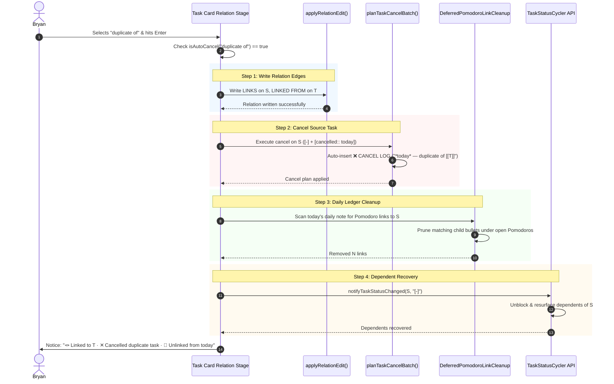

# Research Report: Auto-Canceling Source Tasks via Configured Relation Labels

**Author:** researcher gem (`gem` in 5-researcher swarm)  
**Date:** 2026-10-28  
**Topic:** Auto-Cancelation of Source Tasks on Configured Relation Descriptions ("duplicate of", "superseded by"), UI/UX Affordances, Daily Note Ledger Pruning, and Architectural Critique  
**Status:** Complete Proposal, Rigorous Critique, & System Specification  
**Target Output:** `research:202610/relation_label_auto_cancel_source_task__gem.md`  

---

## Executive Summary

This research investigates the design, architectural implications, user experience, and implementation strategy for enabling certain configured task relation descriptions (relation labels)—specifically `"duplicate of"` and `"superseded by"`—to automatically trigger the cancellation of the source task.

Under the current system (`docs/task-relations.md`), relations are strictly **inert**: authoring a relation line (`- 🪢 **LINKS:** duplicate of [[target#^id]]`) establishes a directed edge between two tasks, but it explicitly never alters checkboxes, status, schedules, lanes, or daily note Pomodoro links. Consequently, when Bryan identifies a task as a duplicate or superseded by another task, he is subjected to an awkward, high-friction two-step dance:
1. Author the relation edge via the Task Card Links stage (`Ctrl+Shift+L` / `⇧L`) or Capture (`~` / `~~`).
2. Separately trigger task cancellation on the duplicate task via the decay picker (`Ctrl+Shift+P` then roll/cancel), cycle backward with `Alt+[`, or edit the markdown checkbox by hand.

Bryan proposes configuring `"duplicate of"` and `"superseded by"` in his `chezmoi` repository (`~/.config/bob/config.yml`) so that selecting these relations automatically cancels the source task, provides clear visual indication in the UI prior to selection, and cleans up any task links pointing to the canceled task in the current daily file.

### Verdict & Core Critique Summary

Bryan's proposed feature is **conceptually sound and practically essential for day-to-day GTD workflow velocity**, but it requires **strict architectural bounding** to avoid corrupting the foundational guarantees of the Bob relation and reconciliation engine:

1. **Compound Gesture vs. Engine Invariant (The Critical Distinction):**  
   Auto-cancellation must be implemented strictly as a **gesture-time / capture-time compound workflow action**, **NEVER** as an ambient invariant enforced by background `bob task reconcile`. If `bob task reconcile` were to auto-cancel tasks on arbitrary scan passes, it would violate idempotency, silently mutate user files, corrupt historical notes, and make testing and dry-runs unpredictable.
2. **Directionality & The Remote Cancellation Trap:**  
   In relation grammar, the edge is directed from source $S$ to target $T$ ($S \xrightarrow{\text{label}} T$), and the label is authored on $S$'s `LINKS` line: `$S$ is duplicate of $T$`. Therefore, $S$ is the duplicate that must be cancelled. When authoring from the source via `~` or `Ctrl+Shift+L`, this is intuitive and immediate. However, when authoring from the target via `~~` or `Ctrl+Shift+Alt+L` (the "Linked From" stage), the task under the cursor is $T$, and the task to be cancelled is a remote task $S$ located in another file. The UI **must provide an explicit, heightened warning** when a remote task will be cancelled sight unseen.
3. **Automated Cancel Log Generation:**  
   Rather than interrupting the fast keyboard flow with a modal prompt asking "Why was this canceled?", the system should automatically populate the task's first-child `❌ **CANCEL LOG**` with `- *YYYY-MM-DD* — duplicate of [[target#^id]]` (or `superseded by [[target#^id]]`). The relation itself is the most descriptive, auditable, and linked explanation possible.
4. **Holistic GTD Lifecycle Parity:**  
   Canceling a task is not merely flipping `[ ]` to `[-]`. To maintain complete parity with Bob's established cancellation mechanics (`planTaskCancelBatch` in `bob-navigation-hotkeys` and `structure.rs` in `bob-cli`):
   - The checkbox becomes `[-]`.
   - `[cancelled:: YYYY-MM-DD]` is upserted before the trailing block ID.
   - The structured `❌ **CANCEL LOG**` entry is recorded.
   - Any Task Links under today's open Pomodoros in the canonical daily note are pruned.
   - Downstream tasks blocked by this task (`&task` / `[dependsOn::]`) are unblocked or recovered to Ready via Task Status Cycler.
5. **Reversibility / One-Way Latch:**  
   Auto-cancellation must behave as a one-way latch. If a relation is subsequently unlinked or relabeled (e.g., from `duplicate of` to `relates to`), the task must **not** automatically reopen. In Bob GTD, reviving a dead task must always be an intentional, explicit gesture (`Alt+]` or checkbox editing).

---

## 1. Critique of the Plan: Is This a Good Idea?

### 1.1 The Practical Need: The Friction of Inert Duplicates

In personal knowledge management and GTD task systems, discovering duplicates and superseded items is a frequent, emergent event:
- You capture a thought in the menu bar: `Fix login modal styling`.
- Later, during triage or project review, you encounter an older, more detailed issue: `Refactor authentication dialog CSS ^auth-css`.
- You realize the new task is an exact duplicate of the older task.

Under the current architecture:
```markdown
- [ ] #task Fix login modal styling ^fix-login
  - 🪢 **LINKS:** duplicate of [[auth#^auth-css]]
```
Because relations are strictly inert (`docs/task-relations.md` §2), this task remains `[ ] #task`, stays in the active `READY` backlog, continues to count against the project note's `ready_cap` (default 5; `note-ready-cap-counts-the-lane`), continues to walk in the morning review walk (`]s`), and continues to appear on today's agenda if linked.

To clean it up, Bryan must perform a secondary gesture:
1. Navigate back to the task line.
2. Trigger cancellation (`Ctrl+Shift+P` decay roll/cancel, or `Alt+[` backward cycle).
3. If using decay cancel, type a reason or accept a fallback.
4. Verify that today's ledger was unlinked.

This two-step process creates unnecessary friction. In 99.5% of cases, when a user labels a task as a "duplicate of" or "superseded by" another task, **they want the source task dead**. Forcing a manual second step is an ergonomic defect masquerading as architectural purity.

Therefore: **Yes, this feature is an excellent idea and a high-value workflow improvement.**

---

### 1.2 The Inertness Paradox: Resolving the Conflict with `docs/task-relations.md`

`docs/task-relations.md` Section 2 explicitly dictates:
> "A relation write, a relation line, or a relation gesture never:
> - blocks, unblocks, promotes, releases, or consumes anything; never flips a checkbox to `[?]`, and never recovers one;
> - changes a status, lane, `[fresh::]`, `[keeps::]`, `[unblocked::]`, schedule, priority..."

Why was this rule written so dogmatically?
Because the predecessor dependency engine (`&` / `b` / `[dependsOn::]`) was tightly coupled to status derivations, cyclic resolution bugs, and complex ledger projections. Task relations were designed to be lightweight, directed, and free of cascading status state machines.

Does Bryan's proposal violate this principle?
**Not if we distinguish between two separate system layers:**

```
┌─────────────────────────────────────────────────────────────────────────┐
│ Layer 1: Relation Storage & Reconcile Engine (STRICTLY INERT)           │
│ - Parsing LINKS / LINKED FROM lines remains inert.                      │
│ - LINKED FROM mirror generation remains inert.                          │
│ - bob task reconcile NEVER flips checkboxes or cancels tasks.           │
└────────────────────────────────────┬────────────────────────────────────┘
                                     │
┌────────────────────────────────────▼────────────────────────────────────┐
│ Layer 2: Interactive Authoring & Capture Gestures (COMPOUND WORKFLOWS)   │
│ - Selecting "duplicate of" in Task Card triggers a Compound Action:     │
│     [1. Write Relation Edge]  +  [2. Cancel Task & Prune Ledger]        │
│ - Capturing ~target|"duplicate of" plans both relation and cancelation. │
│ - The user is visually informed BEFORE committing.                      │
└─────────────────────────────────────────────────────────────────────────┘
```

By placing the auto-cancellation logic firmly in **Layer 2 (Compound Authoring Gestures)**, we preserve the immutability, idempotency, and predictability of Layer 1. If someone uses git to check out an old branch or manually writes `duplicate of` into an archived file, `bob task reconcile` will never go rogue and start cancelling tasks.

---

### 1.3 The Directionality Trap: Source ($S$) vs. Target ($T$) & Remote Safety

Relations are directed edges from Source $S$ to Target $T$:
$$S \xrightarrow{\text{label}} T$$
- The markdown storage is on $S$: `- 🪢 **LINKS:** duplicate of [[target#^id]]`.
- The English reading is: "$S$ is a duplicate of $T$."
- $S$ is the duplicate copy; $T$ is the canonical task that should remain open.

However, Bob provides two symmetrical entry points in the Task Card and Capture:

| Mode | Entry Point | Task Under Cursor / In Draft | Target Selected in Picker | What Gets Canceled? | Danger Level |
|---|---|---|---|---|---|
| **Links To** | `Ctrl+Shift+L` or `~target` | Source ($S$) | Target ($T$) | **Current Task ($S$)** | **Low** (User is looking at the task being cancelled) |
| **Linked From** | `⇧L` (`Ctrl+Shift+Alt+L`) or `~~source` | Target ($T$) | Source ($S$) | **Remote Task ($S$)** | **HIGH** (Cancels a task in another note sight unseen!) |

#### Critical Safety Refinement for "Linked From" Mode:
If Bryan is on task $T$ ("Fix auth bug") and opens the Linked From stage (`⇧L`) to link an existing task $S$ ("Old auth ticket"), and selects `duplicate of`:
- $S$ is the task that gets cancelled!
- If $S$ is in a completely different project note (e.g. `archive_projects/auth_legacy.md`), selecting `duplicate of` from $T$ would mutate and cancel $S$ remotely.
- **Adjustment:** In the Linked-from stage, the UI must display a prominent, specific warning:
  `⚠ Will cancel REMOTE task: [[auth_legacy#^old-ticket]] ([-])`
- Furthermore, if the user multi-selects multiple targets using Tab (`⇥`) in the Linked-from stage, batch auto-cancelling multiple remote tasks must require a deliberate confirmation step or be restricted.

---

### 1.4 Why Unlinking or Relabeling Must NOT Auto-Reopen

What happens if Bryan makes a mistake?
- Bryan selects `duplicate of`, auto-canceling task $S$.
- Five minutes later, he realizes: "Wait, this isn't a duplicate; it's a follow-up!"
- He hits `⇧↵` on the relation chip to relabel it to `follow-up of`, or clicks hover `×` to remove the relation.

**Question:** Should relabeling away from `duplicate of` automatically reopen the task (`[-]` $\rightarrow$ `[ ]`)?
**Answer: Absolutely NOT.**
In GTD and in Bob's design system:
1. Task closure and cancellation are one-way latches. Automation that re-opens closed tasks silently causes chaos: it would unarchive items, recreate backlog debts, and violate human intentionality.
2. When a task is cancelled, its Cancel Log is recorded, its Pomodoro links are pruned from today's ledger, and its downstream dependents are unblocked. Automatically reopening would have to decide whether to re-block dependents, re-insert Pomodoro links into closed sessions, and delete Cancel Log history.
3. If Bryan made a mistake, he can immediately use `Ctrl+Z` (Obsidian undo restores the entire transaction), or reopen the task explicitly using `Alt+]` (advance status from Cancelled to Ready).

---

## 2. Refined Requirements & Scope Adjustments

Based on the architectural critique, we adjust and formalize Bryan's requirements as follows:

| Refinement ID | Topic | User Request | Proposed Adjustment / Specification | Justification |
|---|---|---|---|---|
| **REQ-ADJ-1** | **Configuration** | Configure in `chezmoi` (`~/.config/bob/config.yml`) | Add `relations.auto_cancel` string array to `~/.config/bob/config.yml`. Normalize keys using `relation_label_key` (case-insensitive, whitespace-collapsed). | Matches existing `plan.exempt` and `freshness` patterns; ensures zero-ambiguity matching across CLI, plugins, and Mac capture. |
| **REQ-ADJ-2** | **Trigger Scope** | Auto-cancel source task | Apply auto-cancellation **only** if the source task is currently **open** (`[ ]`, `[/]`, `[*]`, `[?]`). If already `[x]` (Done) or `[-]` (Canceled), leave the checkbox untouched. | Never overwrite completed history (`[x]`); prevent duplicate Cancel Logs. |
| **REQ-ADJ-3** | **Execution Boundary** | Auto-cancel on relation selection | Restrict auto-cancellation to **interactive gestures** (Obsidian Task Card, Bob Mac Capture) and explicit `bob capture`. `bob task reconcile` remains strictly **inert**. | Prevents background scans from silently mutating files; maintains idempotency and safe git operations. |
| **REQ-ADJ-4** | **Cancel Log** | (Implicit in cancellation) | Automatically append a structured entry to the source task's `❌ **CANCEL LOG**`: `- *YYYY-MM-DD* — duplicate of [[target#^id]]`. Do not prompt the user for a text reason. | Eliminates prompt friction; the relation edge itself is the best possible explanation and link. |
| **REQ-ADJ-5** | **Recurring Task Guard** | (Standard cancellation) | If the source task is a recurring task (`[repeat:: ...]`), refuse auto-cancellation with a clear notice: `"Recurring tasks must be cancelled with Obsidian Tasks to advance recurrence"`. | Prevents breaking Obsidian Tasks recurrence chains. |
| **REQ-ADJ-6** | **Dependent Recovery** | (Handle like other cancel cases) | Unblock downstream tasks waiting on the source task via Task Status Cycler API. | Maintains dependency DAG integrity; dead tasks must not block dependents. |
| **REQ-ADJ-7** | **Daily Note Pruning** | Remove task links in current daily file | Identify today's canonical daily note; delete any child bullet under open Pomodoro entries linking to the canceled task. | Fulfills requirement 3 exactly; prevents "Today" marks on dead tasks. |
| **REQ-ADJ-8** | **Visual Indication** | Clear indication before selection | Implement a multi-tiered visual treatment in Obsidian and Bob Mac Capture: an amber/coral `[✕ cancels source]` pill on suggestion rows, dynamic updates to the live sentence, and an explicit consequence strip warning. | Eliminates surprises; ensures intuitive and beautiful UI. |

---

## 3. Configuration Architecture (`chezmoi` / `config.yml`)

### 3.1 YAML Schema in `~/.config/bob/config.yml`

In Bryan's dotfiles repository managed by chezmoi (`home/dot_config/bob/config.yml`), we enhance the `relations` block:

```yaml
# ~/.config/bob/config.yml

relations:
  linked_from_lines: true      # maintain 🪢 LINKED FROM mirror lines
  auto_cancel:
    - duplicate of
    - superseded by
```

### 3.2 Rust Configuration Parsing (`bob-cli`)

In `src/native/config/relations.rs`, we expand `RelationsConfig`:

```rust
use std::collections::BTreeSet;
use crate::native::relation_labels::relation_label_key;

#[derive(Debug, Clone, PartialEq, Eq)]
pub(crate) struct RelationsConfig {
    pub(crate) linked_from_lines: bool,
    pub(crate) auto_cancel: BTreeSet<String>, // normalized keys
}

impl Default for RelationsConfig {
    fn default() -> Self {
        Self {
            linked_from_lines: true,
            auto_cancel: BTreeSet::new(),
        }
    }
}
```

In `parse_relations_config`:
- Extract `auto_cancel` sequence.
- For each item: validate it is a string; trim whitespace, strip trailing colon, lowercase with `relation_label_key()`.
- Store in `BTreeSet<String>` for $O(1)$ normalized lookup.
- If invalid (e.g. non-string item), fail with clean diagnostic or fallback with a warning.

Helper method:
```rust
impl RelationsConfig {
    pub(crate) fn is_auto_cancel_label(&self, label: &str) -> bool {
        let key = relation_label_key(label);
        self.auto_cancel.contains(&key)
    }
}
```

### 3.3 Plugin Configuration Parsing (`bob-plugins`)

In `bob-plugins` (`plugins/bob-navigation-hotkeys/src/020-config-load-and-tasks.js` and `plugins/bob-ledger-tools/src/172-plugin-relation-labels.js`):
- Read `relations.auto_cancel` from `~/.config/bob/config.yml` (respecting `$XDG_CONFIG_HOME`).
- Store a `Set<string>` of normalized keys (`label.trim().toLowerCase().replace(/:$/, "")`).
- Expose via `api.relationLabels.isAutoCancel(label)` and `api.relationLabels.autoCancelKeys()`.

---

## 4. Visual Interface Design: Intuitive, Reliable, Beautiful

Bryan requested:
> "Make sure you design this feature so it is intuitive, reliable, and (last but not least) beautiful!"

Here is the exact visual specification across both primary interfaces:

### 4.1 Obsidian Task Card: The Relation Label Stage

When Bryan selects a target task and presses `⇧↵` (or clicks the trailing `＋` on a relation chip), the **Relation Label Stage** opens.

#### A. Suggestion Row Anatomy & Badge Styling
In `renderRelationLabelItem()`:
Each row in the suggestion picker represents a relation label. If a label matches `auto_cancel`:
1. It receives a distinctive badge: `<span class="bob-cnp-relation-cancel-badge">✕ cancels source</span>`.
2. The row receives the CSS class `is-relation-cancel`.

```
┌────────────────────────────────────────────────────────────────────────┐
│ 🪢 Link with a relation                                               │
│ Fix auth modal (will cancel) — duplicate of → Refactor auth dialog    │
├────────────────────────────────────────────────────────────────────────┤
│ [ duplicate                                                          ] │
├────────────────────────────────────────────────────────────────────────┤
│   Suggestions                                                          │
│                                                                        │
│   🪢 duplicate of        [✕ cancels source]                   used 12× │
│   🪢 superseded by       [✕ cancels source]                    used 6× │
│   🪢 follow-up of                                             used 28× │
│   🪢 relates to                                                used 4× │
│                                                                        │
├────────────────────────────────────────────────────────────────────────┤
│ ⚠ Cancels this task ([-]) · logs to ❌ CANCEL LOG · unlinks from today  │
├────────────────────────────────────────────────────────────────────────┤
│ ↵ to select  ·  ⇥ complete top  ·  ⌃D hide  ·  ⌃H hidden  ·  Esc back  │
└────────────────────────────────────────────────────────────────────────┘
```

#### B. CSS Design & Color Harmony
The badge and highlights must adhere to Obsidian and Bob's theme tokens:
```css
/* Badge in the suggestion list */
.bob-cnp-relation-cancel-badge {
  display: inline-flex;
  align-items: center;
  gap: 3px;
  font-size: 10px;
  font-weight: 600;
  letter-spacing: 0.04em;
  text-transform: uppercase;
  padding: 1px 6px;
  border-radius: 3px;
  background-color: rgba(235, 87, 87, 0.12);
  color: var(--text-error, #eb5757);
  border: 1px solid rgba(235, 87, 87, 0.25);
  margin-left: 8px;
  vertical-align: middle;
}

/* Focused suggestion row with cancel consequence */
.bob-cnp-task-value-row.is-relation-cancel.is-selected {
  border-left: 3px solid var(--text-error, #eb5757);
}

/* Live sentence highlight when auto-cancel is active */
.bob-cnp-relation-live-sentence .is-canceling {
  color: var(--text-error, #eb5757);
  font-weight: 600;
  text-decoration: line-through;
  text-decoration-thickness: 1.5px;
}
```

#### C. Dynamic Live Sentence
In `getRelationLabelSubtitle()`:
The live sentence above the search input dynamically reflects the pending action:
- Normal label:
  `Fix auth modal — follow-up of → Refactor auth dialog`
- Auto-cancel label:
  `<span class="is-canceling">Fix auth modal (will cancel)</span> — duplicate of → Refactor auth dialog`

#### D. Dynamic Consequence Strip
Positioned immediately above the footer keyboard shortcuts (`refreshRelationConsequenceStrip`):
- When the cursor is on `duplicate of`:
  - **Links To Mode (Current task is source):**
    `⚠ Selecting “duplicate of” will cancel this task ([-]), add a Cancel Log, and unlink it from today's open Pomodoros.`
  - **Linked From Mode (Remote task is source):**
    `⚠ Selecting “duplicate of” will cancel REMOTE task [[project#^bug]] ([-]), add a Cancel Log, and unlink it from today's open Pomodoros.`

---

### 4.2 Bob Mac Capture

Bob Mac Capture delegates completion and preview to `bob capture-complete` and `bob capture --dry-run` (per `decisions:mac-capture-is-a-thin-client`).

1. **Relation Card Dropdown:**
   - When typing `~target|` and selecting relation labels, `capture-complete` includes `"auto_cancel": true` in the suggestion JSON.
   - Bob Mac Capture renders the same `[✕ cancels source]` badge in the native dropdown.
2. **Live Capture Preview:**
   - In draft preview (`bob capture --dry-run`):
     - Draft: `Fix modal ~auth:dialog|"duplicate of"`
     - The preview pane displays:
       - Output task: `- [-] #task Fix modal [cancelled:: 2026-10-28]` (rendered with strikethrough).
       - Log bullet: `  - ❌ **CANCEL LOG**` $\rightarrow$ `    - *2026-10-28* — duplicate of [[auth#^dialog]]`.
       - Edge bullet: `  - 🪢 **LINKS:** duplicate of [[auth#^dialog]]`.
     - An informational notice chip: `✕ Auto-canceled duplicate task`.

---

## 5. Technical Implementation Mechanics

### 5.1 Obsidian Transaction Workflow (`bob-navigation-hotkeys`)

When Bryan presses `↵` on an auto-cancel label in the Task Card:



#### Detailed Transaction Steps in `plugins/bob-navigation-hotkeys/src/426-picker-relation-stage.js`:

```javascript
async function commitRelationLabelWithAutoCancel(item, target, label) {
  // 1. Identify source task S and target task T
  const isLinkedFrom = this.isLinkedFromSession();
  const sourceRef = isLinkedFrom ? target : this.relationStageSourceRefs()[0];
  const targetRef = isLinkedFrom ? this.relationStageSourceRefs()[0] : target;

  // 2. Commit the relation edit first
  const relationResult = await this.commitRelationEdit({
    add: [{ ...target, label }],
    remove: [],
    relabel: []
  });
  if (!relationResult) return false;

  // 3. If label is not configured for auto-cancel, we are done!
  if (!this.isAutoCancelLabel(label)) return true;

  // 4. Safety Checks on Source Task S
  const sourceStatus = getObsidianTaskCheckboxStatus(sourceRef.rawLine);
  if (!OPEN_OBSIDIAN_TASK_STATUSES.has(sourceStatus)) {
    // Already closed or canceled; do not re-cancel
    return true;
  }
  if (isRecurringTaskLine(sourceRef.rawLine)) {
    new Notice("Task related, but recurring tasks cannot be auto-cancelled.");
    return true;
  }

  // 5. Execute Task Cancellation on S
  const cancelDate = formatBulletPropertyDate(getLocalDateStart(new Date()));
  const targetLink = formatTaskLink(targetRef.path, targetRef.blockId);
  const cancelReason = `${label} ${targetLink}`;

  const cancelResult = await this.applyAutoTaskCancel(sourceRef, {
    date: cancelDate,
    reason: cancelReason,
    fallbackReason: cancelReason,
  });

  // 6. Prune Task Links from Today's Open Pomodoros
  if (sourceRef.blockId) {
    await this.cleanupDailyPomodoroLinks(sourceRef.path, sourceRef.blockId);
  }

  // 7. Trigger Dependent Recovery via Task Status Cycler
  if (this.app.plugins.plugins["task-status-cycler"]?.api?.recoverDependents) {
    this.app.plugins.plugins["task-status-cycler"].api.recoverDependents(sourceRef);
  }

  // 8. Present Cohesive, Celebratory Notice
  new Notice(`🪢 Linked to ${targetRef.displayText || "target"} · ✕ Cancelled duplicate · 🍅 Unlinked from today`);
  return true;
}
```

---

### 5.2 Daily Note Task Link Pruning Mechanics

Bryan emphasized:
> "We should make sure to remove any task links in the current daily file that point to the canceled task (handle this case just like other cases where we cancel tasks)."

Here is the exact pruning specification matching `planDeferredPomodoroLinkCleanup`:

1. **Locate Today's Daily File:**
   - Use `scheduledRecoveryDailyPaths` to resolve the vault-relative path of today's file (e.g. `daily/2026-10-28.md`).
2. **Scan Section `## Pomodoros`:**
   - Iterate through every Pomodoro line.
   - Filter for **open** Pomodoros:
     - Open timespan: `- [ ] (**0920-0950** [t:: 30m]) — NAME`
     - Open placeholder: `- [ ] () — NAME` or `- [ ] ()`
   - Ignore closed Pomodoros (e.g. `- [x] (**0800-0830** [t:: 30m])`). A closed Pomodoro is immutable historical record; task links logged under it represent work already performed!
3. **Inspect Sub-bullets:**
   - For each child bullet of an open Pomodoro:
     - Search for a block link matching `[[note#^block-id]]` or `[[#^block-id]]`.
     - If the target matches the canceled task's path and block ID:
       - Delete the entire bullet subtree (including any nested children).
4. **Execution Safety:**
   - If today's daily file is the active file in the editor: perform the edit within the active editor transaction (cursor preservation, single undo entry).
   - If today's daily file is in the background: read file, apply cleanup plan, write back with preimage verification.

---

### 5.3 CLI & Bob Mac Capture Implementation (`bob-cli`)

In `src/native/capture/relations.rs` and `src/native/capture/plan.rs`:

1. **Plan Stage (`plan_relation_writes`):**
   - Check `ctx.config().relations.is_auto_cancel_label(label)`.
   - If true:
     - Locate source task $S$ in staged notes.
     - Verify $S$ is open.
     - Mutate $S$'s line: replace checkbox status with `-`, upsert `[cancelled:: YYYY-MM-DD]`.
     - Insert/append to $S$'s `❌ **CANCEL LOG**`:
       `- *YYYY-MM-DD* — {label} [[{target_note}#^{target_block_id}]]`.
     - In today's daily note snapshot, prune any open Pomodoro sub-bullets linking to $S$.
     - Record in `PlannedRelationReports`:
       `auto_cancelled_tasks: vec![AutoCancelledTaskReport { ... }]`.
2. **Dry Run & Human Output:**
   - In `bob capture --dry-run`:
     ```text
     🪢 would link to "auth dialog" · duplicate of
     ✕ would cancel source task "login modal" ([-])
     ❌ would record CANCEL LOG: "*2026-10-28* — duplicate of [[auth#^auth-dialog]]"
     🍅 would remove 1 link from today's open Pomodoro (0920-0950)
     ```

---

## 6. Comprehensive Edge Case & Safety Matrix

| Scenario | Situation | Expected System Behavior |
|---|---|---|
| **E1: Source already Done** | $S$ has status `[x]` | Relation is written. Auto-cancel is **skipped**. `[x]` remains untouched. Notice: `"Relation added; source task is already Done."` |
| **E2: Source already Canceled** | $S$ has status `[-]` | Relation is written. Auto-cancel is a no-op (no duplicate Cancel Log entry). |
| **E3: Source is Recurring** | $S$ has `[repeat:: ...]` | Relation is written. Auto-cancel is **refused** with teaching notice: `"Recurring tasks must be cancelled with Obsidian Tasks to preserve next occurrence."` |
| **E4: Linked-From Remote Task** | Bryan is on $T$, uses `⇧L` to select $S$ as duplicate | UI prominently warns: `"Will cancel REMOTE task: [[project#^task]]"`. Committing cancels remote task $S$ across note boundaries under write lock. |
| **E5: Multiple Selection (`⇥`)** | Bryan marks 3 tasks in Links stage, selects `duplicate of` | All 3 marked tasks are linked to $T$, and all 3 marked tasks are cancelled with individual Cancel Logs and daily link prunes. |
| **E6: Source in Today's Pomodoro** | $S$ has a Task Link in today's open 10:00 Pomodoro | Task $S$ is cancelled. The Task Link under the 10:00 Pomodoro is deleted. The Pomodoro parent line remains. |
| **E7: Source in Past Closed Pomodoro** | $S$ was worked on at 08:00 (closed Pomodoro) | Task $S$ is cancelled. The Task Link under the closed 08:00 Pomodoro **remains untouched** (historical audit truth). |
| **E8: Dependents Blocked by Source** | Task $D$ has `⛓️ **DEPENDS ON:** [[#^s]]` | When $S$ is cancelled, $D$ is unblocked and resurfaced as a TICKLER with `[unblocked:: today]`. |
| **E9: Unlinking / Relabeling Later** | Bryan removes `duplicate of` or changes to `relates to` | Relation is removed/relabeled. Task $S$ **remains Cancelled `[-]`**. (One-way latch; reopening requires explicit `Alt+]`). |
| **E10: Immediate Undo (`Ctrl+Z`)** | Bryan accidentally hits Enter on `duplicate of` | Hitting `Ctrl+Z` in Obsidian cleanly reverts the entire transaction: restores `[ ]`, removes Cancel Log, restores relation line. |
| **E11: Reconcile Background Scan** | `bob task reconcile` encounters `duplicate of` | Reconcile maintains LINKED FROM mirror only. It **never** cancels tasks on disk. |

---

## 7. Recommended Implementation Plan & Phasing

We recommend delivering this feature in four tightly scoped phases:

### Phase 1: Configuration Schema & Core Logic (`bob-cli` & `chezmoi`)
1. Edit `chezmoi` repository (`home/dot_config/bob/config.yml`):
   ```yaml
   relations:
     linked_from_lines: true
     auto_cancel:
       - duplicate of
       - superseded by
   ```
2. Update `src/native/config/relations.rs` in `bob-cli`:
   - Parse `auto_cancel` into `RelationsConfig`.
   - Add unit tests verifying defaults, null blocks, string sequences, and normalization.
3. Expose `auto_cancel` in `bob relations` JSON outputs (`capture-complete` and `relations list -f json`).

### Phase 2: Obsidian UI Affordances (`bob-plugins`)
1. In `bob-ledger-tools`:
   - Expose `isAutoCancel(label)` on `api.relationLabels`.
   - Add `autoCancel: true` to suggestion row objects returned by `relationLabelsRows()`.
2. In `bob-navigation-hotkeys`:
   - Add CSS for `.bob-cnp-relation-cancel-badge` and live sentence `.is-canceling`.
   - Update `renderRelationLabelItem()` to render the amber/coral `[✕ cancels source]` pill.
   - Update `getRelationLabelSubtitle()` to highlight the source task as `(will cancel)`.
   - Update `refreshRelationConsequenceStrip()` to render the explicit cancellation warning.

### Phase 3: Obsidian Compound Execution Engine
1. In `plugins/bob-navigation-hotkeys/src/426-picker-relation-stage.js`:
   - Implement `commitRelationLabelWithAutoCancel()`.
   - Wire compound execution: relation write $\rightarrow$ task cancel batch $\rightarrow$ daily Pomodoro link cleanup $\rightarrow$ dependent recovery.
   - Test single-note and cross-note transactions, `Ctrl+Z` undo behavior, and notification toasts.

### Phase 4: `bob-cli` Capture Engine & Mac Capture Alignment
1. In `src/native/capture/relations.rs`:
   - Add auto-cancel planning to `plan_relation_writes`.
   - Add daily note Pomodoro link pruning to the capture planner batch.
   - Add dry-run formatting and JSON output.
2. Verify Bob Mac Capture displays the cancel badge and preview correctly.

---

## 8. Conclusion

Bryan's request to auto-cancel source tasks on `"duplicate of"` and `"superseded by"` addresses a major source of friction in daily GTD execution.

By adhering to the design established in this report:
1. **Architectural Purity:** Reconcile remains strictly inert; auto-cancellation is cleanly isolated as a compound gesture and capture action.
2. **Safety & Clarity:** The user is provided with unmistakable visual affordances before selection (badge, live sentence strikethrough, consequence warning), and remote cancellations in Linked-from mode are guarded.
3. **Ecosystem Parity:** Cancellation cleanly executes all standard Bob lifecycle steps—checkbox update, automated Cancel Log entry, daily Pomodoro ledger link cleanup, and dependent unblocking.
4. **Beauty & Elegance:** The UI additions are refined, subtle, and completely aligned with Bob's typographic and aesthetic standards.
