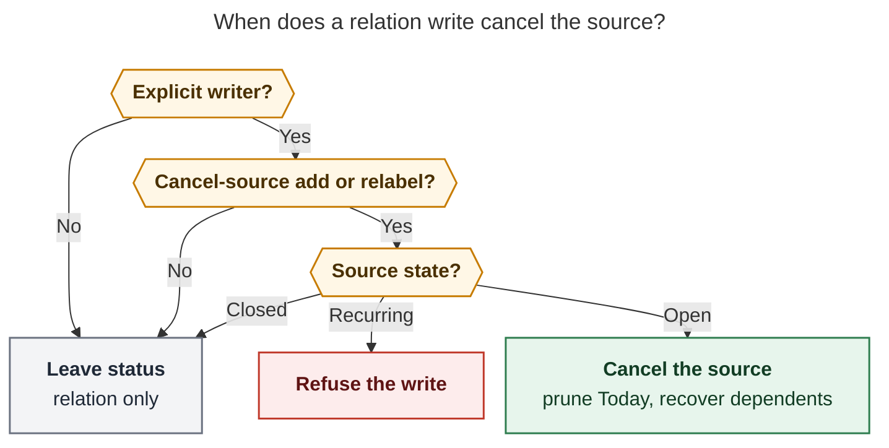
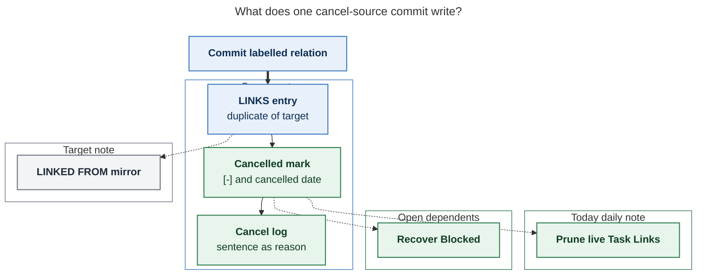

# Relation labels that cancel their source

> **Research query.** Configure certain relation labels so that adding them
> automatically cancels the source task. Start with chezmoi `duplicate of` and
> `superseded by`. Show a clear indication when the chosen label would cancel.
> Remove today's live Task Links to the cancelled task the same way other cancel
> paths do. Lead the design, critique the plan, call out justified requirement
> adjustments, and recommend a solution that is intuitive, reliable, and
> beautiful.

**Researcher.** `grk` (independent swarm report).
**Date.** 2026-10-28.
**Scope.** Research only. No bob-cli, plugin, chezmoi, vault, or memory files
were changed. This file is the deliverable.

**Prior research consulted (unrelated earlier swarms, not this one).**
`research:202610/task_relation_labels.md`,
`research:202610/task_relation_links/`,
`research:202610/undirected_task_relations/`,
`research:202610/relation_card_label_vocabulary/`.

---

## Bottom line

**Build it. Fuse the two gestures Bryan already performs by hand, and keep
every other relation inert.**

`duplicate of` and `superseded by` already mean "this task should leave the
open pool in favor of that one." The live vault proves it: every current
edge with those labels sits on a task that is already `[-]`. The missing
piece is that the relation write and the cancel write are still two
gestures, and the cancel log is usually empty. GitHub splits "Duplicate of
#N" from close because closing someone else's issue is political. Bob is a
single-user GTD vault. Fusing them is the right call.

Do **not** make cancel a derived property of the stored edge. Reconcile,
hand edits, rename, unlink, and reopen must leave status alone. Only an
explicit relation writer that *adds or relabels* a configured cancel-source
label cancels the **LINKS source**, with the existing cancel pipeline
(`[-]`, `[cancelled:: today]`, first-child `❌ **CANCEL LOG**`, prune
today's live Task Links, recover Blocked dependents).

Ship the effect **off by default**. Bryan opts in through chezmoi
`~/.config/bob/config.yml`. That preserves the current inertness contract
for anyone without the key, and it matches the request to configure the two
labels in chezmoi.

The beautiful object is the live sentence that the relation card already
draws, with the cancelled task named in it:

```text
Sell stocks — duplicate of → Sell stocks now  ·  cancels “Sell stocks”
```

Return on that row *is* the confirmation. Do not open the Cancel reason
stage. The cancel log reason is the same sentence's durable form:
`duplicate of [[dev_plex_hack_patch#^sell-stocks-now]]`.

---

## 1. Is this a good idea?

**Yes, with a narrower trigger than "the label exists on the line."**

### 1.1 Why yes

Bryan already uses these labels as retirement. `bob relations list -a`
today:

| Label | Links | Inverse | Where the sources are now |
| --- | ---: | --- | --- |
| `implements` | 10 | none | ordinary relations |
| `inspired by` | 8 | none | ordinary relations |
| `superseded by` | 2 | `supersedes` | both `[-]` in `done/sase_blog_done.md` |
| `duplicate of` | 1 | `duplicated by` | `[-]` `cash.md` `^sell-stocks` |
| three one-offs | 3 | none | hidden / ordinary |

The three matching sources are already cancelled. Two of them (`^write-introduction`
superseded by `sase_blog#^intro-v1`, `^sase-blog-writers-block` superseded by
`#^review-tasks`) and the cash duplicate (`^sell-stocks` duplicate of
`dev_plex_hack_patch#^sell-stocks-now`) have **no Cancel Log**. The docs
example of a well-written cancel (`docs/projects.md`, "Cancelling a task")
is exactly this sentence as a log line:

```markdown
- [-] #task Add new `Agents` sub-tab …
  - ❌ **CANCEL LOG**
    - _2026-09-30_ — Superseded by [[sase_art_links_panel#^agents-sub-tab]]
```

The feature turns that from a remembered idiom into the default.

The inverse table in `docs/task-relations.md` §10 already treats these two
labels as first-class vocabulary (`duplicate of` / `duplicated by`,
`superseded by` / `supersedes`). They are not random strings. They are the
retirement pair.

Industry analogs agree on the *meaning*, and they split on the *trigger*:

- GitHub: a comment `Duplicate of #N` marks the timeline; close is a
  separate act, and Undo unmarks without always reopening.
  ([Marking issues as a duplicate](https://docs.github.com/en/issues/tracking-your-work-with-issues/administering-issues/marking-issues-or-pull-requests-as-a-duplicate))
- GitHub PRs: `Closes #N` / `Fixes #N` *does* fuse link and close, because
  the author of the surviving work is the one retiring the old item.
- Linear: `duplicate` sits next to `blocked` and `related` as its own kind
  (cited in `research:202610/undirected_task_relations/`).
- Jira: a Duplicate *resolution* closes the issue.

Bob's `~` / Task Card `l` from the dying task is GitHub's "Duplicate of."
Bob's `~~` / Task Card `⇧L` from the surviving task is GitHub's
`Closes #N` written from the replacement. Both are useful. The UI must name
**which task** is cancelled, because in `~~` it is not the task you are
typing.

### 1.2 Why a naive reading of the request is dangerous

`docs/task-relations.md` §2 and §13 guarantee inertness (LR18, LX13, LG13):
a relation write never flips a checkbox, never stamps, never routes, never
advances the walk. The Task Card subtitle still says `does not block`, and
the consequence strip says `never blocks, schedules, or changes status`
(`src/305-relation-stage-copy.js`). If a label can cancel and those strings
stay, the UI lies.

The current cancel path is a *different* machine: Task Card `x`, a reason
stage, `planTaskCancelBatch`, prune via `planDeferredPomodoroLinkCleanup`,
then `api.recoverBlockedDependents`. Capture has **no** general cancel
writer. Mac Capture is a thin client of `bob` (`decisions:mac-capture-is-a-thin-client`).
If only Obsidian cancelled, `|"duplicate of"` from the Mac would be a
footgun.

A reconcile-time rule ("any open task whose LINKS line carries `duplicate
of` is cancelled") would also re-cancel a task you just reopened, and it
would fire on a paste. That is the wrong reliability.

### 1.3 Would I take a different approach?

I would **not** invent a third gesture (`Ctrl+Shift+D` "mark duplicate"),
and I would **not** keep relate-then-cancel as two steps with a reason
prompt in the middle. I would also **not** hard-code the two labels inside
bob-cli.

The approach I recommend is slightly stricter than the request:

- Configure **labels** (the contract word; see §8.1), not "descriptions."
- Effect is **write-time**, on add and relabel only.
- Product default is an **empty** list.
- Indication names the task and replaces the lying "never changes status"
  copy for that row.
- Capture, Obsidian, and Mac Capture share one bob-authored flag and one
  cancel pipeline.

That is the request, with the failure modes closed.

---

## 2. What the system does today

### 2.1 Relations are an inert labelled graph

A relation is a directed, optionally labelled edge authored on the source's
`🪢 **LINKS:**` line and mirrored on the target's generated
`🪢 **LINKED FROM:**` line (`docs/task-relations.md`, glossary
`task-relation`). Capture `~` / `~~` and Task Card `l` / `⇧L` are the
writers. Close, cancel, and reopen change nothing about the edge
(§8, §14). Labels are 1–40 characters, keyed by
`relation_label_key` (writer normalize, then Unicode lower case; RV2).

The only `relations` config key today is `linked_from_lines` (default
`true`). Parser: `src/native/config/relations.rs`. Chezmoi
`home/dot_config/bob/config.yml` has **no** `relations:` block yet, so the
default applies.

RV1 is a naming rule the request trips over: **never use "description"** in
code or contracts; bob already uses that word for task text. The UI mostly
says **relation**; the contract says **relation label**.

### 2.2 Cancel is a plugin writer plus a reconcile backstop

Task Card `x` never cancels by itself. It opens a reason stage. Enter runs
`applyTaskCancelFromPicker` → `planTaskCancelBatch`
(`bob-navigation-hotkeys` `src/240-cancel-and-lanes.js`,
`src/540-plugin-decay-picker-and-cancel.js`):

1. Rewrite the task to `[-]` and upsert `[cancelled:: YYYY-MM-DD]`.
2. Prepend a first-child `❌ **CANCEL LOG**` entry
   `*YYYY-MM-DD* — <reason>` when a reason is given (or the 🤷 fallback
   when a log already exists).
3. Prune live Task Links to that block id from **today's open Pomodoros**,
   dedicated-bullet/token semantics (a dedicated link bullet goes with its
   subtree; otherwise only the token goes). Same-note prune shares the
   undo step; cross-note prune is best-effort and never rolls the cancel
   back. The notice reports `removed N Pomodoro links` or
   `Pomodoro links not removed`.
4. Recover Blocked dependents through Task Status Cycler's versioned API.
   A cancelled close **never** offers successor links
   (`closeKind: "cancelled"`).
5. Recurring tasks (`[repeat::]`, `(repeat::)`, `🔁`) refuse with the
   Obsidian Tasks teaching error. `^prj` is allowed; `bob projects sync`
   maps `[-]` to `status: canceled`.

`bob task reconcile` is the authority for the same ledger cleanup: "A link
to an unambiguously canceled Tasks task removes its complete Markdown
list-item subtree from an open Pomodoro" (`docs/task-status-hooks.md`).
Immediate prune is for feedback; the next reconcile heals a missed prune.

Capture already reports `removed_pomodoro_links` for unlink / consumption /
complete. It does not cancel ordinary `#task` lines. There is no
`bob task cancel`. Porting `planTaskCancelBatch` into Rust is the
implementation gap this feature forces, because Mac Capture cannot cancel
unless `bob capture` can.

### 2.3 The indication surface already exists

The relation-label stage and Mac relation card already draw
`S — ‹label› → T` (`relationStageLiveSentence`,
`docs/reference/mac-capture/relationship-pickers.md`). Catalog rows already
carry `inverse`, `count`, `hidden`, `replacement`, `hide_replacement`
(`docs/task-relations.md` §12, `docs/reference/json-outputs.md`). The card
fetches the catalog **once on open** and ranks locally
(`decisions:relation-card-tab-accepts-ctrl-d-hides`). Any new flag must
arrive on that catalog payload. The card must not spawn `bob` per
keystroke, and Mac Capture must not parse `config.yml` itself.

### 2.4 Two related designs that should not block this one

Earlier research argued that an *unlabelled* relation should become
undirected (`research:202610/undirected_task_relations/`). That has **not**
shipped (no "undirected" in `docs/`). This feature is independent and
actually *helps* that future: labels become the only carriers of meaning,
including retirement. Unlabelled relations never cancel, whether or not
direction later goes away.

---

## 3. Recommended solution

Call the effect **cancel-source**. Machine name `cancel_source`. UI copy
always names the task.

### 3.1 Config (chezmoi owns Bryan's list; bob-cli defaults to none)

```yaml
# ~/.config/bob/config.yml  (chezmoi: home/dot_config/bob/config.yml)
relations:
  linked_from_lines: true
  cancel_source:
    - duplicate of
    - superseded by
    # - merged into   # same meaning; leave off until Bryan wants it
```

Rules:

- Sequence of nonempty strings. Each entry is matched after
  `relation_label_key` (so `Duplicate of:` equals `duplicate of`).
- Missing key, null, or `[]` means no auto-cancel. **This is the product
  default.** Invalid entries warn and are skipped; the rest still apply.
  Capture and the Task Card never fail the whole config on one bad string.
- `bob relations list` JSON grows additive `cancels_source: true` on
  matching rows. Human list grows a mint-knot / ⊘ chip:
  `duplicate of  1 link  ⇄ duplicated by  ⊘ cancels source`.
- Rename of a label does **not** rewrite this list. After
  `bob relations rename "duplicate of" "dup of"`, chezmoi must follow or
  the effect stops. The rename preview should *say* whether OLD or NEW is
  in `cancel_source`, so that miss is visible.
- Do not put the list in `.bob/relations/<host>.jsonl`. That journal is
  hide / unhide / rename (RV3). Lifecycle policy is host-wide YAML, like
  `linked_from_lines`.

`merged into` is in the §10 inverse table and is semantically the same
retirement. I would **not** add it in the first chezmoi commit unless Bryan
asks. Call it out as a one-line follow-up. `follow-up of` and `split from`
must never be in this list.

### 3.2 Who is cancelled

**Always the LINKS source** — the task whose line will hold
`‹label› [[target]]`.

| Gesture | LINKS source (cancelled) | Target (survives) |
| --- | --- | --- |
| On the duplicate: `~canonical\|"duplicate of"`, Task Card `l` | the current / new task | the canonical |
| On the replacement: `~~old\|"superseded by"`, Task Card `⇧L` | the **old** task | the new / current task |
| `@route+id ~other\|"duplicate of"` | `route+id` | `other` |

The `~~` / `⇧L` path is the beautiful "I am capturing the replacement"
flow. It is also the scary one, because it cancels a task you are not
typing. The sentence has to name it. Never say only "cancels the source"
in the UI.

### 3.3 When it fires

An explicit writer, in one transaction with the LINKS edit:

- `bob capture` / Mac Capture submit of `~` / `~~` with a matching label
  (including a typed `|"duplicate of"` with no card)
- Obsidian Links / Linked-from apply and relabel (`↵` after `⇧↵`, CURRENT
  `⇧↵`)
- Counted `N Ctrl+Shift+L` with a matching label (extra confirm, §4.3)

It does **not** fire for:

- Hand edits of a LINKS line, including paste
- `bob task reconcile` (LINKED FROM only; LR18 stays for status)
- `bob relations rename` / merge (vocabulary, not a retirement)
- Unlink, chip ×, Ctrl+D on Links to
- Relabel *away* from a cancel-source label (do not reopen)
- Reopen (`Alt+]`); the edge remains history
- A no-op re-add of the same target and same label (`unchanged`)
- Backfill of the three existing vault edges (they are already `[-]`;
  even if they were open, a vault-wide sweep is out of scope)

Add and relabel *to* a cancel-source label both fire, because both are
explicit "this is now a duplicate / superseded-by" choices.

### 3.4 What the cancel write is

Reuse the Task Card cancel payload, composed onto the **same source note
write** as the LINKS edit:

1. `[-]` and `[cancelled:: today]` (today = bob's configured timezone date,
   same as other writers).
2. Cancel log as first direct child, reason =
   `{display spelling} {canonical_link(target)}`, e.g.
   `duplicate of [[dev_plex_hack_patch#^sell-stocks-now]]`.
   Newest first. No second prompt. If a log already exists, prepend.
   Sentence-case of the first character is optional polish; matching the
   stored label plus the canonical link is more important than matching
   the docs example's capital S.
3. Prune today's open-Pomodoro Task Links to the source's block id, same
   dedicated-bullet/token semantics as deferral and Task Card cancel.
   Reconcile remains authoritative.
4. Recover Blocked dependents. No successor offer.
5. Do not stamp freshness. Do not write a Work Log. Do not route inbox
   tasks. `^prj` is allowed, with louder copy (`cancels this project`).
6. Recurring source: **refuse the whole item** (relation + cancel), same
   teaching error as Task Card `x`. A "duplicate of" edge on a still-open
   recurring task would be a lie.
7. Source already `[-]`: write or relabel the relation only; do not bump
   the cancelled date.
8. Source already `[x]`: write the relation only; warn
   `already done · left complete`. Never convert a completion into a
   cancel.
9. Prune failure: warn, do not roll the source write back (parity with
   today's cancel).
10. Same-note LINKS + cancel + log = one undo step in Obsidian. Cross-note
    mirror and daily prune stay best-effort follow-ups.

Capture JSON stays `schema_version: 1` and grows additively:

- `capture-complete` `relation_label` rows: `cancels_source: true` (omit
  when false). Typed row included when the typed key matches config even
  if the label is new.
- `capture` / `--dry-run` per item: `cancelled_tasks[]`
  `{path, block_id, text, label, reason, action: cancelled|already_cancelled|already_done}`
  plus the existing `removed_pomodoro_links`.
- Human dry-run:

  ```text
  🪢 would link to "Sell stocks now" · duplicate of   cash.md ^sell-stocks
  ⊘ would cancel “Sell stocks”  [-]  · duplicate of [[dev_plex_hack_patch#^sell-stocks-now]]
  ```

  For `~~`:

  ```text
  🪢 "Write introduction" would now link here · superseded by   sase_blog.md ^intro-v1
  ⊘ would cancel “Write introduction”
  ```

### 3.5 Inertness contract, amended not deleted

Replace the absolute "never changes status" with a single exception:

> A relation write is inert, except that an explicit add or relabel of a
> label listed in `relations.cancel_source` cancels the LINKS source
> through the ordinary cancel pipeline. Reconcile, rename, unlink, hand
> edit, and reopen never take this exception.

That is a `feat!` contract change under
`decisions:bob-cli-releases-ride-a-daily-train`. JSON can stay additive.
Guarantees LX13 / LG13 / LR18 need an exception vector, not a deletion.

New vectors (names for the implementer):

| ID | Situation | Outcome |
| --- | --- | --- |
| LX17 | `Dup ~T\|"duplicate of"` with the label configured | N born `[-]` with LINKS and Cancel Log; Today's links to N pruned; dry-run matches live |
| LX18 | `New ~~Old\|"superseded by"` | Old cancelled in the same batch as Old's LINKS edit; New stays open and receives the mirror |
| LX19 | `Dup ~T\|"follow-up of"` | relation only; status byte-identical (LX13 still holds) |
| LX20 | cancel_source empty / unset | LX13 holds for `duplicate of` too |
| LX21 | recurring source + cancel-source label | refused; vault byte-identical |
| LX22 | source already `[x]` | relation written; left complete; warning |
| LG16 | Task Card `l` then `⇧↵` `duplicate of` `↵` | one undo; no reason stage; notice names the cancelled task and pruned links |
| LG17 | counted `3 Ctrl+Shift+L` + cancel-source label | danger banner; second Enter cancels all four; Escape writes nothing |
| LR25 | open task with a hand-edited `duplicate of` LINKS line | LINKED FROM repaired; status untouched |

---

## 4. Indication (the beauty constraint)

The request is "a clear indication when the relation label they are
selecting would result in cancelation." The card already has a sentence
pill. Put the danger **in that sentence**, on the row, and in the
consequence strip that today lies.

### 4.1 Label rows

Catalog rows with `cancels_source` show a trailing ⊘ pill
`cancels “‹source›”` (or `cancels this project` for `^prj`). Inverse
phrase stays. Hidden rows that match still show the pill if they appear
as an exact typed match.

Do not hide cancel-source labels from suggestions. Retirement is a common
choice; hiding it would make the dangerous path a typed incantation.

### 4.2 Sentence and consequence strip

Today:

```text
Sell stocks — duplicate of → Sell stocks now
Links only · never blocks, schedules, or changes status
```

Required when `cancels_source` matches and the source is open:

```text
Sell stocks — duplicate of → Sell stocks now  ·  cancels “Sell stocks”
⊘ Cancels this task, removes it from Today, unblocks dependents
```

When the source is already cancelled: keep the relation sentence, drop the
danger, meta `already cancelled`. When the source is done: `already done ·
will not cancel`. When recurring: the row is disabled with the existing
Obsidian Tasks sentence; Return does not insert.

Footer: `↩ insert · cancels “Sell stocks”` replacing `does not block` for
that selection only. The idle subtitle can keep `does not block` for
ordinary labels.

Mac Capture Command-Return from the card captures immediately, so the card
itself must show the cancel *before* submit. The main-panel dry-run is the
second indication, not the only one.

### 4.3 One confirmation, except batches

Selecting the label is the confirmation. Do not open the Cancel reason
stage. That stage exists to capture a free-text why; here the why is the
relation.

Counted `N Ctrl+Shift+L` and Task-Link sessions can cancel several tasks at
once. Match Alt+P's counted-cancel rule: show the danger banner
(`cancels N tasks`) and require a second Enter. Escape writes nothing.
Single-task `~~` that names a different existing task does **not** need
the extra Enter; the named sentence is enough.

### 4.4 Walk

A resolving Task Card commit on a `]s` landing already advances the walk
(`decisions:answering-advances-the-walk`). Cancelling the landed row
through this path should advance once, like Cancel `x` and Ctrl+Enter
close. Capture from the Mac is not a walk answer.

---

## 5. Reliability rules (the rest of the edge table)

| Case | Rule |
| --- | --- |
| Two cancel-source labels on one item | Cancel once. Log reason from the first matching label in authored order. |
| Relabel `follow-up of` → `duplicate of` | Cancel. |
| Relabel `duplicate of` → `superseded by` | Already cancelled: relabel only. |
| Relabel `duplicate of` → `inspired by` | Relabel only; leave `[-]`. |
| Unlink the cancel-source edge | Leave `[-]`. Relations are history; uncancel is `Alt+]`. |
| Malformed LINKS line | Today's refusal; nothing cancelled. |
| Missing block id on source | Mint as today, then cancel. Prune needs the id. |
| Archived / previous-daily target | Relation allowed, mirror skipped as today; source still cancels. |
| Inbox source | Cancel in place. Cancel is not a filing action, so no route picker. |
| Kill switch `linked_from_lines: false` | Still cancel; still write LINKS; no mirror. |
| Multi-item capture | Per item. One item's recurring refusal does not block siblings. |
| Dry run | Identical JSON aside from `dry_run`; no writes, no journal, no prune. |

---

## 6. Implementation shape

Three repos, one authority.

### 6.1 bob-cli (source of truth)

1. Grow `RelationsConfig` with `cancel_source: Vec<String>` (stored as
   keys). `src/native/config/relations.rs` plus
   `docs/reference/configuration.md`.
2. Shared `label_cancels_source(label, config) -> bool`.
3. `capture-complete` additive flag on `RelationLabelSuggestion`.
4. New Rust cancel planner, a twin of `planTaskCancelBatch` + the daily
   prune already used for unlink: checkbox, cancelled field, cancel log,
   `removed_pomodoro_links`, then `recover_blocked_dependents` (already in
   `src/native/task_complete/recovery.rs`).
5. `plan_relation_writes` composes that planner onto the LINKS source
   after a successful add/relabel, in the same staged batch.
6. Human / JSON output as in §3.4.
7. `bob relations list` chip. No new subcommand (CLI rules: membership of
   `bob relations` stays "the relation-label vocabulary"; this is a config
   effect, not a new noun).

This is the expensive phase. Without it, Mac Capture cannot honor the
feature.

### 6.2 bob-plugins

1. Load `relations.cancel_source` next to `linked_from_lines`
   (`src/020-config-load-and-tasks.js`), cache by mtime/size.
2. `api.relationLabels` rows grow `cancels_source`.
3. Relation-label stage: pill, sentence, consequence strip, footer.
4. Links apply: after `plan_links_edit`, if the new/relabeled label
   matches, call `planTaskCancelBatch` + `planDeferredPomodoroLinkCleanup`
   + recover in the same editor transaction when the source is the active
   note.
5. Counted batch danger banner.
6. Walk advance when the landed row is the cancelled source.

Keep the JS cancel planner. Do not route Obsidian through `bob capture`
just for this; undo and same-note transactions stay local. Pin the new
vectors in both trees, same as LW14.

### 6.3 Bob Mac Capture

Render `cancels_source` and bob's dry-run `cancelled_tasks`. No config
parse. Card sentence and row pill. Command-Return is allowed only after
that pill is visible. Thin-client contract unchanged.

### 6.4 chezmoi

Add the `relations.cancel_source` list to `home/dot_config/bob/config.yml`.
After commit, `chezmoi update -a --force` (chezmoi AGENTS.md). Empty
product default means this file is what turns the feature on for Bryan.

### 6.5 Docs and memory (implementer, not this turn)

- Contract: `docs/task-relations.md` §2, §8, §12, §13, §15 (new LX/LG/LR
  vectors), RV1 reminder.
- `docs/reference/configuration.md`, `docs/guides/link-related-tasks.md`
  (today: "Relations never … change status"), plugin + Mac references.
- Decision record: write-time cancel-source labels, empty default, named
  indication, no reconcile backfill.
- Glossary `task-relation`: inert except configured cancel-source labels.
- `just docs-gen` if `bob relations --help` human list copy changes.

Suggested phases: config + contract + Rust planner + capture vectors;
then Obsidian indication + compose; then Mac card; then chezmoi on. Do
not enable chezmoi before capture and the card both show the pill.

---

## 7. Alternatives I am rejecting

| Alternative | Why not |
| --- | --- |
| Hard-code `duplicate of` and `superseded by` in bob-cli | Bryan asked for config, and empty default keeps the old guarantee for other vaults. |
| Reconcile / hooks derive cancel from the edge | Reopen and paste would fight the user. Relations stay history. |
| Keep the Cancel reason stage | The label *is* the reason. A second prompt makes the fusion ugly. |
| New "Mark duplicate" keymap | Two UIs for one meaning. The label vocabulary already exists. |
| Capture-only, plugins later | Obsidian is where `l` / `⇧L` live. |
| Plugin-only, capture later | Mac Capture would silently not cancel. Thin-client violation. |
| Auto-cancel on `merged into` in v1 | Same family, but Bryan named two labels. Offer it as a comment. |
| Convert `[x]` to `[-]` | Completing and cancelling are different history. |
| Uncancel when the edge is removed | Unlink would resurrect work. Reopen stays explicit. |
| Vault backfill of existing edges | All three matching sources are already `[-]`. A sweep is still the wrong policy. |
| Put the list in the per-host journal | Hide/unhide/rename are suggestion prefs. This is lifecycle policy. |
| Confirm every single-task `~~` with a second Enter | The named sentence is the confirm. Extra Enter is for counted batches. |

---

## 8. Requirement adjustments (justified)

These change the request. Each is deliberate.

1. **Say "relation label," never "description."** RV1. Task text is already
   "description." Code, config, JSON, and docs should use `cancel_source`
   / "cancel-source label."
2. **Empty product default; chezmoi opts in.** The request assumed chezmoi
   configuration; making the two labels universal would surprise any vault
   that already used them as ordinary history. Live evidence: they *are*
   used, on already-cancelled tasks.
3. **Write-time add/relabel only.** No reconcile, no hand edit, no rename,
   no unlink side effect. Reliability over "the label always means
   cancelled."
4. **Skip the Cancel reason stage.** Auto-reason is the label plus the
   canonical target link. Indication lives on the card, not on a second
   modal.
5. **Name the cancelled task in every surface.** `~~` / `⇧L` cancel a
   different task than the one being composed. "Cancels the source" is
   machine talk.
6. **Recurring sources refuse the whole write.** Parity with Task Card
   `x`; a surviving open recurring duplicate would be worse than a
   refusal.
7. **Done tasks stay done.** Relation is allowed; cancel is skipped.
8. **Counted batches need a second Enter.** Single-task selection is
   enough confirmation; N+1 is not.
9. **Walk advances** when this write cancels the landed row. It is a
   resolving Task Card commit.
10. **Port cancel into Rust for capture.** Implied by Mac-as-thin-client
    and by "handle Task Link cleanup like other cancels." Not in the
    request as a repo split, but the feature is incomplete without it.
11. **`feat!` on the inertness contract.** Mark the train commit that
    amends §2. JSON stays schema 1 additive.
12. **Do not add `merged into` unless asked.** Document it as the obvious
    third. Leave it commented in chezmoi if a comment is welcome; do not
    enable it silently.

---

## 9. Open questions for the lead / Bryan

None of these block the recommended shape. They are taste.

1. Sentence-case the cancel-log reason (`Superseded by [[…]]`) to match
   `docs/projects.md`, or keep the stored label verbatim
   (`superseded by [[…]]`)? I lean **verbatim + canonical link**, because
   it rhymes with the LINKS line.
2. Enable `merged into` in the same chezmoi commit? I lean **no**.
3. Should `bob relations list` refuse to hide a cancel-source label,
   or is hide-still-typed (RV4) enough? I lean **keep RV4**: hiding only
   removes the suggestion; typing still cancels, and the typed row still
   shows ⊘.
4. A later lint `open_task_with_cancel_source_label` for hand-edited
   edges? Useful, not v1.

---

## 10. Figures

Mermaid CLI `@mermaid-js/mermaid-cli@12.0.0`, PDF-mirroring config, DejaVu
Sans. Measured from the root SVG.

### 10.1 When the write cancels

**Reader question.** When does a relation write cancel the source task?

**Caption.** Only an explicit writer that adds or relabels a configured
cancel-source label cancels an open, non-recurring LINKS source.
Reconcile, hand edits, rename, unlink, and already-closed tasks leave
status alone; a recurring source refuses the whole write.

Rendered size: 728.1 × 824 px; fit scale: 89.7%.



### 10.2 What one commit writes

**Reader question.** Which notes change when a cancel-source relation is
committed?

**Caption.** The source note receives the LINKS entry, the cancelled mark,
and the cancel log in one write. The target receives the generated mirror.
Today's daily note loses live Task Links to the source. Open dependents
recover, with no successor offer.

Rendered size: 861.2 × 762 px; fit scale: 75.8%.



---

## 11. Sources

**Contracts and code (this workspace unless noted).**

- `docs/task-relations.md` §2, §8, §10, §12–§16
- `docs/projects.md` "Cancelling a task"
- `docs/task-status-hooks.md` canceled-reference cleanup
- `docs/reference/configuration.md` `relations`
- `docs/reference/plugins/task-relations.md`, `task-card.md`
- `docs/reference/mac-capture/relationship-pickers.md`, `keyboard.md`
- `docs/guides/link-related-tasks.md`
- `docs/reference/json-outputs.md` `relation_label` rows
- `src/native/config/relations.rs`
- `src/native/task_relations/label.rs` (`inverse_phrase`)
- `src/native/capture/relations.rs`, `capture/output.rs`
- `src/native/task_complete/recovery.rs`
- bob-plugins `src/020-config-load-and-tasks.js`,
  `src/240-cancel-and-lanes.js`, `src/305-relation-stage-copy.js`,
  `src/380-picker-cancel-and-lane.js`,
  `src/540-plugin-decay-picker-and-cancel.js`
- chezmoi `home/dot_config/bob/config.yml` (no `relations:` block today)

**Decisions and glossary.**
`task-relation`, `task-link`;
`relation-card-tab-accepts-ctrl-d-hides`,
`relation-label-hide-is-suggestions-only`,
`mac-capture-is-a-thin-client`,
`unblocked-tasks-are-offered`,
`answering-advances-the-walk`,
`bob-cli-releases-ride-a-daily-train`.

**Live vault (2026-10-28).**
`bob relations list -a`: 7 labels, 24 links;
`duplicate of` ×1 on `cash.md` `^sell-stocks` (`[-]`, no Cancel Log);
`superseded by` ×2 on `done/sase_blog_done.md` `^write-introduction` and
`^sase-blog-writers-block` (both `[-]`, no Cancel Log).

**External.**
GitHub duplicate comments vs `Closes #N`;
Linear `duplicate` / `related` / `blocked` split
(via prior undirected-relations research).
