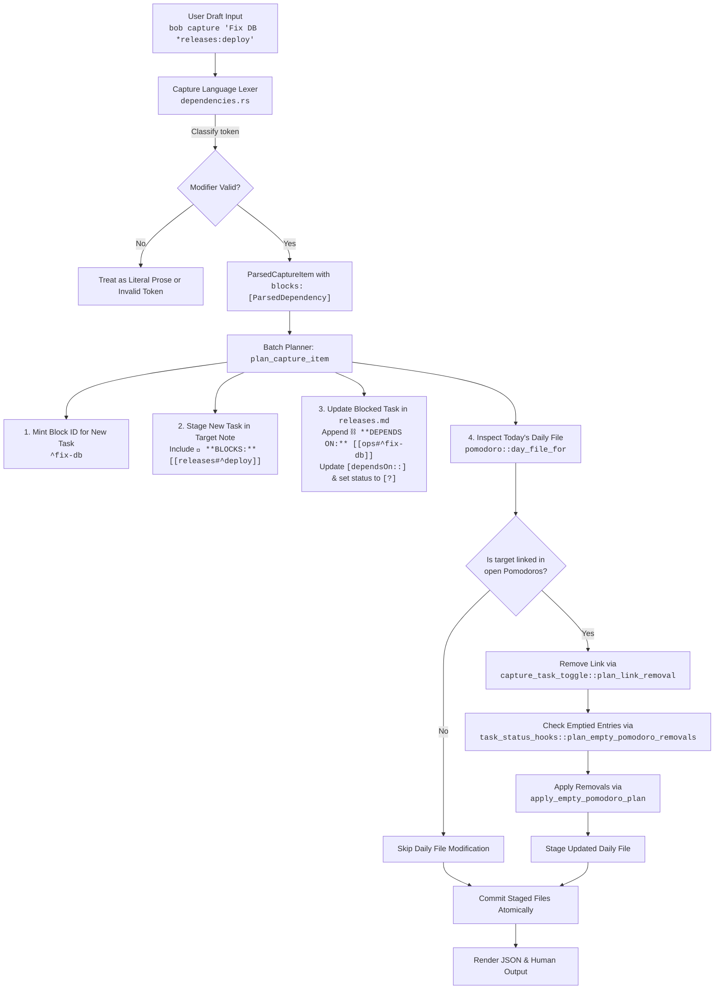

# Research & Architectural Critique: Reverse Dependency (`*` Blocks) Capture Syntax

**Author:** researcher gem (`research.4g.gem`)  
**Date:** 2026-10-14  
**Scope:** `bob-cli` (`bob capture`, `capture-parse`, `capture-complete`), `bob-mac-capture`, and vault ledger integrity  
**Status:** Complete

---

## 1. Executive Summary

This report evaluates the proposal to introduce a new `*` syntax to `bob capture` and Bob Mac Capture. Where the existing `&note:block-id` syntax designates a prerequisite (the captured task *depends on* the target), the proposed `*note:block-id` syntax designates a forward blocking dependency (the captured task *blocks* the target). Furthermore, if the newly blocked task currently has a corresponding task link under an open Pomodoro in today's daily file, that link is to be removed, along with the Pomodoro entry itself if it becomes empty as a result.

### Core Conclusions
1. **High Value, Strong Justification:** Capturing a blocking prerequisite on the fly is one of the most frequent micro-workflows in GTD ("I am about to execute task $B$, but I just realized I must do $A$ first"). Today, this requires a disruptive four-step manual intervention across multiple files. Automating this through capture maintains high system flow and directly enforces the vault invariant that blocked tasks do not linger on the active Pomodoro ledger.
2. **Grammar & Lexical Collision Risks for `*`:** The asterisk `*` is heavily overloaded in Markdown (bullets `* `, italics `*text*`, bold `**text**`) and is a shell wildcard glob in Unix shells (notably causing `zsh: no matches found` in macOS's default interactive shell if unquoted). While `*` is viable, it requires strict lexical guard conditions to avoid misinterpreting valid Markdown prose.
3. **Clarification of Ledger Semantics:** The ledger cleanup rule must be strictly scoped to **open Pomodoro entries** (`- [ ]`). Completed Pomodoro entries (`- [x]`) are immutable historical records of time worked and must never be altered. Additionally, "empty Pomodoro" must mean childless list items; Pomodoros containing other tasks or user notes must be preserved.
4. **Recommended Path:** Implement the reverse dependency feature using the `*` sigil, equipped with robust lexer disambiguation rules, atomic batch ledger updates via existing `capture_task_toggle` and `task_status_hooks` primitives, and full preview transparency in Bob Mac Capture.

---

## 2. Problem Space & Workflow Analysis

### 2.1 The Daily Work Context
In the Bob GTD workflow, the daily note's `## Pomodoros` section serves as the authoritative real-time commitment ledger (`decisions:today-is-read-from-the-ledger`). During a work session, an engineer frequently encounters a dependency discovery:
- **Scenario:** The user has `Deploy release v2.0` scheduled in today's 10:00–10:30 Pomodoro:
  ```markdown
  ## Pomodoros
  - [ ] 1000-1030 Deploy release v2.0
    - [[releases#^deploy-v2]]
  ```
- **Discovery:** Before deploying, database migrations must be applied, which was not previously tracked as a separate prerequisite.
- **Desired Action:** Capture `Run db migration @ops` immediately and mark that it blocks `releases#^deploy-v2`.

### 2.2 The Friction in Today's System
Without a reverse dependency capture syntax, achieving this state requires:
1. Running `bob capture "Run db migration @ops"`, then inspecting the note or capture output to extract the newly minted block ID (e.g., `^run-db-migration`).
2. Navigating to `releases.md` in Obsidian or running a specialized task command to append `- ⛓️ **DEPENDS ON:** [[ops#^run-db-migration]]` to `deploy-v2`.
3. Updating `deploy-v2`'s status checkbox from `[ ]` or `[*]` to `[?]` (Blocked).
4. Navigating to today's daily note and manually deleting `- [[releases#^deploy-v2]]`.
5. Checking whether the `1000-1030` Pomodoro has other tasks; if not, deleting the `- [ ] 1000-1030 Deploy release v2.0` headline.

This friction leads users to either skip formal dependency tracking in the moment or leave stale, blocked tasks occupying today's Pomodoro ledger, violating core system semantics (`decisions:task-status-is-derived`).

---

## 3. Critique of the Plan

### 3.1 Is This a Good Idea?
**Verdict:** **Yes.** The conceptual model is sound, addresses a major gap in capture ergonomics, and aligns with Bob's architectural principles. However, the implementation requires strict boundary controls.

#### Major Strengths:
- **Ergonomic Symmetry:** Bob already supports `&note:block-id` for backward edges ("depends on"). Providing a corresponding mechanism for forward edges ("blocks") completes the dependency capture vocabulary.
- **Preserves Invariants Automatically:** Under `decisions:projects-block-from-prj-line` and `decisions:task-status-is-derived`, a task with open prerequisites is functionally Blocked (`[?]`) and must not carry active Task Links under open Pomodoros. Automating the removal of the link and empty Pomodoro ensures vault consistency without waiting for a later `bob task-status-hooks` reconciliation cycle.
- **Batch Atomicity:** Executing this inside `bob capture` leverages `CaptureBatchPlanner` to stage all modifications (the new task note, the blocked task note, and the daily ledger note) in a single atomic transaction.

#### Major Risks & Concerns:
1. **The Overloaded Asterisk (`*`):**
   - **Markdown Emphasis:** Words surrounded by `*` denote italics (`*italic*`) or bold (`**bold**`). If a capture draft begins or ends with an emphasized title (e.g., `Review *System Architecture Doc* @work`), a naive scanner will treat `*System` as an unquoted modifier prefix.
   - **Markdown List Items:** In standard Markdown, `* ` (asterisk followed by a space) is an alternate unordered list marker.
   - **Existing Capture Grammar:** In `bob capture`, `*` is already used in Pomodoro close selections (`=x*` or `=*` for parking tasks in Next).
   - **Shell Globbing in Interactive Terminals:** In Unix shells, unquoted `*` is the wildcard glob. In `zsh` (macOS default), typing `bob capture Fix bug *auth:login` without quotes will immediately fail with `zsh: no matches found: *auth:login`. (Note: while `&` already requires quotes due to backgrounding, `*` introduces globbing failure modes when unquoted).
2. **Accidental Deletion of User Data in Pomodoros:**
   - If an open Pomodoro contains user notes, URLs, or scratchpad logs alongside the task link, removing the Pomodoro headline would cause silent data loss.
3. **Surprise Factor of Daily File Mutation:**
   - Capturing a task into an area note (e.g., `ops.md`) causing a line deletion in `daily/2026-10-14.md` can surprise the user unless the preview surface in Bob Mac Capture and the stdout summary in CLI explicitly telegraph this side effect.

---

## 4. Alternative Syntaxes Considered

Before committing to `*`, several alternative sigils were analyzed:

| Syntax Option | Description | Pros | Cons |
| :--- | :--- | :--- | :--- |
| **`*note:id`** *(Proposed)* | Asterisk sigil | Fast to type, visually distinct, matches user proposal. | Markdown emphasis collisions (`*italic*`, `**bold**`), shell globbing in zsh, overloaded with list bullets. |
| **`->note:id`** or **`=>note:id`** | Arrow prefix | Intuitive directionality ("this task points to/blocks target"). | Multi-character token; slightly slower to type on mobile/Mac keyboard. |
| **`%note:id`** | Percent sigil | Completely free of Markdown collisions; zero shell globbing issues; unambiguous token start. | Less semantic intuition than an arrow or star; awkward reach on some keyboard layouts. |
| **`&>note:id`** | Directional ampersand | Groups cleanly with `&note:id` under the dependency family; explicitly signals reverse direction. | Two characters; slightly more cumbersome to type. |
| **`>note:id`** | Right angle bracket | Clear arrow-like directionality. | Severe shell hazard (unquoted `>` redirects stdout and truncates files!); Markdown blockquote collision. |

### Recommendation on Syntax:
Retain the user's requested **`*`** syntax, but implement it with **strict lexer disambiguation guards** (detailed in Section 5). The familiarity and simplicity of single-character sigils in Bob capture (`@`, `#`, `+`, `&`, `!`, `*`) make `*` a natural fit once protected against Markdown ambiguity.

---

## 5. Adjustments to Requirements

To ensure robustness and avoid data loss, the following six adjustments to the requirements are proposed:

### Adjustment 1: Strict Lexer Guard Conditions for `*`
To prevent colliding with Markdown italics, bold text, and list bullets, an asterisk token is treated as a blocking dependency modifier **only if all** of the following conditions hold:
1. **Not a List Bullet:** The `*` is not immediately followed by whitespace (`* ` or `*\t`).
2. **Not Bold:** The `*` is not immediately preceded or followed by another asterisk (`**`).
3. **Not Paired Italic:** The token does not start and end with an asterisk without a colon separator (e.g., `*word*` is literal prose).
4. **Positioning Constraint:** Like `&`, directive `*` modifiers are recognized only in the **leading run** (parent line only) or the **trailing run** (following `@route` / `#section` markers). Mid-line `*` between prose words remains literal text.
5. **Escape Support:** `\*` consumes the backslash and preserves a literal `*` in the task description.

### Adjustment 2: Ledger Cleanup Restricted to Open Pomodoros
- Link removal and Pomodoro deletion must **strictly target open Pomodoro entries** (`- [ ]`).
- Completed Pomodoro entries (`- [x]`) and canceled Pomodoro entries (`- [-]`) represent committed historical record and must **never** be modified or deleted.

### Adjustment 3: Precise Definition of "Empty Pomodoro"
- A Pomodoro entry is deemed "empty" and eligible for removal **if and only if** it has no remaining child list items of any kind.
- If the Pomodoro contains other task links, sub-bullets, work log notes, or links to other resources, **only** the target task link line is stripped; the Pomodoro entry headline is preserved.
- The top-level `## Pomodoros` section header itself is a permanent vault structure and is **never** deleted, even if all Pomodoro entries are removed.

### Adjustment 4: Atomic Batch Replacement Handling
When a user captures a new task and simultaneously assigns it to the current Pomodoro while blocking a task that was already in that Pomodoro (e.g., `bob capture "Urgent fix = *releases:deploy"`):
- The removal of the blocked task link and the insertion of the new task link must occur within the same batch pass.
- The Pomodoro entry must **not** be deleted, because the new task immediately populates it.

### Adjustment 5: Target Validation & Guard Gates
The target of a `*` modifier must undergo the same rigorous validation as `&` targets:
- **Must Be an Open Task:** If the target task is already completed (`[x]`) or canceled (`[-]`), capture must fail with an informative error: `task ^{id} in {note}.md is already {status}; cannot block a completed task`.
- **Cycle Prevention:** Adding the dependency must not introduce a cycle ($A \to B \to A$). The existing `reject_new_cycles` logic must be executed before staging.
- **Self-Target Prohibition:** A task cannot block itself.
- **`^prj` Project Cascade:** If the target is a project task (`^prj`), blocking it must trigger the project blocking cascade (`decisions:projects-block-from-prj-line`), marking all open resident tasks as blocked (`[?] #prj_is_blocked`) and consuming their live ledger links.

### Adjustment 6: UI Transparency in Bob Mac Capture
- Bob Mac Capture's live preview must clearly display:
  - A dedicated blocking badge: `🧱 blocks: [[note#^id]] (becomes [?])`.
  - A ledger impact warning chip: `🍅 unlinks from today's Pomodoro (0930-1000)` and `(removes empty entry)` when applicable.

---

## 6. Recommended Technical Architecture

### 6.1 End-to-End Workflow Diagram



---

### 6.2 Implementation Details by Subsystem

#### Subsystem 1: Lexing & Grammar (`src/native/capture_language/`)
The existing lexical scanner in `dependencies.rs` is already partially generalized across sigils (`b'&'` and `b'!'` via `scan_modifier_with_sigil`).
1. **Extend `DependencyDirection`:**
   ```rust
   #[derive(Debug, Clone, Copy, PartialEq, Eq, Serialize)]
   #[serde(rename_all = "snake_case")]
   pub(crate) enum DependencyDirection {
       Prerequisite, // &note:id (this task depends on target)
       Blocks,       // *note:id (this task blocks target)
   }
   ```
2. **Scan `*` Modifiers:**
   Update `scan_line_dependencies` to scan for both `b'&'` and `b'*'`.
   When encountering `b'*'`:
   - Verify it is preceded by a token boundary (start of line or whitespace).
   - Verify the next byte is neither whitespace (`b' '`, `b'\t'`) nor another asterisk (`b'*'`).
   - Route to `scan_modifier_with_sigil(line, base, index, b'*')`.
3. **Spans & Categories:**
   Add span kinds for editor highlighting:
   - `SpanKind::BlocksSigil`, `SpanKind::BlocksNote`, `SpanKind::BlocksBlockId`.
   - In Bob Mac Capture's `CompletionRowContent.swift`, map these to the appropriate semantic category (`.route` and `.blockID`).

#### Subsystem 2: Autocomplete & Pickers (`src/native/capture_complete/`)
1. **Completion Context:**
   Add `CompletionContext::TaskBlocks` in `completion.rs`.
   When the cursor is inside `*` or `*query`:
   - Field context resolves to `TaskBlocks`.
   - Autocomplete engine in `candidates.rs` invokes `capture_dependency_tasks::discover(bob_dir)`.
2. **Candidate Ranking & Filtering:**
   - Exclude completed/canceled tasks from active selection (or mark them disabled).
   - Display candidates in standard picker order (same-note, In Progress, Next, Ready).
   - Replacement string formats as `*note:block-id`.
3. **Bob Mac Capture Presentation:**
   In `DependencyPickerPresentation.swift`:
   - If context is `TaskBlocks`, set header title to `"Choose task to block"` and subtitle to `"New task will be added as prerequisite"`.

#### Subsystem 3: Batch Execution (`src/native/capture/`)
In `src/native/capture/plan.rs` and `dependencies.rs`:
1. **ID Minting for New Task:**
   The new task must have a block ID so the blocked task can reference it. If the captured text does not supply an explicit `^block-id`, call `mint_staged_dependent_id` to generate a readable, deterministic ID based on the task description.
2. **Reverse Edge Construction:**
   Instead of modifying the new task's Depends-On line:
   - **New Task:** Staged with a `🧱 **BLOCKS:** [[target_note#^target_id]]` child.
   - **Target Task:** Located in staged memory. Its Depends-On line is retrieved, updated to include `[[new_note#^new_id]]`, its `[dependsOn::]` field updated, and its status character flipped to `'?'`.
3. **Daily File Ledger Cleanup:**
   Implement a helper `cleanup_blocked_task_ledger`:
   ```rust
   pub(super) fn cleanup_blocked_task_ledger(
       planner: &mut CaptureBatchPlanner,
       bob_dir: &Path,
       target_note: &Path,
       target_block_id: &str,
       index: &NoteIndex,
   ) -> Result<LedgerCleanupResult, CaptureError> {
       let day_file = pomodoro::day_file_for(bob_dir);
       if !day_file.is_file() {
           return Ok(LedgerCleanupResult::default());
       }
       let day_contents = match planner.current_contents(&day_file)? {
           Some(c) => c,
           None => std::fs::read_to_string(&day_file).unwrap_or_default(),
       };
       if day_contents.is_empty() {
           return Ok(LedgerCleanupResult::default());
       }

       // Format canonical and variant block links
       let canonical = canonical_link(target_note, target_block_id, &day_file, index);
       
       // Plan link removal across open Pomodoros
       let removal_plan = capture_task_toggle::plan_link_removal(&day_contents, &canonical);
       if !removal_plan.has_changes {
           return Ok(LedgerCleanupResult::default());
       }

       // Check for emptied Pomodoro entries
       let before_lines = task_status_hooks::logical_lines(&day_contents);
       let section = match pomodoro::pomodoros_section_range(&before_lines) {
           Some(s) => s,
           None => return Ok(LedgerCleanupResult::default()),
       };
       let original_model = task_status_hooks::scan_pomodoros(&before_lines, section);
       let empty_plan = task_status_hooks::plan_empty_pomodoro_removals(
           &removal_plan.content,
           &original_model,
       );
       
       let final_content = task_status_hooks::apply_empty_pomodoro_plan(
           &removal_plan.content,
           &empty_plan,
       );

       planner.stage(&day_file, final_content)?;

       Ok(LedgerCleanupResult {
           removed_links: removal_plan.removed_links,
           removed_pomodoros: empty_plan.removed,
       })
   }
   ```
4. **Pomodoro Block Tracker Integration:**
   For any removed Pomodoro entries, register `PomodoroBlockRef::removed(entry_line)` with the batch's `PomodoroBlockTracker`. This ensures diff tracking and JSON output correctly reflect the deletion without tripping internal assertions.

#### Subsystem 4: Reporting & Output (`src/native/capture/output.rs`)
1. **JSON Additions (Schema v1 Additive):**
   ```json
   {
     "blocked_tasks": [
       {
         "note": "releases.md",
         "block_id": "deploy-v2",
         "description": "Deploy release v2.0",
         "previous_status": " ",
         "new_status": "?",
         "ledger_unlinked": true,
         "emptied_pomodoro_removed": true,
         "pomodoro_time": "1000-1030"
       }
     ]
   }
   ```
2. **Human CLI Output:**
   ```text
   + captured task: Run db migration @ops ^run-db-migration
     🧱 blocks: ^deploy-v2 in releases.md (status -> [?])
     🍅 ledger: removed [[releases#^deploy-v2]] from 1000-1030 Pomodoro (entry removed)
   ```

---

## 7. Edge Cases & Verification Matrix

The test suite must cover the following test vectors:

| ID | Category | Scenario | Expected Behavior |
| :--- | :--- | :--- | :--- |
| **TX01** | Lexical | `Fix bug *releases:deploy` | Parses as task `Fix bug` with blocking target `releases:deploy`. |
| **TX02** | Lexical | `*Task starting with star* @work` | Treated as Markdown italics; does not parse as a blocking modifier. |
| **TX03** | Lexical | `**Urgent task** @work` | Treated as Markdown bold; does not parse as a modifier. |
| **TX04** | Lexical | `* Bullet item` | Treated as list item; space prevents modifier parsing. |
| **TX05** | Lexical | `Task with \*literal star @work` | Escaped asterisk; `\` consumed, `*literal` retained in text. |
| **TX06** | Lexical | `Task &prereq:a *dependent:b` | Dual dependency: task depends on `a` and blocks `b`. Both parsed. |
| **TX07** | Target | Target task is already `[x]` Done | Refused: cannot block a completed task. |
| **TX08** | Target | Target task is `^prj` in project note | Project cascade triggered: `^prj` and all open residents flip to `[?] #prj_is_blocked`; residents' live links consumed. |
| **TX09** | Target | Target task creates circular chain | Cycle detection aborts with error before staging. |
| **TX10** | Ledger | Target has link in open Pomodoro (sole child) | Link removed; Pomodoro headline removed; `PomodoroBlockRef::removed` reported. |
| **TX11** | Ledger | Target has link in open Pomodoro with sibling task | Target link removed; sibling link and Pomodoro headline preserved. |
| **TX12** | Ledger | Target has link in open Pomodoro with user notes | Target link removed; user note lines and Pomodoro headline preserved. |
| **TX13** | Ledger | Target has link in closed `[x]` Pomodoro | Link in closed Pomodoro untouched (historical preservation). |
| **TX14** | Batch | `New task = *target` (target in current Pomodoro) | Target link removed; new task link inserted; Pomodoro entry preserved. |
| **TX15** | Dry-Run | `bob capture --dry-run "Task *target"` | Previews all edits (note, target, ledger); zero disk mutations. |

---

## 8. Summary & Next Steps

1. **Accept the `*` Syntax with Guard Rules:** Proceed with `*note:block-id` as requested, implementing the strict boundary parser to ensure complete immunity against Markdown emphasis and list bullet collisions.
2. **Re-use Existing Core Primitives:** Rather than writing custom ledger-clearing logic, leverage `capture_task_toggle::plan_link_removal` and `task_status_hooks::plan_empty_pomodoro_removals`. These primitives are already battle-tested and correctly handle Pomodoro ranges, indentation, and strikethroughs.
3. **Coordinate Contract with Bob Mac Capture:** Ensure the additive JSON fields and completion contexts (`task_blocks`) are published cleanly so Bob Mac Capture can render dedicated preview cards and distinct picker headers.
