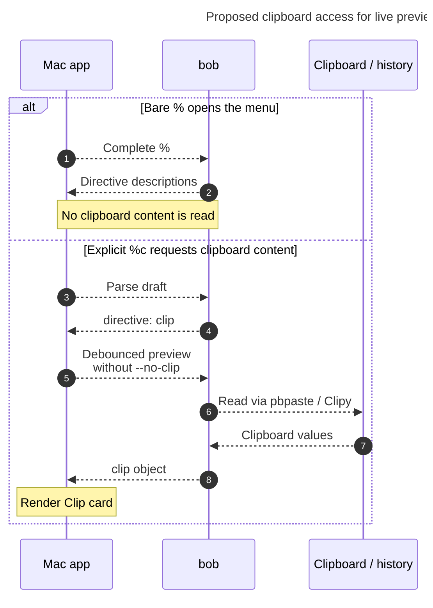

# Diagram proposals: Capture drawers and `%` directives: one grammar for where, what, and how

Proposals for the swarm linker, not a report. Each diagram restates only what the source
report says.

```yaml
source: research:202610/capture_drawer_and_directive_grammar/capture_drawer_and_directive_grammar__final.md
producer: research.2x.image
check: "mmdc 12.0.0 with the PDF-mirroring config rendered 1 of 1 Mermaid diagrams; Puppeteer --no-sandbox; invalid-diagram control returned nonzero"
```

## clipboard-preview-access

```yaml
anchor: |-
  When the latest parse reports a `directive` span with
question: |-
  Who controls clipboard access for the proposed live preview?
illustrates: |-
  The latest parse's clip directive lets the Mac drop --no-clip for debounced live preview, while the % menu never reads the clipboard.
caption: Opening % reads no clipboard content; an explicit %c lets bob acquire preview content through the same path as capture.
review: "649.5x796 px, fit 100.0%; question, source trace, labels, arrowheads, and reading direction passed; 0 revisions"
```


