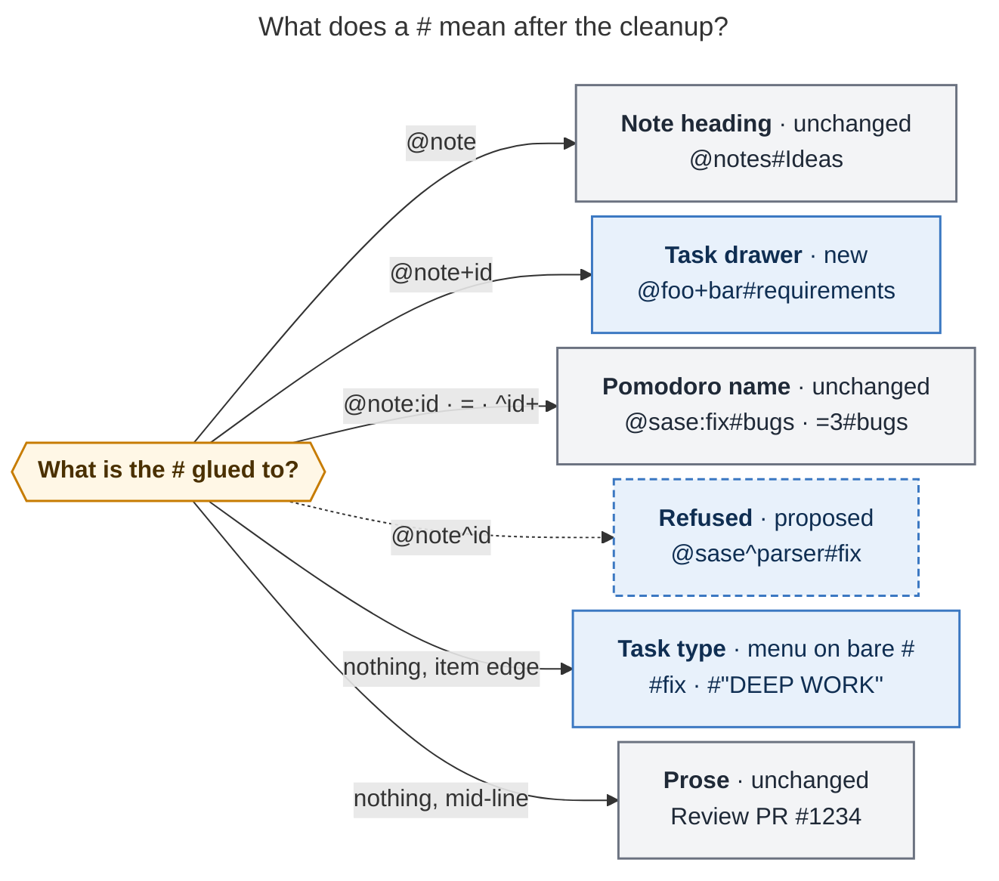
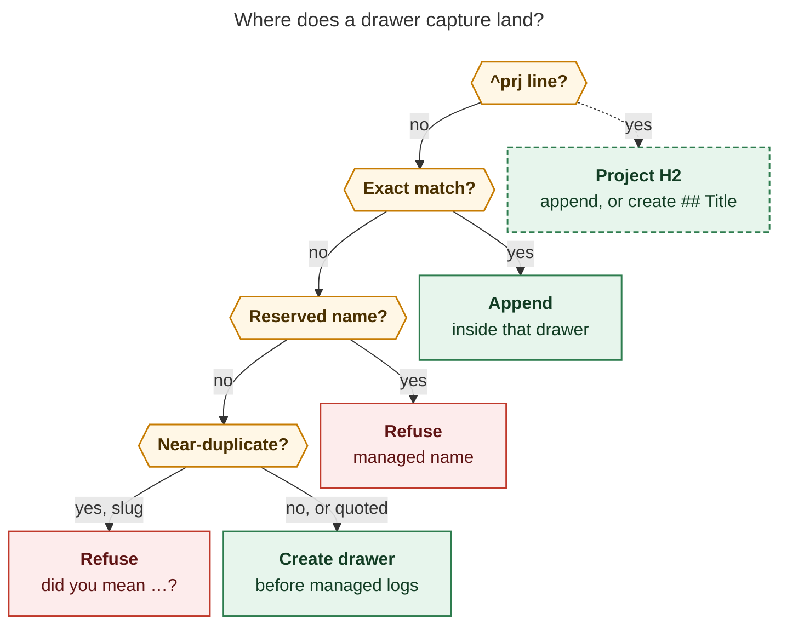

# Capture drawers and `%` directives: one grammar for where, what, and how

*Lead researcher (final) · 2026-10-31 · merges the cdx, cld, grk, mus, and gem reports
with independent verification.*

*Revisions inspected:* bob-cli `061824f8`, which includes `fc1e449f` (the `+`
block-ID separator toggle; it landed after the swarm's `5e2d0856` snapshot).
bob-mac-capture `ec3fff5`. bob-plugins `2ebd58c`.

## Bottom line

**Do it.** I would ship it as one coordinated, breaking language change across bob and
Bob Mac Capture. The request fixes the worst wart in today's capture grammar: in
`@route+id#X`, the `#X` either retypes the task or names a section, **depending on
whether the item happens to have body text**. The request also frees a bare `#` for the
type menu and gathers four "how should this be captured" switches into one discoverable
`%` family. All five researchers agree on that verdict. So do I, after re-probing the
installed `bob 0.4.0` and re-scanning the vault.

The whole grammar then fits in three lines:

> **`@` says where.** `@note`, `@note#Heading`, `@note+id`, `@note+id#drawer`, `@note:id`, `@@note`.
> **`#` says what**, or names a place *inside* the `@` it is glued to.
> **`%` says how.** `%c` clip, `%n` Pomodoro note, `%t` template, plus `%l` listen.

Each adjustment below is called out as a change to the request:

| # | Adjustment | Status |
| --- | --- | --- |
| **R1** | Drawers match **exactly** when the capture runs. Prefix matching moves into the menu. A near-duplicate of a drawer already on the same task is refused unless you quote the name. Managed names are refused | Required for reliability; all five reports agree on exact matching |
| **R2** | A drawer capture needs content. A marker-only `@foo+bar#requirements` is *incomplete*: it never creates an empty drawer and never toggles the task | Adjustment |
| **R3** | Also retire the attached **`@note^id#type`**. Type a new task with a separate `#fix` | Adjustment, and the most debatable one (§3) |
| **R4** | URL listen moves to **`%l`**. `URL %` and its `URL @` alias are retired | Adjustment: adds a fourth letter |
| **R5** | Drop the clip header (`%header`, `--clip=HEADER`). Keep the count as **`%c3`** | Adjustment: header use in the vault is zero |
| **R6** | `%t` marks the **first item** of the draft and may sit at any marker edge of that item. Rows follow the first blank line. Nothing is rewritten | Narrows "leave it where it was typed" |
| **R7** | A menu opened by a bare sigil (`#`, `%`, `@foo+bar#`) starts with **no row selected**. Return then submits, and bob refuses the incomplete marker | Adjustment |
| **R8** | Live preview reads the clipboard **only when bob reports a `%c`**, and shows a real Clip card. Opening the `%` menu never reads the clipboard | Delivers the requested "better `%c` preview" |
| **R9** | Every `%…` token at an item edge is a directive, and an unknown letter is an error. `\%` escapes | Needed so old `%3` and `%build_log` fail loudly with no compatibility code |
| **R10** | On a project's `^prj` line, `#drawer` resolves to the project note's `##` sections | Adjustment, in its own small phase |
| **R11** | Rename "task section" to **drawer** end to end: wire context, span, CLI. The old command name survives only as the hidden alias the CLI rules require | Adjustment |
| **R12** | bob adds a `grammar` revision field. The Mac app refuses to submit to an older bob | Version-skew guard |
| **R13** | Scope clarifications: keep plain `@@route`, `@note#Heading`, and the Pomodoro `#name` menus. "Type menu on every `#`" means a *free-standing* `#` | Clarification |

The recommended solution is in §9.

---

## 1. What exists today

### 1.1 The forms this change touches

| Form today | Meaning | Since |
| --- | --- | --- |
| trailing bare `#` | Pomodoro note | 2026-08-18 |
| `%`, `%N`, `%header` | clipboard as child bullets, with optional history count or header | 2026-07-15 |
| `URL %` (alias `URL @`) | companion-audio listen | 2026-10-10 |
| `@@template:` first line, `@@@` rewrite | bulk template | 2026-10-15 / 10-20 |
| `@@route+block-id` | draft-wide parent task | 2026-08-24 |
| `@route+id#X` + body | child under an ALL-CAPS "task section": prefix match, error if missing | 2026-08-19 |
| `@route+id#X`, marker-only | Ensure Next + retype (bob-cli-ep) | 2026-10-31 |
| `@route^id#X` | type the new task (bob-cli-ep) | 2026-10-31 |

The marker-only `@route+id#…` has already changed meaning twice: first named Ensure
Next, then retype. bob-cli-ep §1.5 replaced the named Ensure Next only today. The
drawer meaning would be the third, so it should be the last. That argues for a meaning
that does not depend on anything else in the item.

### 1.2 Probes against the installed `bob 0.4.0`

These ran as dry runs in a scratch vault with configured types FIX and BUILD (cdx ran
similar probes).

| Draft | Today |
| --- | --- |
| `@foo+bar#requirements` | Ensure Next + retype to REQUIREMENTS |
| `Note @foo+bar#requirements` | child bullet in REQUIREMENTS |
| `Note @foo+bar#req` | **prefix-matches** REQUIREMENTS |
| `Note @foo+bar#missing` | error; capture never creates a section |
| `Note @foo+bar#requirements #fix` | **refused**: "`#fix` types a task, but this capture adds a child bullet" |
| `@foo+bar #fix` | same as `@foo+bar#fix`: Ensure Next + retype |
| completion at `@foo+bar#` | **task types**; with body text it offers sections |
| completion at `text #` | no context, no candidates (`bare_hash_menu = letter`) |
| `# Heading text` | a task whose text is literally `# Heading text` |
| `https://example.com/essay @` | a reference with listen requested (the `@` alias works) |

So Bryan's example needs a **new semantic combination**, not a renamed completion
context. Today a type marker on a body-bearing child capture is refused by design.

### 1.3 Vault evidence

I ran a read-only scan of `~/bob` on apollo. It reproduces cld's numbers.

- **101 project notes.** `## Tasks` appears in 100, `## Requirements` in 51, and
  `## Future Work` in 51.
  - The long tail includes one-off, report-style H2s such as `## Bottom line`,
    `## Recommended solution`, and `## Open questions for Bryan`, two notes each.
  - Ranking recent drawers by modification time alone would surface that junk (§4.3).
- **ALL-CAPS task drawers are rare.** Only three tab-indented ones exist outside
  `done/`: REQUIREMENTS, MOTIVATION, and DONE. Having to pre-create a section before you
  can capture into it has suppressed the habit. Auto-create fixes that.
- **`%header` is unused.** No `**NAME:**` clip headers exist outside the managed lines
  (DEPENDS ON, LINKS, and the others). The one other hit is inside a stored chat source.
  No `file/clip-*.md` snippets exist.

### 1.4 Constraints that shape the design

- **The drawer convention already exists.**
  - bob-cli's `is_section_title` (`src/native/capture_task_sections.rs`) and bob-plugins'
    `PROJECT_SECTION_TITLE_RE` share one ALL-CAPS title grammar.
  - Project promotion turns a qualifying ALL-CAPS child that has at least one nested
    item into a title-cased `##` section (`REQUIREMENTS` → `## Requirements`). Reversal
    uppercases it back (`docs/projects.md`).
  - Promotion title-cases acronyms: `API DESIGN` becomes `Api Design`.
  - No plugin emits any syntax being retired; I grepped bob-plugins and chezmoi. bob-plugins
    needs only a parity check.
- **Why bob-cli-ep kept `#` letter-gated.** Its `bare_hash_menu = letter` decision says
  so directly: "The Mac's Return always accepts row 0 of an open menu, so this keeps
  Pomodoro notes working."
  - The rejected alternative, `bare_hash_menu = open`, already specified an additive
    `initial_selection: "none"`.
  - Moving the Pomodoro note to `%n` removes the premise, and the design for R7 already
    exists.
- **How the clipboard is read today.**
  - On macOS bob reads the clipboard with `pbpaste`, which is text only. History comes
    from Clipy's SQLite store (`capture_clip/clipboard.rs`).
  - Mac live preview *must* pass `--no-clip`; `BobProcessClient.swift:1037` enforces it
    with a precondition. The panel then shows "Clipboard markers stay literal in live
    preview".
- **There is a proven catalog pattern.** `relation_labels/scan.rs` already serves a
  keystroke-path completion from a vault-wide scan. It caches each note by mtime and size
  in `XDG_CACHE_HOME` and keeps a 60-second snapshot TTL.
- **The `+` separator toggle just landed (`fc1e449f`).** Typing `+`, `:`, or `^` after an
  ID now switches `@route:id`, `@route+id`, and `@route^id` in place. The three
  separators now feel like modes of one token, so a `#` glued after any of them should
  mean the same *kind* of thing (R3).
- **Governing rules.**
  - `decisions:mac-capture-is-a-thin-client`: bob supplies grammar, menu copy, and
    previews.
  - `decisions:bob-cli-releases-ride-a-daily-train`: mark breaks with `!` and never edit
    the version or the changelog.
  - CLI rules: never hard-rename a command; `capture-*` names only grow additively; every
    public long option gets a short alias.
  - `decisions:relation-card-tab-accepts-ctrl-d-hides` is the precedent for opening with
    no row selected, with Tab taking the top match.
- **Beads in flight that this touches.**
  - bob-cli-8b: the Ctrl-T template shelf, still landing; it renders `@@template:`.
  - bob-cli-82: record the template "declared expansion" decision.
  - bob-cli-83: the Mac "Expand template" action.
  - bob-cli-8h and bob-cli-8i: the saved-template decision and glossary term.

## 2. Is this a good idea?

**Yes.** What the request gets right:

1. **One meaning per token.** `#` after `+id` stops depending on hidden state elsewhere
   in the item.
2. **`%` becomes a family with a menu.** No sigil today can explain itself. A `%` menu
   with one-line descriptions is the first discoverable grammar surface.
3. **It deletes surprising magic.** `@@@` silently inserts a line at the top of the draft
   and moves the caret. `@@template:` puts a mode switch inside the destination
   namespace.
4. **It unlocks the immediate type menu**, which bob-cli-ep could not ship.
5. **"Drawer" fixes a naming collision.** "Section" currently means a Markdown heading
   (`@note#Ideas`), an Annotation Section (whose glossary entry already says it is "not
   a `bob capture` target section"), and this.
6. **Auto-create matches real usage.** The vault has 102 Requirements and Future Work
   H2s but only three task drawers.
7. **The retired forms are new and lightly used**, so no compatibility shims are needed.

Where it needs work:

- **Auto-create breaks prefix matching.** With creation, `Note @x+y#req` would land in
  REQUIREMENTS on one task and create a junk REQ drawer on another (R1).
- **The example `Note @foo+bar#requirements #fix` is refused today.** Making it work
  means a body-bearing child capture can retype its parent, atomically and without
  Ensure Next.
- **A bare `%` cannot also mean "listen" after a URL** (R4).
- **"Works just like `%`" collides with the new letters.** Old bob already reads `%n`
  and `%t` as clip headers N and T, so count and header must move under `%c` (R5), and
  versions must be checked (R12).
- **"Leave `%t` where it was typed" still needs framing.** Templates are draft-level:
  a definition, then rows (R6).
- **"Type menu on any `#` not after `@file+id`" is too broad.** Taken literally, it
  breaks the `@note#`, `@note:id#`, `=#`, and `^id+#` menus (R13).
- **Opening a menu on a bare `#` creates a muscle-memory hazard.** With row 0 selected,
  `jot idea #⏎` inserts `#build`, and a second ⏎ files a typed inbox task (R7).

**Alternatives considered and rejected:**

| Alternative | Why not |
| --- | --- |
| A non-`#` drawer sigil (`@foo+bar/req`, `>req`) | `/` is the goto picker. A glued `#` already means "place inside" for headings and Pomodoros, so `#` makes the rule *more* uniform |
| Word directives (`%clip`, `%note`) | Slower to type. The `%` menu supplies names and descriptions, so single letters lose nothing |
| Keep the `@@template:` header and rename it (`%t` alone on line 1; mus) | Contradicts Bryan's explicit "don't rewrite to the top line" and keeps a mode switch fixed to line 1 |
| `%t` anywhere, with ordinary items above it | Rows above a template are ambiguous, and today's engine never supported them. This can be added later without breaking anything |
| A configured drawer vocabulary (`capture.drawers:`) | The vault already reveals the vocabulary (102 Requirements and Future Work H2s), and a scan needs no upkeep |
| Rank Recent only by a capture-usage journal (grk, mus) | Starts empty, and misses H2s written by hand or by promotion, which the request explicitly names |
| Mac sends pasteboard text via `--clip-text` (grk, gem) | Creates a second acquisition path, so the preview could disagree with the capture. bob's `pbpaste` path is the same text, and `%c3` history still needs bob |

## 3. Where the reports disagreed, and how I resolved each point

| Question | Positions | Resolution |
| --- | --- | --- |
| Keep attached `@note^id#type`? | Keep: cdx, grk, mus, gem. Retire: cld | **Retire (R3).** It gives one rule: a glued `#` names a place; a free `#` names a type. It costs one space (`@sase^parser #fix`). The form is hours old, and no Mac doc or code depends on it. With the new `+`/`:`/`^` toggle, keeping it would make `#fix` flip between a type and a drawer on a one-keystroke separator change. **This is the one adjustment Bryan should explicitly confirm** |
| Marker-only `@foo+bar#req` | grk: select or create an empty drawer. cdx, cld: incomplete | **Incomplete (R2).** An empty drawer is never promoted and carries no information, and toggling would revive the body-dependent meaning |
| URL listen | cdx: keep `URL @` and add no letter. cld, grk, mus: `%l` | **`%l` (R4).** `URL @` keeps `@` doing both "where" and "how", and makes the route menu lie after a URL. Listen *is* a "how" |
| Clip header | cdx, grk: `%c:build_log`. gem: `%c:"Header"`. mus: `%cheader`. cld: drop | **Drop (R5).** Zero vault use, and drawers now cover the "labelled container" need (`Build output @x+y#build-log %c`). If Bryan objects, `%c:name` is the spelling. Never use `%cname` |
| `%t` framing | mus: header line only. gem: line 1 or the header line. cdx, cld, grk: first item, any marker edge | **First item, any marker edge (R6).** mus's version contradicts the explicit request |
| Recent-drawer source | grk, mus: LRU journal only. gem: scan the last 14 days. cld: cached vault scan. cdx: derived catalog plus usage history | **Cached vault scan, ranked by frequency (§4.3).** The relation-label scan proves the latency. Ranking by frequency rather than mtime keeps one-off report H2s out. A usage boost can come later |
| First row selection on a bare sigil | mus: row 0. cld: none. cdx: unspecified | **None (R7).** Return must not commit a choice the user never made. bob-cli-ep already specified the field |
| `%c` live preview | cld: bob reads when `%c` is present. grk, gem: Mac pipes text. cdx: parse/acquire split plus a fingerprint | **bob reads, gated on bob's own `%c` span (R8).** Preview and capture then share one acquisition path. cdx's fingerprint is optional hardening |
| `^prj` drawers → H2 | grk: now. cld: optional later. cdx: never ("frontmatter magic") | **Do it as phase 3 (R10).** It is keyed on the target being the project's own `^prj` task line, not on frontmatter. Writing an ALL-CAPS bullet under `^prj` would fight the note's structure. Until phase 3, refuse with a hint to `@proj#Requirements` |
| Wire names | grk, cdx: keep `task_section`. cld: rename | **Rename (R11).** The Mac drawer menu is rewritten anyway, so a rename costs almost nothing extra and leaves no stale vocabulary |
| Teaching errors for retired forms | grk, mus: name the old spelling ("is a drawer now…"). cld: plain grammar errors | **Grammar errors that teach the *current* syntax only** (§4.7). Bryan asked for no references to retired syntax |
| Version-skew guard | cdx: capability gate. cld: land bob first | **Both (R12).** Old bob reads `%t` as clip header T and would write junk, so a one-field handshake is cheap insurance |

## 4. Design

### 4.1 The `#` rule

> **A `#` glued to the end of a destination token names a place inside it**: a heading,
> a drawer, or a Pomodoro. **A `#` standing alone at an item edge names a type.**
> Anywhere else it is prose.



*Caption.* A `#` is claimed by the token it is glued to; only a free-standing `#` at an
item edge is a task type. Blue boxes are meanings this change introduces. The dashed
box is R3's proposed retirement of the attached new-task type. The figure measures
863×726 px and renders at 75.6% fit in the PDF.

| You type | Meaning |
| --- | --- |
| `Fix the parser #fix`, `#fix Fix the parser` | new task typed FIX |
| `Fix the parser @sase^parser #fix` | new `^parser` task typed FIX (R3) |
| `Some note goes here. @foo+bar#requirements` | bullet in `^bar`'s REQUIREMENTS drawer, created if missing |
| `Some note goes here. @foo+bar#requirements #fix` | the same, and retype `^bar` to FIX in the same transaction |
| `Some note. @foo+bar #fix` | plain child bullet under `^bar`, and retype `^bar` |
| `@foo+bar #fix` | Ensure Next + retype (today's free-standing form, unchanged) |
| `@foo+bar#requirements` alone | incomplete: needs bullet text (R2) |
| `#` alone at an item edge | incomplete type marker; the type menu is open |
| `@notes#Ideas`, `@sase:fix#bugs`, `=3#bugs`, `@x^y+#admin` | unchanged |
| mid-line `#`, `#1234`, `C#`, `##`, `\#tag` | prose, unchanged |

A leading `# Heading text` changes meaning: it is now an incomplete type marker rather
than literal text. Write `\# Heading text` for the literal. This is rare in captures and
consistent with the rule.

### 4.2 Task drawers

**Token.** `@<route>+<block-id>#<drawer>`, glued, wherever `@route+id` is legal today:
either edge of the first line, or as a trailing marker on an authored child line.

**Names.** One `#name` lexer serves both types and drawers.

- **Slugs** start with an ASCII letter and use letters, digits, and `-`, as in
  `#requirements` and `#future-work`.
- **Literals** are quoted, as in `#"NON-GOALS"`, `#"Q&A"`, and `#"API (V2)"`. A literal
  must pass the shared ALL-CAPS title predicate once uppercased.
- The old unquoted `& ' ( ) , . /` characters now need the literal form, so trailing
  punctuation is never swallowed into the name.
- **The key** is the uppercased, whitespace-collapsed title. A slug also tries hyphens as
  spaces, which is the same rule types use.

**Resolution at commit.** Menu state never decides.



*Caption.* A drawer write is deterministic. bob looks for an exact match among the
target task's drawers, refuses managed names and near-duplicates on the same task, and
otherwise creates the drawer. The dashed branch, project H2s on a `^prj` line, is phase
3 (R10). The figure measures 859×934 px and renders at 76.0% fit in the PDF.

The steps in detail:

1. **Exact match.** If the key matches a direct ALL-CAPS child of the task, append at
   the end of that drawer's own block, before any managed log nested under it. This is
   today's geometry.
2. **Duplicates.** Two identical drawer titles under one task are refused, and the error
   names both lines. bob never picks the first one.
3. **Reserved names are refused with a teaching message.** They are DEPENDS ON, BLOCKS,
   LINKS, LINKED FROM, SCHEDULE LOG, WORK LOG, ROTTEN LOG, and TASKS. Writing one as a
   plain drawer would corrupt structure that bob or the plugins own.
4. **The near-duplicate guard applies only to this task.**
   - If a new slug key is a strict prefix of, or within edit distance 1 of, a drawer on
     the same task, the capture is refused. For example: ``did you mean `#requirements`?
     write `#"REQ"` to create REQ``.
   - A quoted literal skips the guard.
   - This is the one place an old prefix habit could silently write somewhere new, and
     the guard catches it.
5. **Catalog-only near miss.** A new key within edit distance 2 of a popular catalog
   drawer is created, with a warning: `new drawer REQUIRMENTS · did you mean
   REQUIREMENTS?`.
6. **Create.**
   - **Spelling:** the catalog's most-used spelling for that key, else the slug
     uppercased with hyphens as spaces.
   - **Placement:** the task's last direct child, before any managed Schedule, Work, or
     Rotten Log and after a Depends-On first-child line. This is the anchor plain
     sub-bullets already use. The first entry nests under the new drawer.
   - Indentation and line endings come from the existing helpers.
   - The result always qualifies for promotion, because it has at least one nested
     item.
7. **Batch safety.** Re-resolve from the staged text between items, so two captures into
   the same new drawer create it once. Any later failure rolls the whole draft back.

Drawer entries are plain bullets with no `[created::]` stamp, matching today's
sub-bullets and what promotion moves.

**`#type` on a drawer or plain child capture retypes the target task.** It has no
other typeable subject.

- Body text means **no Ensure Next**. Only a marker-only `@route+id` changes lanes.
- The `[type::]` edit stages before the write, and the existing D8 applier relocates a
  live Task Link.
- One transaction covers both. An invalid type, a closed target, or a strict-cap refusal
  leaves the drawer unwritten too.

Before and after `Postgres 17 minimum @foo+bar#requirements #fix`:

```markdown
- [ ] #task Upgrade Postgres [created::2026-07-31] ^bar
	- 🗓️ **SCHEDULE LOG**
		- *2026-08-02* — 🎲 P0 → P2 · in **12** (8–30) days
```

```markdown
- [ ] #task Upgrade Postgres [type:: FIX] [created::2026-07-31] ^bar
	- REQUIREMENTS
		- Postgres 17 minimum
	- 🗓️ **SCHEDULE LOG**
		- *2026-08-02* — 🎲 P0 → P2 · in **12** (8–30) days
```

The preview and human output should state both effects in one block:

```text
foo › ^bar Upgrade Postgres › REQUIREMENTS        new drawer
  - Postgres 17 minimum
type  BUILD → FIX · Task Link moved under FIX
```

**Project tasks (R10, phase 3).** When the target line is a project note's `#prj`
task, `#drawer` matches the note's `##` sections by key. `Tasks`, the generated status
groups, `Pomodoros`, `Events`, and `Highlights` are excluded. The entry is appended
under the matching section. A missing one is created as `## Title Case` at the end of
the note, exactly as promotion does. Until phase 3 ships, this case is refused with
``use `@proj#Requirements` for a project section``.

`@note#Heading` keeps its prefix match and its fallback to the pre-heading section.
That is safe because it never creates anything. The asymmetry is deliberate.

**Possible later extension.** A drawer-only parent with authored children
(`@foo+bar#requirements`, then `- 17+`, `- 2 GB`) could file each child as an entry.
That shape is incomplete today, so adding it later would not break anything.

### 4.3 The drawer menu (`#` after `@note+id`)

The menu opens the instant `#` is typed, with or without body text. Its context is
`drawer`, and bob supplies every row:

```text
╭─ Drawer · ^bar Upgrade Postgres (foo) ──────────────────────╮
│ ON THIS TASK                                                │
│   REQUIREMENTS                                    3 notes   │
│   FUTURE WORK                                     1 note    │
│ RECENT                                                      │
│   MOTIVATION                   used in 2 notes · 3 days ago │
│   ACCEPTANCE                   used in 2 notes · last week  │
├─────────────────────────────────────────────────────────────┤
│ ⇥ take the first · type to filter · ⎋ close                 │
╰─────────────────────────────────────────────────────────────╯
```

- **ON THIS TASK** lists the task's drawers in document order, with entry counts
  ("1 note" / "3 notes"). This also fixes the Mac's current "1 items" string. On a
  `^prj` line, this group lists the note's H2s.
- **RECENT** lists catalog drawers that are not on this task, with use count and
  recency.
- **New drawer.** A dashed `＋ New drawer PERF BUDGET` row appears only for a typed
  query with no exact key. When R1 would refuse the name, the row is dimmed with bob's
  reason and is a no-op.
- **Footer.** bob computes the consequence of the selected row: "Adds to REQUIREMENTS
  after '2 GB RAM'" or "Creates PERF BUDGET under ^bar".
- **Selection (R7).** An empty query opens with nothing selected. Tab or ↓ takes the
  top row, and typing filters with the best match selected. Prefix help lives here, and
  only here.
- **Replacement.** `#slug` when the slug round-trips to the title, else `#"TITLE"`. No
  trailing space is added.
- **Reuse.** The rows reuse the existing `pomodoro_name` group-header and create-row
  styles. A missing or ambiguous target shows a diagnostic, never a plausible Create
  row.

**The catalog** reuses the relation-label scan pattern: a per-note mtime and size cache
in `XDG_CACHE_HOME`, a 60-second snapshot TTL, and bounded warnings.

- **Sources:**
  - direct ALL-CAPS drawer children of `#task` lines, using bob's predicate and
    excluding managed logs, checkboxes, and fenced text;
  - `##` headings in project notes, uppercased, excluding the structural headings
    above.
- **Excluded:** reserved names, dot-directories, and `_templates/`. Notes in `done/`
  count toward frequency but not recency.
- **Ranking:** distinct notes using the key that were modified in the last 90 days, then
  all-time count, then recency.
  - On an empty query, show names used in at least two notes, at most eight rows. This
    keeps one-off report H2s such as "Bottom line" off the default list.
  - Typed queries match the whole catalog.
- **Not in v1:** a successful-capture usage boost and Ctrl+D hide (a per-host journal,
  as for themes and relation labels). Both can be added later without breaking
  anything.

### 4.4 `%` directives

**Token rule (R9).** At an item edge, meaning either edge of any line in the item with
only other markers in between (the `#type` position rule), any whitespace-delimited
token that starts with `%` is a directive.

| Token | Meaning |
| --- | --- |
| `%c` | capture the live clipboard as child bullets (today's `%`) |
| `%c<N>` | the live clipboard plus history, N values in all (today's `%N`). `%c1` is `%c`; `%c0` is invalid |
| `%n` | Pomodoro note: plain bullet under today's open timed Pomodoro, else the last completed, else the first open (today's trailing `#`, same rules) |
| `%t` | this item is a template; rows follow (R6) |
| `%l` | bare-URL items only: queue the reference with companion audio (today's `URL %`) |
| `%` alone | **incomplete**: the directive menu is open |
| `%x`, `%clip`, `%3`, `%build_log` | error: ``unknown directive `%3`: use `%c` clip, `%n` Pomodoro note, `%t` template`` |
| `\%c` | the literal text `%c` |
| mid-line `%c`, `100%`, `50%off`, URL `%25` | prose or URL bytes, unchanged |

**Composition.** Each item takes each directive at most once.

- `%c` composes with routes, drawers, `s:`, `$`, `#type`, and `%n` (clip onto the
  Pomodoro).
- `%n` refuses routes, `s:`, `$`, and `#type`, because a Pomodoro note has no
  destination or fields. It composes with `%c`.
- `%t` refuses `%c` (it would re-read a changing clipboard once per row), session
  operators, and `@@` declarations. `%n` and `%l` inside a template apply per row.
  - Because the expansion is re-parsed, a `%c` or `%t` that arrives through a row value
    is refused too. That also rules out nested templates.

**`%t` framing (R6).**

- The template is the draft's **first item**, meaning a parent line plus optional
  authored children. `%t` may sit at either edge of any line of that item, and it
  stays there.
- Framing masks the token, keeping offsets so editor spans stay exact. From then on,
  everything is today's engine:
  - dense `{N}` placeholders, quoting, and `{0}`-only splitting;
  - the 1,000-row and 1 MiB limits;
  - source-mapped errors, `-E`, and capture(D) = capture(expand(D)).
- A `%t` in any later item is `template_directive_misplaced`: "`%t` marks the first item
  as the template".
- **Ctrl-T shelf.** Canonical definitions are already stored without the header, so
  shelf IDs stay stable. `show` and `draft` render `%t` at the end of the definition's
  first line.
- **Retired with `@@template:`:** the `@@@` rewrite (`start_template`), its Mac hint, and
  the `@@` template candidate. `@@` then means only "draft-wide route".

The retired `@@route+id` use case is now a composition of all three new features:

```text
{0} @job+search#leads %t

Acme
Globex
"Initech Corp"
```

**The `%` menu (context `directive`).** It opens on `%` with no row selected. Rows always
come in the order c, n, t, with l added on bare-URL items. bob supplies every string:

```text
╭─ Capture as … ──────────────────────────────────────────────╮
│ %c  Clip            Paste the clipboard under this item     │
│                     %c3 takes your last 3 clips             │
│ %n  Pomodoro note   Add this line to the current Pomodoro   │
│                     → 14:00–14:25 BUILD · running           │
│ %t  Template        Repeat this item once per row below     │
│                     the first blank line                    │
├─────────────────────────────────────────────────────────────┤
│ type a letter · ⇥ take the first · ⎋ keep a bare %          │
╰─────────────────────────────────────────────────────────────╯
```

- **Inapplicable rows** are dimmed with bob's reason, and Return on them is a no-op.
  Examples: `%n` next to a route ("a Pomodoro note has no destination"), `%n` with no
  Pomodoro today, `%t` on a later item, and `%c` in a template. The menu teaches the
  composition rules instead of hiding them.
- **Detail lines** come from bob and are cheap: the Pomodoro that `%n` would receive,
  and whether a listen command is configured for `%l`. The menu **never reads the
  clipboard**: opening it is not a request to paste.
- **The label is "Pomodoro note", not "Note"** (cld). In Bob's vocabulary "note" usually
  means a file: Project Note, Area Note, Inbox note.
- **Span style.** Use one `directive` span kind with a single tint family, so every `%`
  token reads as one family.

### 4.5 Clipboard previews that tell the truth (R8)

**bob:**

- **Parsing and reading are separate.** `%c` is always parsed and stripped. It never
  appears in the body as literal text.
- **`--no-clip` now means "do not read".** A dry run under `--no-clip` reports
  `clip: {status: "not_read", count: N}`, so the preview shows a placeholder.
- **A real capture with `--no-clip` and a `%c` refuses**: ``remove --no-clip, or write
  \%c to keep the text``.
- **`--clip` loses its value.** `--clip=HEADER` goes with R5.

**Mac:**

- **When to read.** When the latest parse reports a `directive` span with
  `directive: "clip"`, the debounced live preview drops `--no-clip`, and bob reads
  through the same `pbpaste` and Clipy path that the capture will use.
- **The precondition.** The one at `BobProcessClient.swift:1037` becomes "clip reads
  only when bob reported a clip directive".
- **The Clip card** renders the existing `clip` object:
  - a kind header, such as "Clipboard · 3 lines", "2 files · 1 image", or "Snippet · 42
    lines → file/clip-…md";
  - the child lines exactly as they will be written;
  - image thumbnails;
  - entry dividers for `%c3`.
- **Retired caption.** "Clipboard markers stay literal" goes away.
- **Refresh.** Re-run the preview when the panel activates and when
  `NSPasteboard.changeCount` changes while the panel is visible. The counter read is
  free and reads no content.
- **Why gate on `%c`.** Apple has shipped pasteboard-privacy machinery
  (`NSPasteboard.accessBehavior`, macOS 15.4+, with alerts on programmatic reads).
  Default enforcement in current macOS is unconfirmed. Gating every read on an explicit
  `%c` keeps any future prompt tied to something the user typed.
- **Optional hardening (cdx).** Preview returns a fingerprint of what it read, and the
  capture refuses if the clipboard changed: "Clipboard changed; review the preview".
  This is not needed for v1.

### 4.6 The bare `#` type menu (R7)

- **The marker.** A free-standing bare `#` at an item edge becomes an incomplete
  `task_type` marker. `capture-complete` returns the `task_type` context with an empty
  query plus `initial_selection: "none"` (bob-cli-ep's pre-designed field).
- **On submit:** ``a task type goes after `#` (for example `#fix`); write `\#` for a
  literal hash``.
- **Inapplicable items.** On `%n` items, session operators, and template rows, bob
  returns the menu with a refused subject and a reason instead of offering types that
  would fail.
- **Behaviour in the menu.** Ctrl-N, ↓, and Tab select. Typing a letter filters with
  row 0 selected, as today.
- **Ownership.** The Mac app adds an unselected state to its inline menu; it has none
  today. That state is used for `#`, `%`, and `@note+id#`.

### 4.7 Removed outright, with no aliases and no "retired" messages

| Removed | What an old habit gets now |
| --- | --- |
| trailing bare `#` (Pomodoro note) | the type menu opens; submit refuses the incomplete marker |
| `%`, `%N`, `%header`, `--clip=HEADER` | `%` is incomplete; `%3` and `%build_log` are unknown directives; `--clip` takes no value |
| `URL %`, `URL @` (listen) | `URL %` is incomplete; `URL @` is an ordinary incomplete route |
| `@@template:`, `@@@`, the `@@` template candidate | the generic `@@` error: ``invalid `@@` declaration: `@@` takes a route (`@@foo`)`` |
| `@@route+block-id`, `global_destination.mode` / `block_id`, `global_sub_bullet_*` spans | the same generic `@@` error |
| `@route+id#type` (marker-only retype) | a drawer token, incomplete without text (R2) |
| `@route^id#type` (R3) | ``a new task has no drawers: type it with a separate `#fix` `` |
| prefix drawer selection | exact match only; the guard catches near-duplicates |
| "task section" in docs, JSON, CLI, and Rust names | "drawer" |

Error text teaches only the current grammar. Immutable history stays as it is: research,
plans, accepted decision records, and git. Narrow negative tests that prove the old
forms no longer run are kept.

### 4.8 Wire and CLI contract

| Surface | Change |
| --- | --- |
| `capture-parse` spans | **add** `directive` (`directive: clip\|note\|template\|listen`, optional `count`) and `drawer` (`title`, `key`, `exists`). **remove** `clipboard`, `pomodoro_note`, `template_header`, `ref_listen`, `sub_bullet_section`, `global_sub_bullet_*`, and the attached `task_type` on `+id` and `^id` |
| `capture-parse` needs | **add** `directive`, `drawer`, `drawer_text`. A bare edge `#` reports `task_type`. **remove** `task_section` |
| `capture-complete` | **add** context `directive` (rows: `token`, `name`, `summary`, `detail`, `disabled_reason`) and context `drawer` (rows: `title`, `key`, `group: task\|recent\|new`, `entry_count`, `note_count`, `last_seen`, `creates`, `refused`, `replacement`, `cursor_after`). **add** top-level `initial_selection` and `footer`. **remove** `task_section` |
| `capture --format json` | **add** per item `drawer: {title, key, created}` and the type row on drawer and child items. `clip` gains `status`. **remove** `global_destination.mode` and `block_id` |
| `capture-rewrite` | **remove** the `start_template` rule. The separator toggles from `fc1e449f` stay |
| `capture-templates` | `show` and `draft` emit `%t`; IDs are unchanged |
| CLI | **`-D, --drawer TITLE`** replaces `-S, --task-section`. It matches exactly and creates when missing; no Mac caller uses the old flag. **`bob capture-drawers`** is canonical, with `capture-task-sections` as a permanent hidden alias per the CLI rules, plus a `recent` array. `--clip` takes no value |
| Version field (R12) | add a top-level `grammar: 2` to `capture-parse` and `capture-complete`. `schema_version` stays 1 |
| zsh | `%` completes c, n, and t with descriptions; `@note+id#` completes drawers; a bare edge `#` completes types |

### 4.9 Glossary and memory (write all of these through `/sase_memory_write` during implementation)

**New strand `glossary:task-drawer`:**

> **Task Drawer** — *aka drawer*
>
> A named container for one kind of note inside a task: a direct child bullet with no
> checkbox whose whole text is an ALL-CAPS title (`REQUIREMENTS`, `FUTURE WORK`,
> `MOTIVATION`), with its notes nested beneath it. Promoting the task to a
> [[project-note]] turns each non-empty drawer into a `## Title Case` section, and
> restoring the project turns those sections back into drawers; on a project's `^prj`
> task the note's `##` sections are its drawers. Capture adds to one with
> `<text> @note+id#drawer`, matching the title exactly and creating a missing drawer
> (before any managed log) with its first entry; typing `#` after `@note+id` lists the
> task's own drawers first, then drawers used on other tasks and in project notes.
> Managed lines and logs (Depends-On, BLOCKS, LINKS, LINKED FROM, Schedule, Work, and
> Rotten Logs) and `## Tasks` are never drawers. Not a note heading (`@note#Heading`),
> an [[annotation-section]], a [[pomodoro]], or a [[task-type]].

The `^prj` clause depends on R10 shipping.

**Updates to existing strands and records:**

- **Glossary strands.**
  - *Annotation Section:* "not a `bob capture` target section" becomes "not a
    [[task-drawer]]".
  - *Bulk Capture:* `@@template:` becomes `%t`.
  - *Capture:* the live preview is `--no-clip` unless bob reports a `%c`.
- **New decision record.** It should say: "`@` where, `#` names, `%` how". A glued `#`
  names a place, and a free `#` names a type. Drawers are matched exactly and created on
  demand. Directives own the `%` edge namespace.
  - Unlike bob-cli-ep (`memory_record = no`), this is a cross-repo grammar rule that
    later plans will cite.
- **Beads to update.** Point bob-cli-82's pending template decision at `%t` instead of
  `@@template:`. Tell bob-cli-8b's lander and bob-cli-83 about the new framing.

### 4.10 Version skew (R12)

- **New app with old bob: dangerous.** Old bob treats `%t` and `%n` as clip headers and
  `@x+y#fix` as a retype. The Mac app should require `grammar >= 2` from `capture-parse`.
  When the field is missing, it shows "Update bob to use drawers and % directives",
  disables Capture, and keeps the draft. It never translates to old syntax.
- **Old app with new bob: degrades, and the window is short.**
  - Unknown contexts decode as generic rows.
  - `@@@` stops rewriting.
  - The worst case is the bare `#` menu with row 0 preselected until the app updates.
  - Land the bob phases first, then the Mac phase promptly.

## 5. Implementation plan

One epic, "Capture drawers and `%` directives". Each bob phase is one coherent
`feat(capture)!` commit, so that grammar, help, docs, and tests never disagree on
master.

| Phase | Repo / size | Contents |
| --- | --- | --- |
| **1 `cli-directives`** | bob-cli · L · `!` | New `capture_language/directive.rs`: lexer, masking, spans, needs, errors. Remove the trailing-`#`, `%`-clip, and URL-listen lexing from `line.rs`, `markers.rs`, `draft.rs`, `item.rs`, `editor_classify.rs`, and `editor_parse.rs`; the Pomodoro-note and clip executors stay. `%t` framing in `template.rs`. Delete `start_template` and `@@route+id`. Bare `#` becomes incomplete, plus `initial_selection`. New `capture_complete/directives.rs`. `--no-clip` and `--clip` semantics. `grammar: 2`. Template shelf renders `%t`. Help, then `just docs-gen`. Update `docs/capture.md`, `docs/reference/capture-syntax.md`, and `docs/completion.md`. Memory: the Capture and Bulk Capture strands, bob-cli-82 |
| **2 `cli-drawers`** | bob-cli · L · `!` | `capture_task_sections.rs` becomes `capture_drawers.rs`, with exact resolution, the guard, reserved names, and creation in `capture/sub_bullet.rs`. `#` after `+id` is always a drawer; delete `TypeMarkerAttachment::ExistingTask`, the marker-only predicate, and the `^id` attachment (R3). Allow `#type` on child items (`capture/plan.rs`, `task_theme.rs`). New `drawers/{mod,scan}.rs` catalog and the `drawer` context. `-D/--drawer` and `capture-drawers`. Update `docs/task-types.md`. Memory: the Task Drawer glossary strand, the decision record, the Annotation Section strand |
| **3 `cli-project-drawers`** | bob-cli · M | R10: `^prj` lines use H2 sections. Exact key match, create `## Title Case` at the end of the note, and the menu's ON THIS TASK group lists H2s. Additive |
| **4 `mac`** | bob-mac-capture · L | Directive menu; drawer menu (groups, create row, refused rows, footer, the "1 note" fix); unselected state; the gated clip preview and Clip card with `changeCount` refresh; the `grammar` gate; delete `CaptureTemplateStart.swift`, the `@@` template hint and candidate, and global-parent handling; shelf drafts in `%t` form; regenerate fixtures from the landed bob and update `fake-bob`; update docs (`capture-panel`, `capture-previews`, `task-pickers`, `protocol`, `keyboard`, `saved-templates`); build on macOS and do a manual smoke test |

bob-plugins needs no source change. Add one parity test showing that a created drawer
promotes to the expected H2.

**Acceptance cases** (cdx and cld merged):

- **The user example:**
  - REQUIREMENTS existing versus missing;
  - FIX inherited versus explicit;
  - a linked parent whose Task Link moves;
  - one atomic result.
- **Stable meaning:** adding or removing body text around `@foo+bar#` always gives drawer
  completion. There is no type or toggle fallback, and a marker-only drawer reports
  `drawer_text`.
- **Matching:** exact slug; no prefix match at commit; the near-duplicate guard; quoted
  override; duplicate titles; slug collisions (`FUTURE WORK` versus `FUTURE-WORK`);
  reserved names.
- **Structure:** tabs and spaces, CRLF, end of file, nested tasks, fenced text, empty
  existing drawers, managed logs, a Depends-On first child, and promotion round-trip.
- **Batch safety:** two rows create one drawer; a later failing item rolls everything
  back; a stale note is refused.
- **Directives:** bare `%`; an unknown letter; `%c3`; the `%n` fallback order; no
  Pomodoro today; duplicates and conflicts; `\%`; prose `50%`; URL `%25`; `%l` only on
  URL items.
- **Templates:**
  - `%t` leading, trailing, or on a child line;
  - a misplaced `%t`;
  - `%c` or `%t` injected through a row value;
  - the limits, source-mapped error spans, and `-E` parity with the old engine output;
  - shelf IDs unchanged.
- **Clipboard:** a `not_read` dry run; a resolved preview through
  `BOB_CLIPBOARD_CMD` / `BOB_CLIPBOARD_HISTORY_CMD`; no files written by preview; the
  `--no-clip` + `%c` refusal.
- **Interface:**
  - empty-query menus with no selection, Return submitting, Tab taking a row, Escape;
  - stale-response generation checks and Unicode ranges;
  - the `grammar` gate, and both install orders.
- **Gates:**
  - `just check`, `just docs-check`, and `just all`;
  - paired `capture-parse` / `capture-complete` benchmarks against the bob-cli-ep
    limits, warm and cold catalog;
  - `git grep` for `@@template`, `pomodoro_note`, `task_section`, `sub_bullet_section`,
    `global_sub_bullet`, `ref_listen`, and `task-section`, which should find only the
    hidden alias and negative tests.

## 6. Risks

| Risk | Mitigation |
| --- | --- |
| Version skew writes junk (old bob plus `%t`) | The `grammar` gate (R12); land bob first |
| Typos create junk drawers | Exact match, the same-task guard, the catalog warning, and a "new drawer" capsule in the preview |
| Catalog latency on every `#` | The cached mtime and size scan proven by relation labels. Measure warm and cold; the task's own drawers never depend on the catalog |
| Report-style H2s pollute Recent | Frequency-first ranking and the ≥ 2-notes rule on an empty query |
| printf-style `%s`, `%n`, or a leading `# Heading` at an edge in pasted prose | Mid-line stays prose; at an edge, `\%` and `\#` escape, and the preview makes it visible |
| Same-day reversal of bob-cli-ep's attached forms | Delete the branches rather than leave compatibility code. Record the decision so the reversal is intentional |
| In-flight template work (bob-cli-8b landing, bob-cli-82/83/8h/8i) | Sequence after 8b lands, or hand its lander the `%t` rendering change |
| Documentation churn (`docs/capture.md` is ~7,400 lines) | Docs ship inside each phase; `just docs-check` and search-smoke queries gate it |
| A pasteboard privacy prompt on future macOS | Reads happen only after an explicit `%c`; the `%` menu never reads |

## 7. Open questions for Bryan, with my defaults

1. **R3:** retire the attached `@note^id#type`? **Default: yes.** This is the one call
   where the reports split 4–1 the other way.
2. **R4:** add `%l` and retire `URL @`? **Default: yes.** If you want the letters frozen
   at c, n, and t, `URL @` would be the only listen spelling. That is cdx's fallback,
   but it keeps `@` overloaded.
3. **R5:** drop the clip header? **Default: yes.** The fallback spelling is `%c:name`.
4. **R10:** ship project-H2 drawers in this epic? **Default: yes, as phase 3.**
5. **Drawer-only parent with authored children:** allow it now? **Default: later.** It
   can be added without breaking anything.

## 8. What the reports contributed

- **cdx:** the exact-at-commit rule, the narrowing of the hash contexts, version-skew
  gating, the template framing and acceptance matrix, and the preview fingerprint idea.
- **cld:** vault evidence, the one-rule `#` model, the near-duplicate guard, reserved
  names, the no-selection menu, gated clip reads, and the wire table.
- **grk:** the `#` names / `%` directs framing, `%l`, and the case for `^prj` H2
  drawers.
- **mus:** sequencing (`%n` and the bare-`#` menu land atomically) and the latency
  budget.
- **gem:** placement invariants and the menu walkthroughs.

My own additions:

- probes of today's `@foo+bar #fix`, `# Heading text`, and `URL @` behaviour;
- the frequency-versus-mtime catalog evidence (report-style H2s in project notes);
- the `fc1e449f` separator-toggle argument for R3;
- the finding that bob's clipboard reader is `pbpaste` text, which removes the case for
  `--clip-text`;
- the pasteboard-privacy status;
- the overlap with in-flight beads.

## 9. Recommended solution

Ship **one epic in four phases**: bob directives, bob drawers, bob project drawers, then
the Mac app. Each bob phase is a single `feat(capture)!` commit on the release train.

1. **`#` follows one rule.**
   - A glued `#` names a place inside its token: `@note#Heading`, **`@note+id#drawer`**,
     or `@note:id#pomodoro`, `=#name`, `^id+#name`.
   - A free-standing `#word` at an item edge names a type, of the new task or of the
     task the item targets.
   - Retire the attached `@note+id#type` and `@note^id#type`.
   - A bare `#` opens the type menu immediately, with no row preselected.
2. **Task drawers.** `Text @foo+bar#requirements [#fix]` appends a plain bullet to
   `^bar`'s REQUIREMENTS drawer and optionally retypes `^bar` in the same transaction.
   - Matching is exact (a slug or a quoted literal). Prefix help lives only in the menu.
   - A missing drawer is created as an ALL-CAPS child before managed logs, using the
     vault's spelling.
   - Managed names are refused, and near-duplicates on the same task are refused unless
     quoted.
   - The `#` menu shows ON THIS TASK, then RECENT (task drawers plus project H2s from a
     cached, frequency-ranked vault scan), a New drawer row, and a footer stating the
     consequence.
   - On a project's `^prj` line, drawers are the note's `##` sections.
   - Add the **Task Drawer** glossary term and a decision record.
3. **`%` says how.**
   - The directives are `%c` / `%c<N>` (clip), `%n` (Pomodoro note), `%t` (first item
     is the template, never rewritten), and `%l` (listen, bare URLs only).
   - Every other `%…` at an edge is an error, and `\%` escapes.
   - Typing `%` opens a menu described by bob, with inapplicable rows dimmed and
     explained.
   - Live preview reads the clipboard only when bob reports `%c`, and renders a real Clip
     card.
4. **Remove outright, without aliases:**
   - trailing `#`;
   - `%`, `%N`, `%header`, and `--clip=HEADER`;
   - `URL %` and `URL @`;
   - `@@template:` and `@@@`;
   - `@@route+id`;
   - prefix drawer selection;
   - every "task section" name, apart from the one hidden command alias the CLI rules
     require.

   Old habits fail loudly through ordinary grammar errors.
5. **Ship safely.**
   - A `grammar: 2` handshake keeps a new app from submitting to an old bob.
   - Land the bob phases first, then the Mac phase.
   - Coordinate with the template-shelf beads.

The result is a capture language Bryan can explain in one breath, **`@` where, `#` what,
`%` how**, where every menu opens the instant its sigil is typed and every write is
previewed truthfully before it happens.

## Sources

- **bob-cli `061824f8`:**
  - `docs/capture.md`: Grammar at a glance, Global destination, Typing tasks with
    `#<type>`, Bulk templates, Clipboard, Saving links, Sub-bullets, Task Link toggle,
    Pomodoro notes, Section bullets, Project notes, and `bob capture-rewrite`;
  - `docs/reference/capture-syntax.md` and `docs/projects.md`;
  - `src/native/capture_task_sections.rs`, `src/native/capture_clip/clipboard.rs`,
    `src/native/relation_labels/scan.rs`, `src/native/capture/cli.rs`, and
    `src/native/capture_rewrite.rs`;
  - commit `fc1e449f`.
- **bob-mac-capture `ec3fff5`:** `docs/protocol.md` (the Compatibility table),
  `Sources/CaptureCore/BobProcessClient.swift`, `Sources/CaptureCore/CompletionRowContent.swift`,
  `Sources/BobMacCapture/CapturePanelModel.swift`, and
  `Sources/BobMacCapture/CaptureAgendaStore.swift`.
- **bob-plugins `2ebd58c`:** a grep for retired syntax (none found). Promotion helpers as
  cited by the cdx, cld, and grk reports.
- **Plan and beads:** `plan:202610/capture_hash_type_marker.md` (decisions
  `bare_hash_menu`, `retire_t`, `memory_record`, and §1.5); beads bob-cli-8b and
  bob-cli-82, with bob-cli-83, 8h, and 8i listed.
- **Memory:** CLI rules; Obsidian; glossary Capture, Bulk Capture, Annotation Section,
  and Task Type; the decision roster (`mac-capture-is-a-thin-client`,
  `bob-cli-releases-ride-a-daily-train`, `relation-card-tab-accepts-ctrl-d-hides`).
- **Probes:** installed `bob 0.4.0` dry runs and `capture-complete` against a scratch
  vault, plus a read-only scan of `~/bob` on apollo, 2026-10-31.
- **Pasteboard privacy:**
  [Apple: NSPasteboard.AccessBehavior](https://developer.apple.com/documentation/appkit/nspasteboard/accessbehavior-swift.enum/default.md);
  [Michael Tsai, "Pasteboard Privacy Preview in macOS 15.4"](https://mjtsai.com/blog/2025/05/12/pasteboard-privacy-preview-in-macos-15-4);
  [AppleTreats, "macOS 16 will warn when apps access pasteboard"](https://appletreats.substack.com/p/macos-16-will-warn-when-apps-access);
  [Apple: NSPasteboard.changeCount](https://developer.apple.com/documentation/appkit/nspasteboard/changecount).
- **Swarm reports, in this directory:** `capture_drawer_and_directive_grammar__{cdx,cld,grk,mus,gem}.md`.
