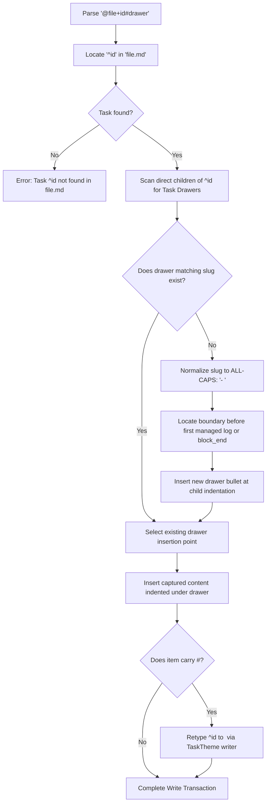
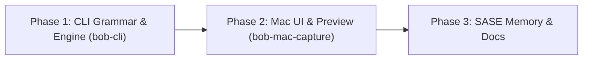

# Research & Architecture: Capture Syntax Cleanup, Task Drawers, and `%<C>` Directives

- **AUTHOR:** researcher gem (`research.2x.gem`)
- **DATE:** 2026-10-31
- **STATUS:** Completed Research & Design Proposal
- **TARGET REPOSITORIES:** `bob-cli`, `bob-mac-capture`, `sase/memory`

---

## Executive Summary

The capture syntax in Bob is the primary gateway through which thoughts, tasks, references, and session logs enter the vault. Over successive iterations, powerful features—such as Pomodoro session notes, clipboard injection, template drafts, multi-item task routing, and task typing—have been added to this language. However, this evolutionary growth led to syntactic overloading:
1. The `#` sigil was burdened with four distinct roles: Obsidian tags (`#tag`), task types (`#fix`), Pomodoro notes (trailing `#`), and task sub-bullet sections/types (`@file+id#...`).
2. The `@file+id#` syntax suffered from context-sensitive semantics: whether `@file+id#foo` retyped an existing task or targeted an existing sub-bullet section depended entirely on whether the capture item had authored body text or children.
3. The `@@` namespace accumulated historical baggage (`@@template:`, `@@route+id`, `@@route`), with `@@template:` requiring an intrusive rewrite that jumped the cursor to line 1.
4. Because trailing `#` was claimed by Pomodoro notes, typing a bare `#` in Bob Mac Capture could not open the Task Type completion menu without risking premature submission on Return.

This research report evaluates and refines Bryan's proposal to overhaul this syntax. We establish that **the proposed plan is an outstanding architectural simplification that establishes true grammar orthogonality**.

We develop the end-to-end design for:
1. **The `@file+id#drawer` syntax**: Retiring `@file+id#type` in favor of dedicated drawer targeting. Changing task types is decoupled into a separate `#type` token.
2. **Auto-creation of missing drawers**: If the targeted drawer does not exist on the task, `bob capture` creates it as an ALL-CAPS child bullet (`- DRAWER`) placed immediately above managed logs.
3. **The "Task Drawer" (aka "Drawer") glossary definition**: Formalized as a first-class Bob concept linking task sub-bullets to Project Note `## H2` sections.
4. **The `%<C>` Directive Syntax (`%c`, `%n`, `%t`)**: Migrating clipboard clipping (`%` -> `%c`), Pomodoro session notes (trailing `#` -> `%n`), and templates (`@@template:` -> `%t`).
5. **Immediate completion affordances**: Freeing `#` allows typing `#` to immediately trigger the Task Type completion menu, while `@file+id#` immediately triggers the Drawer completion menu (blending on-task drawers with recent vault-wide drawers).
6. **First-class Live Previews for `%c`**: Eliminating the `--no-clip` preview blackout by coordinating clipboard snapshots between Swift and the CLI.
7. **Complete legacy retirement**: Hard removal of `@@file+id`, `@file+id#type`, bare `%`, trailing `#` as Pomodoro note, and `@@@` rewriting.

---

## 1. Critical Evaluation & Critique of the Plan

### 1.1 Is This a Good Idea?

**Verdict: An emphatic YES.**

The proposal resolves longstanding friction in the capture grammar and client interaction model. Below is an analysis of each problem and why the proposed shift succeeds:

| Problem in Current System | Root Cause | Proposed Solution | Value & Impact |
| :--- | :--- | :--- | :--- |
| **Overloaded `@file+id#`** | Overloaded between retyping an existing task (`@r+id#fix`) and targeting a section (`@r+id#requirements`). Disambiguated only by the presence of body text or child bullets. | `@file+id#drawer` exclusively targets drawers. Retyping requires a separate `#type` token (e.g. `@foo+bar#requirements #fix` or `@foo+bar #fix`). | **Total orthogonality.** Grammar is context-free. Users can both add to a drawer AND retype a task in a single command without grammatical collision. |
| **Trailing `#` blocks `#` completion** | Trailing `#` was reserved for adding a bullet to the active Pomodoro. Typing `#` in Bob Mac Capture could not open the Task Type menu on bare `#` because Return would accept row 0 instead of submitting the note. | Move Pomodoro note to `%n`. `#` now exclusively denotes Task Type (or Drawer when attached to `@file+id`). | **Instant completion.** Pressing `#` can immediately display the Task Type menu (or Drawer menu after `@file+id`) with zero delay. |
| **Cryptic `%` syntax** | `%` stood for clipboard capture without room for extension. | Replaced by `%c` under a unified `%<C>` directive system. | **Clear mnemonics.** `%c` (clip), `%n` (note), `%t` (template). Frees `%` as the directive trigger. |
| **Intrusive `@@template:` rewrite** | Typing `@@@` triggered `capture-rewrite`, erasing the token and prepending `@@template:\n` at line 1, jumping the user's cursor. | Replaced by `%t`. The directive stays exactly where typed, with no forced draft reorganization. | **Calm editing.** Preserves user spatial focus and eliminates complex cursor-mapping logic in `rewrite.rs`. |
| **Stale `@@file+id` syntax** | Historical shortcut for bulk-capturing sub-bullets to a parent task before template drafts existed. | Completely removed. | **Zero legacy baggage.** Simplifies `draft.rs` and removes dead inheritance paths. |

### 1.2 Critique & Recommended Adjustments to the Requirements

While the proposal is structurally sound, several subtle edge cases require careful design. We recommend the following concrete adjustments:

#### Adjustment 1: Formatting and Placement Invariants for Auto-Created Drawers
- **The Requirement:** If the targeted drawer does not exist when using `@file+id#drawer`, create it.
- **The Challenge:** Where does the newly created drawer land in the task block, how is it indented, and how is its title formatted?
- **Our Recommendation:**
  1. **Title Normalization:** The drawer title must follow Bob's canonical section title rule (`PROJECT_SECTION_TITLE_RE = /^[A-Z0-9][A-Z0-9 \t&'(),./-]*$/` with at least one letter). A slug like `#requirements` or `#acceptance-criteria` is normalized to uppercase with hyphens converted to spaces (`- REQUIREMENTS`, `- ACCEPTANCE CRITERIA`). Exact literals like `#"API DESIGN"` preserve interior characters.
  2. **Refusal on Invalid Titles:** If a user captures `@foo+bar#123` or `@foo+bar#foo_bar` (snake_case or missing letters), Bob must reject the capture with a clear diagnostic explaining valid drawer name characters, rather than writing a broken bullet that fails future project note conversion.
  3. **Placement Geometry:** Tasks may already have child tasks (`- [ ] #task ...`), notes (`- note`), and managed logs (`📅 Schedule Log`, `🪵 Work Log`, `🥀 ROTTEN LOG`). In Bob, managed logs must strictly remain at the tail of the task block.
     - **Rule:** A newly created drawer MUST be inserted **before the first managed log** (or at the end of the task's child block if no logs exist).
     - If existing drawers already exist, the new drawer is appended after the last existing drawer (maintaining drawer grouping).
     - The captured text is then nested under this new drawer indented with the task's dominant child indent unit.

#### Adjustment 2: Two-Tier Drawer Completion with "+ Create" Affordance
- **The Requirement:** When `#` is typed after `@file+id`, trigger a completion menu for existing drawers on that task, and lower in the list, recent drawers from other tasks or project notes (H2 sections).
- **Our Recommendation:**
  To make this menu intuitive and beautiful in Bob Mac Capture, Bob should structure the completion candidates into two semantic groups:
  1. **`on_task` (Group 1 - Priority):** Drawers already present on `^id` in `file.md`. Display child count badge (e.g. `3 notes` or `empty`).
  2. **`recent` (Group 2):** Distinct drawer names collected from recent vault tasks and Project Note `## H2` headings (excluding system headings like `Tasks`).
  3. **`create` Fallback Row:** When the query does not match any existing drawer, show a clean, high-visibility creation row: `+ Create drawer "- <UPPERCASE_NAME>"`. This makes it explicit to the user that pressing Return will create a new container bullet.

#### Adjustment 3: Directive Scoping, Placement, and Escaping Rules
- **The Requirement:** Directives `%c` (clip), `%n` (note), `%t` (template).
- **Our Recommendation:**
  - **Edge Positioning:** Just like `#type`, `$priority`, and `s:schedule`, `%c` and `%n` are marker tokens that must appear at either edge of an item's parent line (or on their own continuation line). Mid-line `%c` (e.g., `Growth increased by 5% compared to Q1`) must remain ordinary prose.
  - **Escape Sequence:** Escaping with `\%` (e.g., `\%c`, `\%n`, `\%t`) strips the backslash and preserves the literal string in the note text.
  - **History & Header Extensions for `%c`:**
    - `%c`: Paste current clipboard.
    - `%c<N>` (e.g., `%c2`): Paste Nth clipboard history item (mirrors current `%2` functionality).
    - `%c:"Header"`: Paste clipboard nested under a sub-header.

#### Adjustment 4: Solving the `%c` Live Preview Blindspot in Bob Mac Capture
- **The Requirement:** Bryan noted: *"I would love if this syntax supported previews better in the bob-mac-capture app."*
- **Our Recommendation:**
  - **Why Live Preview Failed Previously:** In `bob-mac-capture`, `BobProcessClient.swift` contains a hard assertion:
    ```swift
    precondition(arguments.contains("--no-clip"), "live preview must never read clipboard")
    ```
    This forced all live dry-runs to disable clipboard parsing, causing the panel to display a static placeholder: `"Clipboard markers stay literal in live preview"`.
  - **The Solution:** Bob Mac Capture is a native macOS application that has instant, zero-cost access to `NSPasteboard.general`.
    Instead of having subprocess `bob` probe macOS pasteboard APIs in a tight keystroke loop:
    1. When Bob Mac Capture detects a `%c` span or need, it reads the current plain-text string from `NSPasteboard` in Swift.
    2. It passes this text to `bob capture --dry-run` via a new flag: `--clip-preview <CONTENT>` (or via `stdin` / environment variable `BOB_CLIP_PREVIEW`).
    3. `bob` parses the preview text through its existing `capture_clip` formatting engine, calculating exact indentation, line wrapping, and placement.
    4. Bob Mac Capture renders the preview with syntax-highlighted clipboard bullets tinted in the clipboard palette color! The user sees the exact expanded block before committing.

---

## 2. Formal SASE Memory Definition: Task Drawer

As requested, we formalize the "task drawer" concept. Below is the exact text to be added as a strand in `sase/memory/glossary/task-drawer.md`:

```markdown
# Task Drawer

*Requested · project*

aka drawer

A task drawer is an ALL-CAPS uncheckboxed direct-child bullet under an open task (for
example `- REQUIREMENTS`, `- NOTES`, `- ACCEPTANCE CRITERIA`, or `- FUTURE WORK`). It serves
as an organizational container for nested notes, references, and sub-bullets belonging to
that task.

When an open task is promoted or converted into a Project Note (via Obsidian's "Create
project note from task" or `bob project` sync), each drawer containing nested items is
automatically converted into an `## H2` section (for example `## Requirements`, `## Notes`),
with its nested bullets becoming that section's body. Acronyms and letter casing are
title-cased according to Bob's section title grammar. Childless drawer bullets are ignored
during promotion to prevent empty headers.

In capture syntax, a drawer is targeted on an existing task with `@file+id#drawer` (for
example `Some context. @backend+api#requirements`). The captured text is inserted as a child
bullet under that drawer. If the targeted drawer does not exist on the task, `bob capture`
creates it automatically above any managed logs (`📅 Schedule Log`, `🪵 Work Log`).

A task drawer is distinct from:
- a Project Note `## H2` heading (which represents note-level document structure);
- a Task Type marker (`#fix`, `[type:: FIX]`), which classifies the task's work category;
- a Pomodoro session note (`%n`), which logs bullets to today's active Pomodoro;
- a managed task log (`📅 Schedule Log`, `🪵 Work Log`, `🥀 ROTTEN LOG`), which records machine-stamped lifecycle state.
```

---

## 3. Detailed Technical Architecture & Design

### 3.1 Grammar & Lexer Specifications (`bob-cli`)

```
========================================================================================
                               CAPTURE TOKEN TAXONOMY
========================================================================================

  1. TASK TYPE (Free-standing or New Task Attached):
     #<type>                  -> Free-standing Task Type marker at edge (#fix, #"DEEP WORK")
     @file^id#<type>          -> New task creation with explicit initial type

  2. TASK DRAWER (Existing Task Attached):
     @file+id#<drawer>        -> Directs captured bullet into the named DRAWER of ^id in file.md
     @file+id                 -> Ensure Next / task toggle / owner reference (no drawer)

  3. CAPTURE DIRECTIVES:
     %c[<N>][:<header>]       -> Clip directive: paste clipboard (or history <N>) as child bullets
     %n                       -> Note directive: append child bullet to current/running Pomodoro
     %t                       -> Template directive: treat draft as a template expansion definition

  4. ESCAPES:
     \#<word>                 -> Literal tag (e.g. \#fix preserves #fix in note body)
     \%<C>                    -> Literal directive text (e.g. \%c preserves %c in note body)
========================================================================================
```

#### Lexer State Changes in `src/native/capture_language/`:

1. **Retire `TypeMarkerAttachment::ExistingTask` in `type_marker.rs`**:
   - Delete `AttachedRouteKind::ExistingTask` from `type_marker.rs`.
   - `@file+id#...` is NEVER scanned as a `TypeMarker`.
   - A free-standing `#type` token can now appear anywhere on the line alongside `@file+id` or `@file+id#drawer` without ambiguity:
     - `Some note @foo+bar#requirements #fix`:
       - `@foo+bar#requirements`: Parsed as `CaptureKind::SubBullet` targeting `^bar` in `foo.md` under drawer `requirements`.
       - `#fix`: Parsed as `TypeMarkerOccurrence::Complete("FIX")`, which retypes `^bar` to `FIX`.

2. **The New Directive Lexer (`directive.rs`)**:
   - Implement `DirectiveKind`:
     ```rust
     #[derive(Debug, Clone, PartialEq, Eq)]
     pub(crate) enum DirectiveKind {
         Clip(ClipRequest),
         PomodoroNote,
         Template,
     }
     ```
   - Claims edge tokens starting with `%`:
     - `%c`: `DirectiveKind::Clip(ClipRequest::Current { header: None })`
     - `%c3`: `DirectiveKind::Clip(ClipRequest::History { count: 3 })`
     - `%c:Header`: `DirectiveKind::Clip(ClipRequest::Current { header: Some("Header") })`
     - `%n`: `DirectiveKind::PomodoroNote`
     - `%t`: `DirectiveKind::Template`
   - Emits `SpanKind::Directive` covering `%<C>`.
   - Transparent masking: Just like `TypeMarker`, directives are masked during dependency/route passes so neighboring tokens parse cleanly.

3. **Template Draft Lexing (`%t`)**:
   - Delete `start_template` from `rewrite.rs` (no more `@@@` rewriting to line 1).
   - In `template.rs`, update `analyze(raw_text)`:
     - A draft is a template draft if `%t` appears at the start of the draft or as an edge directive on the template header line.
     - The template block immediately follows the definition line.
     - Example:
       ```
       %t
       Deploy {0} to {1} @ops+deploy #fix
       
       auth staging
       billing prod
       ```
     - The directive stays exactly where typed.

4. **Removal of Legacy Syntax**:
   - Remove `@@file+id` from `draft.rs` and `editor_parse.rs`.
   - Remove `is_pomodoro_note_marker` (`#`) from `markers.rs`.
   - Remove legacy bare `%` token parsing from `markers.rs`.

---

### 3.2 Vault Mutation & Auto-Creation Engine (`src/native/capture/`)

When executing `bob capture` with `@file+id#drawer`:



#### Insertion Geometry & Code Details:
In `src/native/capture/sub_bullet.rs`:
```rust
pub(super) fn plan_drawer_sub_bullet_capture(
    planner: &mut CaptureBatchPlanner,
    bob_dir: &Path,
    target: &Path,
    route: &str,
    block_id: &str,
    drawer_slug: &str,
    capture_block: &str,
) -> Result<CaptureWritePlan, CaptureError> {
    let contents = planner.read_existing(target)?;
    let settings = note_tasks::read_settings(bob_dir);
    let scan = note_tasks::scan(&contents, &settings);
    let parent = scan.find_task_by_block_id(block_id)?;

    let existing_drawers = capture_task_sections::task_sections(&contents, parent);
    let (insertion_offset, child_indentation) = if let Some(drawer) = 
        capture_task_sections::select_section(&existing_drawers, drawer_slug) 
    {
        // Case 1: Drawer already exists. Insert inside existing drawer.
        let ins = capture_task_sections::section_insertion(&contents, drawer);
        (ins.offset, ins.indentation)
    } else {
        // Case 2: Drawer does not exist -> Auto-create!
        let drawer_title = capture_task_sections::normalize_drawer_slug_to_title(drawer_slug)?;
        let child_indent = parent.indentation.clone() + "\t"; // or dominant indent unit
        let drawer_line = format!("{child_indent}- {drawer_title}\n");
        
        // Find insert point: before first managed log, or at parent.block_end
        let insert_at = capture::first_direct_managed_log_start(
            &line_spans(&contents),
            parent.line_index,
            parent.block_end
        ).unwrap_or(parent.block_end);
        
        let nested_indent = child_indent.clone() + "\t";
        // Stage creation of the drawer bullet and nested note
        ...
    };
    ...
}
```

---

### 3.3 Completion Engine (`src/native/capture_complete/`)

#### 1. The Directive Completion Menu (`%`)
Triggered when the caret sits on `%` at an edge position:
- **Context:** `CompletionContext::Directive`
- **Query:** Characters typed after `%` (e.g. `c`, `n`, `t`)
- **Candidates:**
  ```json
  [
    {
      "directive": "c",
      "replacement": "%c",
      "title": "Clip",
      "summary": "Paste clipboard content as child bullets under the task",
      "icon": "doc.on.clipboard"
    },
    {
      "directive": "n",
      "replacement": "%n",
      "title": "Pomodoro Note",
      "summary": "Append child bullet to today's active Pomodoro session",
      "icon": "timer"
    },
    {
      "directive": "t",
      "replacement": "%t",
      "title": "Template Draft",
      "summary": "Expand items using a template definition block",
      "icon": "square.stack.3d.up"
    }
  ]
  ```

#### 2. The Drawer Completion Menu (`@file+id#`)
Triggered when `#` is typed immediately following `@file+id`:
- **Context:** `CompletionContext::TaskDrawer`
- **Route:** `file`
- **Block ID:** `id`
- **Query:** Text typed after `#`
- **Candidate Aggregation Pipeline:**
  1. **Local Drawers (Priority 1):** Scans `^id` in `file.md` for existing `- <TITLE>` bullets using `capture_task_sections::task_sections`. Marked with `source: "on_task"`.
  2. **Vault Drawers (Priority 2):** Scans routable Project Notes (for `## <Title>` headings) and recent tasks (for direct child `- <TITLE>` bullets) across the last 14 days of notes. Marked with `source: "recent"`.
  3. **Create Fallback:** If query doesn't match an existing candidate, Bob returns an additive candidate:
     `{ "title": "REQUIREMENTS", "slug": "requirements", "source": "create", "summary": "Create new drawer bullet" }`.

#### 3. Instant Task Type Completion (`#`)
When `#` is pressed at an edge position (and NOT attached to `@file+id`):
- **Context:** `CompletionContext::TaskType`
- **Query:** Text typed after `#` (can be empty!)
- Because trailing `#` no longer means Pomodoro note, Bob immediately returns all configured task types!
- In Bob Mac Capture, the Task Type menu opens instantly on `#`, showing `■ DEV`, `■ BUILD`, `■ FIX`, `■ REF`, etc.

---

### 3.4 Bob Mac Capture Client Integration (`bob-mac-capture`)

#### 1. Directive Menu UI (`CaptureDirectiveMenuView.swift`)
When `completionResponse.context == "directive"`:
Bob Mac Capture displays a clean, elegant 3-row menu:

```
┌────────────────────────────────────────────────────────┐
│ DIRECTIVES                                             │
├────────────────────────────────────────────────────────┤
│ 📋 %c   Clip            Paste clipboard contents       │
│ ⏱️ %n   Pomodoro Note   Add note to current Pomodoro   │
│ 📑 %t   Template        Expand template items          │
└────────────────────────────────────────────────────────┘
```
- Row selection by keyboard shortcut (`c`, `n`, `t`), arrow keys, or mouse hover.
- Subdued pill styling for `%c`, `%n`, `%t`.

#### 2. Task Drawer Menu UI (`CaptureDrawerMenuView.swift`)
When `completionResponse.context == "task_drawer"`:
Presents drawers clearly divided by source:

```
┌────────────────────────────────────────────────────────┐
│ DRAWERS FOR ^parser                                    │
├────────────────────────────────────────────────────────┤
│ 📂 REQUIREMENTS    On this task               2 notes  │
│ 📂 ACCEPTANCE      On this task               empty    │
├────────────────────────────────────────────────────────┤
│    RECENT IN VAULT                                     │
│ 🗂️ NOTES           Used in 5 project notes             │
│ 🗂️ DESIGN          Used in 3 project notes             │
├────────────────────────────────────────────────────────┤
│ ➕ Create drawer "- SPEC"                              │
└────────────────────────────────────────────────────────┘
```

#### 3. Real-Time `%c` Live Preview Resolution
To fulfill Bryan's desire for superior previews with `%c`:
1. In `CapturePanelModel.swift`, when `parse.spans` contains `directive` with value `%c`:
   - Swift reads `NSPasteboard.general.string(forType: .string)`.
   - Instead of passing `--no-clip`, `BobProcessClient` passes:
     `["capture", "--dry-run", "--clip-preview-stdin", "--format", "json", "--", draft]`
     and streams the clipboard bytes via `stdin`.
2. `bob capture --dry-run` expands the clipboard in-memory and returns the generated children in `output.sub_bullets` (marked with `origin: "clip"`).
3. Bob Mac Capture renders the preview panel showing the exact lines that will be inserted, tinted in the clipboard palette accent color!
   - No more `"Clipboard markers stay literal in live preview"`.
   - The user gets full visual confidence before pressing Return.

---

## 4. UI/UX Interaction Walkthrough

````carousel
```markdown
# 1. Targeting an Existing Task Drawer
Bryan types:
`Fix edge cases in parser @compiler+lex#`

Instant Drawer Menu Appears:
╭─ DRAWERS FOR ^lex ────────────────────────────────────────╮
│ 📂 REQUIREMENTS   On task (1 note)                       │
│ 📂 NOTES          On task (3 notes)                      │
│ 🗂️ DESIGN         Recent in project notes                │
│ 🗂️ ACCEPTANCE     Recent in project notes                │
╰───────────────────────────────────────────────────────────╯
Selecting `REQUIREMENTS` inserts `#requirements`.
```
<!-- slide -->
```markdown
# 2. Retyping AND Adding to a Drawer in One Step
Bryan captures:
`Check unicode escapes @compiler+lex#requirements #fix`

Live Preview in Bob Mac Capture:
╭─ PREVIEW ─────────────────────────────────────────────────╮
│ Note: compiler.md                                         │
│ Destination: - [ ] #task Lexer implementation ^lex        │
│ Type: set to FIX                                          │
│ Target Drawer: - REQUIREMENTS                             │
│ Added Bullet: \t\t- Check unicode escapes                 │
╰───────────────────────────────────────────────────────────╯
Both actions execute simultaneously and orthogonally!
```
<!-- slide -->
```markdown
# 3. Using Directives with %
Bryan types: `%` at the end of a line:
`Implement AST generator %`

Instant Directive Menu Appears:
╭─ DIRECTIVES ──────────────────────────────────────────────╮
│ 📋 %c   Clip            Paste clipboard contents          │
│ ⏱️ %n   Pomodoro Note   Add note to current Pomodoro      │
│ 📑 %t   Template        Expand template items             │
╰───────────────────────────────────────────────────────────╯
Pressing 'c' inserts `%c` and immediately displays the live
clipboard lines indented beneath the task!
```
<!-- slide -->
```markdown
# 4. Immediate Task Type Menu on Bare #
Bryan types: `Review PR #`

Instant Task Type Menu Appears:
╭─ TASK TYPE ───────────────────────────────────────────────╮
│ ■ DEV           Feature development                       │
│ ■ BUILD         Build & release engineering               │
│ ■ FIX           Bug fix                                   │
│ ■ REF           Reference reading & research              │
╰───────────────────────────────────────────────────────────╯
No letter delay required! Trailing # no longer blocks #fix.
```
````

---

## 5. Phased Implementation Roadmap

To maintain Bob's daily release train and coherent master invariants, we recommend executing this overhaul in three structured phases:



### Phase 1: `bob-cli` Grammar, Writers, Completion, and Cleanup
1. **Directives Engine (`%<C>`)**:
   - Create `src/native/capture_language/directive.rs` implementing `%c`, `%n`, `%t`.
   - Update `template.rs` to detect `%t` without line-1 rewriting.
   - Delete `start_template` from `rewrite.rs`.
   - Retire bare `%` and trailing `#` Pomodoro note in `markers.rs`.
2. **Task Drawer Engine (`@file+id#drawer`)**:
   - Update `type_marker.rs`: eliminate `ExistingTask` attachment.
   - Update `sub_bullet.rs`: implement drawer resolution and auto-creation above managed logs.
   - Implement `capture_task_sections::normalize_drawer_slug_to_title`.
3. **Completion Updates**:
   - Add `CompletionContext::Directive`.
   - Update `CompletionContext::TaskDrawer` to return on-task drawers + vault-wide recent drawers.
   - Update `CompletionContext::TaskType` to trigger immediately on bare `#`.
4. **Legacy Cleanup**:
   - Remove `@@file+id` from `draft.rs` and `editor_parse.rs`.
   - Delete all legacy compatibility warnings for retired forms.

### Phase 2: `bob-mac-capture` Presentation & Previews
1. **Directive Menu**:
   - Add `CaptureDirectiveMenuView.swift` and models for `directive` completion.
2. **Drawer Menu**:
   - Update `CaptureDrawerMenuView.swift` to render `on_task` vs `recent` vs `create` tiers.
3. **Live Preview for `%c`**:
   - Wire `NSPasteboard` snapshot into `captureLivePreview`.
   - Remove `--no-clip` restriction when `%c` is present.
4. **Test Fixtures**:
   - Regenerate fake-bob responses and UI test suites.

### Phase 3: SASE Memory, Glossary & Documentation
1. **Glossary Strand**:
   - Create `sase/memory/glossary/task-drawer.md`.
   - Run `sase memory init`.
2. **Documentation Overhaul**:
   - Update `docs/capture.md` and `docs/reference/capture-syntax.md`.
   - Document `%c`, `%n`, `%t`, and `@file+id#drawer`.

---

## 6. Recommended Decisions & Conclusion

### Summary of Recommendations

1. **Adopt `@file+id#drawer` and decouple `#type`**:
   Retire `@file+id#type`. Retyping an existing task is cleanly achieved via a separate `#type` token (`@foo+bar#requirements #fix` or `@foo+bar #fix`).
2. **Auto-create missing drawers**:
   When `@file+id#drawer` targets a non-existent drawer, automatically create it as an ALL-CAPS bullet (`- DRAWER`) immediately above managed logs.
3. **Migrate to `%<C>` directives**:
   Consolidate clipboard (`%c`), Pomodoro note (`%n`), and template (`%t`) under the `%` sigil.
4. **Trigger instant completion on bare `#`**:
   Removing trailing `#` as a Pomodoro note frees `#` to immediately open the Task Type menu (or Drawer menu after `@file+id`).
5. **Feed Swift pasteboard data to dry-run for `%c` previews**:
   Eliminate the `--no-clip` preview blackout so users see exact clipboard contents rendered before capture.
6. **Hard removal of legacy syntax**:
   Completely purge `@@file+id`, bare `%`, trailing `#` Pomodoro notes, and `@@@` rewrites with zero backward-compatibility baggage.

This design transforms capture into an intuitive, reliable, and beautiful editing experience that respects Bob's strict vault invariants and delights the user on every keystroke.
