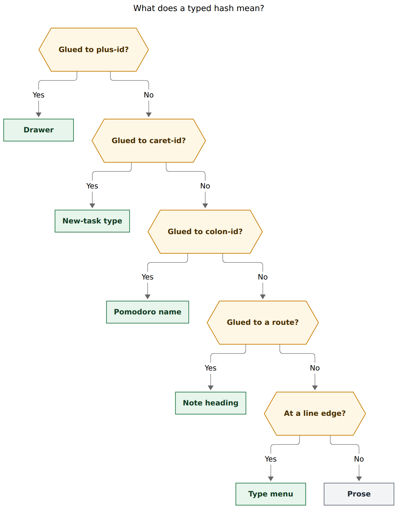
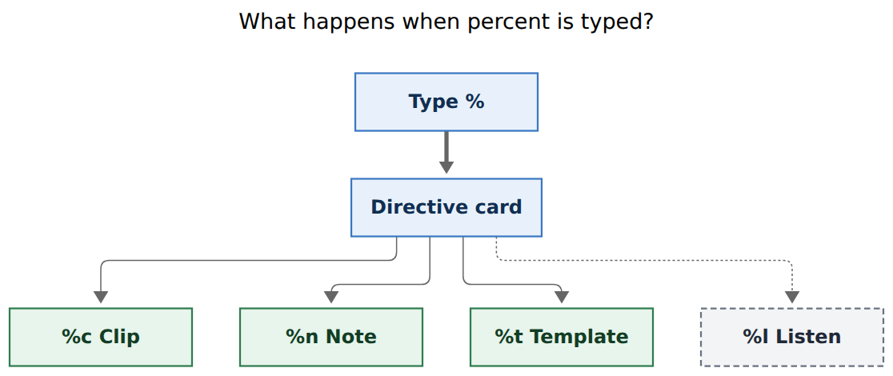
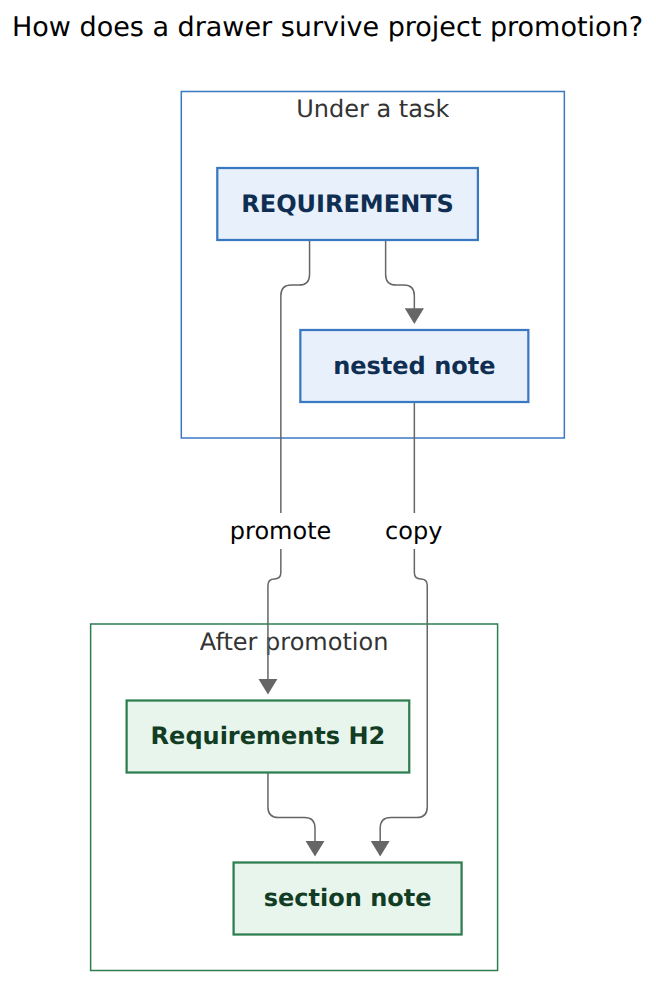

# Capture drawers and percent directives

Researcher: `grk`. Independent swarm report. Do not treat this as the synthesis.

- **Question:** How should Bob retire `@file+id#type`, trailing `#`, `%`, `@@template:`, and `@@file+id` so capture is consistent, completable, and beautiful? Lead the design, critique the request, adjust requirements where justified, and recommend a solution.
- **Evidence:** landed epic `bob-cli-ep` / `plan:202610/capture_hash_type_marker.md`; `docs/capture.md`, `docs/reference/capture-syntax.md`; `src/native/capture_language/{type_marker,completion,markers,template,rewrite}.rs`; `src/native/capture_task_sections.rs`; `src/native/capture_complete/{cli,task_types,candidates}.rs`; Bob Mac Capture `docs/{capture-panel,capture-previews,task-pickers,protocol,saved-templates}.md` and `CaptureTaskTypeMenuView.swift`; bob-plugins `bob-navigation-hotkeys` project conversion (`PROJECT_SECTION_TITLE_RE`, Ctrl+Shift+Alt+N); glossary Capture / Bulk Capture / Task Type / Project Note / Project Task; `decisions:mac-capture-is-a-thin-client`; `cli_rules.md`; in-progress epic `bob-cli-8b` (saved templates).
- **Date of evidence:** 2026-10-31 (bob-cli-ep closed the same day; workspace checkout of bob-cli, bob-mac-capture, bob-plugins).
- **Figures:** Mermaid CLI `@mermaid-js/mermaid-cli@12.0.0`, PDF-mirroring config, DejaVu Sans.

## Bottom line

**Yes: do this.** The request is the right cleanup, and it is larger than a rename. The design that makes it intuitive is one rule:

**`#` names. `%` directs.**

Today those two sigils share jobs. `#` names a type, a task section, a note heading, a Pomodoro, and (when trailing and bare) a Pomodoro note. `%` clips, counts clipboard history, names a clip header, and asks for companion audio on a URL. The hash-type epic that landed today made the overload worse: `@route+id#` is a type when the item has no body, and a section when it does. That body-dependent switch is the opposite of "easier to understand."

The recommended grammar:

| You type | Meaning |
| --- | --- |
| `@foo+bar#requirements` | Drawer `REQUIREMENTS` under `^bar` in `foo.md` (create it if missing) |
| `Some note. @foo+bar#requirements` | Nested note in that drawer |
| `Some note. @foo+bar#requirements #fix` | Same nested note, and retype `^bar` to FIX |
| `#fix` / `@sase^parser#fix` | Task type (free-standing, or glued to a new-task `^id`) |
| `%` | Directive card: Clip, Note, Template |
| `%c` | Clipboard children (today's `%`) |
| `%n` | Plain bullet on the current Pomodoro (today's trailing `#`) |
| `%t` | This item is a bulk template; later rows expand it. `%t` stays where it was typed |

Retire, with teaching errors and no silent fallback: attached `@route+id#type` (the no-body retype form), trailing bare `#`, `%` / `%N` / `%header`, `URL %` as listen (see **ADJ-6**), `@@template:`, `@@@` rewrite, `@@route+block-id`.

Keep: free-standing `#<type>`, `@route^id#type`, `@route:id#pomodoro`, `@route#Heading`, `@@route`, CLI `--clip` / `--no-clip`, the Control-T template shelf.



**Caption.** A hash is claimed by the marker it is glued to. The first match wins, so `@foo+bar#requirements` is always a drawer. A free `#` at a line edge opens the Task type menu immediately. Measured 865×1108 px, fit 75.5%.

## Is this a good idea?

**Yes.** Three product problems are real, and they share one cause.

### 1. `@route+id#` means two things, chosen by whether the item has a body

`docs/capture.md` states the split the hash-type epic shipped:

- `@route+id#type` with no body and no authored children: Ensure Next and retype.
- `@route+id#section <text>`: child under an ALL-CAPS section.
- `@route+id#` with an empty selector: type menu if marker-only, `task_section` need if there is body.

The example in that epic's own "what stays" list is `Need a parser @work+prep#requirements` as a child under a task section. Bryan's new example is the same shape plus a free `#fix`. The attached type form is the recent extra meaning. It is also the one he is asking to delete. Deleting it is correct: a glued `#` after `+id` should have one job.

### 2. Trailing `#` is why the type menu waits for a letter

Epic `bob-cli-ep` reviewer decision `bare_hash_menu = letter` exists because `remembered the timeout #` is a Pomodoro note. `type_marker.rs` skips a free-standing `#` unless the next character is an ASCII letter or a quote. Mac protocol compatibility says the same: "`#` plus a letter opens the menu; bare `#` stays the Pomodoro note."

Moving the Pomodoro note to `%n` removes that reason. Opening the type menu on `#` is then the beautiful path, and it matches what Bryan asked for.

### 3. `%`, templates, and `@@` are three dialects for "extra payload"

Clipboard is `%` / `%N` / `%header`. Pomodoro notes are a trailing `#`. Templates are a first-line `@@template:` header that `@@@` rewrites to the top of the draft. `@@route+block-id` is a fourth dialect for "put several items under one parent," which Bryan says templates replaced.

A three-row `%` card (Clip, Note, Template) is the grammar a person can hold in their head. Org-mode capture already uses `%c` for clipboard; Bob can steal that letter without stealing Org's whole expansion language.

### What is already in the vault, and should stay

Drawers are not a new vault shape. They already exist as ALL-CAPS direct-child bullets (`REQUIREMENTS`, `FUTURE WORK`) with a shared title grammar in `capture_task_sections.rs`: start with an ASCII uppercase letter or digit, allow spaces and `& ' ( ) , . / -`, require at least one letter, forbid `+` (that letter is Pomodoro-name charset). Capture already nests under them via `@route+id#slug`. Project conversion already lifts a qualifying ALL-CAPS bullet with nested children into a title-cased `##` heading (`FUTURE WORK` → `Future Work`; acronyms are not preserved). Plugin Ctrl+Shift+Alt+N uses the same title regex. The missing piece is the *name* "drawer" and a completion menu that treats those titles as a first-class vocabulary.

Managed logs (`🗓️ **SCHEDULE LOG**`, `🛠️ **WORK LOG**`, `🥀 **ROTTEN LOG**`) are already skipped by the scanner. They stay out of the drawer catalog.

## Would I take a different approach?

I would still ship this epic. I would steer it with the `#` / `%` split above, and I would make these design calls that the request left open.

**I would keep `@route^id#type`.** The request names `@file+id#type`. The caret form types a *new* task that does not yet have drawers. Gluing `#fix` to `@sase^parser` is unambiguous and already in Mac New-ID flow. Free-standing `#fix` still works on that item; the glued form is the fast path from the ID picker.

**I would make `@route+id#` a drawer even with no body.** Today's type/section switch is the bug. Marker-only `@foo+bar#requirements` creates (or selects) an empty `REQUIREMENTS` drawer. Marker-only `@foo+bar` without `#` remains Ensure Next. Retype uses a separate `#fix` token.

**I would allow the combined example as two orthogonal markers.** `Some note goes here. @foo+bar#requirements #fix` writes the note into `REQUIREMENTS` *and* retypes `^bar` to FIX. The new bullet is not a task, so `#fix` cannot type it; it types the targeted parent. If Bryan meant `#fix` only as "see, type is separate now," omitting `#fix` still writes the note. Preview shows both consequences when both markers are present.

**I would create a missing drawer from a complete slug, never from a prefix.** `#req` while typing completes `REQUIREMENTS`. Return on a typed slug that matches nothing creates `REQUIREMENTS` from `requirements` (uppercase, hyphens to spaces). Return on `#req` with no unique match refuses, with the Create row as the explicit commit. This avoids a vault full of `REQ` typos.

**I would match `^prj` drawers to the project note's H2s.** After promotion the ALL-CAPS bullet is gone and the heading `## Requirements` is the drawer. `@foo_bar+prj#requirements` should land there. Creating a missing drawer on `^prj` writes a new H2, not an ALL-CAPS child under `^prj`. Ordinary tasks inside a project note still use ALL-CAPS children of *that* task.

**I would add `%l` for listen.** `URL %` currently steals the `%` token on a reference item, which would block the directive card. Companion audio is a directive, so it belongs in the card. This is the one extra letter I would add to `{c,n,t}`.

**I would have Mac send the pasteboard into dry-run for `%c`.** Live preview today is `bob capture --dry-run --no-clip`, so clipboard children are invisible until Preview or Capture. That is the `%` preview complaint. Mac already owns the pasteboard; bob still plans the children. That keeps `decisions:mac-capture-is-a-thin-client`.

**I would leave `%t` on the definition item and retire the first-line header.** The template *is* the capture item. Rows are the items after it. No `@@@` jump to line 1. Control-T inserts a definition that already contains `%t`.

**I would keep `@@route`.** Draft-wide routing is still useful. Only `@@route+block-id` goes away.

**I would keep JSON `task_section` as the completion context id** and change every user-facing word to "drawer." Renaming the wire id forces a Mac protocol bump for no new behavior. Span kind `sub_bullet_section` stays. Help, menus, glossary, and `parent_section` captions say drawer. `bob capture-task-drawers` becomes the canonical command with `capture-task-sections` as a hidden alias (`cli_rules.md`).

## Requirement adjustments

Call-outs the lead should adopt or explicitly reject.

| ID | Adjustment | Why it is justified |
| --- | --- | --- |
| **ADJ-1** | Treat `#` as the naming sigil and `%` as the directive sigil. Design every token against that split. | This is the consistency the request is reaching for. Trailing `#` as a Pomodoro note is a directive wearing a naming character. |
| **ADJ-2** | Keep `@route^id#type`. Retire only the no-body `@route+id#type` form. | Drawers live on existing tasks (`+id`). A new `^id` has no drawers yet. |
| **ADJ-3** | `@route+id#` is always a drawer, body or no body. Empty `#` is incomplete (`needs: ["task_section"]`) and opens the drawer menu. | Deletes the body-dependent switch the hash-type epic just shipped. |
| **ADJ-4** | Combined `@route+id#drawer #<type>` is valid and orthogonal. | Matches Bryan's example if `#fix` is intentional; harmless if it is leftover illustration. |
| **ADJ-5** | Create-on-missing from a complete slug or an accepted Create row. Prefix queries never create. | Today's writer *errors* on a missing section (`docs/capture.md` § Sub-bullets). Create is the requested change; unbounded prefix create is how you get `REQ`. |
| **ADJ-6** | Add `%l` Listen as a fourth directive, shown extra-prominent on a URL-only item. Retire exact `URL %`. Keep `URL @` as the compatible listen alias until a later pass, or retire it in the same commit if Bryan agrees. | Bare `%` must open the card. `URL %` would swallow that keystroke. Listen is the same family as clip/note/template. |
| **ADJ-7** | Clip suffixes attach to `%c`: `%c`, `%c3`, `%c:build_log`. Retire `%`, `%3`, `%build_log`. | `%n` would otherwise be today's clipboard header `n` (`**N:**`). `%t` would be header `t`. Count and header have to move under `c`. |
| **ADJ-8** | `%t` stays on the definition item. Following blank-line items are rows. Items *before* the `%t` item are refused. Retire `@@template:` and `@@@`. | Requested: do not rewrite `%t` to the top line. The first-line header existed only because `@@template:` was a `@@` declaration. |
| **ADJ-9** | Mac live preview of `%c` sends pasteboard bytes to bob (`--clip-text` or an equivalent argv/env). `%c3` history still uses bob's Clipy backend on explicit Preview/Capture. | `--no-clip` is why `%` previews are empty. Reading the pasteboard in Swift is host I/O, not grammar. |
| **ADJ-10** | When the parent is `^prj`, `#drawer` matches and creates project-note H2s (skipping `Tasks`, `Events`, `Pomodoros`, `Highlights`, generated status groups). | Promotion already converts drawers to H2s. Capture should still find them after. |
| **ADJ-11** | Recent drawers are an LRU journal written on successful capture and on project conversion, capped (~20 unique slugs). The targeted task's live drawers always rank first. Do not scan the whole vault on every `#`. | Matches theme/relation journals in spirit, without a hide/rename vocabulary. Vault-wide H2 scans would blow PT3 completion budgets. |
| **ADJ-12** | Keep `@@route`. Remove `@@route+block-id` only. | Bryan named `@@file+id`. Plain `@@route` is still the bulk route for unrouted tasks and default refs. |
| **ADJ-13** | Keep completion context id `task_section` and span `sub_bullet_section`. User-facing copy, glossary, and CLI names say drawer. Hidden alias `capture-task-sections`. | `cli_rules.md` forbids hard-renaming commands. A wire rename is a Mac compatibility row for a synonym. |
| **ADJ-14** | Bare `#` at a marker edge opens the type menu (reverse `bare_hash_menu = letter`). Return on incomplete `#` teaches `%n`. `#` + digit, `##`, mid-line `#` stay prose. | This is the payoff of moving Pomodoro notes off `#`. |
| **ADJ-15** | `%n` composes with `%c` the way trailing `#` composes with `%` today. `%t` still refuses clipboard and session operators. | "Clip this onto the Pomodoro" remains a real gesture. |
| **ADJ-16** | Record a decisions strand for the `#` / `%` split, and add glossary **Task Drawer**. Update Capture / Bulk Capture strands so they no longer describe `@@template:` or trailing `#`. | User asked for the glossary term. Unlike `bob-cli-ep` (`memory_record = no`), this *is* an architecture record. |
| **ADJ-17** | Update the Control-T shelf draft to a `%t`-bearing definition. Coordinate with `bob-cli-8b` (phases closed, epic still in land). | Shelf `show` / list `draft` currently print `@@template:` as the first line. |

## Current grammar, in enough detail to break it cleanly

### Naming hashes (keep, then specialize)

From `docs/capture.md` " `#` is not one marker":

| Form | Today | After |
| --- | --- | --- |
| `@notes#Ideas` / `@notes#` | Heading bullet in `notes.md` | Unchanged |
| `@cash+id#requirements <text>` | ALL-CAPS child section | **Drawer** (same write, create-if-missing, better menu) |
| `@cash+id#coding` with no other text | Ensure Next + retype to CODING | **Retired.** Write `@cash+id #coding` or `@cash+id#coding` as a drawer named CODING |
| `@sase^parser#fix` | Type the new task | Unchanged (**ADJ-2**) |
| `@sase:deep-fix#bugs` | Pomodoro name | Unchanged |
| `#fix` at a line edge | Type; menu waits for a letter | Type; menu opens on `#` (**ADJ-14**) |
| `remembered the timeout #` | Pomodoro note | **Retired.** Write `%n` |
| `Ask about #fix today` | Prose | Unchanged |
| `Review PR #1234` | Prose | Unchanged |

### Directives (rebuild under `%`)

| Form | Today | After |
| --- | --- | --- |
| `%` / `%3` / `%build_log` | Clipboard current / history / header | `%c` / `%c3` / `%c:build_log` |
| `URL %` | Companion audio (`ref_listen`) | `%l` on that URL item (**ADJ-6**) |
| trailing `#` | Pomodoro note | `%n` |
| `@@template:` first line; `@@@` rewrite | Bulk template | `%t` on the definition item |
| `@@route+block-id` | Draft-wide parent | **Retired.** Per-item `@route+id` or a `%t` |
| `@@route` | Draft-wide route | Unchanged |

Clipboard rendering (inline / lines / attachments / snippet, header `**BUILD LOG:**`, Clipy history, `--clip` / `--no-clip`) is unchanged once the token is `%c…`. Templates still refuse session operators and clipboard, still cap 1,000 rows and 1 MiB, still save the definition block to `${XDG_STATE_HOME}/bob-cli/capture/templates.json`.

### What "create the drawer" writes

For a normal task, insert an ALL-CAPS direct child before the first managed log, using the task's child indentation:

```markdown
- [ ] #task Upgrade Postgres [created::2026-07-31] ^bar
	- REQUIREMENTS
		- Postgres 17 minimum
	- FUTURE WORK
```

If `REQUIREMENTS` was missing, the new bullet is created in the same slot, then the note is nested under it. Preview's `task_blocks` view already has a diff gutter; a created drawer is a green `+` line.

For `^prj`, write `## Requirements` (title case via the existing `formatProjectSectionTitle` / CLI equivalent) and put the note under that heading. Authored `TASKS` still merges into `## Tasks`.

Slug rule stays `selector_slug`: trim, collapse whitespace, lowercase, spaces to hyphens. `#"Q&A"` keeps the literal title path already used by Pomodoro names.

## Recommended solution

### 1. Language contract

**Type marker (`#<type>`).** Same slug and literal rules as `bob-cli-ep` §1.1. Attachment points:

- Free-standing at either edge of any line, including a child `- #fix`.
- Glued to `@route^block-id` (new task).
- Never glued to `@route+block-id`. After `+id`, `#` is the drawer selector.

A free-standing `#` with no name is incomplete `task_type` and *does* complete. Execution refuses until a configured type is chosen, with a hint that a Pomodoro note is `%n`.

**Drawer selector (`@route+id#drawer`).** Same charset as today's task-section selector. Whole-slug beats prefix. Empty `#` is incomplete, never "any drawer." A second `#` on the same route token is still not this family. Matching:

1. ALL-CAPS direct children of the parent task (skip managed logs and checkboxes).
2. If the parent is `^prj`, non-special H2 titles of that project note, compared by slug.
3. Else create (**ADJ-5**, **ADJ-10**).

JSON keeps `parent_section` as the original title string (`REQUIREMENTS` or `Requirements`) so preview can say `› REQUIREMENTS`. Add `parent_section_created: true` when the capture minted the drawer.

**Percent directives.** A whitespace-delimited `%` token at a terminal marker position.

| Token | Complete? | Need / span |
| --- | --- | --- |
| `%` | No | `needs: ["percent"]`, span `percent` |
| `%c` | Yes | span `clipboard` (existing) |
| `%c3` | Yes | clipboard history count 3 |
| `%c:build_log` | Yes | clipboard + header |
| `%n` | Yes | span `pomodoro_note` (existing) |
| `%t` | Yes | template definition; span `template_header` over `%t` |
| `%l` | Yes, URL-only items | span `ref_listen` |
| `%x`, `%cat`, `%3` | Invalid | teaching error listing `c` `n` `t` (`l` on URL items) |

Unknown `%…` in the middle of the body stays literal, matching today's clipboard lexer. `--no-clip` keeps `%c…` literal. `--clip` still forces a live clipboard capture without a marker.

`%n` conflicts: same table as today's Pomodoro note (`s:`, `$`, `@route…` rejected; clipboard allowed). `%t` conflicts: same as today's template (no `@@` declarations, no clipboard, no session operators). `%t` plus rows is the whole draft: one definition item, then rows. A `%t` on a child line still marks that item as the definition.

**Retire with teaching errors** (no write, no warn-and-continue):

- `@route+id#fix` with no body, when `FIX` is a configured type and the intent was retype: `` `@sase+parser#fix` is a drawer now; write `@sase+parser #fix` to retype, or add note text to nest under FIX ``. If `FIX` is also a plausible drawer, the drawer reading wins and the type must be the separate token. This is the one sharp edge; the preview's type line plus drawer destination makes it visible.
- Trailing bare `#`: `` `#` is a type now; write `%n` for a Pomodoro note ``.
- `%` / `%3` / `%build_log` as old clipboard: `` write `%c` (clip), `%c3` (3 clips), or `%c:build_log` ``.
- `URL %`: `` write `%l` to request companion audio ``.
- `@@template:` / `@@@`: `` write `%t` on the template item; rows go after a blank line ``.
- `@@route+id`: `` write `@route+id` on each item, or `%t` for a repeating parent ``.

`t:` stays ordinary prose (already retired by `bob-cli-ep`).

### 2. Completion and Mac chrome

Thin client holds. Bob returns contexts; Mac paints them.

**Drawer menu** (`task_section` context, title **Drawer**). Trigger: `#` immediately after a resolved `@route+block-id`, including marker-only items.

- Header: parent description plus `^id`, caption `2 on this task`.
- Group **On this task**: live drawers, document order, child-count caption, empty drawers badged.
- Group **Recent**: LRU slugs from other tasks and project H2s, dimmer, source caption (`cash.md`, `## Requirements`).
- Footer: `Return to nest under REQUIREMENTS` or `Return to create REQUIREMENTS`.
- Typed unmatched slug: a dashed **Create REQUIREMENTS** row, selected when it is the only create option.
- Replacement is the slug (`requirements`). Display is the ALL-CAPS (or H2) title.
- No Ctrl+D hide in v1. Drawers are structure, not a suggestion vocabulary.

**Type menu.** Same compact card as today (`CaptureTaskTypeMenuView`). Opens on `#` at a free edge and on `@route^id#`. Does *not* open after `+id`.

**Percent card** (new context `percent`). Three (or four) 30 pt rows, descriptions from bob, one-letter accept:

| Key | Title | Description |
| --- | --- | --- |
| `c` | Clip | Paste the clipboard as child bullets |
| `n` | Note | Plain bullet on the current Pomodoro |
| `t` | Template | Expand later lines as rows of this item |
| `l` | Listen | Queue companion audio for this URL (URL-only items) |

Return on the selected row inserts that letter. Escape leaves a bare `%` (incomplete, Capture disabled). This is the "good description" Bryan asked for: a card, not a zsh-style list.

zsh: `%` completes `c`, `n`, `t` with those descriptions; `@route+id#` completes drawer slugs; `#` at an edge completes types including empty query.

### 3. `%c` preview

Add an additive dry-run input so Mac can pass the current pasteboard without bob calling `xclip` / Clipy on every keystroke:

```text
bob capture --dry-run --clip-text $'the pasteboard\nbytes' --format json -- 'research %c'
```

When a `%c` span is present, Mac reads `NSPasteboard` once per debounced preview and sends `--clip-text`. Bob plans those bytes as `clip.lines` so the live card shows the real children. Empty pasteboard: a muted **Clipboard is empty** row, Capture still allowed to fail the same way a real empty clip fails. `%c3` stays a "3 clipboard items" placeholder in live preview; explicit Preview/Capture resolve Clipy history as today.

Do not drop `--no-clip` for drafts without `%c`. Do not have Mac parse `%c` itself: it reacts to bob's `clipboard` span / `percent` need.

### 4. Recency journal

Path: `${XDG_STATE_HOME}/bob-cli/capture/drawers.jsonl` (or a small JSON LRU, mode `0600`). Append on successful drawer capture and on project-note conversion. Key is the slug; payload is last title, last route, last representation (`bullet` / `heading`), `last_used_at`. Cap 20 unique slugs, drop oldest. This is bob-owned, like the template shelf, not a vault file and not a per-host hide journal.

Completion merges: live parent drawers (always, even if never captured) then LRU minus those slugs, ranked by `last_used_at`.

### 5. Docs, help, memory

- `docs/capture.md`: grammar-at-a-glance; the `#` table; new `%` table; rename "Sub-bullets / ALL-CAPS child section" to drawers; Pomodoro notes become `%n`; Bulk templates become `%t`; retire the listed forms.
- `docs/reference/capture-syntax.md`: token index; Overloaded-markers `#` and `%` rows.
- `docs/task-types.md`: typed captures still `#`; attached `+id#type` removed from the routing table.
- `just docs-gen` after clap help. Mac docs in bob-mac-capture: capture-panel, task-pickers, protocol, saved-templates, keyboard.
- Glossary **Task Drawer** (aka drawer). Point Capture, Project Note, and Project Task at it. Distinguish Annotation Section, note headings (`@route#Heading`), and managed logs.
- Decision record: `#` names, `%` directs; `@route+id#` is always a drawer; unconfigured types still refuse.

Draft glossary body:

> A **task drawer** is a named container for notes under one task. On an ordinary task it is an ALL-CAPS direct-child bullet (`REQUIREMENTS`) that is not a checkbox and not a managed log. In a project note the same drawer is a title-cased `##` heading, which is what Ctrl+Shift+Alt+N and `@route^id+` write when they promote that bullet. Capture addresses it as `@route+id#drawer`. A missing drawer is created. Recent drawers from other tasks and project notes appear in the `#` menu after the ones already on the targeted task. It is not an Annotation Section, a note-level `@route#Heading` bullet, or a Schedule / Work / Rotten Log.

### 6. Implementation shape

One coherent CLI contract-break, then Mac, same train as `bob-cli-ep`.

**Phase `cli` (large).** Lexer for `%` directives and the `+id#` drawer-only split; writers for create-if-missing and `^prj` H2; retire the listed forms; `capture-parse` needs/spans; `capture-complete` drawer ranking + `percent` context + type menu on bare `#`; `capture-rewrite` drops `start_template` `@@@` (or maps it to in-place `%t` only if a hidden gesture is wanted; default is drop); `capture-templates show` / list `draft` emit `%t`; `--clip-text`; docs, help, fixtures. Commit subject:

```text
feat(capture)!: drawers after +id, percent directives, retire @@template

BREAKING CHANGE: @route+id# is always a drawer; retype with a separate #<type>.
Trailing #, %, @@template:, @@@, and @@route+id are retired in favor of
%c / %n / %t. URL listen moves to %l.
```

**Phase `mac` (medium).** Percent card; drawer menu chrome (groups, Create row, copy); type menu on `#`; `--clip-text` live preview; fake-bob + fixtures regenerated against the `cli` bob; Control-T draft format; docs.

**Memory.** Plan decision default **true** for the glossary strand and the decisions record, quoting Bryan's request.

Do not edit `Cargo.toml` version or `CHANGELOG.md`. `schema_version` stays 1; the break is grammatical.

### 7. Risks

- **Same-day reversal of `bob-cli-ep`.** The attached `+id#type` form is hours old. Removing it is still right. Implementers should delete `TypeMarkerAttachment::ExistingTask` and the `marker_only_task_toggle` predicate rather than leaving a compatibility branch.
- **`#fix` vs drawer `FIX`.** A configured type named FIX can also be a drawer title. After this change `@x+y#fix` with no body creates/selects drawer FIX. Retype needs the space: `@x+y #fix`. Preview must show the drawer destination so this is not silent.
- **`%n` vs `%c:n`.** `%n` is Note. A clip header named `n` is `%c:n`. Document it once in the percent card's Clip description ("headers use `%c:name`").
- **Completion budget.** Drawer menu is one parent scan plus a tiny LRU read. Stay inside PT3; do not walk every project note.
- **Template shelf identity.** Existing `templates.json` entries store the block without the header. Show/insert must add `%t` rather than `@@template:`. Old checked-out drafts with `@@template:` should fail with the teaching error, not auto-migrate (Bryan asked for no compatibility on recently added syntax).
- **Mac `--clip-text` size.** Bound it to the same clipboard limits bob already enforces (1,000-character inline, ten attachments, snippet fallback) so a huge pasteboard cannot stall live preview.

## Figures



**Caption.** Typing `%` opens a three-row directive card. Clip, Note, and Template are the grammar. Listen is the justified extra letter for URL items. Measured 744×314 px, fit 87.7%.



**Caption.** A drawer is one named container. Under a task it is an ALL-CAPS child. After promotion it is a title-cased H2. Capture still addresses it as `#requirements`. Measured 437×656 px, fit 100%.

## What I would tell the planner to write first

1. The `#` / `%` split and the retirement table (this document's language contract).
2. One worked capture: `Some note goes here. @foo+bar#requirements #fix`, with the preview showing a created-or-existing `REQUIREMENTS` drawer *and* a type line on `^bar`.
3. The percent card copy, including `%c3` / `%c:header` and `%l`.
4. The Mac `--clip-text` preview rule.
5. Memory decisions for glossary Task Drawer and the `#` names / `%` directs record.

That is enough for an epic with two phases (`cli`, `mac`) and a reviewer decision on **ADJ-6** (`%l` vs keeping `URL %`) if Bryan wants the letter set frozen at `c n t`.
