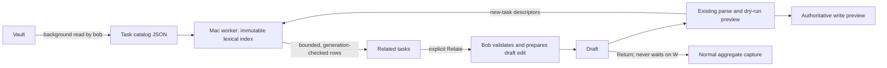

# Related tasks in Bob Mac Capture: a small, fast, trustworthy suggestion surface

Independent research by **cdx**, 2026-10-20. No other report, transcript, summary, or findings from this research swarm were consulted. This is a design recommendation, not an implementation or a measured performance claim.

## Judgment

**Build this, but treat it as optional recognition help during capture, not as a mandatory deduplication step.** The useful moment is when a sufficiently specific new task reminds Bob of work already in the vault. The dangerous version constantly fills the panel with vaguely related tasks, shifts the editor around, or makes Return wait for a search.

My recommended first release uses a Bob-produced task catalog cached in the resident Mac app, a small local lexical ranker running off the main thread, and at most **two compact suggestion rows across the panel**. Bob's normal dry-run preview explicitly identifies the new tasks to query. Suggestions never participate in capture validation or submission. Start with open, visible tasks; show nothing when relevance is weak. Offer **Open** and an explicit **Relate** action using the existing inert `~` relation. Defer embeddings, a persistent search database, a daemon, and generic “Use existing” behavior until evidence justifies them.

There are two independent success criteria: finding useful existing work and leaving capture as quick and calm as before. Better retrieval does not compensate for worse typing or more decision fatigue.

## What I inspected, and what remains unknown

The code review used bob-cli revision `1513a385a691bedbafe13c36de3205e83ce7c7d0` and bob-mac-capture revision `a85b1f8684615bb69c85ac4e8dfa0e7d04cadd9f`, plus audited project memory for the thin-client decision, idle agenda, capture linking behavior, task relations, bulk capture, and CLI rules. Source links below are immutable references to those locally inspected revisions.

I did not read Bryan's live task corpus, run the app on macOS, measure the current vault size, or benchmark a prototype. Consequently, actual match precision, RAM consumption, cold scanning cost, and Mac latency remain unanswered. The timing values below are proposed acceptance targets. An older architectural note reports a roughly 5 ms subprocess measurement on athena; that is neither a current Mac measurement nor a budget for scanning the vault.

The implementation has several useful foundations and several traps:

| Observed implementation | Consequence for this feature |
| --- | --- |
| `CapturePanelModel` uses a 50 ms analysis debounce, calls `capture-parse`, and starts live preview separately. It has generation and draft guards. | Preserve that flow. Add independently cancellable suggestion work; do not lengthen the existing debounce or await suggestions in preview. [Model](https://github.com/bobs-org/bob-mac-capture/blob/a85b1f8684615bb69c85ac4e8dfa0e7d04cadd9f/Sources/BobMacCapture/CapturePanelModel.swift#L8287) |
| `BobProcessClient` has process lanes, cancellation, output draining, and a default timeout of 20 seconds. | Give catalog refresh its own lane. A generic process timeout is much too long to be a useful suggestion deadline; stale results must also be rejected independently. [Client](https://github.com/bobs-org/bob-mac-capture/blob/a85b1f8684615bb69c85ac4e8dfa0e7d04cadd9f/Sources/CaptureCore/BobProcessClient.swift) |
| The dependency picker already builds a local index of Bob-provided candidates and filters it as the query changes. | Local ranking is an established thin-client pattern. There is no need for another subprocess on every keystroke. Its snapshot is contextual, however; do not mistake a possibly partial picker response for a complete task catalog. [Picker](https://github.com/bobs-org/bob-mac-capture/blob/a85b1f8684615bb69c85ac4e8dfa0e7d04cadd9f/Sources/CaptureCore/DependencyPickerPresentation.swift#L61) |
| Bob's dependency scanner covers nested and untyped notes, daily notes, history, hidden and ID-less tasks, with precise note identity and task refs. | Reuse its discovery/parsing components, but apply an explicit recommendation scope. Do not copy its whole, history-inclusive picker policy into automatic suggestions. [Discovery](https://github.com/bobs-org/bob-cli/blob/1513a385a691bedbafe13c36de3205e83ce7c7d0/src/native/capture_dependency_tasks.rs#L86) |
| That scanner reads note contents on discovery. `DataviewIndex::read` also walks and reads notes. | Neither is an existing persistent search index. Calling either for every draft change would add recurring vault-wide I/O. [Dataview](https://github.com/bobs-org/bob-cli/blob/1513a385a691bedbafe13c36de3205e83ce7c7d0/src/native/dataview/index.rs#L109) |
| Bob's picker matcher requires every whitespace-separated query term to match. Swift's fuzzy matcher performs character subsequence alignment. | These solve intentional picker search. They should not become the similarity algorithm for an entire natural-language task. [Rust matcher](https://github.com/bobs-org/bob-cli/blob/1513a385a691bedbafe13c36de3205e83ce7c7d0/src/native/capture_link_tasks.rs#L283), [Swift matcher](https://github.com/bobs-org/bob-mac-capture/blob/a85b1f8684615bb69c85ac4e8dfa0e7d04cadd9f/Sources/CaptureCore/FuzzyMatcher.swift#L85) |
| Capture has one ordered batch planner; an item can create a task, write prose, change an existing task, operate on the ledger, or queue a reference job. Templates expand into items. | Trigger from explicit planned task creation, not from raw text, an `@` heuristic, or a whitelist of Swift mode names. [Planner](https://github.com/bobs-org/bob-cli/blob/1513a385a691bedbafe13c36de3205e83ce7c7d0/src/native/capture/plan.rs#L39) |
| The panel starts at 760 pt wide, has a 620 pt minimum, a measured height budget, a minimum preview height, and an existing scrolling auxiliary region. Idle agenda placement preserves a fixed eye line. | Use the existing width and height planner. A second automatically growing list would worsen scrolling. Typed previews can currently slide upward when clamped, so preserving the caret requires explicitly folding suggestions before they force that clamp. [Layout](https://github.com/bobs-org/bob-mac-capture/blob/a85b1f8684615bb69c85ac4e8dfa0e7d04cadd9f/Sources/BobMacCapture/CapturePanelView.swift#L6), [Placement](https://github.com/bobs-org/bob-mac-capture/blob/a85b1f8684615bb69c85ac4e8dfa0e7d04cadd9f/Sources/CaptureCore/CapturePanelPlacement.swift) |

The accepted thin-client decision explicitly permits the app to filter or rank what Bob returns. My proposal uses that permission narrowly: Bob supplies task identity, eligibility, cleaned semantic text, creation intent, and valid edits; Swift scores and presents those values. Swift does not read Markdown, infer capture grammar, derive task status, or construct relationship syntax.

## Adjustments to the request

These are deliberate requirement changes, not accidental omissions:

1. **Useful suggestions rather than a complete duplicate check.** Absence means “nothing strong enough to show,” not “this task is unique.” Capture remains available during cold start, errors, refresh, and ranking. No duplicate warning dialog.
2. **Precision before broad semantic recall.** Initial automatic scope is visible open tasks, including Blocked, Next, Pending, and Ready; it is not just the current project's tasks. Closed/cancelled/history and hidden tasks remain available through intentional search, not automatic rows. This can miss a completed predecessor, but prevents the active panel becoming a history browser.
3. **All explicit new-task creations can be assessed, but their results do not all expand.** In a bulk draft, show the active item's suggestions and a compact summary of other items with matches. Do not add two rows per item.
4. **Linking means an explicit choice of relation.** The default suggestion action is an inert task relation. Never infer that similarity means a dependency, a prerequisite, or a Pomodoro commitment.
5. **No generic “Use existing” in the first release.** Replacing a new task with `@route:id` can affect scheduling and prerequisites. Appending the draft to an existing task is a different operation and may misplace authored children. Recognition should not silently pick either interpretation.
6. **Local lexical matching first; semantic retrieval is a later experiment.** Some paraphrases will be missed. That is an honest limitation to compare against actual examples, not a reason to ship model loading and inference before knowing whether it helps.

I would also offer a simple preference: **Related tasks: Automatic / On request / Off**. On request gives users who prefer uninterrupted capture a way to access the same feature. Do not turn similarity thresholds and ranking weights into settings.

## Interaction and visual design

The hierarchy should remain: **draft → what capture will do → optional existing work → Capture**. Suggestions are secondary to the write preview and especially to consequences such as consumed links or changed dependencies.

For a short, valid task, show a quiet divider and the heading **Related tasks**, then one or two rows. Each row has a recognizable task status mark, a title, and a subdued second line containing note/project context and one truthful reason. Use **Same title** for conservative normalized equality and **Similar wording** for strong lexical overlap. Reserve **Possible duplicate** for a separately evaluated high-precision class; never call a similarity score a probability.

An illustrative single-item view:

```text
┌──────────────────────────────────────────────────────────────────┐
│ Fix intermittent capture retries @bob                            │
│                                                                  │
│ Will create a task in Bob                                        │
│ □ Fix intermittent capture retries                               │
│                                                                  │
│ Related tasks                                      Hide          │
│ ◇ Fix capture retry failures                         Open  Relate │
│   Bob › Reliability · Similar wording                            │
│ □ Test capture retries after wake                                │
│   Bob › Capture · Shares “capture retries”                        │
│                                                                  │
│                                             Capture  ↵           │
└──────────────────────────────────────────────────────────────────┘
```

These titles illustrate row anatomy, not measured retrieval results. Real reasons must come from the actual query and matched fields; explanations should be verifiable, not fluent inventions.

Use the existing task-row typography and status vocabulary. Keep note context small but readable; do not add large cards, colored backgrounds per match, similarity percentages, AI sparkles, or paragraphs of explanation. Show action affordances on hover and keyboard focus, with accessible names; preserve discoverability through a visible row action menu when space is tight. A faint divider is sufficient separation from the authoritative preview.

**Fit before scroll.** Start with a proposed maximum of roughly 112–128 pt for the entire two-row surface, then validate against actual font metrics. The fit policy should reduce two rows to one, then to a single **Related tasks · 2** disclosure, before creating additional outer scrolling or moving the editor. These are measured layout states, not a hard height that clips larger text. At larger accessibility text sizes, prefer the compact disclosure and a deliberate detail view. Never hide a capture consequence to make room for recommendations.

The compact view contains no nested scroll list. Explicit disclosure can temporarily use the auxiliary region for a bounded related-task list with a clear Back control. There may be scrolling in that intentional browsing view; it should not become a requirement for ordinary capture. Apple recommends hiding secondary detail behind disclosure controls; applying that here is my design inference. [Apple disclosure guidance](https://developer.apple.com/design/human-interface-guidelines/disclosure-controls)

**Typing and focus rules:**

- The editor retains focus when results arrive. Return keeps its current capture meaning. Arrow keys and Tab retain their current editor/completion behavior until the user explicitly enters the suggestions.
- A visible keyboard-focusable Related tasks control opens the list. Assign any shortcut only after checking the existing keymap; do not casually reuse Tab or Command-number combinations.
- Escape in the expanded list returns to the draft; subsequent Escape follows the existing panel behavior. Selecting Open does not clear or submit the draft.
- While completion, an ID prompt, an error, or an interactive capture choice is active, suppress the expanded suggestion surface. Restore it only for the same still-valid draft.
- Do not announce a new VoiceOver result count on every character. Announce a settled useful result once, without stealing accessibility focus. Respect Reduce Motion and use text as well as color for status.
- Avoid animated row reordering. Preserve stable identities and tie-breaking. Freeze the displayed order during keyboard navigation or pointer interaction; resolve a click against the pinned row, not its old list position.

For multiple items, label the group **Related to item 3: Test capture retries**. Show a small **2 other items have matches** control when appropriate. A candidate may be relevant to more than one draft item, but should not be duplicated in the same visible group. Exact repeats within the draft should say **Also in this draft: item 1**; they have source-item identity, not a fake vault block ID. In large batches, evaluate in cancellable chunks, prioritize the active item, and distinguish pending from checked items. Never claim the whole batch was checked when only a prefix was processed.

## Which actions should rows support?

**Open** is immediately useful and low risk. Reuse the app's existing note/block navigation, preserving the draft. For ID-less tasks, use supported note navigation and show enough context; do not fabricate a stable block target from a line number.

**Relate** means “create this task with an outgoing inert relation to that existing task.” The resulting draft visibly contains Bob's canonical `~note:block-id` modifier and the normal preview describes the effect before submission. Adding the relation is one native undoable text edit, does not submit, preserves authored children and sibling items, and does not change focus unexpectedly.

The grammar already distinguishes `~`/`~~` inert relations from `&` prerequisites and `*` blocking relationships. Relations do not alter lanes, schedule, or Pomodoro links. By contrast, a capture existing-task link can remove eligible blocking dependencies and retire scheduling constraints. This makes a generic **Link** or **Use existing** label hazardous. [Capture relations and guards](https://github.com/bobs-org/bob-cli/blob/1513a385a691bedbafe13c36de3205e83ce7c7d0/docs/capture.md#L2271), [Link-guard implementation](https://github.com/bobs-org/bob-cli/blob/1513a385a691bedbafe13c36de3205e83ce7c7d0/src/native/capture/link_guard.rs)

Reuse the existing relationship picker for advanced choices rather than adding four always-visible buttons per row. If a task lacks an ID, keep it discoverable: offer Open and route an explicit relation request through the existing Add block ID flow. Do not allocate IDs merely because a recommendation was displayed. That existing ID-assignment flow is a separate vault mutation; invoking it must be an explicit user action, not an invisible preparatory step.

On action, Bob must re-resolve the target and validate the current draft before returning a replacement edit. Check note path plus block ID, or the existing stale-safe task ref for an ID-less task. Reject renamed, missing, ambiguous, or changed targets gracefully and refresh the group. Current task refs use a line number plus a physical-line digest; they are not eternal IDs. [Task refs](https://github.com/bobs-org/bob-cli/blob/1513a385a691bedbafe13c36de3205e83ce7c7d0/src/native/note_tasks.rs#L65)

Extend the existing completion/draft-edit protocol so Bob supplies the legal UTF-8 replacement range and replacement text. Do not have Swift guess where to append `~`, especially inside templates or items with trailing modifiers. Some generated template items may not admit an isolated source edit; return an explicit unsupported action and keep Open available rather than modifying all expanded items by accident. A preview of the resulting aggregate draft remains mandatory, and the eventual capture still uses its normal live write guards.

For duplicate avoidance in v1, the user can inspect the existing task and remove or revise their new item with normal editing. This is less convenient than a one-click merge, but well-defined. Add an explicit, undoable **Remove this capture item** only after defining retention of child text and template expansion. Do not silently discard an item with unique details.

## Recommended data flow



### Bob owns a complete candidate snapshot

Add a read-only capture-protocol catalog endpoint; an illustrative name is `bob capture-task-catalog --format json`. Final spelling and public options must follow the project's CLI rules, including sibling `capture-*` commands rather than nesting beneath free-text `capture`.

The catalog should contain only the fields needed for matching and presentation: schema and policy versions, vault/client identity, snapshot generation, complete/partial status and bounded warnings; then exact note path, block ID when present, stale-safe ref, clean title, section/project context, Bob-owned status, eligibility, and supported actions per task. Avoid hauling every Work Log and historical child block into memory. Do not invoke `capture-complete` on a fabricated `&` draft as an undocumented catalog API: its guards, scope, and partial results belong to a different interaction.

Reuse `note_tasks` and discovery building blocks. Bob applies the task filter and decides which rows are eligible. Default automatic scope excludes hidden tasks, excluded directories, archive history, and terminal tasks. Reference and project task kinds need explicit policy and fixtures; generic recurring checklist rows should not crowd out task-specific evidence. Scope exclusions are a product choice, not permission for Swift to guess from folder names or checkbox glyphs.

A first implementation can return a full snapshot on refresh. It is not necessary to build a durable database merely to cache a few thousand task titles. However, filter early, bound output, and report truncation explicitly. If the payload or scan is too expensive on the actual vault, implement per-note refresh/deltas in Bob before broad release; do not silently drop the latter half of the catalog and call the result complete.

### Preview explicitly identifies created tasks

Add an optional `created_tasks` array to the normal dry-run result, derived from the planner's actual creation operations. Every descriptor needs an item key, a creation key within that item, original source mapping, cleaned query text, destination/context, and whether a relation edit can be prepared. The existing `created` field is a string, not a boolean indicating that an item creates a new task; `kind` alone is also insufficient for all present and future behaviors. [Result shape](https://github.com/bobs-org/bob-cli/blob/1513a385a691bedbafe13c36de3205e83ce7c7d0/src/native/capture/output.rs#L362)

Cover ordinary tasks, task creation through Pomodoro capture, explicit project-task creation, and task-producing template expansions. Emit only actual semantic task creations, not authored prose bullets, status changes, mirrored task blocks, or ledger session placeholders. Reference jobs that may create a task later are outside this synchronous guarantee and retain their own existing library checks.

The app associates the response with its request's full draft hash and analysis generation. Item keys and source ranges are valid only within that revision; do not carry them across arbitrary edits. If a draft is incomplete or the aggregate preview fails, suggestions may remain unavailable. Do not make a second permissive grammar just to keep recommendations populated.

Missing `created_tasks` or an unsupported catalog command on an older Bob disables this feature cleanly. Cache capability by Bob executable identity and retry when the binary changes. Use additive optional decoding; unexpected schema versions remain unsupported. New Bob must continue to work with older app releases.

### The app owns an in-memory ranking worker

Hold a single immutable catalog/index in an isolated worker. Decode large JSON, normalize searchable fields, build term postings, and rank there; publish only a few presentation rows to the main actor. A `Task` launched from a main-actor model is not by itself proof that CPU work moved off the UI executor. Test the executor behavior and main-thread time explicitly.

Cache results by catalog generation plus the descriptor's semantic query and context. Ignore caret-only moves within the same item and changes that do not alter its search text/context. Multiple items share one index; do not spawn or rebuild once per item.

Schedule after roughly **150 ms of semantic input stability**, independent of the existing 50 ms analysis debounce. If authoritative preview arrives later, start when it is available; do not add another unconditional 150 ms after that. Cancel superseded work cooperatively and reject any late result whose draft, item, client identity, or catalog generation differs. At most one rank job should run, with only the newest pending request retained.

### Refresh, staleness, and failure behavior

Prewarm after the app's essential startup work. Use the existing watcher infrastructure as an invalidation signal; it does not authorize the app to read vault contents. Revalidate on relevant note/settings changes, after successful captures, on wake/unlock, and on show when dirty or sufficiently old. Borrow the agenda store's single-flight refresh and last-good-snapshot pattern, but keep separate state and policy. [Agenda store](https://github.com/bobs-org/bob-mac-capture/blob/a85b1f8684615bb69c85ac4e8dfa0e7d04cadd9f/Sources/BobMacCapture/CaptureAgendaStore.swift), [Watcher flags](https://github.com/bobs-org/bob-mac-capture/blob/a85b1f8684615bb69c85ac4e8dfa0e7d04cadd9f/Sources/BobMacCapture/VaultTargetWatcher.swift#L5)

For full-snapshot refreshes, coalesce bursts, keep one pending follow-up, and initially cap automatic scans to one per five seconds. Hidden-panel changes can simply mark the catalog dirty until the next useful refresh; do not scan every Markdown autosave indefinitely. Settings/global-filter changes invalidate eligibility. A root or Bob/vault identity change clears the snapshot immediately. Rename, directory removal, event loss, and wake require reconciliation. Apple's FSEvents documentation explicitly requires rescans after dropped/coalesced events; watching alone is not a correctness guarantee. [FSEvents guidance](https://developer.apple.com/library/archive/documentation/Darwin/Conceptual/FSEvents_ProgGuide/UsingtheFSEventsFramework/UsingtheFSEventsFramework.html)

On a changed draft, remove or disable the old recommendations immediately; they must never look actionable for the new text. During a catalog refresh, same-query cached matches may remain visibly marked as updating, with target validation on action. If known-invalid paths are identifiable, suppress those rows. On a cold cache, leave the ordinary preview alone. No spinner or skeleton should make optional suggestions look like an unfinished capture. An explicitly opened list can show **Related tasks are updating** or a retry state. Partial scans and failures are distinct from a healthy empty result. Never display **No duplicates**.

Publish byte-identical/logically identical snapshots as no-ops. Keep data only in app memory for v1. Background work still consumes CPU and I/O, so process lanes alone do not prove isolation: if scans compete with foreground preview, throttle, cancel, or switch to per-note updates based on measurement.

## Matching approach and alternatives

Use a small, deterministic lexical retrieval pipeline over Bob's clean fields:

1. Tokenize with Unicode awareness; preserve distinctive identifiers, names, numbers, and negation. Strip capture syntax and task metadata in Bob, not via a second Swift grammar. Use ordinary text normalization consistently for title and query.
2. Build term frequencies/document frequencies once per catalog. Retrieve candidates sharing informative title terms or strong identifiers using an inverted index. Match terms with OR-style candidate recall, not the existing picker's all-terms requirement.
3. Rank title evidence most strongly using BM25 or an equivalent frequency-weighted lexical baseline. Use route/section/project only as small tie-breaks. Being in the same note must never be enough to create a visible recommendation.
4. Reserve an exact normalized-title tier. Use strong token overlap and phrase agreement for near matches. A bounded character-gram comparison over the top candidate set can recover minor spelling differences; defer a separate gram index until typo misses are demonstrated.
5. Apply an abstention threshold calibrated on labeled examples. Two informative terms is a sensible initial query gate, with exceptions for a distinctive identifier or exact title. Keep zero, one, or two matches; never fill empty slots with weak results.

For near-duplicate labeling, consider contradictory numbers, names, dates, and negation. “Renew passport for Alice” and “Renew passport for Bob” may be related but are different actions. “Enable backups” and “Disable backups” must not become a duplicate verdict through token overlap. Recurring tasks with identical titles are also not necessarily duplicates. In the first release, **Same title** and **Similar wording** are safer descriptive labels than a semantic verdict.

BM25 is a baseline, not a calibrated confidence score. The BEIR paper found it robust across heterogeneous retrieval tasks, which supports evaluating a lexical baseline before adding models; it does not establish accuracy on Bryan's task titles. [BEIR, Thakur et al.](https://arxiv.org/abs/2104.08663)

| Option | Advantages | Costs and limits | Recommendation |
| --- | --- | --- | --- |
| Reuse the full-draft fuzzy picker query | Small initial code change | All-terms/subsequence matching is poorly suited to natural-language similarity; broad scans or DP matching can repeat unnecessarily | Reuse presentation and discovery, not the matching objective |
| Bob catalog + in-memory lexical ranking | No additional per-keystroke process or network request; small portable Swift core; straightforward cancellation | Cold prewarm, catalog RAM, refresh I/O, missed paraphrases; a future second client may need the ranking centralized | **First release** |
| Bob-managed SQLite FTS index | Useful when catalog transfer or scanning dominates; potentially shared by several clients | Index lifecycle, migrations, reconciliation and a query transport; not currently a general task index in this checkout | Escalation when measurements justify it |
| Local sentence embeddings or hybrid retrieval | Can retrieve paraphrases without shared words | Model availability/versioning, load time, memory, inference and false semantic neighbors; cross-platform ownership becomes more involved | Offline quality experiment after lexical evaluation |
| Hosted embedding or LLM search | Broader model options | Network dependence and transmitting private drafts; unnecessary latency and operational dependency for this surface | Do not use in the initial design |
| On-request suggestions only | Least visual interruption | Misses the automatic heads-up moment | Supported preference and fallback if automatic usefulness is low |
| Post-capture cleanup only | Removes capture-time interaction | Too late to prevent the duplicate and shifts work to review | Complementary future workflow, not the primary solution |

SQLite FTS5 provides BM25 ranking and column weights; its trigram tokenizer supplies substring search, not an automatic typo-tolerant or semantic duplicate detector. External-content indexes also require explicit consistency maintenance. These capabilities make it a plausible later backend, not a reason to add it before measuring catalog cost. The current Cargo manifest scopes the production `rusqlite` dependency to macOS, so a cross-platform task index would require a deliberate dependency change. [SQLite FTS5](https://sqlite.org/fts5.html), [Cargo manifest](https://github.com/bobs-org/bob-cli/blob/1513a385a691bedbafe13c36de3205e83ce7c7d0/Cargo.toml)

Apple's Natural Language APIs can generate sentence vectors and compare text. That is a credible local experiment, but API availability says nothing about task-specific quality or latency. If embeddings are later tested, version the model and cached vectors, preserve lexical results as fallback, and measure incremental useful recall rather than replacing the whole system on intuition. [Apple text similarity APIs](https://developer.apple.com/documentation/naturallanguage/finding-similarities-between-pieces-of-text)

## Performance and reliability gates

Apple's responsiveness guidance distinguishes noticeable interaction delays around 100 ms from much tighter frame budgets, with roughly 5 ms of main-thread update work as a useful target. Suggestions can arrive later than keystrokes; they cannot consume the keystroke budget. [Apple responsiveness guidance](https://developer.apple.com/documentation/xcode/improving-app-responsiveness)

These are **initial targets to validate on Bryan's Mac**, not measurements:

| Metric | Proposed acceptance target |
| --- | --- |
| Added foreground dependency | No await, lock, vault read, model load, or catalog scan on the typing, show, or submit path |
| Main-thread contribution | Under 2 ms p95 for publishing a bounded result; no catalog decoding/index construction on main |
| Input/preview regression | No visible hitch; p95 keystroke-to-paint increase under 5 ms and normal-preview p95 increase under 10 ms in paired runs |
| Warm ranking | Under 10 ms p95 per ordinary item on a representative catalog; stress larger corpora and pathological titles |
| Useful result arrival | Under 250 ms p95 after the last meaningful edit when the catalog and normal preview are available; break out preview wait from ranking delay |
| Concurrency | At most one catalog refresh and one ranking job; bounded pending work, never one unbounded task per item or character |
| Layout | Zero automatic scroll or caret displacement caused solely by suggestions; at most two rows before disclosure |
| Cold/failure behavior | First-frame editor and normal capture work with an empty, unavailable, old, or corrupt suggestion snapshot |
| Freshness | Typical local edits appear within roughly 5–10 seconds under full-refresh throttling; characterize large-vault tails and show stale/partial state honestly |

Measure separately: catalog subprocess time, bytes, decode time, index build time, query time, main-thread publication, end-to-end latency, cancellation tail, and incremental resident memory. Record catalog task count and corpus size alongside percentiles. Do not combine cold and warm results into a flattering average. Compare feature off versus on using the same release build, actual vault or a representative private fixture, and concurrent preview/completion activity. Test battery/Low Power Mode and bursts of vault updates. Use the app's existing metadata-only signposts; do not log draft text or task titles. [Instrumentation](https://github.com/bobs-org/bob-mac-capture/blob/a85b1f8684615bb69c85ac4e8dfa0e7d04cadd9f/Sources/BobMacCapture/Signposts.swift)

Before committing to the full-snapshot approach, measure the actual corpus and a 10× stress fixture, including long Unicode titles and deeply nested notes. Set an explicit incremental memory budget from those results. If scanning violates the foreground targets, add incremental refresh. If transferring/holding the catalog exceeds a reasonable product budget, move retrieval into a Bob-managed index. If only paraphrase recall is poor, test embeddings. These are different failures with different remedies.

Correctness fixtures should include a late result after an edit; a late result after Bob/vault replacement; a row deleted, renamed, completed, or edited before selection; duplicate block IDs; ID-less tasks; repeated titles; Unicode byte ranges; hidden/global-filter changes; dropped watcher events; old Bob schemas; partial scans; refresh failure; and cancellation during JSON decoding. Capture fixtures must cover every creation form, mixed batches, inherited destinations, templates with multiple expansions from one source span, authored prose children, pure existing-task edits, Pomodoro operations, and reference jobs. Verify that automatic discovery and ranking never mutate the vault.

The action tests should prove native undo, preservation of sibling items and child content, stale-target rejection, and unchanged aggregate capture semantics. Layout tests should cover both 620 and 760 pt widths, short displays, long paths, large text, VoiceOver, Reduce Motion, and completion/prompt precedence. Portable core tests are useful, but changed macOS sources must be compiled and checked on the Mac as required by the linked repo; Linux success cannot verify the SwiftUI/AppKit behavior.

## Deciding whether the feature is actually useful

Create a small private evaluation set before polishing thresholds: approximately 60–100 representative capture drafts against a frozen task snapshot, mixing real duplicates, related-but-distinct actions, same-project irrelevant tasks, short/generic drafts, renamed concepts, typos, paraphrases, recurring tasks, and intentionally unrelated captures. Include a held-out portion so tuning does not merely memorize the examples. Bryan's judgment of “I would have wanted to see this here” is the target label.

Report precision among displayed rows, useful-match recall within the first two, and nuisance rate on drafts with no relevant task. Also report how often the ranker abstains: 100% precision obtained by never showing anything is useless. A reasonable initial automatic-mode bar is at least 90% useful displayed rows on that evaluation set, with a stricter bar for any **Possible duplicate** label. Small sample counts are directional evidence, not strong statistical guarantees. Inspect false positives individually.

Compare exact-title-only, the lexical ranker, and any later hybrid experiment on the same set. Ask whether suggestions reduce later duplicate cleanup without increasing time to capture. Click-through alone is insufficient: a heads-up can be useful without a click, and an appealing irrelevant row can get clicked. During a short personal trial, inspect a few examples with Bryan rather than inventing extensive telemetry. If related suggestions remain noisy, ship automatic same-title/strong-overlap hints and move broader exploration behind explicit disclosure.

Implementation should proceed through an evaluated corpus/ranker prototype, an additive Bob catalog and creation-descriptor contract, the isolated app store and bounded UI, then explicit relation actions and Mac performance/accessibility verification. This is a sequencing recommendation, not a request to modify product code as part of this research.

## Recommended solution

**Ship a conservative, local “Related tasks” surface powered by a Bob-owned catalog and Bob-owned creation descriptors, with ranking over an in-memory snapshot in the Mac app.** Prewarm and refresh independently, rank off the main thread after a short pause, and publish at most two stable rows for the active item. Keep the editor, authoritative preview, and Return path independent of recommendation health. Fold suggestions before they force scrolling or move the caret.

Start with open visible tasks and strong lexical evidence. Use Open and explicit inert Relate actions; let Bob validate and author every draft transformation. Treat empty results as abstention, stale results as stale, and all performance numbers as gates to prove on the actual Mac. Revisit incremental indexing when refresh cost demands it and semantic retrieval when a labeled corpus demonstrates valuable misses. That approach delivers the intended heads-up while keeping both the computational cost and the user's attention cost small.
