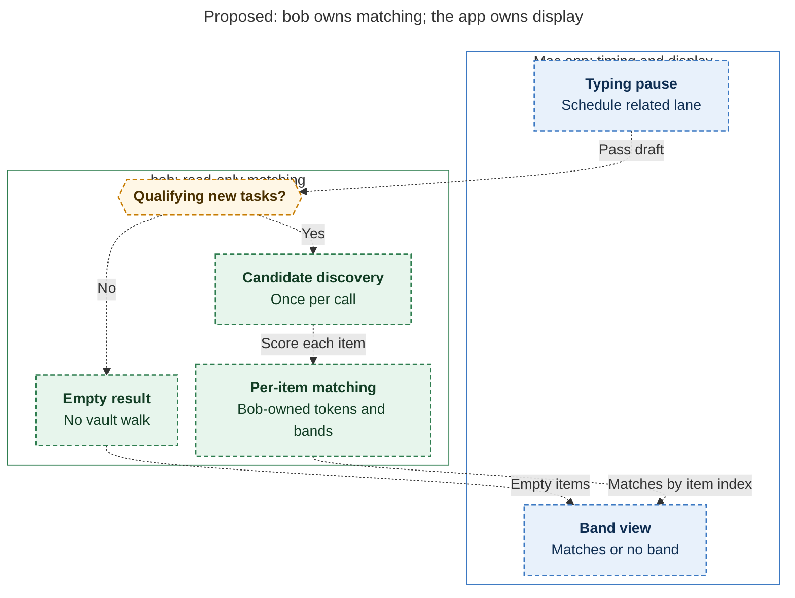
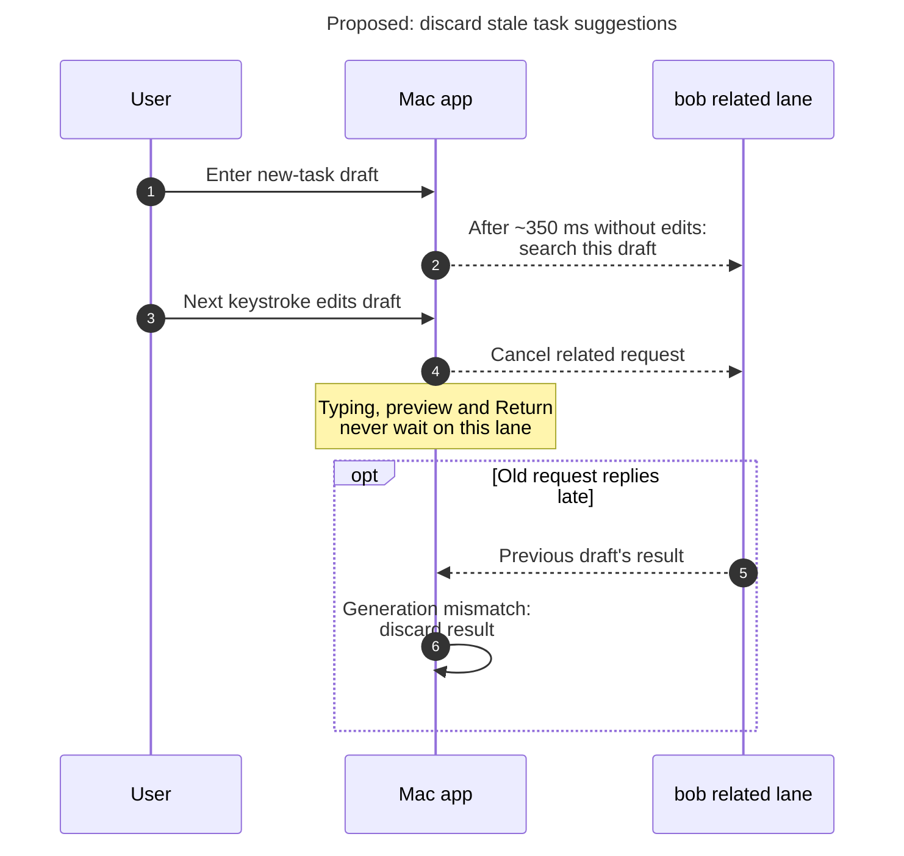
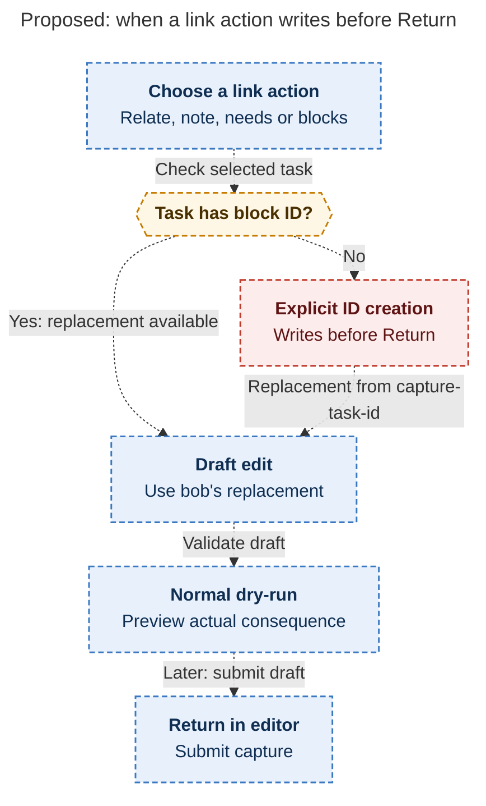

# Diagram proposals: Similar tasks in Bob Mac Capture's preview: consolidated research

Proposals for the swarm linker, not a report. Each diagram restates only what the source
report says.

```yaml
source: research:202610/capture_similar_tasks_band/capture_similar_tasks_band__final.md
producer: research.27.image
check: "mmdc 12.0.0 with the PDF-mirroring config rendered 3 of 3 Mermaid diagrams; prescribed Puppeteer no-sandbox fallback; malformed-input test exited nonzero"
```

## matching-ownership

```yaml
anchor: |-
  Bob parses the draft and keeps only task-creating items that pass the
question: |-
  Which side owns matching, and when does a draft avoid a vault scan?
illustrates: |-
  Bob returns either empty items without walking the vault or per-item matches, while the app owns timing and pixels.
caption: "Bob owns eligibility and matching; the app owns timing and display, and nonqualifying drafts return without a vault walk."
review: "635.586x1019.22 px, fit 87.6%; question and visual checks passed; all nodes and edges traced to source; 0 revisions"
```



## discard-late-results

```yaml
anchor: |-
  the next keystroke cancels it, and a late result is discarded by the
question: |-
  What happens if an old search finishes after another keystroke?
illustrates: |-
  The next keystroke cancels the related lane, and the draft generation check discards a late result without delaying the preview or Return.
caption: "A keystroke cancels the related request; the draft generation check discards any late reply while preview and Return remain independent."
review: "828.5x718 px, fit 78.8%; question and visual checks passed; conditional late reply and all exchanges traced to source; 0 revisions"
```



## explicit-block-id-write

```yaml
anchor: |-
  is minting a block ID when you act on an ID-less row
question: |-
  Can choosing a suggestion write before Return?
illustrates: |-
  Link actions use an existing replacement or explicitly mint a missing block ID, then bob validates and previews the draft edit before capture.
caption: "Link actions may explicitly create a missing block identifier before Return; bob still previews the capture consequence."
review: "464.172x1116 px, fit 80.0%; question and visual checks passed; alternative ID paths and pre-Return write traced to source; 0 revisions"
```


