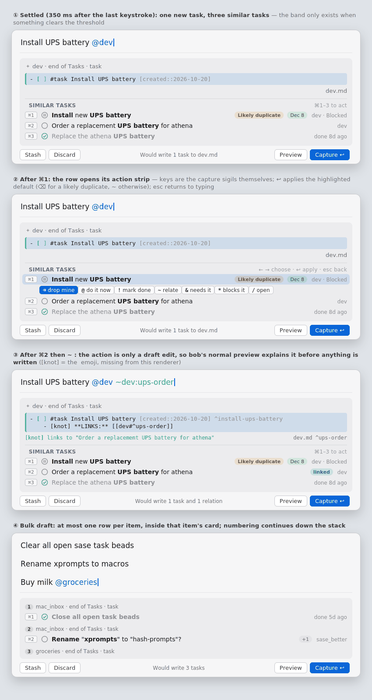
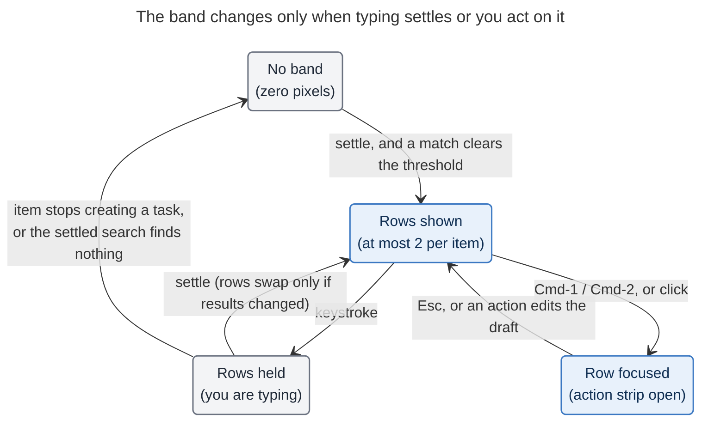

# Similar tasks in Bob Mac Capture's preview: consolidated research

Lead consolidation of five independent reports
([cdx](capture_similar_tasks_band__cdx.md), [cld](capture_similar_tasks_band__cld.md),
[grk](capture_similar_tasks_band__grk.md), [mus](capture_similar_tasks_band__mus.md),
[gem](capture_similar_tasks_band__gem.md)), plus new lead research: the first latency
measurements taken **on the Mac**, a scorer comparison on the live task catalog, and checks
of the grammar and key-routing claims the reports disagreed on. 2026-10-20.

> **Request.** When a capture draft will create one or more new tasks, show likely
> related existing tasks in the preview panel, both to warn about duplicates and to
> surface tasks worth linking. Constraints, in priority order: stay blazing fast; don't
> cramp the panel or force scrolling; be intuitive, reliable, and beautiful. Critique the
> plan, adjust the requirements where justified, and recommend a solution.

## Bottom line

- **Build it, but as a duplicate-first "Similar tasks" band, not a "related tasks"
  list.** Wording reliably finds the same work captured twice. It does not find
  workflow relations: on 95 real dependency pairs, the true prerequisite ranked in the
  top 5 only about 20% of the time (cld). The UI should promise only what matching can
  deliver.
- **Performance: no in-app index needed for v1. The Mac turned out to be fast.** On
  Bryan's M1 MacBook Pro, spawning `bob` costs 4.7 ms, and a scan of every open task in
  routable notes costs 21 ms (incl. writing 220 KB of JSON). One new command,
  `bob capture-related`, runs **once per typing pause** (about 350 ms with no edits) on
  its own cancellable lane. That adds nothing to the keystroke path, the preview, or
  Return. The in-app index three researchers proposed stays as a measured escalation
  path, not v1 complexity.
- **Matching: TF-IDF over Bob-aware tokens**, with code spans and keymaps kept as whole
  tokens, tags stripped, and light stemming. It is owned by bob and golden-tested.
  The picker's all-terms matcher fired on only 3% of open tasks in my run and missed
  obvious paraphrases. Plain Dice scoring misses stemmed duplicates. Embeddings are not
  justified.
- **Space: zero pixels unless something clears the bar.** That should be roughly 9 in 10
  task captures. Otherwise a hairline footer sits inside the new task's own preview card:
  at most **2 one-line rows** (1 per item in bulk drafts). It folds to a one-line summary
  before it would ever cause scrolling.
- **Actions: optional, keyboard-first, and every one is a draft edit.** ⌘1 or ⌘2
  focuses a row and opens a small action strip whose keys are the capture sigils:
  `~` relate, `+` add my text as a note under it, `&` needs it, `*` blocks it, `/` open,
  `⌫` discard mine. bob's normal preview explains the result before Return writes
  anything. Return is never intercepted, and nothing is auto-linked.
- **Calibrate before polishing.** `bob capture-related --query` doubles as the
  evaluation harness. Bryan should label about 100 fresh pairs before the thresholds
  are fixed.

## Is this a good idea?

**Yes. All five reports agree, and the live vault backs them up.** Capture is the
cheapest moment to catch a duplicate: before it costs a triage decision in the NEW tier
of the `]s` walk. The vault holds open duplicates right now, all found by my scan
(below), and they sit in *different* notes:

- "Sell stocks!" (`cash.md`, Blocked) and "Sell stocks now!" (`dev_plex_hack_patch.md`,
  Next).
- "Make docs site just as nice as https://zensical.org site!" in both `bob.md` and
  `sase_pre_blog.md` (grk found this pair too).
- "Make appt w/ Rahway Hospital for CT scan!" next to the open "Make appointment for CT
  scan!".

The feature is also the natural on-ramp for `~` task relations, which just shipped and
are still unused in the vault (cld). And it fits the accepted architecture: bob-owned
facts and app-owned pixels, as with the idle agenda
(`decisions:idle-capture-shows-ledger-agenda`), and choices that are offered, never
applied implicitly (`decisions:unblocked-tasks-are-offered`).

**As stated, though, the plan has four flaws. Each one would undermine the very thing
it is meant to protect:**

1. **"Likely related" over-promises.** Prerequisites rarely share words with their
   dependents ("Start releasing bob-cli to crates.io!" depends on "Switch to using
   diataxis method for bob docs!"). 65% of real prerequisites sit in the dependent's own
   note (cld). A band labelled "related" teaches users to expect dependency discovery,
   and then lets them down.
2. **Naive implementations are slow.** Folding a vault-wide scan into the per-keystroke
   dry-run would turn a 5 ms preview into a 21 ms (open tasks) to 175 ms (whole vault)
   one on the Mac. All five reports reject this.
3. **A live list flickers.** Re-ranking after every word flashed a suggestion that later
   vanished in 33–51% of replayed captures (cld, Experiment D). Short prefixes such as
   "Buy …" or "Fix …" match almost anything.
4. **Low precision trains the user to ignore it.** At a loose threshold (0.35) the band
   fires on about half of captures at about 40% precision (cld). After one noisy week the
   band becomes wallpaper, and the real duplicate gets ignored with the noise.

**Would I take a different approach?** Not a different product: a narrower and quieter
version of the same one. I considered these alternatives:

- **Pull-only** ("press a key to ask"). Rejected as the primary mode: you don't ask about
  duplicates you don't suspect.
- **Triage-time detection only**, as a "Possible duplicate" chip in the NEW tier.
  Rejected as the only mode, because it acts after the duplicate exists. It makes a good
  complement.
- **A post-capture notification.** Too late, and too easy to dismiss.

## Requirement adjustments (explicit)

| # | Request as written | Adjusted to | Why |
|---|---|---|---|
| R1 | "Likely related tasks" | **Similar tasks**. Rows carry a **Same title** or **Possible duplicate** mark only when the evidence supports it. | Wording finds duplicates and topic neighbours, not dependencies. Never show a percentage. Never call a score a probability. |
| R2 | Show related tasks whenever a new task is created | **Show nothing unless a match clears the bar.** No header, no placeholder, and never a "No duplicates" line (rejecting mus's collapsed `No duplicates` caption). | Silence must not read as a guarantee (cdx). The band costs zero pixels on most captures. |
| R3 | Implicitly live | **Settle-gated.** The search runs after about 350 ms without edits. Rows already on screen hold while you type, then swap only if the settled result changed. | Calm, no flicker (cld Experiment D). |
| R4 | Implicitly every task | **Scope.** v1 matches every open task (Ready, Blocked, Next, In Progress) in routable notes: all ~500 open tasks live there. It also includes tasks **closed in the last 30 days, but only at the duplicate bar**, at most 1 row, shown as "Done 8d ago". | Recently closed matches are half of all matches at loose thresholds (cld), and including all closed history tripled the firing rate in my run. Only a near-identical closed task is worth the pixels ("you did this last week"). This is a compromise between cld (all closed in 30 days) and the other four (open only). |
| R5 | Implicitly every draft | **Gate.** Only items that create a task (`task`, `pomodoro_task`, a project note's `^prj` title). Require ≥ 2 meaningful terms, and a stricter bar under 3 terms, except an exact title match. Skip `@@template:` drafts in v1. | No matchable text exists in `=`, `x`, `+N`, `!`, `@route:id`, or URL items. Short titles match noise. Template rows repeat on purpose. |
| R6 | — | **Cap.** 2 rows for a single-item draft (plus a "+N" capsule); 1 row per item in bulk; 5 per draft. | Of captures that fire, 66% have 1 row and 17% have 2 (cld). Two rows plus "+N" covers 83% fully. |
| R7 | "Link to in some way" | **Actions are explicit draft edits only.** Return is never intercepted or re-confirmed. No auto-link. `@` (link into today) and `!` (complete) are not v1 one-key actions. | `decisions:unblocked-tasks-are-offered`. `@route:id` on a Blocked target drops its prerequisites (`decisions:capture-link-drops-blocking-deps`), and 422 of ~500 open tasks are Blocked. |
| R8 | "Blazing fast" | **Numbers.** Zero extra spawns per keystroke. Preview p95 unchanged with the feature on versus off. Related lane p95 ≤ 50 ms on the Mac. | Puts the speed requirement into gates that can be enforced (table below). |
| R9 | — | **A Settings toggle**, "Show similar tasks while capturing", on by default. Thresholds live in bob, not in Settings. | Lets thresholds be retuned with a bob release, without an app release. |
| R10 | — | **Calibrate first**: harness, a labelled set, and a new `decisions` record written through the memory-write process. | Every precision number so far is single-labeller and directional. |

## Evidence

### Where the reports disagreed, and how I resolved it

| Question | cdx | cld | grk | mus | gem | **Resolution** |
|---|---|---|---|---|---|---|
| Transport | Bob catalog, Swift BM25 ranker | Bob term index, Swift dot product, query terms on `capture-parse` | `bob capture-related -- <draft>` per settle | `bob capture-suggest` per settle | Swift index plus Swift tokenizer | **Per-pause bob call** for v1, because the Mac numbers make it cheap. cld's index design is the escalation path. |
| Scorer | BM25 | TF-IDF, words plus atoms (measured AUC 0.82–0.84) | Dice (`title_score`) | Picker tiers, all terms (AND) | Weighted Jaccard plus bonuses | **TF-IDF plus atoms**, backed by the run below. |
| Closed tasks | No | 30 days | No (later) | No | Penalised | **30 days, duplicate bar only.** |
| Visible rows | 2 | 3 | 3 | Duplicates plus a disclosure | 1 chip | **2** (+N). |
| Timing | 150 ms | 400 ms plus hysteresis | After parse | 300–500 ms | Every parse | **~350 ms settle, hold-then-swap.** |
| Actions | Open, Relate | ⌘1–3 plus a 7-sigil strip | Display-only | Insert or seed picker | ⌥ shortcuts | **⌘1–2 plus a 6-action sigil strip**, with `+` (add as note) added; `@` and `!` deferred. |

**Factual corrections, all checked in code:**

- **gem's latency model and command name.** gem predicted 70–165 ms for a routable-notes
  scan; it is 21 ms on the Mac. gem's proposed catalog command,
  `capture-dependency-tasks`, does not exist; `capture-tasks` lists one note's tasks.
- **gem's shortcuts.** On macOS, ⌥ plus a key types a character, and `⌥&` needs ⇧⌥7.
  Tab already carries completion, snippet, and indent duties
  (`CaptureKeyCommandRouter.swift`).
- **mus's AND matcher** cannot find paraphrased duplicates (results below).
- **mus's timings came from a debug build.** mus measured 0.26 s and 2.18 s; release
  builds are 10–20× faster.

### New: latency measured on the Mac

`kellys-macbook-pro`: Apple M1, 8 GB, on battery. bob 0.1.0 against the live vault (6,435
`.md` files). Median of 9 timed runs after 1 warm-up, warm cache, launched over SSH
rather than from the app process.

| Command | Median | Range | Output |
|---|---:|---:|---:|
| `bob --version` (spawn floor) | 4.7 ms | 4.2–5.7 | — |
| `capture-parse` | 4.8 ms | 4.6–5.2 | 0.2 KB |
| `capture --dry-run --no-clip` (new task) | 5.0 ms | 4.9–5.2 | 0.5 KB |
| `capture-pomodoros --tasks` (agenda refresh) | 8.1 ms | 6.8–10.2 | 5.8 KB |
| `capture-complete ':'` (open tasks in routable notes) | **21.0 ms** | 20.8–21.4 | 220 KB |
| `capture-complete '!'` (vault-wide completable) | 171 ms | 170–188 | 218 KB |
| `capture-complete '&'` (vault-wide, open and closed) | 175 ms | 174–196 | 1,570 KB |

What this settles:

- **The thin-client decision's "about 5 ms per spawn" figure was measured on athena. It
  now holds on the Mac too.** Parse and dry-run are almost entirely spawn cost.
- **A per-pause `capture-related` call should cost about 20–30 ms.** The 21 ms `:` scan,
  including serializing 220 KB, is an upper-bound proxy for discovery. Scoring roughly
  1,000 short documents in Rust is sub-millisecond. The output is about 1 KB. The 30-day
  closed window adds a small scan of `done/` (about 0.5 MB, per cld).
  **This is an estimate.** Phase 0 must measure the real command.
- **Behind a 350 ms settle, 25 ms is invisible**, so an in-app index would buy no
  user-visible speed. It would cost:
  - a second refresh pipeline on vault events. Obsidian autosaves in bursts, so this
    could mean *more* bob spawns than a per-pause call.
  - a Swift ranker kept in parity with bob's.
  - a whole class of staleness bugs. A per-pause call reads the current vault, so it is
    never stale.
- Earlier figures agree once host and build are accounted for. On apollo, cld measured
  `:` at 39–40 ms and `&` at 353–363 ms, and grk measured `:` at about 30 ms. mus's
  numbers came from a debug build.

### New: scorer comparison on the live catalog

**Method.** I took all 3,901 tasks from `capture-complete '&'` and used each open task
(about 500) as a query against all the others (leave-one-out). For the second run I
stripped tags and excluded `#gtd` checklist rows. The scorers were:

- picker-style AND substring (mus);
- `title_score` Dice, ported exactly from `ref_library/resolve.rs` (grk);
- TF-IDF cosine with atoms: code spans and keymaps as double-weight tokens, sublinear
  tf, light stemming (cld's design).

**Firing rates:**

| Scorer and scope | Fires on |
|---|---:|
| AND substring (all terms present) | 3% |
| Dice ≥ 90 (grk duplicate band) | 4% |
| Dice ≥ 60 with ≥ 3 tokens (grk related band) | 16% |
| TF-IDF ≥ 0.70, open-only corpus | 3% |
| TF-IDF ≥ 0.60, open-only corpus | 5% |
| TF-IDF ≥ 0.50, open-only corpus | 10% |
| TF-IDF ≥ 0.50, open plus *all* closed history | 29% |

**What the samples show** (I eyeballed them):

- **The AND matcher misses paraphrases.**
  - "Make appt w/ Rahway Hospital for CT scan!" vs "Make appointment for CT scan!": the
    token `appt` never matches `appointment`.
  - "Add support for templated capture!" vs "Add support for bob capture templates!".
- **Dice misses stemmed duplicates.**
  - "templated capture" vs "capture templates": Dice 67, TF-IDF 0.91.
  - The CT-scan pair: Dice 55, TF-IDF 0.52.
- **Dice also scores code-span-only differences as similar.** "Add `%d` short-hand for
  `%dispatch`!" vs "Add `!<cmd>` short-hand for `%proc("<cmd>")`!" scores Dice 60 and
  TF-IDF 0.14. This matches cld's finding that Bob vocabulary must be tokenized as Bob
  vocabulary.
- **Precision depends on the band.**
  - At ≥ 0.70 (open only), about 10 of 14 sampled matches were useful heads-ups, and
    about half were true duplicates. The misses were template-phrased siblings ("… are
    ready to be talked about!").
  - At 0.50–0.70, about half were useful. Siblings such as "Watch the Messenger movie
    with Kelly" vs "Watch F1 the movie with Kelly" are related, not duplicates.
- **Matches cross notes.** Only 25 of 150 top matches were in the same note. Scoping the
  search to the destination note would miss most duplicates, including every live pair
  listed above. Use the destination note as a small tie-break only.
- **Closed history must be windowed.** It tripled the firing rate.

**Caveats.** Leave-one-out over existing tasks is not a capture replay, and the labels
are mine and eyeballed. cld's replay of 1,490 real captures is still the best rate
estimate:

- At 0.50, 21% of captures fire (12% on open tasks, 12% on recently closed).
- 88% of the 80 hand-labelled pairs were useful. That is one labeller, and the atoms fix
  was tuned after seeing the errors.
- With my recommended bars (open ≥ 0.55, closed only ≥ 0.70), cld's table implies the
  band fires on roughly **1 capture in 8 to 10**.

### Facts from code that shape the design

- **Parse already knows which items create tasks.** `capture-parse` reports each item's
  `mode` and clean `body`, vault-free. I verified this with a bulk draft: `task`,
  `pomodoro_close`, `pomodoro_link`.
- **⌘1–⌘9 are free.** `CaptureKeyCommandRouter` routes only ⌘S and ⌘Return.
  `decisions:idle-capture-shows-ledger-agenda` names "⌘1…9 insertion" as a future agenda
  gesture. Using ⌘N for "act on row N" here keeps one meaning across both surfaces.
- **Every action has an existing splice.** `capture-task-id` already returns
  `relation_to_replacement` (`~`), `parent_replacement` (`@route+id`),
  `dependency_replacement` (`&`), `blocked_task_replacement` (`*`), and
  `complete_replacement` (`!`). These are minted on demand for ID-less tasks, which are
  57% of open tasks (grk), through the same Add block ID flow the pickers use.
- **`@route+id` with body text adds an ordinary child bullet under an existing task,
  "without creating a note or changing the parent task".** That is the information-
  preserving "merge into existing" action none of the reports proposed. Caution: a
  *solo* `+` marker means Ensure Next, so the action must keep the item's text.
- **Linking is not a safe one-key action.** `@route:id` on a task Blocked only by its own
  prerequisites drops those prerequisites
  (`decisions:capture-link-drops-blocking-deps`). That is a poor thing to offer on one
  key next to a list where 84% of open tasks are Blocked.
- **`/` Go To never writes.** It opens the task at its home note with no ID minting and
  no freshness stamp. Reuse it for **Open**.
- **Panel geometry.** 760 pt initial width, 620 pt minimum, 720 pt maximum height,
  92 pt preview floor. Typed previews grow downward from the agenda's fixed eye line.

## Recommended design

### 1. Architecture: bob owns meaning, the app owns timing and pixels

**`bob capture-related`** is a new, read-only capture-protocol sibling. Per the CLI rules
it is never nested under `bob capture`. It sorts alphabetically between
`capture-pomodoros` and `capture-rewrite`, and every option gets a short alias.

```text
Usage: bob capture-related [OPTIONS] [-- <DRAFT>]

List existing tasks that each new task in a capture draft may duplicate or relate to.
Read-only; never writes the vault.

Options:
  -b, --bob-dir <DIR>    Bob vault root; defaults to BOB_DIR or ~/bob
  -d, --days <N>         Also match tasks closed in the last N days [default: 30]
  -f, --format <FORMAT>  human or json [default: human]
  -h, --help             Show help
  -l, --limit <N>        Matches per item [default: 5]
  -q, --query <TEXT>     Rank TEXT as one new task title (evaluation harness)
```

**What it does.** Bob parses the draft and keeps only task-creating items that pass the
gate. It discovers candidates once per call, scores each item against them, and returns
per-item matches keyed by item index. Drafts with no qualifying item return
`{"ok": true, "items": []}` without walking the vault, at spawn cost only.

**JSON shape.** It is additive and `schema_version: 1`. Candidate fields mirror the
`task_link` picker rows, so the app can reuse its status, locator, and Add ID code:

```json
{"ok": true, "schema_version": 1, "items": [{
  "index": 0,
  "matches": [{
    "band": "possible_duplicate",
    "matched_ranges": [[0, 4], [9, 15]],
    "actions": ["relate", "note", "needs", "blocks", "open", "discard"],
    "replacements": {"relation_to": "~cash:sell-stocks", "parent": "@cash+sell-stocks"},
    "ref": "12:ab12cd34", "note_path": "cash.md", "locator": "cash",
    "block_id": "sell-stocks", "requires_block_id": false,
    "kind": "task", "text": "Sell stocks!", "section": "Tasks",
    "status_symbol": "?", "status_name": "Blocked", "closed": null
  }]
}]}
```

The fields mean:

- **`band`** is one of `same_title`, `possible_duplicate`, `similar`, `closed_duplicate`,
  or `hold`.
- **`hold`** marks scores within the hysteresis margin below the threshold. The app
  shows a `hold` row only if that task is already on screen. This puts cld's hysteresis
  in bob, and the app merely filters what bob returned.
- **`matched_ranges`** are UTF-8 ranges in `text` that the app renders semibold.
- **`replacements`** come from bob and are present only when the task has a block ID.
  The app never builds `~note:id` itself; for ID-less rows it calls `capture-task-id`.
- **No score is exposed** to the UI.

**What is excluded:**

- tasks the draft already references through `&`, `*`, `~`, `+`, or `@route:id`, which
  bob reports as `linked` instead;
- `#gtd` checklist rows;
- closed instances of recurring tasks.

**App side.** The app adds a `related` process lane:

- **When it fires:** after about 350 ms with no edits, immediately on panel show with a
  retained draft, and never while a picker, ID prompt, relation-label prompt, or pull-in
  choice owns the panel.
- **Cancellation:** the next keystroke cancels it, and a late result is discarded by the
  draft generation check.
- **Older bob:** an "unrecognized subcommand" failure is remembered per bob executable
  identity, and the feature hides silently, the same pattern as `--refuse-override`.
- **No index, no Swift tokenizer, no vault reads.**

**Escalation path.** Move to cld's in-app design *only if* one of these happens:

- the related lane's p95 on the Mac exceeds 50 ms;
- Bryan wants rows to update without a pause;
- a second client wants the ranking.

In cld's design, bob emits a term-weighted index, `capture-parse` emits query terms, and
the app computes a sparse dot product checked against `--query` parity fixtures. That
changes the transport, not the semantics, which is exactly what the thin-client decision
allows when it reopens.

### 2. Matching (bob)

- **Tokenizer** (cld's design, supported by my run):
  - lowercase, split camelCase and snake_case, light stemming, a stopword list;
  - wikilinks reduced to their alias;
  - inline fields, `#tags`, `^id`, and URLs stripped;
  - **code spans and `<key+chords>` kept as atomic, double-weight terms.**
- **Score:** TF-IDF cosine with sublinear tf and smoothed idf over the candidate corpus,
  computed per call. That is cheap at about 1,000 documents.
- **Starting bars** (to tune in Phase 0):

  | Band | Rule |
  |---|---|
  | `same_title` | Normalized titles are equal (open or closed). |
  | `possible_duplicate` | ≥ 0.70, open tasks. |
  | `similar` | ≥ 0.55, open tasks. |
  | `closed_duplicate` | ≥ 0.70, closed in the last 30 days, at most 1 row, only when no open duplicate exists. |
  | `hold` | Within 0.10 below the bar. |
  | Short queries | Under 3 terms, the bar is +0.10. |

- **Tie-breaks.** Open before closed. Then In Progress, Next, Ready, Blocked. Then a small
  boost for the destination note, then recency. Being in the same note must never be
  enough on its own.
- **Known blind spots.** Negation and swapped names ("Enable backups" vs "Disable
  backups"; "… for Alice" vs "… for Bob") look alike to any lexical scorer. That is why
  the strong label is "Possible duplicate", and "Same title" is reserved for exact
  equality.

### 3. Visual design



*Mockup by cld. Differences in this recommendation: at most 2 rows (not 3); the strip
offers `~ + & * / ⌫` (no `@` or `!`); and the strong capsule reads "Possible duplicate",
not "Likely duplicate".*

- **Placement.** A hairline-separated footer inside the new task's own preview card. It
  belongs visually to the task it describes, sits below content that is already settled
  (so nothing above it jumps), and grows the panel downward from the fixed eye line.
  Height is never animated. Content cross-fades in about 120 ms, or instantly with
  Reduce Motion.
- **Header.** "SIMILAR TASKS" in caption small caps, secondary colour, with a trailing
  tertiary hint "⌘1–2". The hint becomes "← → choose · ↩ apply · esc back" while a row is
  focused.
- **Row.** One line, about 24 pt:
  - a tertiary keycap (`⌘1`);
  - the status glyph from `CaptureEditorPalette`;
  - the title, with **matched words semibold**, which shows why it matched without a
    reason paragraph;
  - at most one capsule: **Same title** or **Possible duplicate** in the existing orange
    warning tint, or **Done 8d ago** in secondary;
  - a trailing locator such as `cash · Blocked`.

  The locator truncates first, then the title. Capsules never wrap. Hover shows the full
  title and note path.
- **Closed rows** use a secondary-coloured title and are never struck through.
  Strikethrough reads as "deleted" and competes with the close card.
- **What not to show:** percentages, AI sparkles, per-row coloured backgrounds,
  skeletons, spinners, or empty states.
- **Space.** A 1-row band is about 42 pt and a 2-row band about 66 pt, comfortably inside
  the below-eye-line budget. **Fold before scrolling:** if the auxiliary region would
  otherwise scroll, the band collapses to one line ("2 similar tasks · ⌘1") before any
  other preview content moves. It never displaces a capture consequence (destination,
  status transition, dependency rows, budget meter, errors).
- **Bulk drafts.** Each creating item's card gets at most 1 row plus a "+N" capsule, and
  ⌘ numbering continues down the stack. A task that matches several items appears once.
- **Accessibility.** VoiceOver announces once per settled change ("Possible duplicate:
  Sell stocks!, cash, Blocked"), never per keystroke, and never steals focus. Actions are
  exposed as custom actions. Status is conveyed in text, not just colour.



*Figure: the band's lifecycle. Typing never adds or reorders rows; only a settled search
or your own action changes them. "Settle" means about 350 ms without edits.*

### 4. Interaction

Focus stays in the editor unless you press ⌘N or click. Return keeps its meaning
whenever no row is focused.

| Key | When | Effect |
|---|---|---|
| ⌘1, ⌘2 (⌘1–⌘5 in bulk) | Rows visible | Focus that row and open its action strip. Pressing the same key again unfocuses it. |
| ← → | Row focused | Choose an action. |
| ↑ ↓ | Row focused | Move between rows. Order is frozen while focused. |
| ↩ | Row focused | Apply the highlighted action. |
| Esc | Row focused | Back to typing. Esc with nothing focused keeps its current panel behaviour. |
| Any other key | Row focused | Unfocus and pass the key to the editor. |

The actions, all draft edits that undo with ⌘Z:

| Sigil | Action | Draft edit | Default for |
|---|---|---|---|
| `~` | **Relate** | Append bob's `~note:id` to the item (an inert 🪢 LINKS relation). | Similar rows |
| `+` | **Add as note under it** | Append bob's `@route+id` to the item. Your text, and any authored children, become a child bullet under the existing task, and no new task is created. | Possible duplicate rows |
| `⌫` | **Discard mine** | Remove the item from the draft. Unavailable when the item has authored children; use `+` instead. | Same-title rows |
| `&` | **Needs it** | Append `&note:id`: the new task depends on the existing one. | — |
| `*` | **Blocks it** | Append `*note:id`: the existing task depends on the new one. | — |
| `/` | **Open** | Open the task in Obsidian through the Go To path. The draft is retained, and nothing is written. | — |

- **bob validates every edit.** The normal dry-run then shows the real consequence: a
  relation row, a sub-bullet card, or dependency rows. A task closed a few seconds ago
  fails safely in the preview, never on write.
- **The only write before Return** is minting a block ID when you act on an ID-less row
  (except Open and Discard). It is explicit and is exactly what the `~`, `&`, `*`, and
  `+` pickers already do.
- **Deferred to v1.1, if usage asks for them:** `@` "do it now", which links into today
  and drops a Blocked target's prerequisites, and `!` "mark it done".
- **Mouse:** hovering a row reveals the strip, and clicking an action applies it.

### 5. Performance and reliability gates

| Path | Gate | Basis |
|---|---|---|
| Keystroke: added subprocesses, awaits, or vault reads | **0** | All five reports agree. |
| Preview (parse plus dry-run) p95, feature on vs off | **No change** (paired runs, same build) | The lanes are independent. |
| `capture-related` on the Mac, p95 | **≤ 50 ms** (escalate to the index design above that) | `:` scan measured at 21 ms; command estimated at 20–30 ms. |
| Settle to rows painted, p95 | ≤ 400 ms | 350 ms settle plus the lane. |
| Main-thread publish | ≤ 2 ms; decode off the main thread | cdx. |
| Spawns while the panel is hidden | **0** | No index to refresh. |
| Return | Never waits on the related lane | All. |
| Failure (error, timeout, old bob) | Band absent; preview and capture unaffected; logged to diagnostics | No error UI for advisory content. |

**Instrumentation.** Add signposts `related.request`, `related.publish`, and
`related.empty`. Log metadata only, never draft text or titles.

**Tests:**

- **bob goldens:** short query → empty; recapture → `same_title`; a cross-note duplicate;
  a code-span pair that must *not* match; a blocked or ID-less row; non-creating drafts →
  empty; bulk drafts; the closed-window boundary.
- **Mac render fixtures:** none, 1 row, 2 rows plus "+N", bulk, focused strip, folded,
  dark mode, and large text.
- **Correctness:** a late result after an edit, and a row whose task was closed before
  the action.

## Rollout

0. **Measure and calibrate (bob-cli).**
   - Build the tokenizer and scorer behind `bob capture-related --query`.
   - Add a replay script that samples top matches from vault history, as in cld's
     Experiment B.
   - Bryan labels about 100 fresh pairs; set the bars from that set, not from any
     researcher's labels.
   - Time the real command on the Mac, then confirm the ≤ 50 ms gate or switch to the
     index transport.
1. **bob-cli contract.**
   - Ship `capture-related --format json` with a `docs/capture.md` section, help
     examples, goldens, and a CI performance gate on a fixture of about 1,500 tasks.
2. **Mac v1.**
   - Lane, settle and hold policy, band view, ⌘ focus, `~` Relate, `/` Open.
   - VoiceOver, the Settings toggle, signposts.
   - Docs: `capture-previews.md`, `keyboard.md`, `settings.md`.
   - Compile and verify on the Mac per its `AGENTS.md`.
3. **Mac v1 complete.** `+`, `⌫`, `&`, `*`; bulk numbering; fold-first.
4. **Decision record.** Write a `decisions` record through `/sase_memory_write` stating:
   - bob owns eligibility, tokens, weights, and bands; the app owns settle timing and
     pixels;
   - actions are draft edits;
   - Return is never gated;
   - the per-pause transport.

   The record's evidence should cite the Mac spawn measurements above.
5. **Optional follow-ups**, each small:
   - **Picker seeding:** order the empty-query `~`, `&`, `*`, and `+` pickers by
     similarity when they open on a new-task item. This has zero pixel cost.
   - **NEW-tier chip:** a "Possible duplicate" chip in the `]s` walk's NEW tier, for
     drafts submitted before the band settled.
   - **Route hint:** when most similar open tasks live in one note, suggest that route
     for an unrouted capture.

## Open questions for Bryan

1. **Recently closed tasks.** Show them only at the duplicate bar ("Done 8d ago"), as
   recommended, or not at all in v1?
2. **Defaults for a focused duplicate row.** The recommendation is `⌫` for an identical
   title and `+` (keep my words as a note) for a possible duplicate. Would you rather
   have one default for both?
3. **⌘1/⌘2.** Do they conflict with anything in your launcher or window-manager setup?
4. **Recapture as a freshness signal.** Recapturing an existing task is evidence it
   "still needs doing as written". Should `+` (Add as note under it) also stamp
   `[fresh:: today]` on the existing task? Sub-bullet captures don't stamp today, so this
   would be a deliberate new rule that interacts with the review walk.
5. **Project and reading tasks.** Show `^prj` and `#ref` matches with their own kind
   glyph (recommended), or filter them out?

## Recommended solution

Ship a **Similar tasks band**, not a related-tasks panel:

1. **bob gains `bob capture-related`**, a read-only `capture-*` sibling.
   - Scope: every open task in routable notes, plus near-identical tasks closed in the
     last 30 days.
   - Scoring: TF-IDF over Bob-aware tokens, with bands and hysteresis decided by bob and
     bob-authored replacements for every action.
   - `--query` doubles as the calibration harness.
2. **The app calls it once per typing pause** (about 350 ms) on its own cancellable lane.
   - On the Mac this costs an estimated 20–30 ms that nothing waits on: no index, no
     per-keystroke work, no change to preview or Return.
   - Escalate to cld's in-app index only if Mac measurements break the 50 ms gate.
3. **The band costs zero pixels unless a match clears the bar** (roughly 9 in 10
   captures show nothing).
   - When it does appear, it sits at the foot of the new task's card: at most 2 calm
     one-line rows with status glyphs, matched words in bold, and an honest mark
     ("Same title", "Possible duplicate", "Done 8d ago").
   - It holds steady while you type, and folds before it would ever scroll.
4. **⌘1/⌘2 opens a sigil action strip**: `~` relate, `+` add as note, `⌫` discard mine,
   `&` needs, `*` blocks, `/` open.
   - Every action is a draft edit that bob validates and previews.
   - Return is never blocked, and nothing is linked automatically.
5. **Calibrate on Bryan's own labels before fixing thresholds**, then record the
   decision.

Expected outcome: about one task capture in eight to ten gets a quiet, mostly correct
heads-up. Exact recaptures get a clear warning. Duplicates can fold into the existing
task without losing a word, and `~` relations get their natural on-ramp. Typing, the
preview, and the panel's calm look are unchanged.

---

### Sources

- **Researcher reports in this folder:** `__cdx`, `__cld` (with the replay experiments
  and the mockup), `__grk`, `__mus`, `__gem`.
- **Lead measurements (2026-10-20):**
  - Mac timings: a read-only Python harness over SSH to `kellys-macbook-pro`.
  - Scorer comparison: a Python script over `bob capture-complete --all-tasks '&'` JSON
    on apollo.
  - No vault files were written; scripts stayed in `/tmp`.
- **Memory:**
  - `decisions:mac-capture-is-a-thin-client`
  - `decisions:idle-capture-shows-ledger-agenda`
  - `decisions:unblocked-tasks-are-offered`
  - `decisions:capture-link-drops-blocking-deps`
  - `glossary:task-relation`, `glossary:bulk-capture`, `glossary:capture`
  - CLI rules
- **bob-cli** (`a5253b58`):
  - `docs/capture.md`: "Going to a task with '/'", "Choosing a parent task with `+`",
    "Linking tasks with '~' and '~~'", "Sub-bullets under existing tasks"
  - `src/native/capture_task_id.rs` (replacement fields)
  - `src/native/ref_library/resolve.rs` (`title_score`)
- **bob-mac-capture** (`a85b1f8`):
  - `Sources/BobMacCapture/CaptureKeyCommandRouter.swift`
  - `Sources/BobMacCapture/CapturePanelView.swift` (layout constants)
  - `Sources/CaptureCore/BobProcessClient.swift` (lanes and arguments)
- **External precedent** (via cld and grk): GitHub Issues' create-time duplicate
  detection (2026-06-18 changelog) is inline, shows up to three suggestions, and never
  blocks creation.
