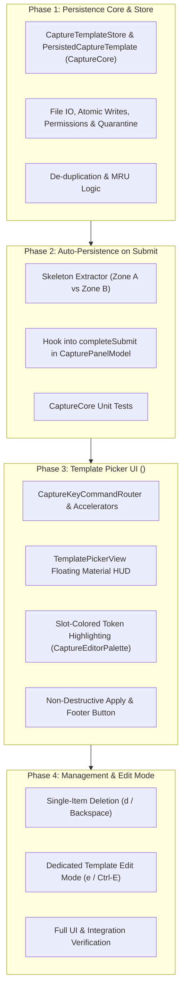

# Capture Template Persistence and Library Design in Bob Mac Capture

- **Date:** 2026-10-16
- **Researcher:** `research.1n.gem` (5-Researcher Swarm)
- **Target Components:** `bob-mac-capture` (`CapturePanelModel`, `CapturePanelView`, `CaptureKeyCommandRouter`, `CaptureCore`) and `bob-cli` (`capture`, `capture-parse`, `capture_language::template`)
- **Context:** Following epic `bob-cli-7w` (Bulk capture templates `@@template:`)
- **Status:** Complete Research Report & Architectural Specification

---

## 1. Executive Summary

Following the landing of epic `bob-cli-7w`, the `bob` capture ecosystem supports **bulk templates** (`@@template:`), where a single typed draft defines a parent task and child structures with indexed placeholders (`{0}`, `{1}`, ...), followed by rows of values that expand into discrete capture items.

The user has proposed extending this system with automatic template persistence and an in-app template management library in `bob-mac-capture`, centered around the following concepts:
1. **Automatic Persistence on Use:** Automatically saving templates to disk when they are used.
2. **Access and Modification:** Allowing users to view and modify saved templates via a dedicated modal interface.
3. **Stash Parity:** Modeling the feature closely on the existing Canceled Draft Stash (`<ctrl+s>`), specifically proposing a new `<ctrl+t>` keymap and adopting a **"pop on select"** mechanic where selecting a template removes it from the store until the capture is submitted.

### Key Conclusions and Verdict

1. **Critique of "Pop on Select" — A Fatal Flaw:**
   Modeling template selection on the canceled draft stash's `pop` mechanic is a **critical anti-pattern** that introduces severe data-loss vulnerabilities. A draft stash is an ephemeral undo/recovery buffer for discarded work; a template is a durable, reusable stencil.
   - If a template is popped upon selection, and the user subsequently cancels the draft (`Esc`), closes the panel, switches applications, experiences an app crash, or hits a validation error, **the template is permanently erased from disk**.
   - Furthermore, popping templates couples template modification to vault capture execution: a user cannot fix a typo in a template or adjust a route without capturing dummy tasks into their live Obsidian vault.
   - **Recommendation:** Template selection must be **strictly non-destructive (Apply / Load)**. Templates must remain in the persistent library until explicitly deleted.

2. **The "Skeleton vs. Instantiated Draft" Boundary:**
   Persisting "the template" must save **only the template blueprint** (the `@@template:` header, pattern task line, and child bullet structures), **never the transient data rows**. Saving data rows pollutes the library with stale one-off values (e.g. past job URLs), introduces duplicate capture hazards, and forces manual row deletion upon every reuse.

3. **`<ctrl+t>` Keymap & Ergonomics:**
   `<ctrl+t>` (macOS KeyCode 17) is currently completely unmapped in `CaptureKeyCommandRouter` and provides natural mnemonic resonance ("Templates"). It should open a dedicated **Template Picker** modal. Because `@@template:` grammar mandates placement on line 1, `<ctrl+t>` should be guarded by `plainDraft.isEmpty` (or an explicit overwrite confirmation), identical to `<ctrl+s>`.

4. **Visual and Interaction Design:**
   The template picker must not be a plain text list. It should showcase the rich template semantics introduced in `bob-cli-7w`:
   - Rendering placeholders (`{0}`, `{1}`) with their **canonical slot hues** (orange, teal, pink, green, purple, brown) defined in `CaptureEditorPalette`.
   - Displaying metadata badges for target routes (e.g. `@job`), field counts, and usage counts.
   - Providing explicit key chords for **Non-destructive Apply** (`Return` / accelerator), **Delete** (`d` / `Backspace`), and a dedicated **Template Edit Mode** (`e` / `Ctrl-E`) that allows updating templates without polluting the vault.

5. **Architectural Placement & Thin-Client Policy:**
   In compliance with `decisions:mac-capture-is-a-thin-client`, Bob Mac Capture must remain a thin presentation client. The template library storage pattern should follow `FileCanceledDraftStashStore` and `RefsSnapshotStore` in `CaptureCore`, storing to `~/Library/Application Support/org.bobs.bob-mac-capture/capture-templates.json` with atomic writes, POSIX `0o600` permissions, and corrupt file quarantine.

---

## 2. Critique of the Proposed Plan

The user prompt requests an explicit critique: *"Is this a good idea? Would you take a different approach? Make any adjustments to the requirements that you think are justified but clearly call these out."*

Here is an analysis of each aspect of the proposed plan:

### 2.1 The "Pop on Select" Mechanic (The Fatal Anti-Pattern)

The user proposed:
> *"Just like with the stash, we should pop a template when it is selected (it will just get re-added when the capture is submitted if the template is used)."*

While this proposal arises from an intuitive desire for self-updating templates, it conflates two fundamentally different software engineering paradigms: **an undo/shelving stash** versus **a template library**.

```
PROPOSED "POP ON SELECT" LIFECYCLE (FRAGILE & DESTRUCTIVE):

  [ Disk Store ] ──( <ctrl+t> Select )──> POPPED (Deleted from disk!)
                                                │
                                                ▼
                                         [ Editor Draft ]
                                                │
                 ┌──────────────────────────────┴──────────────────────────────┐
                 ▼                                                             ▼
         User Submits Capture                                         User Cancels / Closes
                 │                                                             │
                 ▼                                                             ▼
     Re-added to Disk Store                                             PERMANENT DATA LOSS!
                                                                    (Template deleted forever)
```

#### Why "Pop on Select" Fails:

1. **Catastrophic Data Loss on Aborted Capture:**
   In real-world usage, capture panels are frequently opened and closed without submitting. If a user presses `<ctrl+t>`, selects their carefully crafted 5-field job application template, and then:
   - Presses `Escape` to look up information in another browser window;
   - Clicks outside the panel (auto-dismiss);
   - Experiences an OS sleep/wake, window server restart, or system power loss;
   - The template was deleted upon selection and was never submitted. **It is gone forever.**

2. **The `Ctrl+C` Conflict:**
   In `bob-mac-capture`, canceling an active draft with `Ctrl+C` pushes the draft into `CanceledDraftStash` (`<ctrl+s>`). If a popped template is canceled with `Ctrl+C`, it is shunted into the *draft stash*, stripped of its template identity, mixed with abandoned one-off drafts, and subject to eviction under the draft stash's FIFO capacity (default 10). It vanishes from `<ctrl+t>`.

3. **Submission Failures Leave State in Limbo:**
   If `bob capture` fails (for example, due to a duplicate block ID, an unmounted vault, or a syntax error in one of the rows), the draft is retained in the editor with an error banner. If the user decides to clear the editor to unblock their panel, the popped template is lost.

4. **The Modification Paradox (Vault Pollution):**
   The prompt specifies: *"We should then allow the user to access and modify the templates that have been saved in the bob-mac-capture app."*
   Under "pop on select", the only mechanism to re-save a template is to submit a capture (`completeSubmit`). Consequently:
   - To fix a typo in a template, or update a route from `@job_2025` to `@job_2026`, the user **must execute a real capture batch into their vault**.
   - You cannot modify a template without creating phantom tasks in your vault!

5. **Violation of Universal UX Conventions:**
   Across all personal knowledge management, IDE, and text expansion tools (Obsidian Templates, Raycast Snippets, TextExpander, GitHub Issue Templates, VS Code Snippets), templates are **blueprints**, not consumable tickets. You do not consume a rubber stamp by stamping ink onto paper.

#### The Adjusted Requirement:
- **Non-destructive Selection (Apply):** Selecting a template from `<ctrl+t>` copies the template blueprint into the editor. The template remains securely in the store on disk.
- **Explicit Modification:** Provide a dedicated **Template Edit Mode** (`e` / `Ctrl-E`) and single-entry **Delete** (`d` / `Backspace`).

---

### 2.2 What Gets Persisted: "Skeleton" vs. "Full Draft"

The proposal states:
> *"persisting templates to disk automatically when they are used... (it will just get re-added when the capture is submitted if the template is used)."*

When a user captures a bulk template, the raw draft contains two distinct zones:
```text
@@template:
Apply to {0}! @job_2026_apply_29:{1}    <── Zone A: Template Blueprint / Skeleton
- **URL**: {2}                          <── (Header + Pattern Lines + Children)

"Two Sigma" two-sigma https://twosigma.com   <── Zone B: Transient Row Data
"Jane Street" jane-street https://janestreet.com <── (One-off instance values)
```

If the persistence mechanism saves the entire raw draft (`Zone A + Zone B`):
1. **Stale Data Re-injection:** When the template is recalled 3 weeks later, the editor fills with old company names and URLs that were already captured. The user must highlight and delete the old rows before typing new ones.
2. **Double-Capture Hazard:** If a user forgets to delete the old rows and appends new rows, submitting the capture will either re-create the old tasks or fail loudly with a duplicate block ID error.
3. **Privacy and Hygiene:** Ephemeral URLs or sensitive notes remain permanently stored in the template file.

#### The Adjusted Requirement:
The persistence logic must extract **only Zone A (the Template Skeleton)**:
```text
@@template:
Apply to {0}! @job_2026_apply_29:{1}
- **URL**: {2}

```
When applied to an empty editor, this primes the panel perfectly: the syntax is valid, the placeholders are visible, and the cursor is automatically placed on the first row line (after the separator newline), ready for typing.

---

### 2.3 Automatic Persistence on Use: When and How

Is saving templates automatically upon capture a good idea?
- **Yes!** Automatic saving eliminates the cognitive load of having to manually invoke a "Save as Template" command before capturing. Bryan types an ad-hoc template, captures it, and it is automatically ready for reuse next time.
- **However, it requires strict de-duplication and ranking rules:**
  - **De-duplication:** If Bryan uses the "Job Apply" template 15 times over two weeks, the library must not accumulate 15 identical templates. It must match the normalized skeleton, update `lastUsedAt`, increment `useCount`, and move the template to the top of the Most Recently Used (MRU) list.
  - **Trigger Gate:** Persistence must occur **only upon verified capture success** (`CaptureCommandResponse.success`), never on dry-runs, syntax errors, or preview generation.

---

## 3. System Architecture & Component Interactions

### 3.1 Division of Responsibilities

Following `decisions:mac-capture-is-a-thin-client`, `bob-cli` is the sole authority on capture grammar, validation, and execution, while `bob-mac-capture` owns presentation and UI orchestration.

```
┌────────────────────────────────────────────────────────────────────────┐
│                          Bob Mac Capture                               │
│                                                                        │
│  ┌────────────────────────┐             ┌───────────────────────────┐  │
│  │   CapturePanelView     │             │    CapturePanelModel      │  │
│  │  - Template Picker HUD │ ◄─────────► │ - Template Library State  │  │
│  │  - Slot-colored tokens │             │ - Auto-save on submit     │  │
│  │  - Footer 'Templates'  │             │ - Editor priming & cursor │  │
│  └────────────────────────┘             └─────────────┬─────────────┘  │
│                                                       │                │
│                         ┌─────────────────────────────┴──────────┐     │
│                         ▼                                        ▼     │
│           ┌───────────────────────────┐            ┌────────────────┐  │
│           │ CaptureTemplateStore      │            │ BobProcess-    │  │
│           │ (CaptureCore)             │            │ Client         │  │
│           │ - JSON file in AppSupport │            │ (Subprocess)   │  │
│           │ - 0600 atomic file writes │            └───────┬────────┘  │
│           │ - MRU / De-duplication    │                    │           │
│           └───────────────────────────┘                    │           │
└────────────────────────────────────────────────────────────┼───────────┘
                                                             │
                                   bob capture / capture-parse (JSON)
                                                             │
                                                             ▼
                                                ┌────────────────────────┐
                                                │        bob-cli         │
                                                │ - template.rs framing  │
                                                │ - CaptureParseTemplate │
                                                │ - Expansion & Vault    │
                                                └────────────────────────┘
```

### 3.2 Template Storage Location

We evaluated three potential storage locations:

| Location | Pros | Cons | Verdict |
| :--- | :--- | :--- | :--- |
| **A. Mac Application Support**<br>`~/Library/Application Support/org.bobs.bob-mac-capture/capture-templates.json` | - Fully aligns with `FileCanceledDraftStashStore` & `RefsSnapshotStore`<br>- Zero subprocess latency for picker<br>- Safe, isolated permissions (`0o600`) | - Templates are local to the Mac app; CLI `bob capture` cannot access them directly | **Recommended for v1** |
| **B. Bob Vault Directory**<br>`~/bob/_templates/capture/` or `~/bob/.bob/templates.json` | - Syncs across machines via Obsidian / git | - Violates `decisions:mac-capture-is-a-thin-client` ("the app never reads the vault")<br>- Requires vault writes outside `bob capture` | **Rejected** |
| **C. Shared CLI Config**<br>`~/.config/bob/capture-templates.json` (managed via `bob`) | - Shared across Mac App, terminal CLI, Raycast, and scripts | - Requires new `bob` CLI subcommands (`bob template list/save/delete`) and subprocess calls for modal display | **Recommended as v2 evolution** |

By implementing `CaptureTemplateStoring` in `CaptureCore` as a Swift protocol backed by `FileCaptureTemplateStore`, v1 can launch with zero new CLI dependencies, and can seamlessly migrate to a CLI-backed store later if multi-client sharing is desired.

---

## 4. Detailed UX & Visual Design: Intuitive, Reliable, and Beautiful

To make this feature feel truly designed rather than merely functional, the template interface must honor the high visual standards of Bob Mac Capture.

### 4.1 The Template Picker HUD (`<ctrl+t>`)

Pressing `<ctrl+t>` when the editor is empty displays the **Template Picker HUD**, rendered using SwiftUI floating materials matching the existing Stash and Autocomplete pickers:

```
┌────────────────────────────────────────────────────────────────────────────────────────┐
│  Templates (4)                                                           esc Dismiss  │
├────────────────────────────────────────────────────────────────────────────────────────┤
│  [1]  Apply to {0}! @job_2026_apply_29:{1}                                             │
│       - **URL**: {2}                                                                   │
│       @job_2026_apply_29 · 3 fields · Used 14x · 2h ago                                │
├────────────────────────────────────────────────────────────────────────────────────────┤
│  [2]  Review paper: {0} @papers:{1}                                                    │
│       - **ArXiv**: https://arxiv.org/abs/{2}                                           │
│       - **Code**: {3}                                                                  │
│       @papers · 4 fields · Used 6x · 3d ago                                            │
├────────────────────────────────────────────────────────────────────────────────────────┤
│  [3]  Bug: {0} @proj_core^{1}                                                          │
│       - **Repro**: {2}                                                                 │
│       @proj_core · 3 fields · Used 2x · Oct 10                                         │
├────────────────────────────────────────────────────────────────────────────────────────┤
│  [4]  Meeting sync: 1:1 with {0} @agenda:{1}                                           │
│       @agenda · 2 fields · Used 1x · Oct 4                                             │
├────────────────────────────────────────────────────────────────────────────────────────┤
│  ↵ Apply Template   1-4 Quick Select   d Delete   e Edit Template   ⇧D Clear All       │
└────────────────────────────────────────────────────────────────────────────────────────┘
```

#### Visual Styling Details:
1. **Slot-Colored Placeholders:**
   In row items, placeholders like `{0}`, `{1}`, `{2}` are highlighted using the **exact 6-hue palette** from `CaptureEditorPalette` (`field % 6`):
   - `{0}`: Orange (`.systemOrange`)
   - `{1}`: Teal (`.systemTeal`)
   - `{2}`: Pink (`.systemPink`)
   - `{3}`: Green (`.systemGreen`)
   - `{4}`: Purple (`.systemPurple`)
   - `{5}`: Brown (`.systemBrown`)
   This provides instantaneous visual recognition of placeholder patterns and arity before the template is even selected.

2. **Hierarchical Row Layout:**
   - **Line 1 (Bold / Monospaced):** The primary template task line (`Apply to {0}! @job:{1}`).
   - **Line 2 (Subdued / Indented):** Authored child bullet previews (`- **URL**: {2}`).
   - **Line 3 (Metadata Capsule Pills):** Target route pill, field count pill, and relative usage pill.

3. **Accelerators:**
   Single-character accelerators (`1`..`9`, `0`, `A`..`Z`) allow instantaneous 1-keystroke selection, identical to `CanceledDraftStash`.

---

### 4.2 Keymap Table and Interaction Matrix

| Context | Keystroke | Command | Action |
| :--- | :--- | :--- | :--- |
| **Capture Editor** | `Ctrl-T` | `toggleTemplatePicker` | Opens Template Picker (if draft is empty). If non-empty, announces: *"Clear or submit current draft before opening templates."* |
| **Capture Editor** | `Ctrl-S` | `toggleStashPicker` | Opens Canceled Draft Stash (unchanged). |
| **Capture Editor** | `Ctrl-C` | `stashDraftAndClose` | Cancels draft and stashes to draft stash (unchanged). |
| **Capture Editor** | `Return` | `submit` | Submits capture. If draft is a template, saves/updates skeleton in template store. |
| **Template Picker** | `Return` | `applySelectedTemplate` | Injects selected template skeleton into editor and focuses cursor. (Non-destructive). |
| **Template Picker** | `1`..`9`, `A`..`Z` | `applyTemplateByAccelerator` | Injects corresponding template immediately. |
| **Template Picker** | `↑` / `↓` / `⌃P` / `⌃N`| `selectPrevious` / `selectNext` | Navigates template list. |
| **Template Picker** | `d` / `Backspace` | `deleteSelectedTemplate` | Permanently deletes selected template from library. |
| **Template Picker** | `Shift-D` | `clearAllTemplates` | Clears all templates from library. |
| **Template Picker** | `e` / `Ctrl-E` | `beginEditingTemplate` | Opens template in **Template Edit Mode** (see §4.3). |
| **Template Picker** | `Esc` / `Ctrl-[` | `dismissTemplatePicker` | Closes picker and returns to clean editor. |

---

### 4.3 Template Modification: The "Template Edit Mode"

To allow users to modify templates **without polluting their vault with dummy capture tasks**, we introduce a lightweight **Template Edit Mode**:

1. In the Template Picker (`<ctrl+t>`), pressing `e` on a highlighted template enters **Template Edit Mode**.
2. The capture panel transforms slightly to communicate mode context:
   - An indigo/purple badge appears in the header: `Editing Template · [Template Name/Route]`.
   - The editor is populated with the template skeleton.
   - The preview pane displays a calm informational card: *"Template Definition · Press Return to save changes, Esc to discard."*
   - Capturing into the vault is disabled while in this mode.
3. The user edits placeholders, modifies child bullets, or adjusts the route.
4. Pressing `Return` saves the updated template skeleton back to `capture-templates.json` and closes the panel (or returns to the template picker) with status announcement: `"Template updated"`.
5. Pressing `Escape` discards edits without saving.

This elegant modal flow satisfies the prompt's requirement to *"access and modify the templates that have been saved"* with complete safety.

---

## 5. Technical Implementation Specification

### 5.1 Data Models (`CaptureCore`)

```swift
// Sources/CaptureCore/CaptureTemplateStore.swift

import Foundation

public struct PersistedCaptureTemplate: Codable, Equatable, Identifiable, Sendable {
    public let id: UUID
    public var skeleton: String            // Complete template definition (Zone A)
    public var primaryLine: String         // First pattern line (for search & preview)
    public var fieldCount: Int             // Number of placeholders {0}..{N-1}
    public var route: String?              // Detected route (e.g. "job_2026_apply_29")
    public var createdAt: Date
    public var lastUsedAt: Date
    public var useCount: Int
    public var customTitle: String?        // User-defined alias (optional)

    public init(
        id: UUID = UUID(),
        skeleton: String,
        primaryLine: String,
        fieldCount: Int,
        route: String? = nil,
        createdAt: Date = Date(),
        lastUsedAt: Date = Date(),
        useCount: Int = 1,
        customTitle: String? = nil
    ) {
        self.id = id
        self.skeleton = skeleton
        self.primaryLine = primaryLine
        self.fieldCount = fieldCount
        self.route = route
        self.createdAt = createdAt
        self.lastUsedAt = lastUsedAt
        self.useCount = useCount
        self.customTitle = customTitle
    }
}

public struct CaptureTemplateFile: Codable, Equatable, Sendable {
    public static let currentSchemaVersion = 1

    public let schemaVersion: Int
    public let templates: [PersistedCaptureTemplate]

    public init(
        schemaVersion: Int = CaptureTemplateFile.currentSchemaVersion,
        templates: [PersistedCaptureTemplate]
    ) {
        self.schemaVersion = schemaVersion
        self.templates = templates
    }
}

public protocol CaptureTemplateStoring: Sendable {
    func load() -> [PersistedCaptureTemplate]
    func save(_ templates: [PersistedCaptureTemplate])
}
```

### 5.2 Store Implementation (`FileCaptureTemplateStore`)

Following the exact file resilience and safety standards of `FileCanceledDraftStashStore`:
- Path: `~/Library/Application Support/org.bobs.bob-mac-capture/capture-templates.json`
- Permissions: `0o600` on file, `0o700` on parent directory
- Atomic writes via `Data.write(to:options: [.atomic])`
- Quarantine on corruption: moves unreadable files to `capture-templates.corrupt.json` and reports via `onError`.

```swift
public struct FileCaptureTemplateStore: CaptureTemplateStoring {
    public static let bundleIdentifier = "org.bobs.bob-mac-capture"
    public static let fileName = "capture-templates.json"
    public static let quarantineFileName = "capture-templates.corrupt.json"

    private let fileURL: URL
    private let fileManager: FileManager
    private let onError: @Sendable (String) -> Void

    public init(
        fileURL: URL,
        fileManager: FileManager = .default,
        onError: @escaping @Sendable (String) -> Void = { _ in }
    ) {
        self.fileURL = fileURL
        self.fileManager = fileManager
        self.onError = onError
    }

    public static func defaultFileURL(fileManager: FileManager = .default) throws -> URL {
        let support = try fileManager.url(
            for: .applicationSupportDirectory,
            in: .userDomainMask,
            appropriateFor: nil,
            create: false
        )
        return support
            .appendingPathComponent(bundleIdentifier, isDirectory: true)
            .appendingPathComponent(fileName, isDirectory: false)
    }

    public func load() -> [PersistedCaptureTemplate] {
        guard fileManager.fileExists(atPath: fileURL.path) else { return [] }
        do {
            let data = try Data(contentsOf: fileURL)
            let file = try JSONDecoder().decode(CaptureTemplateFile.self, from: data)
            guard file.schemaVersion == CaptureTemplateFile.currentSchemaVersion else {
                quarantineUnreadableFile()
                return []
            }
            return file.templates
        } catch {
            quarantineUnreadableFile()
            return []
        }
    }

    public func save(_ templates: [PersistedCaptureTemplate]) {
        guard !templates.isEmpty else {
            try? fileManager.removeItem(at: fileURL)
            return
        }
        do {
            let parentDir = fileURL.deletingLastPathComponent()
            try fileManager.createDirectory(at: parentDir, withIntermediateDirectories: true, attributes: [.posixPermissions: 0o700])
            let file = CaptureTemplateFile(templates: templates)
            let data = try JSONEncoder().encode(file)
            try data.write(to: fileURL, options: [.atomic])
            try fileManager.setAttributes([.posixPermissions: 0o600], ofItemAtPath: fileURL.path)
        } catch {
            onError("Capture templates not saved: \(error.localizedDescription)")
        }
    }

    private func quarantineUnreadableFile() {
        let quarantineURL = fileURL.deletingLastPathComponent().appendingPathComponent(Self.quarantineFileName)
        try? fileManager.removeItem(at: quarantineURL)
        try? fileManager.moveItem(at: fileURL, to: quarantineURL)
        onError("Capture templates unreadable; quarantined and started empty")
    }
}
```

### 5.3 Extraction and Auto-Persistence in `CapturePanelModel`

When a capture succeeds (`completeSubmit` in `CapturePanelModel.swift`), we check if the draft was a template:

```swift
// In CapturePanelModel.swift

private func autoPersistTemplateIfUsed(draft: String, success: CaptureCommandSuccess) {
    // Verified template draft check:
    guard success.template != nil || parsedTemplate != nil else { return }

    // Extract skeleton:
    guard let skeleton = extractTemplateSkeleton(from: draft) else { return }

    captureTemplateLibrary.recordTemplateUse(
        skeleton: skeleton,
        fieldCount: success.template?.fieldCount ?? parsedTemplate?.fieldCount ?? 0,
        route: success.globalDestination?.route
    )
}

/// Extracts Zone A (Header + Pattern lines + blank line separator)
private func extractTemplateSkeleton(from draft: String) -> String? {
    let lines = draft.components(separatedBy: .newlines)
    guard let firstLine = lines.first, firstLine.trimmingCharacters(in: .whitespaces) == "@@template:" else {
        return nil
    }

    var skeletonLines: [String] = [firstLine]
    var foundPattern = false

    for line in lines.dropFirst() {
        let trimmed = line.trimmingCharacters(in: .whitespaces)
        if trimmed.isEmpty {
            if foundPattern {
                // First blank line after pattern indicates end of skeleton
                break
            } else {
                continue // blank lines before pattern
            }
        }
        foundPattern = true
        skeletonLines.append(line)
    }

    guard foundPattern else { return nil }
    return skeletonLines.joined(separator: "\n") + "\n\n"
}
```

### 5.4 Applying a Template into the Editor

When the user selects a template from `<ctrl+t>`:

```swift
// In CapturePanelModel.swift

func applyTemplate(id: UUID) {
    guard let template = captureTemplateLibrary.template(id: id) else { return }

    dismissTemplatePicker()
    resetAnalysisState()

    let text = template.skeleton
    // Set text and position cursor at the end (line N+2, ready for rows):
    setPlainDraft(text, cursorUTF8Offset: text.utf8.count, suppressSelectionCallbacks: true)
    scheduleAnalysis(cursorUTF8Offset: text.utf8.count, requestCompletion: false, trigger: .edit)

    announceStatus("Loaded template: \(template.primaryLine)")
}
```

---

## 6. Verification and Testing Strategy

Following `bob-mac-capture/AGENTS.md` rules:
> *"Never land Swift you have not compiled, and never write a plan that tells an agent to skip compiling... On a host without Xcode, run `just portable-check`. If `swift` is missing, run it on a tailnet host that has Swift (athena)."*

The test suite must cover:

1. **`CaptureCoreTests` (Store & Persistence):**
   - Clean file save and reload cycle.
   - De-duplication: saving the same skeleton increments `useCount` and updates `lastUsedAt`.
   - Atomic file safety and POSIX permissions (`0o600`).
   - Quarantine of malformed or invalid schema JSON.
   - Deleting the last template deletes the on-disk file.

2. **`BobMacCaptureTests` (Model & Controller):**
   - `testSubmitTemplateCaptureAutoPersistsSkeletonWithoutRows`: Submit a full draft with 3 data rows; verify the store contains only the header and pattern lines.
   - `testTemplatePickerRequiresEmptyDraft`: Attempting `<ctrl+t>` with active text is blocked with announcement.
   - `testApplyTemplatePopulatesEditorAndPreservesLibrary`: Select template; verify editor receives skeleton and template remains in store (non-destructive).
   - `testDeleteTemplateFromPicker`: Delete single entry with `d`; verify store updates.
   - `testTemplateEditModeSavesWithoutCapture`: Enter edit mode, modify text, hit Return; verify store reflects change and no `bob capture` subprocess is spawned.

3. **Key Command Router Tests:**
   - Verify `<ctrl+t>` routes to `.toggleTemplatePicker`.
   - Verify accelerators `1`..`9` route to `.applyTemplate(index)`.
   - Verify `d` routes to `.deleteSelectedTemplate`.

---

## 7. Recommended Implementation Phases



### Phase Summary:
- **Phase 1 (CaptureCore Store):** `PersistedCaptureTemplate`, `CaptureTemplateStore`, file persistence, quarantine, and unit tests.
- **Phase 2 (Auto-Save on Submit):** Skeleton parser, wiring into `CapturePanelModel.completeSubmit`, and de-duplication tests.
- **Phase 3 (Template Picker UI):** Key routing for `<ctrl+t>`, floating picker view, slot hue formatting for `{0}`..`{N-1}`, and non-destructive apply.
- **Phase 4 (Management & Edit Mode):** In-picker single-item deletion (`d`), "Clear All" (`Shift-D`), and the dedicated Template Edit Mode (`e`) to allow modifying templates without vault pollution.

---

## 8. Summary of Adjustments to User Requirements

| Original Proposal | Identified Issue | Recommended Adjustment |
| :--- | :--- | :--- |
| **"Pop on select"** like the stash | Destructive to reusable templates; causes permanent data loss on cancellation, crash, or `Ctrl-C`. | **Non-destructive Apply:** Selecting loads template into editor; template remains safely in store. |
| Persist template upon use | If entire draft is saved, old data rows pollute future uses and cause double-capture errors. | **Skeleton-Only Persistence:** Save only Zone A (`@@template:` + pattern block + children). |
| Modify saved templates | Under "pop on select", modification requires submitting a capture batch, forcing fake tasks into the vault. | **Template Edit Mode (`e`):** Dedicated in-panel editor to tweak and save templates directly without vault writes. |
| `<ctrl+t>` keymap | Excellent proposal; needs collision check and state gating. | Implement on KeyCode 17; gate with `plainDraft.isEmpty` guard. |
| Stash-like management | Stash only supports "Clear All" (`Shift-D`) because it is a transient queue. | **Single-Item Deletion (`d`):** Library items need individual retirement when obsolete. |
