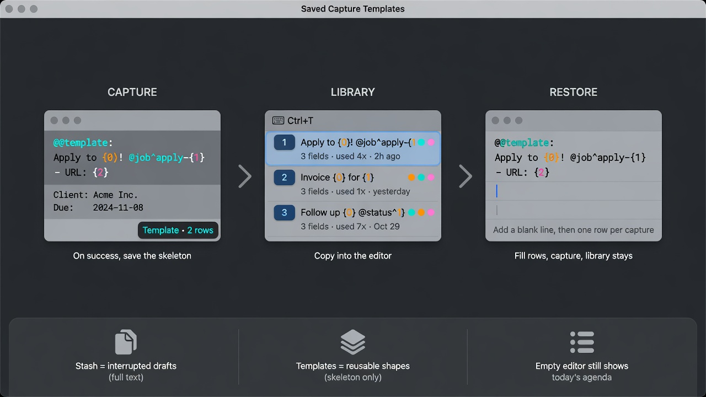

# Saved capture templates: a Mac skeleton library

*Researcher: grk · 2026-10-16 · independent swarm report (`__grk`)*

**Verdict.** Build it. Persist a **skeleton library** in Bob Mac Capture, with stash-like chrome and a Control-T picker. Treat the stated "pop on select, re-add on submit" rule as a checkout *feel*, and keep the library durable: restore **copies** the skeleton into the editor, and a successful template capture **upserts** it. Do not persist rows. Do not put this in the vault. Do not add a `bob capture` subcommand.



---

## 1. Recommendation in one page

Bulk templates shipped yesterday as epic `bob-cli-7w`. Saved / reusable templates were explicitly out of scope (`plan:202610/bulk_capture_templates.md` § Out of scope, item 5; merged research `research:202610/bulk_capture_template_drafts/bulk_capture_template_drafts.md` follow-up 5). The job-application wave that justified templates is still running: `job_2026_apply_29.md` still holds the repeating `Apply for <company>!` + URL-child shape. The vault contains zero `@@template:` strings, which is expected — templates live in the capture panel, and a successful capture currently **clears** the draft. The shape has to be retyped or recovered from the canceled-draft stash, and stash only helps if Bryan remembered to Control-C *before* Return.

**Do this:**

1. **Mac-owned JSON library**, sibling of the canceled-draft stash, at
   `~/Library/Application Support/org.bobs.bob-mac-capture/saved-templates.json`
   (directory mode 0700, file mode 0600, schemaVersion 1, quarantine on corrupt, empty file deleted).
2. **Save the skeleton only:** the `@@template:` header plus the template block (parent + authored children), canonicalized with one trailing blank line so the next keystroke is row 1. Rows stay out of the library. In-progress `template + rows` already belongs to the stash.
3. **Auto-save on successful template capture** in the Mac app. Snapshot the skeleton from bob's `capture-parse` `template` ranges at dispatch; persist only after bob reports success with a `template` summary. Upsert by fingerprint (normalized skeleton hash). Move the hit to index 0, bump `lastUsedAt` / `useCount`. LRU-trim to capacity (default 12, max 36, 0 disables).
4. **Control-T opens a picker** modeled on Control-S stash chrome: accelerators, arrows / Control-N/P, Return, Escape, mutually exclusive with the stash picker, refuses to open while the editor holds any characters. Footer button **Templates N** with SF Symbol `square.stack.3d.down.right` (already the `@@template:` completion glyph).
5. **Return copies** the skeleton into the empty editor, caret at UTF-8 end, starts analysis, leaves the library row in place, and remembers `activeTemplateId` on the session so a later save can update that entry. This is the justified replacement for stash's pop.
6. **Modify without capturing:** Control-Shift-T writes the current draft's skeleton when `parsedTemplate != nil`, including the calm `template_missing_rows` state. Updates `activeTemplateId` when set; otherwise upserts by fingerprint. Return still captures.
7. **Delete is explicit.** Backspace on the selected picker row removes one entry. Settings gets a confirmed **Clear Templates...**. The picker does **not** ship a Shift-D Delete All button — that chrome is for a junk drawer, and this is a library.
8. **Bob Mac Capture stays a thin client** (`decisions:mac-capture-is-a-thin-client`). The app never decides what a template is. It slices the submitted draft with `stringRange(in:byteRange:)` against bob's `header.range` and `template.range`. v1 needs **no** bob-cli command and **no** new `capture-*` sibling (`cli_rules.md`: nothing nests under `bob capture`; `capture-*` names grow additively).

**Do not do this:** pop-delete the only copy; persist filled rows; auto-insert the last template into an empty editor (that hides today's agenda, `decisions:idle-capture-shows-ledger-agenda`); write templates into vault notes; teach Swift the `@@template:` grammar; add `bob capture-templates`.

The full contract is [Recommended solution](#7-recommended-solution). Adjustments to the request are labeled **ADJ-1…ADJ-8**.

---

## 2. Is this a good idea?

**Yes.** The product gap is real, the analog is sitting in the panel already, and the cheap workarounds are the wrong shape.

### The repeating shape is still the daily motion

`job_2026_apply_29.md` ("Apply to 29 job openings!") still lists Next/In Progress apply tasks created 2026-10-14/15, each `Apply for <slug>!` with a URL child (`^apply-pydantic`, `^apply-voleon`, `^apply-close`, …). That is exactly the `@@template:` example in `docs/capture.md` § Bulk templates:

```text
@@template:
Apply to {0}! @job^apply-{1}
- **URL**: {2}

Foobar foo http://foobar.com/career/some_foo_job
"Two Sigma" two-sigma https://www.twosigma.com/careers/some_role
```

Wave 2 and wave 3 will reuse that parent line. Typing it again is the cost templates were built to remove; losing it on every successful Return puts the cost back.

### Successful capture currently throws the recipe away

`CapturePanelModel.completeSubmit` on `.success` does `setPlainDraft("")` and `parsedTemplate = nil`, then hides the panel. Reopening after success is a clean slate (README: the prior summary is cleared; a retained draft from Escape or failure reopens as left). The idle empty editor then shows today's Pomodoro agenda. There is no "last template" to come back to.

The canceled-draft stash does persist full drafts across Quit, but only for Control-C. A successful template capture never hits `stashDraftAndClose`. The only way to reuse a template *today* is to stash it *instead of* capturing, restore, capture, and lose it again — or to keep a side file. That is the hole.

### The original research already named this follow-up

Merged template research, follow-up 5: "Saved templates, as a snippet or a vault note, once the same template keeps coming back." The epic plan copied that as out of scope item 5. Land notes on `bob-cli-7w` confirm no phase filed it. This request is that follow-up, arriving one day after templates landed, which is the right time: the language is real, Mac presentation is real (`parsedTemplate`, slot colors, Template chip, calm `template_row` need), and Bryan can feel the missing reuse.

### Stash proves the chrome; it does not prove the semantics

Canceled-draft stash is a finished, well-tested pattern in this app:

| Piece | Stash fact |
| --- | --- |
| Key | Control-S opens; Control-C pushes and closes |
| Persistence | `canceled-draft-stash.json`, schemaVersion 1, 0700/0600, quarantine, empty deletes the file (`FileCanceledDraftStashStore`) |
| Capacity | default 10, max 36, 0 disables (`CanceledDraftStash`, Settings stepper) |
| Picker | newest first, 5 visible rows then scroll, one-key accelerators, Shift-D Delete All |
| Restore | pop: install text, remove that id, caret at UTF-8 end, panel stays open |
| Guard | refuse to open while the editor has any characters |
| Size | ~1,235 lines to add the picker (`77da370`) plus ~683 to persist it (`3bb1691`) |

Control-T can reuse that chrome. The *data* is a different type: stash entries are unique interrupted drafts (duplicates allowed, even identical text); saved templates are reusable recipes (duplicates are a bug).

### Empty-editor agenda makes "sticky last template" a bad substitute

A smaller idea — leave the skeleton in the editor after success, or auto-insert it on next show — collides with `decisions:idle-capture-shows-ledger-agenda`. After a successful capture the panel hides; the next show is an empty draft that is supposed to render Now / Next / Later. Auto-filling `@@template:` would hide that agenda without an explicit gesture. Control-T is the explicit gesture. The library and the agenda coexist the way stash and the agenda already do.

---

## 3. Critique of the stated plan

The intent is right: persist on use, retrieve from the Mac panel, give it a dedicated key, make it feel like stash. Several written requirements will ship a worse capture if taken literally.

### 3.1 Pop-on-select is the wrong analog for a recipe

Stash pop is correct because a canceled draft is *the work*. Restoring consumes it; Control-C puts it back; losing it on Discard is the point of Discard.

A saved template is *the recipe*. The request says the popped entry "will just get re-added when the capture is submitted if the template is used." That leaves a hole around every non-submit path that already exists in the panel:

| After popping a template | What happens today (if we clone stash) |
| --- | --- |
| Return, still a template | Re-added. Happy path. |
| Return, after Expand (`bob-cli-83`) or deleting the header | Library row is gone. |
| Escape / hide, draft retained | Recipe lives only in the retained draft. Control-T no longer lists it. |
| Control-C | Full draft goes to the *stash*. Library row is gone. |
| Discard | Recipe is gone. |
| Failed capture | Panel keeps the draft; library row is already gone. |
| Restore, then type a grocery list | Recipe is gone. |

That is an easy way to destroy the job-application template. Stash can survive this because the next Control-C recreates an entry. Templates will not, unless every dismissal grows a special re-queue path — at which point the implementation is copy-on-restore with extra failure modes.

**ADJ-1.** Restore **copies** the skeleton. The library row stays. Session state remembers `activeTemplateId` so Save / successful capture can update that row (modify-in-place) and move it to the top (MRU). If Bryan wants the checkout *feel*, v2 can dim the in-editor row; v1 should not delete it.

### 3.2 Persist the skeleton, not the used draft

"Automatically when they are used" is ambiguous between (a) the filled draft that was just captured and (b) the reusable shape. Saving (a) restores yesterday's companies, URLs, and slugs. The next wave then starts with a deletion chore. Saving (b) restores a blank form.

The stash already stores (a). If Bryan Control-Cs a half-filled template draft, restore brings header, body, *and* remaining rows. Duplicating that into a second store is how the two features blur.

**ADJ-2.** The saved object is the **skeleton**: header + template block + one trailing blank line. Rows are stripped using bob's parse ranges. Fingerprint ignores header case and line-ending noise so `@@TEMPLATE:` and `@@template:` collapse.

### 3.3 "View/modify" needs a save that does not capture

A restored skeleton is an incomplete template. `capture-parse` reports `needs: ["template_row"]` and `template_missing_rows` ("Add a blank line, then one row per capture"), which the Mac already treats as a **calm** status, never error red. Return is disabled in that state in the sense that a capture of a header-only draft fails. If the only write-back is "successful capture," Bryan cannot fix a typo in the parent line without also capturing at least one real item.

Stash has no in-picker editor either: you pop, edit, Control-C to put a *new* entry back. That is acceptable for junk drafts. It is a poor modify story for a library.

**ADJ-3.** Control-Shift-T saves the current skeleton whenever `parsedTemplate != nil`, including `template_missing_rows`. It does not submit, does not clear the draft, and does not hide the panel. Require at least one placeholder; refuse `template_invalid_placeholder` / gap / missing-separator errors with bob's diagnostic as the status.

### 3.4 Auto-save every success, with identity, or the library becomes a junk drawer

A one-row grocery `{0} @groceries` and a 12-row job wave would each add a row. Identical skeletons would stack the way stash stacks identical canceled drafts (`CanceledDraftStashTests` asserts two pushes of the same text stay two entries). For templates that is noise.

**ADJ-4.** Upsert by fingerprint. First success inserts; later successes bump `lastUsedAt` and `useCount` and move to index 0. Capacity LRU-drops from the tail. Default 12 (a bit above stash's 10, still inside the 36-accelerator cap). Do not wait for a second use — the job template should be waiting after wave 1.

### 3.5 Ownership: Mac-local, like stash, for v1

The thin-client decision says bob owns grammar, preview, and vault writes. Persistence of *draft text the user already typed* is already a Mac concern: stash never goes through bob. Saved templates are the same class, with one extra duty: **what to strip**. That duty is discharged by bob's existing `CaptureParseTemplate` (`header.range`, `range` for the block, `field_count`, `rows[]`). `stringRange(in:byteRange:)` already maps those UTF-8 ranges into Swift string indices for highlighting.

Putting the library in bob-cli would require a new noun (`bob templates`) or a new `capture-*` sibling. `cli_rules.md` forbids subcommands under `bob capture` and freezes `capture-*` protocol names as additive-only siblings. Vault notes would force the Mac to write the vault, which the thin-client decision forbids, and would collide with the existing zorg `template.md` / frontmatter `template: "[[new_project]]"` (already on `job_2026_apply_29.md`). Bryan captures on the Mac; apollo CLI capture of templates is not the motivating loop.

**ADJ-5.** v1 is Mac-only Application Support, parallel to stash. CLI auto-save and a bob-owned store are a follow-up. Do not use the vault.

### 3.6 Control-T is free, mnemonic, and worth stealing from transpose

`CaptureKeyCommandRouter` has no `KeyCode.t`. The README keyboard table has no Control-T. Repo-wide search finds no Control-T / Ctrl-T binding in bob-cli or Bob Mac Capture. NSTextView's default Control-T transposes characters; this panel already steals Control-A/E/U/J/K/S/C for capture motions, so stealing Control-T is in family. Completions, prompts, and the stash picker already consume Control-S; Control-T should layer the same way.

**ADJ-6.** Bind Control-T as requested. While the template picker is open, Control-T dismisses it (stash's Control-S pattern). Control-S and Control-T are mutually exclusive: opening one dismisses the other.

### 3.7 Delete-All chrome is wrong here

Stash's visible **Shift-D Delete All** exists because canceled drafts are residue and the 36-accelerator map had to reserve `D`. A template library that can be wiped with one chord will someday eat the job recipe. Settings already has a confirmed **Clear Stash...** for the non-modal case.

**ADJ-7.** No picker Delete All. Backspace (or a per-row delete) removes the selection. Settings **Clear Templates...** is confirmed. Accelerators can then use the full `1234567890ABCDEFGHIJKLMNOPQRSTUVWXYZ` set, including `D`.

### 3.8 "Used" means a successful Mac capture of a template draft

Dry-run, Expand (`bob capture -E`), header-only typing, and failed capture must not write the library. CLI `bob capture` of a template in v1 also does not write it (ADJ-5). The Mac success path already has the hook: `completeSubmit` + `success.template != nil` + the dispatch-time snapshot.

**ADJ-8.** Auto-save only after bob reports success with a template summary, using a skeleton snapshotted at `dispatchCapture` from the then-current `parsedTemplate` + draft. If parse ranges are missing, skip the save rather than regexing `@@template:`.

---

## 4. Alternatives considered

| Alternative | Why it loses |
| --- | --- |
| **Sticky skeleton after success** | Next show is supposed to be an empty agenda. Hiding Now/Next/Later behind `@@template:` without a keystroke breaks `idle-capture-shows-ledger-agenda`. |
| **Pop, re-queue on every dismiss** | Equivalent to copy-on-restore, plus a state machine for Escape / Control-C / Discard / Expand / failed submit. Easy to get a double-insert or a drop. |
| **Checked-out / dimmed row** | Beautiful pop-*feel* (one in-editor copy, row stays listed). Extra state. Save it for v2 if copy-on-restore feels too quiet. |
| **Persist the full used draft** | Restores stale rows. Duplicates stash. |
| **Vault note / `_zorg_templates`** | Mac would write the vault. Collides with zorg `template.md` and note frontmatter `template:`. Git noise for capture syntax. |
| **bob-cli data dir / `bob templates`** | Right long-term if CLI capture of templates becomes real. v1 needs a new noun, XDG path agreement, and a JSON contract, for a loop that happens in the panel. |
| **Named header `@@template:job`** | Currently `template_header_misplaced` ("write `@@template:` alone on the draft's first line"); the grammar reserved option-like headers. Naming is a later language change, not a picker requirement. Parent line is a good enough title. |
| **Snippet triggers (`job--` → skeleton)** | `CaptureSnippetResolver` today only maps `--` → em dash. Triggers are a different feature. Control-T is the requested retrieval. |
| **Wait for Expand (`bob-cli-83`) first** | Expand replaces the draft with instances; after that there is no template to save. Orthogonal, ready-sized feature. Do not gate the library on it. |
| **Auto-insert last template on empty editor** | Same agenda collision as sticky skeleton. Control-T is opt-in. |

---

## 5. What "beautiful" means in this panel

The stash picker is compact and keyboard-first: accelerator key-cap, monospaced first-line preview, relative age, material background, 5-row viewport. Templates should feel like a *designed sibling*, with one extra visual that stash cannot have: **slot color**.

The Mac already paints `{k}` and the k-th row field with `CaptureEditorPalette.templateSlotColor` — orange, teal, pink, green, purple, brown, `field % 6`. The picker should echo that so a three-field job template is recognizable before it is restored.

**Row anatomy (top to bottom inside each picker row):**

1. Accelerator key-cap (same 24×22 rounded rectangle as stash).
2. **Title:** the template's parent line, placeholders left intact, line-limit 1. Never lead with `@@template:` — every row would start the same.
3. **Slot dots:** `fieldCount` small circles in slot colors, capped at 6 then `+N`. Accessibility: "3 fields".
4. **Metadata:** `3 fields · used 4× · 2h ago` (reuse `CanceledDraftStash.relativeAgeDescription` against `lastUsedAt`). Child-bullet templates can append ` · 1 child` when the skeleton has authored children.

**Picker chrome:**

- Caption / accessibility: "Saved templates, N entries".
- Empty: status only, `"No saved templates yet. Capture with @@template: to save one."` Do not open an empty list. Match stash's "No canceled drafts yet".
- Restore copies, status `"Restored template"` (or `"Restored template · Apply to {0}!"` truncated). Analysis runs; the calm `template_missing_rows` status replaces the restore toast once parse returns, which is the correct next instruction.
- Selected row: accent fill at 0.18 / 0.32 increased contrast, same as stash.
- No red destructive footer. Backspace deletes the selection with status `"Template deleted"`.
- Height policy: clone `CanceledDraftStashPickerHeightPolicy` (5 visible rows, then scroll). Drop `actionChromeHeight` for the missing Delete All button, or keep a slim hint row `↩ restore · ⌫ delete · esc close`.

**Footer:** `Templates N` to the left of `Stash N`, same control size, `square.stack.3d.down.right`. Help text: "Restore a saved bulk template (Control-T)." Disabled while submitting, while an inline prompt is up, and while a completion/task picker is up — same as Stash.

**After restore:** the Template chip is absent until rows exist (parse has `template` but dry-run is skipped while `template_row` is needed). Slot colors on `{0}` `{1}` `{2}` immediately prove the restore worked. Caret sits on the blank row line. Ctrl-J already inserts a plain newline in template drafts (`parsedTemplate != nil`), so the first row does not grow a stray `- `.

**Save feedback:** auto-save on capture is **silent**. The success notification and "Captured N items" already own the status line; a second toast would fight them. The Templates count incrementing is the tell. Control-Shift-T (explicit save) *does* announce `"Template saved"`.

**Settings:** new section **Saved Templates** under Canceled Draft Stash: capacity stepper 0…36, retained count, confirmed Clear. Copy the stash wording about disk, mode bits, and capacity 0 deleting the file.

This is how the feature stays in the family of the panel (material picker, accelerators, refuse-if-dirty-editor) while reading as a library instead of a trash stack.

---

## 6. Data model and extraction

```json
{
  "schemaVersion": 1,
  "templates": [
    {
      "id": "UUID",
      "skeleton": "@@template:\nApply to {0}! @job^apply-{1}\n- **URL**: {2}\n\n",
      "parentLine": "Apply to {0}! @job^apply-{1}",
      "fieldCount": 3,
      "createdAt": 1760000000,
      "lastUsedAt": 1760000500,
      "useCount": 4
    }
  ]
}
```

- **Order:** most-recently-used first (index 0), like stash's newest-first.
- **Dates:** seconds since 1970, same encoder as stash.
- **`skeleton`:** exactly what restore writes. Always ends in a blank line.
- **`parentLine`:** first nonblank line of the template block, for the picker title. Derived at save time so the picker does not parse.
- **`fieldCount`:** from bob's parse, for slot dots. 0 is never saved.
- **Fingerprint (not stored):** SHA-256 of `normalize(skeleton)` where normalize lowercases the header token to `@@template:`, rewrites CRLF/CR to LF, and rtrims each template-block line. Used only to upsert.
- **`activeTemplateId`:** in-memory on `CapturePanelModel`, set on restore and on explicit save of a new id, cleared on discard, successful non-template capture, and `prepareForPresentation` of an empty editor.

**Extraction (thin client):**

At `dispatchCapture`, if `parsedTemplate` is non-nil and `fieldCount >= 1`:

1. Slice `draft` with `header.range.start ..< block.range.end` via `stringRange(in:byteRange:)`.
2. If the header slice is empty or the range is invalid, skip (do not guess).
3. Append a trailing `\n\n` if the slice does not already end with a blank line.
4. Hold that snapshot beside `requestID`.
5. In `completeSubmit` `.success`, if `success.template != nil` and the snapshot's requestID matches, `library.record(snapshot)`.
6. `record` upserts by fingerprint; if `activeTemplateId` points at a different fingerprint (user edited the body), **update that id's skeleton** (this is modify) and re-fingerprint. Then move to front.

Do not extract from `success.template` alone — execution JSON currently has only `line`, `field_count`, `row_count` (`CaptureTemplateSummary`). Adding `skeleton` there is a nice additive follow-up; v1 does not need it.

**When not to save:** `fieldCount == 0`; parse missing; success without `template`; dry-run; Expand; Go To (`/`) drafts (those already skip stash).

---

## 7. Recommended solution

### 7.1 Gestures

| Key | Editor | Template picker open | Stash picker open | Prompts / completion |
| --- | --- | --- | --- | --- |
| Control-T | Open templates if editor empty and library nonempty; else status | Dismiss picker | Dismiss stash, open templates if editor empty | Consume, like Control-S |
| Control-Shift-T | Save skeleton if `parsedTemplate != nil`; else ignore | Consume | Consume | Consume |
| Control-S | Unchanged (stash) | Dismiss templates, open stash if editor empty | Unchanged | Unchanged |
| Return | Unchanged (capture) | Restore selected (copy) | Restore selected (pop) | Unchanged |
| 1–9, 0, A–Z | Unchanged | Restore that row | Unchanged (stash map) | Unchanged |
| Backspace | Unchanged | Delete selected template | Unchanged | Unchanged |
| Down / Control-N | Unchanged | Next row, wrap | Unchanged | Unchanged |
| Up / Control-P | Unchanged | Previous row, wrap | Unchanged | Unchanged |
| Escape / Control-[ | Unchanged | Dismiss picker only | Unchanged | Unchanged |

Opening the picker while the editor is nonempty: `"Capture, retain, or cancel the current draft before opening templates"` — same sentence shape as stash. Opening an empty library: `"No saved templates yet"`. Inline prompts and the task picker still block, with the same "finish or cancel …" statuses.

Restore requires an empty editor (belt and braces if a click arrives while dirty). It calls `setPlainDraft(skeleton, cursorUTF8Offset: skeleton.utf8.count, suppressSelectionCallbacks: true)` and `scheduleAnalysis(..., requestCompletion: false)`, matching stash restore, then sets `activeTemplateId`.

### 7.2 Module layout (mirror stash, do not generalize yet)

Resist merging stash and templates into one "stack picker" type. They share chrome and diverge on pop vs copy, Delete All, capacity semantics, and preview. Copy the files:

| Stash | Templates |
| --- | --- |
| `CanceledDraftStash.swift` | `SavedCaptureTemplateLibrary.swift` |
| `CanceledDraftStashStore.swift` (CaptureCore) | `SavedCaptureTemplateStore.swift` (CaptureCore) |
| `CanceledDraftStashPicker` in `CapturePanelView.swift` | `SavedCaptureTemplatePicker` beside it |
| `CaptureKeyCommand.toggleStashPicker` | `toggleTemplatePicker` + `saveCurrentTemplate` + `restoreSelectedTemplate` + `deleteSelectedTemplate` |
| Settings "Canceled Draft Stash" | Settings "Saved Templates" |
| AppDelegate `canceledDraftStash` | `savedTemplateLibrary` |

`AuxiliarySection` gains `.templates`. Height policy can start as a copy of the stash policy with `actionChromeHeight` reduced.

Wire auto-save in `dispatchCapture` / `completeSubmit` only. Do not save from `applyParse`.

### 7.3 Tests (the stash suite is the checklist)

Port the stash tests' shape:

- Library: insert, upsert-by-fingerprint, update-via-active-id, LRU trim, capacity 0 disables, accelerators include D, preview/parentLine helper, relative age.
- Store: load/save, schema mismatch quarantines, empty deletes file, 0600/0700, `swift test` construction does not create Application Support (same comment as stash store).
- Panel model: successful template capture records a skeleton without rows; second capture of the same skeleton does not duplicate; Control-T refuses nonempty editor; restore copies and keeps the row; restore caret at end; Backspace deletes; Control-Shift-T saves incomplete template; Control-Shift-T on a restored-then-edited body updates the same id; Expand-then-capture does not save; non-template capture does not save; stash and template pickers dismiss each other; digits while template picker is open do not hit close-comma assist (extend `CaptureCloseTaskCommaTests` the way stash already does).
- Key router: Control-T → toggle; Control-Shift-T → save; Control-T while stash open → switch; completion-visible Control-T still toggles (Control-S does).
- Render fixture (light/dark) of a three-slot picker row, so slot dots cannot drift from `CaptureEditorPalette`.

`just portable-check` on athena; scratch-copy `bundle.sh` + `just typecheck-tests` on the Mac per `bob-mac-capture/AGENTS.md`.

### 7.4 Docs

README: required-bob-features (none new — older bob simply never yields `parsedTemplate`, so auto-save never fires); keyboard table rows for Control-T and Control-Shift-T; picker key table; Privacy bullet parallel to stash (templates can hold routes and ID *patterns*; same 0700/0600; never UserDefaults / notifications / signposts); Settings; footer. `docs/capture.md` § Bulk templates gets one short "Bob Mac Capture saves the skeleton after a successful template capture; Control-T restores it" pointer, so CLI readers know the library is Mac-side.

### 7.5 Phases

| Phase | Where | What | Size |
| --- | --- | --- | --- |
| 1. Store + auto-save | bob-mac-capture | Library + file store + dispatch snapshot + completeSubmit record + tests | medium |
| 2. Picker + Control-T | bob-mac-capture | Key router, panel model, picker view, footer, mutual exclusion with stash, restore copy | medium |
| 3. Modify / delete / settings | bob-mac-capture | Control-Shift-T, Backspace delete, Settings, README, Privacy | small |
| 4. Polish | bob-mac-capture | Slot dots, empty-state wording, render fixtures, light/dark | small |

No bob-cli phase in v1. Estimate: on the order of the stash feature (picker ~1.2k lines, persist ~0.7k), slightly more for slot-dot UI and the save-without-capture path. Entirely gated by macOS CI / Mac compile rules.

Related ready tasks stay independent: `bob-cli-82` (decisions strand for templates-as-expansion) and `bob-cli-83` (Expand action). This feature does not need either. Expand should remain unbound until its own pass; do not spend Control-T on it.

---

## 8. Risks

1. **Stale parse at submit.** If the user hits Return before the latest `capture-parse` returns, the snapshot might describe the previous draft. Mitigate by snapshotting the *submitted* `draft` string with the latest `parsedTemplate` only when `plainDraft` equals the parse input the model last applied (`completionDraftSnapshot` / parse generation). If they disagree, skip auto-save; Control-Shift-T still works on the next parse. Do not slice a mismatched draft.

2. **One-off pollution.** LRU + capacity 12 is the valve. If it still clutters, a later pin (dot on the key-cap, never LRU-evicted) is enough. Do not add pin in v1.

3. **Privacy.** Skeletons include project routes and ID patterns (`@job^apply-{1}`). Treat them like stash text: 0600, no logs, quarantine file can also hold text, Clear deletes both files. README Privacy section must name the new file.

4. **Ctrl-T vs type-ahead in the picker.** Stash uses bare characters as accelerators, so you cannot filter-type. That is correct for ≤36 recipes. Do not add a filter field in v1; the parent-line titles plus slot dots are the scan.

5. **Two libraries in Application Support.** Uninstall (`rm -rf …/org.bobs.bob-mac-capture`) already wipes stash; it will wipe templates too. Document that in the README uninstall snippet.

6. **Older bob.** No `template` object → no auto-save, no Control-Shift-T (disabled when `parsedTemplate == nil`), picker can still restore previously saved skeletons. Restoration does not need bob until analysis runs; an old bob will then red-underline `@@template:` as `invalid_global_destination`. Status should teach "this Bob cannot run templates" if parse returns that code on a restored skeleton. Acceptable; the required-bob-features list already covers templates.

---

## 9. Follow-ups (not v1)

1. **Checked-out dimmed row** — pop-*feel* without deletion.
2. **Additive `template.skeleton` on capture success JSON** — lets CLI persist later and removes the Mac slice.
3. **bob-owned library** (`~/.config/bob/capture-templates.json` or XDG data) if shell `bob capture` of templates becomes a habit. New noun, never a `bob capture` subcommand.
4. **Named headers** `@@template:job` — currently reserved/misplaced. Would give picker titles independent of the parent line.
5. **`{N|slug}`** — still the highest-value *language* follow-up from the original template research; it shrinks the job rows. Independent of this library.
6. **Pin** so LRU cannot drop the job template.
7. **bob-cli-83 Expand** — inspect instances in place; save *before* expanding if the skeleton should be kept.

---

## 10. Open questions for Bryan

1. **Copy-on-restore (ADJ-1) vs true pop.** I am overriding the request here because pop plus "re-add on submit" loses the recipe on Escape / Control-C / Discard / Expand. If you want the checkout feel anyway, say so and we dim the in-editor row in v1 instead of deleting it.
2. **Default capacity 12?** Stash is 10. 12 still fits one screen-and-a-bit (5 visible + scroll).
3. **Control-Shift-T for save-without-capture (ADJ-3).** Needed for "modify". If you would rather have modify mean "restore, add a dummy row, capture, delete the dummy task," we can drop the extra chord — I do not recommend that.
4. **Silent auto-save.** Count on the footer vs a status toast on first insert only.

---

## 11. Evidence index

| Claim | Source |
| --- | --- |
| Saved templates were out of scope for v1 templates | `plan:202610/bulk_capture_templates.md` § Out of scope #5; `research:202610/bulk_capture_template_drafts/bulk_capture_template_drafts.md` follow-up 5; `bob-cli-7w` land note #2 |
| `capture(D) ≡ capture(expand(D))`; Mac is a thin client | `docs/capture.md` § Bulk templates; `decisions:mac-capture-is-a-thin-client`; `src/native/capture_language/template.rs` |
| Parse already exposes header + block ranges | `CaptureParseTemplate` in `Sources/CaptureCore/CaptureModels.swift`; UTF-8 slice helper `stringRange(in:byteRange:)` |
| Success JSON has no skeleton text | `CaptureTemplateSummary` (`line`, `field_count`, `row_count`) |
| Submit clears the draft | `CapturePanelModel.completeSubmit` `.success` → `setPlainDraft("")`, `parsedTemplate = nil` |
| Stash pop / persist / privacy / keys | `CanceledDraftStash.swift`, `CanceledDraftStashStore.swift`, README Keyboard + Privacy; commits `77da370`, `3bb1691` |
| Control-T unbound | `CaptureKeyCommandRouter` key codes; README keyboard table; repo search |
| Empty editor shows agenda | `decisions:idle-capture-shows-ledger-agenda`; README idle-agenda section |
| CLI nesting rules | `sase/memory/cli_rules.md` |
| Job shape still repeating | `~/bob/job_2026_apply_29.md` Tasks; vault `rg` finds zero `@@template:` |
| Calm missing-rows state | `pickerNeed` / `template_row`; README template presentation |
| Expand is a separate ready feature | `bob-cli-83` |
| Template completion glyph | `CompletionRowContent.swift` `square.stack.3d.down.right` |
| Slot palette | `CaptureEditorPalette.templateSlotColors` |
| Ctrl-J already template-aware | `CapturePanelController` `parsedTemplate != nil` → plain newline |
| Named `@@template:…` currently an error | `docs/capture.md` `template_header_misplaced` |

---

## 12. Bottom line, restated

Ship a **saved-template library** in Bob Mac Capture, stash-shaped and skeleton-only.

- Auto-save the template block when a template capture succeeds.
- Control-T lists them; Return copies one into the empty editor.
- Control-Shift-T saves edits without capturing.
- Backspace deletes one; Settings clears all.
- Leave rows to the stash, leave grammar to bob, leave the empty editor to today's agenda.

That is the version of the request I would implement.
