# Copy-mode targeting for code blocks

- **Date:** 2026-10-26
- **Researcher:** `grk` (swarm `research.5b`)
- **Question:** How should Bob Refs copy mode (`⌘Y`) grow a way to copy the *source* of a code block from a Markdown-originated Highlights PDF, and should Highlights itself gain a `⌘Y` that opens that card on the current document?
- **Verdict in one line:** Yes, ship it — keep the exact pre-diagram-swap Markdown beside the PDF as `lib/<type>/<stem>.source.md`, have `bob ref show` project parsed fences, and add a nested `C` picker that mirrors `H`; Highlights `⌘Y` is a fifth frontmost takeover, not a patch inside Highlights.app.

---

## 1. Recommendation

Keep the bytes pandoc actually saw — the Markdown *before* Mermaid fences become figures — as a same-directory companion of the PDF:

```text
lib/<type>/<stem>.pdf
lib/<type>/<stem>.source.md
lib/<type>/<stem>.source.json   # optional page index, written at create
```

Intake stages the same pair under `xlib/`. The reference note gains `source_markdown: "[[lib/<type>/<stem>.source.md]]"`, parallel to `source_pdf`. `bob ref show` parses those fences and adds additive JSON (`code_blocks`, `source_markdown`). Schema version stays **1**. Bob Mac Capture never parses Markdown.

The Copy card grows one letter: **`C`**, unused in today's frozen catalog (`I T W U L X D N O P F R S A H 1–9`). `C` opens a nested picker cloned from `H`. Return copies the selected block's **raw fence body**. Option copies the **fenced Markdown** (language tag included). `C` is hidden when there is no companion or no fence, with the same "rows that do not apply are hidden" contract as `X`/`D`/`H`.

Highlights `⌘Y` is **not** a keymap we install in Highlights.app. It is a Carbon takeover while Highlights is frontmost, the same family as `⌘O` (open Refs) and `⌘T` (Tabs). It selects the current PDF from the existing Accessibility window title (`name.pdf – Page 5 of 25`), opens the Copy card, and — when that page has a mapped code block — lands already inside the `C` picker with the nearest block selected. A successful copy already hides Refs and shows the glass HUD; a Capture draft underneath returns ready for `⌘V`. That is the beautiful loop.

Existing Markdown-originated PDFs without a companion hide `C` honestly. Recapture writes the companion going forward. Do not reconstruct from the live `source_note`, and do not scrape the PDF text layer.

---

## 2. Critique of the original plan

The original plan is the right *job* with three wrong *sources* waiting in the wings, and one wording trap about Highlights.

What is right:

- Copying a code block you are staring at is a real gap. Highlights Smart Copy (`⌥⌘C`, documented 2021.1.2) copies annotations and OCR/tables. Selecting wrapped verbatim in the PDF copies the *rendered* dump: `fvextra` `breaklines,breakanywhere` on every pandoc `Highlighting` environment (`create.rs` `PANDOC_HEADER_INCLUDES`). Mermaid fences are figures, not source (`diagrams.rs` swap filter).
- Scope to Markdown→PDF via `bob ref create` (ordinary `.md`, vault-note snapshots, and `-M/--plain`) is the honest product. Papers, arXiv, web articles, and stamped local PDFs have no Markdown to recover.
- Keeping the original Markdown nearby is independently valuable. Listen already passes `projected.md` as `{target}`. `BOB_HIGHLIGHTS_KEEP_WORKDIR=1` is a debug-only scratch. Recapture, doctor, and this copy path all want a durable snapshot.
- Beauty belongs in the brief. The Copy card is already a glass overlay with letter accelerators, live previews, Option alternates, and a nested `H` picker. Code copy should join that family, not invent a second panel.

What is wrong, and should change:

| Original requirement | Problem | Adjustment |
| --- | --- | --- |
| "We might read the PDF directly" | Pandoc emits every fence as `Highlighting` + `breaklines,breakanywhere`. Mermaid is swapped to a vector figure before XeLaTeX. Ligatures are already off; wrapping still splits tokens and inserts breaks. A text-layer copy is a *different document*. | **Never extract code from the PDF.** Hide `C` when the companion is missing. |
| "Copy the markdown files nearby" as `{stem}.md` beside `{stem}.pdf` | `docs/highlights-ref-sync.md`: a same-stem Markdown file beside a target PDF is **always refused** because Highlights would treat it as the annotation sidecar. Discovery is exact: `foo.pdf` → `foo.md`, else `foo.textbundle`. | Companion is **`{stem}.source.md`**, never `{stem}.md`. |
| Live vault note / `source_note` as fallback | `source_note` is live provenance. Vault snapshots date the stem (`<note>_<YYMMDD>`), drop the title H1, condense logs, subset with `-S`, and restore closed tasks only with `-C`. The live note can drift the same afternoon. | Companion is the **render-input snapshot**. Do not copy from the live note in v1. |
| "Add a `⌘Y` keymap to the Highlights app" | We do not ship Highlights.app. The working pattern is `HighlightsTakeover`: Carbon hotkeys while Highlights (or the Settings override bundle) is frontmost. `⌘O` / `⌘T` already do this. | Fifth takeover, **`refsHighlightsCopy`**, default `⌘Y`, Off-able. |
| Auto-enter code copy from every `⌘Y` | In-panel `⌘Y` is the identity catalog (wiki link, PDF, notes). Diving into code every time punishes the common copy. | Auto-enter the `C` picker **only** from the Highlights takeover, and only when the current page has a mapped block. |
| Embed the Markdown in the PDF | `decisions:open-pdf-writes-are-coordinated`: marker writes are a bounded `.forMerging` sequence around the whole per-PDF write. Attachments change bytes, hashes, and reload behaviour. Highlights does not expose PDF attachments to Refs. | Companion files beside the PDF. Never mutate PDF bytes for this feature. |

The idea is a good idea. Shipping a PDF scraper, a same-stem `.md`, or a live-note fallback would be a bad implementation of it.

### Would I take a different approach?

Four alternatives I considered and rejected as the *primary* design:

1. **Select-and-copy in Highlights, then a Bob formatter.** Smart Copy and ordinary `⌘C` already exist. They copy the wrapped text layer. Bob cannot un-wrap a `breakanywhere` dump into the original fence. The companion *is* the formatter's input.
2. **A new top-level "Code" panel.** A second overlay next to Copy, Rename, and Link-to-Today splits a verb the user already knows as `⌘Y`. Nested `C` is how `H` already overflowed a full highlight list.
3. **Immediate copy of "the" code block on `⌘Y`.** Fastest for a one-block page, undiscoverable when the page has two, and it trains "Y always copies one secret default" — the same trap the original yank-card research rejected for wiki links.
4. **Put the snapshot under `ref/<type>/` or `ref/<type>/<stem>.assets/`.** `DefaultTargetOccupancy` walks every `.md` under `ref/` as a reference id. A sibling `.md` without `type: "[[ref]]"` is still occupancy and a Dataview surprise. Image notes already own `ref/<type>/<stem>.assets/`. Keep the snapshot next to the PDF, with the other library companions.

Companion I *would* take, as a later extra, not a replacement: **`M` copies the whole source file** (a `fileURL`, like `F` for the PDF). Not v1.

---

## 3. What exists today (verified)

### 3.1 Copy card

`docs/reference/mac-capture/refs.md` §Copy card, `RefsCopy.swift`, `RefsHighlightPicker.swift`, `RefsCopyCardView.swift`:

- `⌘Y` opens an in-panel card for the selected available row (`RefsKeyRouter` → `.showCopyCard` → `openCopyCard()`).
- Fixed letters copy identity, sources, files, and notes. Missing rows hide without moving keys.
- `1`–`9` copy visible commented highlights; `A` copies all notes; `H` opens a picker over every highlight and standalone note.
- The picker windows at most 9 entry rows, scrolls to keep the selection visible, draws non-selectable group titles when sections exist, and treats Option as "quote only".
- Escape from the picker returns to the card; Escape from the card returns to the inspector.
- Return or `⌘Y` on the catalog copies the selected row (marker ID when present, otherwise wiki link).
- A successful pasteboard write **hides Refs** and shows a glass HUD. A Capture draft underneath returns ready for `⌘V`.
- Notes load through `bob ref show` (`schema_version` 1). `RefsShowRow` uses `decodeIfPresent`; unknown fields are ignored. An older bob still opens the card; `H`/`1–9` simply stay hidden.

`C` is not in `RefsCopyKey`. Adding it is a closed-catalog extension, not a new card.

### 3.2 Markdown → PDF

`docs/highlights-create.md`, `create.rs`, `diagrams.rs`, `note_snapshot/profile.rs`:

| Route | What pandoc sees | Default `ref` type |
| --- | --- | --- |
| External `.md` | The file, after Mermaid swap | `chat` |
| Vault-note snapshot | Projected Markdown (`projected.md`) | `notes` |
| Vault-note `-M/--plain` | Original note bytes, same parent/naming/`source_note` | `notes` |

Both Markdown PDF routes:

- `--highlight-style=tango`
- `Highlighting` verbatim wrapped with `breaklines,breakanywhere`
- Mermaid fences collected, rendered, and **swapped for figures** before XeLaTeX (Mermaid 12.2.0, offline). Untagged `flowchart` source stays a code block on purpose.
- Note snapshots and research-report PDFs use a clean text layer (ragged right, no hyphenation, `Ligatures=NoCommon`) so Highlights quotes stay free of hyphen splits. That helps *quotes*. It does not preserve code.

Create-time intake moves the PDF and same-stem companions from `xlib/` to `lib/` under `bob_sync.lock` then `scan.lock`. `xlib/` is gitignored (`docs/obsidian-sync-exclusions.md`); `lib/` is vault-tracked. A companion that rides intake will be committed with the PDF after drain.

The original Markdown is **not** installed today. `BOB_HIGHLIGHTS_KEEP_WORKDIR=1` keeps scratch `projected.md` / TeX / logs for debugging and is not a library artifact.

### 3.3 Sidecars, occupancy, rename

Highlights sidecar discovery (`sidecar.rs` `discover_sidecar_path`):

1. `{stem}.md` if it is a file
2. else `{stem}.textbundle/` containing `text.md` or `text.markdown`

`DefaultTargetOccupancy` (`stamp.rs`) reserves, per stem, across `ref/`, `lib/`, and `xlib/`: `pdf`, `md`, `textbundle`, known audio extensions, and `{stem}.assets`. It does **not** reserve `{stem}.source.md`.

`bob ref rename` `MoveKind` is `Note | Pdf | Sidecar | Audio`. `build_bundle` moves `{stem}.md` and `{stem}.textbundle` beside the PDF, plus audio. `{stem}.source.md` would be left behind unless rename grows a kind.

Create already refuses a same-stem `.md` beside `--output` "because Highlights would interpret it as a sidecar" (`docs/highlights-ref-sync.md`).

### 3.4 Highlights takeovers

`HotKeyAction` today: `capture = 1`, `refs = 2`, `refsHighlightsOpen = 3`, `refsHighlightsTabs = 4`.

| Key | While Highlights is frontmost | While Bob Refs is visible |
| --- | --- | --- |
| `⌘O` (default, Off-able) | `toggleRefs()` — ordinary library, **does not** select the current PDF | Stays registered; panel handles its own keys |
| `⌘T` (default, Off-able) | `showRefs(source: .highlightsTabs)` | **Yields** so the panel can toggle Tabs (`yieldsToVisiblePanel`) |

Accessibility already reads the Highlights window title for file name **and page** (`HighlightsWindowTitle.pageNumber("fixture.pdf – Page 5 of 25") → 5`). Tabs matching uses that. Copy-from-Highlights should too.

Permissions doc (`docs/reference/mac-capture/permissions.md`): Accessibility is used only against Highlights, for window/tab attributes, tab select/close, and `⌘S` key-down. A `⌘Y` takeover adds a hotkey, not a new data class.

`prepareForPresentation` always `closeCopyCard()`. A Highlights-copy presentation source must select the row **then** open the card.

### 3.5 Highlights' own copy keys

Verified from highlightsapp.net, not from the Mac menu bar in this session:

- Smart Copy shortcut is **`⌥⌘C`** (iOS/macOS 2021.1.2 changelog: "a new keyboard shortcut for Smart Copy (Option-Command-C)").
- Highlights **1.3.2** (2015) shipped "Custom plaintext format with direct export to pasteboard **(CMD+Y)**". That is Highlights 1. Whether current Highlights still binds `⌘Y` is **unverified on the Mac** and must be checked against the live Edit/Notes menus before defaulting the takeover on.
- Finder's `⌘Y` is Quick Look; that does not apply inside Highlights.

Treat a live collision as the same class of problem as `⌘O` vs File → Open: Settings gets `Command-Y / Control-Y / Off`.

---

## 4. Where the bytes should come from

**Reader question:** Where should copied code bytes come from?

**Caption:** Copy the exact Markdown pandoc saw, stored as a `source.md` companion. If that file is missing, hide `C`. Never extract the PDF text layer.



Rendered size: 658.3 × 562 px; fit scale: 99.2%. Mermaid CLI 12.0.0.

The companion is the Markdown **before** the Mermaid swap filter runs. After swap, mermaid fences are gone from the pandoc AST and the PDF holds a figure. The thing the user wants to paste into an editor is the fence they wrote.

| Candidate | Keep? | Why |
| --- | --- | --- |
| `{stem}.source.md` next to the PDF | **Yes** | Exact snapshot; Finder-visible; git-tracked with `lib/`; wikilinkable from the note |
| Live `source_note` | No (v1) | Drift, `-S` subsets, dated stems, condensed logs |
| `{stem}.md` sidecar slot | No | Highlights annotation sidecar; already refused |
| PDF text layer / `pdftotext` | No | `breakanywhere` wrap; tango tokens; mermaid is a figure |
| PDF embedded attachment | No | Coordinated marker writes; hash churn; Highlights does not expose it |
| `ref/<type>/<stem>.source.md` | No | Occupancy walks `ref/**/*.md` as reference ids |
| `lib/<type>/<stem>.assets/source.md` | Backup | Occupancy already reserves `{stem}.assets` in `lib/`/`xlib/`, and Highlights will not treat a directory as a sidecar. A bare file beside the PDF is simpler and matches audio companions. |

### Collision to reserve

`{stem}.source.md` is **not** the sidecar of `{stem}.pdf`. It **is** the sidecar of a *different* PDF named `{stem}.source.pdf`.

Occupancy must therefore:

- For stem `S`, reserve `S.source.md` and `S.source.json` as *this* reference's source companion.
- For stem `S.source`, continue to reserve `S.source.md` as a Highlights sidecar.
- Creating a Markdown-originated `S.pdf` refuses if `S.source.md` exists and is not ours.
- Creating `S.source.pdf` refuses if `S.pdf` already claims `S.source.md` as its companion (frontmatter `source_markdown` or sibling PDF).

That collision is bounded and testable. It is cheaper than a new directory convention.

Do not add YAML to the companion itself. Extra frontmatter would mean the file is no longer the exact bytes pandoc saw. Provenance lives on the **reference note**:

```yaml
source_pdf: lib/notes/harbor_cranes_261026.pdf
source_markdown: "[[lib/notes/harbor_cranes_261026.source.md]]"
```

---

## 5. Copy-card UX

The catalog stays a closed letter board. Code is a **contents** group, inserted between **files** and **notes**: identity, sources, files, contents, notes. Code is neither an annotation nor a path.

### Catalog row `C`

| Face | Value |
| --- | --- |
| Glyph | `C` |
| Label | `Code…` |
| Preview | `3 blocks · rust, mermaid` (languages, first few, then a count) |
| Hidden when | no `source_markdown`, unreadable companion, or zero fences |
| Hidden copy | `No source Markdown for this PDF` / `No code blocks in the source` |
| Press | opens the picker; copies nothing by itself (same as `H`) |

Do not add an `A`-style "copy all code" on the catalog. Concatenating rust, mermaid, and shell across a paper is not a paste anyone wants.

### Picker `C` (clone `H`, do not share it)

One nested layer at a time: `H` and `C` are siblings, never stacked.

- Header caption: `CODE 3` (mirrors `HIGHLIGHTS N`).
- Window of at most 9 entry rows; arrows / `⌃N P J K` scroll; digits copy the visible window.
- Line 1: first line of the body (tail-truncated).
- Line 2: `lang · heading` (omit either when empty; untagged fences show `code`).
- Detail: short page label when the page index has one (`p. 5`).
- Group headers by the nearest preceding heading when headings exist, using the same non-selectable group-title treatment as sectioned `H`.
- **Primary payload:** exact fence body, no fences, original newlines. This is what you paste into an editor or Capture.
- **Option payload:** a closed fence with the language tag, including the trailing newline after the closer. This is what you paste into Markdown.
- Confirmation: `Copied Code · rust · p. 5` (drop lang or page when missing).
- Escape returns to the catalog. There is no picker `A`.
- Return copies the selected entry. **Never auto-copy**, even when the window has one row. The preview *is* the product.

VoiceOver: on catalog, keep "Copy menu. Press a letter or number." On picker open: "Code picker. 3 blocks. rust selected."

### Landing rules

**In-panel `⌘Y`** (Refs already visible, any source): catalog, default key unchanged (`I` if a marker id exists, else `W`). Do not auto-enter `C`. The user asked for a copy menu, and wiki/PDF/notes remain the common case.

**Highlights takeover `⌘Y`** (panel was hidden):

**Reader question:** What should Highlights Command-Y open?

**Caption:** While Refs is hidden, Command-Y selects the current library PDF and opens Copy; if this page has code, the nested picker is already on the nearest block. While Refs is visible, Command-Y stays the in-panel Copy card.



Rendered size: 795.9 × 848 px; fit scale: 82.0%. Mermaid CLI 12.0.0.

Converging arrows are unused here; each decision has exclusive branches.

| Situation | Land |
| --- | --- |
| Refs already visible | Yield. Panel `⌘Y` opens the Copy catalog for the **selected** row, as today. |
| Current PDF not in the library | Warning banner, no copy card (Tabs already has this shape for unmanaged tabs). |
| Page has ≥1 mapped block | `C` picker, nearest block selected (first on that page; if the caret is visually between two, the first whose page equals the current page). |
| Page has none, PDF has some | Catalog with `C` selected, so one extra `C` still reaches the picker. Do not dump the user into a block from another section. |
| No companion / no fences | Catalog, default `I`/`W`. `C` hidden. No modal, no beep. |
| Page number unknown (no AX caption, no index) | Treat as "page has none": catalog, `C` selected if any blocks. |

After a successful copy the existing HUD path fires: Refs hides, Highlights is frontmost again, Capture reappears if it was underneath. The chord budget from a code page is **`⌘Y` then Return** (or `1`). That is the beautiful path. Catalog-first would be `⌘Y`, `C`, Return — one extra key the takeover can spend for us.

Do **not** turn on Tabs filter for this source. Copy is about one reference. `RefsPresentationSource` grows `.highlightsCopy` (carry the AX page number). `prepareForPresentation` selects that library row, then `openCopyCard` with a pending "enter `C` if this page has code" flag that fires once `ref show` returns. Today's notes-loading path already rebuilds the catalog when show JSON arrives; `H` appears late the same way.

---

## 6. Highlights `⌘Y` takeover

### Adjustment (called out)

We cannot add a keymap *inside* Highlights. The requirement becomes: **while Highlights is frontmost and Refs is hidden, Bob Mac Capture's Carbon hotkey `⌘Y` opens Refs in copy mode on the current PDF.**

### Shape

- `HotKeyAction.refsHighlightsCopy = 5`.
- `RefsHighlightsCopyKey`: `cmdY` (default), `ctrlY`, `off`. Persist like `refsHighlightsOpenKey` / `refsHighlightsTabsKey`.
- `HighlightsTakeover` registers it only when the frontmost bundle is Highlights (or the Settings override).
- `yieldsToVisiblePanel == true`, matching `⌘T`. In-panel `⌘Y` must keep working.
- `AppDelegate` dispatch: not `toggleRefs()`. Select current file via the existing tab reader, then `showRefs(source: .highlightsCopy)` and open the card.
- Settings row next to the other Highlights keys. Permissions doc grows one sentence: the copy takeover reads the same window title already used for Tabs.

If live Highlights still binds `⌘Y` (legacy plaintext export from 1.3.2, Redo, or anything else), ship the default **on** only after a 30-second menu-bar check on the Mac, and keep Off one click away. I would still default `cmdY` so the chord matches the panel. Collision handling is the same as `⌘O` vs File → Open.

Accessibility grant is the same as Tabs. No new prompt if Tabs already works.

---

## 7. `bob ref show` contract

`REF_SCHEMA_VERSION` stays **1**. Additive fields, `skip_serializing_if` empty, Mac `decodeIfPresent`.

Sketch (names are the recommendation, not a frozen schema):

```json
{
  "source_markdown": "lib/notes/harbor_cranes_261026.source.md",
  "code_blocks": [
    {
      "index": 1,
      "lang": "rust",
      "heading": "Implementation",
      "page": 5,
      "preview": "fn main() {",
      "body": "fn main() {\n    println!(\"hi\");\n}\n",
      "fence": "```rust\nfn main() {\n    println!(\"hi\");\n}\n```\n"
    }
  ]
}
```

Rules:

- Omit `source_markdown` when there is no companion. Omit `code_blocks` when empty. An older Mac build ignores both.
- `body` is the primary paste; `fence` is the Option paste. Sending both avoids a Swift formatter that would have to know fence width (` ``` ` vs ` ```` `).
- `page` is optional. Missing page still lists the block.
- `heading` is the nearest preceding ATX/setext heading in the companion, not the PDF bookmark.
- Include mermaid fences (`lang: mermaid`). Include untagged fences (`lang` empty). Include indented CommonMark code blocks if the walker treats them as `CodeBlock`. Skip inline `` `code` `` and `$$` math.
- Preserve duplicate bodies. Two identical fences in different sections are two picker rows.
- Parse **in bob**, with a fence walker that matches `diagrams_collect.lua` (backtick and tilde fences, including those nested in lists and blockquotes; do not guess mermaid from untagged `flowchart`). Do **not** make `ref show` depend on pandoc being installed — show must keep working on a Mac that only reads notes.
- Do not put 10 MB dumps on the hot path without a cap. A 256 KiB-per-block ceiling with a picker row `too large — open the source file` is enough; typical vault-note fences are tiny.

No new public subcommand in v1. `bob ref create` / `scan` / `rename` / `doctor` grow. `just docs-gen` after any new doctor row or create dry-run line. User-facing behaviour: `docs/highlights-create.md` (companion), `docs/reference/mac-capture/refs.md` (letter `C`), `docs/reference/mac-capture/permissions.md` (takeover key).

---

## 8. Page mapping

Without pages, Highlights `⌘Y` cannot know "this page has code" and must land on the catalog. That still works. It is not the two-key path.

SyncTeX maps TeX line numbers, not Markdown fences. Heuristic lines-per-page dies on figures. The aux file exists **only at create**.

v1 create-time index:

1. A Lua filter, **after** the Mermaid swap, emits `\hypertarget{bob-code-N}{}\label{bob-code-N}` immediately before each remaining `CodeBlock`.
2. Mermaid pages come from the existing diagrams results (the figure that replaced fence *k*).
3. After XeLaTeX, parse `.aux` / named dests into `{stem}.source.json`: `{index, page, kind: code|mermaid}`.
4. `ref show` walks the companion in order and joins pages by index. If the JSON is missing, pages are omitted and Highlights `⌘Y` uses the "page unknown" landing.

The companion stays immutable. Recapture replaces PDF, `source.md`, and `source.json` together. Editing `source.md` by hand is unsupported; pages would drift.

If aux parse is flaky on a host, degrade: write the companion anyway, skip JSON, hide nothing except page labels. Do not fail the import.

I would put the filter in the same create change as the companion. Retrofitting pages later is a recapture of every Markdown-originated PDF.

---

## 9. Intake, rename, doctor, backfill

| Surface | Change |
| --- | --- |
| Create (Markdown, snapshot, `-M`) | Write `{stem}.source.md` next to the staged PDF (exact pre-swap bytes). Write `{stem}.source.json` when pages parse. Set note `source_markdown`. Dry-run prints both paths. |
| Occupancy | Reserve `{stem}.source.md` and `{stem}.source.json` in `lib/` and `xlib/`, plus the `{stem}.source.pdf` sidecar collision above. |
| Intake / scan | Move the companion with the PDF, same as audio. |
| Rename | New `MoveKind::SourceMarkdown` (and JSON). `destinations_taken` includes `{new}.source.md` / `{new}.source.json`. Frontmatter `source_markdown` rewrites with the other library paths. |
| Doctor | For notes with `source_pdf` whose origin is a Markdown route, warn `source_markdown missing`. Not fatal. |
| Overwrite / recapture | Replace companion and JSON with the new render input. |
| Existing library | Hide `C`. No silent backfill from live notes. Recapture is the backfill. |

Do not gitignore `lib/**/*.source.md`. Vault-sync already warns at 50 MiB and refuses at 95 MiB; these files are small. `xlib/` copies stay ignored until drain, like the PDF.

---

## 10. Thin-client and JSON rules

`decisions:mac-capture-is-a-thin-client` applies even though this is Refs, not capture: the app renders what bob returns and does not parse Markdown, PDF bytes, or fence grammar. Swift builds picker rows from `code_blocks[]`.

`cli_rules.md`: no new public option is required for v1. If doctor grows a row, keep help alphabetical and give any new long option a short alias. Do not add a `bob capture` subcommand (irrelevant) and do not bump `schema_version`.

Marker IDs, coordinated writes, and ingest-at-birth stay untouched. This feature must not open a PDF for reading code.

---

## 11. Risks

| Risk | Mitigation |
| --- | --- |
| Live Highlights still uses `⌘Y` | Menu-bar check on the Mac; Settings Off; `ctrlY` alternative |
| `{stem}.source.md` vs `{stem}.source.pdf` sidecar | Occupancy tests for both directions |
| Companion left behind on rename | `MoveKind` + destinations_taken + a rename integration test |
| Show JSON too large | Per-block cap; omit `code_blocks` when empty |
| Page index disagrees with Highlights' "Page N of M" | We already trust that caption for Tabs; named dests are 1-based PDF pages, same as the title |
| User edits `source.md` | Treat as immutable; recapture to refresh; doctor can later hash-check against a create-time digest if we want |
| Older bob on the Mac | `decodeIfPresent`; `C` hidden; takeover still opens the catalog |
| Mermaid-only PDF | `C` still appears; primary paste is mermaid source, which is the point |

---

## 12. Suggested build order

One epic, four PRs, each shippable:

1. **Create + occupancy + intake + rename + frontmatter.** Companions exist. `C` does not, so nothing user-visible regresses. Tests: collision, rename, queued xlib drain.
2. **`ref show` JSON + fence walker + doctor warning.** `bob ref show -f json` grows fields. Golden fixtures from a small fenced note, a mermaid note, and a paper with no companion.
3. **Mac `C` picker.** Catalog group, nested picker, Option fence, hidden reasons, design snapshots next to the existing `refs-copy-highlight-picker` goldens. In-panel `⌘Y` stays catalog-first.
4. **Highlights `⌘Y` takeover + page-aware landing.** Fifth hotkey, `.highlightsCopy` presentation source, yield-while-visible, AX page → picker. Settings + permissions docs.

Page JSON can land in PR 1 (writer) and be consumed in PR 4. PR 3 works without pages.

---

## 13. Recommended solution

**Do this.** It is the right product: a two-key copy of the *source* you are looking at, in the card the user already opens with `⌘Y`, from a snapshot bob already needed for other reasons.

Ship:

1. Durable render-input companion `{stem}.source.md` (and optional `{stem}.source.json` page index) beside the PDF, in `xlib/` then `lib/`, linked from `source_markdown`.
2. Additive `ref show` `code_blocks` / `source_markdown`. Schema 1. Mac `decodeIfPresent`.
3. Copy-card letter **`C`**, nested picker cloned from `H`, contents group, raw body default, Option = fenced, hide when absent.
4. Highlights-frontmost **`⌘Y` takeover** (Off-able), yielding while Refs is visible, selecting the current library PDF, auto-entering `C` only when the current page has a mapped block.
5. Occupancy, intake, rename, doctor. Recapture as backfill. No PDF extraction, no live-note fallback, no same-stem `.md`, no PDF attachment, no Markdown parser in Swift, no Highlights.app plugin.

**Adjustments vs the prompt, collected:**

- "Read the PDF" → **rejected**.
- "Copy markdown nearby" → **yes**, as `{stem}.source.md`, never `{stem}.md`.
- "Probably only markdown→PDF via `bob ref create`" → **yes**, including vault-note snapshots and `-M`.
- "`⌘Y` keymap in the Highlights app" → **Highlights-frontmost takeover**, same family as `⌘O`/`⌘T`.
- Auto behaviour → **page-aware picker from Highlights only**; in-panel `⌘Y` stays the catalog.

I would not take a different primary approach. I would refuse a v1 that scrapes PDF text or copies from the live vault note, because both teach the user that `C` is a lie.
)
