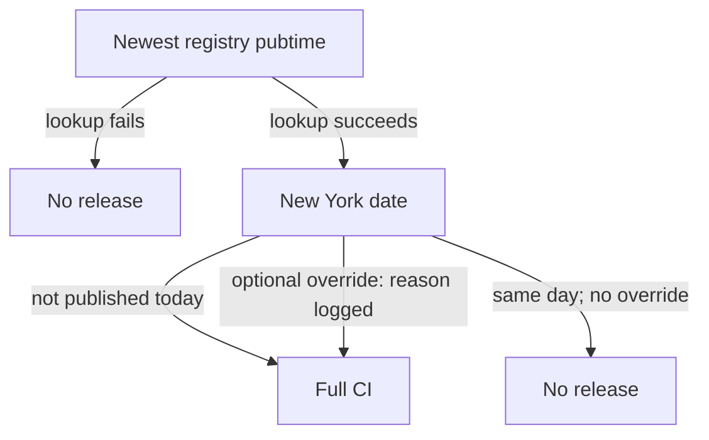
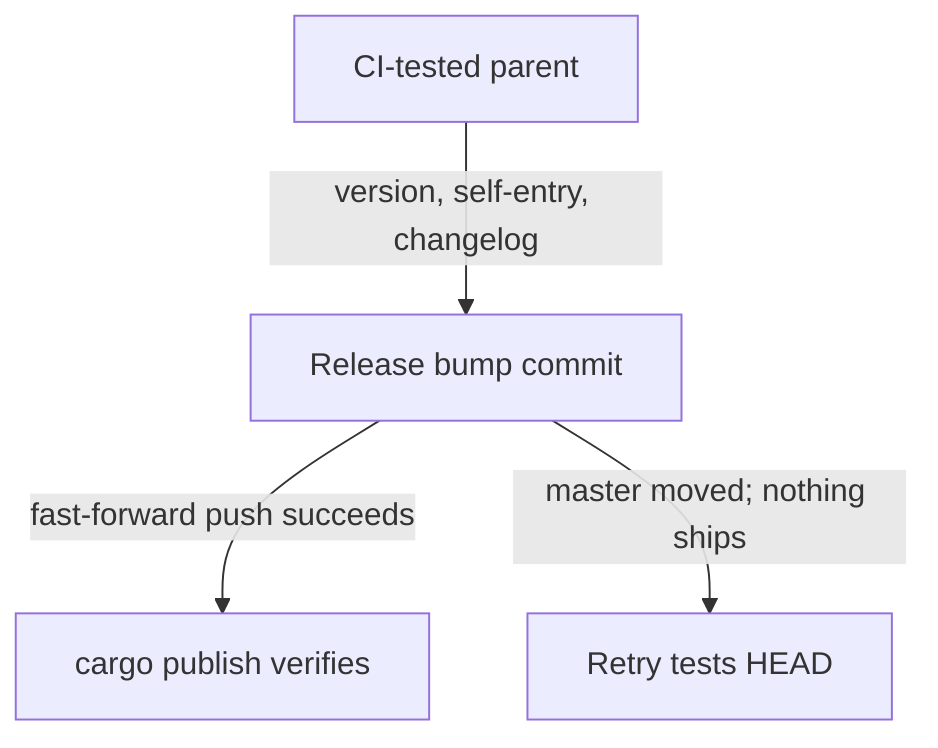
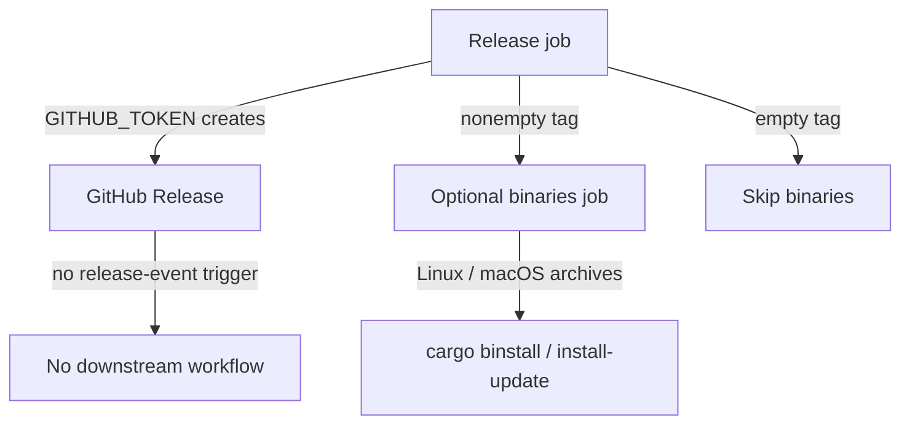

# Diagram proposals: Daily crates.io releases for bob-cli with release-plz

Proposals for the swarm linker, not a report. Each diagram restates only what the source
report says. The workflow is proposed, and the binaries job and hotfix override remain
optional.

```yaml
source: research:202610/crates_io_daily_release_train/crates_io_daily_release_train__final.md
producer: research.25.image
check: "mmdc 12.0.0 rendered 3 of 3 Mermaid diagrams"
```

## registry-daily-guard

```yaml
anchor: |-
  guard reads **registry data**, not cron timing or GitHub Releases.
illustrates: |-
  In live mode, the proposed registry guard counts yanked versions and fails closed, with an optional written-reason hotfix override.
caption: "Proposed live-mode guard; the written-reason hotfix override remains optional."
```



## selected-sha-push-race

```yaml
anchor: |-
  The CI'd SHA is the parent of the release commit.
illustrates: |-
  For a new bump, the CI'd SHA is the parent of the release commit, and a concurrent push rejects the fast-forward-only push so nothing ships that slot.
caption: "Proposed new-bump path: a rejected push defers publication to a fresh run."
```



## same-workflow-binary-delivery

```yaml
anchor: |-
  Add a `binaries` job to `release.yml` with `needs: release` and
illustrates: |-
  The optional binaries job uses the nonempty release tag in the same workflow because a GitHub Release created with GITHUB_TOKEN does not trigger another workflow.
caption: "Proposed binary delivery uses job dependencies; GITHUB_TOKEN release events do not trigger downstream workflows."
```


