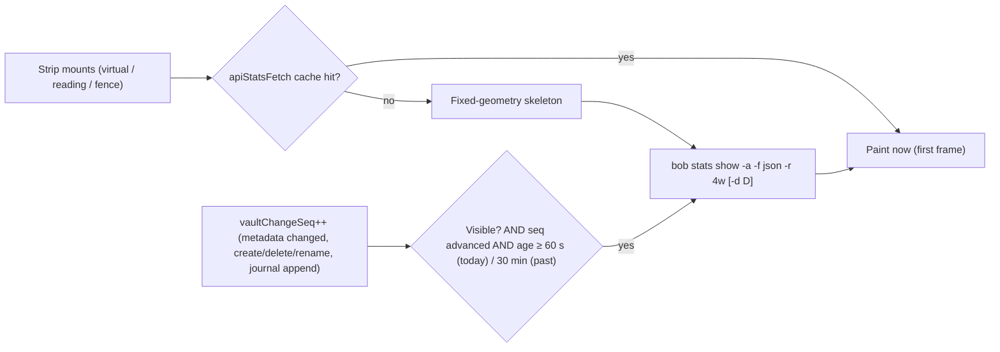

# A Day Stats Strip at the Bottom of Daily Notes: Research, Critique, Recommendation

Researcher `cld` · 2026-10-24 · Inputs: the request; `~/bob/dash_stats.md` and its
screenshot (`20261024_145006.png`); bob-cli `8a7b02e1` (`docs/stats.md`,
`src/native/stats/`, the ledger writers); bob-plugins `1202c6a`
(`plugins/bob-ledger-tools`, `plugins/bob-navigation-hotkeys`); the live vault; the
prior research `research:202610/bob_daily_stats/bob_daily_stats__final.md`; and
external sources listed at the end. I changed nothing in any repo or in the vault. The
mockup was rendered from real `bob stats` JSON for 2026-10-20 and 2026-10-24.


---

## 0. Bottom line

**Build it, but change the mechanism, the scope, and the tone.**

1. **Yes, it's a good idea.** The weekly Stats page is where you explore; the daily
   note is where you look all day. A compact strip at the bottom of each daily note
   turns that note into a self-describing record: the plan at the top
   (`bob-plan`), the ledger in the middle, the outcome at the bottom. The engine
   already computes every number this needs. I verified that a past day's values
   match exactly when computed "as of" that day.
2. **Don't write it into the file.** Render it *virtually* at the end of every
   canonical daily note (`YYYY/YYYYMMDD.md`). Use a CodeMirror block widget in Live
   Preview and a post-processor in Reading view. A fenced block at the bottom of the
   template is the literal reading of your request, but it puts a code block on the
   ledger's growth edge. There, `G`, Ctrl/Cmd+End, and clicks below the note either
   flip it to source or make new lines land *below* the dashboard. It would also
   appear only on new notes: the `bob-plan` fence is in 26 of 1,169 daily notes.
3. **Speed comes from caching, not a narrower query.** Every `bob stats` call pays one
   full vault pass (6,473 notes, 14 MB). A 1-metric 7-day query cost the same as the
   full 4-week report in my measurements. So the strip:
   - paints from the existing in-memory report cache in the first frame;
   - never spawns `bob` while it is off-screen;
   - refreshes at most once a minute while visible, and only if the vault changed.

   It must **not** reuse the Stats page's revalidation. That policy spawns `bob`
   every ~3 s while edits continue. On an always-open daily note, it would run all
   day.
4. **Make it the note's day, not "today".** Every daily note shows its own day. Past
   notes become receipts; today reads "so far". This needs one small bob-cli flag,
   `bob stats --day DATE`.
5. **Calm by construction.** Show five tiles (Worked, Reviewed, Done, Created,
   Review) plus one thin "where the time went" bar, in about 100 px. The tiles use
   neutral ink and gray context sparklines; the only color is the area mix. There are
   no deltas, percentages, targets, streaks, or red/green. "Typical" appears only as
   a faint band and in tooltips. An unmet review today reads **not yet**, not
   *missed*. Every tile is a doorway to the Stats page with that day pinned.

---

## 1. What exists today (verified)

| # | Fact | Evidence | Consequence |
| --- | --- | --- | --- |
| F1 | **The engine is mature.** `bob stats` is about 18k lines of Rust with a schema-1 JSON report: values, display strings, quality, provisional today, p25/p75, homes, theme hues, sessions. It "never writes", and "consumers never recalculate a display string." | `docs/stats.md`; `src/native/stats/` | The strip should be a thin renderer of the same JSON, like the page. |
| F2 | **Cost is one full vault pass, whatever you ask for.** On apollo (16 cores, load average about 15 during my runs), every variant took 0.53–1.35 s and about 42 MB RSS. That covered `-r 7d`, `show worked -r 7d`, `show -a -r 4w`, and an explicit 7-day range. The docs record a **182 ms median** for `-r 4w` JSON on an idle athena. `bob pomodoro --worked`, which reads only today's note, took 16–22 ms. | timed with release `bob 0.3.1`; `docs/stats.md` §Performance | A "lighter" request buys nothing. The levers are caching and refresh policy. |
| F3 | **The Stats data path already does stale-while-revalidate.** There is an in-memory LRU of 8 reports keyed by argv, one in-flight fetch, and coalescing. | `bob-ledger-tools/src/236-plugin-stats-data.js:7-15, 587-761` | Reuse it. The strip's request for today can share the page's default 4-week report. |
| F4 | **Page revalidation would be wrong for a daily note.** Any `metadataCache` change, or a vault create/delete/rename, schedules a revalidation 3 s later. It is throttled, not debounced. It runs while *any* view in `statsBlockViews` is mounted. | `236-…:765-802`; `238-plugin-stats-block.js:57-80` | If the strip joined `statsBlockViews`, an always-open daily note would spawn `bob` about every 3 s through the morning review. The strip needs its own registry and policy. |
| F5 | **The `bob-plan` block is the opposite design.** It is an in-process JS mirror of `docs/plan.md`, reads the open file, repaints 150 ms after a change, and repaints on a 5 s interval. No spawn. | `050-plan-budget.js:1-4`; `290-plugin-today-and-location.js:292-327, 400-…`; `170-plugin-lifecycle.js:647` | That precedent works because plan budgeting is local to one note. Stats are vault-wide (done/created live everywhere), so mirroring them in JS would be a third implementation. The prior research rejected that. |
| F6 | **The bottom of the daily note is the Pomodoros section.** It ends at the next `##` heading or at EOF. Fenced lines are skipped inside it. Rust writers insert relative to entries ("after the current entry, else after the last completed entry, else before the first Pomodoro"), and entry blocks end at the next column-0 line. | `src/native/pomodoro.rs:473-503`; `capture/pomodoro_insert.rs:110-116`; nav `140-scheduled-recovery.js:337-360` | A trailing fence would survive today's writers. But it becomes a new invariant every future ledger writer must respect, and it doesn't stop *you* from typing below it. |
| F7 | **Template changes reach only new notes.** There are 1,169 daily notes since 2023-07-19 (164 / 355 / 365 / 285 by year). Only 26 contain the `bob-plan` fence. | `ls`/`grep` over `~/bob/20*/` | A fence-based strip would be missing from 97.8% of daily notes unless you run a bulk rewrite. |
| F8 | **"As of a past day" already computes correctly.** With `BOB_NOW=2026-10-20T23:59`, all 11 metrics for Oct 20 matched the real-clock report exactly (for example Worked 4h 10m, Reviewed 57, Done 19, Created 23, Review met). | `bob stats show -a -f json -r 4w` under both clocks, diffed | A proper `--day` flag is a thin wrapper over the existing `StatsRequest::with_now` (`src/native/stats/request.rs:62`). |
| F9 | **`BOB_NOW` is not that wrapper.** It marks the past day `provisional: true`. It also counts every later date as invalid (`health.tasks.invalid_dates` 1 → 128). | same run | Add `--day` rather than shipping the `BOB_NOW` hack. |
| F10 | **Today's live state shows the main UX trap.** At 14:50 the report read: Worked 3h 05m, Reviewed **10** (window median 57), Review closed **missed** (provisional). | live `-r 7d` report | A day view must not frame an in-progress day as a bad day: "so far", "not yet", no deltas. |
| F11 | **The plugin already has the CodeMirror pieces.** It imports `editorInfoField` and `editorLivePreviewField` and ships several `Decoration.widget` extensions. Its `minAppVersion` is 1.8.7, the version that added `App.loadLocalStorage` / `saveLocalStorage`. | `010-load-and-constants.js:40-48`; `220-plugin-heading-and-review.js:321-552`; `273-plugin-pomodoro-home-chips.js`; manifest | A virtual mount uses tools already in the codebase. One CodeMirror rule applies: block widgets must come from a `StateField`, not a `ViewPlugin`. |
| F12 | **The Stats palette passes the dataviz validator** in light (`#ffffff`) and dark (`#1e1e1e`). Worst adjacent CVD ΔE is 21.0 in light and 17.3 in dark. Area hues reuse the same ramps: `gtd` is orange like Worked, `dev` is blue like Created. | `validate_palette.js`; `styles.css:2017-2031, 3162-3200` | In a 100 px strip, metric hues next to area hues collide (mockup panel 6). Tiles should use neutral ink; color belongs to the area mix only. |
| F13 | **No `stats:` block in your config**, so everything uses defaults: range 4w and the six-metric overview. | `~/.config/bob/config.yml` | The strip pins 4w for its "typical" band: 28 days, four of each weekday. |

---

## 2. Is this a good idea? (critique)

### 2.1 The case for it

- **It is where your eyes already are.** You open the daily note many times a day.
  The Stats page needs a deliberate trip (STATS ↗ chip, or Open Stats). Personal
  informatics research separates a *discovery* phase (exploring and finding
  patterns) from a *maintenance* phase (quick status against what you already know)
  (Li, Dey & Forlizzi 2011). The page serves discovery; a strip serves maintenance.
- **Glanceable, ambient feedback works.** Consolvo et al.'s UbiFit Garden put a
  glanceable display on the phone's background. Per the project page, participants
  with it maintained their activity over a holiday stretch, while those without it
  dropped. Meyer et al. (CSCW 2017) found that workplace self-monitoring with
  retrospection increased developers' awareness of their work.
- **It completes the daily note's story.** Plan at the top, ledger in the middle,
  outcome at the bottom. A past daily note becomes a self-contained receipt:
  "what was Oct 20 like?" can be answered without opening the page.
- **The marginal engine cost is near zero** (F1, F8). The one-engine principle holds:
  the strip and the page can never disagree, because they read the same report.

### 2.2 The case against, and what the design does about it

| Risk | Why it is real here | Mitigation in this design |
| --- | --- | --- |
| **A scoreboard on the working surface** | The prior research deliberately kept Stats *out* of the daily note (its R9: "weekly is where numbers inform decisions; daily is where they become targets"). It also warned that quantification can lower enjoyment (Etkin 2016). F10 shows how an unfinished morning looks: Reviewed 10 against a median of 57. | No deltas, no percentages, no targets, no streaks, no red/green. "Typical" is a faint band, never a goal line. Today says "so far". An unmet review says "not yet". There is a recorded exit criterion (§8). |
| **Redundancy** | Worked is already in the Pomodoros heading and the Mac menu-bar indicator. Review progress is in the status-bar review footer. | The strip earns its place with *context* the others lack: an 8-day sparkline, the typical band, and the area mix. Its other numbers (Done, Created, Reviewed, review closeout) appear in no other daily surface. |
| **Performance on the most-opened note** | F2 and F4: a naive mount would spawn a 0.2–1.3 s, 42 MB process every few seconds. | Cache-first paint, visibility-gated refresh, and its own refresh policy (§5.6). |
| **Clutter** | The page is about 1,100 px tall. | A hard budget: about 100 px expanded, about 24 px collapsed, fixed geometry, no controls beyond a link and a chevron. |
| **Another surface to maintain** | CSS, tests, docs. | One pure model plus one renderer shared by every mount. bob-cli changes are additive (`--day`). |

### 2.3 Verdict, and how I'd do it differently

The idea is sound, and it supersedes the earlier "weekly only" advice for a specific
reason: the weekly page now exists and is in use. A daily *glance* is a different job
from a weekly *review*. I would change three things about the request:

- **Mechanism.** Render virtually rather than writing a block into the file (§4.1).
- **Scope.** Show *the note's* day, so past notes get a strip too, rather than "today
  only".
- **Tone.** Make it a quiet receipt with drill-down, not a mini copy of the page.

---

## 3. Requirement adjustments (called out explicitly)

| # | You asked for | I recommend | Why |
| --- | --- | --- | --- |
| A1 | A dashboard "at the bottom of daily files" | **The bottom of the daily-note *view*, rendered virtually**, with nothing written to the file. Keep a `bob-day` fence processor too, for embedding a day elsewhere and for prototyping. | F6/F7 and §4.1: no caret or source flips, nothing typed below it, every past note covered, and no new invariant for ledger writers. |
| A2 | "Daily statistics" | **Statistics of the note's own day.** Today is provisional ("so far"); past days are complete receipts. | Makes 1,169 existing notes useful and gives the Stats page's "Open daily note" a round trip. |
| A3 | Inspiration from `dash_stats.md` | **Borrow its vocabulary, not its controls.** Keep tiles, sparklines, the hollow provisional mark, area hues, and the area bar. Drop range chips, the focus chart, the table, panels, and Definition. Every tile links to the page with the day pinned. | The page answers "how has the week gone?". The strip answers "how did this day go?". It is a doorway, not a second dashboard. |
| A4 | "Take up less space" | **A hard budget:** about 100 px expanded (about four text lines at 700 px width), one about 24 px line when collapsed. Fixed geometry, so async updates never shift the note. | Measured in the mockup (§5.2). |
| A5 | "Render faster" | **Reframe "fast" as first-frame paint from cache plus zero background cost.** Do not chase a faster engine query. | F2: narrower queries cost the same. Caching makes repeat opens instant. Visibility gating makes the always-open note cost nothing. |
| A6 | (implicit: same metrics as the page) | **Five tiles:** Worked, Reviewed, Done, Created, Review (closeout). Add the area time mix. **Drop Net flow and the secondary metrics** from the day view. A `stats.day` config key can change this. | Net flow is a window question; one day's ±11 is noise, and Done beside Created answers it at a glance. Habits has read 100% every day lately. |
| A7 | (new) | **No judgment on the day view:** no deltas, %, goals, streaks, or status colors. An unmet provisional bool reads "not yet" (a bob-side display fix, also right for the page and CLI). | §2.2. |
| A8 | (new) | **An exit criterion:** after three weeks, if the strip pulls you toward chasing numbers, make it collapsed by default or recap-only (past days, plus today after the POST closeout). | It keeps the feature honest. |

---

## 4. Options considered

### 4.1 Where and how it renders

| Option | Verdict | Reasoning |
| --- | --- | --- |
| **Virtual strip.** A CodeMirror `StateField` block widget at the document end (Live Preview and Source), plus a Reading-view post-processor that appends after the last section. Canonical daily notes only. | **✓ Recommended** | Nothing in the file, so ledger writers, Templater, Mac Capture, and agents are all unaffected. It appears on every daily note, past and future. The caret can never enter it: `G` lands on the last ledger line, and new lines go above the strip. It skips hover previews and embeds. It uses only public APIs that the plugin already uses (F11). Obsidian's own "Backlinks in document" and the community *Virtual Content* (formerly *Virtual Footer*) plugin use the same "render at the bottom without modifying the file" pattern. |
| **` ```bob-day ` fence at the end of `_templates/daily.md`** | Second choice | Simplest, explicit, the same API as `bob-plan`. But: (a) new notes only (F7); (b) in Live Preview, `G`, Ctrl/Cmd+End, or a click below the note leaves the caret on or just under the fence, so either the block flips to source or the next line you type lands below the dashboard; (c) it sits inside the Pomodoros section (F6), so every future ledger writer must keep inserting above it; (d) it renders in hover previews and embeds. **Ship the processor anyway**, for embedding a day elsewhere (`day: 2026-10-20`) and as the first prototype. |
| Extend the top `bob-plan` block with a stats row | ✗ | The top is the planning surface (forward-looking, in-process JS). Mixing outcomes into it muddles both and adds a spawn to a block that repaints every 5 s. |
| A status-bar item | ✗ | The review footer already occupies it, the menu bar already shows Worked, and it isn't "on the daily note". |
| Prototype with the *Virtual Content* plugin rendering a `bob-day` fence | Prototype only | It would give the virtual placement with no CodeMirror code. But it adds a small third-party dependency on the most important note, and Bob plugins avoid those. |
| DataviewJS block in the template | ✗ | A second implementation of every definition, slow over a vault, and no review journal. |
| Nightly materialized summary in the note or frontmatter | ✗ | Churns 365 files a year, goes stale on late edits, and repeats the `#today`-tag mistake that `decisions:today-is-read-from-the-ledger` retired. |

### 4.2 Where the numbers come from

| Option | Verdict | Reasoning |
| --- | --- | --- |
| **Spawn `bob stats show -a -f json -r 4w [-d D]` through the existing `apiStatsFetch` cache, with a strip-specific refresh policy** | **✓** | One engine, so strip and page always agree. Today's request is byte-identical to the page's default, so they share the cache. |
| A narrower request (`-r 7d`, fewer metrics) | ✗ | Measured: same cost (F2). It also loses cache sharing and the 28-day typical band. |
| A JS mirror from the Tasks cache plus the ledger (instant, no spawn) | ✗ | A third copy of task semantics: recurring exclusion, `^gtd`, archives, homes. Parity drift between the strip and the page would destroy trust ("the strip says 6 done, the page 7"). |
| A persisted warm-start snapshot (`app.saveLocalStorage`, per device, not synced) | Optional, phase 4 | Only matters for the first open after an Obsidian launch. Background tabs are deferred since Obsidian 1.7.2, so even that is rare. A fixed-geometry skeleton is fine in v1. |
| An incremental (mtime-keyed) parse cache in the engine | Only if needed | Worth it only if the MacBook's cold `bob stats` exceeds about 500 ms. It also speeds up the page and CLI. |
| A long-lived `bob` daemon | ✗ | Over-built for a personal tool. `decisions:idle-capture-shows-ledger-agenda` already chose in-memory caching over a daemon for the same reason. |

---

## 5. Recommended design: the **Day strip**

*Naming:* "footer" is already the glossary's **Morning GTD Review Footer** (the
status-bar item). Call this the **Day strip** in code and docs, and **Day stats** in
UI labels and commands.

### 5.1 What it shows

```text
──────────────────────────────────────────────────────────────────────────────
WORKED          REVIEWED        DONE            CREATED         REVIEW
3h 05m          10              6               17              not yet
▃▅▆▅▂▁▅▯        ▇▆▇▆▆▅▅▁        ▆▆▇▅▆▃▂▫        ▇▅▇▅▂▁▅▯        ●●●●●●●◌
▬▬▬▬▬▬▬▬▬▬▬▬▬▬▬▬▬▬▬▬▬▬▬▬▬▬▬▬▬▬▬▬▬▬▬▬▬ ▬▬▬▬▬▬▬▬▬▬▬▬▬▬▬▬▬▬▬▬▬▬▬▬▬▬▬▬▬▬▬
● gtd 1h 45m   ● dev 1h 20m                          so far · 14:50  Stats ↗  ▾
```

| Element | Content | Source in the schema-1 report |
| --- | --- | --- |
| Tiles, left to right | Worked · Reviewed · Done · Created · Review | `metrics[id].points[date == D].display`; Review uses `review_closed` |
| Tile sparkline | D−7…D (8 marks). Earlier days are gray context; **D is ink**, outlined when provisional. A faint band shows p25–p75 of the 28 days before D. | `points`, `summary.p25/p75` |
| Review dots | Last 8 days met (●) or missed (○). D: ● closed, dashed ◌ not yet, ○ missed. | `review_closed.points` |
| Time mix | One 5 px stacked bar of D's Worked minutes by **area**, with a 2 px surface gap between segments. `unlinked`/`unfiled` buckets sit last in gray. A legend line underneath gives dots plus `gtd 1h 45m`. | `worked.points[D].parts.area`, `parts_display.area`, `homes[k].hue/label` |
| Meta (right) | `so far · HH:MM` on today's note, nothing on complete days, then `Stats ↗` and the collapse chevron | report `today`, plus the clock |

Values come from Bob's display strings; the renderer formats nothing.

### 5.2 Visual design (beautiful by construction)

The mockup at the top of this report shows: (1) today in light, (2) a complete past
day in dark, (3) collapsed, (4) a 540 px column, (5) a 410 px split, and (6) the
rejected hue variant.

- **Form.** A KPI row of stat tiles with emphasis sparklines: the subject day in
  ink, earlier days in de-emphasis gray. One part-to-whole bar. There is no chart
  axis, so there is nothing to misread.
- **Color.** Tile text uses text tokens only. The day's mark uses `--text-normal`,
  and context marks use `--text-muted` at about 38%. **Area hues are the only
  color** (`--bob-area-*`, the hue Bob reports, per
  `decisions:theme-hue-is-pin-exempt-area-hash`). Panel 6 shows why: with metric
  hues, an orange Worked bar sits beside an orange `gtd` segment and reads as the
  same thing. Volumes get no status colors.
- **Type.** Labels follow the house chip language (small caps, `0.72em`, muted,
  `letter-spacing .06em`). Values are about 17 px, weight 650, proportional figures.
  The legend minutes use tabular figures.
- **Layout.** Five vertical tiles (label, value, sparkline) in a `flex-wrap: wrap;
  justify-content: space-between` row, each at least 5.2rem wide. That gives one row
  from about 520 px up (the default 700 px readable width, zoomed, or split), and 4+1
  in a 410 px side split. A hairline `--background-modifier-border` rule above
  separates it from the ledger, with no card box. The strip is **about 100 px
  tall** expanded and about 24 px collapsed.
- **Marks.** Sparkline bars are 5 px wide with 2 px gaps and about 1.5 px rounded
  data ends. Null days are a faint baseline dash. A real zero is a 1 px baseline mark
  that can still be selected. The provisional day is a 1.2 px outline. The mix bar
  has 3 px radius ends and 2 px surface gaps.
- **Motion.** None by default. A changed value cross-fades for 120 ms, disabled under
  `prefers-reduced-motion`. There is no dimming on refresh: the page's 0.55 opacity
  would flicker on a note you look at all day.
- **Collapsed.** One line: `3h 05m worked · 10 reviewed · 6 done · 17 created ·
  review not yet` plus `so far · Stats ↗ · ▸`. The state is stored per device with
  `app.saveLocalStorage`, as UI state only, never vault data.

### 5.3 Honest states

| State | What the strip shows |
| --- | --- |
| Today, in progress | Values "so far". The D mark is outlined. An unmet review reads **not yet** (dashed dot). |
| Past day | Filled D mark. "missed" is allowed, because it is true. |
| Before tracking starts (for example Reviewed before 2026-10-12) | `–`, with the tooltip "Tracking since Oct 12". |
| Every metric not tracked (pre-2023-07-19 notes) | Hide the strip entirely. |
| Journal gap / `missing` quality | `–` plus a small `⚠` whose tooltip carries Bob's warning text. |
| No Pomodoros on D | Worked `0m` (a real zero). The mix bar becomes a faint baseline with "no Pomodoros". |
| Future daily note | Hidden. |
| First load, nothing cached | A skeleton with exactly the final geometry (labels visible, values as faint bars). No spinner, no layout shift. |
| Refresh fails with a cached frame | Keep the frame. A faint "stale" dot next to `Stats ↗`; its tooltip gives the error title. |
| Fails with nothing cached | One muted line: *"Day stats unavailable — bob was not found. Set stats.bob_path, or open Stats for details."* Never the page's full error card. |

### 5.4 Interaction (intuitive by construction)

- **Hover or focus a tile** for the label, D's value (with "so far" when
  provisional), and the typical day (for example "typical day 2h 55m – 4h 33m,
  middle half of the 28 days before"). It also shows the one-sentence definition from
  the report.
- **Click a tile** to open Stats focused on that metric, with D pinned and the range
  moved so D is inside it. Cmd/Ctrl opens a new tab. **The legend or mix bar** opens
  Stats → *Where the time went* for D. **`Stats ↗`** opens Stats with D pinned. The
  plugin writes the page's session view state before opening `dash_stats`. That is
  same-plugin state, with no vault writes.
- **Hover a sparkline mark** to see its date and value. The hit area is a full
  column, at least 24 px tall. In v1 marks don't navigate (open question Q4).
- **The chevron** collapses or expands the strip. Two more controls: the setting
  "Show Day stats on daily notes", default on, and the command "Toggle Day stats on
  daily notes".
- **Accessibility.** `role="group"` with the aria-label "Day stats for Saturday,
  October 24, so far". Tiles are buttons with full-sentence labels and visible focus
  rings. The accessible table is the Stats page's **Table** view, one click away.

### 5.5 Mounts: one component, three hosts

A pure `dayStripModel(report, day, options)` builds every tile, mark, mix segment,
and state. One `paintDayStrip(el, model)` paints it. Three hosts call them:

1. **Live Preview and Source.**
   - A `StateField<DecorationSet>` holds one
     `Decoration.widget({ widget, block: true, side: 1 })` at `doc.length`. It is
     provided through `EditorView.decorations.from(field)`, because block widgets
     cannot come from a `ViewPlugin`.
   - It is active only when `editorInfoField` reports a path matching
     `PLAN_DAILY_PATH_RE` and the setting is on.
   - `WidgetType.eq()` compares `{day, collapsed}`, so keystrokes only remap the
     position and **never rebuild the DOM**. `estimatedHeight` is fixed.
     `ignoreEvent()` returns true, so clicks never move the caret.
2. **Reading view.**
   - `registerMarkdownPostProcessor` checks whether `ctx.getSectionInfo(el)` covers
     the last non-blank line of a canonical daily note. If so, it appends the strip
     after that section.
   - It skips `.hover-popover` and `.markdown-embed` ancestors.
3. **` ```bob-day ` fence.** Optional `day: YYYY-MM-DD`, defaulting to the note's
   own date or today. Use it for embedding a day in a weekly review note, and as the
   phase-2 prototype: add the fence by hand to today's note and live with it for a
   few days before building the virtual mount.

### 5.6 Data path and refresh policy (the speed design)



- **The request.**
  - Today: `["stats","show","-a","-f","json","-r","4w"]`, identical to the page's
    default, so the two share one cache entry.
  - A past day adds `-d D`.
  - The strip pins `4w` even if `stats.range` changes. The typical band should be
    28 days, four of each weekday.
- **Its own registry** (`dayStripViews`), separate from `statsBlockViews`, so the
  page's 3 s revalidation never applies (F4). When the page refreshes a shared cache
  entry, strips repaint from it for free.
- **Visibility gate.** An `IntersectionObserver` on the strip, combined with
  `document.visibilityState`. Off-screen strips (a long ledger in the afternoon, a
  background tab) never spawn.
- **Change gate.** A cheap counter that bumps on vault events. The strip refreshes
  only if the counter moved since its report was fetched.
- **Age gate.** Today's strip refreshes at most every 60 s; a past day's at most
  every 30 min. The check runs when the strip enters the viewport, on
  `active-leaf-change`, on window focus, and on a 60 s tick that is a no-op unless
  visible.
- **Rollover.** At midnight, today's strip becomes a past-day strip (adds `-d`)
  and a new key starts. A snapshot whose date isn't D is never shown, mirroring the
  agenda rule in `decisions:idle-capture-shows-ledger-agenda`.

**Budget**

| Measure | Target |
| --- | --- |
| Paint from cache | ≤ 1 frame (5 tiles, ≤ 45 SVG marks) |
| Keystrokes in the daily note | 0 DOM rebuilds (`eq()`), tested |
| Cold fetch | one `bob stats` run (182 ms idle athena; 0.5–1.3 s loaded apollo; **MacBook to be measured**) |
| Background cost | 0 spawns off-screen; ≤ 60/h while visible and the vault is changing |
| Memory | one parsed report per viewed day (≤ about 335 KB JSON), within the existing LRU of 8 |

### 5.7 bob-cli changes (small, additive)

1. **`-d, --day <DATE>`** on `bob stats [overview]` and `bob stats show`. Help text:
   *"Report as of DATE: the window ends the day before DATE and DATE is the final
   point (provisional only when DATE is today)."*
   - Build the request with `with_now(D)` while keeping the real today for
     `provisional` and for health future-date checks (fixes F9).
   - Add `range.day` to JSON. This is additive and stays `schema_version: 1`.
   - Reject a future D, and `--day` together with an explicit `START..END` range,
     with exit 2.
   - Follow `cli_rules`: alphabetical options, a short alias (`-d` is free in
     `stats`), and an example in help.
2. **Provisional booleans read "not yet".** An unmet provisional bool point gets
   display `not yet`, everywhere: CLI, JSON, and page. Update the M6 row and its docs
   accordingly.
3. **Optional `summary.band_display`** (for example `"2h 55m – 4h 33m"`), so
   tooltips never format numbers in JS.
4. **Goldens.** Extend the M-vector table. For example, `--day 2026-10-10` on the
   golden fixture: Oct 10 is complete and not provisional, the window ends Oct 9, and
   `invalid_dates` stays at 1. Add usage-error cases for a future D and a conflicting
   range. Document it in `docs/stats.md` (new "Day strip" section) and link from
   `docs/dashboard.md`. Read the `docs.md` memory first.

These are `feat(stats)` changes, and no contract break, so no `!`.

### 5.8 Config

```yaml
stats:
  day:                      # read by bob-ledger-tools; bob ignores unknown keys
    enabled: true           # also a plugin setting + command
    metrics: [worked, reviewed, done, created, review_closed]
    mix: area               # area | theme | off
```

Custom metrics (for example `sase_time`) can be added to `metrics` and appear as tiles
automatically, because the request is `show -a`.

---

## 6. Reliability and test plan

- **Model tests** for `dayStripModel` run against `scripts/fixtures/stats/canonical.json`
  and the `synthetic-*` fixtures. Cover: provisional and complete days,
  `not_tracked`, `missing`, journal gap, no Pomodoros, a real zero, bucket ordering,
  long labels, and custom metrics.
- **CodeMirror tests.** The widget follows `doc.length` across edits. `eq()` keeps
  the same DOM while typing. Non-daily paths get no decoration. Toggling the setting
  removes the decoration.
- **Refresh-policy tests** with fake timers, a fake IntersectionObserver, and a fake
  `execFile`. Assert:
  - no spawn while off-screen;
  - no spawn without vault changes;
  - ≤ 1 per 60 s while visible;
  - cache shared with the page;
  - rollover re-keys.
- **Browser preview matrix.** Extend `scripts/preview-stats-block.cjs`, or add a
  sibling, to cover light, dark, 410/540/700 px, collapsed, skeleton, stale, and
  error.
- **bob-cli goldens** for `--day` and the provisional bool display (§5.7).
- **Real-vault check.** Time `bob stats show -a -f json -r 4w` with `hyperfine` on
  the MacBook, because that is where Obsidian runs.
- Run `bob plugins sync` after plugin changes.

---

## 7. Phased plan

| Phase | Repo | Deliverable | Useful alone? |
| --- | --- | --- | --- |
| 1 | bob-cli | `--day`, provisional "not yet", optional `band_display`, goldens, docs | ✅ Also improves the CLI and page (honest today) |
| 2 | bob-plugins | `dayStripModel` and renderer, CSS, the `bob-day` fence mount, the strip refresh policy. Prototype by hand-adding the fence to today's note for 3–5 days. | ✅ The look is tested before investing in the virtual mount. Today needs no `--day`, so phases 1 and 2 can run in parallel. |
| 3 | bob-plugins | Virtual mount (CodeMirror plus Reading view), setting and command, collapse state, drill-down handoff to Stats, preview matrix | ✅ The feature as designed |
| 4 (optional) | either | localStorage warm start; engine mtime cache if the MacBook's cold run exceeds 500 ms; a recap-only mode if A8 triggers | Optional |

After it ships, record the placement choice in the decisions web (virtual vs fence:
why, cost, what reopens it), via `/sase_memory_write` and Bryan's approval.

---

## 8. Success and exit criteria

- On ≥ 95% of daily-note opens, the strip is complete in the first frame.
- The strip's source never appears, and a typed line never lands below it.
- Spawn counts stay within the §5.6 budget. Expose a debug counter, for example
  `api.stats` diagnostics.
- **After three weeks**, ask one question: did it change a decision, or reassure you
  usefully? If instead you noticed yourself working to move its numbers, switch to
  collapsed by default or recap-only (A8). If you never look at it, turn it off.
  Either way, the page is unaffected.

---

## 9. Open questions for you

1. **Area or theme mix by default?** I recommend area: it matches the page's
   default and its hues, and theme is one config key away. Themes do match the
   `— NAME` you see in the ledger, if you prefer that.
2. **Reading view in v1?** I recommend yes; it is small.
3. **Historical notes:** show the strip on every note with any tracked metric
   (Worked back to 2023-07-19)? I recommend yes.
4. **Should clicking a sparkline mark open that day's daily note?** It is a nice way
   to browse days, but it risks accidental navigation away from the working note.
   I recommend tooltip only in v1.
5. **Expanded or collapsed by default?** I recommend expanded, with the A8 check.

---

## 10. Side findings

- **`bob stats … | head` panics** with exit 101 ("failed printing to stdout: Broken
  pipe"). This is cosmetic in a terminal, and harmless to the plugin, since
  `execFile` reads all output. It is worth a tiny EPIPE-tolerant stdout fix across
  `bob` subcommands.
- **`BOB_NOW` in the past inflates `health.tasks.invalid_dates`**, because later
  dates count as "future". That is expected for a clock pin, and it is one reason to
  add `--day` instead (F9).

---

## 11. Recommended solution

Build the **Day strip**: a compact, read-only "how did this day go" receipt that
bob-ledger-tools renders **virtually at the bottom of every canonical daily note**,
drawn entirely from the existing `bob stats` schema-1 report.

- **Placement.**
  - A CodeMirror `StateField` block widget at the document end (Live Preview and
    Source), plus a Reading-view post-processor, for `YYYY/YYYYMMDD.md` notes only.
  - Nothing is written to the file. Every past and future daily note gets it, and
    the caret can never enter it.
  - The same component also answers a ` ```bob-day ` fence, for embedding a day
    elsewhere and for prototyping.
- **Scope.** The note's own day. Today reads "so far"; past days are complete. A
  small additive bob-cli flag, `bob stats -d/--day DATE`, supports this, plus a
  "not yet" display for unmet provisional booleans.
- **Content.**
  - Five tiles: Worked, Reviewed, Done, Created, Review closeout. Each has an 8-day
    emphasis sparkline (the day in ink, earlier days gray) over a faint typical band.
  - One thin area time-mix bar with a legend.
  - About 100 px tall, collapsible to one line.
  - Only the area mix is colored. There are no deltas, percentages, targets,
    streaks, or status colors.
- **Interaction.** Tooltips carry the definition and the typical range. Every tile,
  the mix, and `Stats ↗` open the Stats page with the day pinned. The strip is a
  doorway, not a second dashboard.
- **Speed.**
  - Paint from the shared in-memory report cache in the first frame, with a
    fixed-geometry skeleton on a cold miss.
  - Refresh only when the strip is on screen, the vault has changed, and the report
    is older than 60 s (30 min for past days).
  - Keep its own registry so the Stats page's 3-second revalidation never applies.
  - No JS mirror and no new engine.
- **Order.** bob-cli `--day` and the plugin model/renderer in parallel. Then a
  hand-placed fence prototype for a few days. Then the virtual mount. Then a
  three-week check that it informs rather than scores.

---

## Sources

**Internal (read or measured this session)**

- bob-cli:
  - `docs/stats.md` (§Performance, §Obsidian Stats block, §Data model).
  - `src/native/stats/request.rs:62`.
  - `src/native/pomodoro.rs:473-503`.
  - `src/native/capture/pomodoro_insert.rs:110-116`.
- bob-plugins `plugins/bob-ledger-tools/src/`:
  - `236-plugin-stats-data.js`, `238-plugin-stats-block.js`.
  - `050-plan-budget.js`, `290-plugin-today-and-location.js`.
  - `170-plugin-lifecycle.js`, `010-load-and-constants.js`.
  - `220-plugin-heading-and-review.js`, `273-plugin-pomodoro-home-chips.js`.
  - `styles.css`.
- bob-plugins `plugins/bob-navigation-hotkeys/src/140-scheduled-recovery.js`.
- Vault: `_templates/daily.md`, `2026/20261024.md`, `dash_stats.md`, daily-note
  counts, `.obsidian/appearance.json`, `~/.config/bob/config.yml`.
- Prior research: `research:202610/bob_daily_stats/bob_daily_stats__final.md`
  (R9, §6.5, §7).
- Memory: `obsidian.md`, `cli_rules.md`, `decisions:today-is-read-from-the-ledger`,
  `decisions:idle-capture-shows-ledger-agenda`, and the glossary entries Pomodoro,
  Pomodoro Theme, Morning GTD Review Footer, and Mac Menu Bar Pomodoro Indicator.
- Dataviz method and palette validator (bundled skill): stat tile, emphasis, and
  anti-pattern rules. The validator ran on the Stats palette in both modes.

**External**

- Li, Dey & Forlizzi, "Understanding My Data, Myself: Supporting Self-Reflection with
  Ubicomp Technologies," UbiComp 2011 (discovery vs maintenance phases):
  <https://ianli.owlstown.net/publications/16-understanding-my-data-myself-supporting-self-reflection-with-ubicomp-technologies>
- Consolvo et al., "Activity Sensing in the Wild: A Field Trial of UbiFit Garden,"
  CHI 2008, and the project page on the glanceable display:
  <https://makeabilitylab.cs.washington.edu/media/publications/Consolvo_ActivitySensingInTheWildAFieldTrialOfUbifitGarden_CHI2008.pdf>,
  <https://www.consolvo.org/ubifit>
- Meyer, Murphy, Zimmermann & Fritz, "Design Recommendations for Self-Monitoring in
  the Workplace," PACM HCI (CSCW) 2017: <https://www.merlin.uzh.ch/publication/show/15499>
- Etkin 2016 and Harkin et al. 2016, as cited in the prior research (quantification
  costs; monitoring benefits).
- *Virtual Content* (formerly *Virtual Footer*), an Obsidian community plugin that
  renders content at the bottom of matching notes without modifying them:
  <https://community.obsidian.md/plugins/virtual-footer>
- CodeMirror: block decorations must come from a state field, not a view plugin:
  <https://discuss.codemirror.net/t/block-decorations-may-not-be-specified-via-plugins/4812>,
  <https://discuss.codemirror.net/t/preferred-way-to-create-multi-line-widget/4865>
- Obsidian developer docs on deferred views (1.7.2+) and `App.loadLocalStorage` /
  `saveLocalStorage` (1.8.7+): <https://docs.obsidian.md/plugins/guides/defer-views>,
  <https://docs.obsidian.md/Reference/TypeScript+API/App>
