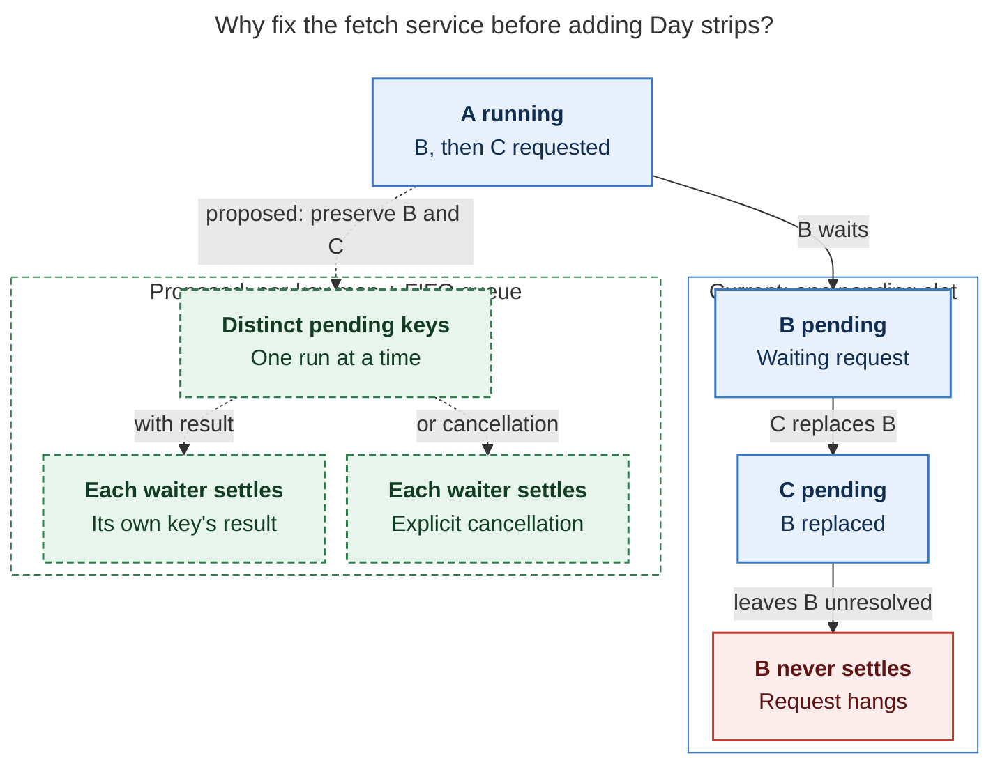

# Diagram proposals: The Day strip: a compact daily-stats footer for Bob daily notes

Proposals for the swarm linker, not a report. Each diagram restates only what the source
report says.

```yaml
source: research:202610/daily_note_day_strip/daily_note_day_strip__final.md
producer: research.2f.image
check: "mmdc 12.0.0 with the PDF-mirroring config rendered 1 of 1 Mermaid diagrams; smoke render used --no-sandbox; malformed input correctly failed"
```

## fetch-waiter-preservation

```yaml
anchor: |-
  Replace the single pending slot with a per-key in-flight map and
question: |-
  Why must the fetch service change before several daily notes consume it?
illustrates: |-
  The current single pending slot loses B when C arrives, while the proposed per-key map and FIFO preserve distinct pending keys until each waiter settles.
caption: A first-in, first-out queue preserves pending keys so each waiter receives its own result or an explicit cancellation instead of hanging.
review: "668.844×787 px, fit 97.6%; question and visual checks passed; 1 revision; every node and edge traced to F8a and section 5.7; unique body anchor"
```


