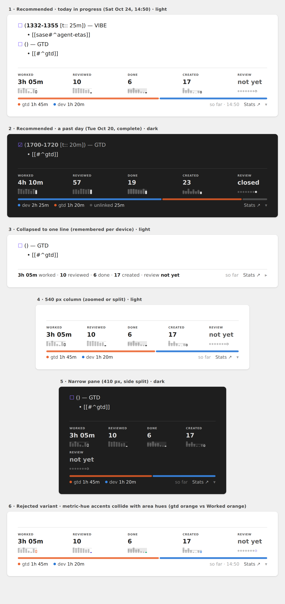
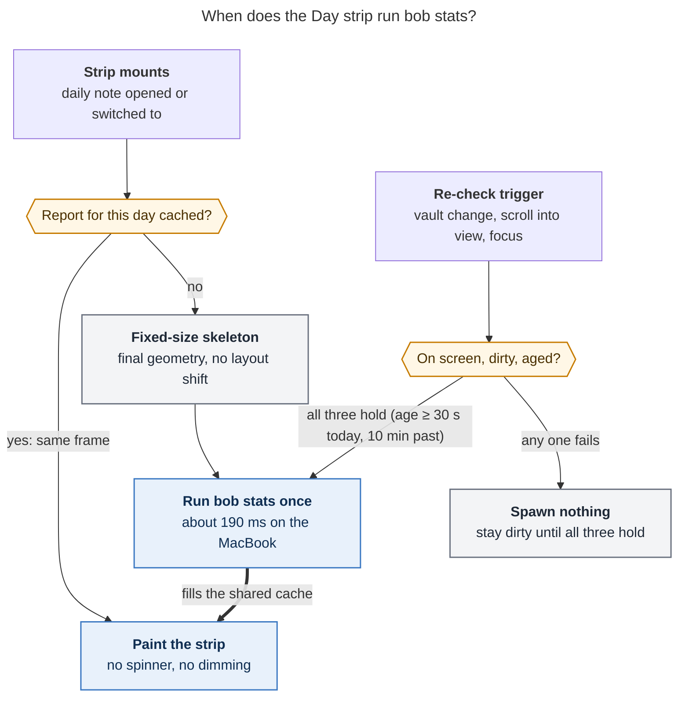

# The Day strip: a compact daily-stats footer for Bob daily notes

Lead researcher (consolidation) · 2026-10-24 · Merges five independent reports in this
directory (`__cdx`, `__cld`, `__grk`, `__mus`, `__gem`) with my own verification. That
covered bob-plugins `1202c6a` source (`bob-ledger-tools` stats fragments), `bob 0.3.1`
timings on apollo **and on the MacBook where Obsidian runs**, the live vault, the
*Virtual Content* plugin's source, and the prior Stats research. Nothing in any repo or in
the vault was changed.



*Figure 1. cld's mockup, rendered from real `bob stats` JSON for Oct 20 and Oct 24. The
recommended design follows panels 1–5. Panel 6 shows why the tiles stay neutral: an
orange Worked accent next to the orange `gtd` segment reads as the same thing.*

---

## 0. Bottom line

**Build it as a quiet "Day strip" that mirrors the note's own day, not as a smaller
copy of `dash_stats`.**

1. **Is it a good idea? Yes, in a narrower form than requested.** The daily note is the
   most-opened file in the vault, and its bottom is the ledger's growth edge, where the
   active Pomodoro sits. A strip there completes the note: plan at the top (`bob-plan`),
   ledger in the middle, outcome at the bottom. All five researchers agree. It does
   reverse the prior Stats research's R9 ("home it in the weekly prune, not the daily
   note — daily is where they become targets"), so it must show facts and never targets.
2. **What it shows:** five neutral tiles (Worked, Reviewed, Done, Created, Review
   closeout), each with a tiny 8-day sparkline, plus one thin area time-mix bar. It is
   about **100 px** tall, or one **~24 px** line when collapsed; the Stats page is over
   1,100 px. It has no deltas, percentages, goals, streaks, range chips, charts, or
   tables. Every tile opens `dash_stats` with that day pinned.
3. **Where it renders:** bob-ledger-tools renders it after the last line of every
   canonical daily note (`YYYY/YYYYMMDD.md`) as a CodeMirror block widget in Live
   Preview. **Nothing is written into the file.** A `bob-day-stats` fence ships too, for
   a hand-placed prototype and for embedding a day elsewhere.
4. **Data:** the existing `bob stats` JSON, with the engine unchanged. Today's strip
   reuses the Stats page's default report (one shared cache entry). Any day in the last
   four weeks is read from that same report, so it costs no extra run. Older days fetch
   an 8-day explicit range. **No new CLI flag is needed** (verified, F5).
5. **Speed — the real problem is refresh, not first paint.** One `bob stats` run takes
   **~190 ms on the MacBook** at any range (F3). What would hurt is the current refresh
   rule: about 3 s after any vault change, it re-runs `bob stats` for every mounted Stats
   view and dims it, background tabs included (F7). The strip gets its own policy. It
   paints from cache in the first frame, and re-runs only when it is on screen, the vault
   has changed, and its report is at least 30 s old.
6. **Prerequisite:** fix two verified bugs in the shared fetch service before adding a
   second consumer (F8). Some requests can hang forever, and every cache hit spawns a
   run.
7. **One small bob-cli change:** an unmet review closeout reads **"not yet"** until the
   day is over, instead of "missed".
8. **Order:** service fixes and the renderer; then a week with the fence placed by hand
   in today's note; then the virtual mount; then a three-week check of whether it
   informs or keeps score.

---

## 1. Verified facts

"Lead" means I re-checked the claim myself in this consolidation. Other tags name the
researchers whose reports carry the evidence.

| # | Fact | Evidence | Consequence |
| --- | --- | --- | --- |
| F1 | **The engine is mature and owns every number.** `bob stats` is read-only, emits a schema-1 JSON report with display strings, quality, provisional today, homes, and hues, and "consumers never recalculate a display string." | `docs/stats.md`; all five | The strip is a thin renderer of the same JSON as the page. |
| F2 | **The page answers a different question.** `dash_stats.md` is one empty `bob-stats` fence. It renders range controls, six tiles headlined by *window* values (`4h 10m /day`, `▼ 17%`, `7 of 7 days`), a focus chart, day detail, and "Where the time went" — well over 1,100 px. | Screenshot `20261024_145006.png`; all five | A shrunken copy would show the wrong quantity (window means) and keep all the cost. |
| F3 | **One run costs one full vault pass, whatever the range or metric set.** MacBook M1: `-a -r 4w` took 310 ms on the first run, then 190–200 ms; 5 metrics over 8 days took 180–190 ms. Idle athena: 182 ms median. Loaded apollo (load average 11–15, 16 cores): 0.4–0.6 s, up to 1.7 s. `bob pomodoro --worked` (one file) takes under 10 ms. | Lead (Mac and apollo, today); `docs/stats.md`; cdx, cld, mus | First paint is fine. The thing to engineer is how often runs repeat in the background. gem's "~550 ms per open" and "spins all CPU cores" figures came from the loaded server, not the Mac. |
| F4 | **The plugin always passes `-a`.** A fence `metrics:` list does not shrink the request: `-a -r 7d worked done` returned all 11 metrics. | Lead (`statsBuildArgs`, 236:240-264; CLI run); cdx, grk | mus's `metrics: [...]` / `range: 7d` fence would neither speed anything up nor share the page's cache. |
| F5 | **An explicit past range already yields a correct, complete day.** `-r 2026-10-13..2026-10-20 -g day` returned Oct 20 as non-provisional: 4h 10m / 57 / 19 / 23 / met. That is identical to cld's results with the clock pinned via `BOB_NOW`. The default `-r 4w` report is day-bucketed: 28 complete days plus today. | Lead | cld's proposed `bob stats --day` flag is unnecessary for v1. |
| F6 | **Read the day's point, never the headline.** For a today-only range, `summary.headline` is `null` while today's point holds `3h 05m`, `provisional: true`. Today's `review_closed` displays **`missed`** while the day is still in progress. | cdx; lead; cld | Select `points[date == D]`. Unmet-today wording needs a bob-side display fix. |
| F7 | **Current revalidation is a 3 s throttle over all mounted views.** Any metadata `changed` event, or a vault create, delete, or rename, arms one timer; events during the wait are dropped. When it fires, it dims every mounted Stats view (including a background `dash_stats` tab) to 0.55 opacity and runs `bob stats` again. | Lead (236:765-802, 238:57-80, `revalidateStatsBlocks`); cld, cdx, grk | This already happens whenever a `dash_stats` tab stays open. On an always-open daily note it would spawn and flicker all day. |
| F8 | **Two service bugs.** (a) Lost waiters: with request A in flight, an uncached B and then an uncached C replace the single pending slot, so **B never settles**. (b) Every cache hit starts a new run, because `fetchedAt` is stored but never consulted. | cdx reproduced (a) in the harness; lead confirmed both in source (236:655-678, 611) | Several daily notes open at once would hit (a). Fix both first. |
| F9 | **There are 1,169 canonical daily notes** (164 / 355 / 365 / 285 for 2023–2026). Only **26** contain the `bob-plan` fence. The 580 and 3,054 figures in other reports counted all files in the year folders; gem's "~6,000" is the vault's total note count. | Lead (`ls`, `grep`); cld | A fence added only to the template reaches about 2% of daily notes. |
| F10 | **The daily note ends at the ledger**, today with the open planned `- [ ] () — GTD` placeholder. Obsidian runs with **vim mode on** and Live Preview as the default. | Lead (`_templates/daily.md`, `2026/20261024.md`, `.obsidian/app.json`) | A fence at the very end turns into raw source whenever the caret enters it, and `G` lands there. |
| F11 | **Bob already draws a lot of UI that is not in the file**: home chips, theme chips, today marks, progress marks, and relation chips. All of them are inline `ViewPlugin` decorations plus Reading-view post-processors; there is no block widget yet. CodeMirror requires block widgets to come from a `StateField`. That class is not imported yet but ships in `@codemirror/state`. | Lead (grep of `src/`); cld | A virtual strip follows house style, with one new CodeMirror pattern. |
| F12 | **Virtual Content (cld's precedent) injects DOM** into Obsidian's internal `.cm-sizer` and `.mod-footer` and uses MutationObservers. Its history is a run of render fixes: double render in long files, footers missing far down the page, flicker on file change, bottom padding, and a race condition fixed as recently as 2026-09-28. | Lead (source and `git log`) | A virtual bottom mount works, but the DOM-injection version is fragile. Use the block widget in Live Preview, and treat Reading view as best-effort. |
| F13 | **The metric hues and area hues share ramps** (`gtd` orange = Worked orange; `dev` blue = Created blue). The palette passes the colour validator in isolation, but side by side in a 100 px strip it misleads. | cld (validator; mockup panel 6) | Keep the tiles neutral; colour appears only in the area mix. |
| F14 | **Other glances already exist**: the Pomodoros heading (a Dataview sum of worked time), the Mac menu-bar indicator (worked time while idle), the status-bar review footer (walk position), and `bob-plan` (forward lanes). Done, Created, Reviewed, closeout, and the area mix appear nowhere on the daily note. | grk, cld; glossary | The strip earns its space with those, not with another clock or queue counter. |
| F15 | **No mobile surface today.** Spawning `bob` needs the desktop app. The custom `bob-*` plugins are gitignored and deployed per machine with `bob plugins sync`. | Lead (manifest; obsidian memory); mus, cdx | Hide quietly where spawning is impossible. Never show an error card. |

---

## 2. Is this a good idea?

**Yes — but the strongest version is narrower than the request.**

### Why it earns a place

- **It sits where your eyes already are.** You open and edit the daily note all day, and
  the strip sits under the active Pomodoro. The Stats page needs a deliberate trip.
- **It completes the note's story.** Plan, then ledger, then outcome. Past notes become
  self-contained receipts ("what was Oct 20 like?"). This is the inverse of the page's
  existing **Open daily note** button.
- **The marginal cost is low.** No new engine, metric, or logging habit is needed, and
  the strip and the page can never disagree because they read the same report.
- **Research supports a glance alongside a destination.** Personal-informatics work
  separates *discovery* (exploring patterns: the page) from *maintenance* (checking
  status against what you already know: the strip) (Li, Dey & Forlizzi 2011).
  In Consolvo et al.'s UbiFit field trial (2008), participants with a glanceable display
  maintained their activity over a holiday stretch, while those without it dropped off.
  Monitoring progress improves goal attainment (Harkin et al. 2016, d ≈ 0.40). These were
  cited by cld and grk.

### The risks, and what the design does about each

| Risk | Why it is real here | Mitigation |
| --- | --- | --- |
| **A scoreboard on the working surface** | R9 deliberately kept Stats off the daily note. Quantification can lower enjoyment (Etkin 2016). At 14:50 today the report read Reviewed 10 against a window median of 57 (F6). | No deltas, %, targets, streaks, or red/green. Today reads "so far"; an unmet closeout reads "not yet". There is an explicit exit criterion (§8). |
| **Redundancy** | Worked appears in the heading and the menu bar; review progress in the status bar (F14). | The strip carries no live clock, no queue counter, and no session list. Its value is the four facts found nowhere else on the note, plus the area mix. |
| **Cost on the hottest note** | The current refresh rule would spawn `bob` and dim the strip every few seconds of editing (F7). | A dedicated refresh policy with visibility, change, and age gates (§5.6). |
| **Clutter** | The page is over 1,100 px tall. | A hard budget: about 100 px expanded, about 24 px collapsed, with fixed geometry. |
| **Maintenance** | More CSS, tests, and docs. | One pure model and one painter, reusing the existing fixtures and browser-preview harness. |

### Would I take a different approach?

- **Not** a status-bar item or sidebar: the review footer and the Mac menu bar already
  occupy those slots.
- **Not** numbers written into notes (nightly frontmatter, or gem's synced
  `.bob/stats/summary_cache.json`): that means git churn across three synced hosts and
  stale copies of derived facts. It repeats the mistake `decisions:today-is-read-from-the-ledger`
  retired.
- **Not** a JavaScript re-implementation of the metrics (gem's "Tier 1" regex over the
  ledger). It would be a third copy of task semantics (recurring exclusions, `^gtd`,
  archives, homes, the review journal), and "the strip says 6 done, the page says 7"
  destroys trust.
- **Test cheaply before building the mount.** Hand-place the fence at the bottom of
  today's note for about a week (cld), or just keep `dash_stats` open in a split (grk).
  If you never glance at it mid-day, stop at the fence.
- **Reframe "faster."** The request treats speed as a rendering-size problem. It is
  really a refresh-policy problem (F3, F7).

---

## 3. Requirement adjustments, called out explicitly

| # | You asked for | I recommend | Why | Support |
| --- | --- | --- | --- | --- |
| A1 | A mini-dashboard inspired by `dash_stats` | **A Day strip.** Borrow the page's vocabulary: tiles, sparklines with a hollow provisional mark, the area bar, honest `–`. Drop the controls, chart, panels, table, window means, and deltas. | The page answers "how did the last weeks go?" The strip answers "what has this day become?" | All five |
| A2 | "Daily statistics" | **Statistics of the note's own day.** Today reads "so far"; past days are receipts; future notes show nothing. | Every daily note becomes useful, and "today" never leaks into an old note. | cdx, cld, gem |
| A3 | "At the bottom of daily files" | **At the bottom of the daily-note *view*, rendered virtually**, with nothing written to the file. Keep a `bob-day-stats` fence for the prototype and for embeds. | F9, F10, F11; see §4 | cld (contested — §4) |
| A4 | "Take up less space" | **A hard budget:** about 100 px expanded and about 24 px collapsed — roughly 1/11 of the page. Fixed geometry, so asynchronous updates never shift the note. | Measured in cld's mockup | cld, grk, gem |
| A5 | "Maybe render faster" | **Paint from cache in the first frame, and cost nothing while off screen.** Fix the shared service. Do not chase a narrower query. | F3, F4, F7, F8 | All (gem differs on mechanism) |
| A6 | (Implied) the same six tiles | **Five tiles plus the area mix.** Drop Net flow (a window question that Done beside Created already answers), sessions (the ledger is right above), habits, keep rate, and review time. | Glanceability; cld's validated layout | cld (grk 6, gem 4, cdx 3, mus 3) |
| A7 | (New) | **No judgment.** No deltas, %, goals, streaks, or status colours. An unmet provisional boolean reads "not yet". | R9; F6 | cdx, cld, grk |
| A8 | (New) | **Desktop only; silent elsewhere.** | F15 | cdx, mus |
| A9 | (New) | **An exit criterion.** After three weeks, ask whether it informed you or became a scoreboard; then switch to collapsed by default, recap-only, or off. | Keeps the reversal of R9 honest | cld, cdx |
| A10 | (New) | **Leave the Pomodoros heading's Dataview total alone for now.** Revisit it after living with the strip. | Separate change; it is still useful while scrolling the ledger | grk, cdx |

---

## 4. Where the reports disagreed, and how I resolved it

| Question | Positions | Resolution | Deciding evidence |
| --- | --- | --- | --- |
| **Placement** | cld: virtual mount. cdx: a new fence under a new `## Day in numbers` heading. grk: `bob-stats` with `layout: day` in the template. mus: `bob-stats` with `mini: true`. gem: `bob-mini-stats`, plus an optional auto-mount setting. | **Virtual Live Preview mount** (a `StateField` block widget at the document end), plus a fence for prototyping and embeds. | F9 (a template fence reaches about 2% of notes). F10 (vim `G` and the Live Preview source flip on the ledger's growth edge). F11 (virtual decorations are already house style). No new rule every ledger writer must respect. grk's objection — "invisible injection is undebuggable" — is answered by a setting, a command, a stable CSS class, and a link that names its source. F12 limits Reading view to best-effort. |
| **Fence syntax** (for the fence that does ship) | `bob-stats` with `layout: day` (grk) or `mini: true` (mus), versus a new language (cdx: `bob-daily-stats`; gem: `bob-mini-stats`; cld: `bob-day`) | **`bob-day-stats`** | An empty or unknown-key `bob-stats` fence silently paints the whole page. A distinct language makes the day contract explicit and testable. |
| **Data source** | gem: parse the ledger in JS plus a vault summary cache. cdx: `-r D..D` with explicit metric IDs. cld and grk: share the page's `-a -r 4w`; cld also adds `--day`. | **One engine.** Today uses the page's default arguments (shared cache). Days in the last four weeks are sliced from that report. Older days fetch `-r D-7..D -g day`. | F1, F3, F5; one cache entry serves the page and every recent strip. |
| **Metric count** | 3 (cdx: Worked/Reviewed/Done; mus: Worked/Done/Created), 4 (gem), 5 (cld), 6 (grk) | **5** | The only rendered, width-tested mockup. Done next to Created answers flow; Reviewed and closeout are the day's two review facts; Worked anchors the mix. Easy to trim after use (open question 4). |
| **Sparklines** | cdx: none. grk: one, for Worked. cld: every tile, with a p25–p75 band. mus: every tile, plus deltas. gem: none, but "71% of median". | **Every tile, 8 marks, no band and no median in v1.** Earlier days are gray; the note's day is in ink and hollow while provisional. | This matches the page's hollow-today rule (R7). A band and a median invite "am I behind?" on a partial day. |
| **Colour** | Metric hues (grk, mus, gem) versus neutral tiles with area hues only (cld) | **Neutral tiles** | F13; mockup panel 6 |
| **Refresh cadence** | grk: 30 s throttle, active leaf. cld: 60 s when visible and changed (30 min for past days). mus: focus, rollover, and retry only. cdx: about 1 s quiet window plus a several-second minimum, while visible. gem: no spawn. | **On screen, changed, and at least 30 s old (10 min for past days).** Re-check on change (with a trailing ~2 s quiet window), on scrolling into view, and on focus. A today report older than 10 min counts as changed. | Closing a Pomodoro shows up within about 30 s while costing at most 2 runs a minute. The 10-minute rule covers review-journal updates synced from other hosts: they live under hidden `.bob/`, so Obsidian fires no event for them. |
| **CLI changes** | cld: `--day`, "not yet", `band_display`. gem: a summary cache. Others: none. | **Only "not yet."** | F5 removes the need for `--day`; v1 has no band to display. |
| **Historical notes** | grk, mus: template only. cdx: an idempotent insert action. cld: all notes, virtually. gem: an auto-mount setting. | **All canonical notes, virtually; no file edits.** | F9 |
| **Mobile** | grk: plugins never reach mobile. cdx, mus: a quiet fallback. | **Hide wherever spawning is unavailable.** | F15 |

---

## 5. Recommended design: the Day strip

**Naming.** "Footer" is already taken by the glossary's **Morning GTD Review Footer** (the
status-bar item). Call this the **Day strip** in code and docs, and **Day stats** in UI
labels and commands. (cld)

### 5.1 What it shows

```text
──────────────────────────────────────────────────────────────────────────────
WORKED          REVIEWED        DONE            CREATED         REVIEW
3h 05m          10              6               17              not yet
▃▅▆▅▂▁▅▯        ▇▆▇▆▆▅▅▁        ▆▆▇▅▆▃▂▫        ▇▅▇▅▂▁▅▯        ●●●●●●●◌
▬▬▬▬▬▬▬▬▬▬▬▬▬▬▬▬▬▬▬▬▬▬▬▬▬▬▬▬▬▬▬▬▬▬▬ ▬▬▬▬▬▬▬▬▬▬▬▬▬▬▬▬▬▬▬▬▬▬▬▬▬▬▬▬▬▬▬▬▬
● gtd 1h 45m   ● dev 1h 20m                          so far · 14:50  Stats ↗  ▾
```

*Values are from today's 14:50 report.*

| Element | Content | Source in the schema-1 report |
| --- | --- | --- |
| Tiles, left to right | Worked · Reviewed · Done · Created · Review (closeout) | `metrics[id].points[date == D].display`; Review uses `review_closed` |
| Tile sparkline | D−7 … D (8 marks). Earlier days are gray; D is in ink and outlined while provisional. | `metrics[id].points` |
| Review dots | Last 8 days: ● met, ○ missed; D shows ● closed, ◌ not yet, or ○ missed | `review_closed.points` |
| Time mix | One 5–6 px stacked bar of D's Worked minutes by area. `@unlinked` and unfiled go last, in gray. A legend lists at most three named entries, then `+N`. | `worked.points[D].parts.area`, `parts_display.area`, `homes[k].label` / `.hue` |
| Meta, right | `so far · HH:MM` on today's note only; then `Stats ↗` and the collapse chevron | report `today`, plus the clock |

**The renderer formats nothing.** Every value, label, unit, and part display comes from
bob. If `worked` has been redefined in config as something other than Pomodoro time,
show its scalar and omit the mix bar (cdx).

### 5.2 Visual contract

- **One calm region, no card box.** A hairline `--background-modifier-border` rule above
  separates it from the ledger.
- **Type.** Labels use the house chip language: small caps, `0.72em`, muted,
  `letter-spacing .06em`. Values are about 17 px at weight 650. Legend minutes use
  tabular figures.
- **Colour.** Tiles use text tokens only: D's mark in `--text-normal`, context marks in
  `--text-muted` at about 38%. **Area hues are the only colour**, using the hue bob
  reports (`decisions:theme-hue-is-pin-exempt-area-hash`). There are no status colours.
- **Marks.** Sparkline bars are 5 px wide with 2 px gaps. A null day is a faint baseline
  dash; a real zero is a 1 px mark; the provisional day is a 1.2 px outline. The mix bar
  has rounded ends and 2 px surface gaps between segments.
- **Layout.** Five tiles in a `flex-wrap` row, each at least 5.2 rem wide. That gives one
  row from about 520 px, and 4 + 1 in a 410 px split.
- **Motion.** None. No dimming on refresh (the page's 0.55 opacity would flicker on a
  note you watch all day). An optional 120 ms cross-fade is disabled under
  `prefers-reduced-motion`.
- **Collapsed state.** One line: `3h 05m worked · 10 reviewed · 6 done · 17 created ·
  review not yet · so far · Stats ↗ ▸`. The state is stored per device with
  `app.saveLocalStorage` (available from `minAppVersion` 1.8.7, which the plugin already
  requires). It is UI state only, never vault data.
- **Accessibility.** `role="group"` with a full-sentence `aria-label` ("Day stats for
  Saturday, October 24, so far: …"). Tiles are buttons with visible focus rings. Text,
  not colour, carries every meaning. Check at 200% text zoom.

### 5.3 Honest states

| State | What the strip shows |
| --- | --- |
| Today, in progress | Values "so far"; D's mark outlined; an unmet closeout reads **not yet** |
| A past day | Solid marks. "missed" is allowed, because it is true |
| Before a metric was tracked (e.g. Reviewed before 2026-10-12) | `–`, with the tooltip "Tracking since Oct 12" |
| Missing input or a journal gap | `–` plus a small `⚠` whose tooltip carries bob's warning text |
| No Pomodoros on D | Worked `0m` (a real zero); the mix bar becomes a faint baseline reading "no Pomodoros" |
| A future daily note | Nothing |
| First load, nothing cached | A skeleton with the exact final geometry: labels visible, values as faint bars, no spinner |
| Refresh fails, a cached frame exists | Keep the frame; show a faint stale dot by `Stats ↗` with the error title in its tooltip |
| Fails with nothing cached | One muted line: "Day stats unavailable — bob was not found. Set stats.bob_path, or open Stats." |
| Mobile, or spawning unavailable | Nothing |

**Never show another date's result while loading.** Values are a *current projection*
of the records, not a frozen snapshot: reopening a task or correcting a log can change a
past day (cdx).

### 5.4 Interaction

- **Click a tile** to open Stats focused on that metric, with D pinned and the range
  moved to contain D. Cmd/Ctrl-click opens a new tab. **Clicking the mix bar or legend**
  opens "Where the time went" for D. **`Stats ↗`** opens Stats with D pinned.
- This needs a small internal API, `openStatsForDay({ day, metric, newLeaf })`, that
  writes the page's session view state and then opens `dash_stats`. Today's **Open
  Stats** command only opens the page (cdx). Confirm that the page honours a pinned day on
  first paint (grk).
- **Hover or focus a tile** for its definition (from the report), D's value, and "so far"
  when provisional. Sparkline marks get tooltips only; clicking them does nothing in v1.
- **The chevron** collapses the strip. Add a setting, "Show Day stats on daily notes"
  (default on), and a command, "Toggle Day stats on daily notes."

### 5.5 Where it mounts

One pure `dayStripModel(report, day)` builds every tile, mark, segment, and state. One
`paintDayStrip(el, model)` paints it. Three hosts call them.

1. **Live Preview (primary).**
   - A `StateField<DecorationSet>` holds one `Decoration.widget({ block: true, side: 1 })`
     at `doc.length`. It is provided through `EditorView.decorations.from(field)`,
     because block widgets cannot come from a `ViewPlugin`.
   - It is active only when `editorInfoField`'s path matches the canonical daily-path
     regex (`PLAN_DAILY_PATH_RE`) and the setting is on.
   - `WidgetType.eq()` compares `{day, collapsed}`, so keystrokes never rebuild the DOM.
     Data refreshes repaint inside the existing element.
   - `estimatedHeight` is fixed, and `ignoreEvent()` returns true, so the caret never
     enters the strip. `G` lands on the last ledger line, and new lines go above the
     strip.
2. **The ` ```bob-day-stats ` fence.** It takes an optional `day: YYYY-MM-DD` and defaults
   to the note's own date. Use it for the phase-2 prototype and to embed a day in a
   weekly note. If a daily note contains a fence for its own day, the virtual mount stands
   down, so there is never a double strip.
3. **Reading view (best-effort, later).** An idempotent post-processor appends the strip
   after the section that holds the last line. It skips `.hover-popover` and
   `.markdown-embed`. Ship it only if you actually read daily notes in Reading view (F12).

**Date identity** comes from the canonical path, validated against the year folder and
the calendar (cdx). Never use the active tab, the file mtime, or
`new Date('YYYY-MM-DD')`, which parses as UTC and can shift a day. If the frontmatter
`date:` disagrees, mention it in the tooltip.

### 5.6 Data path and refresh policy



*Figure 2. The strip never inherits the Stats page's 3-second rule. Mounting paints from
cache when possible. A background run happens only when the strip is visible, something
changed since its last fetch, and the report has aged. Off-screen strips spawn nothing.
(Rendered with mermaid-cli 12.0.0 using the PDF configuration: 730 × 1124 px, 79% fit.)*

**Requests**

- **Today:** `apiStatsFetch()` with the default options, i.e.
  `stats show -a -f json -r <stats.range, default 4w>`. These are exactly the page's
  default arguments, so the two share one cache entry.
- **D within the last four weeks:** slice from that same report, with no spawn (F5).
- **Older D:** `stats show -a -f json -g day -r <D-7>..<D>`. This needs a `group` option
  in `statsBuildArgs`.
- **Always** select `metrics[id].points[date == D]`. Never use `summary.headline`, the
  nearest date, or today's value as a substitute.

**Policy**

- **Its own registry**, `dayStripViews`, separate from `statsBlockViews`, so the page's
  3-second revalidation never applies. When the page refreshes a shared entry, strips
  repaint from it for free.
- **Visible** means an `IntersectionObserver` on the strip reports it in view,
  `document.visibilityState` is `visible`, and its leaf is shown.
- **Dirty** means a counter has advanced since the fetch. Metadata `changed`, vault
  create/delete/rename, and local review-journal appends bump it. A today report older
  than 10 minutes also counts as dirty, a bounded foreground re-check for journals synced
  from other hosts.
- **Re-check triggers:** dirty events (after a trailing ~2 s quiet window, so a burst of
  review gestures coalesces), entering the viewport, window focus, and
  `active-leaf-change`.
- **Rollover:** at local midnight, today's strip re-keys as a past-day strip. A report
  whose date is not D is never shown, mirroring `decisions:idle-capture-shows-ledger-agenda`.

**Budget**

| Measure | Target |
| --- | --- |
| Paint from cache | One frame, zero spawns |
| Keystrokes in the daily note | 0 DOM rebuilds (tested via `eq()`) |
| Cold fetch | One async run (~190 ms on the MacBook) plus `JSON.parse` of ~335 KB |
| Strip off screen | 0 spawns |
| Visible while the vault changes | ≤ 2 spawns per minute |
| Visible and idle | ≤ 6 spawns per hour |

### 5.7 Shared fetch-service fixes (do these first; they also fix the page)

1. **No lost waiters.** Replace the single pending slot with a per-key in-flight map and
   a FIFO of distinct pending keys, run one at a time. Every waiter settles with its own
   key's result, or with an explicit cancellation (F8a).
2. **Freshness.** A cache hit spawns only when the entry is dirty or aged, using
   `fetchedAt` and the change counter (F8b).
3. **A generation stamp.** If a change arrives during a fetch, mark the result possibly
   stale and schedule exactly one follow-up.
4. **`statsBuildArgs`** gains `group` (and, optionally, explicit IDs without `-a`).
5. **Page views also gate on visibility**, so a background `dash_stats` tab stops
   spawning all day (F7). This is a separate small fix using the same mechanism.

### 5.8 The bob-cli change

- **An unmet provisional boolean point displays "not yet"** in the CLI, the JSON, and the
  page. This is `feat(stats)`, not a contract break (no `!`). It needs a `docs/stats.md`
  row update and goldens, and ships on the daily release train.
- **No `--day` flag** (F5). A `summary.band_display` field can come later, if a
  typical-range tooltip is ever wanted.
- **Docs:** add a "Day strip" section to `docs/stats.md`, link it from
  `docs/dashboard.md`, and update the bob-ledger-tools plugin reference. Read the
  `docs.md` memory first.

---

## 6. Options rejected

| Option | Why not |
| --- | --- |
| Embed the full `bob-stats` block, or shrink it with CSS | Wrong semantics (window means) and full cost, on the hottest note (F2, F7) |
| DataviewJS in the template | A second implementation of every definition, with no review journal and no honest states |
| A JavaScript mirror computed from the ledger and Tasks cache (gem's Tier 1) | A third copy of task semantics; parity drift with the page |
| A vault summary cache or nightly frontmatter numbers (gem, others' option C) | Git churn across hosts, stale derived copies (`decisions:today-is-read-from-the-ledger`) |
| A status-bar item or sidebar | The slots are taken (F14); higher ambient attention cost |
| A stats row inside `bob-plan` | It mixes the forward plan with the rear-view outcome, and `bob-plan` repaints every 5 s |
| The *Virtual Content* plugin as the mount | A third-party dependency on the most important note, with a DOM-injection history (F12); fine only as a throwaway prototype |
| An engine daemon or incremental index | No demonstrated need at ~190 ms (F3). Revisit only if the Mac's cold run exceeds 500 ms |
| A template fence under a new `## Day in numbers` heading (cdx) | Reaches about 2% of notes, adds a heading to every note, and moves the ledger boundary that writers rely on |

---

## 7. Phased plan

| Phase | Repo | Deliverable | Useful on its own? |
| --- | --- | --- | --- |
| 1 | bob-plugins | The shared-service fixes in §5.7, with tests: A/B/C waiters all settle; a warm remount spawns nothing; a background tab spawns nothing | Yes — it fixes the Stats page today |
| 1′ | bob-cli | The "not yet" display, plus docs and goldens | Yes; runs in parallel with phase 1 |
| 2 | bob-plugins | `dayStripModel` and `paintDayStrip`, CSS, the `bob-day-stats` fence, the strip registry and policy, and a preview matrix (light/dark; 410/540/700 px; collapsed, skeleton, stale, error). Then **hand-place the fence in today's note for about a week.** | Yes — and it is the go/no-go test |
| 3 | bob-plugins | The virtual Live Preview mount, the setting and command, collapse state, and the `openStatsForDay` handoff. Reading view only if you use it. | The feature as designed |
| 4 (optional) | either | A `localStorage` warm start for the first open after launch; an engine mtime cache if the Mac's cold run exceeds 500 ms; a recap-only mode if A9 triggers | As needed |

Run `npm run build:check`, `npm test`, and `bob plugins sync` after each plugin phase.
After phase 3, record the placement choice — and that it refines R9 — as a decision
record via `/sase_memory_write`, with your approval.

**Acceptance tests** (merged from cdx and cld)

- **Parity:** each tile equals the CLI's point for D. Cover today with a null summary and
  a non-null point, a past day, a future day, a leap day, an invalid path, and a
  folder/year mismatch.
- **Model cases:** provisional versus complete; `not_tracked` versus `missing` versus a
  real zero; no Pomodoros; all time unlinked; long labels; a redefined `worked`.
  Allocation must come from the day's point even when `parts_summary` is absent.
- **CodeMirror:** the widget follows the document end across edits; `eq()` keeps the same
  DOM while typing; non-daily paths get no decoration; toggling the setting removes it.
- **Policy** (fake timers, IntersectionObserver, and `execFile`): no spawn off screen;
  none without a change; at most one per 30 s while visible; the cache is shared with the
  page; rollover re-keys.
- **Side effects:** opening, refreshing, or collapsing the strip never changes note bytes
  or appends journal events.
- **On the Mac:** measure warm paint, cold first appearance, and typing with the strip
  off screen (which must cause zero spawns). Report main-thread time separately from
  subprocess time.

---

## 8. Success, exit, and open questions

**Success.** At least 95% of daily-note opens show a complete strip in the first frame.
The caret never enters the strip. Spawn counts stay within budget, exposed through a debug
counter.

**Exit.** After three weeks, ask one question: did the strip change a decision, or
usefully reassure you? If you caught yourself working to move its numbers, switch to
collapsed by default, or recap-only (past days, plus today after the POST closeout). If
you never looked at it, turn it off. The Stats page is unaffected either way.

**Open questions for you** (my default in bold):

1. Area or theme mix? **Area** — it matches the page and the area hues. Themes match the
   `— NAME` you see in the ledger, and switching is one setting.
2. Expanded or collapsed by default? **Expanded**, subject to the A9 check.
3. Do you use Reading view on daily notes? **If not, skip it in v1.**
4. Five tiles, or the weekly prune's three (Worked, Done, Created)? **Five**, then trim
   after a week.
5. Every daily note, or only today's? **Every note.** Past days become receipts.

---

## 9. Recommended solution

Build the **Day strip** in bob-ledger-tools: a read-only "how did this day go" receipt,
drawn from the existing `bob stats` schema-1 report and rendered **virtually after the
last line of every canonical daily note**. In Live Preview it is a `StateField` block
widget; nothing is written to the file, and a `bob-day-stats` fence covers prototyping
and embeds.

It shows the note's own day: five neutral tiles (Worked, Reviewed, Done, Created, Review
closeout), each with an 8-day sparkline in which the day is drawn in ink and hollow while
provisional, plus one area time-mix bar. It is about 100 px tall and collapses to one
line. It has no deltas, percentages, targets, or status colours: today reads "so far",
and an unmet closeout reads "not yet". Every element opens `dash_stats` with the day
pinned.

For speed, today shares the page's default report, and the last four weeks are sliced
from it. The strip paints from cache in the first frame and re-runs `bob stats` only when
it is on screen, the vault has changed, and its report is at least 30 s old (about 190 ms
per run on the MacBook). First fix the shared fetch service's lost-waiter and
spawn-on-every-hit bugs, and add the one-line "not yet" display to bob-cli. Then live
with a hand-placed fence for a week before building the virtual mount, and hold the
feature to a three-week informs-not-scores check.

---

## Sources and provenance

**Researcher reports (this directory):** `daily_note_day_strip__cdx.md` (time semantics,
the date contract, service bugs, honest states), `__cld.md` (virtual mount, refresh
policy, visual design and mockup, `BOB_NOW` verification), `__grk.md` (cache sharing, the
event table, R9 framing), `__mus.md` (render anatomy, fetch-cost measurements, quiet mobile
fallback), `__gem.md` (bookending, an auto-mount setting, the two-tier idea — rejected
here). The mockup is `daily_note_day_stats_strip_mockup__cld.png`.

**Lead verification, 2026-10-24:**

- bob-plugins `1202c6a`, `plugins/bob-ledger-tools/src/`:
  - `236-plugin-stats-data.js`: `statsBuildArgs` always passes `-a`; `apiStatsFetch`
    replaces the pending slot and spawns on every hit; `scheduleStatsRevalidate` is a
    3 s throttle.
  - `238-plugin-stats-block.js`: wiring for every metadata change and vault event;
    revalidation dims all views.
  - `010-load-and-constants.js` (CodeMirror imports); `manifest.json` (`minAppVersion`
    1.8.7, `isDesktopOnly: false`); `styles.css` (`.bob-plan-chip`, `--bob-area-*`).
- `bob 0.3.1` timings:
  - MacBook (Apple M1, over Tailscale SSH, read-only): `-a -f json -r 4w` took 310, 200,
    190, 190 ms; 5 metrics over 8 days took 180–190 ms; `pomodoro --worked` took under
    10 ms.
  - apollo (load average 11–13): 4w took a 506 ms median; 5 metrics over 8 days, 431 ms;
    `-a` plus IDs, 554 ms, returning all 11 metrics.
- Explicit-range checks: `-r 2026-10-13..2026-10-20 -g day` (Oct 20 complete: 4h 10m /
  57 / 19 / 23 / met); `-r 2026-10-17..2026-10-24` (today provisional; `review_closed`
  displays `missed`); `-r 4w` (day grouping, 29 points; Oct 20 parts dev 2h 25m, gtd
  1h 20m, unlinked 25m).
- Vault: `_templates/daily.md`; `dash_stats.md`; `2026/20261024.md` (tail);
  `.obsidian/app.json` (`vimMode: true`); `.obsidian/daily-notes.json`; daily-note counts
  by year; `bob-plan` fence count; `bob.md` `^add-daily-statistics` (the originating
  task).
- *Virtual Content* (`Signynt/virtual-footer` at `964fdcb`): `main.ts` injection
  selectors and MutationObservers; commit history of render fixes, 2024-11 to 2026-09.
- Prior research `research:202610/bob_daily_stats/bob_daily_stats__final.md` (R7, R8, R9).
- Memory: `obsidian.md`, `tailnet.md`; the glossary entries for Pomodoro, Morning GTD
  Review Footer, and Mac Menu Bar Pomodoro Indicator; `decisions:idle-capture-shows-ledger-agenda`
  and `decisions:today-is-read-from-the-ledger`.

**External** (cited through the reports; not independently re-fetched in this
consolidation):

- Li, Dey & Forlizzi, UbiComp 2011.
- Consolvo et al., CHI 2008 (UbiFit Garden).
- Meyer et al., CSCW 2017.
- Harkin et al., *Psychological Bulletin* 2016.
- Etkin, *Journal of Consumer Research* 2016.
- The CodeMirror forum on block decorations and `StateField`.
- Obsidian developer docs: plugin lifecycle, deferred views, and
  `App.loadLocalStorage` / `saveLocalStorage`.
- MDN, Intersection Observer API.
- W3C WCAG 2.2.
