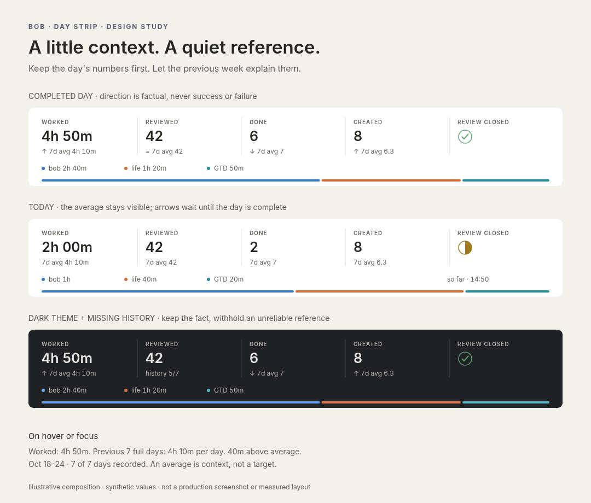

# Day strip comparisons: make the previous week a quiet reference

Independent research by **cdx**, 26 October 2026. This report was produced without consulting the other swarm researchers or their reports. It recommends a design; it does not implement or deploy the feature.

**Recommendation:** put a small, neutral reference line beneath each numeric fact: **`↑ 7d avg 4h 10m`**. The large number remains the selected day's value; the small number is the preceding seven calendar days' arithmetic mean. On completed days, a direction mark makes the relationship immediately visible. **Today shows the same average without a direction mark**, because an unfinished day and seven whole days are not comparable measures of pace. Compute the references in Bob, disclose their dates and coverage, and withhold a reference when the seven-day history is incomplete.



*Synthetic design study, not a production screenshot. The surrounding panels represent separate note surfaces, not new cards inside the strip. [Scalable SVG](media/day-strip-seven-day-reference-design__cdx.svg). The composition demonstrates hierarchy and states; actual layout must be checked at the existing note widths.*

## What exists, and why that matters

I inspected bob-cli at `b5ba95c96ec51418ad312e5e1b4e1fa71bb2753c` and the linked bob-plugins checkout at `43a04d6d31cc83c99354173364788d6fee0a42e6`. Repository-relative paths below identify the evidence at those revisions.

The “table” is currently a five-column grid of clickable facts, followed by a root-parent legend and the colored time-allocation bar. It folds to three columns at narrow widths. The default facts are:

| Fact | Actual meaning | Comparison implication |
| --- | --- | --- |
| Worked | Minutes in **closed** Pomodoros; open sessions do not count | It changes in steps, not as a running stopwatch. More minutes need not mean better work. |
| Reviewed | Distinct decision-tier walk row keys with a journaled answer on that date | Review demand varies. This is neither time spent nor the number of every review gesture. |
| Done | Currently DONE, non-recurring tasks with that completion date, with documented exclusions | Reopening a task changes history. Counts do not measure task size. |
| Created | Non-recurring tasks with that creation date, with the same exclusions | The registry already calls its direction neutral. More captured tasks is ambiguous. |
| Review closed | Boolean checklist state | Keep its existing status mark; do not turn it into a numeric comparison. |

Evidence: bob-cli `src/native/stats/registry.rs` (`BUILTINS`), `metrics.rs`, `journal.rs`, and `docs/stats.md` (“Day strip”); bob-plugins `plugins/bob-ledger-tools/src/239-plugin-day-strip-model.js` (`DAY_STRIP_METRIC_IDS`, `dayStripBuildFact`). Built-ins can be redefined, so implementation must check the returned unit rather than assume a metric ID permanently means minutes or count.

Bob already owns values, labels, definitions, formatting, quality, and provisional status. The renderer selects the relevant daily point and lays it out. Preserve that division. The strip's cache coverage check already asks for **D−7 through D**, and its fallback request uses that exact date range. This is a favorable starting point, but it is **not an existing seven-day comparison calculation**. Evidence: `239-plugin-day-strip-hosts.js`, `dayStripDefaultReportCovers` and `dayStripRequestFor`.

I ran the production browser preview with synthetic fixtures:

```sh
node scripts/preview-day-strip.cjs --out <scratch-directory>
```

At the inspected plugin revision, Chrome 156.0.8078.47 passed **114 cells**, covering 410/540/700 px widths, light/dark themes, and the existing loading, stale, missing, wide-value, interaction, and Reading-view cases. There were no reported overflow failures. Today's measured strip was **81.1 px** at 540/700 px and **131.6 px** at 410 px. This establishes the current renderer baseline, not validation of the proposed feature.

There is a relevant documentation discrepancy: bob-cli `docs/stats.md` still gives 56/80 px limits, while the plugin preview actually enforces 84/136 px. Resolve this as part of the feature's layout specification; do not design to the outdated smaller figures or silently relax the executable checks.

## Is the idea good?

**Yes, as context for reflection. It is a weak basis for grading a day.** “Six tasks” is easier to interpret alongside “seven per day last week.” The previous week is a memorable, inspectable reference and adapts to recent activity. The feature can also make changes in the records worth investigating.

There are five reasons to keep it restrained:

1. **A day-to-average comparison is not a trend.** A single point above a mean says nothing by itself about a sustained improvement. Avoid “trending up,” “on track,” and “behind.” A rising diagonal arrow also suggests a time trend; use a simple vertical arrow, explicitly described as above or below the reference.
2. **An average is not a target.** Worked, Reviewed, and Done all measure activity, with different limitations. Created is explicitly ambiguous. Red/green evaluation would introduce a motivational policy the user did not request.
3. **Today is unfinished.** At 10:00, a low total relative to complete days is expected. Closing the morning review does not complete the workday. The “so far” timestamp is useful context, but it does not make a prominent downward signal a fair pace comparison.
4. **A seven-day mean can be unrepresentative.** Six days at 1 and one day at 22 produce a mean of 4; today at 3 is below that mean but above six of the seven observations. NIST explains why extreme values pull the mean and why a median is more robust. Retain the requested arithmetic mean, but call it an average, not a “normal range.” [NIST: Measures of Location](https://www.itl.nist.gov/div898/handbook/eda/section3/eda351.htm).
5. **Weekly rhythms matter.** Five 8-hour days and two zero days average about 5h 43m. An ordinary 8-hour weekday would appear above average. The seven-day window contains each weekday once, but it does not make a particular weekday comparable to that mix. NIST's seasonality guidance supports examining recurring patterns; whether Bryan's records have such a pattern remains unmeasured here. [NIST: Seasonality](https://www.itl.nist.gov/div898/handbook/pmc/section4/pmc443.htm).

There is also a reason to resist making this a miniature scorecard. Etkin's six experiments found that personal measurement could increase activity while reducing enjoyment in the studied activities. That is not evidence that this Bob feature will have the same effect, especially for work; it is a reason to evaluate whether the feature promotes useful reflection or merely pressure to beat yesterday's numbers. [Etkin, *The Hidden Cost of Personal Quantification*, 2016](https://scholars.duke.edu/publication/1134328).

## Alternatives and my choice

| Approach | Benefit | Cost or misleading implication | Decision |
| --- | --- | --- | --- |
| Red/green percentage badges | Highly noticeable | Implies good/bad; low bases produce dramatic percentages; zero bases are undefined | Reject |
| Neutral signed absolute deltas | Precise; familiar units | Hides the baseline; small fractional count differences can feel fussy | Put in the explanation, not the default row |
| **Reference average + neutral direction mark** | Shows the actual reference; works at zero; easy to inspect | Adds one text line; magnitude is read from the pair of numbers | **Choose** |
| Tiny bullet bars with average ticks | Compact comparison using position and length | Needs a scale; risks looking like goal progress; competes with the existing allocation bar | Strong alternative for a larger Stats view |
| Sparkline with mean line | Shows outliers and sequence | Answers a broader question; seven points in a tiny cell require more interpretation | Keep history in Stats |
| Median or same-weekday baseline | More useful for some distributions and rhythms | Changes the question and needs a different label or longer history | Revisit after use, not silently substitute |
| Same-time-of-day average | Fairer answer to “how am I doing by now?” | Cannot reconstruct all four metrics reliably from current data | Defer |

Stephen Few's bullet-graph specification is a good precedent for making a reference visible while keeping the featured value dominant. A genuine bullet chart also has a quantitative scale; an unexplained tiny fill is not equivalent. My choice borrows the hierarchy but uses text because this strip already has an important bar with a different meaning. [Few: Bullet Graph Design Specification](https://www.perceptualedge.com/articles/misc/Bullet_Graph_Design_Spec.pdf).

Same-time comparison deserves particular caution. Task Created/Done are currently date-based facts, and Worked counts closed sessions. Even where timestamps exist for another source, that does not establish a consistent historical intraday series across all four metrics. Never approximate pace by multiplying a full-day average by elapsed clock time: work is not uniformly distributed over 24 hours.

## Proposed visual and interaction design

Preserve the label, the large tabular value, the hairline column separators, the existing click target, and the root-parent bar. Add one compact line directly under each numeric value:

| State | Large value | Secondary line |
| --- | --- | --- |
| Completed day, above | `4h 50m` | `↑ 7d avg 4h 10m` |
| Completed day, below | `6` | `↓ 7d avg 7` |
| Exactly equal | `42` | `= 7d avg 42` |
| Equal at displayed precision | `4h 10m` | `≈ 7d avg 4h 10m` |
| Today, provisional | `2h 00m` | `7d avg 4h 10m` |
| Seven prior days all zero | `3` | `↑ 7d avg 0` on a completed day |
| Incomplete baseline | `42` | `history 5/7` |
| Unsupported or boolean unit | Existing value or status mark | No comparison line |

**The arrow describes the large value relative to the small average.** It does not describe the average's movement. Use a fixed glyph slot on numeric cells so live-to-complete and above-to-below transitions do not move text. For today's cells leave that slot empty. Use equal ink weight for up and down; no red/green, no saturation ramp, no celebration, no animated counting.

The whole reference line should be quieter than the primary number, but still legible: approximately 12 px at the standard 16 px base, normal or medium weight, tabular digits, existing theme text colors. Do not reduce opacity until it becomes decorative gray. WCAG's minimum contrast for ordinary small text is 4.5:1. The project should check its actual theme pairs rather than assume a token guarantees compliance. [W3C: Contrast (Minimum)](https://www.w3.org/WAI/WCAG22/Understanding/contrast-minimum.html).

Direction is conveyed by a symbol and accessible words, never color alone. This also keeps existing root-parent hues free to identify where time went. [W3C: Use of Color](https://www.w3.org/WAI/WCAG22/Understanding/use-of-color.html).

Preserve the existing three-column fold. If long duration/reference text does not fit, wrap or fold at a wider breakpoint; do not ellipsize the average or the quality indicator. Reserve the same line box in loading states and in the boolean column for stable alignment, without inventing a boolean average. A reasonable **prototype allowance**, not a measured result, is one extra 16–18 px line per fact row: approximately 102 px maximum for one row and 172 px for two, subject to measurement and visual review. Do not shrink the primary values to retain the old height budget.

Hover **and keyboard focus** should expose a short, Bob-supplied explanation:

> Worked: 4h 50m. Previous 7 full days: 4h 10m per day. 40m above average. Oct 18–24, 2026 · 7 of 7 days recorded.

For today:

> Worked: 2h 00m so far. Previous 7 full days: 4h 10m per day. Today's total is still accumulating; this is not a pace comparison.

The full explanation should include the existing metric definition and relevant quality reasons. A `title` attribute alone is not a keyboard-accessible disclosure design. A custom tooltip must be hoverable, dismissible, and persistent while used; Escape should dismiss it. Keep the fact itself as the existing Stats link and avoid adding a nested button or extra tab stop. Clicking or Enter still opens Stats with the metric and date pinned. Put the same reference detail in the pinned-day view so it is available beyond a transient tooltip. [W3C: Content on Hover or Focus](https://www.w3.org/WAI/WCAG22/Understanding/content-on-hover-or-focus.html).

Expose words such as “above the previous seven-day daily average” in an accessible description. Preserve the current accessible name containing label and value; this avoids breaking the renderer's existing name convention. Do not announce every refresh through a live region. The meaningful interaction is inspecting a fact, not hearing background updates.

## Precise calculation and quality rules

For a note date D and one numeric metric m:

```text
window = the seven calendar dates D−7, D−6, …, D−1
S      = sum of the seven eligible daily values for m
mean   = S / 7
delta  = value(m, D) − mean
```

Use local calendar dates consistently with Bob's existing daily-note and report semantics. Never subtract seven times 86,400 seconds. A past note uses its own D, not the current date. Exclude D even when it is complete; exclude future and provisional observations from the reference. Include weekends and recorded zero days. Do not substitute the last seven active days, or reach farther back to replace a missing day.

**Recommended first-release eligibility: seven finite, non-provisional daily observations with `quality: ok`.** A missing date, `missing`, `not_tracked`, or `partial` observation prevents the seven-day reference. Continue displaying today's available fact and say `history n/7`, meaning n eligible days in that exact window. The explanation lists excluded dates and their reasons. New tracking with no complete history reads `history 0/7`, with a tracking-start explanation.

This is deliberately conservative. In existing Bob, `partial` can mean either estimated Pomodoro durations or unavailable durations, which have different implications. Treating every finite partial value as equally trustworthy would conceal that difference. The cost is occasional withheld references even when range estimates are useful. If this is frequent in real use, introduce a machine-readable distinction between complete estimates and incomplete totals before allowing an explicitly estimated baseline. Do not parse an English `reason` string to decide eligibility. Evidence: bob-cli `metrics.rs`, `evaluate_pomodoros`; `value.rs`, `DataQuality`.

The distinction between zero and missing is already real: a daily note with a valid empty Pomodoros section yields zero; a missing daily note or section yields missing. A closed review with no journal answers can be a missing-data gap, rather than zero reviews. Task counts are derived from their indexed dated records, so the renderer must not invent an additional daily-note-exists condition for them. Evidence: `metrics.rs` and `journal.rs`, `evaluate_journal`.

For a complete baseline but a missing/partial current observation, show the average as context without a direction mark or delta. For future notes, preserve the existing hidden state. For a failed refresh, retain the entire previous snapshot with its existing stale treatment and timestamp; never combine a new current value with an old baseline. The next calendar day only receives final comparison marks after a fresh report removes yesterday's provisional state.

Maintain rational precision internally: keep S and denominator 7, or equivalent fixed precision, and round only the display. Show count means to at most one decimal, trimming `.0`; show duration means to the nearest minute. Thus 44/7 becomes `6.3`, not `6`. For comparison direction, use the same display precision as the absolute delta. If the exact delta is zero use `=`; if it rounds to zero use `≈`, described as equal at display precision. This is a formatting rule, **not** a confidence interval or an assertion of statistically insignificant change. No arbitrary ±10% “normal” band.

Zero needs no exception to the main design: an average of zero displays zero, and a positive current value has a finite absolute difference. A percentage is unnecessary. For example, six prior zeros and one prior 1 yield a mean of 0.143; a current 1 is technically 600% above it, a poor headline for a single item.

Do not add percentage baselines or rate comparisons merely because a boolean is encoded numerically. Initially support the actual minutes/count facts, plus signed values when a built-in is redefined accordingly. An unsupported returned unit retains its existing fact with no reference and an explanatory detail. Percentage/rate metrics need a separate decision about daily mean versus pooled numerator/denominator, with changes in percentage points where appropriate; do not guess.

Finally, these are comparisons of **currently reconstructable records**, not immutable historical productivity. Reopened/deleted tasks and corrected logs can change both the numerator and reference later. Preserve this existing Stats meaning and make it available in the definition/limits disclosure.

## Where the implementation should live

Add an optional, additive seven-day reference object to **daily series points in Bob's Stats JSON**, rather than a plugin-only mean or a separate command. A possible contract is:

```json
{
  "date": "2026-10-25",
  "value": 290,
  "display": "4h 50m",
  "quality": "ok",
  "provisional": false,
  "reference_7d": {
    "state": "ready",
    "start": "2026-10-18",
    "end": "2026-10-24",
    "days_expected": 7,
    "days_usable": 7,
    "mean": { "sum": 1750, "denominator": 7, "display": "4h 10m" },
    "display": "7d avg 4h 10m",
    "comparison": {
      "relation": "above",
      "display": "+40m",
      "words": "40 minutes above the previous seven-day daily average"
    }
  }
}
```

This is a proposed contract, not an assertion that the field exists. For an insufficient reference, return a state, usable-day count, excluded-date reasons, and supplied display/description; omit mean/comparison. For a provisional or invalid current point, the mean may be ready while `comparison` is absent. Keeping reference readiness separate from current-day comparability avoids treating today as bad history. The renderer maps a supplied relation to a glyph; it does not recompute the mean, thresholds, delta, or prose.

Relevant implementation seams and traps:

- **`report.rs`:** `SeriesPoint` is the additive schema seam. Do not alter existing `value`, `display`, `rolling_median`, or summary meanings. Keep older clients working, and have the new plugin gracefully omit the enhancement when the field is absent.
- **`series.rs` / `compute.rs`:** calculate references from evaluated daily inputs before presentation grouping. A daily point inside a week/month report needs the same reference as the same point in a day report. Never attach a daily comparison to a whole weekly bucket.
- **Lead-in:** the current day-group rolling median uses six earlier days, and includes the target point in its seven-point window. This feature needs **seven earlier days and excludes the target**. Explicitly ensure that the earliest emitted daily point has D−7 evaluated, including grouped reports' `daily_points`. An existing prior-period window may incidentally supply those dates, but that is not the invariant to rely on.
- **Existing fields are wrong shortcuts:** `summary.mean` covers the selected complete report window and is rounded to an integer; `summary.delta` compares period headlines; `rolling_median` is a median with a different window and partial-history policy. None is this reference. Evidence: `series.rs`, `summarize_with_prior`, `mean`, `add_rolling_medians`, and `display_daily_points`.
- **Plugin:** extend `239-plugin-day-strip-model.js`, `239-plugin-day-strip-render.js`, the relevant Stats pinned-day view, and `styles.css`. Preserve `statsChartDailyPoints`, so day grouping uses `points` and grouped reports use `daily_points`.
- **Cache and refresh:** reuse the existing request, visibility gate, shared single-flight queue, and rollover safeguards. No request per cell, no new minute timer, no durable baseline cache. Absence of the new field in an old Bob response must not trigger an endless fetch loop. Config and record changes should invalidate through the existing Stats path.
- **Cost:** use a rolling accumulator with an eligibility count if producing references for long histories. The data is already evaluated in one Stats pass; the feature should add no vault scan. Measure serialization size and time for the default and all-history reports, as per-point prose can cost more than the arithmetic.
- **Delivery:** build committed plugin fragments, use the repo's existing validation/preview commands, and deploy with `bob plugins sync` when implementing. Coordinate additive JSON support with the existing daily CLI release train; do not force a new CLI flag or version change for this research.

## Requirement adjustments, explicitly

1. **Today gets reference context, not direction arrows.** This is the largest change to the original request. It trades an immediate “up/down” signal for a fairer presentation while still putting the comparable historical number beside every live numeric fact. Do not introduce pace estimation in version one.
2. **Only trustworthy seven-day histories get a seven-day average.** Incomplete history receives an honest coverage state. No zero imputation, no unlabeled five-day average, no backfilling from older dates.
3. **Use neutral magnitude and direction, not performance coloring.** The strip answers how values compare, not whether the day was good.
4. **Make the average visible; keep absolute differences in details.** Avoid percentage badges and four extra mini charts. This makes the reference inspectable and handles zero naturally.
5. **Allow one extra line of height.** Reconcile the documented and actual layout budgets and measure the new result. Do not pay for the feature by making existing numbers smaller.
6. **Scope initial numeric support to well-defined units.** Do not compare the review-status boolean; do not silently invent rate aggregation when a configured metric uses a different unit.

These are product recommendations, not existing accepted decisions. In particular, the strict seven-good-days rule and the treatment of today are deliberate choices that should be reviewed as such.

## Validation before shipping

The most valuable tests exercise semantics that can look plausible while being wrong:

| Case | Expected result |
| --- | --- |
| Seven 250-minute days; D = 290 | Mean 250, delta +40, above on a completed day |
| Prior sum 44; D = 8 count | Mean 6.3 displayed, delta +1.7; no integer truncation |
| Seven zeros; D = 3 | Average 0 and finite difference; no infinity or “new” label |
| One missing, not-tracked, or partial prior point | Exact seven-date window retained; no ready reference |
| Seven valid zeros including rest days | All seven are counted |
| D is today; review already closed | Average visible; no direction or pace judgment |
| Same D from cached default, custom daily, and grouped report | Identical reference and quality state |
| D is first displayed day | Complete D−7 lead-in is evaluated |
| Midnight, DST, month/year rollover | Correct calendar dates; no formerly provisional cache reused as final |
| Baseline edit or metric definition change | Current and reference recomputed together |
| Old Bob, hidden metric, redefined unit | Existing facts remain usable; no guessed comparison |

Then extend the existing browser matrix with the new reference row, one-decimal means, long durations, missing history, forced colors, enlarged text, hover/focus disclosure, and narrow widths. Check matching skeleton heights, stable value baselines, no clipping, preserved click/keyboard behavior, and the final full-width allocation bar. Test the explanation with a screen reader rather than relying only on DOM snapshots. The 114-cell pass reported above is only the unmodified renderer's baseline; none of these feature tests has yet run.

For a small personal trial, use the feature for roughly two weeks and ask three concrete questions: Can Bryan explain the baseline without opening documentation? Does today's presentation feel informative rather than like a shortfall? Does the comparison lead to useful inspection in Stats? This is a suggested usability trial, not a statistical validation period. If weekday effects repeatedly dominate interpretation, evaluate a clearly labeled same-weekday baseline over a longer history. If outliers dominate, evaluate a median. If comparison is distracting, remove the direction marks before adding more configuration or more charts.

## Confidence and limits of this research

The architecture and existing metric meanings are grounded in the inspected code, audited glossary reads, documentation, and a production-renderer fixture run. The visual study was rendered and inspected separately. No live-vault productivity distribution was sampled, no causal benefit is claimed, and the proposed layout has not been implemented in the production renderer. Sources support the statistical and accessibility principles; the precise typography, seven-good-days policy, and live-day treatment are my design judgments. No peer research was used.

## Recommended solution

**Implement a quiet reference line under Worked, Reviewed, Done, and Created: the preceding seven full calendar days' arithmetic mean, with neutral direction marks only for completed days.** Show today's average without an arrow, show coverage instead of a misleading average when history is incomplete, and disclose exact dates and absolute differences on inspection. Compute and format the reference in Bob, reuse the existing Stats request/cache, and preserve the strip's visual hierarchy and navigation. This gives the requested comparison a useful, trustworthy role without turning the day strip into a scoreboard.
