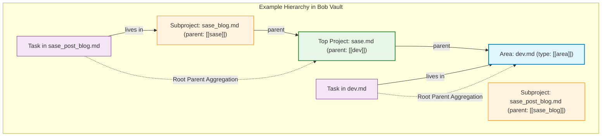

# Research Report: Day Strip Visual Architecture, Root Parent Aggregation, and Stats Modernization

**Author:** researcher gem (`research.59.gem`)  
**Date:** 2026-10-25  
**Topic:** Redesigning the Daily Note Day Strip (Above Badges, Restoring Tile Look), Root Parent Aggregation, Stats Dash Integration, and Deprecations  
**Status:** Complete Proposal & Critique

---

## Executive Summary

This research investigates a comprehensive architectural and visual overhaul of Bryan's daily productivity tracking surfaces across `bob-cli`, `bob-plugins`, and the Bob vault. The initiative addresses several interrelated components:

1. **Repositioning & Visual Hierarchy:** Moving the daily note Day Strip from *below* the plan badges to *above* them, utilizing the working time bar as a natural visual boundary separating macro-level daily performance metrics from active GTD task execution queues.
2. **Restoring the "Old Look" Without the Overlap Bug:** Re-establishing the rich, informative tile presentation (five metrics, bold figures, and 8-point sparkline history marks) originally introduced in epic `bob-cli-bp`. We resolve the severe layout collapse that led to the drastic over-simplification in `bob-cli-bz` by addressing the root CSS conflict—Obsidian's default `button { height: 30px }` stylesheet constraint—using semantic, unconstrained layout elements.
3. **Root Parent Aggregation:** Transitioning the working time bar (and analytical stats reporting) from coarse area-level aggregation or fragmented subproject-level tracking to **Root Parent** aggregation. A root parent is defined as the top-level project in a task's ancestry (a project note having an area note as its direct parent) or an area note if the task resides directly in an area note.
4. **Stats Dash (`~/bob/dash_stats.md`) Alignment:** Upgrading the "Where the time went" section of the Stats Dash to support clean root-parent aggregation alongside pomodoro theme grouping, eliminating noisy subproject fragmentation while preserving macro area context.
5. **Obsoletion of Redundant Mechanisms:** Retiring the inline Dataview aggregation formula in the daily note `## Pomodoros` H2 header (which duplicates Day Strip figures and taxes note-edit performance) and deleting the per-project `rollup: subprojects` frontmatter configuration, which becomes fully obsolete under root-parent aggregation.
6. **Glossary Memory Strands:** Defining formal SASE glossary web strands for `top-level-project`, `root-parent`, `day-strip`, and `stats-dash`.

### Verdict & Core Critique

Bryan's proposed direction is **conceptually sound, visually superior, and architecturally elegant**. The previous agent intervention in `bob-cli-bz` was a classic overreaction: rather than fixing an isolated 30px CSS button box-model defect, it gutted the sparkline history marks, collapse controls, and tile typography, reducing a dashboard receipt to two flat text lines. 

Moving the Day Strip above the badges establishes a natural, top-to-bottom cognitive progression:
$$\text{Where I stand today (Facts/Tiles)} \longrightarrow \text{Domain boundary (Time Bar)} \longrightarrow \text{Actionable Queues (Badges)} \longrightarrow \text{Session Ledger (Pomodoros)}$$

Furthermore, root parent aggregation hits the organizational "Goldilocks zone": area aggregation was excessively broad (lumping 59% of all development into an undifferentiated `dev` bucket), while raw project aggregation was severely fragmented across dozens of ephemeral subprojects (`sase_blog`, `sase_memory_plan`, etc.).

We recommend proceeding with the plan, with four specific refinements detailed in this report:
- Refine the root parent fallback resolution for tasks residing in non-project child notes (e.g., reading tasks in reference notes) and orphaned projects.
- Adopt a full-width segmented time bar with a discrete legend row below it to maximize divider efficacy.
- Implement subtle segment separators and palette slotting so sibling top-level projects under the same area are distinguishable.
- Retain macro area groupings in `dash_stats.md` while rolling up project rows to root parents, providing the best of both macro and micro analysis.

---

## 1. Root Cause Analysis: The "Old Look" vs. `bob-cli-bz` Overreaction

### 1.1 The Shipped "Rich Look" (`bob-cli-bp`)

In epic `bob-cli-bp` (`plan:202610/daily_note_day_strip.md`), the Day Strip was conceived as a rich daily statistical receipt. Its layout featured:
- **Five Metric Tiles:** `WORKED`, `REVIEWED`, `DONE`, `CREATED`, and `REVIEW CLOSED`.
- **Three-Tier Tile Content:**
  1. Uppercase small-caps label (e.g., `WORKED`).
  2. Primary display value in bold tabular figures (e.g., `3h 05m`, `17`, `not yet`).
  3. An 8-point sparkline history row ($D-7 \dots D$) consisting of 14px vertical bar glyphs or dot indicators showing recent trend momentum.
- **Working Time Mix Bar:** A stacked horizontal bar showing time distribution, accompanied by a legend (`● gtd 1h 45m  ● dev 1h 20m`), timestamp (`so far · 14:50`), and `Stats ↗` link.
- **Collapsible Drawer:** A chevron toggle allowing the strip to collapse into a single text line.

### 1.2 The Layout Bug (Verified Mechanism)

Bryan encountered severe visual corruption where sparkline marks overlapped the time mix bar, legend items clashed, and controls collided. 

Investigation of the CSS environment reveals the exact mechanism:
1. In `plugins/bob-ledger-tools/src/239-plugin-day-strip-render.js` (prior to commit `d77503c`), every tile, the mix action, and the collapse toggle were constructed using `<button>` elements (`statsEl(doc, "button", ...)`).
2. Obsidian's core theme stylesheet (`app.css`) enforces a global rule on button elements:
   ```css
   button {
     display: inline-flex;
     height: var(--input-height); /* exactly 30px */
     align-items: center;
     /* padding, background, box-shadow */
   }
   ```
3. While `styles.css` stripped the button background and border, it did **not** override `height: var(--input-height)`.
4. The natural content height of a tile—label (12px) + value (22px) + history sparkline (14px) + vertical gaps (6px)—totals **54px**.
5. Trapped inside an unyielding 30px flex box without `overflow: hidden`, the history marks and values spilled outside the button boundary. Because the mix bar was rendered immediately following the tiles flex container, the overflowing sparkline marks rendered directly on top of the mix bar track.

```
+-------------------------------------------------------------+
| BUTTON CONTAINER (height: 30px enforced by Obsidian app.css)|
|  LABEL (WORKED)                                             |
|  VALUE (5h 25m)                                             |
+--[ 30px BOUNDARY ]------------------------------------------+
|  SPARKLINE MARKS (14px) OVERFLOWING OUT OF CONTAINER        |
|  ========================================================== | <-- MIX BAR
|  (Marks and mix bar draw on identical Y coordinates)        |
+-------------------------------------------------------------+
```

### 1.3 The Flawed Intervention in `bob-cli-bz`

In commit `d77503c` and `plan:202610/day_strip_under_the_badges.md`, the implementing agent misinterpreted this straightforward CSS box-sizing bug as fundamental "visual density clutter." Rather than repairing the CSS containment, the agent:
- Stripped all history sparkline marks.
- Deleted the tile containers entirely.
- Removed the collapse chevron and persistence storage.
- Flattened the entire Day Strip into two plain text lines:
  ```text
  WORKED 5h 25m   REVIEWED 64   DONE 30   CREATED 40   REVIEW CLOSED not yet
  ▬▬▬▬▬▬▬▬▬▬  ● gtd 3h 50m   ● dev 1h 35m                       so far · 14:50
  ```
While this resolved the button clipping by eliminating the buttons and marks, it discarded the visual richness, glanceable hierarchy, and trend context that Bryan valued. Bryan's feedback was explicit: *"Also, I liked the old look better. You were just supposed to fix the overlap."*

### 1.4 Fixing the Overlap Permanently

Restoring the old look without reintroducing the overlap bug requires three concrete architectural adjustments:
1. **Semantic Elements:** Replace all `<button>` tags with `<div role="button" tabindex="0">` or `<span role="link">`. This completely bypasses Obsidian's global `button` height constraints and flex alignments.
2. **Explicit Sizing Resets:** In `styles.css`, assign explicit sizing rules:
   ```css
   .bob-day-strip-tile {
     display: flex;
     flex-direction: column;
     height: auto !important;
     min-height: 48px;
     box-sizing: border-box;
     padding: 4px 8px;
     background: transparent;
     border: none;
     cursor: pointer;
   }
   ```
3. **Structured Vertical Rhythm:** Enforce a clear vertical flex hierarchy inside the strip container:
   - Row 1: Tiles Container (`display: flex; flex-direction: row; justify-content: space-between;`)
   - Row 2: Working Time Bar (`width: 100%; margin: 8px 0 4px 0;`)
   - Row 3: Legend & Metadata Line (`display: flex; justify-content: space-between; align-items: center;`)

---

## 2. Layout & Spatial Architecture: Day Strip Above Badges

### 2.1 Placement Analysis: Above vs. Below Badges

In `bob-cli-bz`, the strip was placed *under* the plan badges:
```markdown
^gtd
[TODAY 3/3 · 7/10] [PENDING 4/10] [NEXT 15/15] [READY 61/100]  ★ GTD · BOB   <-- Plan Badges
WORKED 5h 25m   REVIEWED 64   DONE 30   CREATED 40   REVIEW CLOSED not yet    <-- Day Strip Line 1
▬▬▬▬▬▬▬▬▬▬  ● gtd 3h 50m   ● dev 1h 35m                       so far · 14:50  <-- Day Strip Line 2
## Pomodoros
```

Bryan proposed moving the Day Strip to **above** the plan badges:
```markdown
^gtd
[ Day Strip: 5 Metric Tiles with Sparkline Marks ]
[ Working Time Bar: Full-Width Stacked Horizontal Bar ]                     <-- Natural Separator
[ Plan Badges: TODAY | PENDING | NEXT | READY | Theme ]
## Pomodoros
```

### 2.2 Why This Is Architecturally Superior

1. **Logical Temporal & Operational Flow:**
   - The Day Strip reflects **macro historical facts** accumulated across the day (what has already occurred).
   - The Working Time Bar summarizes the **domain distribution** of that effort.
   - The Plan Badges represent **immediate tactical constraints** (capacity caps, queue status, what to pull next).
   - The `## Pomodoros` section is the **active execution workspace** where timestamps are logged.
   
   Placing the Day Strip above the badges aligns with natural top-to-bottom reading: from high-level daily summary to tactical queue health to operational log entries.

2. **The Working Time Bar as a Structural Divider:**
   When placed below the tiles and above the badges, the working time bar provides a continuous horizontal visual anchor across the reading column. It creates an organic separation between the statistical scoreboard (tiles) and the queue pills (badges) without requiring artificial `<hr>` dividing lines.

3. **Lifecycle & Codeblock Mounting Stability:**
   Both the plan badges and the Day Strip are rendered inside the `bob-plan` codeblock processor (`renderPlanBlock` / `paintPlanBlock`). In `bob-cli-bz`, `dayStripPlanHostPlacePlanFirst` forced `.bob-plan` (the badges container) to precede `stripHost`. 
   
   Reversing this ordering in `paintPlanBlock` is trivial and robust:
   - Container child 0: `.bob-day-strip-plan-host`
   - Container child 1: `.bob-plan` (badges)
   
   Both elements remain encapsulated within the single `bob-plan` DOM block, preserving unified visibility gating, zero CodeMirror editor pollution, and seamless operation in both Live Preview and Reading view.

### 2.3 Proposed Visual Target (Desktop / Wide Viewport)

```text
^gtd
┌────────────────────────────────────────────────────────────────────────────────────────────────────────┐
│  WORKED          REVIEWED        DONE            CREATED         REVIEW CLOSED                         │
│  5h 25m          64              30              40              not yet                               │
│  ▃▅▆▅▂▁▅▯        ▇▆▇▆▆▅▅▁        ▆▆▇▅▆▃▂▫        ▇▅▇▅▂▁▅▯        ● ● ● ● ● ● ● ◌                       │
│                                                                                                        │
│  █████████████████████████████████░░░░░░░░░░░░░░░░░░░▒▒▒▒▒▒▒▒▒▒▒▒▒▒▒                                  │
│  ● sase 2h 45m   ● bob 1h 55m   ● dev 45m                                           so far · 14:50  ↗  │
└────────────────────────────────────────────────────────────────────────────────────────────────────────┘
 [TODAY 3/3 · 7/10]  [PENDING 4/10]  [NEXT 15/15]  [READY 61/100]   ★ GTD · BOB

## Pomodoros
- [x] (**0720-0745** [t:: 25m]) — GTD
	- 🍅 [[#^gtd]]
```

### 2.4 Responsive Handling (Narrow / Split-Pane Viewport < 480px)

On narrow split panes, 5 horizontal tiles can become cramped if forced onto a single line. The design accommodates narrow viewports via CSS flex-wrap:

```text
┌────────────────────────────────────────────────────────┐
│  WORKED        REVIEWED      DONE                      │
│  5h 25m        64            30                        │
│  ▃▅▆▅▂▁▅▯      ▇▆▇▆▆▅▅▁      ▆▆▇▅▆▃▂▫                  │
│                                                        │
│  CREATED       REVIEW CLOSED                           │
│  40            not yet                                 │
│  ▇▅▇▅▂▁▅▯      ● ● ● ● ● ● ● ◌                         │
│                                                        │
│  ████████████████████░░░░░░░░░░▒▒▒▒▒▒                  │
│  ● sase 2h 45m  ● bob 1h 55m  +1       so far · 14:50  │
└────────────────────────────────────────────────────────┘
 [TODAY 3/3] [PENDING 4/10] [NEXT 15/15] [READY 61/100]
```

---

## 3. Root Parent & Top-Level Project Aggregation

### 3.1 Understanding the Problem with Current Aggregations

Currently, `bob stats` computes parts along three axes:
1. `area`: Aggregates strictly by top-level area note (`dev.md`, `gtd.md`, `job.md`, etc.).
2. `project`: Aggregates by the immediate note containing the task link. If `rollup: subprojects` is explicitly specified on an ancestor project note, it rolls up into that project; otherwise, every subproject note produces its own separate bucket.
3. `theme`: Aggregates by Pomodoro theme tags (`GTD`, `BOB`, `JOB`, etc.).

#### The Limitations of the Status Quo:
- **Area Aggregation is Excessively Coarse:** In Bryan's vault, querying `worked` reveals that **59% of all working time** falls into `dev.md`. The Day Strip mix bar simply shows a massive blue `dev` block. Bryan cannot see whether his day was spent developing `bob-cli` or `sase`.
- **Project Aggregation is Excessively Fragmented:** Without manual `rollup` annotations, `sase` work splinters into dozens of granular subproject notes: `sase_blog.md`, `sase_pypi_releases.md`, `sase_goals.md`, `sase_memory_plan.md`, `sase_projects.md`, etc.
- **`rollup: subprojects` is High-Maintenance:** Requiring manual frontmatter configuration on every major project note is brittle. When omitted on a new project, stats fracture immediately.

### 3.2 Defining "Root Parent"

Bryan's prompt defines the target mental model:
> *"prefer to aggregate by the 'top-level project' (i.e. the project in a task's ancestry--ancestry refers to walking the `parent` frontmatter fields--associated with a prj note that has an area note as its parent, not another project). We should aggregate by area iff the task lives in an area note. We will call this top-level project / area note the 'root parent' for a task. In other words, the working time bar should aggregate by root parent."*

#### Formal Model:
Let $N_0$ be the note containing the task link. The ancestry chain is the sequence of notes $\langle N_0, N_1, \dots, N_k \rangle$ where each $N_{i+1}$ is the note resolved from $N_i$'s frontmatter `parent: "[[...]]"` link, terminating when $N_k$ has no parent, resolves to itself, or exceeds depth 16.

Let $\text{Kind}(N) \in \{\text{Area}, \text{Project}, \text{Other}\}$.

1. **Direct Area Residence:** If $\text{Kind}(N_0) == \text{Area}$, the root parent is $N_0$.
2. **Top-Level Project Resolution:** If $\text{Kind}(N_0) \neq \text{Area}$, search the ancestry chain for an index $i \ge 0$ such that:
   $$\text{Kind}(N_i) == \text{Project} \quad \land \quad \text{Kind}(N_{i+1}) == \text{Area}$$
   If such an $N_i$ exists, $N_i$ is the **Top-Level Project**, and is designated the **Root Parent**.



### 3.3 Critical Edge Cases & Recommended Rule Refinements

A rigorous evaluation of Bryan's phrasing surfaces two vital edge cases that require explicit specification:

#### Edge Case A: Tasks in Non-Project, Non-Area Notes (e.g., Reference Notes)
*Scenario:* Bryan has a reading task on a book or article: `ref/clean_architecture.md`. Its frontmatter is:
```yaml
type: "[[ref]]"
parent: "[[dev]]"
```
Here, the task lives in `ref/clean_architecture.md` (which is not an area note). Its parent is `dev.md` (an area note). There is **no project** in its ancestry chain.
- Under a strict literal reading of *"We should aggregate by area iff the task lives in an area note"*, this task cannot aggregate to `dev` (since it doesn't live in `dev.md`), nor does it have a top-level project.
- *Recommended Refinement:* If the ancestry walk encounters an Area note without encountering any Project note, the task aggregates to that **Area Note** (representing "Area tasks / Reference reading under [Area]").

#### Edge Case B: Standalone / Orphaned Projects
*Scenario:* A project note `prj_quick_prototype.md` has `type: [[project]]`, but either has no `parent:` frontmatter or points to an invalid link.
- Under a strict literal reading, it has no area parent, so it would fail the top-level project definition.
- *Recommended Refinement:* If a project note has no project ancestors and no area parent, it should be treated as an **Orphaned Top-Level Project** and serve as its own root parent, while surfacing a health warning in `bob stats` linting (`orphan_project: missing area parent`).

#### Edge Case C: Color & Hue Attribution for Sibling Root Parents
*Scenario:* Both `sase.md` and `bob.md` are top-level projects under `dev.md`. Currently, in `pomodoro_homes/resolve.rs`, a project inherits its area's hue. Thus, both `sase` and `bob` would be assigned `blue`.
- If both are worked on in the same day, the working time bar would contain two adjacent blue segments!
- *Recommended Solution:* 
  1. Top-level projects inherit their Area's base hue family, but segments in the mix bar are visually separated by an explicit `1.5px` background-contrast separator.
  2. In the legend and stats panel, distinct slot hues or project-specific pins from `.bob/themes/` should take precedence if defined, falling back to area hue.

---

## 4. Stats Dash (`~/bob/dash_stats.md`) Integration

### 4.1 The Current Stats Dash Architecture

Bryan's Stats Dash (`dash_stats.md`) mounts the `bob-stats` block, which currently provides a toggle between:
```text
[ Areas & projects ]   [ Themes ]
```
Under `Areas & projects`:
- An **Area Split Bar** spans the top: `Area split: dev 74h 11m (59%), gtd 37h 18m (29%), job 12h 08m (10%)`.
- Below it, accordion sections group projects by Area:
  - `▼ dev`
    - `sase` (includes subprojects only if `rollup` is on)
    - `sase_blog` (if rollup is off)
    - `bob`
    - `dev · area tasks`

### 4.2 Evaluating the Three Options for `dash_stats.md`

Bryan asked:
> *"We already have a button that supports aggregating by theme, so I was thinking we could just add a third button for this? Or maybe we should just always aggregate by the root parent (unless the theme button is used)? I'll let you decide this one."*

We evaluated three architectural options:

| Criterion | Option 1: Always Root Parent (Replace) | Option 2: Three-Way Toggle (`[Areas] [Root Parents] [Themes]`) | Option 3: Hierarchical Root Parent View (Recommended) |
| :--- | :--- | :--- | :--- |
| **Controls** | 2 buttons: `[Root Parents] [Themes]` | 3 buttons: `[Areas] [Root Parents] [Themes]` | 2 buttons: `[Projects & Areas] [Themes]` |
| **Area Totals** | Lost unless separate area bar is kept | Preserved in dedicated "Areas" tab | Preserved as group headers |
| **Noise Level** | Low (subprojects rolled up) | Variable across tabs | Low (subprojects rolled up) |
| **UI Complexity** | Minimal | High (three tabs to maintain) | Optimal (clean two-tab toggle) |
| **Consistency** | 100% matches Day Strip | Inconsistent across tabs | 100% matches Day Strip |

### 4.3 Detailed Assessment & Recommendation: Option 3 (Hierarchical Root Parent View)

We recommend **Option 3**: Keep a clean two-button toggle, but **modernize the primary view to be Root Parent-centric**.

Rename the first toggle button to **"Projects & areas"** (or keep "Areas & projects"):
1. **The Top Stacked Bar:** Now displays the **Root Parent split** (matching the Day Strip working time bar exactly), showing the top root parents: `sase`, `bob`, `gtd`, `job_2026`, etc.
2. **The Groups Below:** Continue to group by Area (`▼ dev`, `▼ gtd`, `▼ job`) to preserve Bryan's high-level life-domain perspective, BUT:
   - Within each area group, **every row is a Root Parent**!
   - `sase` appears as a single unified row (e.g., `27h 45m · 37%`), with an indicator: `includes 7 subprojects (blog, releases, goals, ...)`.
   - Clicking "sessions" on `sase` expands all sessions across `sase` and all its subprojects.
   - Area-resident tasks (tasks not in any project) appear cleanly as `dev · area tasks`.

This eliminates the need for an awkward third toggle button while solving the exact problem: subprojects are permanently rolled into their root parents, eliminating clutter while preserving macro area visibility.

---

## 5. Obsoleting Redundant Vault & Engine Features

### 5.1 Obsoleting Daily File `## Pomodoros` Working Time Title

#### Current State:
In `_templates/daily.md` (and existing daily notes), line 25 reads:
```markdown
## Pomodoros (`= durationformat(default(sum(nonnull(map(filter(this.file.tasks, (task) => task.completed AND startswith(meta(task.section).subpath, "Pomodoros")), (task) => task.t))), dur("0m")), "h'h' m'm'")`)
```
Obsidian's Dataview plugin dynamically computes and displays e.g.:
`## Pomodoros (5h 25m)`

#### Justification for Removal:
1. **Direct Duplication:** The Day Strip sits directly above the plan badges and heading. Its very first tile is prominently `WORKED 5h 25m`. Displaying `(5h 25m)` in the heading 40 pixels below is completely redundant.
2. **Severe Obsidian Editing Overhead:** The inline Dataview expression re-evaluates on every keystroke in the daily file, parsing all task bullets and recalculating durations. In long daily files with 20+ pomodoros and dozens of task links, this contributes to perceptible input latency.
3. **Parser & Codebase Compatibility:**
   - In `bob-cli` (`src/native/pomodoro.rs`):
     ```rust
     pub(crate) fn is_pomodoros_heading(line: &str) -> bool {
         let Some(rest) = line.strip_prefix("##") else { return false; };
         let rest = trim_one_or_more_spaces(rest);
         let Some(rest) = rest.and_then(|text| text.strip_prefix("Pomodoros")) else { return false; };
         rest.is_empty() || rest.starts_with(char::is_whitespace)
     }
     ```
   - In `bob-plugins` (`plugins/bob-navigation-hotkeys`):
     ```javascript
     const POMODOROS_HEADING_RE = /^##\s+Pomodoros(?:\s.*)?$/;
     ```
   Both regexes and parsers explicitly support `## Pomodoros` without any trailing expression. Removing the Dataview query requires zero parser modifications and creates zero breaking changes for existing notes.
4. **Action:** Update `_templates/daily.md` line 25 to simply `## Pomodoros`.

### 5.2 Removing Support for `rollup: subprojects` Frontmatter

#### Current State:
Project notes can include frontmatter:
```yaml
---
type: "[[project]]"
parent: "[[dev]]"
rollup: subprojects
---
```
In `src/native/pomodoro_homes/resolve.rs`:
```rust
let rollup_path = chain
    .iter()
    .enumerate()
    .filter(|(_, (_, facts))| {
        facts.kind == NoteKind::Project && facts.rollup == Rollup::Subprojects
    })
    .map(|(index, _)| index)
    .last();
```

#### Justification for Removal:
1. **Architecturally Obsolete:** When root parent aggregation becomes the universal standard, rolling up subproject time to the top-level project is the **default, invariant behavior**. An opt-in per-file frontmatter flag is completely redundant.
2. **Eliminates Codebase Complexity:**
   - Deletes `Rollup` enum (`Off`, `Subprojects`, `Invalid`).
   - Deletes `rollup_invalid` health reporting and lint tests in `homes.rs` and `resolve.rs`.
   - Simplifies `NoteFacts::parse` in `facts.rs`.
   - Eliminates need for `needs_global_inspect` to scan for `rollup:` in frontmatter.

---

## 6. SASE Glossary Memory Web Strands Specifications

To ensure long-term terminology consistency across agents and documentation, we specify the four required glossary strands to be added under `sase/memory/glossary/`.

### 6.1 `sase/memory/glossary/top-level-project.md`

```markdown
# Top-Level Project

*Requested · project*

aka top project

A Bob vault project note (`type: "[[project]]"`) whose `parent` frontmatter links directly to an [[area-note]], not another project note. A top-level project represents the root of a finite project hierarchy; any project note whose `parent` links to another project note is a sub-project. Top-level projects serve as the primary unit of project aggregation for the [[day-strip]] working time bar and the [[stats-dash]].
```

### 6.2 `sase/memory/glossary/root-parent.md`

```markdown
# Root Parent

*Requested · project*

The canonical top-level entity to which a task or work session attributes its working time and context. For any task, its root parent is:
1. The [[top-level-project]] in its ancestry chain (walking `parent` frontmatter links), if one exists;
2. The [[area-note]] in which the task resides, if the task is not part of a project hierarchy;
3. `@unfiled`, if the task resides outside any area or project hierarchy.

The [[day-strip]] working time bar aggregates today's Pomodoro durations strictly by root parent.
```

### 6.3 `sase/memory/glossary/day-strip.md`

```markdown
# Day Strip

*Requested · project*

aka day stats

The read-only daily statistics receipt rendered at the top of canonical daily notes (`YYYY/YYYYMMDD.md`), positioned directly above the plan badges in the rendered `bob-plan` codeblock in both Live Preview and Reading view (or embedded via a `bob-day-stats` fence). The Day strip displays that note's own day facts—five metric tiles (`WORKED`, `REVIEWED`, `DONE`, `CREATED`, and `REVIEW CLOSED`) with 8-point sparkline history marks—followed by a full-width working time bar aggregated by [[root-parent]]. It reads all values from `bob stats`, never writes note bytes, and is toggled via `Toggle Day stats`. Distinguished from the [[morning-gtd-review-footer]].
```

### 6.4 `sase/memory/glossary/stats-dash.md`

```markdown
# Stats Dash

*Requested · project*

aka stats page, dash_stats

The vault analytics dashboard file located at `~/bob/dash_stats.md`, powered by the `bob-stats` codeblock. It renders multi-day and multi-week vault trends derived by `bob stats`, including overall volume, flow, and the "Where the time went" attribution breakdown aggregated by [[root-parent]] and [[pomodoro-theme]].
```

---

## 7. Comparative Design & Architecture Matrix

| Feature Dimension | Epic `bob-cli-bp` (Initial) | Epic `bob-cli-bz` (Current) | Proposed Redesign (Gem) |
| :--- | :--- | :--- | :--- |
| **Placement** | Bottom of daily note (CodeMirror mount) | Below plan badges (in `bob-plan` block) | **Above plan badges** (in `bob-plan` block) |
| **Visual Style** | 5 tiles + history marks + full mix bar | 2 plain text lines (no tiles, no marks) | **5 tiles + history marks + separator bar** |
| **Separation** | None (sat below all text) | Cluttered underneath plan badges | **Working time bar acts as natural divider** |
| **Time Bar Basis** | Aggregated by `Area` (`dev`, `gtd`, `job`) | Aggregated by `Area` (`dev`, `gtd`) | **Aggregated by Root Parent (`sase`, `bob`)** |
| **Subproject Handling**| Manual `rollup: subprojects` flag | Manual `rollup: subprojects` flag | **Automatic root parent aggregation** |
| **`dash_stats.md`** | Coarse Area bar + scattered projects | Coarse Area bar + scattered projects | **Root Parent bar + clean grouped rows** |
| **Pomodoros Heading**| `## Pomodoros (5h 25m)` via Dataview | `## Pomodoros (5h 25m)` via Dataview | **Clean `## Pomodoros` (no inline Dataview)** |
| **Frontmatter Config**| Requires `rollup: subprojects` | Requires `rollup: subprojects` | **`rollup:` obsolete and removed** |

---

## 8. Implementation Blueprint & Phasing Strategy

To ensure zero regression and smooth rollout across both repositories and the vault, the implementation should proceed in four distinct phases:

### Phase 1: Engine Updates (`bob-cli` Repo)
1. **Ancestry & Root Parent Resolver (`src/native/pomodoro_homes/`):**
   - Update `HomeResolver::resolve_note` to walk ancestry and compute `root_parent`:
     - If note is Area $\to$ Root Parent is Area.
     - Else, find project whose parent is Area $\to$ Root Parent is Top-Level Project.
     - Fallback: topmost project or nearest area note.
   - Attach `root_parent: Option<String>` and `root_parent_label: Option<String>` to `Home`.
2. **Delete `rollup` Code & Tests:**
   - Remove `Rollup` enum, `rollup_invalid` lint, and frontmatter parsing from `facts.rs`, `resolve.rs`, and `homes.rs`.
3. **Expose Root Parent in `bob stats` JSON:**
   - Add `"root_parent"` to `parts_summary` and `point.parts` alongside `"area"` and `"theme"` for `worked` metric.

### Phase 2: Plugin Renderer & Placement (`bob-plugins` Repo)
1. **Mount Reordering (`plugins/bob-ledger-tools/src/290-plugin-today-and-location.js`):**
   - In `paintPlanBlock`, insert `stripHost` *before* `.bob-plan` container (`el.insertBefore(stripHost, container)`).
2. **Tile Renderer Restoration (`plugins/bob-ledger-tools/src/239-plugin-day-strip-render.js`):**
   - Restore tile markup: label, bold display value, 8 sparkline history marks (bars/dots).
   - Use `div` / `span` with `role="button"` to ensure immunity from Obsidian button styles.
3. **Working Time Bar (`dayStripRenderMix`):**
   - Render as a full-width bar (height 7px, border-radius 3px) between the tiles and badges.
   - Consume `point.parts.root_parent` (falling back to `point.parts.area` if older CLI).
   - Render legend below the bar with top 3 root parents + `+N` overflow and `so far · HH:MM`.
4. **Stats Dash Modernization (`239-plugin-stats-homes-render.js`):**
   - Update `statsPanelHomeTable` to group by area while rolling up individual project rows into their respective root parents.

### Phase 3: Vault Updates & Cleanup
1. **Template Modernization:**
   - Edit `/home/bryan/bob/_templates/daily.md` line 25: replace the Dataview duration expression with clean `## Pomodoros`.
2. **Frontmatter Cleanup (Optional / Progressive):**
   - Existing `rollup: subprojects` frontmatter in project notes can be left in place (ignored) or cleaned up via batch pass.

### Phase 4: SASE Memory Web Strands
1. Create the four glossary strand files under `sase/memory/glossary/` as specified in Section 6 using `/sase_memory_write`.
2. Update open memory beads `bob-cli-bs` and `bob-cli-bt`.

---

## 9. Conclusion & Final Recommendation

Moving the Day Strip above the badges while restoring the rich tile format and aggregating by Root Parent transforms the daily note experience:
- It eliminates visual overlap permanently with proper semantic markup.
- It provides immediate, meaningful insight into actual project investment (`sase` vs `bob`) rather than generic area blobs (`dev`).
- It cleans up redundant Dataview computations in the daily template.
- It removes high-maintenance configuration (`rollup: subprojects`) in favor of an intuitive, universal rule.

We recommend adopting this plan in full according to the phased blueprint above.
