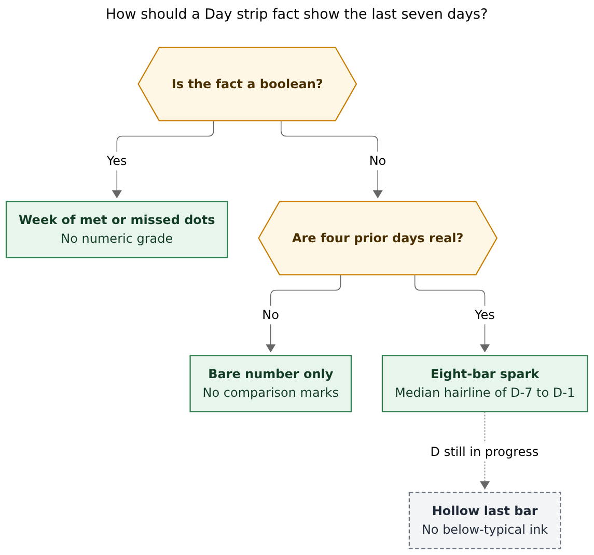
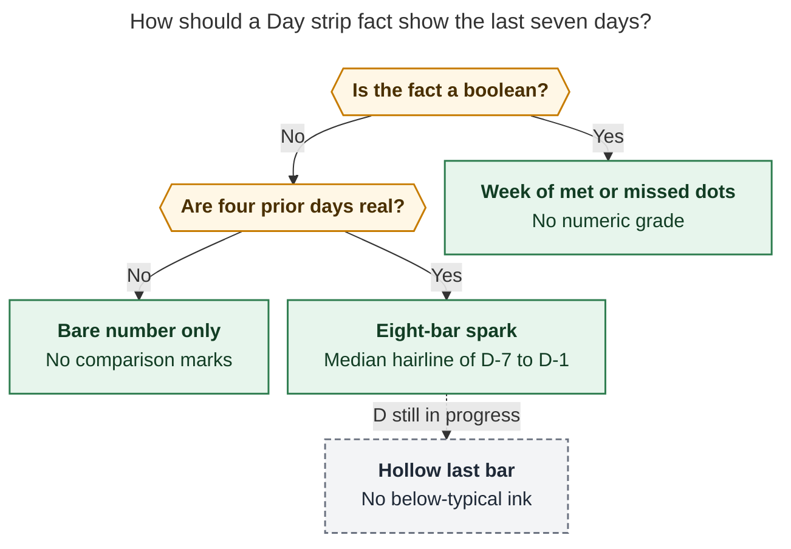
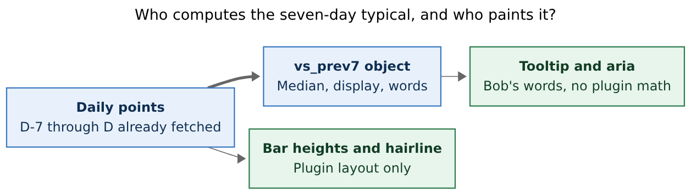
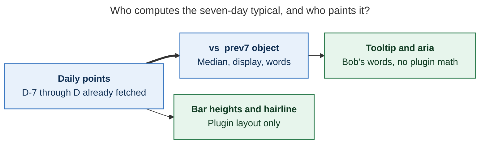

# Day strip: show each number against the last seven days, without grading the day

*Researcher: grk · 2026-10-26 · independent swarm report*

**Verdict.** Yes — give every numeric Day strip fact a quiet comparison to the previous seven *complete* days. Do it as an eight-bar spark with a median hairline under the number, in the same fact grid the strip already paints. Do **not** print `▲ 17%`, do **not** paint green or red, do **not** use the arithmetic mean, and do **not** grade today's in-progress values against a finished-day typical. Bob already fetches `D−7…D` for every strip; the engine should own a new optional `prev7` object on each daily point, and the plugin should only lay the bars out.

---

## 1. Recommendation in one page

The Day strip is a five-column fact table (`worked`, `reviewed`, `done`, `created`, `review_closed`) above the root-parent bar. Each numeric cell already answers “what did day D become?” It does not answer “is that unusual?” That second question is worth asking, and it is the one this request names. The original Day strip research already designed the answer — an eight-day spark, no deltas — and the shipped strip kept the `D−7…D` fetch while dropping the history marks (`docs/stats.md`: “There are no history marks”). Finish that design.

**Do this:**

1. **Under each numeric fact, draw eight 12 px bars** for `D−7…D`. Prior days are `--text-faint`. D is `--text-normal`, hollow while provisional (the same language as Stats tile sparks). A 1 px dashed hairline sits at the **median of `D−7…D−1`**. Real zeros are a 2 px tick; missing days are a gap.
2. **`review_closed` stays a boolean.** Paint seven or eight met/missed dots, never a “86% of typical” grade. The existing check / ✕ / half-ring on the value stays the day’s own mark.
3. **Bob owns the typical.** Add an optional schema-1 field `prev7` on each daily point: median, display, window, `n`, and a three-way `kind` (`near` / `above` / `below`) plus `words` for the tooltip. The plugin never formats minutes, never computes a percentage, never invents “typical”. Hairline Y comes from `prev7.value` so the line and the words agree.
4. **Tooltip and `aria-label` carry the comparison in words.** Example: `Sun Oct 25: 3h 25m. Typical last 7 days: 4h 10m (median).` Today: `2h 10m so far. Typical full day, last 7 days: 4h 10m (median).` No percent in the strip itself.
5. **Raise the height budget**, not the chrome. One-line strip from 56 px to about 70 px; wrapped from 80 px to about 96 px. Still a glance, still far under `dash_stats`.
6. **Leave `dash_stats` as the instrument.** A later table column of exact “−45m vs median” belongs there, on a page Bryan visits on purpose. The strip is maintenance, not discovery.

**Do not do this:** traffic-light the numerals; print `▼ 48%` under today’s Worked at 11:00; reuse `summary.mean` of the current report (wrong window); reuse `rolling_median` (it includes D); compare today to a paced “by this hour” typical (Stats has no intra-day series); exclude weekends or zeros; add a config flag in v1.

---

## 2. Is this a good idea?

**Yes, with a narrower encoding than a KPI delta.** The request is the right *question* on the right *surface*. The naive answer — a green/red percent next to each number — is the scoreboard the Day strip was built to avoid.

### Why the question earns a place

The strip’s five facts are already a table of this day’s point. A lone `3h 25m` is under-specified: Bryan’s last two weeks of Worked sit in a 75–340 minute band, median about 4h 33m over 14 complete days (`bob stats show … -r 14d -g day -f json` on 2026-10-26). Without context, every number is a target looking for a grade. With a week of bars and a typical hairline, the same number is a *shape*: Sunday 3h 25m is a bit short of a 4h 10m week-median; Thursday 1h 15m is a valley you can see across Worked, Reviewed, Done, and Created together.

That is the personal-informatics split Li, Dey, and Forlizzi documented: **discovery** (what is going on? — `dash_stats`, range chips, the focus chart) versus **maintenance** (is today in the shape I already know? — the strip) (Li 2011, CMU-HCII-11-106; Li, Dey & Forlizzi, CHI 2010). The strip is a maintenance surface. Maintenance questions are Status and Discrepancy. The request is a Discrepancy question. A spark with a typical line answers it at a glance; a percent answers it as a score.

The original Day strip research already made this call. All five researchers then agreed on eight-day sparks and **no deltas, no %, no status colours** (requirement A7 in `research:202610/daily_note_day_strip/daily_note_day_strip.md`). The shipped renderer kept the fetch that those sparks needed — past days request `-r <D-7>..<D>`, and the cache is reused only when the series covers `D−7…D` (`docs/stats.md`, Day strip) — and then painted a bare number. This feature is the missing third of that layout, not a new product.

Glanceable context next to a destination also has field evidence: Consolvo’s UbiFit glanceable display helped people keep an activity habit over a holiday stretch (UbiComp 2008); Harkin et al. found that monitoring progress helps goal attainment (Psychological Bulletin, 2016, d ≈ 0.40). Those results support a *quiet* comparison on a surface Bryan already opens. They do not support a traffic light.

### Why a literal “vs 7-day average” on the daily note is a bad idea

| Risk | Evidence in this vault, today | What goes wrong |
| --- | --- | --- |
| **Scoreboard on the working surface** | Original Stats research R9, carried into Day strip A7: daily is where numbers become targets. Etkin (JCR 2016): measuring an activity increases output and lowers enjoyment because it makes the activity feel like work. | `▼ 48%` under this morning’s Worked trains “I am behind” every time the daily note opens. |
| **Today is not a finished day** | 2026-10-26 Worked is `2h 10m`, `provisional: true`. Previous-7 median is `4h 10m` (−48%). Done is 4 vs median 17 (−76%). | Any full-day typical makes morning look like failure. Stats has no hourly series, so a “pace” correction would be invented. |
| **Mean is the wrong typical** | Sat 2026-10-24 Worked `4h 50m`: +16% vs the previous-7 **median** (`4h 10m`), +31% vs the previous-7 **mean** (`3h 41m`). The mean is pulled by Thu 75m and Wed 135m. | One light day, or one crunch day, moves the baseline around under every later cell. Stats headlines already use **median**, not mean (`docs/stats.md`). |
| **`rolling_median` is the wrong field** | Engine window is 7 points **including D**, and is `null` for today (`series.rs` `add_rolling_medians`). Thu 10-22 Reviewed rolling median 58 includes 43; previous-7 median excluding D is 58 anyway, but Sat 10-24 Reviewed 21 pulls a including-D median down. | Reusing it would both include the day being judged and go blank on the hottest strip (today). |
| **Percent noise on small integers** | Existing delta language treats ±1% as `≈ same` — that is for **window vs prior window**. Daily Done of 17 vs 19 is −11%. Created of 22 vs 26 is −15%. | Almost every day would light up. The Stats `▲`/`▼` copy is a window instrument. |
| **Created is not “up = good”** | Catalog: `created` direction **neutral**, color blue. `worked` / `reviewed` / `done` are `up`. | Green for “more created than typical” is a false valence. The comparison is *unusual*, not *winning*. |
| **A boolean is not an average** | `review_closed` over 14 days is `13 of 14`, mean `1`. Sat 10-24 is `missed`. | Averaging 0/1 into “86% of typical” is a fake precision the mark already refuses. |
| **Coordinated light days** | Thu 2026-10-22: Worked 75m, Reviewed 43, Done 9, Created 3 — all well below their previous-7 medians (−70%, −26%, −61%, −88%). | Four red arrows panic. Four short bars in a row *describe a light Thursday*. |

The idea is good. The encoding has to stay a **shape**, not a **grade**.

---

## 3. Explicit requirement adjustments

Call these out as changes to the request.

| # | You asked for | I recommend | Why |
| --- | --- | --- | --- |
| **A1** | Visual indication vs the **average** of the previous 7 days | **Median** of `D−7…D−1`, with the mean available in `prev7` for the tooltip if we want honesty, never as the hairline | Stats headlines are already daily medians. On this vault the mean and median already disagree by half an hour on Worked. Median is the “typical day” the hairline should name. |
| **A2** | Compare **each numeric metric** | The four numeric facts (`worked`, `reviewed`, `done`, `created`). **`review_closed` gets dots, not a grade.** Hidden metrics stay omitted. | The fact table is mixed type. A boolean already has a mark. |
| **A3** | Put it **in the table** | **In the existing five-column fact grid**, as a third row under each value (label / value / spark). Not a new column of percents, not a sixth fact, not the Stats page table | The strip *is* the table. A percent column is the scoreboard. The Stats table is the later, denser instrument. |
| **A4** | (implied) Show how far above/below | **Position along a shared scale** (bar height vs hairline), not a signed percent, and **no green/red** | Cleveland & McGill (1984): position and length outrank color saturation. WCAG 1.4.1: color is not a sole encoding. Few’s bullet-graph greys, not traffic lights. |
| **A5** | (implied) Same treatment for today | **Hollow last bar, no below-typical ink, tooltip says “so far” vs “typical full day”** | There is no honest pace without intra-day history. Inventing one would break “Bob owns every value”. |
| **A6** | (implied) Plugin can compute it from points it already has | **Bob emits `prev7`; the plugin only scales bars.** Plugin may derive *heights* (Stats tiles already do in `statsSparkBars`). Plugin must not format `4h 10m` or `▼ 18%`. | `docs/stats.md`: “Consumers never recalculate a display string, summary, percentage, or delta.” |
| **A7** | (new, from live data) | **Need ≥ 4 complete prior observations**; missing/not_tracked days drop out of the median; real zeros stay in; weekends stay in | A 7-calendar-day window is a typical week, including rest. Silent zeros for missing notes are the quality bug Stats already refuses. |
| **A8** | (new) | **“Near typical” = within 15% of the median, with a floor of 15 minutes or 1 count** — tooltip only, never a chip | The window-delta ±1% band is far too tight for a single day. 15% + floor matches how this vault actually moves. |
| **A9** | (new, from original A7 / R9) | **No valence, no streaks, no day score, no animation of the comparison** | A composite “good day” index is the strongest form of the scoreboard. The existing review-closed check-arrive animation stays; sparks do not pulse. |
| **A10** | (new) | **No v1 config flag.** If it becomes a scoreboard, `Toggle Day stats` already hides the strip. Revisit after three weeks. | Same exit hatch the original strip research asked for. |

---

## 4. What exists today

### The fact table

`DAY_STRIP_METRIC_IDS = ["worked", "reviewed", "done", "created", "review_closed"]` (`239-plugin-day-strip-model.js`). Each cell stacks a small uppercase label over a 1.5em tabular value, split by hairlines, wrapping to three columns below ~34em. Boolean facts paint the status mark; numeric facts split bob’s `display` into numeral and unit runs. Clicking a fact opens Stats with D pinned and that metric focused.

Height budget at a 16 px base: **56 px** one line, **80 px** wrapped (`docs/stats.md`). No card, no border, no extra Stats link. Area hues live on the mix bar only.

### The fetch already covers the week

- Today: cached default Stats report (4 weeks of daily points + provisional today).
- Past D: `bob stats show -a -f json -g day -r <D-7>..<D>` when the default does not cover `D−7…D`.
- Cache reuse **requires** that coverage.

So every painted strip already holds the eight daily points a spark needs. First paint cost does not change. No new CLI flag is required. The original research verified this as F5; the shipped contract kept it.

### What the engine already computes (and why it is not enough)

| Field | Window | Includes D? | Today? | Use for this? |
| --- | --- | --- | --- | --- |
| `summary.mean` / `summary.headline` | Whole report (4w default, or the 8-day past-day range **including D**) | Yes, except today is excluded from summaries | Headline is `null` for a today-only range | **No** — wrong window |
| `point.rolling_median` | 7 day points, half-window minimum, 6-day lead-in | **Yes** | Always `null` | **No** — includes D, blank on today |
| `summary.delta` | This window’s headline vs the **prior equal window** | n/a | n/a | **No** — week vs previous week, and it already paints `▲`/`▼` on Stats tiles |
| `chart.p25` / `p75` | Displayed complete buckets | No | Excluded | Useful as a later band, too wide/narrow for a 7-day hairline |

Needed: a per-point object whose window is **the seven complete days before D**, whose stat is **median**, and whose words the plugin can quote.

### Live week on this vault (clock 2026-10-26)

Previous-7 window for today = Mon 10-19 … Sun 10-25.

| Fact | Direction | D (today, so far) | Prev-7 median | Prev-7 mean | Complete D examples |
| --- | --- | --- | --- | --- | --- |
| Worked | up | 2h 10m | 4h 10m | 3h 40m | Thu 10-22: 1h 15m (−70% vs median). Sat 10-24: 4h 50m (+16% median, +31% mean). Sun 10-25: 3h 25m (−18%). |
| Reviewed | up | 41 | 54 | 51.7 | Sat 10-24: 21 (−63%). Sun 10-25: 75 (+39%). |
| Done | up | 4 | 17 | 16.4 | Thu 10-22: 9 (−61%). Sun 10-25: 17 (near). |
| Created | **neutral** | 10 | 22 | 19.0 | Thu 10-22: 3 (−88%). Sat 10-24: 22 (near). Sun 10-25: 9 (−61%). |
| Review closed | up (bool) | met (provisional) | 6 of 7 met | — | Sat 10-24 missed; every other day in the 14-day window met. |

Worked over the 14 complete days: median **4h 33m**, mean 254m, p25 221m, p75 311m. The week is not flat, and it is not a simple “weekends are rest” series either (Sun 10-19 was 5h 25m; Thu 10-22 was 1h 15m). A 7-calendar-day median is a honest “typical week” for *this* vault. Same-weekday lookback would need seven weeks and would answer a different question.

---

## 5. Encoding options

Cleveland & McGill’s ranking of elementary perceptual tasks (JASA 1984) is the right filter: **position along a common scale**, then length, then area, then saturation, then hue. A percent in green/red spends the two weakest channels on a signed grade. A spark spends the two strongest.

| Option | What the eye reads | Fits 56–80 px? | Scoreboard risk | Verdict |
| --- | --- | --- | --- | --- |
| **A. Eight-bar spark + median hairline** (recommended) | Length of D vs a line, plus the week’s shape | +12 px under each value → ~70 / ~96 px | Low: no valence, no percent | **Ship this** |
| **B. Compact bullet under the numeral** (Few 2005/2013) | Position of D vs a marker on one axis | +6 px | Medium: a bullet *is* a grade unless the marker is clearly “typical”, not “goal” | Fallback if 12 px is refused |
| **C. `▲ 17%` chip, Stats-tile style** | A signed number, usually with green/red | Fits today | **High** — this is the request, and it is R9 | Reject for the strip |
| **D. Recolor the numeral** | Saturation / hue | Zero extra px | High, and WCAG 1.4.1 fails if it is the only channel | Reject as sole encoding |
| **E. Spark, no hairline** | Shape only | Same as A | Low | Incomplete: the request is vs typical, not vs history alone |
| **F. Hairline, no spark** | One comparison, no rhythm | Same as B | Medium | Loses the Thursday-was-light reading |
| **G. p25–p75 band behind the spark** | “Inside the usual” | Same as A | Low | Nice v2; 7 values make quartiles jumpy |
| **H. Same-weekday 7-week median** | Monday vs Mondays | Same as A | Low | Wrong question; needs 7 weeks; user asked for 7 days |

Stacey Barr’s split is the same one: a **smartline / sparkline** tells you whether performance is changing through time; a **bullet** tells you how far the current value sits from a comparison (Barr, 2014, “Bullet Graphs or Smartlines”). The strip has room for one small graphic per cell. Putting a hairline *on* the spark is the combination that answers both in 12 px. iOS Screen Time’s weekly bars with a dashed average line is the consumer pattern people already know; it is option A with different labels.

Few’s bullet-graph spec uses **one hue, several greys**, specifically so the ranges stay readable under color-blindness and so the dashboard does not spend its color budget on traffic lights (Few, *Bullet Graph Design Specification*; Wikipedia summary of the same rule). The strip already spends color on the root-parent bar. The sparks should stay in text ink.

Tufte’s sparkline is a “word-sized graphic” with data-ink ratio 1 (*Beautiful Evidence*). Eight bars, a gap for missing, a tick for zero, a dashed typical, no axes, no legend: that is the density the fact cell can afford.

---

## 6. How a fact should encode the week

**Reader question:** When should a Day strip fact show the last seven days, and in what form?

**Caption:** Boolean facts get a week of met or missed dots. Numeric facts with fewer than four complete prior days stay a bare number. Numeric facts with enough history get an eight-bar spark and a median hairline; while D is still in progress the last bar is hollow and it takes no below-typical ink.



Rendered size: 762.8 × 714 px; fit scale: 85.6%. Mermaid CLI 12.0.0, PDF-mirroring config.



---

## 7. Who computes the typical

**Reader question:** Who computes the seven-day typical, and who paints it?

**Caption:** bob-cli owns the previous-seven-day median, its display string, and the comparison words. The plugin turns already-fetched daily points into bar heights and a hairline, and quotes bob’s words in the tooltip.



Rendered size: 838.0 × 238 px; fit scale: 77.9%. Mermaid CLI 12.0.0, PDF-mirroring config.



Blue nodes are the engine; green nodes are the plugin. The thick arrow is the new work: a `prev7` object serialized next to `rolling_median`. The thin arrows are layout, which Stats tiles already do.

This is additive JSON (`schema_version: 1` stays). Older plugins ignore the field. Older bob: the plugin may still draw bars from `points` (heights only) and omit the hairline and the typical words. Not a `!` contract break under `decisions:bob-cli-releases-ride-a-daily-train`.

---

## 8. Recommended visual contract

ASCII for a **complete past day** (Sun 2026-10-25, from the live report):

```text
WORKED          REVIEWED        DONE            CREATED         REVIEW CLOSED
3h 25m          75              17              9               ✓
▂▅▃▁▅▆▄▎        ▆▅▅▄▃▃▂▇        ▅▅▃▃▂▁▂▎        ▅▂▁▅▄▂▁▎        ●●●●●●○●
┄┄┄┄┄┄┄┄        ┄┄┄┄┄┄┄┄        ┄┄┄┄┄┄┄┄        ┄┄┄┄┄┄┄┄
● bob  …        ● gtd  …                                         so far omitted
▬▬▬▬▬▬▬▬▬▬▬▬▬▬▬▬▬▬▬▬▬▬▬▬▬▬▬▬▬▬▬▬▬▬▬▬▬▬▬▬▬▬▬▬▬▬▬▬▬▬▬▬▬▬▬▬▬▬▬▬▬▬
```

ASCII for **today in progress** (Mon 2026-10-26, 2h 10m so far):

```text
WORKED          REVIEWED        DONE            CREATED         REVIEW CLOSED
2h 10m          41              4               10              ✓
▂▃▁▅▆▄▃▯        ▅▄▃▃▂▂▇▯        ▃▃▂▁▂▂▃▯        ▂▁▁▅▄▂▁▯        ●●●●●●○●
┄┄┄┄┄┄┄┄        ┄┄┄┄┄┄┄┄        ┄┄┄┄┄┄┄┄        ┄┄┄┄┄┄┄┄
● …                                                              so far · HH:MM
▬▬▬▬▬▬▬▬▬▬▬▬▬▬▬▬▬▬▬▬▬▬▬▬▬▬▬▬▬▬▬▬▬▬▬▬▬▬▬▬▬▬▬▬▬▬▬▬▬▬▬▬▬▬▬▬▬▬▬▬▬▬
```

`▯` is the hollow provisional bar. The hairline is still the **full-day** median of the previous seven. It is context for the remaining day, not a verdict on the morning.

### Cell rules

- **Spark geometry.** 8 bars, ~5 px wide, 2 px gaps, 12 px tall, `align-items: flex-end`. Reuse the Stats tile zero/null/today classes at this smaller size (`statsSparkBars` already maps value → 0..1, zeros to a 2 px tick, nulls to a gap, today to a hollow stroke).
- **Scale.** Per fact, independent. Max of the eight values and `prev7.value`. Never a shared scale across Worked and Done (minutes vs counts).
- **Hairline.** 1 px dashed `--text-faint`, `pointer-events: none`, Y from `prev7.value / max`. Omit when `prev7` is absent (`n < 4`).
- **Ink.** Prior bars `--text-faint` (~38% as in the original strip research). D `--text-normal`. **No metric hue on the sparks.** Area hues stay on the mix bar so Worked-orange cannot collide with a `gtd` segment (the reason the original research rejected metric-hue tiles).
- **Boolean dots.** 8 slots, filled / empty / hollow-today, violet ink already used by the review mark. No hairline.
- **Type.** Unchanged: small-caps label, 1.5em value, smaller unit. The spark is the only new ink.
- **Motion.** None on the spark. `prefers-reduced-motion` already a no-op if there is no motion. The pending→met check-arrive animation on Review closed stays.
- **Hit target.** The whole fact remains one `role="link"`. The spark is not a second control (too small for a day-jump). Hover / title / aria already live on the fact.
- **Wrap.** At 34em the grid already goes 3+2. Each wrapped cell keeps its own spark. Accept ~96 px total.

### Tooltip / aria (bob’s words)

Complete day:

> Worked: minutes in closed Pomodoros.
> Sun Oct 25: 3h 25m.
> Typical last 7 days: 4h 10m (median).

Today:

> Worked: minutes in closed Pomodoros.
> Mon Oct 26: 2h 10m so far.
> Typical full day, last 7 days: 4h 10m (median).

`aria-label` appends the typical clause to the existing “Worked 3 hours 25 minutes”. Kind `near` / `above` / `below` may appear in the accessible sentence (`near the last 7 days' median`) and must not appear as color.

### `prev7` shape (additive)

On each daily `SeriesPoint`, optional:

```json
"prev7": {
  "stat": "median",
  "n": 7,
  "start": "2026-10-18",
  "end": "2026-10-24",
  "value": 250,
  "display": "4h 10m",
  "mean": 221,
  "mean_display": "3h 41m",
  "delta": {
    "kind": "below",
    "sign": -1,
    "display": "below typical",
    "words": "below the last 7 days' median of 4h 10m"
  }
}
```

Rules, all in `series.rs` next to `add_rolling_medians`:

- Window is the 7 calendar days **before** D, not including D.
- Inputs: complete, non-provisional points with a finite `value` (zeros with `quality: ok` count; `missing` / `not_tracked` do not).
- `n < 4` → omit the object (plugin paints a bare number).
- `stat` is always `"median"` in v1. `mean` is extra honesty, not the hairline.
- `delta.kind` is `near` when `|D − median| ≤ max(15% of median, 15 minutes or 1 count)`; otherwise `above` / `below` by the metric’s signed difference. **Do not** reuse `make_delta`’s ±1% / `▲ 17%` / `▼ 3.3×` display — that copy is for window headlines.
- Today: still emit `prev7` against complete prior days, so the hairline has a Y. The plugin uses it for layout and for “typical full day” words, and it does not map `kind: below` onto ink.
- Bool / ratio points omit `prev7`; the plugin has its own dot path.
- Lead-in: the default 4w report already contains enough days for every recent D. The past-day `-r D-7..D` request contains exactly the 7 priors for D. No extra spawn.

Plugin model change: `dayStripBuildFact` grows `spark: [{value, provisional, quality}, …×8]` and `prev7` (pass-through). Renderer adds one `span.bob-day-strip-spark` under the value. Skeleton: eight 40%-height placeholder bars so wrap points stay stable.

---

## 9. What I would not ship, and where numbers *do* belong

**Not in the strip.** A signed percent, a green/red numeral, a “day score”, a streak, a qualitative poor/ok/good band, a pace-adjusted today, a same-weekday 7-week median, a config toggle, a second fetch.

**On `dash_stats`, later.** The Stats table is already “the accessible route and the source of exact numbers” (`237-plugin-stats-models.js`). A `vs typical` column quoting `prev7.display` and `delta.words` is the right place for `−45m vs 4h 10m`, because that page is the weekly instrument and already shows `▲`/`▼` on tiles. Do not block the strip on that column.

**Not a new CLI verb.** `bob stats show -a -g day` already returns the points. Help text and `docs/stats.md` gain a paragraph on `prev7`, generated through the usual docs path.

---

## 10. Implementation sketch

Small, layered, tests already have a home.

1. **bob-cli `series.rs`:** `add_prev7(points)` after `add_rolling_medians`. Unit tests next to `rolling_median_requires_half_window_and_excludes_provisional` covering: n=7, n=3 omitted, zeros kept, missing dropped, today still serialized, D excluded from the median. Golden JSON in the existing stats fixtures.
2. **Docs:** `docs/stats.md` Day strip section — replace “There are no history marks” with the spark/hairline contract; schema-1 optional-fields list gains `prev7`. Plugin reference one-paragraph. `just docs-check`.
3. **Plugin model + render + CSS:** `dayStripBuildFact` / `dayStripRenderFact` / ~40 lines of CSS. Reuse `statsSparkBars`. Fixtures in `day-strip-fixtures.cjs` plus `scripts/test-ledger-tools-day-strip-*.cjs`. Preview via `npm run build && node scripts/preview-stats-block.cjs` is for `bob-stats`; add a day-strip fixture case to the existing host tests rather than a new preview stack.
4. **Accessibility:** fact `aria-label` includes bob’s `prev7.delta.words`; spark `aria-hidden="true"`. Keyboard path unchanged (the fact is still the link).
5. **Live with it for three weeks.** Same exit criterion as the original strip: if it starts feeling like a grade, collapse to numbers-only (hairline off) or hide the strip. Do not add a second toggle before that.

No vault writes. No journal events. No change to `stats.day_strip` besides documenting the extra 12 px.

---

## 11. Open questions for Bryan

These are preference, not blockers. Defaults I would take are in parentheses.

1. **Hairline stat:** median (default) or mean? I would not offer a config; pick median.
2. **Near band:** 15% + 15 min / 1 count floor (default), or “inside p25–p75 of the same 7 days”? Quartiles on n=7 are jumpy; I would keep the percent+floor in v1 and consider an IQR band in v2.
3. **Show `mean` in the tooltip as well as the median?** Default **no** — one typical is enough. The field can still serialize for the Stats table later.
4. **Boolean dots:** 7 prior + D (8) to match the numeric spark, or 7 prior only? Default **8**, with today hollow-unmet / filled-met.
5. **Stats table column** in the same change set, or strip-only first? Default **strip-only**. The table is a second surface with its own wrap and CSV questions.

---

## 12. Sources

### In-repo

- `docs/stats.md` — engine principle, summaries, deltas, rolling median, Day strip layout, fetch `D−7…D`, “no history marks”, “consumers never recalculate a display string”.
- `src/native/stats/series.rs` — `add_rolling_medians` (includes D, null today), `summarize` (headline = median), `mean` / `median` / `make_delta` (±1% ≈ same).
- `sase/repos/linked/bob-plugins/plugins/bob-ledger-tools/src/239-plugin-day-strip-{model,render,hosts}.js` and `styles.css` — fact table, 56/80 px budget, numeric runs, boolean marks.
- `…/237-plugin-stats-models.js` — tile deltas, `statsSparkBars` (zero / null / hollow today).
- `research:202610/daily_note_day_strip/daily_note_day_strip.md` — original A7 (no judgment), eight-day sparks, R9, mockup.
- Live `bob stats show worked reviewed done created review_closed -r 14d -g day -f json` on 2026-10-26 (bob 0.3.1).

### Visualization and HCI

- Cleveland, W. S. & McGill, R. (1984). Graphical perception. *JASA* 79(387), 531–554. Position and length outrank saturation and hue.
- Tufte, E. (2006). *Beautiful Evidence*. Sparklines as word-sized graphics.
- Few, S. (2006). *Information Dashboard Design*; Few, S., *Bullet Graph Design Specification*. Comparison measure plus grey qualitative ranges; avoid traffic-light gauges.
- Barr, S. (2014). “Bullet Graphs or Smartlines – Which One is Best?” Sparklines for change through time; bullets for distance from a comparison.
- Li, I., Dey, A. & Forlizzi, J. (2010). A stage-based model of personal informatics systems. *CHI 2010*. Li, I. (2011). *Personal Informatics and Context*, CMU-HCII-11-106. Discovery vs maintenance; maintenance asks Status and Discrepancy.
- Harkin, B. et al. (2016). Does monitoring goal progress promote goal attainment? *Psychological Bulletin*. d ≈ 0.40.
- Etkin, J. (2016). The hidden cost of personal quantification. *Journal of Consumer Research* 42(6), 967–984.
- Consolvo, S. et al. (2008). Activity sensing in the wild: a field trial of UbiFit Garden. *UbiComp 2008*.
- WCAG 2.2 SC 1.4.1 Use of Color; SC 1.4.11 Non-text Contrast (3:1 for meaningful graphics).
- Kaufman, J. (2022). “Careful With Trailing Averages.” Seven-day means smear weekly cycles; name the window honestly.
- iOS Screen Time weekly bars with a dashed average line — the closest shipped consumer pattern to option A.
