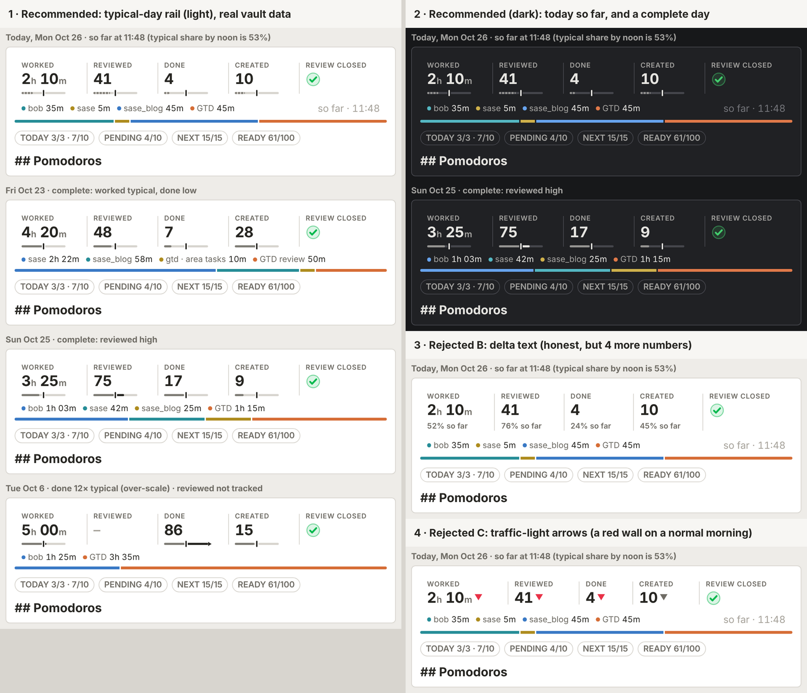

# Day strip vs. the previous 7 days: the typical-day rail

> **Research query:** Show a visual indication of how each numeric metric in the Day
> strip's stat row compares with the average of the previous 7 days for the same
> metric. Lead the design so it is intuitive, reliable, and beautiful. Is this a good
> idea? Would a different approach be better? Call out any requirement adjustments, and
> end with a recommended solution.



*Figure 1. Mockup rendered in headless Chrome. It uses bob-plugins' production
`main.js` and `styles.css` at `43a04d6`, and real `bob stats` JSON from the live vault
on 2026-10-26. The proposed `typical` field was simulated in Python from the same
points. Only the rail CSS and the plan badges are mock-ups. Panel 1 shows today at
11:48, a typical Friday, a Sunday with high Reviewed, and Oct 6 with 86 done (12× the
typical day). Panel 2 is dark mode. Panels 3 and 4 are the two most obvious
alternatives, both shown at the same 11:48 moment.*

## Bottom line

1. **Yes, build it, but not as a literal "vs average" badge.** A bare "Done 4" has no
   context, and your own recent days are the right reference. The data, however, rules
   out the obvious versions:
   - **Partial days:** at noon you have typically logged only 53% of a day's work.
   - **Noise:** day-to-day swings are 29–59% of a week's level.
   - **Spikes:** one 86-done day distorts a mean for a week.

   An up/down arrow, a red/green colour, or a "▼ 48%" would therefore be wrong most
   mornings and close to a coin flip on finished days.
2. **Recommendation: a "typical-day rail"** under each of the four numeric values
   (Worked, Reviewed, Done, Created). It is a quiet 3 px bullet-graph rail:
   - The **ink tick at its centre** is the typical day.
   - The **fill** is this day's value, on a scale from 0 to 2× typical.
   - Fill past the tick turns ink.
   - **Today's fill is dashed** ("so far"), so it reads as progress toward a typical
     day, not as a verdict.
   - It uses no hue, no arrows, and no new numbers. The exact figures live in the
     tooltip and the screen-reader label.
3. **Adjustment: "average" becomes the median** ("typical day") of the previous 7
   complete days, D−7…D−1. It needs at least 4 days with data.
   - On your data the mean and median differ by more than 25% on **28% of Done days**.
   - The engine already uses the median for every headline and for the Stats chart's
     7-day line. The tick on day D is exactly where that chart's median line stood on
     D−1.
   - If you prefer the literal mean, the visuals do not change; it is a one-line change
     in the engine.
4. **bob computes it; the plugin only draws it.**
   - A small, additive `typical` object goes on day-grouped points: value, display,
     days with data, and a `compare` phrase.
   - It is `feat(stats)`, not a breaking change, and adds about **8%** to the default
     report (28 KiB on 367 KiB).
   - The strip already requests D−7…D (a leftover of the removed history marks), so
     **no new `bob` run or request is needed.**
5. **Cost on screen: +11 px** (81 → 92 px on one row, 132 → 154 px when folded). The
   delta-text alternative measured +20 px.
6. **This reverses a documented stance.** Three earlier designs said "facts, never
   targets; no deltas, history, or comparisons." The tick will act as a soft daily
   target. Record the reversal as a decision (it changes pending bead `bob-cli-bs`).
   Keep the exit criterion: if you catch yourself chasing ticks, fall back to showing
   the rail on completed days only.

## Is this a good idea?

**Yes, with conditions.** Here is the case for it and the risks, with evidence.

### Why it earns its place

- **A number without a reference is half a fact.** Is "Created 10" a lot? The answer
  depends on your recent rhythm, which has shifted sharply. Done jumped from about
  3–7/day in September to 20–30/day by mid-October. A fixed
  goal or a long average would mislead; a trailing week adapts within days.
- **Self-comparison is the gentlest comparison.** Bob has no peers to compare with, and
  absolute goals were deliberately rejected (R9 in the Stats research). Your own
  recent days are the only honest norm.
- **The data and the place are already there.**
  - The strip already asks for D−7…D on every past day.
  - Today's strip shares the Stats page's 28-day report.
  - The Stats page already draws a 7-day rolling-median line, so the concept is native
    to Bob.
- **The strip was built for this kind of glance.** You open the note all day, and the
  strip is the first thing in it.

### The risks, and what the design does about each

| Risk | Evidence (measured on your vault) | Design response |
| --- | --- | --- |
| **Comparing a partial day with full days** | Median share of a day's Worked minutes already logged: **35% by 10:00, 53% by 12:00, 67% by 14:00, 83% by 16:00** (85 days, Aug 1 – Oct 25). At 11:48 today you were at 2h 10m, **52%** of a typical 4h 10m: exactly on a normal pace. | Today's fill is dashed and reads as progress toward a typical day. Before the day ends, the tooltip says "52% so far", never "▼ 48%". |
| **Noise** | Median coefficient of variation inside the prior-7 window: Worked 29%, Sessions 32%, Created 41%, Done 59%. With a ±10% "about the same" band, only **10–18%** of days count as typical; the rest flip ▲/▼. | A continuous rail instead of categories: a small difference looks small. There is no colour and no arrow. |
| **Spikes and regime shifts** | Done hit 86 on Oct 6. On Oct 12–13 (25 and 27 done, normal days), the trailing mean reads **▼ 21%** both days, while the median (25) reads `≈ same` and `▲ 8%`. Mean and median differ by more than 25% on 28% of Done days, 11% of Created, and 6% of Worked. | Use the median ("typical day"). |
| **A target on the working surface** (R9, Goodhart) | Two earlier plans removed history and comparisons because they "invite comparison". Quantification can raise output while lowering enjoyment (Etkin 2016). | No hue, and no "behind" wording on today. The tick is called "typical", never "goal". The exit criterion stays, with recap-only as the fallback. |
| **Visual budget at the top of the busiest note** | The strip is 81 px; the rail adds 11 px. | One hairline-scale instrument per value, aligned across columns. No new numbers. |
| **Contract drift** ("bob owns every number") | The page already plots `rolling_median` geometry itself. The strip formats nothing. | bob supplies the typical value, its display, and the comparison phrase. The plugin draws only geometry. |

### Would I take a different approach?

**Same goal, different form.** I would not ship a literal "vs 7-day average" delta. I
would ship the same comparison in the four adjusted forms below. Each is listed under
[Requirement adjustments](#requirement-adjustments-called-out-explicitly).

- The median, not the mean.
- Progress framing for today.
- Geometry, not verdicts.
- Bob-computed values.

One genuinely different idea is a *weekly trend*: this week's average against the last
4–12 weeks. That is how Apple Fitness Trends (90-day vs. 365-day averages) and Garmin
HRV Status (a 7-day average vs. a 3-week baseline range) avoid daily noise. It answers a
different question, "is my rhythm changing?", and belongs on the Stats page tiles, not
in a per-day receipt. I list it as a follow-up, not a replacement.

## What the data says (verified facts)

All facts were checked on 2026-10-26 against `bob 0.3.1` on athena, the live vault, and
bob-plugins `43a04d6`. Nothing in any repo or in the vault was changed.

- **F1. The strip already fetches the window it needs.**
  - `dayStripDefaultReportCovers` requires daily points for every date D−7…D
    (`239-plugin-day-strip-hosts.js:145-148`).
  - Past days otherwise request `-g day -r D-7..D` (`:198-201`; docs/stats.md:986-989).
  - Today shares the default `stats show -a -f json -r 4w` report: 28 complete days plus
    today, grouped by day.
  - *Consequence:* the comparison costs no new request.
- **F2. The engine already computes the statistic.** `add_rolling_medians`
  (`src/native/stats/series.rs:740`) takes the median of 7 day points. It needs ceil(7/2)
  = 4 real values and is null for provisional today.
  - The median at D−1 is therefore exactly the median of D−7…D−1.
  - The first displayed day needs one more day of lead-in: `lead_in_start` is 6 days
    today (`:283`) and would become 7.
  - The delta grammar (`make_delta`, `:895`) already produces `≈ same`, `▲ 16%`,
    `▼ 0.3×`, `new`, and `▼ 100%`.
- **F3. No day-of-week effect.** Mean Worked minutes by weekday, Jul 1 – Oct 25: Mon 273,
  Tue 257, Wed 274, Thu 263, Fri 296, Sat 272, Sun 272. You work seven days a week.
  Created and Done are similarly flat. A trailing 7-day window always holds one of each
  weekday anyway. "Same weekday last week" would add noise and no signal.
- **F4. Daily values are noisy relative to a week.** The coefficients of variation and
  band shares are in the risk table above. Values beyond 2× the trailing mean occur on 1%
  of Worked days, 8% of Created, and 12% of Done. Values below ½× occur on 8%, 16%, and
  25%. The rail needs an over-scale cap; it is rare for Worked and common for Done.
- **F5. Partial-day shares** come from the report's `sessions` list (closed Pomodoros
  with time ranges). They cover 85 complete days from Aug 1. The median first session
  ends at about 07:15, the last at about 18:00.
- **F6. Geometry, measured with the production CSS** at a 16 px base:

  | Width | Current strip | With the rail | With delta text instead |
  | --- | --- | --- | --- |
  | 700 / 540 px (one row) | 81.1 px | 92.2 px | 100.7 px |
  | 410 px (folded) | 131.6 px | 153.8 px | — |

  The skeleton equals today's height in every case. The current harness budgets are
  ≤84 / ≤136 px.
- **F7. Payload.** A slim `typical` object on the 203 day points of the minutes/count
  metrics in the default report adds about 28 KiB to 367 KiB (+8%). Week- and
  month-grouped `daily_points` are excluded on purpose: an `-r all` report is already
  about 1.9 MiB.
- **F8. Documented stance being reversed.**
  - `plan:202610/day_strip_under_the_badges.md` removed the eight-day history marks
    because "history invites comparison, which is the scoreboard risk the research
    warned about (R9)".
  - `plan:202610/day_strip_stat_row.md` put "no deltas, goals, sparklines, history
    marks, or per-metric colours" out of scope.
  - Pending memory bead `bob-cli-bs` proposes the decision "the Day strip shows the day's
    facts, never targets (no deltas, percentages, goals, streaks, or status colours)".
  - You have already relaxed one part of that stance yourself: the review closeout
    paints green, red, and yellow marks (`plan:202610/day_strip_review_marks.md`).
- **F9. A doc bug, found in passing.** `docs/stats.md:981-983` still says "at most 56 px…
  at most 80 px". The preview harness has enforced ≤84 / ≤136 px since the stat-row
  redesign (bob-plugins `04c61c7`). This feature's docs phase should fix it either way.

## Requirement adjustments (called out explicitly)

- **J1. Average becomes "typical day" (median)**
  - *You asked for:* "the average of the previous 7 days"
  - *I recommend:* The **median of the previous 7 calendar days, D−7…D−1**, labelled
    **"typical day"** in the UI.
  - *Why:* Robust to spikes (F4; the Oct 6 Done example). It matches the engine's
    headline statistic and the Stats chart's 7-day line (F2). "Typical" is the plain
    word for median. The mean is a drop-in swap if you prefer it.
- **J2. The window rules**
  - *You asked for:* "previous 7 days"
  - *I recommend:*
    - Never include D itself.
    - Skip days with no data (`missing` or `not_tracked`).
    - Count real zeros.
    - Require **at least 4 days with data**, the same rule as the rolling median.
      Otherwise show no rail.
  - *Why:* Including D would pull the reference toward the day being judged. The
    4-of-7 rule matches the rest of Stats, and a vacation-week zero is a true
    observation.
- **J3. Today is progress, not a verdict**
  - *You asked for:* "compares" (implicitly, at all times)
  - *I recommend:* On today's note, show the **so-far** value against the typical day as
    **progress** (a dashed fill, "52% so far"). Show ▲/▼ wording only on completed days.
  - *Why:* F5: at noon a normal day is 53% done. A delta on a partial day is wrong most
    of the day.
- **J4. Geometry, not verdicts**
  - *You asked for:* "some visual indication"
  - *I recommend:* **Continuous, monochrome geometry:**
    - a rail with a centred tick;
    - a fill proportional to the value;
    - ink past the tick.
    - No red/green, no arrows, and no new visible numbers.
  - *Why:* F4: daily noise makes categories flip. Colour would collide with the
    root-parent hues and the closeout's status inks. Created has no "good" direction.
- **J5. Which metrics get a rail**
  - *You asked for:* "each numeric metric"
  - *I recommend:* **Worked, Reviewed, Done, and Created.** Review closed (bool) keeps its
    mark only. A redefined metric whose unit is ratio or signed gets no rail in v1.
  - *Why:* A bool day has no meaningful "vs typical". Signed values cannot fill from 0.
- **J6. Who computes the numbers**
  - *You asked for:* (implicit)
  - *I recommend:* **bob computes the typical value and its words.** The plugin draws
    geometry only.
  - *Why:* It preserves "bob owns every number" (docs/stats.md), keeping it reliable and
    testable in Rust goldens.
- **J7. Height budget**
  - *You asked for:* (new)
  - *I recommend:* Raise the strip budgets to **≤94 px** (one row) and **≤156 px**
    (folded). Fix the stale 56/80 numbers in the docs (F9).
  - *Why:* F6: the rail costs 11 / 22 px.
- **J8. A decision record**
  - *You asked for:* (new)
  - *I recommend:* Record "**the Day strip compares each numeric fact with the typical
    day, as neutral geometry**". It supersedes the "no deltas/percentages" clause
    proposed in `bob-cli-bs`.
  - *Why:* F8: three artefacts state the opposite. Future agents will otherwise
    "fix" it back.
- **J9. An exit criterion**
  - *You asked for:* (new)
  - *I recommend:* After about three weeks, ask whether the rail informed you or made
    you chase ticks. **Fallback:** draw rails only on completed days (recap mode), or
    show them on hover only.
  - *Why:* It keeps the R9 reversal honest. It is cheap because recap mode is a single
    condition.

## Options considered

All four "glance" alternatives were rendered against the same data (Figure 1 shows B
and C).

- **A. Typical-day rail (recommended)**
  - *What it is:* A 3 px bullet-graph rail under each value: a tick for typical, a fill
    for this day
  - *Strengths:*
    - Length and position are the most accurately read encodings (Cleveland & McGill
      1984).
    - One encoding works for partial and complete days.
    - Honest about magnitude, and quiet.
    - Ticks align across columns.
    - +11 px.
  - *Weaknesses:* The tick must be learned once (the tooltip explains it), and exact
    figures need a hover.
  - *Verdict:* **Ship**
- **B. Delta text** (`▲ 16%`, `52% so far`), Stats-tile grammar
  - *Strengths:* Precise, and familiar from the Stats page tiles.
  - *Weaknesses:*
    - Four more numbers on a five-number row.
    - Today needs a second grammar.
    - +20 px, and the width is tight at 540 px.
    - A jittery ▲/▼ verdict every day (F4).
  - *Verdict:* Tooltip and aria only
- **C. Arrows / traffic-light colour**
  - *Strengths:* The fastest pre-attentive read.
  - *Weaknesses:*
    - Binary and noisy.
    - A **red wall at 11:48** on a perfectly normal morning (Figure 1, panel 4).
    - Hue clashes with the roots and the closeout mark.
    - Created has no good direction.
  - *Verdict:* Reject
- **D. Bring back sparklines** (the 8 history marks)
  - *Strengths:* Shows the trend and the spread.
  - *Weaknesses:* Answers "what happened?", not "how does today compare?". It is about
    40 marks, and it was removed for clutter on 2026-10-25.
  - *Verdict:* Reject
- **E. Tint the value numerals**
  - *Strengths:* No extra space.
  - *Weaknesses:* Colour-only meaning (accessibility), clashes with hue semantics, and
    the numerals stop being neutral facts.
  - *Verdict:* Reject
- **F. Pace tick ("typical by this hour")**
  - *Strengths:* A fair comparison for today.
  - *Weaknesses:*
    - Only Worked (session time ranges) and Reviewed (journal timestamps) carry
      time-of-day; Done and Created have dates only.
    - The value changes every minute, which fights the refresh cache.
    - It is a stronger target.
  - *Verdict:* Later, for Worked only, if wanted
- **G. Same weekday last week**
  - *Strengths:* Simple.
  - *Weaknesses:* A single sample is noisier still, and there is no weekday effect to
    correct (F3).
  - *Verdict:* Reject
- **H. Weekly trend** (this week vs. prior weeks; Apple and Garmin style)
  - *Strengths:* Robust, and good for reflection.
  - *Weaknesses:* A different question, and it is window-level.
  - *Verdict:* Stats page follow-up

## Recommended design: the typical-day rail

### Anatomy

```text
 WORKED      │ REVIEWED   │ DONE      │ CREATED   │ REVIEW CLOSED
 2h 10m      │ 41         │ 4         │ 10        │ (✓)
 ┄┄──┃────   │ ┄┄┄─┃────  │ ┄───┃──── │ ┄┄──┃──── │
 ● bob 35m  ● sase 5m  ● sase_blog 45m  ● GTD 45m            so far · 11:48
 ━━━━━━━━━━━━━━━━━━━━━━━━━━━━━━━━━━━━━━━━━━━━━━━━━━━━━━━━━━━━━━━━━━━━━━━━━━
```

Today at 11:48: dashed fills (`┄`) are "so far"; every tick (`┃`) sits at the centre of a fixed-width rail. See Figure 1 for the real rendering.

- **Track:** 0 … 2× the typical day, 4.5em wide (about 55 px), and left-aligned with
  the value. Every tick sits at the same offset in its column, so the row reads as one
  instrument.
- **Tick:** the typical day. It is 2 × 9 px in ink (`--text-normal`) with a 1.5 px
  knockout ring of note background, so it stays crisp over the fill.
- **Fill:** this day's value at `min(value / (2 × typical), 1)` of the track. The part
  before the tick is muted ink. **The part past the tick is full ink** (the "surplus"),
  so above-typical days get a little weight without any hue.
- **Today:** the fill (and any surplus) is dashed, 3 px on and 1.5 px off, meaning "so
  far, still growing". This mirrors the Stats chart's hollow provisional bar.
- **Over-scale:** a value above 2× typical fills the track and ends in a small ink
  arrowhead (Oct 6: Done 86 against a typical 7).

### States

- **Complete day:** a solid fill, and ink past the tick when the value is above typical.
  The tooltip line reads `Typical day 4h 10m (median of the previous 7 days) · ▲ 4%`.
- **Today, in progress:** a dashed fill. The tooltip reads `… · 52% so far` and never
  shows ▲/▼.
- **A value of 0 when typical > 0:** an empty track plus the tick. That is honest: the
  day had none.
- **Fewer than 4 of the 7 days have data** (for example Reviewed on Oct 12–15): the rail
  row is reserved but blank, and the tooltip says `No typical day yet`.
- **Typical day is 0** (median 0): the rail row is blank. The tooltip shows bob's
  `compare` (`new`).
- **Point `missing` or `not_tracked`:** the value shows `–` and the rail is blank.
- **Bool, ratio, or signed units:** no rail.
- **Stale cached frame:** the fill and tick fade to `--text-faint`, like the stale
  numerals.
- **Skeleton:** a faint track in `--background-modifier-hover`, with the same height as
  the loaded strip (measured equal).
- **Older bob without `typical`:** the rail row is reserved but blank, and nothing
  breaks.
- **Forced colours:** track `GrayText`, fill and arrow `CanvasText`, tick `Highlight`.

### Visual contract (CSS, as validated in the mockup)

```css
.bob-day-strip-fact { padding-bottom: 0.18em; }           /* was 0.3em */
.bob-day-strip-rail {
  position: relative; display: block; width: 4.5em; max-width: 100%;
  height: 9px; margin-top: 0.12em;
}
.bob-day-strip-rail::before {                               /* track */
  content: ""; position: absolute; inset: 3px 0 auto 0; height: 3px;
  border-radius: 1.5px; background: var(--background-modifier-border);
}
.bob-day-strip-rail-fill {
  position: absolute; top: 3px; left: 0; height: 3px; border-radius: 1.5px;
  width: calc(var(--bob-day-strip-rail-fill, 0) * 100%);
  background: color-mix(in srgb, var(--text-muted) 85%, transparent);
}
.bob-day-strip-rail-surplus {                               /* past the tick */
  position: absolute; top: 3px; left: 50%; height: 3px;
  width: calc((var(--bob-day-strip-rail-fill, 0) - 0.5) * 100%);
  border-radius: 0 1.5px 1.5px 0; background: var(--text-normal);
}
.bob-day-strip-rail-provisional .bob-day-strip-rail-fill {
  background: repeating-linear-gradient(90deg,
    color-mix(in srgb, var(--text-muted) 80%, transparent) 0 3px, transparent 3px 4.5px);
}
.bob-day-strip-rail-provisional .bob-day-strip-rail-surplus {
  background: repeating-linear-gradient(90deg, var(--text-normal) 0 3px, transparent 3px 4.5px);
}
.bob-day-strip-rail-tick {
  position: absolute; top: 0; left: calc(50% - 1px); width: 2px; height: 9px;
  border-radius: 1px; background: var(--text-normal);
  box-shadow: 0 0 0 1.5px var(--background-primary);
}
.bob-day-strip-rail-over::after {                            /* > 2x typical */
  content: ""; position: absolute; top: 1.5px; right: -5px; width: 5px; height: 6px;
  background: var(--text-normal); clip-path: polygon(0 0, 100% 50%, 0 100%);
}
```

Design principles to keep in the code comments:

- **The value still leads.** The rail is lighter than the label. It never competes with
  the 21 px numerals.
- **Hue keeps one meaning.** Root parents get hue, and the closeout gets status inks.
  The rail is ink only.
- **Magnitude is honest.** The fill is linear from zero. Being 5% above typical looks
  like 5%.
- **One position means one thing.** The tick is always at the centre, so "past the
  middle" always means "above a typical day".
- **Fixed geometry.** The rail row is always reserved for numeric facts, so a strip
  never grows when data arrives.

### Words, interaction, and accessibility

- **No new visible copy.** The rail is `aria-hidden` and has no tabindex. It is part of
  the fact's existing link, so clicking opens Stats with D pinned, where the 7-day
  median line gives the longer view.
- **Tooltip** (`title`), with one line appended after the existing date line:
  - Complete day: `Typical day 4h 10m (median of the previous 7 days) · ▲ 4%`
  - Today: `Typical day 4h 10m (median of the previous 7 days) · 52% so far`
  - The value, display, and phrase come from bob. The fixed frame (`Typical day`,
    `median of the previous 7 days`, `No typical day yet`) is strip copy, like
    `so far`.
- **Screen readers:** each fact's `aria-label` gains bob's `compare.words`. For example,
  `Worked 2h 10m, 52% of a typical day so far` and `Done 7, down 0.3 times vs a typical
  day`. The group sentence repeats them. Text, never geometry alone, carries the
  meaning.
- **Motion:** none. Do not animate a fill crossing the tick; that would turn the
  typical day into a celebrated target.

### Data contract (bob-cli, schema 1, additive)

Day-grouped `points` gain an optional `typical` object for metrics whose unit is
`minutes` or `count`. The report gains one top-level definition:

```json
"typical_day": {"stat": "median", "days": 7, "min_days": 4,
                "definition": "Median of the previous 7 days with data (D−7…D−1); needs 4."},
"metrics": [{"id": "worked", "points": [
  {"date": "2026-10-26", "value": 130, "display": "2h 10m", "provisional": true,
   "typical": {"value": 250, "display": "4h 10m", "days_with_data": 7,
               "compare": {"display": "52% so far",
                           "words": "52% of a typical day so far", "sign": 0}}}
]}]
```

- **Window and statistic:** `typical(D)` is the median of points D−7…D−1 that are not
  provisional and have values, needing at least 4. It equals `rolling_median(D−1)`
  computed before the lead-in points are dropped. Extend the day-grouping lead-in from 6
  to 7 days so the first displayed day has it. Rolling-median outputs do not change.
- **`compare`:**
  - On complete points it reuses the delta grammar, with the label "a typical day":
    `≈ same`, `▲ 16%`, `▼ 0.3×`, `new`, `▼ 100%`.
  - On provisional points it is the share grammar (`52% so far`).
  - Refactor `make_delta`'s value comparison into a helper shared by both.
- **Scope:** omitted when the window holds fewer than 4 values, for bool, ratio, and
  signed units, and on week/month buckets and their `daily_points` (payload, F7). No
  new vault pass is needed; the cost is O(points × 7).
- **Ships as** `feat(stats)` on the daily release train (`decisions:bob-cli-releases-ride-a-daily-train`).
  It is additive, so there is no `!`. Agents never bump the version.

### Data path (plugin)

- **Unchanged.**
  - Today uses the shared default report.
  - Past days use the cached default when it covers D−7…D, else `-g day -r D-7..D`.
  - The refresh gates (visible, dirty, aged) and the shared cache stay as they are.
- **One added coverage rule:** reuse the cached default only when
  `report.range.group === "day"`. A `stats.range` of 92 days or more makes the default
  week-grouped, and grouped `daily_points` carry no `typical`.
- **Model and painter changes:**
  - **Model:** `dayStripBuildFact` gains a `rail` object, `{state: "ready" | "blank",
    fill, over, provisional}`. It uses raw `point.value` and `point.typical.value` for
    geometry only (the precedent is the page plotting `rolling_median`). The fact also
    gains a `tooltip` line and an `aria` suffix built from bob's strings.
  - **Painter:** `dayStripRenderRail(doc, fact)` appends spans only, with no `<button>`
    and `aria-hidden`.

## Implementation plan

**Phase 1 — bob-cli: `typical` on day points** (independently useful; the JSON is
self-describing)

- `src/native/stats/report.rs`:
  - Add `Typical { value, display, days_with_data, compare: Delta }`.
  - Add `SeriesPoint.typical: Option<Typical>` with `skip_serializing_if`.
  - Add the top-level `typical_day` definition.
- `src/native/stats/series.rs`:
  - Extend `lead_in_start` for `GroupName::Day` to 7 days.
  - After `add_rolling_medians` in `make_points` (day grouping only, before
    `drop_before`), set `points[i].typical` from `points[i-1].rolling_median` when the
    `i-1` point is not provisional. Use `format_value` and the shared comparison helper.
- **Tests:**
  - excludes D;
  - the 4-of-7 rule;
  - provisional share grammar;
  - zero typical gives `new`;
  - a spike day leaves the median stable;
  - the first displayed point has a typical from the lead-in;
  - rolling medians unchanged;
  - no `typical` on bool, ratio, or signed units or on grouped buckets.

  Update the golden fixture and the M-vector table, then `just test`.
- **Docs:** `docs/stats.md` (Schema-1 contract, data model, and a Day strip paragraph)
  and `docs/reference/json-outputs.md`. Read the `docs.md` memory first, then run
  `just docs-check`.

**Phase 2 — bob-plugins: the rail** (degrades to blank rows until phase 1's release
lands)

- **Model** (`239-plugin-day-strip-model.js`): `dayStripRailState(unit, point)`,
  exported next to `dayStripMarkState`. Clamp to [0, 1], set `over` above 2×, set
  `provisional` from the point, and return `blank` when there is no typical or it is 0.
  Add the tooltip line and the aria suffix.
- **Painter** (`239-plugin-day-strip-render.js`): `dayStripRenderRail`; the rail row is
  reserved in skeleton and ready states for numeric facts.
- **Hosts** (`239-plugin-day-strip-hosts.js`): the default-report reuse requires day
  grouping.
- **`styles.css`:** the CSS above, plus stale and forced-colours rules. Header comment:
  "Area hues plus status inks for boolean marks are the colours; rails are ink."
- **Fixtures** (`day-strip-fixtures.cjs`): add `typical` to `today`, `past`, and
  `wideValues`. Add cases for over-scale, no-typical-yet, zero day, and old bob.
- **Unit tests:**
  - the rail state table;
  - painter DOM: rail spans are `aria-hidden`, no button, the rail is the third child
    of each numeric fact, and no rail on bool;
  - the aria label ends with bob's words;
  - a stale frame fades the rail.
- **Preview harness checks:**
  - (t) every tick's centre lies within 0.5 px of its rail's midpoint;
  - (u) fill width equals `clamp(value / 2·typical)` × the rail width, within 0.5 px;
  - (v) every rail lies inside its fact cell;
  - (w) the skeleton keeps the rail row.

  Raise the budgets from ≤84 / ≤136 px to **≤94 / ≤156 px**. Look at the 700/540/410 light and
  dark screenshots before calling it done.
- **Release:** bump `manifest.json` (minor), then run `npm run build`, `npm test`,
  `npm run validate`, `npm run docs:check`, and `bob plugins sync`.

**Phase 3 — docs and memory** (with your approval)

- `docs/stats.md` Day strip section:
  - Describe the rail.
  - Keep "There are no history marks" (still true).
  - Change the budgets to 94/156 px (this fixes F9).
- bob-plugins `docs/bob-ledger-tools.md`: one sentence on the rail.
- Through `/sase_memory_write`:
  - update the glossary strand `glossary:day-strip` ("…each numeric fact carries a
    typical-day rail");
  - record the decision in J8;
  - re-scope bead `bob-cli-bs` so it no longer claims "no deltas or percentages".

**Phase 4 — optional, after living with it**

- The Stats page's Day detail repeats the `typical` line.
- `bob stats` human output prints today's in-progress values as "2h 10m (52% of
  typical)".
- A pace tick for Worked only (option F).
- The weekly-trend tiles (option H).

## Acceptance and exit criteria

- **Parity:** for every fixture and for live days Oct 6, 22, 23, 25, and 26, the
  tooltip's typical value equals `bob stats` JSON. The tick and fill geometry match
  `value / (2 × typical)` within 0.5 px.
- **Stability:** typing in the daily note causes zero rail DOM rebuilds beyond today's
  repaint policy, and no new `bob` spawns.
- **Look:** at 410, 540, and 700 px in light and dark, the values still dominate (check
  (n)), ticks align within each row, and no rail touches the legend.
- **Exit (about three weeks):** two questions.
  - Did the rail change a decision or usefully reassure you?
  - Did you catch yourself working to push a fill past its tick?

  If you never looked at it, turn it off. If you chased it, switch to **recap mode**:
  rails on completed days only, plus today after the POST closeout.

## Open questions for you

My default is in bold.

1. Median ("typical day") or a literal mean ("7-day average")? **Median**; the visuals
   are identical.
2. Rails on today's note (progress framing), or only on completed days? **Today too**,
   with recap mode as the exit fallback.
3. Ink "surplus" past the tick: keep it, or keep the rail one tone? **Keep it.** It is
   the only emphasis, and it is proportional.
4. Should the Stats page Day detail and `bob stats` show the same comparison? **Later**
   (phase 4).

## Recommended solution

Add a **typical-day rail** to the Day strip's four numeric facts (Worked, Reviewed,
Done, Created):

- **Shape:** a 3 px, ink-only bullet-graph rail under each value. The centre tick is
  the **median of the previous 7 days (D−7…D−1, at least 4 with data)**. The fill is
  the day's value on a 0–2× scale, and the part past the tick turns ink. Over-scale
  days end in a small arrowhead.
- **Today:** the fill is dashed and reads as "so far" progress toward a typical day,
  never as "below average".
- **Hidden in the tooltip and screen-reader label:** every number and phrase, such as
  `Typical day 4h 10m · ▲ 4%` or `52% so far`. These strings come from **bob**, through
  a new additive `typical` object on day-grouped points.
- **Cost:** no new request (the strip already fetches D−7…D), 8% more JSON, and 11 px of
  height.
- **Order:**
  1. Ship the bob field (phase 1).
  2. Ship the plugin rail, which degrades to blank rows until the bob release lands
     (phase 2).
  3. Record the decision that the strip now compares with the typical day (phase 3).
  4. Judge it after three weeks against the exit criterion, with recap mode as the
     fallback.

## Sources and provenance

**Local verification (2026-10-26, read-only):**

- **bob-cli `b5ba95c9`:**
  - `docs/stats.md`: metric kinds, summaries, rolling medians, the Day strip, budgets
    (lines 860–1006).
  - `src/native/stats/series.rs`: `lead_in_start` :283, `build_metric_series` :342,
    `make_points` :483, `add_rolling_medians` :740, `make_delta` :895, `format_minutes`
    :1293.
  - `src/native/stats/report.rs`: `SeriesPoint` :212.
- **bob-plugins `43a04d6`, `plugins/bob-ledger-tools`:**
  - `src/239-plugin-day-strip-model.js`: `dayStripBuildFact`, `dayStripMarkState`.
  - `src/239-plugin-day-strip-render.js`.
  - `src/239-plugin-day-strip-hosts.js`: `dayStripDefaultReportCovers`,
    `dayStripRequestFor`.
  - `src/239-plugin-stats-chart-models.js`: the page plots `rolling_median`.
  - `styles.css`: the Day strip section.
  - `scripts/preview-day-strip.cjs`: budgets 84/136.
- **`bob 0.3.1` on athena against the live vault:**
  - `bob stats show worked reviewed done created review_closed sessions -f json -g day -r 2026-07-01..2026-10-26`
    gave the daily series, 927 session facts, the weekday means, the CV and band
    shares, the mean-vs-median gaps, and the hour-of-day shares.
  - `-g day -r` windows ending on Oct 6, 22, 23, 25, and 26 drove the mockup.
  - `stats show -a -f json -r 4w` gave the payload size.
- **Mockup:**
  - Production `main.js` and `styles.css`, loaded the same way
    `scripts/preview-day-strip.cjs` loads them, under the harness's Obsidian-like theme
    tokens. Rendered in headless Google Chrome with Inter.
  - Heights were measured with `getBoundingClientRect`. Baseline heights (81.1 and
    131.6 px) match the stat-row plan's prototype, which confirms the render matches
    production.
- **Prior research and plans** (read through `sase artifact read`):
  - `research:202610/daily_note_day_strip/daily_note_day_strip.md` (A7 "no judgment",
    R9).
  - `plan:202610/day_strip_under_the_badges.md` (history marks removed).
  - `plan:202610/day_strip_stat_row.md` (out of scope: deltas, sparklines).
  - `plan:202610/day_strip_review_marks.md` (status inks for the bool).
  - Bead `bob-cli-bs` (the pending "facts, never targets" decision).
- **Memory:** `glossary:day-strip`, `glossary:stats-dash`, `glossary:pomodoro`,
  `glossary:pomodoro-theme`, `sase_artifacts.md`, `obsidian.md`, `docs.md`;
  `decisions:bob-cli-releases-ride-a-daily-train` (from the decisions roster).

**External:**

- Stephen Few, *Bullet Graph Design Specification*, Perceptual Edge (2006, rev. 2013).
  It describes a featured measure as a bar and a comparative measure as a perpendicular
  marker on a linear scale from zero, designed to replace gauges in small spaces.
  Summaries:
  [BetterEvaluation](https://betterevaluation.org/node/1784),
  [Tableau](https://tableau.com/chart/what-is-bullet-graph).
- W. S. Cleveland & R. McGill, "Graphical Perception", *JASA* 79 (1984). Position on a
  common scale and length are the most accurately judged encodings; colour is among the
  least. Summaries:
  [Cornell INFO 3312](https://info3312.infosci.cornell.edu/slides/04-graphical-perception.html),
  [UBC](https://www.cs.ubc.ca/~tmm/courses/533-09/slides/percep.pdf).
- Edward Tufte, *Beautiful Evidence* (2006), "Sparklines: intense, simple, word-sized
  graphics". Data-dense marks at the scale of a word, with scale given by nearby
  numbers. [edwardtufte.com](https://www.edwardtufte.com/?p=69)
- Apple, "Track your trends in the Fitness app": 90-day vs. 365-day averages with
  up/down arrows.
  [support.apple.com](https://apple.co/36ggRsf),
  [Macworld](https://www.macworld.com/article/233093/ios-13-and-apple-watch-activity-trends-give-you-the-big-picture.html)
- Garmin, "Heart Rate Variability Status": a 7-day average against a personal baseline
  range built from about three weeks of data; higher is not automatically better.
  [Garmin manual](https://www8.garmin.com/manuals/webhelp/GUID-025D75CF-3445-49E1-8D81-1AA74AB4E00F/EN-US/GUID-9282196F-D969-404D-B678-F48A13D8D0CB.html),
  [Garmin blog](https://www.garmin.com/en-PH/blog/understanding-the-hrv-status-on-your-garmin-smartwatch/)
- Jordan Etkin, "The Hidden Cost of Personal Quantification", *Journal of Consumer
  Research* 42(6), 2016, pp. 967–984. Measurement raised output but lowered enjoyment
  across six experiments.
  [Wharton PDF](https://marketing.wharton.upenn.edu/wp-content/uploads/2016/10/Etkin-Jordan-11-12-15-Hidden-Cost.pdf),
  [Duke Fuqua summary](https://www.fuqua.duke.edu/duke-fuqua-insights/etkin-counting-steps)
