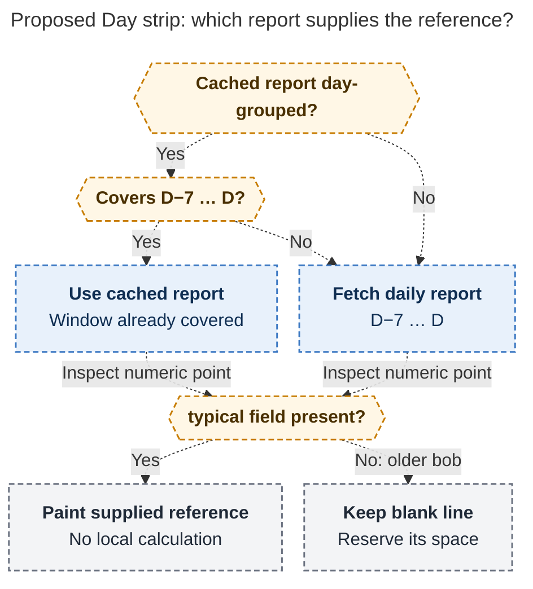

# Diagram proposals: Day strip vs the previous week: a quiet "typical" line under each number

Proposals for the swarm linker, not a report. Each diagram restates only what the source
report says.

```yaml
source: research:202610/day_strip_vs_previous_week/day_strip_vs_previous_week__final.md
producer: research.5d.image
check: "mmdc 12.0.0 with the PDF-mirroring config rendered 1 of 1 Mermaid diagrams; deliberately broken input exited nonzero"
```

## reference-report-routing

```yaml
anchor: |-
  reuse the cached default report only when
question: |-
  Which report can supply the proposed reference line, and what happens with older bob?
illustrates: |-
  The proposed Day strip reuses only a day-grouped report covering D−7…D, otherwise fetches daily points, and renders bob's supplied reference or keeps a blank reserved line when older bob omits the field.
caption: "For selected day D, reuse requires daily grouping and D−7…D coverage; either route paints bob's fields or reserves a blank line."
review: "527.344x960 px, fit 93.0%; question, source-trace and visual checks passed; 0 revisions; either report route supplies the four numeric facts; dashed paths mark proposed behavior"
```


