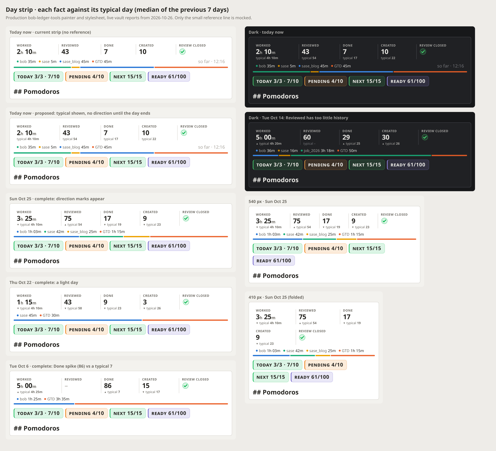
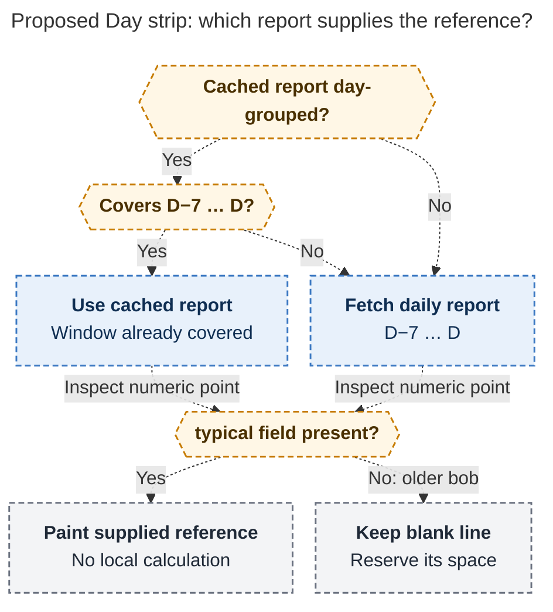

# Day strip vs the previous week: a quiet "typical" line under each number

> **Research query:** How should each numeric metric in the Day strip table visually
> show how it compares with the average of the previous 7 days for that metric, in a
> design that is intuitive, reliable, and beautiful? Is this plan a good idea, what
> would you do differently (calling out any adjusted requirements clearly), and what
> solution do you recommend?


## Bottom line

**Build it, but as context, not as a scorecard.** Under each of the four numeric
values (Worked, Reviewed, Done, Created), add one quiet line of text that shows the
**typical day** from the previous seven days:

```text
WORKED              REVIEWED          DONE              CREATED           REVIEW CLOSED
3h 25m              75                17                9                 ✓
▼ typical 4h 10m    ▲ typical 54      ▼ typical 19      ▼ typical 23
```

- **The big number stays the day's value.** The small number is the typical day:
  [the median of D−7…D−1](#median-typical-day-instead-of-mean).
- **Completed days get a small mark.** A
  [neutral ▲, ▼, or =](#direction-marks-at-display-precision) says whether the big
  number is above, below, or equal to the typical day.
- **Today gets no mark.** It shows `typical 4h 10m` with no direction, because
  [an unfinished day can't be judged against whole ones](#today-gets-the-reference-without-a-verdict).
- **No colour, percentages, bars, or new requests.** Bob computes the value and its
  words in a [new additive `typical` field](#data-contract). The plugin only paints them.
- **Measured cost:** **+14.2 px** of height (81.1 → 95.3 px on one row; 131.6 → 160.0 px
  folded at 410 px), with no overflow at 700, 540, or 410 px.



*Figure 1. The production `bob-ledger-tools` `main.js` and `styles.css` at `7d005fb`
render live reports from 2026-10-26. Only the reference line is mocked: its CSS is in
[§ Visual spec](#visual-spec), and its values were computed the way the proposed bob
field would compute them. Shown in the light theme: today at 12:16 with the current
strip above it for comparison, a complete Sunday, a light Thursday, and the Oct 6 Done
spike (86 against a typical 7). Shown in the dark theme: today, and Oct 14, when
Reviewed did not yet have enough history. Also shown: the 540 px and folded 410 px
widths. Correction to the mockup: the "typical –" state is drawn in `--text-faint`,
which fails text contrast (2.5:1). The spec below uses `--text-muted` (5.2:1).*

Every report I received said **yes, with conditions**. They differed on the statistic,
the mark, and how to treat today. Their disagreements are
[resolved below](#how-each-disagreement-was-resolved), using live data that I checked
myself.

## Is this a good idea?

### Why it earns its pixels

- **A bare number has no scale.** "Created 10" means little until you know a typical
  day is 22. Bob has no peers to compare against, and absolute goals were deliberately
  rejected (R9 in the original Stats research). So Bryan's own recent days are the only
  honest reference.
- **Bryan's rhythm moves, so the reference should move too.** Done went from about 3–7
  a day in September to 20–30 a day by mid-October. A trailing week adapts within days;
  a fixed goal or a long average would not.
- **The data is already in hand.** The strip reuses a cached report only when it covers
  D−7…D. Otherwise, past days fetch exactly `-g day -r <D-7>..<D>`. This was a leftover
  of the removed history marks (`docs/stats.md` § Day strip → Data;
  `dayStripDefaultReportCovers`). The feature therefore needs no new `bob` run.
- **A 7-day window is fair to this vault, because there is no weekday effect.** Mean
  Worked minutes by weekday from Jul 1 to Oct 25 were Mon 273, Tue 257, Wed 274, Thu 263,
  Fri 296, Sat 272, and Sun 272. Done ranges from 10 to 14 a day and Created from 15 to
  20, with no weekday pattern. Bryan works seven days a week, and a 7-day window holds
  one of each weekday anyway. A same-weekday baseline would add noise, not signal. (This
  refutes `__gem`'s assumption of Monday–Friday work with light weekends.)

### What the critique has to take seriously

**1. The comparison is mostly context; day to day, it is mostly noise.** I checked this
on completed days from Jul 1 to Oct 25 (117 days each for Worked, Done, and Created):

- **Worked:** inside the prior 7 days' min–max range 74% · within ±15% of the 7-day
  mean 31% · above/below flips from the previous day 41%
- **Done:** inside the prior 7 days' min–max range 74% · within ±15% of the 7-day mean
  26% · above/below flips from the previous day 52%
- **Created:** inside the prior 7 days' min–max range 72% · within ±15% of the 7-day
  mean 20% · above/below flips from the previous day 44%

If every day were drawn from the same distribution, an 8th day would fall outside the
range of the previous seven 25% of the time. The observed rate is 26–28%. So most days
are ordinary, and a ▲/▼ verdict changes about every other day. **The useful part of
this feature is the reference value ("a typical day is 4h 10m"), not the arrow.** The
design should therefore put the reference first and keep the mark small and neutral.
If Bryan later wants to know whether his rhythm is changing, that is a weekly-trend
question for the Stats page, not for a per-day receipt (see
[Follow-ups](#follow-ups-not-in-v1)).

**2. Today is unfinished, and it is the note Bryan opens most.** Using the closed
Pomodoro session ranges (85 complete days from Aug 1), the median share of a day's
Worked minutes already logged is:

- **Median share:** by 10:00 35% · by 12:00 53% · by 14:00 67% · by 16:00 83% · by
  18:00 100%

At noon the middle half of days falls between 42% and 63%. A full-day comparison is
therefore wrong for most of the working day. Even a pace-adjusted one would be noisy,
and only Worked and Reviewed have the time-of-day data to build one at all. Today has
to show context, not a verdict. Every report agreed on this; they disagreed only on how
to do it.

**3. It reverses a documented stance, and that has to be recorded.** Three earlier
artifacts say the opposite of this feature:

- `plan:202610/day_strip_under_the_badges.md` removed the eight-day history marks on
  2026-10-25 because "history invites comparison, which is the scoreboard risk the
  research warned about (R9)".
- `plan:202610/day_strip_stat_row.md` puts "no deltas, goals, sparklines, history marks,
  or per-metric colours" out of scope.
- Pending memory bead `bob-cli-bs` proposes the decision "the Day strip shows the day's
  facts, never targets (no deltas, percentages, goals, streaks, or status colours)". That
  bead is already stale for another reason: it describes the old mount "after a
  canonical daily note's last line".

Bryan's request overrides the earlier stance. Record that explicitly
([adjustment R8](#requirement-adjustments-called-out-explicitly)), or a future agent
will "fix" the feature back out.

**4. Measuring an activity can make it feel like work.** In Etkin's six experiments,
tracking raised output but lowered enjoyment (*JCR* 42(6), 2016). That does not prove
the same will happen here. It is a reason to keep the comparison quiet, uncoloured, and
free of goal language, and to set an exit criterion.

**Verdict:** a good idea, as long as it stays a quiet reference on every numeric fact
and gives no verdict on unfinished days. A literal red/green "vs average" delta would be
a bad idea on this surface.

## Where the five reports agreed and disagreed

**They agreed on these points:**

- Exclude D from its own window.
- Treat today differently.
- Use no saturated red/green.
- Treat Created as direction-neutral.
- Give the boolean Review closed no average.
- Add no new fetch.
- Raise the height budget rather than shrink the values.
- Re-evaluate after a few weeks.

Four of the five also said bob, not the plugin, must compute the numbers.

- **Statistic**
  - *cdx:* Mean
  - *cld:* Median ("typical day")
  - *grk:* Median
  - *mus:* Mean
  - *gem:* Mean, with the median in the tooltip
  - *Resolution:* **Median, labelled "typical"**
- **Visual form**
  - *cdx:* Text line `↑ 7d avg 4h 10m`
  - *cld:* 3 px bullet rail, numbers hidden
  - *grk:* 8-bar sparkline plus a median hairline
  - *mus:* Delta caption `▲ +45m vs 7d avg`
  - *gem:* Delta microline, tinted green/orange
  - *Resolution:* **Text reference line (cdx's form)**
- **Today**
  - *cdx:* Average shown, no arrow
  - *cld:* Dashed "progress" fill
  - *grk:* Hollow last bar
  - *mus:* Delta shown anyway
  - *gem:* Target shown, flipping to ▲ once exceeded
  - *Resolution:* **Reference shown, no mark**
- **History needed**
  - *cdx:* 7 of 7 good days
  - *cld:* ≥4 of 7
  - *grk:* ≥4 of 7
  - *mus:* ≥4 of 7
  - *gem:* ≥4 of 7
  - *Resolution:* **≥4 of 7**
- **"Near" band**
  - *cdx:* Display precision only
  - *cld:* None (continuous)
  - *grk:* 15%, with a floor
  - *mus:* ±0.5 count, ±5 m or ±5%
  - *gem:* ±10 m
  - *Resolution:* **Display precision only**
- **Colour**
  - *cdx:* Neutral
  - *cld:* Ink only
  - *grk:* Ink only
  - *mus:* Neutral
  - *gem:* Muted green/orange
  - *Resolution:* **Neutral**
- **Who computes**
  - *cdx:* bob
  - *cld:* bob
  - *grk:* bob
  - *mus:* bob
  - *gem:* Plugin first
  - *Resolution:* **bob**
- **Height**
  - *cdx:* +16–18 px (estimated)
  - *cld:* +11 px rail, +20 px text (measured)
  - *grk:* Based on the stale 56/80 px figures
  - *mus:* Based on the stale figures
  - *gem:* Not given
  - *Resolution:* **+14.2 px (measured)**

## How each disagreement was resolved

### Median typical day instead of mean

This is adjustment R1. The request says "average". I recommend the median, for three
reasons.

**It changes the answer on real days.** From Jul 1 to Oct 25, the direction against the
mean and the direction against the median disagree on:

- **19% of Done days**;
- 9% of Created days;
- 6% of Worked days.

The mean and median differ by more than 25% on 21% of Done days. (`__cld` measured 28%
with a different denominator.) The Oct 6 spike shows why:

- **Oct 7:** Done 25 · previous 7 days 86, 7, 21, 49, 1, 7, 6 · mean 25.3 · median 7 ·
  vs mean ▼ · vs median ▲
- **Oct 12:** Done 25 · previous 7 days 18, 37, 17, 31, 25, 86, 7 · mean 31.6 · median
  25 · vs mean ▼ · vs median =
- **Oct 13:** Done 27 · previous 7 days 25, 18, 37, 17, 31, 25, 86 · mean 34.1 · median
  25 · vs mean ▼ · vs median ▲

One 86-task day made a week of normal days read "below average". The same thing happened
yesterday on a smaller scale: on Oct 25, Done was 17 against a mean of exactly 17.0 but
a median of 19.

**It matches the rest of Bob.**

- Stats headlines are daily medians (`docs/stats.md`).
- The Stats chart's 7-day line is `rolling_median` (`239-plugin-stats-chart-models.js`).
- With the same ≥4 rule, the typical day for D is exactly `rolling_median(D−1)`.

So clicking a fact opens Stats with D pinned and the same number on the chart's line.
A mean on the strip would be a number that appears nowhere on the page it links to.
That is the "strip says X, page says Y" failure that bob-owned values exist to prevent.

**It reads better.** The median of integer counts is an integer, so the line reads
"typical 17", not "typical 16.4". "Typical" is the plain-English word for a median.

On the counterarguments:

- `__mus` argued that the median of bursty counts is often a dead 0 or 1. On the live
  vault the 7-day median was never 0 for any metric from Jul 1 onward.
- The mean is the right statistic for flow (Created vs Done rate). That question belongs
  on the Stats page.
- The median lags a genuine regime shift until four of the seven days are in the new
  regime (Oct 7 above: median 7, while Done was moving to about 25).

**If Bryan wants the literal mean**, it is a one-function swap in bob, and the label
becomes `7d avg`. Nothing else in the design changes.

### A text reference line

A text reference line, not a rail, sparkline, or delta:

- **Against delta captions (`__mus`, `__gem`).** `+45m vs 7d avg` hides the baseline, so
  the reader learns the difference but not what normal is. It also needs sign, zero,
  and band rules. Showing the reference value handles zero naturally (`typical 0`) and
  lets the eye compare the two numbers directly.
- **Against the bullet rail (`__cld`).** This was the strongest alternative. It is
  compact (+11 px against my measured +14.2 px), continuous, and well rendered. I still
  reject it for the strip, for four reasons:
  1. **It must be learned.** What does the centre tick mean?
  2. **Its numbers live only in a `title` tooltip,** which keyboard and touch users can't
     reach.
  3. **On today it is literally a progress bar toward a target.** `__cld` concedes that
     "the tick will act as a soft daily target". Progress-toward-a-goal displays are what
     drive goal-gradient effort, where people speed up as the goal nears (Kivetz,
     Urminsky & Zheng, *JMR* 2006). That is the scoreboard effect the earlier research
     warned about.
  4. **It stacks a second bar idiom directly above the root-parent bar,** which means
     something else entirely (composition, not comparison).

  The text line costs only about 3 px more.
- **Against the 8-bar sparkline (`__grk`).** It would bring back the eight-day history
  marks that were removed one day earlier, for clutter and for R9: 32 bars plus 8 dots
  in a 95 px strip. It answers "what happened this week?", which is the Stats page's
  job.
- **For the text line.** It needs no learning and shows exact values. It works at zero
  and at 86. It is typographic, like the rest of the strip, and adds no colour and no
  bar. It completes the classic three-tier tile: label, value, reference.

### Today gets the reference without a verdict

This is adjustment R3. Today shows `typical 4h 10m` with no mark until the day is
complete. The proposals I rejected:

- **`__gem`'s design** shows a target, then flips to ▲ once today passes it. That
  creates a goal-crossing moment and is asymmetric, since a ▲ can appear but a ▼ never
  does.
- **`__cld`'s dashed fill** is a progress bar toward a target (see
  [A text reference line](#a-text-reference-line)).
- **`__mus`'s design** shows a ▼ delta every morning and relies on the tooltip to
  explain it.

The tooltip on today says the day is still in progress, so the line is context, not a
pace.

The cost is real and should be said plainly: Bryan mostly looks at today's note, so in
everyday use the feature is "a typical number under each value". The marks appear on
past days: yesterday's note, weekly look-backs, and any `bob-day-stats` fence. That is
deliberate.

### History rule of at least 4 of the 7 days

This is adjustment R2. `__cdx` wanted all seven days present with `quality: ok`. On live
data the two rules give the same result for Worked, Done, and Created on every day since
Aug 1. The only Worked `partial` points are Jun 1 and Jun 4. They differ only where
tracking starts: since Reviewed began on Oct 12, the strict rule withholds 7 of its 14
days and the ≥4 rule withholds 4. The ≥4 rule is the engine's existing rolling-median
rule (`add_rolling_medians`: `window.div_ceil(2)`), so it keeps "typical = rolling
median of D−1" exactly true.

The window is the seven calendar days D−7…D−1:

- **Never include D.**
- **Count real zeros.**
- **Skip** `missing`, `not_tracked`, and provisional points.
- **Include `partial` points** the way `rolling_median` does. The tooltip says how many
  days were used.

`__cdx`'s concern stands as a v2 trigger: `partial` can mean either "estimated" or
"incomplete". If partial days become common, give them a machine-readable distinction
before trusting them.

### Direction marks at display precision

Direction marks use the sign at display precision, with no "near" band.

A ±15% band would still leave 69–80% of days marked ▲ or ▼, so it does not stop the
day-to-day flipping. All it adds is a hidden threshold to explain. Instead, compare the
two values at display precision, which is always an integer for minutes and counts:

- **▲** when the day is above the typical day;
- **▼** when it is below;
- **=** when the two are equal.

Both numbers are visible, so magnitude is never hidden, and the mark's neutral ink keeps
a flip harmless. No percentages appear anywhere on the strip.

### Neutral ink

Use neutral ink, with no green, red, or tint.

Hue already has two meanings in the strip: root-parent area hues, and status inks for
the Review closed mark. Created has no good direction. A 9-hour Worked day is
information, not praise. The Stats tile deltas are already `--text-normal`, not
coloured.

`__gem`'s green/orange tint is therefore rejected. Direction is carried by the glyph
plus words in the accessible label, never by colour alone (WCAG 2.2 SC 1.4.1).

### bob computes and the plugin paints

`docs/stats.md` says consumers never recalculate a display string, summary, percentage,
or delta. `__gem`'s plugin-side `dayStripCalculate7dComparison` would break that rule
and fork the formatting logic. With an older bob, the plugin shows a blank reserved line
instead of computing a fallback. Ship the bob field first: bob releases ride the daily
release train (`decisions:bob-cli-releases-ride-a-daily-train`), and until that release
lands, the plugin's lines stay blank.

## Recommended design

### States

Every state's reference line is drawn in `--text-muted`:

- **Complete day, above**
  - *Big value:* `5h 00m`
  - *Reference line:* `▲ typical 4h 20m`
- **Complete day, below**
  - *Big value:* `3h 25m`
  - *Reference line:* `▼ typical 4h 10m`
- **Complete day, equal**
  - *Big value:* `25`
  - *Reference line:* `= typical 25`
- **Today (provisional)**
  - *Big value:* `2h 10m`
  - *Reference line:* `typical 4h 10m` (no mark)
- **Fewer than 4 of the 7 days have data**
  - *Big value:* `60`
  - *Reference line:* `typical –`
- **D is `missing` or `not_tracked`**
  - *Big value:* `–`
  - *Reference line:* blank, with the line kept
- **Review closed (boolean)**
  - *Big value:* ✓ / ✕ / ◐ mark
  - *Reference line:* blank, with the line kept
- **Skeleton (first load)**
  - *Big value:* placeholder
  - *Reference line:* blank, with the line kept
- **Stale cached frame**
  - *Big value:* muted numerals
  - *Reference line:* muted with the numerals
- **Older bob (no `typical` field)**
  - *Big value:* value
  - *Reference line:* blank, with the line kept

Every fact always keeps the line's space, so the strip never changes height when data
arrives, and the skeleton matches the loaded height. Today's text starts flush with the
value's left edge. On complete days the mark comes first, so the line reads "below a
typical 4h 10m". A note doesn't turn from today into a past day while it is on screen
except at midnight, so the text shifting by one glyph never happens in front of the
reader.

### Visual spec

This CSS was validated in Figure 1, apart from the contrast correction noted there:

```css
.bob-day-strip-ref {                      /* third tier: label / value / reference */
  display: flex; align-items: baseline; gap: 0.28em;
  min-width: 0; height: 1.25em; margin-top: -0.05em;   /* reserved on every fact */
  color: var(--text-muted);                            /* 5.2:1 light, 6.4:1 dark */
  font-size: 0.72em; font-weight: 450; line-height: 1.25;
  font-variant-numeric: tabular-nums lining-nums;
  white-space: nowrap; overflow: hidden;
}
.bob-day-strip-ref-mark { flex: none; font-size: 0.8em; }  /* ▲ ▼ = in the same ink */
.bob-day-strip-ref-num  { font-weight: 600; }             /* the number carries the line */
@media (forced-colors: active) { .bob-day-strip-ref { color: CanvasText; } }
```

- **Hierarchy.** The small uppercase label, the 1.5em tabular value, and the 0.72em
  sentence-case reference make three tiers. The value always dominates.
- **Alignment.** The reference lines share one baseline across the row and sit under
  the existing hairline column separators.
- **Restraint.** The line uses no hue, no motion, and no bars. The root-parent bar stays
  the strip's only graphic.
- **Fit.** Measured with no overflow at 700 and 540 px (five columns) and at 410 px
  (folded). Before shipping, add the harness's `wideValues` case (`▲ typical 10h 05m` at
  540 px).
- **Contrast.** Use `--text-muted` for every state, including `typical –`. In the
  harness theme, `--text-faint` is 2.5:1 light and 3.5:1 dark, which fails the 4.5:1
  minimum for text (WCAG 2.2 SC 1.4.3). Check the real theme pairs too.

### Words: tooltip and screen reader

The reference line is `aria-hidden`. Its meaning travels in words that bob supplies:

- **The fact's `aria-label`** gets one clause appended to the existing "label value":
  - Complete day: `Worked 3h 25m, 45m below the typical day of 4h 10m`.
  - Today: `Worked 2h 10m so far; typical full day 4h 10m`.
- **The fact's tooltip** gets one line after the existing date line:
  - Complete day: `Typical day 4h 10m: median of Oct 18–24 (7 of 7 days). This day: 45m below.`
  - Today: `Typical full day 4h 10m: median of Oct 19–25. Today is still in progress, so this is context, not a pace.`
  - Short history: `No typical day yet: 2 of the previous 7 days have data (needs 4).`

Keep the fact as the single link to Stats, with D pinned. Add no nested button and no
extra tab stop, and don't announce refreshes in a live region.

`__cdx` correctly notes that a `title` tooltip can't be reached from the keyboard. The
whole strip already relies on `title`, and the `aria-label` carries the same words.
Treat a custom hover/focus disclosure (WCAG 2.2 SC 1.4.13) as a strip-wide follow-up,
not part of this feature.

### Data contract

*bob-cli, schema 1, additive.*

Day-grouped `points` for metrics measured in `minutes` or `count` gain an optional
`typical` object:

```json
{
  "date": "2026-10-25", "value": 205, "display": "3h 25m",
  "quality": "ok", "provisional": false,
  "typical": {
    "start": "2026-10-18", "end": "2026-10-24", "days": 7,
    "value": 250, "display": "4h 10m",
    "relation": "below",
    "words": "45m below the typical day of 4h 10m"
  }
}
```

- **`relation`** is `above`, `below`, or `equal`. It is `null` when D is provisional or
  has no value.
- **With fewer than 4 usable days,** `value`, `display`, and `relation` are `null`;
  `days` gives the count, and `words` says why.
- **Omitted entirely** for bool, ratio, and signed units, and for week and month
  buckets and their `daily_points`. `__cld` measured about +8% payload on the default
  report for day points alone (28 KiB on 367 KiB); the all-history report is already
  about 1.9 MiB.
- **Optionally,** add a report-level `typical_day` definition (`stat`, `days`,
  `min_days`, `definition`) for docs and tooltips.

**Engine seams:**

- `src/native/stats/report.rs`: add the `SeriesPoint.typical` field (with
  `skip_serializing_if`).
- `src/native/stats/series.rs`: in `make_points`, for `GroupName::Day` only, compute
  `typical` after `add_rolling_medians` and before `drop_before`.
  - Evaluation dates are contiguous, so the index windows equal calendar windows.
  - Extend `lead_in_start` for `Day` from 6 to 7 days, so the first displayed point has
    a full window. Rolling medians don't change, because they look back only 6 days.
  - The prior-window evaluation in `compute.rs` `evaluation_dates` usually covers the
    extra day already.
- **Don't reuse these existing fields:**
  - `rolling_median` includes D and is null for today.
  - `summary.mean` covers the wrong window and is rounded.
  - `summary.delta` compares a window with the prior window.
  - `make_delta`'s ±1% / `▲ 16%` grammar is for window headlines.
- **Release:** ships as `feat(stats)`, with no `!` and no version edits.

### Plugin

*bob-plugins, `bob-ledger-tools`.*

- **Model** (`239-plugin-day-strip-model.js`): `dayStripBuildFact` gains
  `ref: {state: "ready" | "short" | "blank", mark, display, words}` from
  `point.typical`. It adds the tooltip line and the aria clause, and computes nothing.
- **Painter** (`239-plugin-day-strip-render.js`): append
  `span.bob-day-strip-ref[aria-hidden]` after the value on every fact, including bool
  and skeleton facts. Its content is the mark, the fixed copy `typical`, and bob's
  display. `typical` is strip copy, like `so far`.
- **Hosts** (`239-plugin-day-strip-hosts.js`): reuse the cached default report only when
  `report.range.group === "day"`. A `stats.range` of 92 days or more makes the default
  report week-grouped, and its `daily_points` carry no `typical`.
- **Styles:** the CSS above, plus the stale-state and forced-colours rules.
- **Preview harness:** add `typical` to the fixtures; add `short`, `blank`, over-scale,
  and old-bob cases; and add checks for reference baselines aligned within 0.5 px, no
  overflow, and skeleton height equal to loaded height. Raise the budgets from
  ≤84 / ≤136 px to **≤98 / ≤162 px**.
- **Release:** build, test, validate, then `bob plugins sync`.

[The report-routing diagram](#figure-reference-report-routing) traces the proposed path:
reuse only a day-grouped cached report covering D−7…D, else fetch daily points, then
paint bob's reference or keep a blank line for older bob.

<div id="figure-reference-report-routing">



_For selected day D, reuse requires daily grouping and D−7…D coverage; either route paints bob's fields or reserves a blank line._

</div>

## Requirement adjustments called out explicitly

- **R1**
  - *You asked for:* "the average" of the previous 7 days
  - *I recommend:* **[The median, labelled "typical"](#median-typical-day-instead-of-mean)**
  - *Why:* It flips direction on 19% of Done days compared with the mean. It matches the
    Stats headlines and the chart's 7-day line. Counts stay integers. Swapping back is
    one function.
- **R2**
  - *You asked for:* "previous 7 days"
  - *I recommend:* **D−7…D−1. Exclude D, count zeros, skip missing and not-tracked days,
    and require [≥4 usable days](#history-rule-of-at-least-4-of-the-7-days)**
  - *Why:* Same as the engine's rolling-median rule. Gives the same result as a strict
    7/7 rule on live data, except where tracking starts.
- **R3**
  - *You asked for:* A comparison at all times
  - *I recommend:* **[Today shows the reference with no ▲/▼](#today-gets-the-reference-without-a-verdict)**
  - *Why:* 53% of a typical day's Worked minutes are logged by noon, so a full-day
    verdict is wrong most of the day.
- **R4**
  - *You asked for:* "some visual indication"
  - *I recommend:* **A [neutral text line](#a-text-reference-line) with a ▲/▼/= mark: no
    colour, percentages, bars, or sparklines**
  - *Why:* Intuitive with no learning. Leaves hue to areas and status. Avoids a
    progress-bar target and a second bar idiom.
- **R5**
  - *You asked for:* "each numeric metric"
  - *I recommend:* **Worked, Reviewed, Done, Created. Review closed keeps its mark and
    gets no average.**
  - *Why:* An average of a met/missed boolean is a streak by another name.
- **R6**
  - *You asked for:* (implicit)
  - *I recommend:* **[bob computes the value and its words; the plugin paints](#bob-computes-and-the-plugin-paints)**
  - *Why:* The "bob owns every value" contract. Testable in Rust goldens.
- **R7**
  - *You asked for:* (new)
  - *I recommend:* **Raise the height budget to ≤98 / ≤162 px.** Fix `docs/stats.md`,
    which still says 56/80 px while the harness enforces 84/136.
  - *Why:* Measured +14.2 px per row of facts. Don't shrink the values to pay for it.
- **R8**
  - *You asked for:* (new)
  - *I recommend:* **Record a decision:** "The Day strip compares each numeric fact with
    its typical day as neutral reference text; unfinished days get no direction."
    Re-scope bead `bob-cli-bs`.
  - *Why:* Three artifacts state the opposite stance. Make the change through
    `/sase_memory_write` when implementing.
- **R9**
  - *You asked for:* (new)
  - *I recommend:* **Exit criterion after about 3 weeks**
  - *Why:* Keeps the R9 reversal honest (see [below](#validation-and-exit-criteria)).

## Validation and exit criteria

**Engine tests** (next to `rolling_median_requires_half_window_and_excludes_provisional`):

- **Window:** D is excluded; real zeros count; missing and not-tracked days are skipped.
- **History:** 3 usable days gives `short`, and 4 gives `ready`.
- **Today:** a provisional D has `relation: null`.
- **Spike:** an 86-task day leaves the next week's typical value stable.
- **Lead-in:** the first displayed point has a full window.
- **Unchanged:** `rolling_median` output is the same as before.
- **Omissions:** no `typical` on bool, ratio, or week/month points.
- **Calendar:** the window is correct across midnight, DST, and month boundaries.

Update the golden JSON.

**Plugin tests:**

- [The state table](#states) above.
- `aria-label` ends with bob's words.
- The reference line is `aria-hidden` and is not a button.
- Lines are reserved on bool and skeleton facts.
- A stale frame mutes the line.

Extend the preview matrix to 410/540/700 px in light and dark, then look at the
screenshots before calling it done.

**Parity:** for Oct 6, 22, 25, and 26, the strip's typical value must equal `bob stats`
JSON and the Stats chart's median line at D−1.

**Exit, after about three weeks.** Ask Bryan two questions:

1. Did the line change a decision or usefully reassure you?
2. Did you catch yourself working to beat the typical number?

If he never looks at it, remove it. If he chased it, switch to **recap mode**, with lines
on completed days only; that is one condition in the model. If the marks distract, drop
them and keep the reference. Removal is plugin-only, with no engine revert.

## Open questions for Bryan

The default I would take is in bold.

1. Median ("typical") or the literal mean ("7d avg")? **Median.**
2. The visible word: `typical` or `7d`? **`typical`.** It fit every width tested.
3. Reference line on today's note, or recap mode from day one? **On today**, with no
   mark.
4. Should the Stats page's pinned-day view repeat the same line? **Later**, once the
   strip has proven useful.

## Follow-ups not in v1

- **Weekly trend tiles on Stats:** this week against the previous 4–12 weeks. This is
  how Apple Fitness trends and Garmin HRV status avoid daily noise. It answers "is my
  rhythm changing?", which this feature does not. (Raised by `__cld`.)
- **A pace mark for Worked only,** if it is ever wanted. Only Worked and Reviewed carry
  time-of-day data, and the spread at noon (42–63%) limits how precise it could be.
- **A strip-wide hover/focus disclosure** to replace `title` tooltips.
- **A "vs typical" column in the Stats table**, quoting bob's words.

## Recommended solution

**Ship a quiet "typical" reference line under the Day strip's four numeric facts.**

- **The value:** the median of the seven calendar days before D, needing at least 4 days
  with data.
- **Complete days:** a neutral ▲/▼/= mark, so `▼ typical 4h 10m`.
- **Today:** the same line with no mark, so `typical 4h 10m`.
- **Short history:** `typical –`.
- **Review closed:** stays a status mark.
- **Who computes:** bob computes the value, the relation, and the words in an additive
  `typical` object on day-grouped points. The plugin paints them with no colour,
  percentages, or bars.
- **Data:** the strip reuses the D−7…D data it already fetches.
- **Cost:** 14 px of height per row of facts.
- **Order:**
  1. bob field (`feat(stats)`).
  2. Plugin line. It shows blank reserved lines until the new bob release lands.
  3. Docs and budgets, including the stale 56/80 px figures.
  4. The decision record and re-scoping bead `bob-cli-bs`.
  5. A three-week check against the [exit criterion](#validation-and-exit-criteria),
     with recap mode as the fallback.

This answers the request (how does each number compare with last week?) in the form
that is easiest to read, hardest to misread, and quietest on the note Bryan opens most.

## How this report was made

*Consolidated report by the lead researcher, 2026-10-26. It merges five independent
reports in this directory (`__cdx`, `__cld`, `__grk`, `__mus`, `__gem`). I re-checked
their disputed claims against bob-cli `38a02d7b`, bob-plugins `7d005fb`, and the live
vault (`bob 0.3.1` on athena), and I rendered the recommended design with the
production painter and stylesheet. Nothing in any repo or in the vault was changed.*

> **Research request:** Show a visual indication of how each numeric metric in the
> Day strip table compares with the average of the previous 7 days for that metric.
> Lead the design so it is intuitive, reliable, and beautiful. Critique the plan,
> adjust the requirements where that is justified (calling each change out), and end
> with a recommended solution.

## Sources and provenance

**Swarm reports (this directory):**

- `day_strip_vs_previous_week__cdx.md`: text reference line, the strict-history
  argument, the stale-budget discovery, and a contract sketch. Media are in `media/`.
- `day_strip_vs_previous_week__cld.md`: live-data noise and partial-day shares, the
  bullet rail, and a production-rendered mockup
  (`day_strip_typical_day_comparison_mockup__cld.png`).
- `day_strip_vs_previous_week__grk.md`: sparkline plus median hairline, and the
  personal-informatics framing (`figure-*.png`).
- `day_strip_vs_previous_week__mus.md`: delta caption and suppression rules.
- `day_strip_vs_previous_week__gem.md`: dual-mode microline. Its weekday-seasonality
  assumption, plugin-side computation, and 56/80 px budget are corrected above.

**My verification (2026-10-26, read-only):**

- **bob-cli `38a02d7b`:**
  - `src/native/stats/series.rs`: `lead_in_start` (:283), `make_points` (:483),
    `add_rolling_medians` (:740), `make_delta` (:895), `mean`/`median` (:1327).
  - `src/native/stats/report.rs` `SeriesPoint` (:212); `src/native/stats/compute.rs`
    `evaluation_dates`.
  - `docs/stats.md` § Day strip, including the stale 56/80 px budget.
- **bob-plugins `7d005fb`:**
  - `239-plugin-day-strip-{model,render,hosts}.js`, `239-plugin-stats-chart-models.js`
    (it plots `rolling_median`), and `styles.css` (`.bob-stats-tile-delta` uses
    `--text-normal`).
  - `scripts/preview-day-strip.cjs`: budgets 84/136 px. The baseline run passed all
    114 cells.
- **`bob 0.3.1`, live vault:**
  - `bob stats show worked reviewed done created review_closed -f json -g day -r 2026-06-01..2026-10-26`,
    plus `stats show -a -f json`, and the ranges `2026-09-29..2026-10-06` and
    `2026-10-07..2026-10-14`.
  - These gave the range shares, flip rates, ±15% shares, mean–median disagreement,
    weekday means, partial-day shares (from `sessions`), and the eligibility comparison.
- **Figure 1:** the production `main.js` and `styles.css` loaded with the preview
  harness's module stubs and theme tokens, rendered in headless Chrome 156. Heights come
  from `getBoundingClientRect`.
- **Memory and plans:**
  - `glossary:day-strip`, `glossary:stats-dash`;
  - bead `bob-cli-bs`;
  - `plan:202610/day_strip_under_the_badges.md`, `plan:202610/day_strip_stat_row.md`.

**External:**

- S. Few, *Bullet Graph Design Specification*: a featured measure against a comparative
  marker.
- W. S. Cleveland & R. McGill, "Graphical Perception", *JASA* 79 (1984): position and
  length are read more accurately than colour.
- J. Etkin, "The Hidden Cost of Personal Quantification", *JCR* 42(6), 2016.
- R. Kivetz, O. Urminsky & Y. Zheng, "The Goal-Gradient Hypothesis Resurrected", *JMR*
  43(1), 2006.
- I. Li, A. Dey & J. Forlizzi, "A Stage-Based Model of Personal Informatics Systems",
  CHI 2010.
- W3C WCAG 2.2: SC 1.4.1 Use of Color, SC 1.4.3 Contrast (Minimum), SC 1.4.13 Content on
  Hover or Focus.
