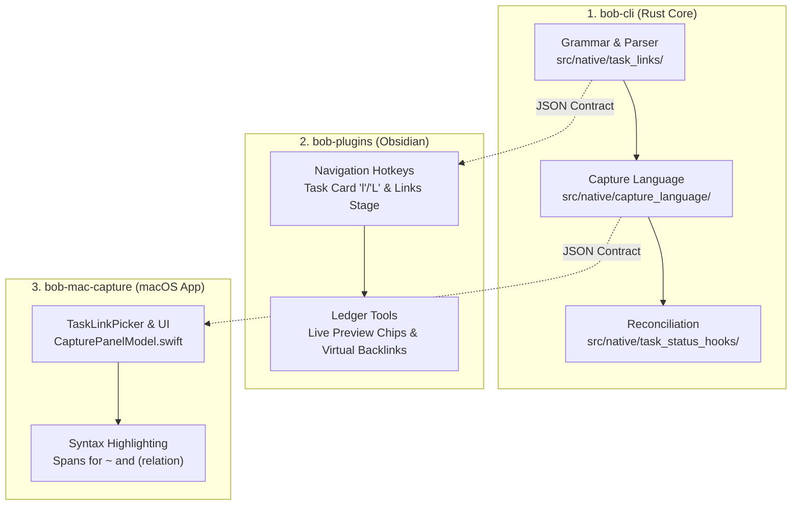

# Directed Task Links and Backlinks: Associative Relations, Virtual Projections, and Beautiful Chips

> **Research query:** How should we implement directed links from one Obsidian task to another, including a new `LINKS` sub-bullet, an automatically maintained `BACKLINKS` sub-bullet, fast capture in `bob-mac-capture` with `~` and `~~` syntax, an Obsidian keymap via `<Ctrl+Shift+P>`, and optional relation/link descriptions? Critique the proposal, evaluate whether it is a good idea, suggest justified adjustments, and recommend an intuitive, reliable, and beautiful end-to-end design.

---

## 1. Executive Summary & Bottom Line

**Build directed task links, but decisively reject physical `BACKLINKS` markdown lines and the `~~` capture syntax.**

The core user desire is compelling and addresses an active deficiency in the Bob task ecosystem: today, the only structured relationship between tasks is the finish-to-start dependency (`⛓️ **DEPENDS ON:**` and `🧱 **BLOCKS:**`). However, in real-world knowledge work and Getting Things Done (GTD), many tasks are meaningfully associated without having a hard sequencing dependency. Forcing related tasks into `DEPENDS ON` causes severe workflow breakage (it forces tasks into the `[?] Blocked` state, suppresses them from the Ready queue, consumes them from Pomodoros, and warps review walks). Conversely, burying task links in arbitrary body prose forfeits structured traversal, bidirectional visibility, and capture ergonomics.

However, two specific mechanisms in the user's initial sketch are architecturally dangerous and must be adjusted:

1. **Physical `BACKLINKS` Markdown lines are an anti-pattern for a distributed vault.** 
   Requiring task B to maintain a physical `- BACKLINKS: [[taskA]]` line whenever task A links to task B causes massive multi-file write amplification across the vault. A single task capture in `inbox.md` would immediately dirty unrelated files (e.g., in `projects/`, `areas/`, or even archived notes in `done/`), multiplying git commit noise, provoking sync collisions across devices (Syncthing/iCloud), and creating ongoing reconciliation baggage. Obsidian's own fundamental architectural insight is that **forward links are physical and authored; backlinks are virtual and computed**. Backlinks should be indexed dynamically in memory and rendered as live, interactive chips in Obsidian, rather than physically written to disk.
2. **The `~~` capture syntax is dead on arrival due to Markdown strikethrough.**
   In Markdown, `~~text~~` is the universal syntax for strikethrough text. In Bob's own codebase, `~~[[#^id]]~~` is explicitly recognized as a struck (completed/cancelled) task link. Introducing `~~` as a prefix sigil creates irreconcilable lexical collisions with CommonMark, editor highlighters, and Bob's existing markdown parsers. Furthermore, `~` is already used on Pomodoro session lines (`=~2`, `x~1`) for dropping queued links. While a single `~` can be safely used for task capture items when scoped to non-session lines, reverse links should use a clear, distinct directional mechanism (such as `~^` or an interactive direction toggle in the capture picker).

### Summary of Recommended Architecture

| Component | Proposal In Request | Recommended Architecture | Rationale |
| :--- | :--- | :--- | :--- |
| **Forward Links** | `LINKS` task sub-bullet | `- 🔗 **LINKS:** [[note#^id]] (relation) • …` | Matches established Bob managed child line grammar (`docs/task-dependencies.md`). |
| **Backlinks** | `BACKLINKS` task sub-bullet | **Virtual Chips / Dynamic Projection** | Zero write cascades, zero multi-file git churn, immune to sync conflicts, always 100% up-to-date. |
| **Relation Syntax** | Freeform link description | Curated directional ontology with freeform fallback: `[[target#^id]] (relation)` | Prevents tag fragmentation (`subtask` vs `child` vs `sub-task`) while preserving flexibility. |
| **Capture Syntax (Forward)** | `~note:block-id` | `~note:block-id(relation)` | Clear prefix modifier on task items; triggers vault-wide task picker. |
| **Capture Syntax (Reverse)** | `~~note:block-id` | Direction toggle in picker (`Tab` or `Cmd+R`), or explicit `~^note:block-id` | Eliminates fatal collision with Markdown strikethrough (`~~`). |
| **Obsidian Hotkey** | `<Ctrl+Shift+P>` | Task Card `l` (Links) and `⇧L` (Linked By); Direct hotkeys: `Ctrl+Shift+L` / `Ctrl+Shift+Alt+L` | Perfectly mirrors `b` (Depends on) and `⇧B` (Blocks) in `bob-navigation-hotkeys`. |
| **Visual Presentation** | Plain sub-bullet text | Status-colored pill chips with relation badges, hover removal (`×`), and inbound reference counts | Beautiful, readable, and consistent with `bob-ledger-tools` dependency chips. |

---

## 2. In-Depth Critique: Is This a Good Idea?

### 2.1 The Problem It Solves (The Good)

In personal task management systems, relationships between tasks generally fall into three distinct tiers:

```
┌────────────────────────────────────────────────────────────────────────┐
│                        TASK RELATIONSHIP TIERS                         │
├────────────────────────────────────────────────────────────────────────┤
│ 1. EXECUTION DEPENDENCIES (Hard Graph)                                 │
│    - "Task A cannot start until Task B is complete"                    │
│    - Semantics: Blocking [?], Lane Promotion, Pomodoro Consumption     │
│    - Syntax: ⛓️ **DEPENDS ON:** and 🧱 **BLOCKS:**                     │
├────────────────────────────────────────────────────────────────────────┤
│ 2. SEMANTIC ASSOCIATIONS (Soft Graph) — [MISSING TODAY]                │
│    - "Task A is related to Task B" (subtask, split-off, context)       │
│    - Semantics: Purely navigational & conceptual; NO status effects    │
│    - Syntax: Proposed 🔗 **LINKS:**                                    │
├────────────────────────────────────────────────────────────────────────┤
│ 3. PROSE CONTEXT (Unstructured)                                        │
│    - Narrative text, research notes, meeting minutes                   │
│    - Syntax: Freeform Markdown body text under a task                  │
└────────────────────────────────────────────────────────────────────────┘
```

Today, Bob only supports Tier 1 (Dependencies) and Tier 3 (Prose). When a user has two related tasks—for instance, "Refactor database migrations" and "Write developer documentation for new schema"—neither task blocks the other. If the user puts them into `⛓️ **DEPENDS ON:**`, the following catastrophic side-effects occur under Bob's core policies:
- The dependent task is marked `[?] Blocked` (`decisions:task-status-is-derived`).
- The task cannot enter the `Ready` backlog (`decisions:ready-is-freshness-gated`).
- If scheduled or planned, the task is immediately consumed and dropped from today's open Pomodoro (`decisions:capture-link-drops-blocking-deps`).
- The task is excluded from review walks until unblocked.

Because users intuitively recognize that related tasks shouldn't be blocked, they currently resort to dumping bare `[[wikilinks]]` in child bullet notes or task titles. This results in:
1. No bidirectional discovery (you cannot see what links to a task without searching).
2. Cluttered task titles.
3. No capture support (typing links into macOS capture requires manually looking up block IDs and formatting wikilinks by hand).

**Conclusion:** Providing a first-class, non-blocking directed link mechanism is a **first-rate idea** that fills a major structural hole in the Bob productivity stack.

---

### 2.2 Critical Flaws in the Initial Plan

While the motivation is sound, several specifics of the proposed implementation suffer from severe design and architectural flaws.

#### Flaw 1: The Write-Amplification Trap of Physical `BACKLINKS` Lines
The proposal suggests:
> *"Tasks should also track their backlinks (via a new `BACKLINKS` sub-bullet?), which must always stay consistent and correct (i.e. this field needs to be kept up-to-date automatically somehow)."*

To understand why this is dangerous, we must examine the history of `🧱 **BLOCKS:**` in Bob. In `docs/task-dependencies.md` §14, Bob introduced a physical `BLOCKS` line under tasks that have dependents. The engineering fallout was immense:
- **Synchronization Hell:** Writing an edge from Task A to Task B requires mutating Task B's file. If Task B is in `work.md` and Task A is being captured in `inbox.md`, `bob capture` must open, parse, lock, modify, and format `work.md`.
- **Git Churn:** Instead of 1 file modified per capture, 2 or more files are modified. In ephemeral SASE agent workspaces, multi-file dirtiness complicates final commit declarations and rebasing.
- **Merge Conflicts:** If device A (Mac desktop) captures a task linking to `prj.md`, while device B (mobile via Syncthing/iCloud) marks a task complete in `prj.md`, concurrent physical edits on the same file trigger sync conflict files (`prj.sync-conflict-...md`).
- **Archive Corruption:** If Task A links to an older, archived task in `done/2026-Q3.md`, does Bob write a `BACKLINKS` line into an immutable historical archive note? If it does, archive integrity is violated; if it doesn't, the backlink graph is incomplete.
- **Reconciliation Burden:** Maintaining exact consistency required building a massive Rust reconciliation engine (`src/native/task_status_hooks/reconcile.rs`) running R1–R10 rules across the whole vault on every CLI execution.

**The Fix:** Make `LINKS` physical (authored by the user), but make `BACKLINKS` **virtual**! Obsidian's internal metadata cache already indexes all block links. The Obsidian plugin (`bob-ledger-tools`) can render live inbound link chips directly in the DOM, computing them instantly on view without writing a single byte to disk. For CLI access, `bob task links --inbound <task>` can query the index instantly.

#### Flaw 2: The `~~` Lexical Collision with CommonMark Strikethrough
The proposal suggests:
> *"We also need a way to specify that another task should link to the current task... in the bob-mac-capture app (via a new `~~` syntax maybe?)."*

In Markdown and GFM (GitHub Flavored Markdown), `~~` is the reserved token for strikethrough:
```markdown
~~This is deleted text~~
```
In Bob's own codebase, `docs/task-dependencies.md` §2.2 explicitly handles struck links:
```markdown
- [ ] #task Parent
  - ⛓️ **DEPENDS ON:** ~~[[#^completed-task]]~~
```
If Bob Mac Capture uses `~~` as a prefix sigil (e.g., `~~auth:login`), the parser faces deep lexical ambiguity:
- Is `~~note:id` an unclosed strikethrough span?
- What happens if someone types `~~note:id~~`?
- How does the syntax highlighter distinguish between strikethrough and a reverse task link?

**The Fix:** Reject `~~`. Use a clean, non-colliding syntax. For capture, reverse linking should either be handled via an explicit modifier like `~^note:id` or, even better, through the capture picker UI where pressing `Tab` or `Cmd+R` flips the link direction before committing.

#### Flaw 3: Directionality vs. Symmetrical Relations
Directed links imply an arrow: $A \xrightarrow{rel} B$. But relations in natural language behave differently depending on their type:
- **Symmetric:** If Task A `relates to` Task B, then Task B automatically `relates to` Task A. Asking the user to specify direction for a symmetric relationship adds cognitive friction.
- **Asymmetric / Inverse:** If Task A is `parent of` Task B, then Task B is `subtask of` Task A. If the user only authors freeform descriptions without an inverse mapping, the backlink on Task B can only say `linked from Task A (parent of)`, which is linguistically awkward.

**The Fix:** Establish a concise relationship ontology with defined inverse pairs (e.g., `parent` $\leftrightarrow$ `subtask`, `split-from` $\leftrightarrow$ `split-to`), while supporting freeform string descriptions for ad-hoc cases.

#### Flaw 4: Cognitive Bloat & GTD Task Purity
A major risk in personal task management is "procrastination through topological modeling"—spending 20 minutes categorizing and linking tasks instead of doing them. The primary job of a GTD system is fast capture, clear priority, and focused execution. Task linking must remain strictly optional, secondary to task capture, and visually subordinate to the task checkbox and title.

---

## 3. Justified Requirement Adjustments

Based on the critique above, here are eight concrete requirement adjustments (**ADJ-1** through **ADJ-8**):

### [ADJ-1] Single-Source-of-Truth Managed Line: `🔗 **LINKS:**`
- **Adjustment:** Forward task links live on a single, managed direct child line under the `#task` bullet:
  ```markdown
  - [ ] #task Implement OAuth token refresh ^auth-refresh
    - 🔗 **LINKS:** [[auth-spec#^spec-draft]] (subtask) • [[backend-api#^api-gw]] (relates)
  ```
- **Rationale:** Conforms directly to Bob's managed child line contract (`docs/task-dependencies.md` §2.4). Follows the exact layout of `⛓️ **DEPENDS ON:**`, placing links neatly below the task without polluting the parent task line.

### [ADJ-2] Backlinks are Virtual Projections by Default (Zero Vault Churn)
- **Adjustment:** Do not create or write physical `BACKLINKS` lines to markdown files. Instead, backlinks are computed dynamically in Obsidian via `bob-ledger-tools` and displayed as live, interactive chips. In the CLI, backlinks are queried on demand via `bob task links`.
- **Rationale:** Prevents write amplification, eliminates multi-file git dirtiness during capture, avoids sync conflicts across devices, and prevents corrupting closed notes in `done/`.

### [ADJ-3] Reject `~~` and Adopt Unambiguous Capture Grammar
- **Adjustment:** Eliminate `~~`. For forward linking in capture, use `~note:block-id` (or `~note:block-id(relation)`). For reverse linking, provide a directional toggle (`Tab` or `Cmd+R`) in the macOS capture picker, or an explicit prefix `~^note:block-id`.
- **Rationale:** Avoids fatal collisions with CommonMark strikethrough (`~~text~~`) and legacy struck links (`~~[[link]]~~`).

### [ADJ-4] Structured Relation Syntax: `[[note#^id]] (relation)`
- **Adjustment:** Represent link relations using trailing parenthesized text immediately following the wikilink:
  `[[target-note#^block-id]] (relation-name)`. If no relation is specified, omit the parentheses: `[[target-note#^block-id]]`.
- **Rationale:** Keeps the wikilink clean and standard for Obsidian's native link indexer, while keeping the human-readable relation easily parseable by regex and AST scanners.

### [ADJ-5] Standardized Relationship Ontology with Inverse Mappings
- **Adjustment:** Support a core set of recognized relation pairs with automatic inverse rendering, while permitting arbitrary custom strings:
  - `parent` $\leftrightarrow$ `subtask`
  - `split-from` $\leftrightarrow$ `split-to`
  - `supersedes` $\leftrightarrow$ `superseded-by`
  - `causes` $\leftrightarrow$ `caused-by`
  - `relates` (symmetric)
  - `see-also` (symmetric)
- **Rationale:** Ensures that virtual backlinks display natural language (e.g., if A is `parent` of B, B's backlink pill displays `subtask of A`, not `parent A`).

### [ADJ-6] Strict Isolation from Task Execution & Scheduling Mechanics
- **Adjustment:** Directed task links must never cause a task to become `[?] Blocked`, must never trigger Pomodoro promotion, must never consume live Task Links, and must never alter lane placement (Ready, Next, In Progress).
- **Rationale:** Protects Bob's core scheduling invariants (`decisions:task-status-is-derived`, `decisions:task-lanes-are-sticky`). Hard dependencies belong exclusively on `⛓️ **DEPENDS ON:**`.

### [ADJ-7] Task Card Integration via `l` and `⇧L` (`<Ctrl+Shift+P>`)
- **Adjustment:** In Obsidian, integrate directed links into the existing Task Card modal:
  - `Ctrl+Shift+P` then `l`: Opens the "Links to" stage.
  - `Ctrl+Shift+P` then `⇧L`: Opens the "Linked by" (Reverse links) stage.
  - Dedicated direct keymaps: `Ctrl+Shift+L` (Links) and `Ctrl+Shift+Alt+L` (Linked by).
- **Rationale:** Directly mirrors the muscle memory of `b` (Depends on) / `⇧B` (Blocks) and `Ctrl+Shift+B` / `Ctrl+Shift+Alt+B`.

### [ADJ-8] Rich Visual Status Chips with Interactive Controls
- **Adjustment:** In Obsidian Live Preview and Reading View, `bob-ledger-tools` transforms the raw `🔗 **LINKS:**` markdown line into rich status-colored chips showing the target task's current status icon, title, relation badge, hover removal (`×`), and an add button (`+`).
- **Rationale:** Plain wikilinks with block IDs (`[[note#^8f1a2b]]`) are ugly and illegible in raw markdown. Status chips make the graph beautiful, informative, and interactive.

---

## 4. Architectural Specification & Design

### 4.1 Data Model & Grammar

#### The Managed `LINKS` Line
Like all machine-managed child lines in Bob, the `LINKS` line conforms to the closed registry in `docs/task-dependencies.md` §2.4:

```markdown
- [ ] #task Primary task summary ^task-alpha
  - 🔗 **LINKS:** [[auth#^spec]] (subtask) • [[billing#^stripe-api]] (relates) • [[devops#^infra]]
  - 🗓️ **SCHEDULE LOG**
  - 🛠️ **WORK LOG**
```

#### Managed Line Ordering Rules
In the child bullet hierarchy under an open `#task`, managed lines occupy deterministic slots:
1. `❌ **CANCEL LOG**` (if present)
2. `⛓️ **DEPENDS ON:**` (execution prerequisites)
3. `🧱 **BLOCKS:**` (execution dependents projection)
4. `🔗 **LINKS:**` (associative directed links — **NEW**)
5. `🧩 **Sub-projects:**` (on `^prj` lines)
6. `🗓️ **SCHEDULE LOG**`
7. `🛠️ **WORK LOG**`

#### Grammar Rules
- **Line Prefix:** Indent + `- 🔗 **LINKS:** `
  - Canonical emoji: `🔗` (`U+1F517`). Tolerated: `🖇️`, `📎`, `🧭`.
  - Canonical label: `**LINKS:**`. Tolerated: `**LINKED:**`, `**RELATED:**`.
- **Item Separator:** ` • ` (`U+2022` surrounded by single spaces).
- **Item Format:** `[[target_note#^target_block_id]]` optionally followed by a space and `(relation)`.
- **Target Link Form:** Shortest unambiguous form:
  1. `[[#^block-id]]` for targets in the same note.
  2. `[[basename#^block-id]]` for unique basenames in the vault.
  3. `[[dir/note#^block-id]]` for ambiguous basenames or notes in `done/`.
- **Empty State:** If all links are removed, the `🔗 **LINKS:**` line is deleted completely. No placeholder line is retained.

#### Parsing Algorithm (Rust & JavaScript)
```
Input: candidate child line
1. Verify line is a direct child of an open `#task` line.
2. Verify list marker and label prefix matches `/^\s*[-*]\s*(?:🔗|🖇️|📎|🧭)?\s*\*\*LINKS:\*\*/`.
3. Locate all wikilink spans `[[...#^...]]`.
4. For each wikilink:
   a. Extract target note and block ID.
   b. Check immediate right-hand lookahead for `\s*\(([^)]+)\)`.
   c. If found, record relation string; otherwise relation is None.
5. After removing wikilinks, relation parentheses, and `•` separators, ensure no orphan text remains.
   If unexpected prose remains, mark line as `Malformed`.
```

---

### 4.2 Why Backlinks Must Be Virtual Projections

Let us rigorously compare the two architectural choices for backlinks:

```
┌───────────────────────────────────────┬───────────────────────────────────────┐
│     OPTION A: PHYSICAL BACKLINKS      │     OPTION B: VIRTUAL PROJECTIONS     │
│   (Markdown lines written to disk)    │     (Computed dynamically in RAM)     │
├───────────────────────────────────────┼───────────────────────────────────────┤
│ ❌ High Write Amplification: Capturing │ 🟢 Zero Write Amplification: Only the │
│    1 task modifies N target files.    │    authored note is modified.         │
│ ❌ Sync Conflict Hazard: Multi-device  │ 🟢 Sync Conflict Free: No concurrent  │
│    writes on shared files collide.    │    edits on untouched notes.          │
│ ❌ Git Noise: Commits touch dozens of │ 🟢 Clean Commits: Atomic, isolated    │
│    unrelated area and project files.  │    diffs per task action.             │
│ ❌ Archive Pollution: Must either mut- │ 🟢 Pristine Archives: Immutable notes │
│    ate `done/` or leave graph broken. │    in `done/` are never touched.      │
│ ❌ Complex Healing Engine: Requires   │ 🟢 Always Consistent: Derived directly│
│    R1–R10 style whole-vault sweeps.   │    from the live link cache.          │
└───────────────────────────────────────┴───────────────────────────────────────┘
```

#### How Virtual Backlinks Work in Obsidian
1. **Metadata Index:** Obsidian maintains an internal vault link database (`app.metadataCache`). Every link to `#^block-id` is automatically indexed with its source file and character offset.
2. **Reverse Resolution:** When `bob-ledger-tools` renders a task in Live Preview or Reading View, it checks the index for all incoming block links pointing to this task's `^block-id`.
3. **Filtering:** It filters incoming links to those residing on `🔗 **LINKS:**` lines.
4. **Rendering:** Below the task title (or alongside existing chips), it renders an elegant inbound chip:
   ```
   [ ] Review PR for auth refactor ^auth-pr
       🔗 links  ( ? Spec draft [subtask] )
       ↖️ 2 backlinks  ( ? API Gateway [subtask of] )  ( ✓ Deploy script [relates] )
   ```
5. **Portability:** If the user ever wants a static snapshot of backlinks (e.g. for offline publishing or archiving), a CLI command `bob task links --project-backlinks` can export or project them on demand. But in daily authoring, keeping them virtual guarantees 100% consistency with zero disk churn.

---

### 4.3 Capture Grammar & macOS Capture App Design

#### The Capture Syntax
In `bob capture`, task modifiers are space-delimited tokens in the leading or trailing modifier runs (`docs/capture.md`).

For directed task links, we introduce the `~` prefix sigil on task items:
```bash
# Capture a task linking to an existing task (no relation)
bob capture 'Review migration script ~backend:db-migration'

# Capture a task with an explicit relation
bob capture 'Write unit tests ~backend:db-migration(subtask)'

# Capture a task with multiple links
bob capture 'Coordinate release ~frontend:deploy(relates) ~backend:api(relates)'
```

#### Disambiguation Rules
1. **Not a Session Operator:** Session drop syntax (`=~2`, `x~1`) only applies when the line starts with `=` or `x`. A line capturing a task or bullet is never a session command.
2. **Not a Strikethrough:** A standalone token `~note:block-id` has only one tilde. The parser rejects `~~` and prints an informative error:
   ```
   Error: '~~' is reserved for strikethrough. To link an existing task to this new task,
   use '~^note:block-id' or toggle direction in the capture picker.
   ```
3. **Quoted Notes:** Notes with spaces are quoted: `~"Shopping List":groceries-123(subtask)`.

#### Reverse Linking in Capture (`~^note:block-id`)
When the user captures a new task and wants an *existing* task to link to the *new* task:
- In the CLI, use `~^note:block-id` (the `^` signifies pointing back to this owner):
  ```bash
  bob capture 'Master Architecture Doc ~^backend:api(parent)'
  ```
- This instructs `bob capture` to generate a block ID for the new task, and append a link pointing to the new task onto `backend:api`'s `🔗 **LINKS:**` line.

#### macOS Capture UI Flow (`bob-mac-capture`)

Bob Mac Capture operates as a thin client over `bob capture-parse` and `bob capture-complete` (`decisions:mac-capture-is-a-thin-client`).

```
┌─────────────────────────────────────────────────────────────────────────┐
│ BOB MAC CAPTURE                                                  [Esc]  │
├─────────────────────────────────────────────────────────────────────────┤
│ Write integration tests for payment flow ~pay                           │
│                                          ▲                              │
│                                   (cursor here)                         │
├─────────────────────────────────────────────────────────────────────────┤
│ 🔗 LINK TASK (fuzzy searching vault...)                  [Tab] Direction │
│                                                                         │
│  ▸  billing.md      Implement Stripe Webhook handler          ^stripe-wh│
│     checkout.md     Audit payment retry logic                 ^pay-retry│
│     accounts.md     Store customer billing profile            ^cust-prof│
├─────────────────────────────────────────────────────────────────────────┤
│ RELATION: [1] relates   [2] subtask   [3] parent   [4] custom...        │
├─────────────────────────────────────────────────────────────────────────┤
│ PREVIEW:                                                                │
│ - [ ] #task Write integration tests for payment flow                    │
│   - 🔗 **LINKS:** [[billing#^stripe-wh]] (subtask)                      │
└─────────────────────────────────────────────────────────────────────────┘
```

1. **Typing `~`:** The editor parser decodes a `task_link` need. The macOS app immediately mounts the `TaskLinkPicker` (parallel to `DependencyPicker` for `&` and `BlockedTaskPicker` for `*`).
2. **Fuzzy Search:** Queries `bob capture-complete --mode task-link --query pay`. Candidates display note name, task title, status icon, and block ID.
3. **Direction Toggle:** Pressing `Tab` or `Cmd+R` flips the direction banner between:
   - `🔗 Links to: (New task → Existing task)`
   - `↖️ Linked by: (Existing task → New task)`
4. **Relation Selection:** A quick-select footer allows pressing numbers `1`–`4` or typing a relation name. Default if omitted is `relates`.
5. **Insertion:** On Enter, inserts `~billing:stripe-wh(subtask)` into the draft.
6. **Live Preview:** The preview pane renders the planned task with its `🔗 **LINKS:**` child line formatted as a rich chip.

---

### 4.4 Obsidian Plugin Design (`bob-navigation-hotkeys`)

#### Task Card Integration (`Ctrl+Shift+P`)
The Task Card is the central command hub for task operations in Obsidian.

```
┌─────────────────────────────────────────────────────────────────────────┐
│ TASK CARD: Implement Stripe Webhook handler                             │
├─────────────────────────────────────────────────────────────────────────┤
│ [b]  Depends on (prerequisites)                                         │
│ [B]  Blocks (dependents)                                                │
│ [l]  Links to (outgoing task links)               <-- NEW               │
│ [L]  Linked by (incoming task links)              <-- NEW               │
│ [s]  Schedule                                                           │
│ [p]  Priority                                                           │
│ [m]  Move to note                                                       │
└─────────────────────────────────────────────────────────────────────────┘
```

- Pressing **`l`**: Opens the **Links Stage** for the active task.
- Pressing **`⇧L`** (Shift+L): Opens the **Linked By Stage** (reverse links).
- Direct Hotkeys:
  - `Ctrl+Shift+L` opens the Links Stage directly from any task line.
  - `Ctrl+Shift+Alt+L` opens the Linked By Stage directly.

#### The Links Stage UI
Reuses the battle-tested `bob-cnp` modal layout:

```
┌─────────────────────────────────────────────────────────────────────────┐
│ EDIT TASK LINKS: Implement Stripe Webhook handler                       │
├─────────────────────────────────────────────────────────────────────────┤
│ Filter tasks: auth                                                      │
├─────────────────────────────────────────────────────────────────────────┤
│ CURRENT LINKS                                                           │
│  (x) [[billing-spec#^spec]] (subtask)             [Enter to remove]     │
├─────────────────────────────────────────────────────────────────────────┤
│ VAULT TASKS                                                             │
│  [ ] Handle OAuth token expiry        auth.md#^oauth-exp                │
│  [?] Refactor User session store      auth.md#^session-store            │
├─────────────────────────────────────────────────────────────────────────┤
│ RELATION FOR NEW LINKS:                                                 │
│  (•) relates   ( ) subtask   ( ) parent   ( ) split-from   ( ) custom   │
├─────────────────────────────────────────────────────────────────────────┤
│ ↑↓ navigate · ⇥ mark · ↵ toggle · Alt+1..4 relation · Esc dismiss       │
└─────────────────────────────────────────────────────────────────────────┘
```

- Selecting a task in `VAULT TASKS` and pressing Enter attaches it with the active relation.
- Selecting a task in `CURRENT LINKS` and pressing Enter (or `Ctrl+D`) removes it.
- Pressing `Alt+1` through `Alt+4` instantly switches the relation type.

---

### 4.5 Visual Presentation: Chips in `bob-ledger-tools`

Raw markdown with wikilinks and block IDs is visually noisy. In Obsidian, `bob-ledger-tools` will render `🔗 **LINKS:**` and virtual backlinks using the custom chip framework:

```
[ ] Implement OAuth token refresh ^auth-refresh
    🔗 links  ( ✓ Spec approved [subtask] )  ( ? Gateway routing [relates] )   ＋
    ↖️ linked by  ( ? Mobile client auth [subtask of] )
```

#### Visual Styling Specs
- **Row Container (`.bob-task-links-row`):** Muted indent matching task child bullets, subtle vertical guide line.
- **Prefix Label:** Muted icon (`🔗`) with small-caps bold title (`LINKS`).
- **Pill Chips (`.bob-link-chip`):**
  - **Background:** Subtle translucent background tinted by target status (e.g., light green tint for done, subtle amber for blocked, neutral slate for open).
  - **Status Glyph:** Leading icon (`✓`, `?`, `*`, ` `) reflecting the target task's real-time status.
  - **Target Text:** Truncated task summary (not the raw filename or block ID).
  - **Relation Badge (`.bob-relation-badge`):** Tiny rounded pill inside the chip with muted uppercase font: `SUBTASK`, `RELATES`, `PARENT`.
  - **Hover `×`:** Shows on hover; clicking it commits an atomic edit removing that link from the line.
  - **Click Target:** Clicking the chip body navigates directly to the linked task across the vault.
- **Add Button (`.bob-link-add`):** Small `＋` button at the end of the row that immediately opens the `Ctrl+Shift+L` Links Stage.

---

### 4.6 Reconciliation & Invariant Guarantees

The Rust core (`bob task reconcile`) acts as the ultimate guarantor of vault consistency.

#### Reconciliation Invariants
1. **Target Existence:** If a link targets a block ID that was deleted, `reconcile` flags an `unresolved_task_link` warning.
2. **Heal on Move (R3 Pattern):** If a target task was moved to another note (e.g. via `Ctrl+Shift+M` or refactoring), `reconcile` automatically rewrites the wikilink to the new file path while preserving the relation tag.
3. **Orphan Cleanup:** If a `🔗 **LINKS:**` line has all its links removed, `reconcile` deletes the child line completely (preventing empty bullet pollution).
4. **Tolerance of Hand Edits:** If the user edits the line by hand in raw markdown (e.g. changing commas to `•`, omitting spaces, or using lowercase `links:`), `reconcile` canonicalizes the line back to writer form without dropping targets.
5. **Cycle Tolerance:** Unlike `DEPENDS ON` (where cycles cause deadlocks), `LINKS` lines can be cyclic ($A \rightarrow B \rightarrow A$) without error, because associative links carry no execution semantics.

---

## 5. End-to-End Walkthrough Scenarios

### Scenario A: Capturing a Task with a Subtask Link
1. Bryan is on his Mac and presses the global hotkey to bring up Bob Mac Capture.
2. He types: `Refactor SQLite connection pool ~storage`
3. As soon as `~` is typed, the task picker pops up, showing open tasks matching `storage`.
4. He selects `Optimize database query cache ^db-cache`.
5. He presses `2` to assign the `subtask` relation.
6. The draft updates to: `Refactor SQLite connection pool ~storage:db-cache(subtask)`.
7. He presses `Enter`.
8. `bob capture` inserts the new task into `projects/database.md` with the line:
   ```markdown
   - [ ] #task Refactor SQLite connection pool ^pool-refactor
     - 🔗 **LINKS:** [[storage#^db-cache]] (subtask)
   ```
9. When viewed in Obsidian, `storage.md` dynamically shows:
   `↖️ 1 backlink ( [ ] Refactor SQLite connection pool [parent of] )` without `storage.md` having been touched on disk.

### Scenario B: Linking Two Existing Tasks in Obsidian
1. Bryan is reviewing `devops.md` in Obsidian and lands on `- [ ] Set up Grafana alerts ^grafana`.
2. He presses `Ctrl+Shift+L`.
3. The Links Stage modal opens.
4. He types `loki` to find the logging task.
5. He hits `Tab` to select `relates`, then `Enter` on `- [ ] Configure Loki retention rules ^loki-retention`.
6. The modal closes, and `devops.md` immediately renders:
   ```markdown
   - [ ] #task Set up Grafana alerts ^grafana
     - 🔗 **LINKS:** [[#^loki-retention]] (relates)
   ```
   rendered in Live Preview as a sleek, clickable status chip.

---

## 6. Implementation Roadmap

Implementing this feature cleanly requires coordinating changes across the three repositories in Bob's ecosystem:



### Phase 1: `bob-cli` Core Grammar & AST
- Create `src/native/task_links/` (parallel to `src/native/task_dependencies/`):
  - `parse.rs`: Scans and parses `🔗 **LINKS:**` lines.
  - `format.rs`: Formats canonical links with `(relation)` and ` • `.
- Update `src/native/capture_language/`:
  - Add `~` token scanning for task items.
  - Add `SpanKind::TaskLinkSigil`, `TaskLinkNote`, `TaskLinkBlockId`, `TaskLinkRelation`.
  - Add `Need::TaskLink` to `capture-parse`.
- Implement `capture-complete --mode task-link`.
- Add test vectors to `docs/task-links.md`.

### Phase 2: `bob-cli` Execution & Reconcile
- Implement write logic in `bob capture` to append `🔗 **LINKS:**` child lines.
- Implement reverse link capture (`~^note:id`).
- Add `reconcile_links` pass in `bob task reconcile`:
  - Resolves links, heals moved targets, canonicalizes whitespace, removes empty lines.
  - Exposes `bob task links` CLI command for querying forward and inbound links.

### Phase 3: `bob-plugins` (Obsidian Integration)
- **`bob-navigation-hotkeys`**:
  - Add `l` (Links) and `⇧L` (Linked By) to Task Card.
  - Register `Ctrl+Shift+L` and `Ctrl+Shift+Alt+L` hotkeys.
  - Implement `planLinksStageView` and the Links picker modal.
- **`bob-ledger-tools`**:
  - Implement `LinksChipWidget` in Live Preview replacing `🔗 **LINKS:**`.
  - Implement virtual backlink chip resolver using `app.metadataCache`.
  - Style chips with status colors, relation badges, hover removal (`×`), and `＋` button.

### Phase 4: `bob-mac-capture` (macOS Frontend)
- Update Swift models to decode `task_link` mode from `bob capture-parse`.
- Implement `TaskLinkPicker` in `CapturePanelModel.swift`.
- Add `Tab`/`Cmd+R` direction toggle and relation selector keys (`1`–`4`).
- Add token syntax highlighting for `~`, target note, and relation tags.

---

## 7. Conclusion

Adding directed associative links to Bob completes the triad of task relationships: hard execution dependencies (`DEPENDS ON`), soft associative connections (`LINKS`), and freeform narrative context. 

By replacing physical `BACKLINKS` lines with **dynamic virtual chips**, and replacing the conflicting `~~` syntax with **clean picker-driven directionality**, the resulting system will be:
- **Intuitive:** Works seamlessly through `<Ctrl+Shift+P>` and fast macOS capture.
- **Reliable:** Zero write amplification, zero sync collisions, and rock-solid link reconciliation.
- **Beautiful:** Elegant, status-colored chips that turn dense markdown references into an interactive, visual productivity surface.
